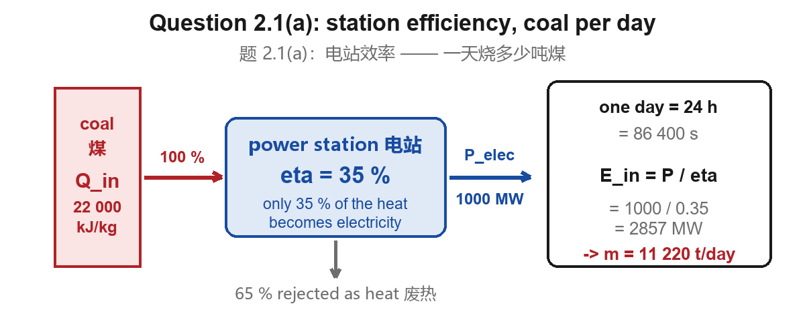
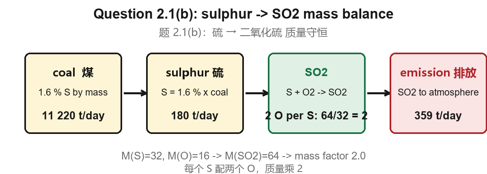

# Q2.1 Station efficiency: coal and SO₂ per day

> **Source**: ME1 Thermodynamics, *Exercise 2 — Introduction & Basic Concepts* (§2.6), Question 2.1 (★ core level)
> **Keywords**: **station efficiency**, **calorific value**, mass balance, combustion

## 1. The problem

> **\*1** In power plant terminology, "station efficiency" means the net electrical power output of a power station divided by the theoretical rate of input of energy in the fuel. This energy input rate is the product of the mass of fuel consumed in unit time and the calorific value, or heating value, of the fuel. Calorific value is the energy theoretically converted from one form, chemical energy, to another, internal energy, of the gaseous products, when unit mass of the fuel is completely burned.
>
> **(a)** A large coal-fired power station with a maximum electrical output of 1000 MW may have a station efficiency of 35%. If the coal has a calorific value of 22000 kJ/kg, how many tonnes of coal are consumed per day when such a plant is running continuously (i.e., for 24 h) at its maximum rating?
>
> **(b)** Typical U.K. coal has a sulphur content of 1.6% (by mass). Assuming that all of this is converted to sulphur dioxide (SO₂) during combustion, what mass of SO₂ will be emitted to the atmosphere per day by the power station in part (a)? (Approximate relative atomic masses S: 32, O: 16)

The definitions come first: **station efficiency** = net electrical power out ÷ rate of energy input in the fuel; the fuel energy input rate = mass of coal burned per unit time × **calorific value**. Part (a) works backwards: knowing the electrical output and the efficiency, find the input energy, then divide by the energy per kilogram of coal to get the tonnes burned in a day. Part (b) starts from the coal mass of (a), multiplies by the sulphur mass fraction to get the sulphur mass, then uses the stoichiometry (one S takes two O) to convert to a mass of SO₂.

## 2. Answers at a glance

| Part | Asked | Answer | Official key |
|---|---|---|---|
| (a) | coal burned per day | **11 221 t/day** | 11 200 t (3 s.f.) |
| (b) | SO₂ emitted per day | **359.1 t/day** | 359 t (3 s.f.) |

**How to report**: the official answer is quoted to **3 significant figures**, so write **11 200 t** and **359 t**. If the platform or your coursework wants more precision, 11 221 t (≈11 220 t) and 359.1 t are equally consistent — the only difference is rounding.

## 3. What you need to know

1. **station efficiency**: electrical power out ÷ fuel energy rate in. It is always a number below 1, because a large part of the fuel energy leaves as **rejected heat** through the condenser.
2. **calorific value:** the energy that 1 kg of fuel can theoretically release when it is burned completely, in kJ/kg. Coal is about 22 000 kJ/kg (≈22 MJ/kg); diesel is about 43 000 kJ/kg.
3. **energy rate = power**: 1 W = 1 J/s, so "kJ per hour" and "J per second" convert straight into kW / MW.
4. **mass balance**: combustion only rearranges atoms; no atomic mass disappears. The extra oxygen that appears in SO₂ comes from the air.
5. **mole → mass conversion**: from the relative atomic masses, S = 32 and O = 16, so SO₂ = 32 + 2×16 = 64.

## 4. Formulas

**Efficiency is the ratio of output to input power**

$$
\eta_{\text{station}} = \frac{P_{\text{elec,net}}}{\dot E_{\text{in,fuel}}}
$$

*How to read it*: $\eta_{\text{station}}$ reads "station efficiency" and is a dimensionless fraction; $P_{\text{elec,net}}$ is the net electrical power (W); $\dot E_{\text{in,fuel}}$ is the rate at which the fuel delivers energy (W). The dot over the letter ($\dot E$) means "rate".

**Fuel energy rate from mass flow and calorific value**

$$
\dot E_{\text{in,fuel}} = \dot m_{\text{fuel}}\, Q_{\text{CV}}
$$

*How to read it*: $\dot m_{\text{fuel}}$ reads "m-dot fuel", in kg/s; $Q_{\text{CV}}$ is the **calorific value**, in J/kg (the subscript CV stands for calorific value here, not control volume). Multiplying the two gives W.

**Rearranged to get the fuel mass flow**

$$
\dot m_{\text{fuel}} = \frac{P_{\text{elec,net}}}{\eta_{\text{station}}\, Q_{\text{CV}}}
$$

*How to read it*: the numerator is the electrical power you want, the denominator is the part of each kilogram of coal that actually becomes electricity ($\eta Q_{\text{CV}}$, in J/kg); dividing gives the kilograms to burn each second.

**Per day**

$$
m_{\text{day}} = \dot m_{\text{fuel}} \times 86\,400\ \text{s}
$$

*How to read it*: one day of 24 h is 86 400 s; the product is kg/day, and dividing by 1000 gives t/day.

**SO₂ mass from sulphur mass**

$$
m_{\text{SO}_2} = m_{\text{S}}\cdot\frac{M(\text{SO}_2)}{M(\text{S})}
= m_{\text{S}}\cdot\frac{32+2\times16}{32}
= 2\,m_{\text{S}}
$$

*How to read it*: $M(\text{SO}_2)$ is the molar mass of SO₂, 64 g/mol, and $M(\text{S})$ is 32 g/mol for sulphur. The ratio 64/32 = 2 means that **every 1 kg of sulphur ends up as 2 kg of SO₂**.

| Symbol | Meaning | Value in this question |
|---|---|---|
| $P_{\text{elec,net}}$ | net electrical output | 1000 MW = $1.0\times10^{9}$ W |
| $\eta_{\text{station}}$ | station efficiency | 0.35 |
| $Q_{\text{CV}}$ | calorific value of the coal | 22 000 kJ/kg = $2.2\times10^{7}$ J/kg |
| $\dot m_{\text{fuel}}$ | coal mass flow | to be found (kg/s) |
| S mass fraction | sulphur content | 0.016 |
| $M(\text{S})$, $M(\text{SO}_2)$ | molar masses | 32 and 64 g/mol |

## 5. Full worked solution

**Step 1 — pick consistent units**

Everything in watts and joules per kilogram first; convert to tonnes only at the very end.

$$
P_{\text{elec,net}} = 1000\ \text{MW} = 1.0\times10^{9}\ \text{W},\qquad
Q_{\text{CV}} = 22\,000\ \text{kJ/kg} = 2.2\times10^{7}\ \text{J/kg},\qquad
\eta = 0.35
$$

**Step 2 — fuel energy rate needed**

$$
\dot E_{\text{in,fuel}} = \frac{P_{\text{elec,net}}}{\eta}
= \frac{1.0\times10^{9}}{0.35}
= 2.857\times10^{9}\ \text{W}
$$

So each second the boiler must release about 2.86 **GW** of chemical energy — and only 1 GW comes out as electricity. The other 1.86 GW leaves as waste heat.

**Step 3 — coal mass flow**

$$
\dot m_{\text{fuel}} = \frac{2.857\times10^{9}\ \text{J/s}}{2.2\times10^{7}\ \text{J/kg}}
= 129.9\ \text{kg/s}
$$

**Step 4 — per day, in tonnes**

$$
m_{\text{day}} = 129.9\ \text{kg/s}\times86\,400\ \text{s}
= 1.122\times10^{7}\ \text{kg}
= 11\,221\ \text{t}
$$

$$
\boxed{m_{\text{coal}} \approx 11\,220\ \text{t/day} \;(=1.12\times10^{4}\ \text{t/day})}
$$

Check the sense: 11 220 t is about **390 lorry loads** of coal per day (28 t per lorry) — that is realistic for a 1 GW coal plant.

**Step 5 — sulphur**

$$
m_{\text{S}} = 0.016 \times m_{\text{coal}} = 0.016\times11\,221\ \text{t}
= 179.5\ \text{t/day}
$$

**Step 6 — sulphur to SO₂**

$$
n_{\text{S}} = \frac{m_{\text{S}}}{M(\text{S})},\qquad
m_{\text{SO}_2} = n_{\text{S}}\,M(\text{SO}_2)
= m_{\text{S}}\times\frac{64}{32} = 2\,m_{\text{S}}
$$

$$
m_{\text{SO}_2} = 2\times179.5\ \text{t}
= 359.1\ \text{t/day}
$$

$$
\boxed{m_{\text{SO}_2} \approx 359\ \text{t/day}}
$$

That is why Britain fitted **flue-gas desulphurisation (FGD)** to its coal stations: 359 t of SO₂ a day, untreated, turns straight into acid rain.

**30-second self-check**

- energy in = energy out ÷ η, never × η → 2.857 GW, not 0.35 GW.
- kg/s → t/day is **×86.4** (86 400 s ÷ 1000 kg/t). 129.9 × 86.4 = 11 220 ✓.
- SO₂ factor is 2 (64/32), never 3 or 48.

## 6. Common mistakes

- **Multiplying by efficiency instead of dividing.** You want the input, so divide by η.
- **Forgetting the 24 h.** The question asks **per day**; leaving the answer at 129.9 kg/s (or 467 t/h) loses the mark.
- **Using 1 t = 1000 kg inconsistently.** Keep kg until the last line.
- **SO₂ mass = sulphur mass × 2, not × 3.** Only two oxygens come from air; check with 32 + 32 = 64.
- **Rounding too early.** Carry 4–5 digits through the arithmetic; round only the final answer to 3 s.f.
- **SO₂ is not SO₃.** The key says SO₂, factor 2. (SO₃ would be 80/32 = 2.5 and is not what the question asks.)

## 7. Cross-references

- ME1 Thermodynamics lecture notes, **Sec. 3.1** (*Forms of energy*): chemical energy of fuel → internal energy of gases — the phrase the question quotes.
- ME1 Thermodynamics lecture notes, **Sec. 1** (*Introduction*): why thermodynamics is studied through power plants and why efficiencies are so low.
- Tutorial sheet source: `ME1Thermo_LectureNotes (2026-27).pdf`, §2.6 Exercise 2, pp. 10–13 (the answers are in the ANSWERS section of the sheet).

> **Note**: no full lecture-note Markdown for ME1 Thermodynamics exists in this folder yet; the PDF is the reference, and the links point at PDF section numbers.
