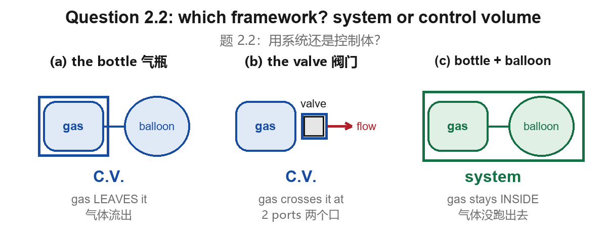

# Q2.2 Which framework: system or control volume?

> **Source**: ME1 Thermodynamics, *Exercise 2 — Introduction & Basic Concepts* (§2.6), Question 2.2 (★ core level)
> **Keywords**: **system**, **control volume (C.V.)**, **control surface**, **port**

## 1. The problem

> **\*2** If a balloon is inflated by connecting it to a bottle of compressed gas, what would be the most appropriate "framework", system or control volume, for thermodynamic calculations on
>
> **(a)** the bottle, **(b)** the bottle's valve, **(c)** the bottle plus the balloon?
>
> State the reason in each case.

A balloon is inflated and the gas in the bottle keeps flowing through the valve into the balloon. The question asks you to pick, for each of three objects, one "bookkeeping framework": a **system**, which follows a fixed lump of matter, or a **control volume**, which watches a fixed region of space.

## 2. Answers at a glance

| Part | Object | Framework | Reason |
|---|---|---|---|
| (a) | the bottle | **C.V.** | gas crosses its boundary at **one port** |
| (b) | the valve | **C.V.** | gas crosses at **two ports** (one in, one out) |
| (c) | bottle + balloon | **system** | **no gas crosses** the outer boundary |

**One-line memory**: **"Matter crosses the boundary → C.V.; matter does not cross the boundary → system."**

## 3. What you need to know

1. **system**: a **fixed, identifiable** lump of matter. Its boundary (system surface / boundary) separates the system from the surroundings; energy (heat, work) may cross it, **matter may not**.
2. **control volume**: a **fixed region** in space. Its boundary is called the **control surface (c.s.)**; both matter and energy **may** cross it.
3. **port**: a place on the control surface where matter goes in or out. Counting the ports is the most direct way to choose a framework.
4. **The boundary must be definable**: whether a framework works depends on whether you can still recognise its boundary at the end of the process. This point is used hard in question 2.6.
5. **Same physics, different bookkeeping**: the choice of framework does not change the answer, only how easy the equations are to write.

## 4. Decision procedure

$$
\text{Does matter cross the boundary during the process?}
\begin{cases}
\text{yes} & \Rightarrow \text{control volume (C.V.)}\\
\text{no} & \Rightarrow \text{closed system (system)}
\end{cases}
$$

*How to read it*: this is a yes/no question: **does any matter cross the boundary you chose** during the process? Yes → use a control volume; no → use a closed system.

**Step card**

| Step | Do this |
|---|---|
| 1 | Draw the object you were told to analyse |
| 2 | Draw the boundary around it |
| 3 | Mark every place gas can get in or out |
| 4 | Count ports: 0 → system; ≥1 → C.V. |
| 5 | Check the boundary is still there at the end |

| Symbol | Meaning |
|---|---|
| s.b. | system boundary |
| c.s. | control surface (the boundary of a control volume) |
| port | opening where mass crosses |

## 5. Full worked solution

**(a) The bottle**

A control volume.

The boundary is drawn just inside the bottle's wall. Gas leaves through the neck, which is **one port**. If you had tried a closed system here, you would have to follow a particular lump of gas — but this lump shrinks as gas escapes, and its free surface moves around inside the bottle, so you could never say where its boundary is at the end.

**(b) The valve**

A control volume.

Gas enters the valve from the bottle (inlet port) and leaves to the balloon (outlet port): **two ports**. The valve is a fixed piece of hardware, so the control volume is the natural choice — and this is exactly how a throttling valve is handled later in the course.

**(c) The bottle plus the balloon**

A closed **system**.

Take the boundary around the bottle *and* the balloon together. The gas never leaves this combined object — it only moves from the bottle into the balloon. **Zero ports** on the outer boundary, so it is a system. The boundary itself changes shape (the balloon inflates) but that is allowed for a system.

**A nuance worth knowing (beyond the official answer)**: in (c) you *could* also draw a control volume round the bottle and the balloon; it would still work, because no mass crosses the *outer* control surface either. The key's preferred answer is "system" because no material crosses the boundary, and the system version gives you the simplest statement of conservation of mass ($m_{\text{bottle}}+m_{\text{balloon}} = \text{constant}$).

**30-second self-check**

- (a) one port; (b) two ports; (c) zero ports.
- The word "port" is about **mass**, not heat or work.
- In (c), the boundary moves but nothing crosses it.

## 6. Common mistakes

- **Judging by "fixed region" only.** A heated rigid tank has a fixed region *and* no mass crossing — both frameworks work, but the simpler one is the system.
- **Forgetting that a system's boundary can deform.** A balloon inflating is still a system boundary; a deforming boundary is not the same as matter crossing it.
- **Calling the valve a system** just because it is small. Two ports = C.V.
- **Mixing up the object.** The question asks about (a) the bottle *alone* — if you draw the boundary round bottle + balloon you are answering (c).
- **Mentioning heat/work crossing as the reason.** Heat and work can cross a system boundary too; only **matter** decides.

## 7. Cross-references

- ME1 Thermodynamics lecture notes, **Sec. 2.2** (*Frameworks*) — system vs control volume, control surface and ports, pp. 4–5 of the notes.
- ME1 Thermodynamics lecture notes, **Sec. 5.1** — why a control volume is chosen round a gas-turbine compressor.
- Tutorial sheet source: `ME1Thermo_LectureNotes (2026-27).pdf`, §2.6 Exercise 2, pp. 10–13.

> **Note**: no full lecture-note Markdown for ME1 Thermodynamics exists in this folder yet; the PDF is the reference.
