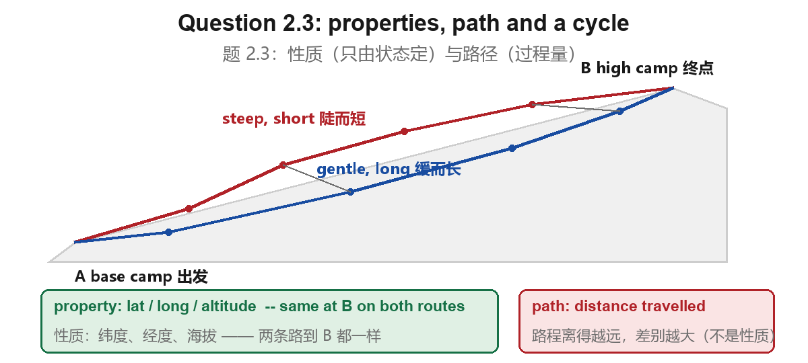

# Q2.3 Climbers: properties, path and a cycle

> **Source**: ME1 Thermodynamics, *Exercise 2 — Introduction & Basic Concepts* (§2.6), Question 2.3 (★ core level)
> **Keywords**: **property**, **process path**, **cycle**, **state**

## 1. The problem

> **\*3** Two mountaineers set out from base camp, A, to reach the same higher-altitude camp, B. (This is analogous to a substance undergoing processes.) One takes a short but steep route, the other a longer route with a more gradual slope. When either of them has reached B, their final state, which of the following can be regarded as properties defining that state?
>
> **(a)** the latitude and longitude
> **(b)** the altitude
> **(c)** the distance travelled (along the mountain surface) during the climb
>
> One climber now returns to A. What word could be used to describe the process of ascending to B then descending to A,
>
> **(d)** using the same route in each direction?
> **(e)** descending by the route which the other climber used to reach B?

Two climbers both go from camp A up to camp B, one by the steep short route and one by the gentle long route. Once at B the question is: latitude and longitude, altitude, distance walked — which of these count as **properties** describing that state? And what word describes the trip back to A?

## 2. Answers at a glance

| Part | Answer | Why |
|---|---|---|
| (a) | **Yes, properties** | fixed numbers at B |
| (b) | **Yes, a property** | altitude is fixed once you are at B on the surface |
| (c) | **No, not a property** | depends on the **route** |
| (d) | **Cycle** | starts and ends at A |
| (e) | **Cycle** | same answer, different route |

**One-line memory**: **"A property depends only on where you are; a process quantity depends on how you got there."**

## 3. What you need to know

1. **property**: a quantity fixed by the **state** alone. For the same state it has the same value however you arrived. In thermodynamics these are $P$, $v$, $T$, $u$, $h$, $s$.
2. **state**: the whole set of properties of a system at one instant. The lecture notes' **two-property rule** says that for a simple compressible substance any two independent properties fix the state, and everything else follows.
3. **process**: a change from one state to another. The string of intermediate states joining the two ends is the **path**.
4. **path function**: a quantity that depends on the path. In thermodynamics these are **heat $Q$** and **work $W$** — the core contrast of this whole sheet.
5. **cycle**: a sequence of processes whose start and end are the same state. Every property returns to its original value, but the **net heat and net work are generally not zero** — that is exactly why a cycle can deliver work to the outside.

## 4. Mapping the analogy

| Mountain | Thermodynamics |
|---|---|
| camp A, camp B | state 1, state 2 |
| latitude, longitude, altitude | $P$, $v$, $T$ (and $u$, $h$, $s$) — **properties** |
| distance walked, effort, sweat | heat $Q$, work $W$ — **not properties** |
| one route, other route | process **path** |
| A → B → A | **cycle** |

*How to read it*: the left column is the climbing story from the question, the right column is its thermodynamic counterpart. Altitude ≈ a property (internal energy $u$, say); the distance walked ≈ heat and work, which depend on how you go. **This is the analogy to remember for "property vs process quantity".**

**Definition to keep**

$$
\text{property: } \Delta X = X_2 - X_1 \text{ depends only on states 1 and 2}
$$

$$
\text{heat and work: } Q_{12},\ W_{12} \text{ depend on the path 1}\to\text{2}
$$

*How to read it*: the change $\Delta X$ of a property $X$ is fixed by the two end states alone, whereas the subscripts $12$ on $Q_{12}$ and $W_{12}$ mean "along this particular route from 1 to 2" — take another route and the number changes.

## 5. Full worked solution

**(a) Latitude and longitude** — **a property**.

At camp B there is exactly **one** latitude and **one** longitude, whichever route you took. Two independent numbers fix your position — exactly analogous to the two-property rule that fixes the state of a simple compressible substance.

**(b) The altitude** — **a property**.

Assuming you stay on the mountain surface, altitude is fixed once latitude and longitude are fixed. It is a third number that gives no new freedom — very much like $u$ (or $h$) being fixed by $P$ and $T$.

**(c) The distance travelled** — **not a property**.

The short steep route and the long gentle route arrive at exactly the same B, yet cover completely different distances. A quantity that depends on **how you got there** cannot define the state. This is the analogue of heat transfer and work transfer: both are path-dependent, so neither is a property.

**(d) The same route up and down** — a **cycle**.

You start at A and finish at A, so every property (lat, long, altitude) is back to its original value. The net change of any property over the cycle is zero: $\oint dX = 0$. But the distance walked is not zero — which is fine, because distance is not a property.

**(e) Up one route, down the other** — still a **cycle**.

The route is different, but a cycle is defined only by **the start and end states being identical**, not by the path. So (e) is a cycle too.

**30-second self-check**

- Could you be at B at two different altitudes? No → (b) is a property.
- Could two different routes give the same distance? Yes, sometimes — but not *always*, and "always the same for the same state" is what a property needs.
- Both (d) and (e) return to A → both are cycles.

## 6. Common mistakes

- **Thinking (e) is not a cycle because the routes differ.** A cycle looks only at the start and end states, never at the path.
- **Saying altitude is not a property because it "depends on where you are".** The opposite is true: being fixed by where you are is exactly what makes something a property.
- **Confusing "same value by coincidence" with "property".** Two different routes could happen to give equal distance, but a property must be the **same for every** route between the states.
- **Forgetting the two-property rule.** It is the bridge between the mountain analogy and real thermodynamics; quote it in the exam answer.
- **Adding that properties "must be conserved"**. They need not be; a cycle returns them to the start, so the **net change** is zero but each property has its own rule.

## 7. Cross-references

- ME1 Thermodynamics lecture notes, **Sec. 2.3** (*Properties and states*) and **Sec. 2.5** (*Processes and cycles*) — two-property rule, state, path and cycle.
- ME1 Thermodynamics lecture notes, **Sec. 3.4** (*First Law*) — the same "property vs path" idea applied to $Q$, $W$ and $U$.
- Tutorial sheet source: `ME1Thermo_LectureNotes (2026-27).pdf`, §2.6 Exercise 2, pp. 10–13.

> **Note**: no full lecture-note Markdown for ME1 Thermodynamics exists in this folder yet; the PDF is the reference.
