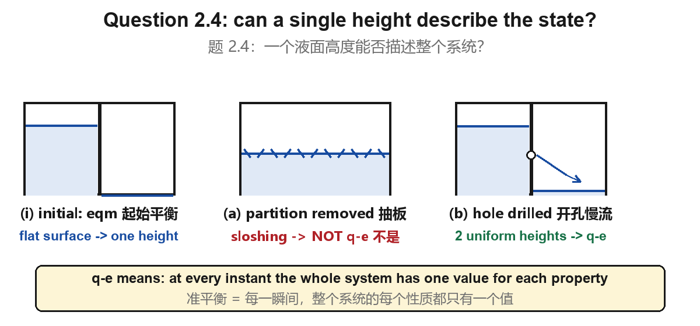

# Q2.4 Partition removed vs small hole: equilibrium and q-e

> **Source**: ME1 Thermodynamics, *Exercise 2 — Introduction & Basic Concepts* (§2.6), Question 2.4 (★ core level)
> **Keywords**: **equilibrium**, **quasi-equilibrium process (q-e)**, **intermediate state**, **uniform**

## 1. The problem

> **\*4** A tank, with a leak-proof partition dividing it into two sections, has one section initially filled with a liquid (the system), as shown on the left.
>
> **(a)** The partition is suddenly removed (so that a process takes place). After some time, the liquid settles down to a new level, as shown on the right.
> i. Is the system in equilibrium in its initial state and in its final state?
> ii. On the centre diagram, sketch (very roughly) the liquid surface in some intermediate state.
> iii. Can this process be described as a quasi-equilibrium process? (Give the reason.)
>
> **(b)** From the same initial state, a different process occurs if, instead of removing the partition, it is left in place and a small hole is drilled in it so that liquid can flow slowly through to the other section. Sketch the liquid surface at an intermediate state in this new process, and state, with a reason, whether this is a quasi-equilibrium process.

A two-compartment tank has liquid in one compartment. In case (a) the **partition is suddenly pulled out**, the liquid sloshes about and finally finds a new level; in case (b) the partition stays and a **small hole** is drilled, so the liquid creeps through. The questions: are the first and last states equilibrium states? What does the surface look like in an intermediate state? Can the process be called **quasi-equilibrium (q-e)**? And for (b), sketch the intermediate surface and decide whether it is q-e.

## 2. Answers at a glance

| Part | Answer | Key reason |
|---|---|---|
| (a) i | **Yes — both states are equilibrium** | nothing changes with time |
| (a) ii | **No flat single surface** | the surface varies across the tank |
| (a) iii | **Not q-e** | properties are not uniform during the process |
| (b) | **Yes, q-e** | two nearly uniform heights, changing slowly |

**One-line memory**: **"Fast → the intermediate states are a mess, not q-e; slow → the intermediate states are uniform everywhere, so q-e."**

## 3. What you need to know

1. **equilibrium**: a state in which **no property changes with time**. If the system is also isolated, the state is one of **internal equilibrium**.
2. **quasi-equilibrium process (q-e)**: a process that runs **slowly enough** that every **intermediate state** is approximately an equilibrium state — that is, **at any instant the whole system has one pressure and one temperature**.
3. **intermediate state**: a state between the start and the end of a process. Only the two ends of a real process are equilibrium states; the states in between generally **are not**.
4. **uniformity test**: the most practical way to judge q-e — "does this property have the same value everywhere in the system right now?" Yes → treat it as q-e; no → it is not.
5. **Why it matters**: only a q-e process allows $W=\int P\,dV$ and a path drawn on a $P$–$V$ diagram. See §3.3.1 of the notes.

## 4. The q-e test

$$
\text{q-e} \;\Longleftrightarrow\; \text{every intermediate state is (almost) uniform}
$$

*How to read it*: the symbol $\Longleftrightarrow$ reads "if and only if". In one sentence: **quasi-equilibrium ⇔ every intermediate state is (almost) uniform everywhere**.

**Step card**

| Step | Ask yourself |
|---|---|
| 1 | Is the **start** state uniform and still? |
| 2 | Is the **end** state uniform and still? |
| 3 | What does the **middle** look like? |
| 4 | Could **one number** describe the whole system mid-way? |
| 5 | Could I **stop** it and would it stay put? |

If steps 2–5 are all yes, it is q-e.

| Symbol | Meaning |
|---|---|
| q-e | quasi-equilibrium |
| $\Xi$ (in the lecturer's notes) | equilibrium (the same symbol is used to mean "equilibrium") |
| state 1 / state 2 | initial / final state |

## 5. Full worked solution

**(a) i — Are the initial and final states equilibrium states?**

**Yes, both.**

In the initial state the liquid is still, with a flat surface; in the final state the liquid has settled to a new flat level and has stopped moving. In both, no property (level, pressure, temperature) changes with time, and **one number — the surface height — describes the whole system**. That is exactly what an equilibrium state means.

**(a) ii — Sketch the intermediate state**

Right after the partition is pulled out, the liquid on the full side is much higher than on the empty side. It rushes sideways, piles up against the far wall, and then **sloshes back and forth**. In any intermediate state the surface is **not flat**: it is sloped or wavy, higher on one side than the other.

**(a) iii — Is it q-e?**

**No — not a quasi-equilibrium process.**

The test fails on two counts. First, the surface height varies with position across the tank, so **no single value can be assigned to the system as a whole**. Second, if you stopped the process at mid-way (e.g. by sliding the partition back in), the two heights would **keep oscillating for some time** before settling — an equilibrium state would have stopped immediately. In the notes' language, this is like an **unresisted expansion** for a gas: the liquid falls freely into the empty space.

**(b) Small hole drilled**

**Yes — this can be a quasi-equilibrium process.**

With only a small hole, the liquid flows across **very slowly**. At any instant the liquid on each side of the partition is essentially **flat**, so the state is described by just **two numbers: the heights on the two sides**. If you plugged the hole, the two levels would stop changing **almost immediately** — the intermediate states are almost equilibrium states. That is the definition of q-e.

**A subtlety**: during the (a) process the liquid is still "the system" throughout — the tank walls never let liquid in or out — so the awkwardness is not about the boundary, it is purely about **internal uniformity**. That distinction is what Q2.5 and Q2.6 split into "can we define the boundary?" vs "is it uniform inside?".

**30-second self-check**

- Start state: still, one height → equilibrium ✓
- End state: still, one height → equilibrium ✓
- Middle of (a): many heights → not q-e
- Middle of (b): two heights, each side uniform → q-e

## 6. Common mistakes

- **Saying the initial/final states are not equilibrium just because a "process" happens.** The states before and after can be perfectly good equilibrium states; only the ones in between are not.
- **Saying the whole (a) process has one liquid height.** The intermediate surface is not flat, and one number cannot describe the whole system.
- **Thinking slow = q-e by itself.** Slowness is necessary, not sufficient: the inside must also be uniform everywhere, and a slowly sloshing tank of water is not uniform.
- **Confusing "equilibrium" with "steady"**. In an equilibrium state every property stops changing with time; in a steady state only some quantities stop changing (heat transfer with a fixed temperature difference, say) — the two are not quite the same.
- **Forgetting the "stop it and see" test.** "Plug the hole and it stops" is the key argument in the notes for (b), and you should mention it in your answer.

## 7. Cross-references

- ME1 Thermodynamics lecture notes, **Sec. 2.4** (*Equilibrium*) — internal and external equilibrium.
- ME1 Thermodynamics lecture notes, **Sec. 2.5.2** (*Quasi-equilibrium process*) — the "fully resisted / slow" definition used here.
- ME1 Thermodynamics lecture notes, **Sec. 3.3.1** — why $W=\int P\,dV$ needs a q-e process.
- Tutorial sheet source: `ME1Thermo_LectureNotes (2026-27).pdf`, §2.6 Exercise 2, pp. 10–13.

> **Note**: no full lecture-note Markdown for ME1 Thermodynamics exists in this folder yet; the PDF is the reference.
