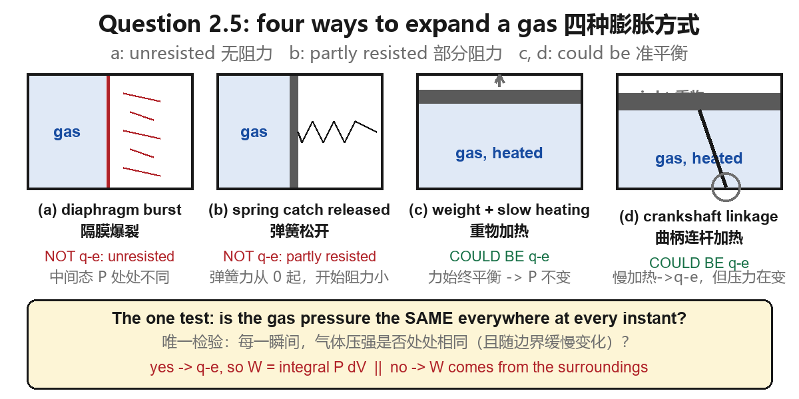

# Q2.5 Four expansions: which are quasi-equilibrium?

> **Source**: ME1 Thermodynamics, *Exercise 2 — Introduction & Basic Concepts* (§2.6), Question 2.5 (★ core level)
> **Keywords**: **quasi-equilibrium**, **unresisted expansion**, **fully resisted**, **partly resisted**

## 1. The problem

> **\*5** The four sketches below represent different ways in which a gas (the system, shown shaded) in a cylinder can undergo an expansion process from an initial equilibrium state.
>
> In **a**, a diaphragm, which initially separated the gas from an evacuated section of the cylinder, has burst, allowing the gas to expand rapidly to fill the entire cylinder.
> In **b**, the gas is separated from the evacuated section by a lightweight piston attached to the end of the cylinder by a compression spring; initially the spring was not compressed, and the piston was held in place by a catch; the expansion was caused by releasing the catch.
> In **c**, a heavy weight was placed on the piston, whose upper surface is open to the atmosphere; initially the upward force on the piston due to the gas pressure just balanced the downward force due to atmospheric pressure plus the weight, and the expansion was caused by heating the gas.
> In **d**, a connecting rod links the piston to a rotating crankshaft, as in a reciprocating engine, and the expansion was again caused by heating the gas.
>
> For each case, state, with reasons, whether the process **is**, **is not**, or **could be** a quasi-equilibrium process. If the answer is "could be", say what conditions would have to be satisfied.

In the same cylinder, four different ways of letting the gas expand: (a) a diaphragm bursts and the gas rushes into a vacuum; (b) a spring-loaded piston is held by a catch and the catch is released; (c) a weight sits on the piston and slow heating lifts it; (d) the piston drives a crankshaft through a connecting rod, again under heating. For each one, say whether it is **quasi-equilibrium (q-e)**, and why.

## 2. Answers at a glance

| Case | Answer | Driver of the process | Key idea |
|---|---|---|---|
| (a) diaphragm burst | **Not q-e** | gas rushes into vacuum | **unresisted** expansion |
| (b) spring released | **Not q-e** | spring force starts at zero | **partly resisted** |
| (c) weight + heating | **Could be q-e** | slow heating | fully resisted; **and $P$ stays constant** |
| (d) crankshaft | **Could be q-e** | slow heating | fully resisted, but **$P$ is not constant** |

**One-line memory**: **"At the instant the expansion starts, is anything holding the piston back? If it is, the process could be q-e; if nothing is, it definitely is not."**

## 3. What you need to know

1. **resisted expansion**: as the gas pushes the piston, something on the other side pushes back (a weight, a spring, the atmosphere, a connecting rod). If the push back is "just enough", the piston creeps along.
2. **fully resisted**: at every instant the gas pressure exceeds the outside resistance by only a tiny margin, small enough to ignore — so the process is slow and the inside stays uniform. The notes describe this with a pile of small weights removed one at a time.
3. **unresisted expansion**: the gas rushes into a vacuum, with **nothing** in front of the piston (or of the gas itself). The process is fast and violent, and the intermediate states are not uniform.
4. **partly resisted**: almost no resistance at the start, more and more later. A spring behaves exactly like this: zero force at zero compression, force only once it is compressed.
5. **The pay-off**: only a q-e process allows $W=\int P\,dV$ and a path on a $P$–$V$ diagram. See §3.3.1 of the notes.

## 4. The test you actually apply

$$
\text{q-e} \;\Longleftrightarrow\; \forall t:\ \text{the gas pressure is uniform at every instant}
$$

*How to read it*: $\forall t$ reads "for every instant". The statement is that at each instant the pressure inside the gas is the same everywhere — which is what "one number describes the whole system" means.

**Step card**

| Step | Ask yourself |
|---|---|
| 1 | At the moment the process **starts**, is the force on the piston **balanced**? |
| 2 | If it is not balanced, and by a big gap → **not q-e** |
| 3 | If it can be balanced at all times → **could be q-e** |
| 4 | Is the **cause** slow enough (heat added slowly)? |
| 5 | Draw the $P$–$V$ path: is $P$ constant or changing? |

| Symbol | Meaning |
|---|---|
| $P$ | gas pressure |
| $P_{\text{atm}}$ | atmospheric pressure |
| $W$ | weight of the heavy piston |
| $A$ | piston area |
| $k$ | spring stiffness |

## 5. Full worked solution

**(a) Diaphragm bursts — NOT q-e**

**Not a quasi-equilibrium process.**

The moment the diaphragm breaks, the gas faces **vacuum** — there is nothing pushing back. The gas front races away at the speed of the molecules, and inside the cylinder the pressure, temperature and velocity are completely different from place to place. The notes call this an **unresisted expansion**. Also note the boundary is still definable (the cylinder wall plus the advancing gas front), so the problem here is **not** the boundary — it is that no single pressure describes the gas at any instant.

**(b) Spring released — NOT q-e**

**Not a quasi-equilibrium process.**

Initially the spring is **not compressed**, so when the catch is released it exerts **zero force** on the piston. The piston therefore starts moving under a large unbalanced force — just like (a), only less extreme. As the expansion proceeds the spring compresses more and more, so the resisting force **grows from zero**; the notes call this a **partly-resisted expansion**. The first part of the process is rapid and non-uniform; that alone is enough to disqualify it.

**(c) Weight + slow heating — COULD BE q-e**

**Could be**, provided the heating is **slow enough** that the gas pressure stays uniform in space.

At every instant the forces on the piston balance:

$$
P\,A = P_{\text{atm}}A + W
\qquad\Rightarrow\qquad
P = P_{\text{atm}} + \frac{W}{A}
$$

*How to read it*: $P$ is the gas pressure, $A$ the piston area, $P_{\text{atm}}$ the atmospheric pressure and $W$ the weight. The two terms on the right are the forces pressing the piston down; the left is the gas pushing it up. Equality of the two is the balance.

Because $P_{\text{atm}}$, $W$ and $A$ **never change** during the process, the gas pressure $P$ is **constant throughout**. So the process is a **constant-pressure (isobaric) expansion**, fully resisted at all times — a textbook q-e process. On a $P$–$V$ diagram it is a horizontal line, and the work is simply the rectangle $P(V_2-V_1)$.

**(d) Crankshaft linkage — COULD BE q-e**

**Could be**, again provided the heating is slow enough.

Here the "weight" is replaced by the force the **connecting rod** applies to the piston. That force comes from the gas and the inertia of rod, crank and flywheel, and it **changes as the crank rotates** (near top-dead-centre the piston hardly moves for a small volume change, so $P$ must rise quickly). So the process is fully resisted but **not constant pressure**: $P$ varies with the crank angle.

**Both (c) and (d) share the same condition**: the heat must be supplied **slowly enough** that the gas can stay in internal equilibrium; fast heating would leave pressure gradients behind and spoil the q-e assumption.

**30-second self-check**

- (a) vacuum in front → nothing resists → not q-e.
- (b) spring force is zero at the start → partly resisted → not q-e.
- (c) $PA = P_{\text{atm}}A + W$ with all constants → $P$ constant → q-e if slow.
- (d) $P$ changes with crank angle, but can still be q-e if slow.

## 6. Common mistakes

- **Saying (b) is q-e "because there is a spring".** A spring only pushes once it is compressed; at the starting instant the force is zero, so the expansion is partly resisted. What matters is the **initial force**.
- **Saying (c) is not q-e "because the gas expands freely".** The opposite is true: the weight presses on the piston all the time, so this is the most classic fully-resisted expansion there is.
- **Mixing up (c) and (d).** Both "could be q-e"; the only difference is whether **$P$ is constant**, and exams like to test exactly that.
- **Confusing "slow" with "q-e" in general.** Slowness is a necessary condition: (c) is isobaric only if slow, (d) is uniform inside only if slow — but (d) is not isobaric even when it is slow.
- **Claiming $W=\int P\,dV$ for (a) or (b).** Only a q-e process can be integrated this way; for unresisted or partly-resisted expansions you have to work from the force on the surroundings side times the displacement (the spring's $\tfrac12 kx^2$, for example).

## 7. Cross-references

- ME1 Thermodynamics lecture notes, **Sec. 2.5.2** (*Quasi-equilibrium process*) and **Sec. 3.3.1** (*Displacement work*) — the fully-resisted / unresisted language and $W=\int P\,dV$.
- ME1 Thermodynamics lecture notes, **Structured Tutorial 3** (supplementary problem) — the same "spring + peg" set-up is worked through, and it shows how to get $W$ from the **surroundings** ($\tfrac12 kx^2$) when the process is not q-e. Very useful companion reading.
- Tutorial sheet source: `ME1Thermo_LectureNotes (2026-27).pdf`, §2.6 Exercise 2, pp. 10–13.

> **Note**: no full lecture-note Markdown for ME1 Thermodynamics exists in this folder yet; the PDF is the reference.
