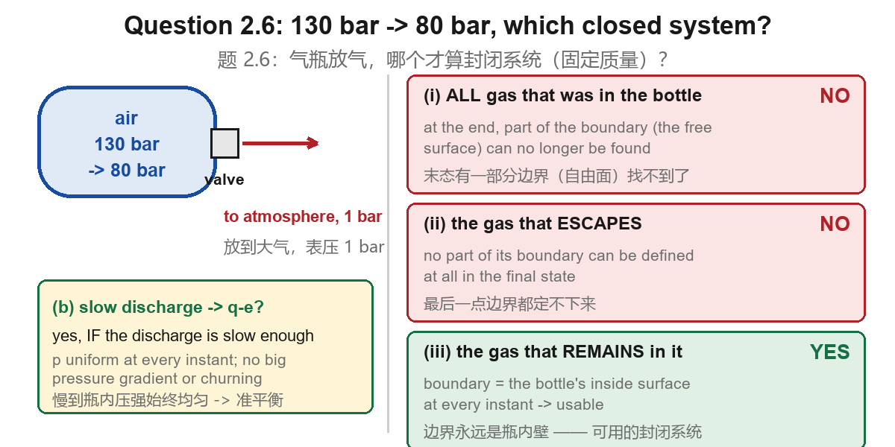

# Q2.6 Discharging an air bottle: which closed system?

> **Source**: ME1 Thermodynamics, *Exercise 2 — Introduction & Basic Concepts* (§2.6), Question 2.6 (★★ intermediate level)
> **Keywords**: **closed system**, **control volume**, **system boundary**, **quasi-equilibrium**

## 1. The problem

> **\*\*6** The valve on a compressed air bottle, containing air at an initial pressure of 130 bar, is opened slightly to discharge air slowly to the atmosphere (where the pressure is approximately 1 bar) until the pressure in the bottle has fallen to 80 bar. (Numbers are for illustration; no calculations are required.)
>
> **(a)** Could any of the following usefully be defined as a closed system when attempting to describe this process, and if not, why?
> (i) the air initially in the bottle (ii) the air which escapes (iii) the air which remains in the bottle.
>
> **(b)** Could the air, which is still in the bottle at the end of the process, be said to have undergone a quasi-equilibrium process? Why, and under what conditions?

A bottle at 130 bar is slowly discharged down to 80 bar. Two things are asked: (a) of the three candidate "closed systems", which one can actually be used? (b) can the air **still left in the bottle** be said to have gone through a quasi-equilibrium process, and under what conditions?

## 2. Answers at a glance

| Part | Candidate | Usable? | Why |
|---|---|---|---|
| (a) i | **all the air initially in the bottle** | **No** | its boundary cannot be found at the end |
| (a) ii | **the air which escapes** | **No** | no part of its boundary exists at the end |
| (a) iii | **the air that remains in the bottle** | **Yes** | boundary = the bottle's inside surface |
| (b) | the remaining air | **Yes, if slow enough** | it needs time to redistribute → uniform $P,T$ |

**One-line memory**: **"A closed system is a fixed lump of matter whose boundary you can point at from beginning to end."**

## 3. What you need to know

1. **closed system**: a **fixed, identifiable** lump of matter with no matter crossing its boundary. Note the key words are **"fixed and identifiable"** — not merely "nothing crosses".
2. **control volume**: a fixed region in space (the bottle), through which matter can pass in and out. In this question the bottle itself is naturally a control volume.
3. **boundary must be definable**: this is what the question is really testing. A system follows **one particular lump of matter**, and you must be able to say at any moment where that lump is and where its boundary is drawn.
4. **mixing / redistribution**: the gas molecules keep moving about inside the bottle. During a slow discharge the remaining gas has time to become uniform again; a fast discharge leaves a pressure gradient behind.
5. **why it matters**: only q-e lets you draw the process on a $P$–$V$ diagram and use $W=\int P\,dV$; otherwise you must honestly track how much work the surroundings side did.

## 4. The two tests used here

**Test 1 — can I still find the boundary at the end?**

$$
\text{closed system is useful} \;\Longleftrightarrow\; \text{the same lumps of matter keep a definable boundary}
$$

*How to read it*: $\Longleftrightarrow$ reads "if and only if". In one sentence: **for a closed system to be useful, you must be able to point at that lump of matter, and at its boundary, from start to finish**.

**Test 2 — is the state uniform at every instant?**

$$
\text{q-e} \;\Longleftrightarrow\; \text{one } P \text{ and one } T \text{ describe the gas at every instant}
$$

*How to read it*: quasi-equilibrium ⇔ at every instant one $P$ and one $T$ describe the whole bottle of gas.

**Step card**

| Step | Do this |
|---|---|
| 1 | Draw the boundary you propose |
| 2 | Walk through the process to the **end** |
| 3 | Can you still point at that boundary? |
| 4 | Is the remaining gas uniform in $P$ and $T$? |
| 5 | Was the discharge slow relative to redistribution? |

| Symbol | Meaning |
|---|---|
| $P_1$, $P_2$ | initial / final pressure (130 / 80 bar) |
| $P_{\text{atm}}$ | atmospheric pressure (≈1 bar) |
| C.V. | control volume |
| remaining gas | the gas inside the bottle at the end |

## 5. Full worked solution

**(a) i — All the air initially in the bottle**

**No — not useful.**

At the start this lump is just "everything in the bottle", and its boundary is perfect. But as gas escapes, this same lump **shrinks and pushes out through the valve**; at the end part of it has become a jet outside the bottle and part of it has been lost into the atmosphere. There is **no definable boundary** at the end — the "free surface" of this lump is nowhere you can draw it.

**(a) ii — The air which escapes**

**No — not useful.**

An even stronger fail. Which molecules are "the escapees" only becomes known **after the fact** — you cannot mark them off at the start. And at the end they are spread through the whole atmosphere, so **no part of their boundary can be defined at all**.

**(a) iii — The air which remains in the bottle**

**Yes — this is the useful closed system.**

Its boundary is, at **every instant**, the bottle's inside surface — a real, fixed, easy-to-draw boundary. Mass never crosses it (this gas never leaves), only heat may cross (and slow discharging is close to adiabatic). The nice microscopic picture from the key: at any time, molecules of "the gas that will remain" can be found anywhere inside the bottle, so initially you may regard the bottle content as **two systems sharing the same volume**.

**(b) Could the remaining air have undergone a q-e process?**

**Yes — provided the discharge is slow enough.**

Slow discharge gives the remaining air time to redistribute itself, so that at every instant the pressure (and temperature) is **uniform throughout the bottle**. Then one $P$ and one $T$ describe the state, the intermediate states are true equilibrium states, and it is a quasi-equilibrium process. If the valve were opened wide and the pressure crashed from 130 to 80 bar quickly, the gas would churn and the properties would not be a single value — then it would not be q-e.

**What the useful system buys you**: with (a)(iii) as your closed system you can apply the closed-system first law $Q-W=\Delta U$ to the remaining air, and model its path as something like $P V^n = \text{const}$ (the mass $m$ is constant for *this* lump, so $V$ is well defined). The bottle as a whole, by contrast, is a natural **control volume**.

**30-second self-check**

- (i) and (ii) both fail at the **final** state — not at the start.
- (iii) passes because its boundary is the bottle wall.
- "Slowly" is the condition for (b), not for (a).

## 6. Common mistakes

- **Saying "the gas in the bottle" is a closed system — but which gas?** The point is to separate "all the gas at the start" from "the gas left at the end"; their boundary behaviour is completely different.
- **Focusing on the valve and saying all three are C.V.s.** The question asks whether a **closed system** can be used.
- **Answering (a) with the reason "mass crosses"** — it is not that mass crosses (it does not, for the lumps you chose), it is that the **boundary becomes undefinable**.
- **Claiming q-e without the slow condition.** The discharge must be slow, otherwise the bottle is not uniform inside.
- **Using $PV^n=\text{const}$ with $V$ = bottle volume for the whole bottle**. For the whole bottle (a control volume) $m$ is changing, so this cannot be used; it holds only for the remaining gas.

## 7. Cross-references

- ME1 Thermodynamics lecture notes, **Sec. 2.2** (*Frameworks*) — system vs control volume.
- ME1 Thermodynamics lecture notes, **Sec. 2.4** (*Equilibrium*) and **Sec. 2.5.2** (*Quasi-equilibrium process*).
- ME1 Thermodynamics lecture notes, **Sec. 5** — why the same bottle would be treated as a control volume in a steady-flow analysis.
- Tutorial sheet source: `ME1Thermo_LectureNotes (2026-27).pdf`, §2.6 Exercise 2, pp. 10–13.

> **Note**: no full lecture-note Markdown for ME1 Thermodynamics exists in this folder yet; the PDF is the reference.
