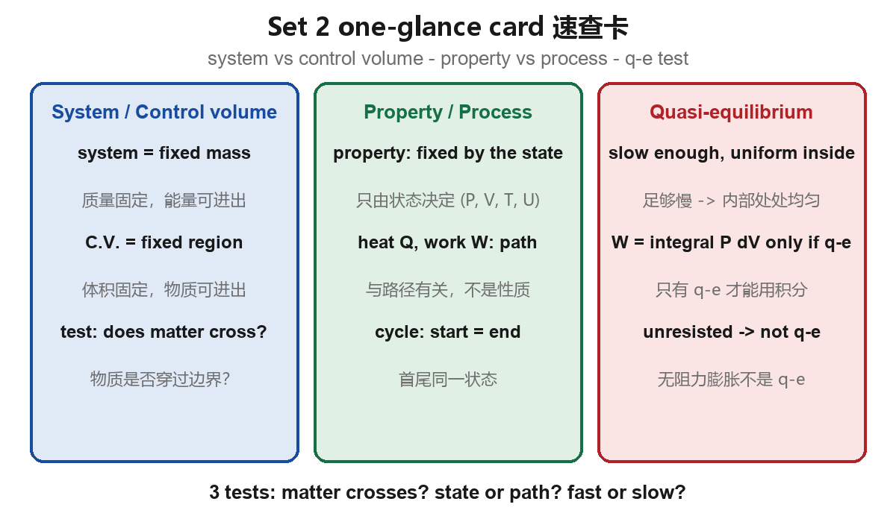

# ME1 Thermodynamics — Tutorial Sheet **Set 2** (Exercise 2: Introduction & Basic Concepts)

> **Course**: ME1 Thermodynamics, Imperial College London (2026–27)
> **Source**: `ME1Thermo_LectureNotes (2026-27).pdf`, **§2.6 EXERCISE 2** (pp. 10–14 of the print, PDF pp. 14–18), **including the official ANSWERS**
> **Sheet rating**: ★ = CORE, ★★ = INTERMEDIATE, ★★★ = ADVANCED/EXAM
> **Convention**: every answer has been checked independently against the official answers; the two numbers in 2.1 recompute consistently (11 221 t, 359.1 t, which the official version rounds to 3 s.f. as 11 200 t / 359 t).

---

## 0. One-glance card

  

**Three tests, three words**

- **Does matter cross the boundary?** yes → control volume; no → system.
- **Does the value depend on the route?** no → property; yes → heat/work, a path quantity.
- **Is the inside uniform at every instant?** yes → quasi-equilibrium (q-e); no → not q-e.

---

## 1. Answer table

| Q | Level | Topic | Answer |
|---|---|---|---|
| **2.1** | ★ | Station efficiency, coal and SO₂ | (a) **11 200 t/day** (b) **359 t/day** |
| **2.2** | ★ | System or control volume? | (a) **C.V.** (b) **C.V.** (c) **system** |
| **2.3** | ★ | Climbers: properties and a cycle | (a) property (b) property (c) not a property (d) **cycle** (e) **cycle** |
| **2.4** | ★ | Tank: partition out vs small hole | (a)(i) **equilibrium in both** (ii) surface not flat (iii) **not q-e**; (b) **yes, q-e** |
| **2.5** | ★ | Four gas expansions | (a) **not q-e**, (b) **not q-e**, (c) **could be**, (d) **could be** |
| **2.6** | ★★ | Air bottle 130 → 80 bar | (a)(i) no (ii) no (iii) **yes**; (b) **yes, if slow enough** |

---

## 2. Question index

| Q | Topic | Key idea | File |
|---|---|---|---|
| 2.1 | Efficiency, calorific value, stoichiometry | $\dot E_{\text{in}}=P/\eta$, $\dot m=\dot E_{\text{in}}/Q_{\text{CV}}$, SO₂ factor 64/32 = 2 | [Q2.1](Q2.1-station-efficiency-coal-so2.md) |
| 2.2 | Frameworks | count the ports: 0 → system, ≥1 → C.V. | [Q2.2](Q2.2-system-vs-control-volume.md) |
| 2.3 | Property vs path, cycle | a property depends only on the state; a cycle only on the start and end | [Q2.3](Q2.3-properties-and-cycles-climbers.md) |
| 2.4 | Equilibrium vs quasi-equilibrium | can one number describe the intermediate state? | [Q2.4](Q2.4-tank-partition-quasi-equilibrium.md) |
| 2.5 | Resisted vs unresisted expansion | the force balance at the moment the process starts | [Q2.5](Q2.5-four-expansion-processes.md) |
| 2.6 | Closed system vs C.V., boundary definability | can the boundary still be drawn in the final state? | [Q2.6](Q2.6-air-bottle-discharge.md) |

---

## 3. Three threads

**1. Framework** — what is "the system"? A fixed mass (system) or a fixed region (control volume)? Which one keeps a definable boundary for the whole process? This is the theme of 2.2 and 2.6(a).

**2. Property vs process quantity** — $P, v, T, u, h$ are fixed by the state; $Q$ and $W$ are not, they depend on the path. A cycle returns every property. This is the theme of 2.3, and it is the foundation of the first law in Chapter 3.

**3. Quality of the process** — equilibrium, quasi-equilibrium, fully-resisted vs unresisted. Only q-e lets you write $W=\int P\,dV$ and draw the path on a $P$–$V$ diagram. This is the theme of 2.4 and 2.5.

---

## 4. Notation

| Symbol | Meaning | Unit |
|---|---|---|
| $\eta$ | efficiency | – |
| $P$, $\dot P$ | power | W, MW |
| $Q_{\text{CV}}$ | calorific value | kJ/kg |
| $\dot m$ | mass flow rate | kg/s |
| $Q$, $W$ | heat and work transfer | J, kJ |
| $U$, $u$ | internal energy (total / per unit mass) | J, J/kg |
| $h$ | specific enthalpy | J/kg |
| $v$, $V$ | specific volume / volume | m³/kg, m³ |
| q-e | quasi-equilibrium | – |
| C.V. | control volume | – |

**Unit conversions**: $1\ \text{bar} = 10^{5}\ \text{Pa}$; $1\ \text{MW} = 10^{6}\ \text{W}$; $1\ \text{t} = 10^{3}\ \text{kg}$; $1\ \text{day} = 86\,400\ \text{s}$; $1\ \text{kJ/kg} = 10^{3}\ \text{J/kg}$.

---

## 5. How to answer these question types

**"Property or not?"** Answer with the test, not with the word: is the value the same on **every** route between the two states? Point at a counter-example (here: the two routes to camp B).

**"System or C.V.?"** Draw the boundary first, then count ports. State the reason in terms of **matter crossing**, never heat or work.

**"Is it q-e?"** Name the process type (unresisted / partly resisted / fully resisted), then say whether the gas pressure is uniform at every instant. If it "could be", give the condition ("heating slow enough", "valve opened slightly").

**"Is this a closed system?"** Check the boundary at the **final** state. That single test answers all of Q2.6(a).

---

## 6. Cross-references

| Sheet question | Lecture section |
|---|---|
| 2.1 | Sec. 1 (why thermodynamics, power plants); Sec. 3.1 (forms of energy) |
| 2.2 | Sec. 2.2 (frameworks, control surface, ports); Sec. 5.1 |
| 2.3 | Sec. 2.3 (properties and states, two-property rule); Sec. 2.5 (processes and cycles) |
| 2.4 | Sec. 2.4 (equilibrium); Sec. 2.5.2 (quasi-equilibrium); Sec. 3.3.1 |
| 2.5 | Sec. 2.5.2; Sec. 3.3.1 (displacement work); Structured Tutorial 3 (supplementary problem: spring + peg) |
| 2.6 | Sec. 2.2; Sec. 2.4; Sec. 2.5.2; Sec. 5 (steady flow, C.V.) |

> **Note**: This folder currently holds the lecture PDF only. There is no full course-note Markdown for ME1 Thermodynamics yet — these links give the PDF section numbers instead.

---

## 7. Files in this folder

| File | Content |
|---|---|
| `README.md` | This file: answer table, index, notation, how to answer |
| `Q2.1-station-efficiency-coal-so2.md` | Station efficiency, coal burn, SO₂ emission (full numerical calculation) |
| `Q2.2-system-vs-control-volume.md` | System vs control volume |
| `Q2.3-properties-and-cycles-climbers.md` | Properties, path and cycle |
| `Q2.4-tank-partition-quasi-equilibrium.md` | Equilibrium state and quasi-equilibrium |
| `Q2.5-four-expansion-processes.md` | Four ways of expanding a gas |
| `Q2.6-air-bottle-discharge.md` | Air bottle discharge and the boundary |
| `figures/` | 8 hand-made schematic diagrams (1200 px wide, dark text on white) |
| `ME1Thermo_LectureNotes (2026-27).pdf` | Course lecture notes; the questions are in §2.6 |

---

*All answers are re-derived and checked against the official ANSWERS in the lecture notes.*
