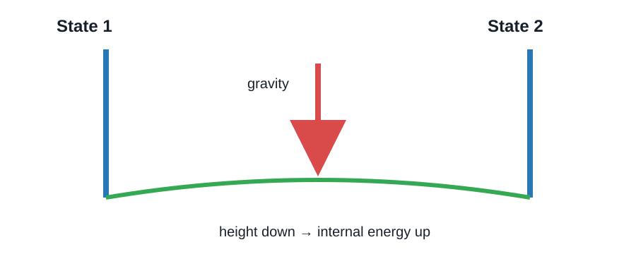
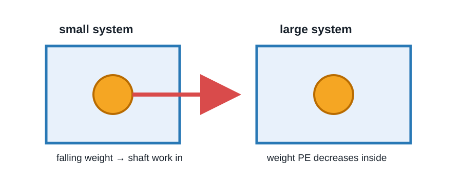
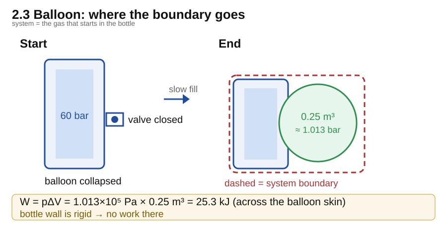
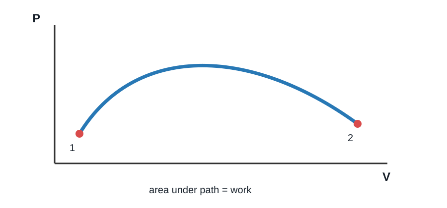
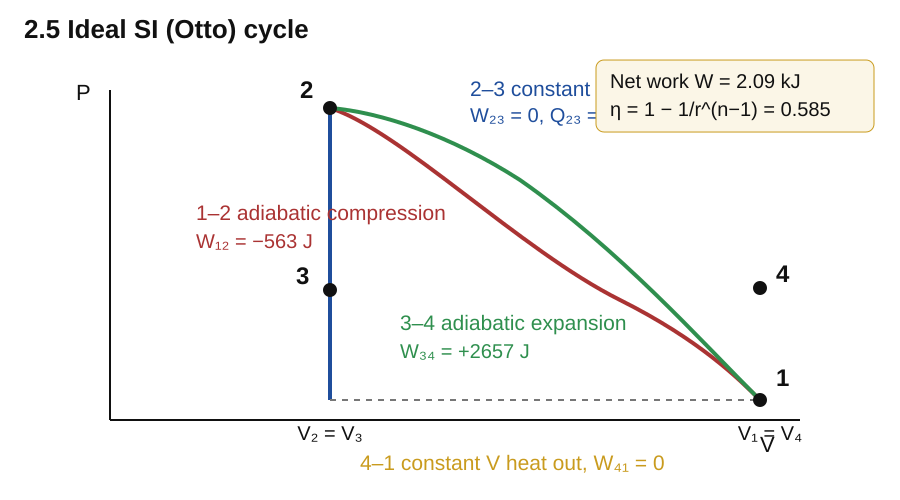
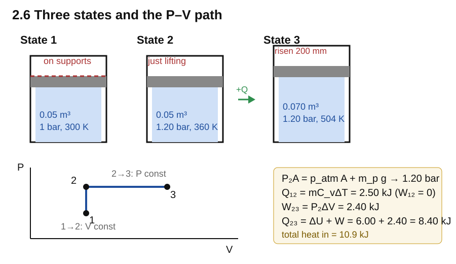
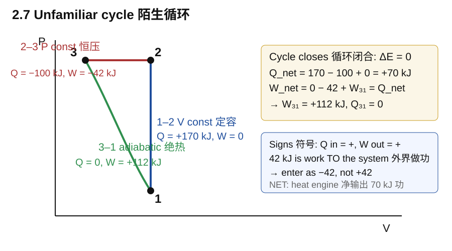

# MECH40003 Thermodynamics 1 — Lambda Feedback Set 2 (full worked solutions)

> Source: Lambda Feedback, MECH40003 Thermodynamics 1, 2026–27, Set 2 **Energy, Heat, Work and the 1st Law** (seven questions, 2.1–2.7).
>
> Every number below is reproduced by `solve_set2.py` in this folder, and the script asserts the answers the site states (2.5 kJ, 360 K, 1.20 bar, 2.40 kJ, 504 K, 8.40 kJ).

**Sign convention**: Q is positive **into** the system; W is positive **by** the system (work the gas does on its surroundings). So the 1st law for a closed system is ΔE = Q − W.

## Cheat sheet

| Question | Core idea | Key result |
|---|---|---|
| 2.1 Waterfall | PE → KE → U, ΔE = 0 | ΔPE −981 J, ΔKE +981 J, ΔU 0→+981 J, ΔT 0.117 K |
| 2.2 Energy transfer | boundary decides the bookkeeping | shaft/electrical work, or nothing |
| 2.3 Balloon | work across the balloon skin = p_atm ΔV | W = 25.3 kJ (60 bar irrelevant) |
| 2.4 Work transfer | W = ∫P dV for six paths | P ΔV; 0; ½(P1+P2)ΔV; (P1V1−P2V2)/(n−1); P1V1 ln(V2/V1); m c_v (T1−T2) |
| 2.5 SI engine | ideal Otto cycle, n = 1.4 | 2.09 kJ/cycle, 87 kW, p_me 14.7 bar |
| 2.6 Vertical cylinder | three states, lift-off force balance | m 0.0575 kg, P2 1.20 bar, Q12 2.50 kJ, W23 2.40 kJ, T3 504 K, Q23 8.40 kJ |
| 2.7 Unfamiliar cycle | ΔE = 0 round a cycle | Q31 = 0, W31 = 112 kJ |

## Symbols

| Symbol | Meaning | Unit |
|---|---|---|
| PE, KE | potential / kinetic energy | J |
| U, u | internal energy, specific internal energy | J, J/kg |
| E | total energy E = U + KE + PE | J |
| Q, W | heat in / work out | J or kJ |
| P, V, T | pressure, volume, absolute temperature | Pa (bar), m³, K |
| m, R, C_v | mass, gas constant, specific heat at constant volume | kg, J/(kg K), J/(kg K) |
| n | polytropic index, P V^n = const | – |

Plain-text formulas: ΔE = Q − W; ΔE = ΔU + ΔKE + ΔPE; W = ∫P dV; PV = mRT; ΔU = m C_v ΔT; T2/T1 = (V1/V2)^(n−1).

---

## 2.1 Waterfall

**Prompt.** A system of 2 kg of water is in a lake above a waterfall (state 1, flowing slowly so KE ≈ 0). It falls 50 m and is in state 2 just before entering the pool, then state 3 a little downstream once the turbulence has died down. No heat or work crosses the boundary. (a) Find ΔPE, ΔKE, ΔU and ΔE between 1 and 2. (b) Repeat between 1 and 3. (c) Given Δu = 4190 ΔT J/kg, find the temperature change between 1 and 3.

**Knowns**

| Quantity | Value |
|---|---|
| m | 2 kg |
| Δz (1→2) | −50 m |
| g | 9.81 m/s² |
| Q, W | 0 (adiabatic, rigid-free but no work crossing) |
| Δu/ΔT | 4190 J/(kg K) |

**Principle.** Energy conservation for a closed system with no heat and no work: ΔE = ΔU + ΔKE + ΔPE = 0. Total energy is conserved; the internal bookkeeping can shift between the three stores.

### (a) State 1 → state 2

**Step 1 — potential energy.** ΔPE = m g Δz = 2 × 9.81 × (−50) = **−981 J**. The height falls, so the potential energy drops.

**Step 2 — kinetic energy.** Nothing has dissipated yet: the lost PE has all become KE.
ΔKE = −ΔPE = **+981 J**. Check speed: ½ × 2 × v² = 981 → v = √981 = 31.3 m/s (= √(2 g h), free fall).

**Step 3 — internal energy and total energy.** Water temperature is unchanged at this instant, and u depends only on T, so ΔU = **0 J**. Then ΔE = 0 + 981 − 981 = **0 J**.

> **Answer (a)**: ΔPE = −981 J, ΔKE = +981 J, ΔU = 0 J, ΔE = 0 J.

### (b) State 1 → state 3

**Step 1 — potential energy** is the same drop: ΔPE = **−981 J**.

**Step 2 — kinetic energy.** Far downstream the water is slow again, so ΔKE = **0 J** (both 1 and 3 have negligible speed).

**Step 3 — internal energy.** All the PE has been dissipated by turbulence into internal energy: ΔU = **+981 J**. Then ΔE = 981 + 0 − 981 = **0 J**.

> **Answer (b)**: ΔPE = −981 J, ΔKE = 0 J, ΔU = +981 J, ΔE = 0 J.

### (c) Temperature rise, state 1 → state 3

**Step 1 — specific internal energy.** Δu = ΔU / m = 981 / 2 = 490.5 J/kg.

**Step 2 — invert the given relation.** ΔT = Δu / 4190 = 490.5 / 4190 = **0.117 K**.

> **Answer (c)**: ΔT = 0.117 K (about 0.12 K, i.e. a tenth of a degree).

**Sanity check**: 981 J over 2 kg of water is tiny; 0.12 K is exactly the sort of unremarkable warming you would never notice at a waterfall. And ΔE = 0 every time — energy moved, it did not appear.

**Pitfall**: ΔE ≠ ΔU. At state 2 the internal energy has **not** changed yet; only the KE has. Do not write "PE became internal energy" for 1→2.

**Memory hook**: fell down → speeding up → stirred warm.

---

## 2.2 Energy Transfer to a Gas

**Prompt.** (a) A gas in a rigid, insulated vessel is stirred by a paddle wheel driven by a falling weight on a rope wound round a drum. What form of energy transfer, and in which direction, crosses the boundary if the system is (i) the gas + paddle wheel + the shaft part inside the vessel, (ii) the gas + paddle wheel + shaft + drum + rope + weight? (b) The same vessel is instead heated by an electric resistance heater (ignore the wires). Repeat for the system being (i) the gas, (ii) the gas + heater, (iii) the gas + heater + battery.

**Principle.** Energy crosses a boundary only where the boundary cuts something: a shaft, a wire, a moving surface, or a hot wall. Rigid + insulated kills boundary work (no moving surface) and heat (no conduction), but it does **not** kill work carried by a shaft or a wire that crosses the boundary.

### (a) Paddle wheel driven by a falling weight

**(i) Gas + paddle wheel + inner shaft.** The boundary cuts the shaft where it passes through the vessel wall. Energy crosses as **shaft work, into the system** (the weight outside does work on the shaft, the shaft does work on the paddle wheel, the paddle wheel does work on the gas). Q = 0 because the vessel is insulated.

**(ii) Gas + paddle wheel + shaft + drum + rope + weight.** Now the whole driving mechanism is inside the boundary and nothing mechanical crosses it. The weight loses gravitational PE inside the system; that PE ends up as internal energy of the gas. **No energy transfer crosses the boundary at all** (Q = 0, W = 0). The energy conversion is internal, not a transfer.

### (b) Electric resistance heater

**(i) Gas only.** The boundary is the inner wall of the vessel, and the heater wires cross it. Energy enters as **electrical work** (electrical energy in, converted to internal energy of the gas by the resistance).

**(ii) Gas + heater.** The wires still cross the boundary, so again **electrical work in** — same direction, same form. Only the location of the conversion moved inside the boundary.

**(iii) Gas + heater + battery.** The battery is inside, nothing crosses the boundary. The battery's chemical energy becomes internal energy of the gas **inside the system**: again **no energy transfer across the boundary**.

> **Answer**: (a)(i) shaft work in; (a)(ii) none; (b)(i) electrical work in; (b)(ii) electrical work in; (b)(iii) none.

**Sanity check**: in every "none" case the energy source is carried **inside** the boundary — the gas still heats up, but the 1st law for that system reads ΔU = 0 + 0, so the energy must already have been counted as internal energy of the system (PE of the weight, chemical energy of the battery).

**Pitfall**: insulated ≠ nothing happens. "No energy transfer" only becomes true when you have swallowed the whole energy source into the system.

**Memory hook**: move the boundary, change the answer.

---

## 2.3 Inflating a Balloon

**Prompt.** A light, flexible balloon, initially collapsed, is connected through a valve to a rigid bottle of gas at 60 bar. The valve is partly opened and gas flows slowly in until the balloon volume is 0.25 m³. Atmospheric pressure is 1.013 bar. System = the gas initially in the bottle. (a) Sketch the boundary at the start and at the end. (b) Calculate the work transfer across the part of the boundary that is the inner surface of the balloon (not all the data are relevant).

**Knowns**

| Quantity | Value |
|---|---|
| p_atm | 1.013 bar = 1.013 × 10⁵ Pa |
| balloon volume change | 0.25 m³ (from 0) |
| bottle pressure | 60 bar — **needed only for the sketch, not for (b)** |

**Principle.** The balloon skin is light and flexible, so it cannot hold a pressure difference: the gas just inside the skin is at essentially atmospheric pressure throughout. The work done by the system on the skin is therefore ∫p dV with p ≈ p_atm.

### (a) Boundary sketch

**Step 1 — at the start.** The balloon is collapsed; the system (the gas initially in the bottle) fills the bottle only. Boundary = bottle inner wall + closed valve.

**Step 2 — at the end.** Some of that same gas is now in the balloon, the rest still in the bottle, so the boundary has to stretch to wrap **both**: bottle wall, pipe, and the balloon skin. The balloon skin alone is **not** the system boundary — the mass you are following is split between two vessels.

### (b) Work across the balloon inner surface

**Step 1 — identify the pressure on that surface.** Light flexible skin ⇒ pressure inside ≈ pressure outside = p_atm = 1.013 × 10⁵ Pa.

**Step 2 — integrate.** W = ∫p dV = p_atm ∫dV = p_atm × (0.25 − 0) = 1.013 × 10⁵ × 0.25 = 25 325 J.

> **Answer (b)**: W = **25.3 kJ**, done **by the system** on the balloon skin (and, through it, on the atmosphere).

**Sanity check**: 25.3 kJ is roughly the pV of a quarter of a cubic metre of air at 1 bar — the same order as pushing a piston through that volume. The 60 bar never enters, because the balloon skin (not the bottle) is the pressure that acts on this part of the boundary. The bottle wall is rigid, so **no** work crosses there.

**Pitfall**: the balloon's *final* pressure is not 60 bar. The 60 bar is the bottle; the flow is slow and the valve is throttling, so the gas entering the balloon is at about 1 bar.

**Memory hook**: soft skin = atmospheric pressure.

---

## 2.4 Work Transfer in a Process

**Prompt.** A gas in a cylinder with a leak-proof, frictionless piston goes slowly from state 1 to state 2 (quasi-equilibrium), with V2 ≥ V1. For each process (a)–(f), sketch the path on a P–V diagram, shade the area giving the magnitude of the work, and derive the simplest expression for the displacement work done by the gas. (a) constant pressure; (b) constant volume; (c) P varies linearly with V; (d) polytropic PV^n = const, n > 1; (e) as (d) but n = 1; (f) adiabatic, T1 → T2, mass m, Δu given.

**Principle.** For a quasi-equilibrium process the displacement work is the area under the path: W12 = ∫(V1→V2) P dV. The path shape decides the value — work is **path-dependent**, unlike U.

### (a) Constant pressure

**Step 1.** P = P1 throughout, so it comes out of the integral: W12 = P1 ∫dV = **P1 (V2 − V1)**.

**Step 2 — graph.** A horizontal line at P1; the shaded rectangle has height P1 and width (V2 − V1).

> **Answer (a)**: W12 = P1 (V2 − V1).

### (b) Constant volume

**Step 1.** dV = 0 along the path, so W12 = ∫P dV = **0**.

**Step 2 — graph.** A vertical line at V1: zero width, zero area. Note the pressure may change a lot — that is heat, not work.

> **Answer (b)**: W12 = 0.

### (c) P linear in V

**Step 1.** With P = a + bV, the area under the line is a trapezium: W12 = ½ (P1 + P2)(V2 − V1).

**Step 2 — graph.** A straight sloping line from (V1, P1) to (V2, P2); shaded trapezium.

> **Answer (c)**: W12 = ½ (P1 + P2)(V2 − V1).

### (d) Polytropic, PV^n = const, n > 1

**Step 1.** Write P = C V^(−n) with C = P1V1^n = P2V2^n.

**Step 2.** Integrate: W12 = C ∫V^(−n) dV = C [V^(1−n)/(1−n)] from V1 to V2 = C (V2^(1−n) − V1^(1−n)) / (1 − n).

**Step 3.** Put C back: C V2^(1−n) = P2V2 and C V1^(1−n) = P1V1, so W12 = **(P2V2 − P1V1)/(1 − n) = (P1V1 − P2V2)/(n − 1)**.

> **Answer (d)**: W12 = (P1V1 − P2V2)/(n − 1). For expansion V2 > V1 the pressure falls and W > 0.

### (e) Polytropic with n = 1 (isothermal for a perfect gas)

**Step 1.** PV = C, so P = C/V. W12 = C ∫dV/V = C ln(V2/V1) = **P1V1 ln(V2/V1)**.

**Step 2 — graph.** A hyperbola; the area is not a trapezium, so do not use (c).

> **Answer (e)**: W12 = P1V1 ln(V2/V1).

### (f) Adiabatic, with Δu given

**Step 1.** Adiabatic ⇒ Q12 = 0.

**Step 2.** 1st law: W12 = Q12 − ΔU = −m(u2 − u1) = m(u1 − u2).

**Step 3.** With u as a function of T only, Δu = c_v ΔT, so W12 = **m c_v (T1 − T2) = −m c_v (T2 − T1)**.

> **Answer (f)**: W12 = m c_v (T1 − T2). Compression (T2 > T1) gives W < 0, i.e. work **on** the gas.

**Sanity check**: all six reduce to "area under the path". (a) is a rectangle, (c) a trapezium, (d) and (e) integrals of the same curve family, (f) uses the 1st law because the path shape is already fixed by "adiabatic".

**Pitfall**: work depends on the path — the same states 1 and 2 give different W for different routes. And for (b), a big pressure change with V constant is **not** work.

**Memory hook**: constant V → no area; constant P → rectangle; anything curved → integrate.

---

## 2.5 Spark-Ignition Engine

**Prompt.** Idealised air-standard model of a four-stroke SI engine: 1–2 adiabatic compression, 2–3 constant-volume heat addition, 3–4 adiabatic expansion, 4–1 constant-volume heat rejection (the exhaust and induction strokes cancel). (a) Sketch the cycle on a P–V diagram. (b) Derive the work transfer in each of the four processes and hence the net work. (c) Using PV = mRT with R = 287 J/(kg K), n = 1.4, maximum volume 1.6 litre, compression ratio 9, maximum temperature 3000 °C, P1 = 1 bar and T1 = 15 °C, find the mass of air, V, P and T in states 2, 3 and 4, and the work in each process and per cycle. (d) If the net work per cycle runs in a real four-stroke engine at 5000 rev/min, what is the power, and why would a real engine of the same size be less powerful? (e) Find the mean effective pressure.

**Knowns**

| Quantity | Value |
|---|---|
| V1 = V_max | 1.6 L = 1.6 × 10⁻³ m³ |
| r = V1/V2 | 9 |
| T3 = T_max | 3000 °C = 3273 K |
| P1, T1 | 1 bar = 10⁵ Pa, 15 °C = 288 K |
| n (both adiabatic legs) | 1.4 |
| R | 287 J/(kg K) |
| c_v = R/(n − 1) | 717.5 J/(kg K) |

### (a) Cycle sketch

**Step 1.** V2 = V3 = V1/r = 0.178 L (the small volume at top dead centre) and V4 = V1 (bottom dead centre).

**Step 2.** 1–2 and 3–4 are steep adiabatic curves (PV^1.4 = const); 2–3 and 4–1 are **vertical** because V does not change. The loop runs clockwise: work out on the top, work in on the bottom.

### (b) Work in the four processes

**Step 1 — 1–2 (adiabatic compression).** Use the polytropic result from 2.4(d) with n = 1.4:
W12 = (P2V2 − P1V1)/(1 − n) = mR(T2 − T1)/(1 − n). Since T2 > T1 and (1 − n) < 0, **W12 < 0** (work done on the air).

**Step 2 — 2–3 (constant volume heat addition).** dV = 0 ⇒ **W23 = 0**. All the heat goes into internal energy.

**Step 3 — 3–4 (adiabatic expansion).** W34 = mR(T4 − T3)/(1 − n); now T4 < T3, so **W34 > 0**.

**Step 4 — 4–1 (constant volume heat rejection).** **W41 = 0**.

**Step 5 — net work.** Add them:
W_net = mR[(T2 − T1) + (T4 − T3)]/(1 − n) = mR[(T3 − T4) − (T2 − T1)]/(n − 1).

> **Answer (b)**: W12 = mR(T2 − T1)/(1 − n), W23 = 0, W34 = mR(T4 − T3)/(1 − n), W41 = 0, W_net = mR[(T3 − T4) − (T2 − T1)]/(n − 1).

### (c) Numbers

**Step 1 — volumes.** V2 = V3 = 1.6/9 = **0.1778 L**; V4 = **1.600 L**.

**Step 2 — mass of air.** m = P1V1/(R T1) = (10⁵ × 1.6 × 10⁻³)/(287 × 288) = **1.93 × 10⁻³ kg** (1.93 g).

**Step 3 — state 2 (isentropic relations T2/T1 = r^(n−1), P2/P1 = r^n).**
T2 = 288 × 9^0.4 = **694 K**; P2 = 1 × 9^1.4 = **21.7 bar**.

**Step 4 — state 3 (constant V, so V3 = V2 and P3/P2 = T3/T2).**
P3 = 21.7 × 3273/694 = **102 bar**.

**Step 5 — state 4 (adiabatic expansion back to V1 = 9 V3).**
T4 = 3273/9^0.4 = **1359 K**; P4 = 102/9^1.4 = **4.72 bar**.

**Step 6 — works.** mR = 1.93 × 10⁻³ × 287 = 0.555 J/K.
W12 = 0.555 × (694 − 288)/(1 − 1.4) = **−563 J**;
W34 = 0.555 × (1359 − 3273)/(−0.4) = **+2657 J**.

**Step 7 — net work and efficiency.** W_net = 2657 − 563 = **2094 J ≈ 2.09 kJ**. Heat in: Q23 = m c_v (T3 − T2) = 0.555/0.4 × 2580 = 3580 J, so η = 2094/3580 = **0.585**, which equals 1 − 1/r^(n−1) = 1 − 1/9^0.4 = 0.585.

| State | V (L) | P (bar) | T (K) |
|---|---|---|---|
| 1 | 1.600 | 1.00 | 288 |
| 2 | 0.178 | 21.7 | 694 |
| 3 | 0.178 | 102 | 3273 |
| 4 | 1.600 | 4.72 | 1359 |

| Process | W (J) |
|---|---|
| 1–2 | −563 |
| 2–3 | 0 |
| 3–4 | +2657 |
| 4–1 | 0 |
| **Net** | **+2094** |

> **Answer (c)**: m = 1.93 × 10⁻³ kg; states as in the table; W12 = −563 J, W23 = 0, W34 = +2657 J, W41 = 0, W_net = 2.09 kJ/cycle.

### (d) Power and why a real engine is weaker

**Step 1 — cycles per second.** Four-stroke ⇒ one thermodynamic cycle per **two** revolutions: 5000/60 = 83.33 rev/s ⇒ 41.67 cycles/s.

**Step 2 — power.** P = W_net × cycles/s = 2094 × 41.67 = **87 kW**.

> **Answer (d)**: ≈ 87 kW. A real engine of the same capacity, compression ratio and peak temperature gives **less**, because of friction in piston rings, bearings and valve train, heat loss to the cylinder walls during compression and expansion, incomplete and finite-time combustion, non-ideal gas behaviour and n ≠ 1.4, pumping losses across the valves, and the fact that the exhaust/induction strokes are not exactly free.

**Sanity check**: the 87 kW number is the *ideal* ceiling — a 1.6 L four-cylinder road engine of that era is around 60–80 kW at the flywheel, so the model is only slightly optimistic, which is the point of an idealised model.

### (e) Mean effective pressure

**Step 1 — definition.** p_me = W_net / (V1 − V2), the swept (displaced) volume.

**Step 2 — evaluate.** V1 − V2 = 1.6 − 0.178 = 1.422 L = 1.422 × 10⁻³ m³.
p_me = 2094 / 1.422 × 10⁻³ = 1.47 × 10⁶ Pa = **14.7 bar**.

**Step 3 — graphical meaning.** Draw a rectangle of width (V1 − V2) and height p_me with the **same area** as the cycle loop: p_me is the average pressure that, acting over the whole stroke, would deliver the same work per cycle.

> **Answer (e)**: p_me ≈ **14.7 bar**.

**Pitfall**: the 4-stroke factor of 2. Forgetting it doubles the power to 174 kW. And p_me uses the **swept** volume, not the maximum volume.

**Memory hook**: two revolutions, one cycle.

---

## 2.6 Vertical Cylinder

**Prompt.** A vertical cylinder, area A = 0.1 m², closed at the bottom and open at the top, has a heavy piston of mass m_p = 203.9 kg resting on inward-projecting supports, trapping V1 = 0.05 m³ of gas at P1 = 1 bar and T1 = 26.8 °C. Atmospheric pressure on the top face is also 1 bar. The gas is a perfect gas with R = 0.290 kJ/(kg K) and C_v = 0.725 kJ/(kg K). Heat is added slowly until the piston has risen 200 mm. (a) Sketch the three states. (b) Sketch the process on P–V. (c) Show m = 0.0575 kg. (d) Show P2 = 1.20 bar and find T2. (e) Write the 1st law for 1–2 and show Q12 = 2.50 kJ. (f) Write the 1st law for 2–3 and show W23 = 2.40 kJ, T3 = 504 K, Q23 = 8.40 kJ.

**Knowns**

| Quantity | Value |
|---|---|
| A | 0.1 m² |
| m_p | 203.9 kg |
| V1 | 0.05 m³ |
| P1 | 1 bar = 10⁵ Pa |
| T1 | 26.8 °C = 299.95 K ≈ 300 K |
| p_atm | 1 bar = 10⁵ Pa |
| R | 0.290 kJ/(kg K) = 290 J/(kg K) |
| C_v | 0.725 kJ/(kg K) = 725 J/(kg K) |
| piston rise | 200 mm = 0.2 m |
| g | 9.81 m/s² |

### (a) and (b) Sketches

**Step 1 — state 1.** Piston sitting on the supports, V1 = 0.05 m³. The supports carry the piston, so the gas pressure does **not** need to balance the weight yet.

**Step 2 — state 2.** The moment the piston is just about to lift: the supports carry nothing and the gas pressure exactly balances atmosphere + piston weight. V is still 0.05 m³, so this is a **constant-volume** pressure rise from 1 bar to 1.20 bar.

**Step 3 — state 3.** After lift-off the piston rises slowly through 0.2 m at constant pressure (quasi-equilibrium, so the force balance still holds), so V3 = 0.05 + 0.1 × 0.2 = 0.070 m³.

**Step 4 — P–V path.** Vertical line at V = 0.05 from 1 to 1.2 bar, then horizontal line at 1.2 bar from 0.05 to 0.07 m³.

### (c) Mass of gas

**Step 1.** Equation of state in state 1: P1V1 = m R T1.

**Step 2.** m = P1V1/(R T1) = (10⁵ × 0.05)/(290 × 299.95) = 5000/86 986 = **0.0575 kg**.

> **Answer (c)**: m = 0.0575 kg (3 s.f.).

### (d) Lift-off pressure and T2

**Step 1 — force balance on the piston at lift-off.** Upward: P2 A. Downward: p_atm A + m_p g.
P2 A = p_atm A + m_p g.

**Step 2.** P2 = p_atm + m_p g/A = 10⁵ + (203.9 × 9.81)/0.1 = 10⁵ + 20 003 = 1.200 × 10⁵ Pa = **1.20 bar**.

**Step 3.** V2 = V1 = 0.05 m³ (piston has not moved yet), so the equation of state gives
T2 = P2V2/(mR) = (1.2 × 10⁵ × 0.05)/(0.0575 × 290) = 6000/16.67 = **360 K** (= 86.8 °C).

> **Answer (d)**: P2 = 1.20 bar, T2 = 360 K.

### (e) 1st law for process 1–2

**Step 1 — write it.** Q12 − W12 = ΔU12 with ΔU12 = m C_v (T2 − T1).

**Step 2 — zero work.** V is constant, so W12 = ∫P dV = 0. The unknowns reduce to Q12 alone (T2 is fixed by the force balance).

**Step 3 — evaluate.** Q12 = m C_v (T2 − T1) = 0.0575 × 0.725 × (360 − 300) = **2.50 kJ**.

> **Answer (e)**: Q12 = 2.50 kJ (all of it raises the internal energy).

### (f) 1st law for process 2–3

**Step 1 — write it.** Q23 − W23 = ΔU23 = m C_v (T3 − T2).

**Step 2 — displacement work at constant pressure.** W23 = P2 ΔV = 1.2 × 10⁵ × (0.070 − 0.050) = 1.2 × 10⁵ × 0.02 = **2.40 kJ**.

**Step 3 — T3 from the equation of state.** T3 = P2V3/(mR) = (1.2 × 10⁵ × 0.07)/(0.0575 × 290) = 8400/16.67 = **504 K** (= 231 °C).

**Step 4 — internal energy change.** ΔU23 = 0.0575 × 0.725 × (504 − 360) = 0.0417 × 144 = **6.00 kJ**.

**Step 5 — heat.** Q23 = ΔU23 + W23 = 6.00 + 2.40 = **8.40 kJ**.

> **Answer (f)**: W23 = 2.40 kJ, T3 = 504 K, ΔU23 = 6.00 kJ, Q23 = 8.40 kJ.

**Sanity check**: the work 2.40 kJ equals P2 × (swept volume) — the rectangle under a constant-pressure path. And Q23 > ΔU23 because the gas also has to push the atmosphere and lift the piston. Adding the two stages, the gas absorbed 2.50 + 8.40 = 10.9 kJ in total.

**Pitfall**: the lift-off balance must include **both** atmospheric pressure and the piston weight — forgetting p_atm gives 1.002 bar. Also state 2 is at the *same* volume as state 1.

**Memory hook**: lift-off = force balance; sliding = constant pressure.

---

## 2.7 Unfamiliar Cycle

**Prompt.** A system goes round a cycle of quasi-equilibrium processes. 1–2: constant volume, 170 kJ of heat transfer **to** the system. 2–3: constant pressure, 100 kJ of heat **from** the system and 42 kJ of work **to** the system. 3–1: adiabatic. (a) Sketch the cycle on P–V. (b) Evaluate the heat and work transfers in process 3–1.

**Principle.** Around a complete cycle the system returns to its starting state, so ΔE = 0 and therefore Q_net = W_net. That single equation closes the cycle and gives the unknown leg.

### (a) Sketch

**Step 1 — 1–2.** Constant V with heat in ⇒ P rises (given: internal energy and pressure rise with temperature at constant volume). Vertical line upwards.

**Step 2 — 2–3.** Constant P: the horizontal line at P2. Heat out and work **to** the system both mean the volume must **decrease**, so the path runs right-to-left.

**Step 3 — 3–1.** Since 2–3 pushed the volume *down* (work in), V3 < V1. So 3–1 runs back from (V3, P2) to (V1, P1): volume **increases** and pressure falls along the adiabatic curve PV^n = const, which is steeper than an isotherm. That is why this leg gives net work **out**.

### (b) Heat and work in 3–1

**Step 1 — adiabatic.** Process 3–1 is adiabatic ⇒ **Q31 = 0**.

**Step 2 — net heat.** With Q positive into the system: Q_net = (+170) + (−100) + 0 = **+70 kJ**.

**Step 3 — net work.** Work to the system is negative: W23 = −42 kJ, W12 = 0 (constant V), so
W_net = 0 − 42 + W31 = W31 − 42.

**Step 4 — close the cycle.** ΔE_cycle = 0 ⇒ Q_net = W_net ⇒ 70 = W31 − 42 ⇒ W31 = **+112 kJ**.

**Step 5 — interpret.** W31 > 0 means the gas **does** 112 kJ of work on the surroundings during 3–1, so its internal energy falls by 112 kJ (ΔU31 = Q31 − W31 = −112 kJ), which is exactly what is needed to get back to state 1.

> **Answer (b)**: Q31 = 0, W31 = +112 kJ (112 kJ of work done **by** the system).

**Sanity check**: Q_net = W_net = 70 kJ means the cycle is a net **heat engine**: it takes 70 kJ of net heat and turns it into 70 kJ of net work. Consistency: 170 in at 1–2, 100 out at 2–3, 42 in as work, 112 out as work.

**Pitfall**: the 42 kJ is work **to** the system, so it enters the sum as **−42 kJ**. Sign errors here are the whole question.

**Memory hook**: a cycle closes the account: Q_net = W_net.

---

## Answer summary

| Question | Answer |
|---|---|
| 2.1(a) | ΔPE = −981 J, ΔKE = +981 J, ΔU = 0, ΔE = 0 |
| 2.1(b) | ΔPE = −981 J, ΔKE = 0, ΔU = +981 J, ΔE = 0 |
| 2.1(c) | ΔT = 0.117 K |
| 2.2 | (a)(i) shaft work in, (a)(ii) none; (b)(i) electrical work in, (b)(ii) electrical work in, (b)(iii) none |
| 2.3(a) | boundary = bottle + pipe + balloon skin at the end |
| 2.3(b) | W = 25.3 kJ (by the system) |
| 2.4(a) | P1(V2 − V1) |
| 2.4(b) | 0 |
| 2.4(c) | ½(P1 + P2)(V2 − V1) |
| 2.4(d) | (P1V1 − P2V2)/(n − 1) |
| 2.4(e) | P1V1 ln(V2/V1) |
| 2.4(f) | m c_v (T1 − T2) |
| 2.5(c) | m = 1.93 × 10⁻³ kg; state 2: 0.178 L, 21.7 bar, 694 K; state 3: 0.178 L, 102 bar, 3273 K; state 4: 1.600 L, 4.72 bar, 1359 K; W12 = −563 J, W23 = 0, W34 = +2657 J, W41 = 0; W_net = 2.09 kJ; η = 0.585 |
| 2.5(d) | ≈ 87 kW; real engines lose to friction, heat loss, incomplete combustion, pumping |
| 2.5(e) | p_me ≈ 14.7 bar |
| 2.6(c) | m = 0.0575 kg |
| 2.6(d) | P2 = 1.20 bar, T2 = 360 K |
| 2.6(e) | Q12 = 2.50 kJ |
| 2.6(f) | W23 = 2.40 kJ, T3 = 504 K, Q23 = 8.40 kJ |
| 2.7(b) | Q31 = 0, W31 = +112 kJ |

## 30-second self-check

1. In 2.1, why is ΔU = 0 at state 2 but +981 J at state 3?
2. In 2.3, why does the 60 bar never appear in the calculation?
3. In 2.5, why is there a factor of 2 between rev/min and cycles/s?
4. In 2.6, why is state 2 at the same volume as state 1?
5. In 2.7, what makes W31 positive rather than negative?

Answers: dissipation has not happened yet at state 2 / the balloon skin is light so it holds only ~1 atm / four-stroke means one cycle per two revolutions / the piston has not left the supports yet / the cycle must return net work outward to close with +70 kJ of net heat.

---

## Source and version

- Site: Lambda Feedback, MECH40003 Thermodynamics 1 (2026–27), Set 2 "Energy, Heat, Work and the 1st Law", questions 2.1–2.7, fetched from the live page.
- Checker: `solve_set2.py` in this folder recomputes every number and asserts the values quoted on the site (2.50 kJ, 360 K, 1.20 bar, 2.40 kJ, 504 K, 8.40 kJ).
- This file replaces the earlier mismatched note for this tutorial; the old "Introduction & Basic Concepts" material belongs to a different tutorial and is not part of Set 2.
