# MECH40001 Professional Engineering Skills 1 — Using LLMs in Practice: Framing, Study, Coursework, Work, Prompting and Sources

> Course: MECH40001 Professional Engineering Skills 1, Imperial College London, first-year Mechanical Engineering (ME1).
> Lecture date: 2026-11-16. Recording title: ME MECH40001 - Professional Engineering Skills 1 (2026-11-16).
> Covered time span: 00:46-54:45. From 54:45 to the end of the recording there is only after-class conversation, with no lecture content.
> The lecture is taught from an online question set called "2. Using LLMs in practice" (sections 2.1-2.8), shown on screen in the frames. The transcript is automatically generated; where it clearly mishears a word, the note follows the on-screen text and says so.

## What this lecture is about

This is the second lecture on **large language models (LLMs)**. Last week was technical: how these models work inside. This week is hands-on: what you should and should not use them for. The lecture first recaps last week's lessons (no thinker behind the text, hallucination, bias, context, data privacy). It then gives one framing picture, a space with three axes (learning, duration, output), and uses it to give advice for three settings: study, coursework and professional work. It ends with two general skills: prompt engineering and source verification.

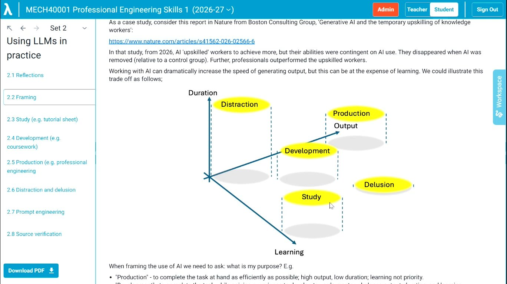
*Figure 0 — The framing diagram that organises the whole lecture: three axes (Duration, Output, Learning) and five regions (frame t1260, 21:00).*

---

## 1. Introduction and plan (00:46-02:27)

The lecturer says this is the second lecture in the series on AI and large language models (the audio about how many lectures there are is slightly garbled; it sounds like three lectures on Mondays). Last week was a rapid technical introduction so that you can picture what is happening inside the models. This week steps back and asks: given that they work the way they work, what should we use them for?

The session is meant to be interactive. Students are asked to log in to **Lambda Feedback**, the course's online question platform, because some parts take typed responses that the lecturer can see. On the platform, question set 1, "Introduction to Large Language Models (LLMs)", was released on 09/11/26, and question set 2, "Using LLMs in practice", on 16/11/26 (frame t0060).

The plan follows the left-hand menu of set 2: 2.1 Reflections, 2.2 Framing, 2.3 Study (e.g. tutorial sheet), 2.4 Development (e.g. coursework), 2.5 Production (e.g. professional engineering), 2.6 Distraction and delusion, 2.7 Prompt engineering, 2.8 Source verification. The sections of this note follow the same order.

Summary: last week explained how LLMs work; this week asks what to use them for. Pitfall: none yet. Memory tip: "how it works" last week, "what it is for" this week.

---

## 2. Reflections I: language without a thinker, hallucination and the rear-view mirror (02:27-08:12)

**Anthropomorphising** means treating something that is not a person as if it were one. All our lives we have learned to read text as the trace of a person who thought something; the text is an artefact of their thought. When you read text produced by an LLM, that habit makes you infer a person behind it, but there is nobody there. The text is the output of a statistical model.

The lecturer is not saying the output is useless or bad. He is saying be careful in two directions. When you write, make sure the language represents you rather than some model. When you read model output, do not accidentally infer a thinker who is not there. Saying "it thinks" or "it feels" is acceptable as loose talk, as long as you know you are stretching the words.

The slide adds context (frame t0180): people have parroted other people's ideas for millennia and mass propaganda is old, but the scale and ease of generation with LLMs is unprecedented. The slide's conclusion is that an LLM "does not reflect a 'thinking' process"; it is a very advanced statistical model of the outputs of human activity, which is why it is called *artificial* intelligence.

A **hallucination** is usually taken to mean a confidently wrong output. The lecturer's point is deeper. Last week, words (or **tokens**, the small pieces of text a model works with) were placed in a continuous **embedding space**, so that every token has a position in space. The model's output is also a point in that continuous space, and the model then snaps to the nearest word. There is never a word exactly at the output point, but it has to pick one.

So, in the lecturer's words, everything that comes out is a hallucination: it is ungrounded, a statistical pattern based on the data. What we normally call a hallucination is just the case where it gets it badly wrong, like last week's demonstration in which the model was made to say the capital of France is Madrid.

The model is also a **lossy compression** of the internet: it keeps a simplified version and loses detail. Last week's small neural network compressed 200 data points into 49 parameters. Large models compress petabytes of internet data into a few hundred billion parameter values. A model can **interpolate** well, meaning it can fill in between known points where data is dense, but outside the training data it gets lost.

For a sense of scale (this ratio is computed in this note, not in the lecture), the small network keeps about four data points per parameter:

$$\frac{200 \ \text{data points}}{49 \ \text{parameters}} \approx 4.1 \ \text{data points per parameter}$$

How do you end up outside the training data in practice? Students suggested research on something never written about, and a language the model was not trained on (Klingon was mentioned). The lecturer added a classic case: very local knowledge. Everyone in the room knows the ME1 tutorial groups and timetables, but they hardly appear in the training data, so the model will not know them. The transcript hears the group names as "me one group one A" and "group one C"; the exact names are unclear.

The slide adds that famous failures such as counting the letter "r" in "Strawberry" get fixed one by one as models improve, but fixing problems one by one does not change the fundamental fact: LLMs cannot work in unfamiliar spaces, just like the simple neural network outside its training data (frame t0180).

The **rear-view mirror** image: a model is like the mirror when you drive. It shows everything behind you but does not help you decide where to go. Models can be retrained with the latest data, but they never contain the future, so they struggle with genuinely new questions and do fine with things that repeat over and over.

The rule of thumb is to ask, every time: "Is this in the data?" Questions about the Beatles or Shakespeare are likely to be answered correctly because they appear in so much training data. A striking example is **Unix** commands. Unix underlies many servers, its commands have existed for more than half a century, and they appear in countless manuals in exactly the same form. If you translate a task into a Unix command, an LLM will follow it very faithfully; an obscure programming language leads to more mistakes. The slide puts it bluntly: "Only use LLMs when the subject matter is very common in the training data."

Summary: there is no thinker behind LLM text; every output is a statistical guess snapped to the nearest word; the model interpolates well inside dense data and fails outside it, and never sees the future. Pitfall: thinking "hallucination" only means the obvious mistakes. Memory tip: ask "Is this in the data?" before you trust anything.

---

## 3. Reflections II: bias and context engineering (08:18-12:14)

**Bias** here means a systematic lean in the model that comes from its training data. The lecturer stresses that we bias models deliberately: last week's first example only produced Latin letters, because it was trained on our text. Without such bias, planet Earth would never feature, since we are "an irrelevant part of an irrelevant solar system of an irrelevant galaxy". We bias the models towards ourselves.

The slide shows **GPT-2** word embeddings projected onto one direction in embedding space that was identified as "gendered" (frame t0540). Explicitly male words sit on the left (negative values): brother near $-0.2$, king and uncle near $-0.14$, actor near $-0.08$, husband near $-0.02$. Explicitly female words sit on the right (positive values): wife and aunt near $0.2$, sister and queen near $0.25$, actress near $0.35$. These positions are read by eye from the plot.

The lecturer reads it like this: "actress" is extreme because it always refers to a woman, while "actor" is less extreme because an actor can be female. The interesting row is the probe words, which are not gendered terms at all: engineer and soldier sit on the male side, nurse and dancer on the female side. You get male nurses and female engineers, but the training text usually refers to engineers as men and nurses as women. That may reflect biased views, or the fact that there are more male engineers and female nurses; either way it is no reason to assume anything about any individual.

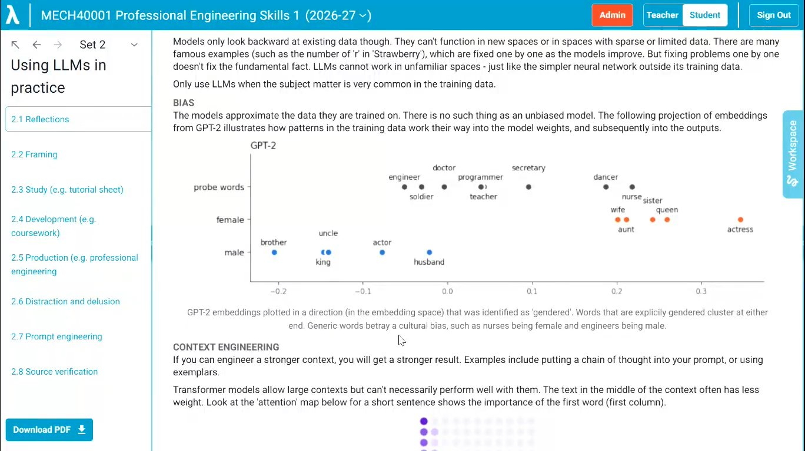
*Figure 1 — GPT-2 embeddings plotted along a direction identified as "gendered". Generic words such as nurse and engineer pick up a cultural bias (frame t0540, 09:00).*

The danger is a loop. The model picks up the bias, reproduces it in everything it writes, and that output becomes training data for the next models, so "we're locked into this now". This gender example is obvious; many less obvious biases affect all kinds of groups. Because models are biased on purpose, there is no unbiased model. The only defence is not to trust the model and to keep thinking critically yourself.

**Context engineering** comes from a simple picture. An LLM is its **model weights**, the fixed numbers learned in training. Your **context**, meaning everything in the prompt and conversation, passes through those weights and comes out as the output. The slide shows two **attention** maps for GPT-2. Attention is how strongly each word influences how another word in the same text is processed; the darker a dot, the stronger the link.

The lecturer's question: with the same weights and the same context length, why can the same transformer light up differently? Since the weights do not change, the only thing that can change is the context. So if you keep using the same model, the difference in behaviour comes from your prompt, and prompting is a skill you need. He asks you to picture the transformer lighting up and linking the parts of your context while you use it: what you put in changes what you get out.

The slide text adds two points that were on screen but not read out (frame t0660). First, "if you can engineer a stronger context, you will get a stronger result", for example by putting a chain of thought or exemplars in the prompt (both come back in Section 10). Second, transformers allow large contexts but cannot necessarily use them well: the text in the middle of the context often has less weight. One head of GPT-2 mainly attends to the first word (first column of the map); head 5 shows words influencing their neighbours (the diagonal). Many heads, each specialising, give each model its own character.

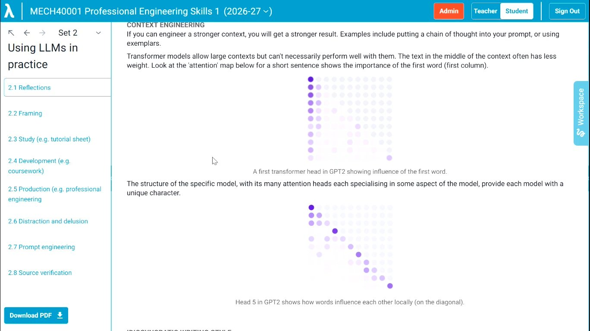
*Figure 2 — Two GPT-2 attention heads: the first shows the influence of the first word, head 5 shows local influence along the diagonal (frame t0660, 11:00).*

Summary: bias comes from the data and is reproduced and amplified; there is no unbiased model. With fixed weights, only the context changes the behaviour. Pitfall: assuming a neutral-sounding answer is unbiased. Memory tip: same weights, different context, different output.

---

## 4. Reflections III: writing style, rare events, data sharing and dAIsy (12:14-17:56)

**Writing style**: LLMs have recognisable styles. The slide calls it an **idiosyncratic writing style** that tends to be bland and vague, partly because most of the training content is bland and vague, and partly because the model is statistical; it links to the Wikipedia page "Signs of AI writing" (frame t0780). The lecturer's remark about whether he could tell text written with Claude is garbled in the audio. He says the style will change from year to year.

Some students will want help with their language, especially when studying in a second language, and the lecturer calls that a fantastic idea. But you must take ownership of what you hand in; if you simply take what you are given, it will "look funny". He tried letting these tools write for him and concluded he prefers to write himself, while leaving the choice to you.

**Rare events**: events do not have to be very rare to appear too seldom in the training data. The slide's example is names: about 100,000 names in the US Social Security database (and that does not cover the rest of the world), compared with fewer than 30,000 common words in English. Names are less likely to be learned than common nouns, and because the compression is lossy, low-count items are not recoverable.

The comparison of the two numbers (this ratio is computed in this note) shows why names are a weak spot: there are more than three US names for every common English word.

$$\frac{100\,000 \ \text{names}}{30\,000 \ \text{common words}} \approx 3.3$$

The slide adds that we experience rare events every day because there are so many kinds of them. Combined with the inability to extrapolate, this makes models dangerous outside common subjects: "cooking recipes are fine, but the inner layers of Jupyter's gases are out of scope" (the slide spells it "Jupyter's", presumably meaning the planet Jupiter).

**Data sharing**: every time you put data into one of these models, assume it is going out onto the internet, to the public, unless you have evidence otherwise. The lecturer's example: if you use Gemini on a personal Google account, read the terms and conditions; your data is used for training and can come back out in other people's results. So never paste passwords, financial information, medical information, private information or commercially sensitive information.

One way to keep data private is to run an LLM locally on your own computer. A student mentioned this, and the lecturer listed the drawbacks: it needs more computing power than a typical computer, a lot of setup, it produces tokens slowly, and the output quality is not as good as the free online services. For most people, at the moment, it is not worth it.

The slide lists exceptions where an adequate data agreement exists: Microsoft Copilot when logged into your enterprise account, the dAIsy app via your organisation, and the API end points of most services (OpenAI, Claude, Gemini, and so on).

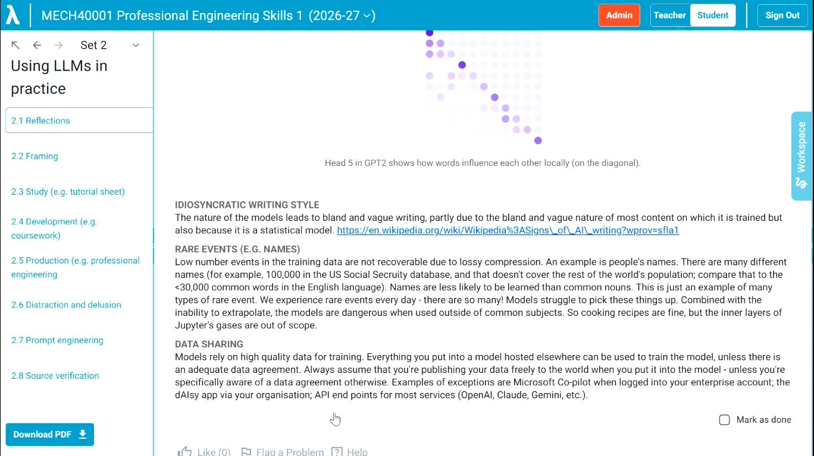
*Figure 3 — Slide text on idiosyncratic writing style, rare events such as names, and data sharing with its exceptions (frame t0780, 13:00).*

**dAIsy** is Imperial's own chat interface (the screen shows daisy.imperial.ac.uk, "ONEchat", with Claude Sonnet 5 selected, frame t0960). The transcript writes it as "Daisy"; the screen spells it "dAIsy". Its pros, collected from students and the lecturer: there is an enterprise data agreement, so data does not go further than Imperial; researchers can use it without worrying that their results will be republished by the AI company; it costs you nothing extra ("it's not actually free, you've already paid for it"); and it offers several models, so you are not locked in.

Its cons: not every model is offered. The lecturer lists Anthropic's four models as Haiku, Sonnet, Opus and Fable and says the top two are missing; the platform also nudges you towards the more environmentally friendly model, which he presumes does not perform as well. Your data is also still saved somewhere, just not passed to the AI companies.

dAIsy has an "agents" feature: ready-made assistants such as the Imperial Success Guide and a Canvas one, and you can make your own (the transcript mishears "agent" as "Asian"), although you cannot share them with each other. The lecturer encourages each student to make a study assistant whose instructions make it respond in a way that helps you learn; Section 6 says what that means.

Summary: model writing is bland and vague; rare things such as names are poorly learned; anything you type may become public unless there is a data agreement; dAIsy is the Imperial option with such an agreement. Pitfall: pasting private or commercially sensitive data into a personal account. Memory tip: if you would not post it publicly, do not paste it.

---

## 5. Framing: what is the purpose of the activity? (18:01-22:27)

**Framing** means deciding, before you start, what the purpose of an activity is and therefore what role AI should play in it. The slide says: "Before we discuss *how*, or even *whether* to use AI, we need to *frame* its use" (frame t1140).

The image is a student sitting in a gym while a forklift lifts the weights. Has the student been to the gym? Yes. Is it in the spirit of going to the gym? No. If the purpose of lifting weights is to make your muscles stronger, using a forklift is self-defeating. If the purpose is useful work that you are paid for and it does not matter who lifts, you use the forklift. So ask: should AI do the heavy lifting here, or is there a purpose in doing the cognitive work yourself?

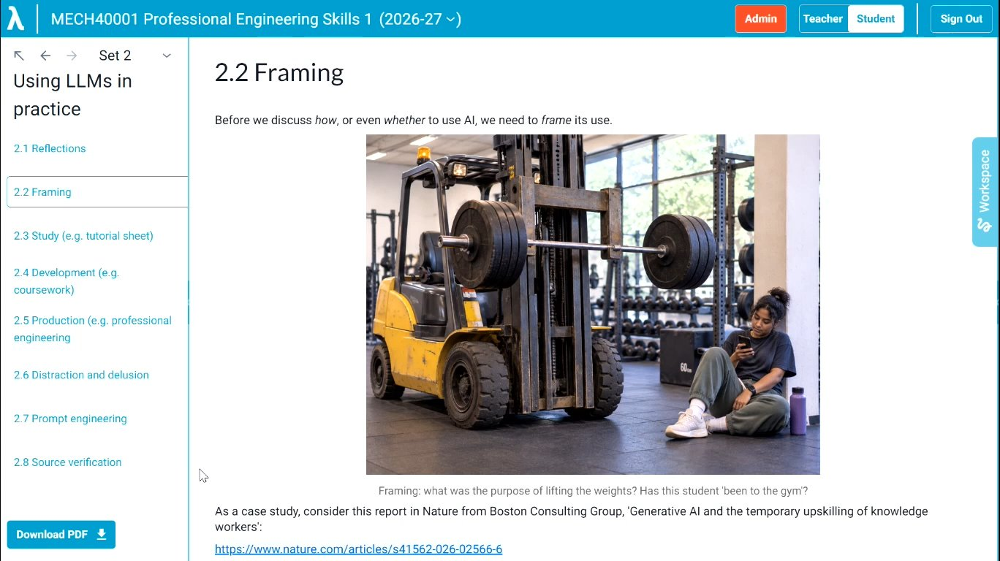
*Figure 4 — "Framing: what was the purpose of lifting the weights? Has this student 'been to the gym'?" (frame t1140, 19:00).*

The case study is a report in Nature by Boston Consulting Group, "Generative AI and the temporary upskilling of knowledge workers" (link on the slide, frame t1200). In a controlled test, people given AI performed at a higher level on management-consulting tasks. When the AI was taken away, they dropped back to the level of the control group: there was no lasting change. Experts still outperformed the group using AI, and the lecturer adds that the AI group will never become experts if they keep relying on AI.

The lecturer turns this into rules: if you want to be an expert in ten years, do not use AI for everything, because you will never get there; if you need a job done now and it does not matter how, AI may be useful. He describes his own way of expressing this with three parameters: how much you are **learning**, the **duration** (how long it takes), and the **output** you produce. These are the three axes of Figure 0.

The five regions of the diagram are defined as follows:

- **Production**: at work, the aim is output in minimal duration, and learning is not the priority; this is where AI really helps productivity. The slide: "to complete the task at hand as efficiently as possible; high output, low duration; learning not priority."
- **Study**: the outputs are usually pointless in themselves; you do the task in order to learn, like going to the gym. If AI does the learning for you, you miss out.
- **Development**: the middle region, where the output has real value but you are also trying to learn from the experience, so you must strike a balance.
- **Distraction**: AI takes you down a rabbit hole; you spend time, learn nothing and produce nothing.
- **Delusion**: AI produces something quickly; you think you have learned and produced something valuable, but you have not.

Summary: frame first, then decide how to use AI; the same tool is right for production and wrong for study. Pitfall: confusing "the task got done" with "the purpose was achieved". Memory tip: forklift at work, your own arms at the gym.

---

## 6. Study: cognitive engagement versus cognitive surrender (22:27-33:00)

In study you are in the Learning region of the diagram, and the key concept is that learning takes **cognitive engagement**, actively using your own brain. The opposite is **cognitive surrender**, handing your thinking over to the tool. The lecturer asks you to keep the term "cognitive surrender" in mind every time you sit at the keyboard: if you surrender your cognition, you fail the learning task. Depending on the framing that may be acceptable, but if the purpose was to learn, do not cheat yourself.

The slide explains why most LLMs are *not* appropriate for the core task when the goal is to learn (frame t1560). They take agency away from the user: you put something in, get something out, then put in something based on that, and you lose control of the process, which is the whole point of learning. They give very long responses that waste your time and drain your energy without helping you think. And they overload your bandwidth while underloading your independent thinking.

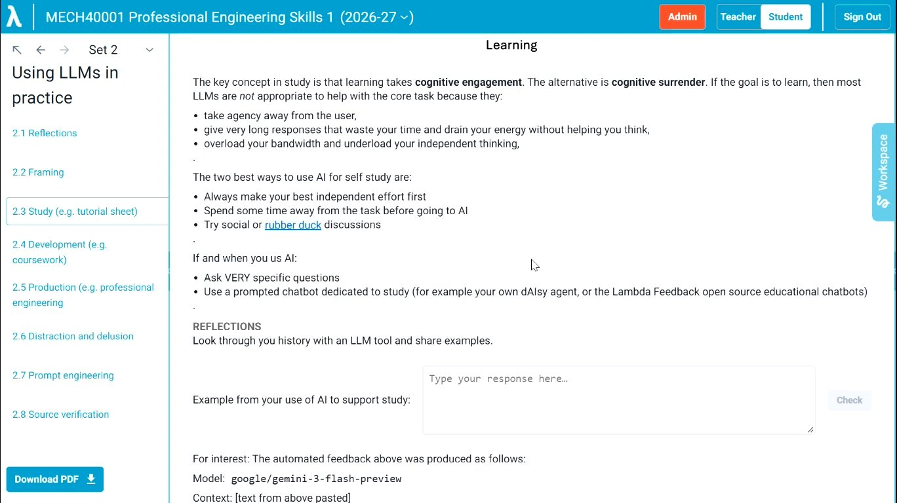
*Figure 5 — Section 2.3 Study: why LLMs can block learning, the best ways to study, and the reflection activity with its automated-feedback model (frame t1560, 26:00).*

The lecturer's advice comes in order. First, always make your best independent effort and find out how far you can get on your own. Second, once you reach your limit, stop and do not go straight to AI: go for a walk. He mentions the brain's **default mode**: the brain has a focused and an unfocused way of working, things still happen while you are unfocused, and you often come back and solve the problem.

Third, try a social or **rubber duck debugging** discussion. In computing, when you cannot solve a problem, you explain it out loud to a rubber duck on your desk; by the time you have explained it, you often see the solution, so the duck never needs to answer. You do not need a real duck; imagine one. Some computing departments put a rubber duck on every computer.

Only after all that, if you use AI: ask VERY specific questions. "How do I do it?" is a poor question. Write it out as you did for the rubber duck: "in this question we assumed this, I tried this, I thought this, I checked this, and when I did this...". Writing it out may solve the problem by itself; if not, paste that in, so that you keep control of the conversation. Also use a chatbot prompted for study, such as your own dAIsy assistant set to give short responses that do not solve the problem for you, or the Lambda Feedback open-source educational chatbots.

The class activity (25:41-32:38): students pasted a real prompt from their own AI history (or made one up) into a Lambda Feedback box and received automated feedback on it. The lecturer showed exactly how the feedback was produced (frame t1980). The model was google/gemini-3-flash-preview; the context was the guidance text above; and the feedback instruction read: "Give feedback on the relevant aspects of the proposed prompt: student agency, independent thinking, and specificity. For each one comment objectively and concisely on the prompt. Overall max 50 words." This was combined with a moderation prompt running in parallel.

The audio during the activity (about 26:29-30:18) is mostly inaudible. In the discussion afterwards, one student's prompt got positive feedback because it included the question, the context, and specifics of what they had done; the agreed takeaway was "be specific". Another student had asked Gemini what the weather was that morning and got the feedback "no thinking", although it did the job. The lecturer's point: for the weather, little cognitive effort is a good thing, so there is no single right way to use AI; it depends on the framing. A third student said they were probably guilty of expecting AI to fill in the gaps and that, when in a lazy mood, they perhaps should not have gone to AI at all. Parts of these exchanges are garbled.

Summary: in study, effort first, then a break, then a rubber duck, and only then a very specific question to a study-focused chatbot. Pitfall: letting the LLM take over the conversation so that you lose agency. Memory tip: think before you type.

---

## 7. Development: coursework, chore versus core (33:00-37:02)

Coursework sits in the middle of the diagram, the Development region: you have some time, you want to learn something, but you also have to produce an output and get the job done. The key idea is to distinguish a **chore** from the **core**. A core part is what the task is really trying to teach; a chore is necessary work that is not the point of the task. To tell them apart, read the task yourself and ask what the teacher is really trying to achieve.

The slide begins with a warning: "Before doing anything, check the regulations for your particular piece of coursework!" (frame t2040). It then asks for your approach in two examples, worked below.

### Example 1 — The fairground ride report: 50% of the marks are for formatting

**What is asked.** The quiz states: "50% of the marks for the fairground ride are for formatting." Choose an approach: (a) formatting is a CHORE, use AI; (b) formatting is CORE, do it entirely manually; (c) formatting is CORE, do it manually but use AI as a checker.

**Why this route.** The chore-versus-core test says: read the task and ask what the teacher wants you to learn. The mark scheme is the clearest evidence of that intent, so we start from the weight of formatting in the marks.

**Step 1 — Read the weight of formatting in the mark scheme.** Let $w_{\text{formatting}}$ be the fraction of the total marks given to formatting (a pure number, no unit). This yields the size of formatting within the task.

$$w_{\text{formatting}} = 50\% = 0.5$$

**Step 2 — Infer the teacher's goal.** Half of all marks would not be spent on something the teacher does not care about. The lecturer says the intent is that formatting is core, "because you should be able to format a report" (34:26). This yields the classification.

$$\text{half of the marks on formatting} \;\Rightarrow\; \text{formatting is CORE}$$

**Step 3 — Decide the role of AI.** AI can format the report, just as a forklift can lift weights in the gym. But "how do you even know if it's formatting it right, if you've never done it yourself?" (34:48). Learning the skill takes real cognitive effort ("the hard yards"). This yields the decision.

$$\text{CORE} \;\wedge\; \text{skill not yet mastered} \;\Rightarrow\; \text{do the formatting yourself}$$

**Where each number comes from.** The 50% is printed in the quiz (frame t2040), and the lecturer confirms it aloud ("I think it's right that 50% of your marks are for the formatting", 33:50). No other number is involved.

**Sanity check.** Compare with the framing diagram. A first-year lab report is mainly a learning activity: the formatted report has little value in itself, so the task sits towards Study/Development, where AI should not do the core work. The answer agrees with that.

**Answer.**

$$\boxed{\text{Formatting is CORE: do the formatting yourself}}$$

The lecturer did not say aloud whether option (b) or option (c) is the one marked correct by the quiz, and the answer key is not visible in the frames; his reasoning only establishes that formatting is core and that you must learn to do it yourself.

**Common pitfall.** Treating formatting as cosmetic "just presentation" and handing it to AI. When the mark scheme puts weight on a skill, that skill is the point of the exercise.

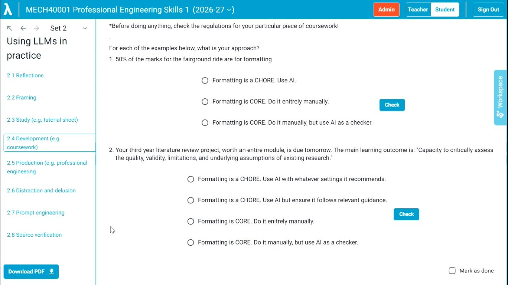
*Figure 6 — Section 2.4 quiz: the fairground ride formatting question and the literature review question, each with chore/core options (frame t2040, 34:00).*

### Example 2 — The third-year literature review

**What is asked.** "Your third year literature review project, worth an entire module, is due tomorrow. The main learning outcome is: 'Capacity to critically assess the quality, validity, limitations, and underlying assumptions of existing research.'" Is formatting a chore or core, and how should you use AI?

**Why this route.** Again apply the chore-versus-core test, but this time the teacher's goal is written down explicitly as a learning outcome, so we check whether formatting appears in it.

**Step 1 — Read the learning outcome.** It asks for critical assessment of research. Formatting is not mentioned. This yields the core of the task.

$$\text{CORE} = \text{critical assessment of existing research}, \qquad \text{formatting} \notin \text{CORE}$$

**Step 2 — Classify formatting.** Since formatting is not part of the learning outcome, the lecturer says: "It's a chore" (35:33; the transcript mishears "chore" as "jaw"). This yields the classification.

$$\text{formatting} \;\Rightarrow\; \text{CHORE}$$

**Step 3 — Check the conditions for handing a chore to AI.** The lecturer: "the best thing to use AI for is something you already know how to do" (35:47). If you formatted reports yourself in first year, you can tell whether the AI's formatting is right. This yields the decision.

$$\text{CHORE} \;\wedge\; \text{mastered earlier} \;\wedge\; \text{you can verify it} \;\Rightarrow\; \text{AI may do it}$$

**Where each number comes from.** "Third year", "an entire module" and "due tomorrow" are printed in the quiz (frame t2040). The lecturer adds aloud that it is worth five credits (35:13); that figure is from the audio only.

**Sanity check.** The answer depends on Example 1: the reason AI is acceptable here is precisely that you learned the skill by doing the formatting yourself in first year. That is consistent with the forklift picture: use the forklift for work you can already do.

**Answer.**

$$\boxed{\text{Formatting is a CHORE: AI may do it, because you mastered it before and can check it}}$$

The lecturer's reasoning matches the option "Formatting is a CHORE. Use AI but ensure it follows relevant guidance" more closely than "Use AI with whatever settings it recommends", but he did not name the option aloud, and the answer key is not visible in the frames.

**Common pitfall.** Using AI for a chore you have never done yourself: you then cannot verify the result. Another pitfall is skipping the coursework regulations, which the slide says to check first.

*Figure 6 (again) — The literature review question is the second item in the same quiz frame (frame t2040, 34:00).*

The lecturer closes the section with **epistemological framing**, meaning framing to do with knowledge: what is the purpose of the task? Rarely at university is the purpose of a task simply to complete it. If you struggle through half of it, you have probably got more out of it than if you rushed to the end. He notes that students do not have a strong record of reading coursework descriptions and reflecting on the core purpose.

Summary: in coursework, find the core (do it yourself) and the chores (AI may help, but only if you have mastered them and can verify them). Pitfall: assuming the goal is to finish. Memory tip: core is the workout, chore is the carrying.

---

## 8. Production: professional work and accountability (37:02-48:47)

In professional work you are in the Production region: a similar amount of time, but now getting the job done comes before learning. The slide gives reasons: tight deadlines, work that is commercially or legally necessary in the short term but not core to your mission, and so on (frame t2280). You can get a lot done with AI, especially with the newest agent tools covered next week, but you can also shoot yourself in the foot.

The distraction anecdote (37:42-38:22): in a meeting that day, the lecturer watched a colleague who had made a PowerPoint slide with Claude, well prompted, with very good output. They then needed one number changed (the transcript says "from 5 to 0"; the exact numbers may be misheard). They prompted Claude to rebuild the slide; five minutes later there was a long answer, verification steps, and finally the file was saved, but it was the wrong file. Editing the number by hand would have taken seconds. A powerful automatic tool can feel productive while wasting your time.

The delusion anecdote (38:29-39:02): the lecturer did consulting work with AI, declared it, and shared the whole repository so the client could see his trail. He got about three months' work done in three days. The client only cared about the answers, so it was not cheating, as long as he stayed accountable. But he cannot take credit for having really done that work: asked to repeat it, he could not write it out line by line. Do not delude yourself that you did it, and make sure you are accountable.

For a sense of the speed-up (this ratio is computed in this note, taking a month as about 30 days), three months in three days is roughly a thirty-fold compression of time:

$$\frac{3 \times 30 \ \text{days}}{3 \ \text{days}} = 30$$

**Accountability** is the key word. Colleagues ask the lecturer whether it is acceptable to give students AI-generated teaching material. Asked for their view, some students shook their heads and some were indifferent. His view is that this is not the point: the point is quality, and someone has to be accountable for that quality, which is the teacher. He wrote this material by hand because that was the best way to express himself, but in other cases using AI is appropriate. What matters is quality and accountability.

The slide summarises the key guidance (frame t2280). Avoid delusion: make sure the outputs really meet the requirements, and do not assume you learned anything (for example, that you could do it yourself next time). Avoid distraction: AI can quickly get you debugging the wrong problem. Ensure accountability: even if the work can be automated, can you still take responsibility for it? Are lives, capital or commercial advantages at risk if you use AI?

The best jobs to automate are those that are (1) routinely covered in the training data, (2) jobs you could do yourself if necessary, and (3) verifiable by you when complete. The lecturer stresses the last one: if you produce more output than you can verify, you will get into trouble.

$$\text{automate only if: routine in training data} \;\wedge\; \text{you could do it yourself} \;\wedge\; \text{you can verify it}$$

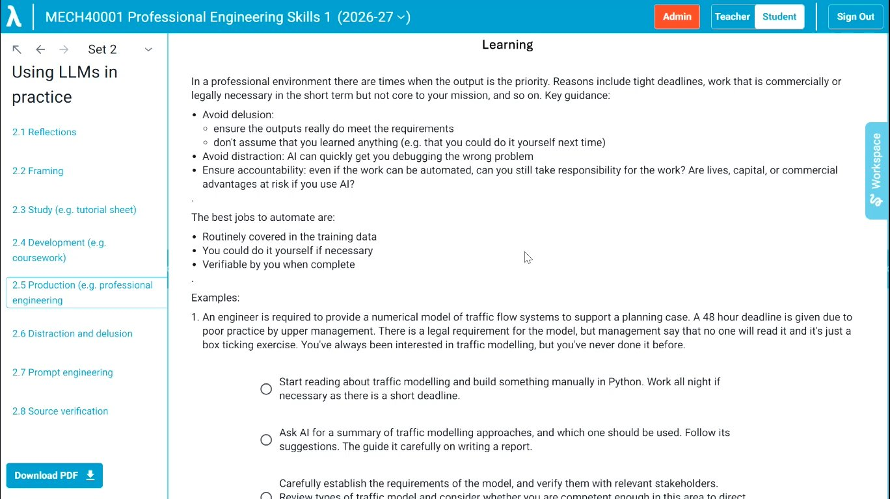
*Figure 7 — Section 2.5 Production: avoid delusion, avoid distraction, ensure accountability; the best jobs to automate (frame t2280, 38:00).*

### Example 3 — A traffic flow model in 48 hours

**What is asked.** "An engineer is required to provide a numerical model of traffic flow systems to support a planning case. A 48 hour deadline is given due to poor practice by upper management. There is a legal requirement for the model, but management say that no one will read it and it's just a box ticking exercise. You've always been interested in traffic modelling, but you've never done it before." Which of five approaches should you take (frame t2580)?

**Why this route.** This is production work, so we apply the three automation criteria from the slide and the accountability test, then check each option against them and against the time available.

**Step 1 — List the facts.** The deadline is $t_{\text{deadline}} = 48$ h; your experience of traffic modelling is zero; the model is a legal requirement even if "no one will read it". This yields the constraints.

$$t_{\text{deadline}} = 48 \ \text{h}, \qquad \text{prior traffic-modelling experience} = \text{none}$$

**Step 2 — Apply the automation criteria.** You could not build such a model yourself, so you also cannot verify one the AI builds. Two of the three criteria fail. This yields: you cannot responsibly hand the task to AI.

$$\text{could do it yourself} = \text{no} \;\Rightarrow\; \text{cannot verify} \;\Rightarrow\; \text{do not hand it to AI}$$

**Step 3 — Test each option against the lecture's arguments.**
(1) Read up and build it manually in Python, working all night: a student argued it is not worth the effort for the outcome.
(2) Ask AI which approach to use and follow its suggestions: you do not know whether that advice is sound. The lecturer's story: where he lives, £130 million was committed to a new busway whose modelling he believes is wrong (he showed calculations that taking people by helicopter would be cheaper for the benefit), and it still got planning permission; "you can't use models that you don't understand". AI can help explain a model to you faster, but you cannot simply follow its advice.
(4) Give the task to Claude on max settings and, if convinced, submit: "It's not about convincing people. It's about being accountable."
(5) Read the fundamentals until expert, build toy models, then scale up with AI: "a great way to work, but it's not going to work in 48 hours".
This yields option (3) as the only one consistent with the arguments.

**Step 4 — Check the remaining option.** Option (3): establish the requirements, verify them with the stakeholders, review the types of traffic model, judge honestly whether you are competent to direct AI, and be prepared to say no. The lecturer backs this: if you just accept an unreasonable request you are "half of the problem"; management is a two-way process, your manager may not know it is unreasonable, and as a manager he appreciates being told. This yields the answer.

**Where each number comes from.** The 48 h deadline is printed in the scenario (frame t2580). The £130 million busway figure comes from the lecturer's personal anecdote in the audio (42:55), not from the slide.

**Sanity check.** A legal requirement means someone may rely on the model later, so "no one will read it" does not remove your accountability. The chosen option is the only one that keeps you accountable without pretending to a competence you lack, which agrees with the production guidance.

**Answer.**

$$\boxed{\text{Option 3: establish and verify the requirements, judge your competence, be prepared to say no}}$$

The lecturer argued against options 1, 2, 4 and 5 and supported saying no; he did not read out the quiz's answer key.

**Common pitfall.** Believing "I can't say no" in a first internship. The lecturer's reply: if you really cannot say no, "that's not a place for you to work".

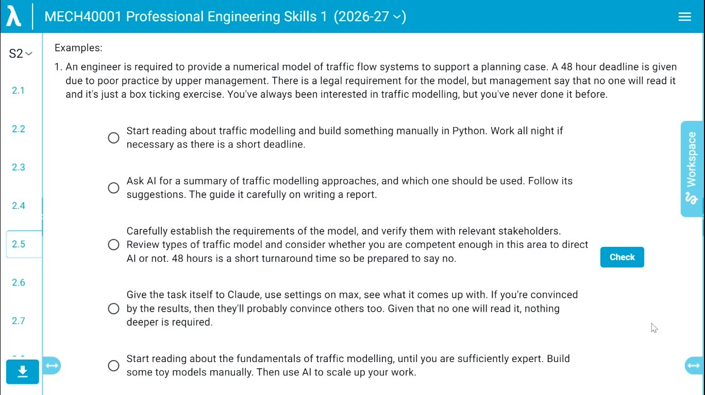
*Figure 8 — The traffic flow model scenario and its five options (frame t2580, 43:00).*

### Example 4 — Statistics on a large, messy dataset

**What is asked.** "You are asked to perform a basic statistical analysis on a large and messy data set. You have performed this type of analysis before and consider yourself competent. However, the task is very unattractive because there is so much manual work." Choose among four options (frame t2820).

**Why this route.** Again a production task, so we apply the three automation criteria. This time they pass, so the question becomes how much verification is enough.

**Step 1 — Apply the automation criteria.** Basic statistics is routine in training data, you are competent, and you can check the work. This yields: AI is appropriate.

$$\text{routine} \;\wedge\; \text{competent} \;\wedge\; \text{verifiable} \;\Rightarrow\; \text{AI is appropriate}$$

**Step 2 — Reject the options that refuse AI or refuse the work.** Option 1 (refuse the work and complain because it does not help your development): when you sign up for a job you commit to doing the job; if the task is within your competence, you get on with the dirty work. Option 2 (do it all manually because it is a professional job): too slow; your peers will get it done "ten times as fast" and "you're not going to survive". This yields: use AI.

**Step 3 — Decide how much checking is enough.** Option 3 says drop everything into Claude and do "a few checks". The class pointed out that the AI can make mistakes; the lecturer: "In a professional environment, a few checks is not enough", because you are as accountable as you always were. This yields the verification rule.

$$\text{your accountability with AI} = \text{your accountability without AI}$$

**Step 4 — Build the workflow of option 4.** Prompt an LLM to write code to process the data; make sure the technique is appropriate (you are competent to judge that); check every line of code; check all of the results; expect to iterate a few times because the data is messy. This yields the answer.

$$\text{LLM writes code} \to \text{check technique} \to \text{check every line} \to \text{check all results} \to \text{iterate}$$

**Where each number comes from.** "Ten times as fast" is the lecturer's rhetorical estimate in the audio (47:15), not a measured value. "A few checks" and "a few times" are the wording of the options on the slide (frame t2820).

**Sanity check.** The lecturer explicitly endorses option 4: "This is using the right combination of judgement, expertise and tools at your disposal" (48:38). It also satisfies all three automation criteria and the accountability test.

**Answer.**

$$\boxed{\text{Option 4: AI writes the code; you check the technique, every line and every result, and iterate}}$$

**Common pitfall.** Option 3's "a few checks on the outputs". It sounds responsible, but it leaves you accountable for errors you never looked for.

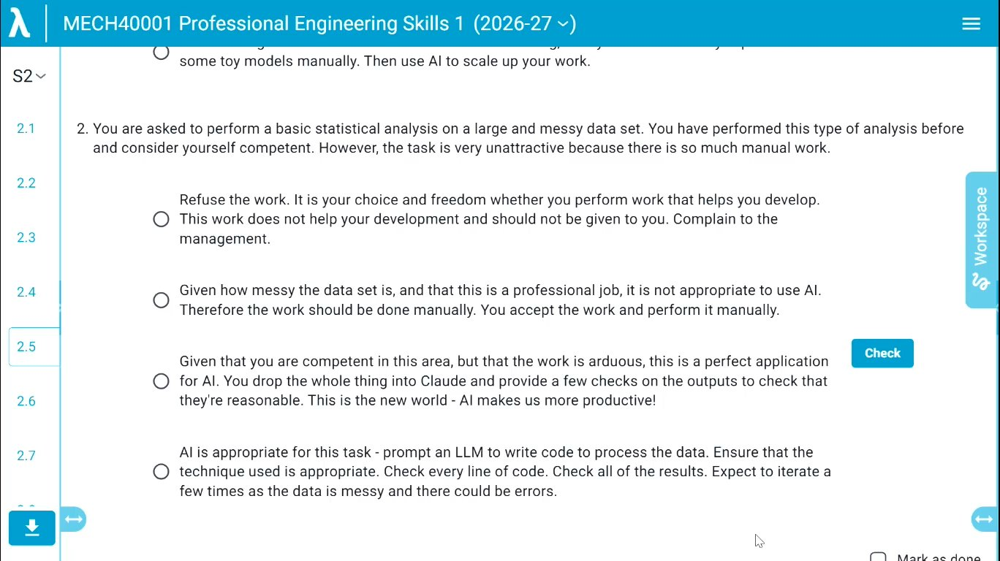
*Figure 9 — The messy dataset scenario and its four options; the lecturer endorsed the fourth (frame t2820, 47:00).*

Summary: in production AI is a legitimate tool, but only for work that is routine, that you could do yourself, and that you can verify; accountability never moves to the AI. Pitfall: producing more output than you can check. Memory tip: you can delegate the work, not the responsibility.

---

## 9. Distraction and delusion (48:53-49:07)

The lecturer passes over this section quickly, saying he has already told the class about the distraction and delusion loops (the anecdotes in Section 8) and that the slide is "just a nice picture there for you". The **distraction loop** on the slide (frame t2940) runs: start a chat hoping to get help; initial answers are rapid and helpful ("Dopamine says, continue!"); the question still is not answered, so you steer the AI back on track; courteous answers continue but things get more confusing; you get frustrated; you have spent a lot of time and try to get a summary or something useful out; you end up "with nothing but a hot, empty head". In the middle the slide asks: "What could you have achieved on your own in this time?"

The text below the diagram, partly cut off in the frame, says that when it feels hard to get started it is tempting to turn to AI, which seems innocent at first but can waste your time and energy; the first piece of advice visible is to turn your screen off before opening AI and ask what the specific purpose of using it is and why it is the right choice. The delusion part of section 2.6 was not shown in the frames.

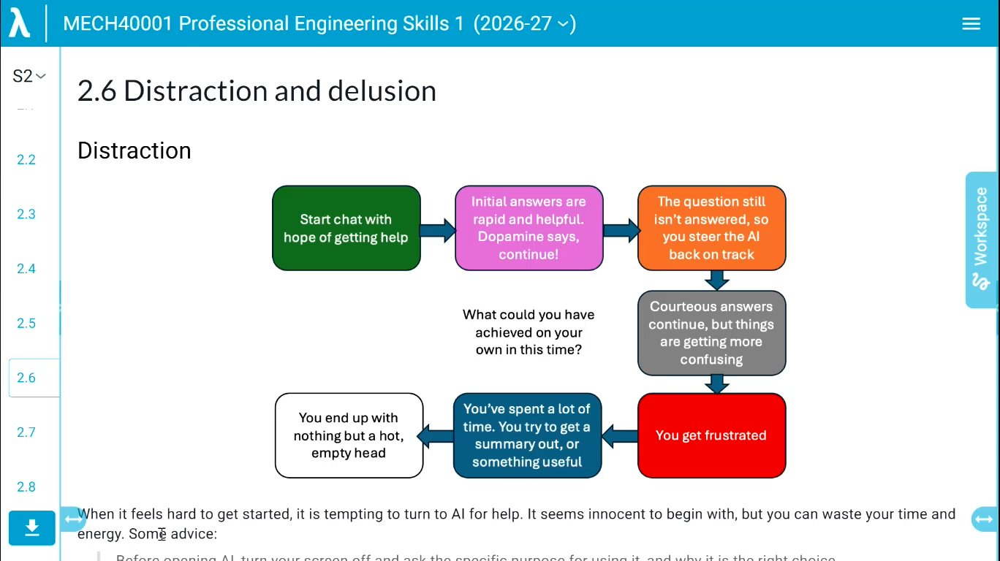
*Figure 10 — The distraction loop: from "start chat with hope of getting help" to "nothing but a hot, empty head" (frame t2940, 49:00).*

Summary: distraction costs time and yields nothing; delusion yields output quickly but no real learning or value. Pitfall: mistaking a busy chat for progress. Memory tip: before opening AI, name the purpose.

---

## 10. Prompt engineering: context, multi-shot and chain of thought (49:07-51:15)

**Prompt engineering** means deliberately designing what you put into the model so that the output is more useful. The first technique is to enhance the context: remember the picture of the transformer linking parts of your input, and put in as much relevant context as you can. A student's good example earlier was pasting the whole question and adding their own part at the end. If you drag and drop an image, it is all turned into tokens and helps; the models are very good with unstructured data.

The second technique is the **multi-shot prompt**. The transcript hears it as "multi prompting"; the slide says "Multi-shot prompts" (frame t3000). Typical prompts are **single-shot**: one query, one response. A multi-shot prompt shows a few worked versions of a similar prompt so the model has a pattern to follow. The slide's example is a website that automatically categorises support tickets so that each goes to the right person with the right urgency.

### Example 5 — What a multi-shot prompt teaches the model

**What is asked.** The prompt on the slide is: Ticket "The app crashes when I upload a photo." Category: Bug | Urgency: High; Ticket "Could you add a dark mode?" Category: Feature request | Urgency: Low; Ticket "I was charged twice this month." Category: Billing | Urgency: High; Ticket "How do I change my password?" Category: (left blank for the model). What do the three examples teach the model, and what would happen if every example had said "Urgency: High"?

**Why this route.** The model continues the most likely pattern in its context, so we read the pattern off the examples, list what it fixes, and then change the examples to see what the model would copy.

**Step 1 — Read the output format.** Every example answer has the same shape: a category and an urgency separated by a pipe. The lecturer: "it's going to give two words split by a pipe". This yields the format.

$$\text{Category: } c \;\mid\; \text{Urgency: } u$$

**Step 2 — Read the allowed values.** The examples show three categories and two urgency levels. This yields the sets the model will choose from.

$$c \in \{\text{Bug},\ \text{Feature request},\ \text{Billing}\}, \qquad u \in \{\text{High},\ \text{Low}\}$$

**Step 3 — List what the examples guide.** The slide says the three examples guide in four ways that a single-shot prompt would not: 1. categories; 2. output format; 3. interpreting urgency; 4. length of the answer (models often add an explanation paragraph). This yields the benefit of multi-shot prompting.

**Step 4 — Change the examples.** The lecturer asks: imagine every example says "Urgency: High"; what will the model say for the next one? The answer given in class is "High". The model copies the pattern and will not infer anything outside the examples. This yields the rule about variety.

$$u_1 = u_2 = u_3 = \text{High} \;\Rightarrow\; u_4 = \text{High}$$

**Where each number comes from.** "Three examples" and "four ways" are from the slide (frame t3000). The subscripts $u_1, u_2, u_3$ label the urgencies of the three example tickets and $u_4$ the urgency the model will write for the fourth ticket; this labelling is added in this note.

**Sanity check.** The real example set contains both High and Low, so the model sees that urgency can vary; this is exactly the variety the lecturer says is needed. Note that the lecture did not say which category the password ticket should get, and none of the three categories obviously fits it; this note does not guess.

**Answer.**

$$\boxed{\text{The examples fix categories, format, urgency and length; all-High examples give a High answer}}$$

**Common pitfall.** Giving examples with too little variety. The model will copy whatever the examples share, even when you did not intend it.

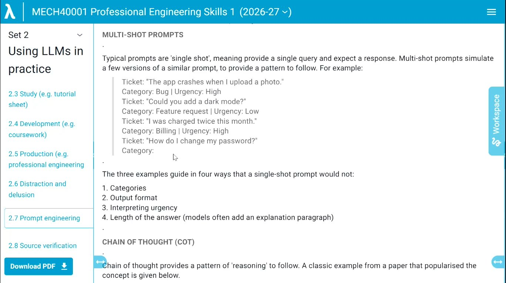
*Figure 11 — A multi-shot prompt for ticket categorisation and the four things the examples guide (frame t3000, 50:00).*

The third technique is **chain of thought (CoT)**: the prompt shows a pattern of reasoning to follow, not just answers. The slide shows a classic example from a paper that popularised the idea, linked as arXiv 2201.11903 (frame t3060). The lecturer says this is what led to the so-called **reasoning models**, which are covered next week.

### Example 6 — Chain-of-thought prompting on the cafeteria apples question

**What is asked.** Both prompts contain the same worked exemplar, "Roger has 5 tennis balls. He buys 2 more cans of tennis balls. Each can has 3 tennis balls. How many tennis balls does he have now?", followed by a new question: "The cafeteria had 23 apples. If they used 20 to make lunch and bought 6 more, how many apples do they have?" With standard prompting the exemplar answer is just "The answer is 11" and the model outputs 27 (wrong). With chain-of-thought prompting the exemplar shows the reasoning. Work the reasoning the model is being taught to imitate, and find the correct answer.

**Why this route.** Chain of thought works by giving the model a step-by-step pattern to copy. So we first write out the exemplar's reasoning, then apply the same pattern to the new question one operation at a time.

**Step 1 — The exemplar's reasoning.** The slide's chain-of-thought exemplar reads: "Roger started with 5 balls. 2 cans of 3 tennis balls each is 6 tennis balls. 5 + 6 = 11." (The transcript hears "two cans of three" as "two kinds of three"; the slide wins.) This yields the pattern: start value, change, total.

$$5 + 2 \times 3 = 5 + 6 = 11 \ \text{tennis balls}$$

**Step 2 — Apply the pattern: subtract what was used.** The cafeteria starts with 23 apples and uses 20. This yields the apples left after lunch.

$$23 - 20 = 3 \ \text{apples}$$

**Step 3 — Add what was bought.** They then buy 6 more. This yields the final count, matching the slide's chain-of-thought output: "They had 23 - 20 = 3. They bought 6 more apples, so they have 3 + 6 = 9."

$$3 + 6 = 9 \ \text{apples}$$

**Where each number comes from.** 5, 2, 3 and 11 come from the tennis-ball exemplar; 23, 20 and 6 from the cafeteria question; 27 is the wrong output under standard prompting and 9 the correct output under chain of thought. All are printed in the figure on the slide (frame t3060).

**Sanity check.** Using 20 of 23 apples leaves only 3, and adding 6 to 3 cannot exceed 9, so 27 is impossible. The lecturer notes that in both prompts the exemplar answer is 11; the only difference is that the style of reasoning was copied into the output, which made a correct answer more likely.

**Answer.**

$$\boxed{9 \ \text{apples}}$$

**Common pitfall.** Thinking chain of thought changes the model. The weights are unchanged; only the context changes. It makes a correct answer more likely, not guaranteed.

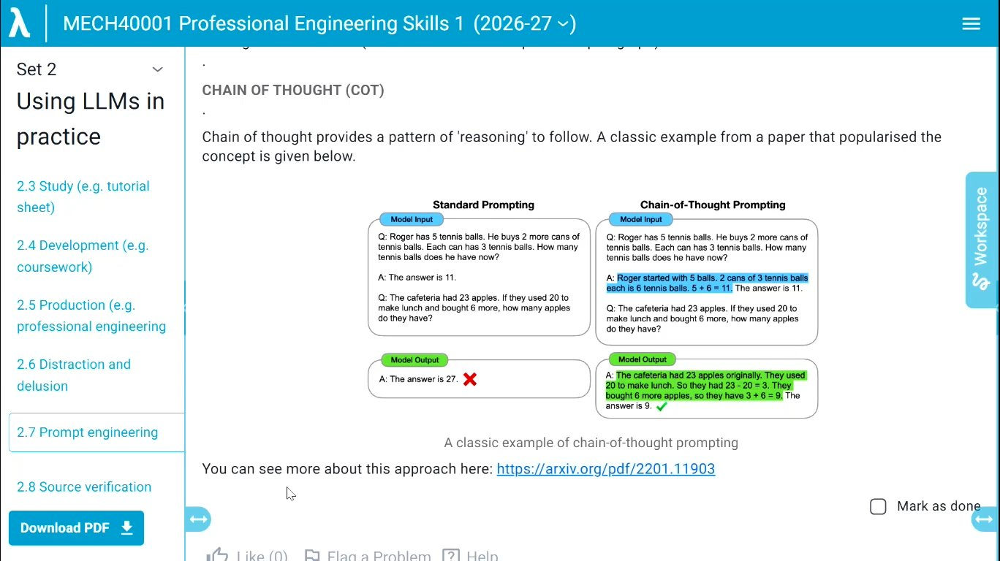
*Figure 12 — Standard prompting (output 27, wrong) versus chain-of-thought prompting (output 9, correct), with the paper link arXiv 2201.11903 (frame t3060, 51:00).*

Summary: give rich context, give varied examples of the output you want, and show the reasoning pattern you want copied. Pitfall: examples that all share an unintended feature. Memory tip: the model copies what you show, not what you mean.

---

## 11. Source verification (51:15-54:18)

**Source verification** means checking that a claim traces back to a source you can rely on. The lecturer asks: "When is an LLM output reliable?" Suggestions from the class included asking the AI to check an equation for you, and "it will be reliable if it's from a reliable source".

The lecturer's answer is: never. If the subject is very common and simple in the training data, the output is highly likely to be right, but an LLM is not a reliable source and not a **primary source**, meaning the original publication or data where a claim was first made. It is a lossy compression of the internet. What it is good for is pointing you to where to go and what to look for.

Fabricated references are a real hazard. If a model gives you a source and tells you what it says, go and look it up: often the source does not exist. The lecturer says many references in published work today do not exist; people cite such work, others copy the citation, and you can end up with something like 50,000 citations of something that does not exist (his illustrative figure), because the original sources are lost.

The Newton story (53:36-54:12) shows the right use. The lecturer asked a model where in Newton's book Newton discusses calculus, because he had the book and could not find it. It gave a page number in the Principia Mathematica (the transcript mishears "page number" as "patent number"). He looked and found nothing about calculus. He told the model, which replied that Newton used different notation and pointed to specific passages. He looked again and, sure enough, it was there. The model was right this time because Newton is copied everywhere, but he still did not simply believe it: he used it to find the original and then read the primary source.

The slide (frame t3120) adds: LLMs are certainly *useful* but not 100% reliable; reliability is highest when the outputs represent something very common and unambiguous in the training data, but they can and do still make mistakes. They are trained for helpfulness and coherence, and they always generate an output. To verify information, find a source you can rely on:

- Wikipedia is defined as a *secondary* source that cites primary sources; those primary sources need verifying.
- AI can suggest sources for its information; they need verifying.
- Not all primary sources are equal: reputable organisations and peer-reviewed journals provide confidence.
- Expert advice is only advice.

When asserting claims, refer to primary sources rather than to AI or its reasoning traces.

### Example 7 — What does an 85% benchmark score mean for reliability?

**What is asked.** A student argued that LLMs "often give correct answers": on benchmarks they score around 85%. The lecturer replied: "Do you want to be wrong 15% of the time?" Show where the 15% comes from, and decide whether an 85% model can be used as a source in a lab report.

**Why this route.** A benchmark score is the fraction of test questions answered correctly, so the fraction wrong is its complement. Then we apply the lecture's rule on what counts as a source.

**Step 1 — Write the score as a probability.** Let $p_{\text{correct}}$ be the fraction of benchmark questions answered correctly (a pure number between 0 and 1). This yields the starting value.

$$p_{\text{correct}} = 85\% = 0.85$$

**Step 2 — Take the complement.** Each answer is either right or wrong, so the two fractions add up to 1. This yields the error rate the lecturer quoted.

$$p_{\text{wrong}} = 1 - p_{\text{correct}} = 1 - 0.85 = 0.15 = 15\%$$

**Step 3 — Apply the source rule.** Even a high score does not make the model a primary source; it is a lossy compression of the internet and it always produces an output. So the model's output can only be a pointer to a primary source, which you then read and cite. This yields the decision.

$$\text{LLM output} \to \text{pointer} \to \text{primary source} \to \text{cited claim}$$

**Where each number comes from.** The 85% is the lecturer's rough figure for typical benchmark scores ("It gets scores like 85%", 52:17); no specific benchmark is named. The 15% follows from it, and the lecturer states it himself.

**Sanity check.** $0.85 + 0.15 = 1$, so the two fractions cover all answers. The conclusion agrees with the lecturer's one-word answer to "When is an LLM output reliable?": never.

**Answer.**

$$\boxed{p_{\text{wrong}} = 0.15 \ \text{: never cite the LLM, cite the primary source it points to}}$$

**Common pitfall.** Asking the AI to check its own equation and treating its confirmation as verification. The slide says to refer to primary sources, not to AI or its reasoning traces.

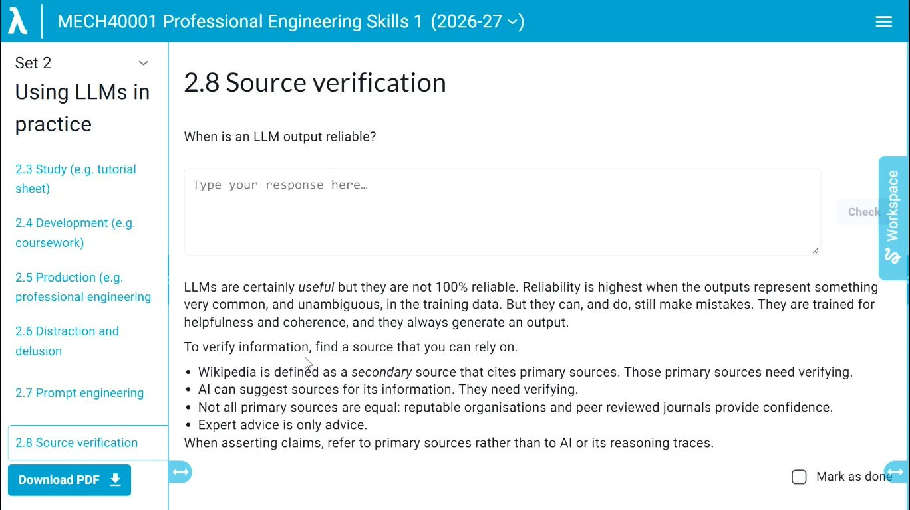
*Figure 13 — Section 2.8: "When is an LLM output reliable?" with the guidance on secondary sources, AI-suggested sources, primary sources and expert advice (frame t3120, 52:00).*

Summary: an LLM is never a reliable source; use it to find where to look, then read and cite the primary source. Pitfall: citing references the model invented. Memory tip: AI points, primary sources prove.

---

## 12. Wrap-up and next week (54:18-54:45)

The lecturer closes the advice part and invites feedback. Next week returns to technical, more advanced topics: agents and tools, with students doing some computing themselves, such as calling a model's API (application programming interface) from Python, so that they can use programmatic approaches.

Summary: this week was about judgement; next week is about programmatic use. Pitfall: none. Memory tip: judgement first, automation second.

---

## Key formula and rule sheet

The lecture is mostly about judgement, so most entries are decision rules written in compact form; the few numbers come from the lecture or are clearly marked as computed in this note.

Interpolation needs dense data; last week's small network (ratio computed in this note):

$$\frac{200 \ \text{data points}}{49 \ \text{parameters}} \approx 4.1$$

Rare events: names outnumber common words (ratio computed in this note):

$$\frac{100\,000 \ \text{names}}{30\,000 \ \text{common words}} \approx 3.3$$

Coursework, chore versus core:

$$\text{CORE} \Rightarrow \text{do it yourself}, \qquad \text{CHORE} \wedge \text{mastered} \wedge \text{verifiable} \Rightarrow \text{AI may do it}$$

Production, the three automation criteria:

$$\text{automate only if: routine in training data} \;\wedge\; \text{you could do it yourself} \;\wedge\; \text{you can verify it}$$

Accountability does not move:

$$\text{your accountability with AI} = \text{your accountability without AI}$$

Chain-of-thought exemplar and target question (slide numbers):

$$5 + 2 \times 3 = 11, \qquad 23 - 20 + 6 = 9$$

Benchmark accuracy versus error rate:

$$p_{\text{wrong}} = 1 - p_{\text{correct}} = 1 - 0.85 = 0.15$$

Source chain:

$$\text{LLM output} \to \text{pointer} \to \text{primary source} \to \text{cited claim}$$

---

## Self-check questions

**Q1.** Why does the lecturer say that everything an LLM outputs is a hallucination, not just the obvious mistakes?

*Answer:* The output is a point in a continuous embedding space that is snapped to the nearest word; it is an ungrounded statistical pattern, and the obvious mistakes are just the cases where it lands badly.

**Q2.** Give two examples of being "outside the training data" from the lecture.

*Answer:* Any two of: research that has never been written about; a language the model was not trained on; very local knowledge such as ME1 groups and timetables; the future (the rear-view mirror).

**Q3.** If a model's weights are fixed, what is the only thing that can change its behaviour, and what does that imply for you?

*Answer:* The context. Prompting is therefore a skill: what you put in changes what you get out.

**Q4.** Name the three axes and five regions of the framing diagram.

*Answer:* Axes: Learning, Duration, Output. Regions: Study, Development, Production, Distraction, Delusion.

**Q5.** In what order does the lecturer recommend you get unstuck when studying?

*Answer:* Make your best independent effort; take time away (a walk); talk it through with someone or a rubber duck; only then ask AI a very specific question, ideally through a study-focused chatbot.

**Q6.** In the third-year literature review, why may AI do the formatting, when in the first-year fairground report it should not?

*Answer:* In the fairground report formatting carries 50% of the marks, so it is core; in the literature review the learning outcome is critical assessment, so formatting is a chore, and you already mastered it in first year and can verify it.

**Q7.** What are the three properties of the best jobs to automate?

*Answer:* Routinely covered in the training data; you could do it yourself if necessary; verifiable by you when complete.

**Q8.** In the ticket example, what would the model answer for urgency if all three examples said "High", and why?

*Answer:* "High", because the model copies the pattern in the examples and will not infer anything outside them.

**Q9.** When is an LLM output reliable, according to the lecturer, and how should you use it instead?

*Answer:* Never; use it to find where to look, then read and cite the primary source.

---

## Glossary

| Term | Meaning |
|---|---|
| large language model, LLM | A statistical model trained on huge amounts of text that produces likely next text. |
| token | A small piece of text that the model processes. |
| embedding space | A continuous space in which each token has a position. |
| hallucination | Ungrounded output; in the lecturer's view, every output, not only obvious errors. |
| interpolation | Filling in between known data points; reliable only where data is dense. |
| lossy compression | Keeping a simplified version and losing detail, as a model does with the internet. |
| anthropomorphising | Treating a non-person, such as a model, as if it thinks and feels. |
| bias | A systematic lean in the model inherited from its training data. |
| model weights | The fixed learned numbers that make up the model. |
| context | Everything in the prompt and conversation that the model processes. |
| attention | How strongly one word influences the processing of another. |
| context engineering | Deliberately building a stronger context to get a stronger result. |
| dAIsy | Imperial's chat platform with an enterprise data agreement. |
| framing | Deciding the purpose of an activity before deciding how to use AI. |
| cognitive engagement | Actively using your own thinking; what learning requires. |
| cognitive surrender | Handing your thinking over to the tool. |
| rubber duck debugging | Explaining a problem out loud, to a duck or anyone, until you see the answer. |
| chore versus core | Necessary but incidental work versus what the task is really meant to teach. |
| accountability | Being responsible for the quality of the work, whoever or whatever produced it. |
| multi-shot prompt | A prompt that includes several worked examples to set a pattern. |
| chain of thought | A prompt that shows the reasoning steps to imitate. |
| primary source | The original publication or data where a claim was first made. |

---

## Sources

Recording: ME MECH40001 - Professional Engineering Skills 1 (2026-11-16), automatically generated transcript with timestamps, 00:46-56:15 (lecture content 00:46-54:45). On-screen content: the Lambda Feedback question set "2. Using LLMs in practice", sections 2.1-2.8, and the dAIsy chat page.

Frames examined (filename = seconds into the recording): t0060, t0180, t0300, t0540, t0660, t0780, t0900, t0960, t1020, t1080, t1140, t1200, t1260, t1320, t1380, t1500, t1560, t1620, t1740, t1800, t1860, t1920, t1980, t2040, t2100, t2160, t2220, t2280, t2340, t2460, t2580, t2640, t2820, t2940, t3000, t3060, t3120, t3180, t3300. Frames used as figures: t0540, t0660, t0780, t1140, t1260, t1560, t2040, t2280, t2580, t2820, t2940, t3000, t3060, t3120.