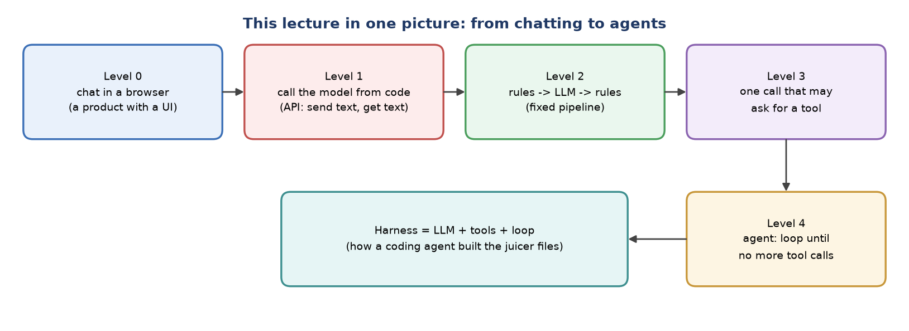
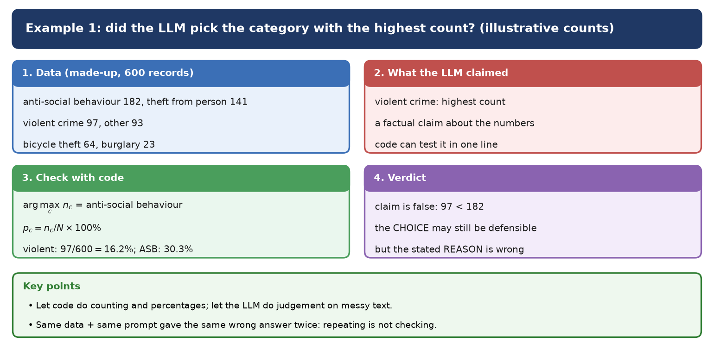
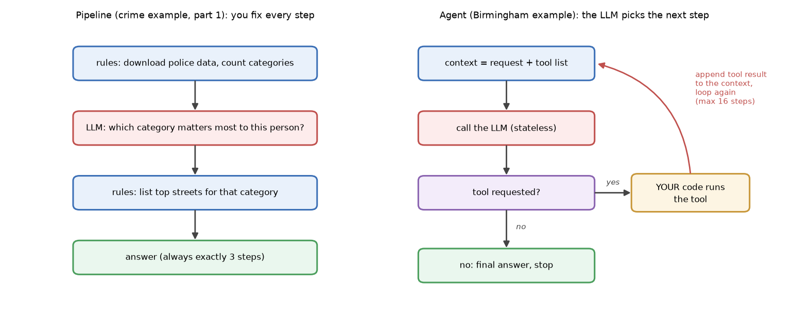
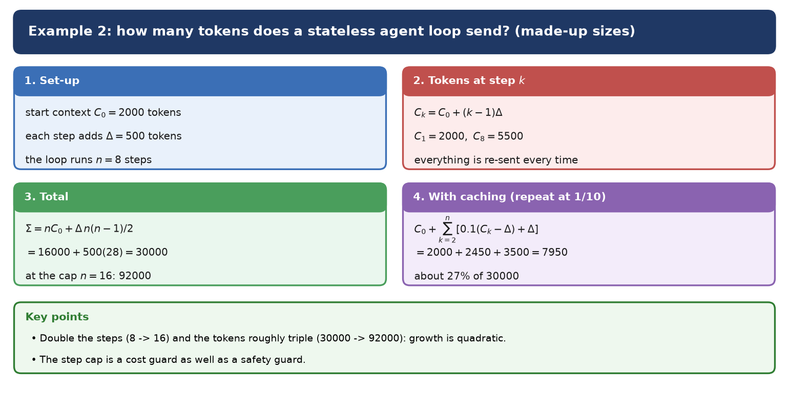
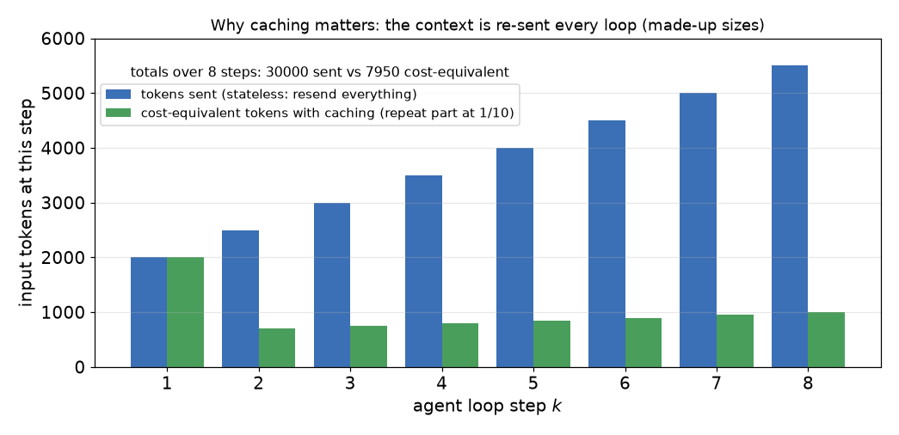

# MECH40001 Professional Engineering Skills 1 — Beyond the Chat Window: Calling LLMs from Code, Reasoning, Tools and Agents

This note covers the Imperial College London first-year lecture ME MECH40001 Professional Engineering Skills 1 on 2026-11-23. The recording runs 57:55 and the teaching content runs from 00:31 to 57:04. It is written only from the automatic transcript, because the video and slides could not be downloaded. When the lecturer shows code or output on screen, this note describes it from what he says aloud. The code sketches below are written for this note to illustrate the ideas, not copied from his notebook.

## What this lecture is about

This is the third AI lecture. Lecture 1 explained how a large language model predicts the next token. Lecture 2 asked "core or chore?" before you use one. Today goes back to the technical side and asks how a model that only predicts the next word can do a whole engineering job. The answer is built in four steps: call the model from code, give it data, give it a list of **tools**, and put the call in a loop to make an **agent**. The lecturer started a coding agent on a real task at the start of the class and opened its results at the end.



Figure 1. The lecture as a staircase. Each level adds one thing to the one before it. Drawn for this note from the transcript.

## 0. Chapter map

| Part | Time | Topic | Question it answers |
|---|---|---|---|
| 1 | 00:31–06:01 | Live demo: set an agent a design task | What can a coding agent do in 30 minutes? |
| 2 | 06:01–08:02 | Recap and plan | Where did lectures 1 and 2 leave us? |
| 3 | 08:02–11:34 | Calling an LLM from code | How do I send text to a model and get text back without a browser? |
| 4 | 11:34–26:34 | Data plus LLM: the crime example | How do I feed real data into a prompt and use the answer? |
| 5 | 26:34–33:07 | The full reply and "reasoning" | What else comes back, and what is a reasoning model? |
| 6 | 33:07–39:30 | Tools | How can a text-only model "use" a tool? |
| 7 | 39:30–52:00 | Agents | What is an agent, and who is responsible for what it does? |
| 8 | 52:00–57:04 | Demo results, harness, context and caching | What did the agent produce, and what limits it? |

## 1. Live demo: give an agent a design task (00:31–06:01)

The lecturer asked the class for an engineering problem. Suggestions included the DTP, the Navier–Stokes equations, the Riemann hypothesis, plungers for climbing a glass building, a stapler and a fruit juicer. He picked the **fruit juicer**, because he did not know this year's DTP. The class then built the specification aloud: a domestic juicer for pineapples and watermelons that juices a whole fruit in under five minutes.

The requested outputs were deliberately huge: calculations, mathematical modelling, engineering design with justification, production drawings, physically accurate 3D renderings, an instruction manual, full costing for 1,000 to 20,000 units a year, and a market analysis to find the best volume. It also had to finish in at most 30 minutes, deliver everything as a zip download plus a single HTML page for the browser, and make good engineering judgements, with a complete result as the priority. He typed this into Claude, a coding agent, and left it running.

## 2. Recap and plan (06:01–08:02)

Lecture 1: a **transformer** takes the context, links words to each other, and guesses the next **token**; that token joins the context and the next one is guessed. Lecture 2: frame your use first. You do not go to the gym and get someone else to lift the weights. If a task is **core** to your learning, doing it with AI is cheating yourself. If it is a **chore**, AI is a good idea, as long as you do not get distracted or fool yourself that you did the work.

Today's plan: call a model from code, not a browser; build logic around it; touch on reasoning; introduce tools and then agents; mention orchestrators if there is time; then go back to see what the agent did. Orchestrators were not reached in the recording.

## 3. Calling an LLM from code (08:02–11:34)

In plain words: the chat website is just one front door. Behind it is a model running on someone's GPU server (a computer full of graphics chips, which do the model's arithmetic fast), and your own program can knock on that door directly.

In lecture 1 the model ran locally and you could see its weights. Last week you used **frontier models** through dAIsy, the College's browser tool, where you get whatever that product does. Today the lecturer calls a hosted model from Python through an **API**, a fixed way for one program to ask another for something. The ingredients, as he described them, are listed below.

| Ingredient | What it is | Why it is needed |
|---|---|---|
| Google Colab notebook | Runs Python in the browser | No local install; the computing lecturer recommended it |
| OpenAI Python library | A client library many providers accept | Same code works for many models |
| OpenRouter | A service that forwards your request to almost any model provider | Flexibility to switch models |
| Secret key | A password-like string, stored in Colab's secrets | Calls cost money; without a key you get an error |
| Model gpt-oss-20b | An open-weights model with 20 billion parameters (the adjustable numbers inside the network) | Its weights are public, so it could in principle be modified |

The pattern looks like this. It is a sketch written for this note; the lecture's notebook may differ in detail.

```python
from openai import OpenAI
from google.colab import userdata

client = OpenAI(base_url="https://openrouter.ai/api/v1",
                api_key=userdata.get("OPENROUTER_KEY"))   # name must match the secret's name

reply = client.chat.completions.create(
    model="openai/gpt-oss-20b",
    messages=[{"role": "user", "content": "hello world"}])

print(reply.choices[0].message.content)                   # just the text of the answer
```

Line by line: the first two lines import the client library and Colab's secret store. The client object holds where to send requests, OpenRouter's address, and the key. The name you pass to the secret store must exactly match the name you gave the secret in Colab; the lecturer pointed this out. The create call sends one user message to one chosen model. The last line digs the answer text out of the reply. In class the model answered "hello", a wave emoji, and "How can I help you today?".

So what? There is no user interface any more, just your program and the model. That is the starting point for everything else today. It is like the police crime API from the computing course: you call a web address and get data back. The difference is that the thing at the other end is a language model.

## 4. Data plus LLM: the crime example (11:34–26:34)

The second notebook reuses the computing-course code. It sends a latitude, a longitude and a month to the UK police data website and gets back the crime records for that place and month. The code then counts how many records fall in each crime category. Up to here it is plain, rule-based code.

Next it builds a prompt from the counts: "Crime counts for one month in South Kensington, London: …. Which one category should most concern …?". The gap is filled with a **profile**, such as a car owner, a cyclist, or a student walking home late. It also asks for the reply in **JSON** (JavaScript Object Notation), a way of structuring data with curly brackets so the program can read the answer back. Finally, more rule-based code takes the chosen category and lists the streets where it happens most.

So the pattern is **rules, then an LLM decision, then rules**. The power is that the context is built by your program from live data, not typed by a person. The lecturer's app idea: you type "I'm in South Kensington and I'm cycling", and the app warns you about bike theft, not burglary. The run used 461 tokens. Tokens cost money, so counting them is a habit worth forming.

Then came the important failure. For the student profile, the model answered "violent crime: this category has the highest count". The lecturer asked the class whether that was correct. It was not: violent crime did not have the highest count. The police data itself could contain errors, but at least nothing was lost in translation. The model made a factual claim about numbers that were sitting in its own prompt, and got it wrong. Running it again gave the same wrong answer, because the data and prompt were the same. For a cyclist it chose bicycle theft, which made sense: different context, different output.

### Example 1. Check an LLM's claim with code

**What is asked**

The transcript does not give the actual counts, so this example uses illustrative counts with the same kind of error. A month of data for one area has 600 records: anti-social behaviour 182, theft from the person 141, violent crime 97, other 93, bicycle theft 64, burglary 23. The model says "violent crime has the highest count". Is that true, and what share does each category have?

$$n=(182,\ 141,\ 97,\ 93,\ 64,\ 23),\qquad N=\sum_c n_c=600$$

**Why this route**

"Highest count" is a question with one exact answer, so code answers it perfectly and costs nothing. The lecturer did the same thing in his agent: he wrote a percentage function "because the LLM was getting them wrong". Asking the model again would not help, since the same input gives the same output.

**Step 1: find the category with the largest count**

The largest count belongs to anti-social behaviour, not violent crime.

$$\arg\max_c\,n_c=\text{anti-social behaviour},\qquad n_{max}=182>97$$

**Step 2: compute each share**

$$p_c=\frac{n_c}{N}\times100\%,\qquad p_{ASB}=\frac{182}{600}=30.3\%,\qquad p_{violent}=\frac{97}{600}=16.2\%$$

**Step 3: separate the choice from the reason**

The model's choice, "violent crime matters most to a student", may still be defensible, because violent crime is serious for personal safety. But the reason it gave, "highest count", is false. In a report you would keep the judgement if you agree with it, and replace the false reason with the true numbers.

**Where the constant comes from**

The 100% turns a fraction into a percentage. $N=600$ is the sum of all six counts, $182+141+97+93+64+23$. The ratio $182/97\approx1.9$ shows the claimed "highest" category is almost half the size of the real one.

**Sanity check**

The six shares must add up to 100%: $30.3+23.5+16.2+15.5+10.7+3.8=100.0\%$. Re-running the model is not a check. In the lecture, the second run repeated the same wrong sentence.

**Answer**

$$\text{claim false: } 97<182;\qquad p_{violent}=16.2\%,\quad p_{ASB}=30.3\%$$

**Trap**

Trusting fluent text about numbers. The sentence sounded confident and specific, yet it contradicted data sitting in its own prompt. A second trap is thinking that two identical answers confirm each other. They come from the same input, so they are one answer, not two.

Technique: let code count, let the model judge, and check every number the model states.



The lecturer gave the class a few minutes to think of other uses for "data, then LLM, then data" and to run notebook part B with the key from that afternoon's email. Then he made a key point: this is still **deterministic**. He wrote exactly what happens at each step, always three steps. Agents will take that control away.

## 5. The full reply and "reasoning" (26:34–33:07)

A student asked whether calling from code has disadvantages. The model is the same, so the output is the same. A product's interface adds conveniences, such as saving your chats. Through the API you get only the raw response. A student also asked why the code reads only the first choice's message content. The lecturer printed the whole reply object. It holds a finish reason, an index, and a message with a content field, a role, tool calls and reasoning. The content is usually all you want.

In plain words: a **reasoning model** writes itself some rough notes before giving the final answer, and those notes become extra context that steers the answer.

The lecturer printed the reasoning field. Before saying hello, the model had written: "The user says hello world, which is a greeting. The assistant should respond appropriately…". Underneath, the raw output has markers, roughly "channel: analysis … end … start assistant final …". The library splits the text at those markers into the reasoning part and the final message. An LLM can only output tokens. A reasoning model is trained to output a marked block of tokens that is not the final answer. It is the model writing its own chain of thought, the prompting trick from last week, into its own context.

Is it really reasoning? The lecturer pointed to an Apple research paper. It reported that on problems outside the training data these models scored zero however much "reasoning" they did, which suggests they recall solution patterns rather than reason. "Reasoning" is the industry's word for it. It still changes the final output, so you need to know it exists.

When is it worth it? Reasoning takes longer and costs more, but helps on complex, multi-step questions. For "Is red a colour?" or "What is the capital of Spain?" you want the first answer. For "factorise this quadratic, divide by two, then do this, then that", step-by-step notes help, because each final step then rests on one small step. Most commercial chat products use reasoning models, and you can tune how much reasoning to request. More reasoning rarely gives a worse answer; it mostly just costs more time and money.

## 6. Tools (33:07–39:30)

In plain words: a model cannot press buttons. It can only write. A "tool call" is the model writing a note that says "please run this function with these inputs". Your code reads the note and decides whether to run it.

The lecturer added one thing to the crime code: a **tool description**, a short structured text that says what a function does and what arguments it needs. His example was "count crimes near a UK postcode; argument: the postcode". The only change to the call is one extra line passing the tool descriptions. The library appends them to the context. The model is trained to reply in one of two ways: normal text, or the name of a tool plus its arguments.

He showed both. Prompt 1, "Briefly, what kind of crime is violent?", got a normal text answer; he jokingly called it "a nice long piece of AI slop". Prompt 2, "How much crime is there near this postcode?" with a Birmingham postcode, got no text content at all. Instead it returned a tool call: the count-crimes tool, with the postcode as the argument. The transcript hears the postcode as "B15 2H…", so it is not given in full here. One call, a list of tools it may use, and the model chose to ask for one.

A student asked how a transformer that only outputs the next token can call a tool. The answer: it cannot. Something around the model has to do it. A student also asked what a token is. It is the single unit the model reads and writes: often a whole word, sometimes part of a word (shopping might be two or three tokens), or a space, a hash, a full stop, a question mark, or the special end-of-sequence token.

When should you not use a model at all? If you can write the whole program yourself, do that: models can be unreliable. Use a model when you must handle **unstructured data**, such as free text or a vague request, that ordinary code cannot process.

## 7. Agents (39:30–52:00)

In plain words: an agent is a loop. Ask the model, and if it wants a tool, run the tool, add the result to the conversation, and ask again. Stop when it answers without asking for a tool.

The driving request was: "I'm moving to Birmingham and will cycle to work at Queen Elizabeth Hospital. Which neighbourhoods within cycling distance have the least bicycle theft?" Before 2026 you would answer it by hand: find the hospital, find neighbourhoods within cycling distance, get each one's crime data, compare bicycle theft, and pick the lowest. The logic is clear, but each step is fuzzy. How do you turn "Queen Elizabeth Hospital" into a location? Which neighbourhoods are "nearby"? An agent handles that fuzziness.

**Definition.** An **agent** is a pattern of code, nothing more magical than any other code. The pattern is a loop that calls an LLM. If the LLM asks for a tool, the code calls the tool, appends the result to the context, and loops again. When the LLM replies without asking for a tool, the loop ends. We do not know in advance how many times the LLM will be called. We give the code **agency** to choose which tools to call, when, and when to finish. We still choose which tools it is allowed to have.

**Key idea: the LLM is stateless.** Each call starts from nothing. The model remembers only what is in the context you send. So the loop resends the old context plus the new tool result every time. Example 2 below shows what that does to the token count.



Figure 2. Pipeline versus agent. In the pipeline you fix every step. In the agent the model chooses the next step, and your code runs it. Drawn for this note from the transcript.

The lecturer's agent has three parts. Part 1, the tools and helpers, is the most complex and the most essential. Four tools are offered to the model: find places, give a crime overview for a location, find crime trends, and list the top micro-locations (streets, car parks) for a category. Four helpers are used inside the tools but not offered to the model: a percentage function ("the LLM was getting them wrong"), a distance-between-two-points function ("LLMs can't do that very well"), a lookup that turns a name into coordinates through postcodes.io, and a crime download. Part 2 turns the tool descriptions into one big JSON block for the context; he called it boring but important. Part 3 is the agent loop, with a cap of 16 steps so it cannot run forever and use up the tokens.

A loop with that shape, sketched for this note (not the lecturer's code), is shown below.

```python
messages = [{"role": "user", "content": request}]
for step in range(16):                                    # hard cap: cost and safety guard
    reply = client.chat.completions.create(model=MODEL, messages=messages, tools=TOOL_LIST)
    msg = reply.choices[0].message
    messages.append(msg)                                  # stateless model: keep the history ourselves
    if not msg.tool_calls:                                # no tool requested: this is the final answer
        print(msg.content)
        break
    for call in msg.tool_calls:
        result = run_tool(call.function.name, call.function.arguments)   # THIS line acts in the world
        messages.append({"role": "tool", "tool_call_id": call.id, "content": result})
```

What each part does: the message list is the whole memory, so it grows every loop. The cap of 16 is the lecturer's limit. If the reply has no tool calls, the model has given its answer and we stop. Otherwise, for each requested tool, our own function runs it and the result is appended as a tool message. The run-tool line is the one the lecturer singled out: "it's that line in the code that has agency".

**Responsibility.** The lecturer was blunt. If an agent does damage, such as the hacking incident he mentioned (the transcript's "hack hugging face" is unclear), it is not "the agent" or some "strange digital civilisation" that is responsible. The model only emits tokens. The responsible party is whoever wrote the line that executes tools. If you write code that can take actions, you are responsible for those actions. His tools were harmless: internal calculations and read-only web requests.

**The run.** The printed trace showed the model deciding every step. Finding "Queen Elizabeth Hospital" by name failed, so it found the coordinates through a postcode. It then found neighbourhoods within 5 km (Selly Oak, Edgbaston, Harborne, Bournville, Moseley, Bartley Green), got a bicycle-theft overview, pulled 12 months of data for Moseley and Bartley Green, and listed their top locations. A benefit: it made small, specific database queries instead of downloading all of England's crime. Then it produced a long summary that never actually said where to live.

He presented it as illustrative in both senses: it works, and it does not work very well. When he ran it for Manchester, it produced an equally detailed analysis, yet there was no Manchester police data since 2019, only transport data. "I set up the agent. I'm responsible for that."

### Example 2. Token cost of a stateless agent loop

**What is asked**

Use made-up but realistic sizes. The first context, the request plus all tool descriptions, is $C_0=2000$ tokens. Each loop adds $\Delta=500$ tokens, the model's tool call plus the tool's result. The run takes $n=8$ steps. How many input tokens are sent in total? How many at the lecturer's cap of 16 steps? What if repeated context is cached at one tenth of the price, as the lecturer said at the end?

$$C_0=2000,\qquad\Delta=500,\qquad n=8\ (\text{and }16),\qquad\text{cache price}=0.1$$

**Why this route**

Statelessness means every call resends everything so far. So the input at step $k$ is the starting context plus all the additions before it. That is an arithmetic sequence, and its sum has a closed form. Caching changes only the price of the part already sent before, so we price the repeat and the new part separately.

**Step 1: write the input at step k**

$$C_k=C_0+(k-1)\Delta,\qquad C_1=2000,\quad C_8=2000+7\times500=5500$$

**Step 2: sum the arithmetic sequence**

Add $n$ copies of $C_0$ plus $\Delta$ times $0+1+\dots+(n-1)$, which equals $n(n-1)/2$.

$$\Sigma_n=nC_0+\Delta\frac{n(n-1)}{2},\qquad\Sigma_8=16\,000+500\times28=30\,000,\qquad\Sigma_{16}=32\,000+500\times120=92\,000$$

**Step 3: price the cached part at one tenth**

From step 2 onward, everything except the newest $\Delta$ was already sent, so it is cached.

$$\text{cost}=C_0+\sum_{k=2}^{8}\left[0.1\,(C_k-\Delta)+\Delta\right]=2000+0.1\times24\,500+7\times500=7950$$

**Where the constant comes from**

The $n(n-1)/2$ is the sum $0+1+\dots+(n-1)$: the first step carries no additions, the second carries one, and so on. The 0.1 is the lecturer's rule of thumb that cached context costs about a tenth. The 24,500 is $\sum_{k=2}^{8}(C_k-\Delta)=7\times2000+500\times(0+1+\dots+6)=14\,000+10\,500$.

**Sanity check**

Add the bars directly: $2000+2500+3000+3500+4000+4500+5000+5500=30\,000$, the same as the formula. Doubling the steps from 8 to 16 multiplies tokens by about 3.07, not 2: growth is quadratic because each step carries everything before it. Caching brings 30,000 down to 7,950, about 27%, in line with "a tenth as much" on the repeated part.

**Answer**

$$\Sigma_8=30\,000\ \text{tokens},\qquad\Sigma_{16}=92\,000\ \text{tokens},\qquad\text{with caching}\approx7950\ \text{token-equivalents}$$

**Trap**

Estimating cost as "8 steps times 2000 tokens = 16,000". That forgets that the context grows. It misses almost half the cost at 8 steps, and about two thirds at 16 steps (32,000 against 92,000). Also note that a bigger context is not only dearer. The lecturer warned that with very long contexts the model stops paying proper attention to all of it.

Technique: for any stateless loop, write the input at step $k$ first, then sum. The step cap guards cost as well as safety.





Figure 3. The same numbers as Example 2, step by step. The blue bars grow because the model is stateless. The green bars stay low because the repeated part is cached. Sizes are made up for illustration.

## 8. Demo results, the harness, context and caching (52:00–57:04)

Back to the juicer. The agent had finished well inside the time. It had created files, zipped them and run commands. The HTML page claimed a shared platform for pineapples and watermelons that juices in 90 seconds, a cutaway view, Python files and plots for the numerical modelling, engineering drawings, costing and a market analysis with a price slider, and profit of about £300,000 a year. The lecturer doubted the drawings would pass any drawing standard.

How? It is exactly today's pattern: a pre-trained transformer plus tools in a loop. The tools plus the LLM is called the **harness**. Getting the harness right is hard. The lecturer suggested that is why Anthropic is doing well, and remarked that such companies were valued at around two trillion US dollars that week.

All earlier caveats still apply. From lecture 1: is it accurate? Tools help here, because you can rerun the Python scripts and check. From lecture 2: what is the purpose? If he was meant to learn, he learned nothing. If he was meant to produce, he produced something, but he is not accountable for it, because he has no idea what it did. The power is real if you use it the right way.

In the closing Q&A, a student asked whether you can ask the model afterwards for its reasoning. You can only call it fresh, but you can paste the whole output back in and ask about it. That raises the question of how much context a model can handle. There are two answers. Technically, context windows are typically up to about a million tokens, limited by GPU memory. In practice, at that size the model usually does not pay enough attention to all of it and gets confused. Because you must resend everything every time, **caching** matters for cost: if the repeated context is cached in GPU memory, a call costs roughly a tenth as much.

## Pitfalls and look-alikes

| Easily confused | The difference | What goes wrong if mixed up |
|---|---|---|
| Chat product vs API call | Same model; the product adds conveniences, the API gives the raw reply | You expect saved history from the API and lose it |
| Pipeline vs agent | Pipeline: you fix the steps. Agent: the model picks the next step in a loop | You cannot predict an agent's number of calls or cost |
| Model "calls a tool" vs code calls a tool | The model only writes a request; your code executes it | You blame "the AI" for an action your code took |
| Reasoning vs real reasoning | Extra self-written context; fails outside training data | Over-trusting answers on novel problems |
| Stateless vs memory | Each call starts blank; history lives in your message list | Forgetting to append results, so the model repeats work |
| Repeating vs checking | Same input gives the same output | A wrong answer "confirmed" twice |
| Context size vs attention | A million tokens fit, but attention degrades | Long dumps give confused answers |

## Chapter summary and review sheet

| Idea | One-line meaning | Lecture example |
|---|---|---|
| API call | Your program sends text to a hosted model and gets text back | Hello world via OpenRouter and gpt-oss-20b |
| Data in context | Build the prompt from live data with code | Police crime counts plus a profile |
| Reasoning model | Writes self-notes before the final answer | Reasoning field before "hello" |
| Tool | A described function the model may ask for | Count crimes near a postcode |
| Agent | Loop: call model, run requested tool, append, repeat until no tool | Birmingham cycling neighbourhoods |
| Stateless | Every call resends the whole history | Token growth in Example 2 |
| Harness | LLM plus tools plus loop | The juicer design pack |
| Responsibility | Whoever writes the tool-executing line | His remarks on the hacking incident |
| Caching | Repeated context costs about a tenth | Closing Q&A |

Short recipe for building with an LLM: (1) ask whether plain code can do it, and if so, use plain code; (2) let code fetch and count, and let the model handle unstructured judgement; (3) describe tools clearly and keep them harmless; (4) cap the loop; (5) check every number the model states; (6) remember you are accountable for what your code does.

Memory trick: "The model writes, your code acts, and you answer for it."

## Sources and open items

Source: the automatic transcript of "ME MECH40001 Professional Engineering Skills 1 (2026-11-23)", 57:55, from Panopto. The video returned HTTP 403, so the notebook code, the printed outputs and the agent's HTML page were not seen. They are described from the lecturer's spoken words. The code sketches and both examples' numbers were written for this note to illustrate the ideas, and are marked as such. Student names spoken in the recording are left out.

Chapter label Ch3: the lecturer refers to "lecture one" (large language models) and "last week" (using LLMs in practice, core or chore) and calls today "advanced topics". So this is the third lecture in the AI strand. The notebook part numbers in the transcript ("3.12 C", "3.1 part B") also start with 3, but they are garbled. The previous note in this folder (2026-11-16) was not numbered.

ASR doubts, each judged from context:

| Time | Transcript says | Judged as |
|---|---|---|
| 08:02, 41:03 | "Daisy" | dAIsy, the College's AI platform (as in the previous note) |
| 09:01 | "Open Router" | OpenRouter |
| 09:01, 24:06 | "Li" / "Lee" | The computing lecturer; spelling uncertain |
| 09:33, 33:30 | "GPT OSS", "120 billion", "20,000,000,001" | gpt-oss-20b and gpt-oss-120b; the last is an ASR slip for "20 billion one" |
| 20:05 | "This is part B of 3.12 C", "3.1 part B" | Notebook section numbers; uncertain |
| 20:05 | key "starts ESC or SCO" | Key prefix unclear; not needed and not recorded |
| 30:34 | "a paper by Apple Research" | The lecturer's summary of the paper; the paper itself was not checked |
| 37:06 | postcode "B15. Two. H." | A Birmingham B15 postcode; the full postcode is uncertain |
| 46:00 | "hack hugging face", "strange digital civilisation" | A news incident the lecturer referred to; details unclear |
| 50:01 | "Harbour" | Probably Harborne, a Birmingham suburb |
| 52:00 | "worth [USD] 2 trillion this week" (dollar sign dropped) | The lecturer's remark; not checked |
| 56:01 | "a million tokens" | Typical upper context size, as the lecturer stated |
