# MECH40002 Fluid Mechanics 1 - Chapter 1 Note

This note covers Imperial College London's first-year Mechanical Engineering course MECH40002 Fluid Mechanics 1 on 2026-11-16. The recording is titled "ME MECH40002 - Fluid Mechanics 1 (2026-11-16)". The lecture coverage is 00:36-52:32. The opening fragment at 00:21 and the audio after the lecturer's closing at 52:32 are unclear.

## What this lecture is about

The lecture connects **viscous stress**, the frictional force per unit area between moving fluid layers, to how fast a small piece of fluid changes shape. It then classifies fluid flows, reviews their forces, and begins **fluid statics**, the study of fluids at rest. It derives the **hydrostatic equation**, which gives the pressure change with height, and applies it to a U-tube **manometer**, a device that measures pressure from liquid levels.

## 1. Shear deformation and strain rate (00:36-08:27)

A **fluid element** is a small piece of fluid around a point. In the one-dimensional **shear flow** shown, the horizontal velocity $u$ points along $x$ and varies with the transverse position $y$. A layer a distance $\delta y$ above the lower layer moves faster, at $u+\delta u$, so it travels farther in the same time. The slide calls the resulting change of angle $\delta\theta$ the **shear strain** for this small deformation.

In solid mechanics, the deformation angle itself is important. In fluid mechanics the fluid is continually moving, so the useful quantity is the **shear strain rate**, the rate at which the angle changes. The quantities $\delta y$ and $\delta x$ are lengths in metres, $u$ is velocity in $\mathrm{m\,s^{-1}}$, and $t$ is time in seconds. The angle is dimensionless when measured in radians.

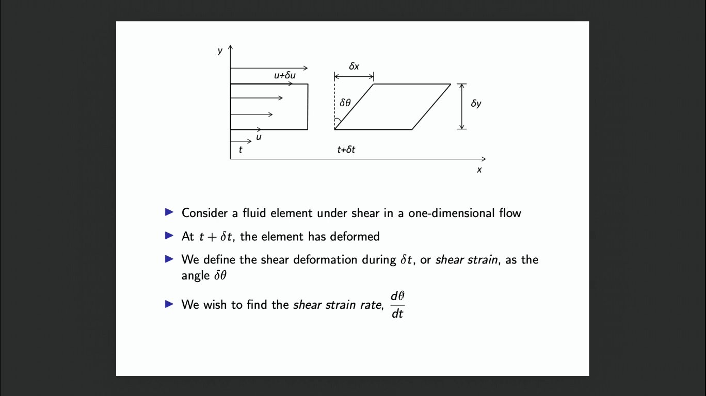
*Figure 1 - Slide frame t0240 (04:00), showing the element, $u$, $u+\delta u$, $\delta x$, $\delta y$, and $\delta\theta$.*\

### Worked derivation: rate of deformation

**What is asked.** Find the rate $d\theta/dt$ at which the fluid element deforms.

**Why this route.** The geometry gives the angle from the horizontal displacement difference, and the small-angle limit converts that geometry into a velocity gradient.

**Step 1.** Multiply each layer's velocity by the time interval $\delta t$ to find its travel distance. Subtract the lower layer's distance from the upper layer's distance to find the relative horizontal displacement.

$$
\delta x=(u+\delta u)\delta t-u\delta t=\delta u\,\delta t.
$$

**Step 2.** The **small-angle approximation** lets us replace a small angle in radians by its tangent. The drawing exaggerates the angle for visibility.

$$
\delta\theta\approx\tan\delta\theta.
$$

**Step 3.** In the right triangle, the tangent is the horizontal offset divided by the vertical separation. Substitute the displacement from Step 1. The time interval cancels, leaving the velocity difference per unit vertical distance.

$$
\tan\delta\theta=\frac{\delta x}{\delta y}.
$$

$$
\frac{\delta\theta}{\delta t}
\approx\frac{\tan\delta\theta}{\delta t}
=\frac{1}{\delta t}\frac{\delta x}{\delta y}
=\frac{1}{\delta t}\frac{\delta u\,\delta t}{\delta y}
=\frac{\delta u}{\delta y}.
$$

**Step 4.** As $\delta t$ and $\delta y$ tend to zero, the angle change per unit time and the velocity change per unit distance become derivatives. Both derivatives have units of $\mathrm{s^{-1}}$ because the angle is dimensionless in radians and velocity divided by distance also gives inverse seconds.

$$
\boxed{\frac{d\theta}{dt}=\frac{du}{dy}}.
$$

**Where each coefficient comes from.** The coefficient 1 comes from the small-angle tangent relation. The velocity difference is $\delta u$, the separation is $\delta y$, and the time interval cancels.

**Sanity check.** If $du/dy=0$, every layer has the same velocity and $d\theta/dt=0$. If the velocity changes more rapidly with $y$, the element deforms faster.

**Final answer.**

$$
\boxed{\text{rate of deformation}=\frac{d\theta}{dt}=\frac{du}{dy}}.
$$

**Common pitfall.** The angles of $30^{\circ}$ and $45^{\circ}$ mentioned in the lecture are too large for the small-angle step in this derivation. The figure exaggerates the tilt so the geometry is visible.

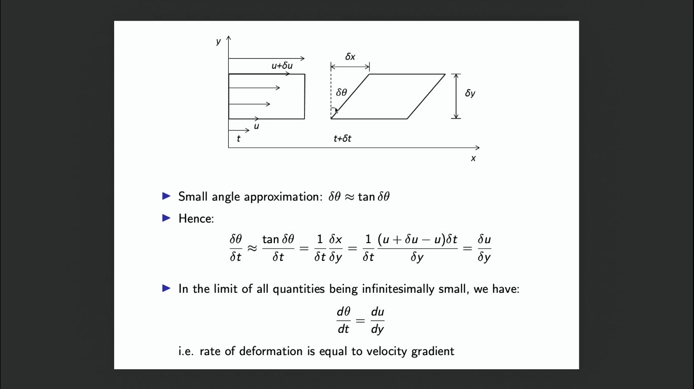
*Figure 2 - Slide frame t0480 (08:00), with the small-angle approximation and the limiting result.*\

The result explains the earlier viscous-stress law. A velocity gradient means neighbouring fluid layers have different velocities, so internal friction acts between them. In solid mechanics one tracks deformation, whereas in fluid mechanics the rate of deformation, equivalently the velocity gradient, is the more useful quantity.

**Principle summary.** A shear flow changes the shape of a fluid element, and the local rate of that change is $du/dy$.

**Memory tip.** A larger velocity difference over the same vertical distance means a larger deformation rate.

## 2. Flow classifications and force summary (08:34-16:12)

The lecture revisits several names that will be used later. A **steady flow** has no variation with time at a fixed position, while an **unsteady flow** varies with time. A steady flow can still vary from one position to another.

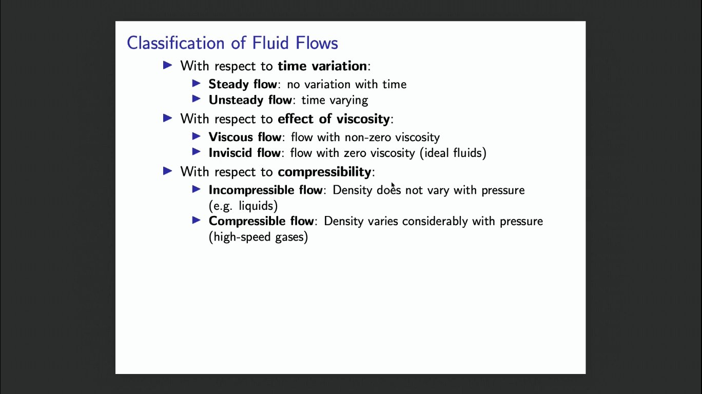
*Figure 3 - Slide frame t0600 (10:00), showing the first three classification axes.*\

The automatic transcript at 08:50 reverses the time criterion for steady flow. Figure 3 gives the slide definitions.

A **viscous flow** includes the effects of **viscosity**, the fluid's resistance to shearing motion. An **inviscid flow** treats viscous forces as negligible compared with the other forces. The lecturer stresses that real fluids have viscosity and uses **ideal fluid** for the zero-viscosity model of the flow.

An **incompressible flow** is one in which density does not change because of pressure changes in that flow. It is not identical to saying that density is the same everywhere. A water-oil mixture can have different local densities while both liquids remain incompressible. Air can also be treated as incompressible in a flow where pressure changes are not large enough to change its density significantly. The lecture gives standard aircraft flow as an example and supersonic aircraft flow as a compressible example.

In a **compressible flow**, changes in pressure cause appreciable changes in density, the mass per unit volume. The lecture also gives another way density can vary from place to place in a liquid. In the ocean, the amount of dissolved salt can change with depth and affect the density.

The slide then names **laminar flow** as ordered flow with one dominant space or time scale, and **turbulent flow** as chaotic flow with many space or time scales. The lecture also calls a flow **internal flow** when it is completely enclosed by boundaries, such as flow in a pipe. A flow over an aircraft is described as unbounded because only one side touches a boundary.

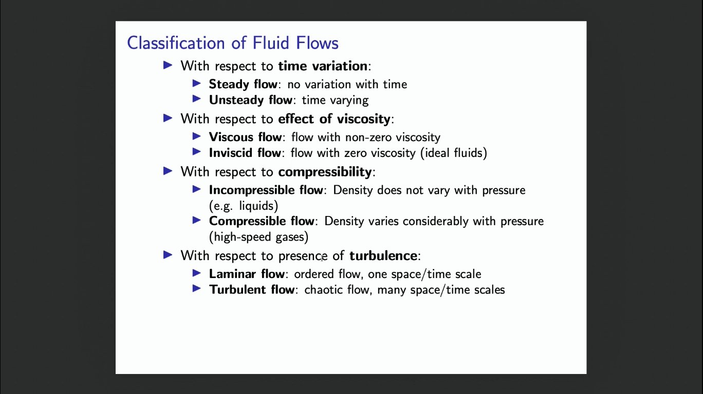
*Figure 4 - Slide frame t0780 (13:00), adding laminar and turbulent flow.*\

The force recap uses three quantities. **Gravity** is a body force. If $\rho(x,y,z)$ is density in $\mathrm{kg\,m^{-3}}$, $g$ is gravitational acceleration in $\mathrm{m\,s^{-2}}$, and $\delta V$ is an element volume in $\mathrm{m^{3}}$, then the gravitational-force magnitude is

$$
F_g(x,y,z)=\rho(x,y,z)g\,\delta V.
$$

**Pressure force** and viscous force act on surfaces. We describe them using **stress**, the force $F$ in newtons divided by the area $A$ in $\mathrm{m^{2}}$. Stress $\tau$ is measured in pascals, $\mathrm{Pa}=\mathrm{N\,m^{-2}}$.

$$
\tau=\frac{F}{A}.
$$

Pressure is a compressive **normal stress**, which acts perpendicular to a surface and pushes inward. At any one point, pressure has the same value for every surface orientation, so a single number describes it. Viscous force arises from relative motion and converts mechanical energy into heat. The **no-slip condition** says that fluid touching a wall moves at the wall's velocity.

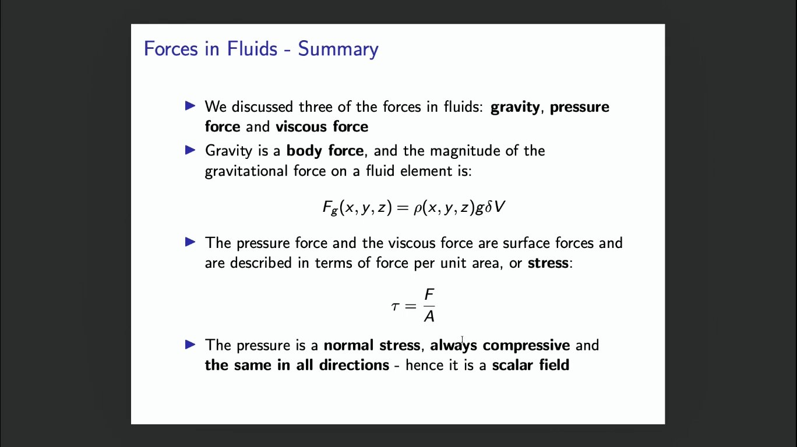
*Figure 5 - Slide frame t0900 (15:00), summarising the force types and pressure properties.*\

**Newton's law of viscosity** applies here to a **Newtonian fluid** with horizontal velocity $u$ varying only with the transverse coordinate $y$. The **dynamic viscosity** $\mu$ measures how much viscous shear stress the fluid generates for a given shear rate. The slide gives the $x$-directed **shear stress** $\tau$ on a plane normal to $y$ as follows.

$$
\tau=\mu\frac{du}{dy}
$$

The units of $\mu$ are $\mathrm{Pa\,s}$. Multiplying by $du/dy$ in $\mathrm{s^{-1}}$ gives stress in Pa. The lecturer also refers back to the earlier face sign convention for the direction of the force. The frame shows the stress component and the wall condition.

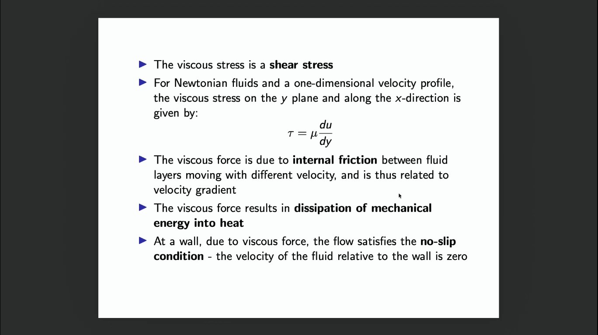
*Figure 6. Slide frame t0960 (16:00) gives Newton's viscosity law for the one-dimensional profile and states the no-slip condition.*\

**Principle summary.** Flow labels describe time variation, viscosity, compressibility, turbulence, or boundaries. Pressure is a normal surface stress, while gravity acts throughout the volume.

**Common pitfall.** “Incompressible” does not mean “constant density everywhere.” It refers to the response of density to pressure changes in the specified flow.

## 3. Fluid statics and its engineering scope (16:16-25:10)

The lecture returns to five course questions. The first three ask what a fluid is, how to describe its motion mathematically, and how to describe its forces mathematically. The remaining questions ask how to study the balance of forces and how to link forces to motion.

The force-balance question leads to **hydrostatics**, the study of fluids at rest with their forces in equilibrium. It applies to liquids and gases. **Fluid dynamics** studies moving fluids and takes up most of the rest of the course.

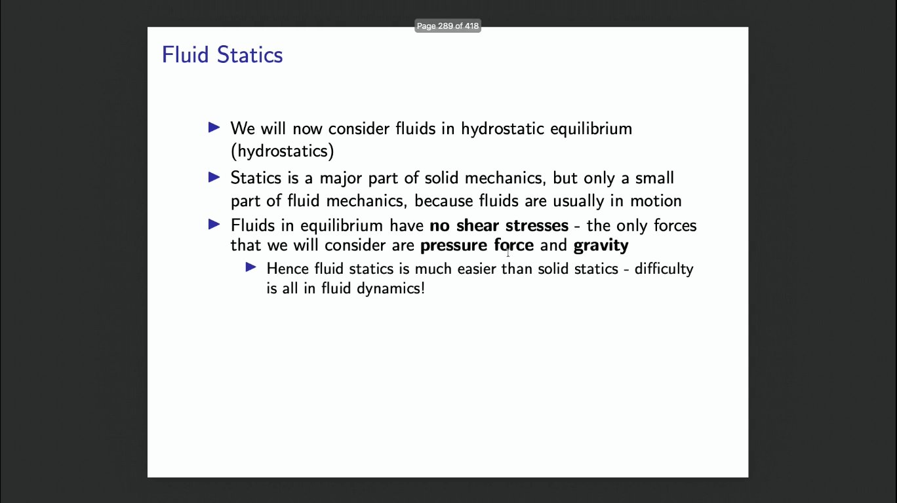
*Figure 7 - Slide frame t1200 (20:00), stating that static fluids have no shear stresses.*\

A static fluid cannot sustain even a very small shear stress. If such a stress existed, it would start the fluid moving. Therefore the forces considered in hydrostatics are pressure force and gravity only. This is why fluid statics has fewer stress components than solid statics, even though fluid dynamics is much more involved.

Important applications listed on the slide are pressure variation in the atmosphere, pressure measurement by manometry, forces on submerged surfaces, and ship flotation and stability.

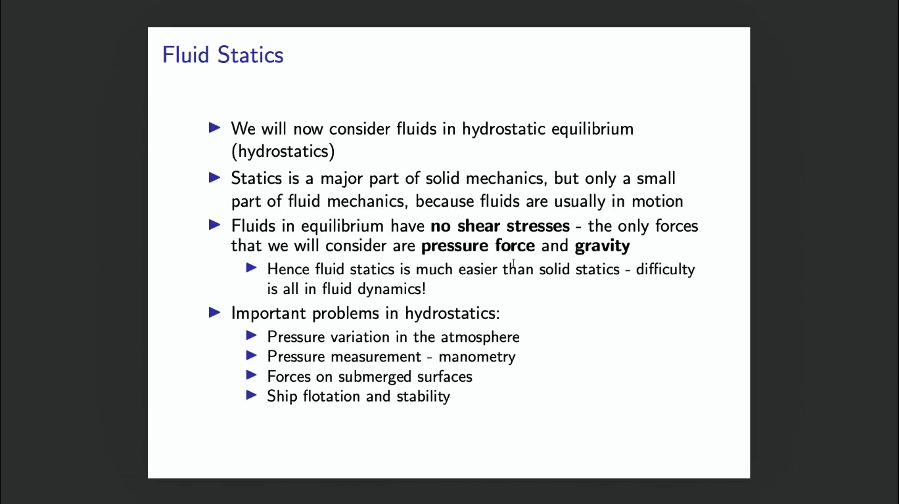
*Figure 8 - Slide frame t1440 (24:00), listing atmospheric pressure, manometry, submerged surfaces, and ship stability.*\

Atmospheric pressure decreases with altitude because higher layers carry the weight of less air above them. The lecture treats the large-scale vertical pressure distribution from the ground upward as hydrostatic when motion-induced variations are small enough to neglect. It gives a cyclone as an example where the pressure variation due to motion matters. It also names a submarine hull and a dam wall as surfaces on which fluid pressure exerts a force.

**Principle summary.** In a static fluid, the absence of shear stress leaves pressure and gravity to balance each other.

**Memory tip.** Static fluid means no relative layer motion, so no viscous shear force is needed in the balance.

**Common pitfall.** The atmospheric example uses a hydrostatic approximation for the large-scale vertical pressure distribution. The lecture treats the pressure variation within a cyclone as a motion-dependent problem.

## 4. First-order Taylor approximation (25:10-28:47)

Before deriving the pressure equation, the lecture reviews the physical meaning of a **first-order Taylor approximation**. Suppose the known value of a function is $f(x_0)$, and the known local slope is $df/dx$ at $x_0$. For a small displacement $\delta x$, the tangent line gives an estimate of the new value:

$$
f(x_0+\delta x)\approx f(x_0)+\frac{df}{dx}(x_0)\,\delta x.
$$

The estimate is not exactly the curved graph. The difference is the approximation error, and it becomes smaller as $\delta x\to0$. In the hydrostatic derivation the variable is height $z$, the function is pressure $p(z)$, and the small displacement is $\delta z$.

The units of $x_0$ and $\delta x$ match the units of the input $x$. The slope has units of output per unit of input, so slope times $\delta x$ has the same units as $f(x_0)$. In the pressure example this means $\mathrm{Pa\,m^{-1}}$ times metres gives pascals.

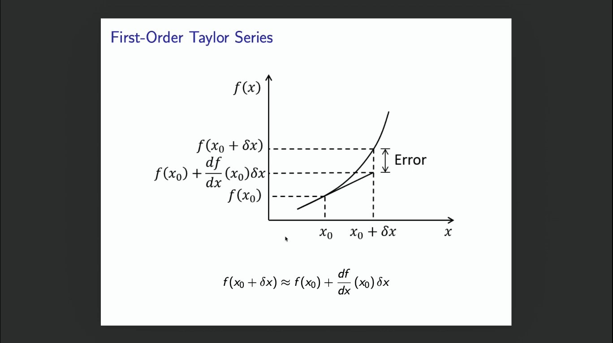
*Figure 9 - Slide frame t1560 (26:00), showing the tangent estimate and the error between the estimate and the curve.*\

**Principle summary.** A first-order Taylor approximation replaces a nearby curved function by its tangent, with an error that vanishes as the step becomes infinitesimal.

**Common pitfall.** The approximation is local. A large $\delta x$ can produce a large error.

**Memory tip.** Start at the known value and add the tangent slope times the step.

## 5. Hydrostatic equation, constant density, and gauge pressure (28:47-42:59)

Let a small cylindrical fluid element have cross-sectional area $\delta A$, height $\delta z$, and density $\rho$. The vertical coordinate $z$ increases upward. Pressure at the lower face is $p(z)$, while the pressure at the upper face is estimated by the first-order Taylor formula:

$$
p(z+\delta z)\approx p(z)+\frac{dp}{dz}\delta z.
$$

The pressure force from below is upward and equals $p(z)\delta A$. The pressure force from above is downward and equals $p(z+\delta z)\delta A$. Weight acts downward with magnitude $\rho g\delta A\delta z$, where $\delta A\delta z$ is the volume in $\mathrm{m^{3}}$. Pressure is measured in Pa, $\delta A$ in $\mathrm{m^{2}}$ and $\delta z$ in metres. The horizontal pressure forces balance because pressure is uniform around each horizontal level of the static element.

### Worked derivation: the hydrostatic equation

**What is asked.** Find how pressure varies with height in a static fluid.

**Why this route.** A static element is in force equilibrium. Taylor expansion expresses the unknown pressure at its upper face in terms of the known lower pressure and its gradient.

**Step 1.** Balance vertical forces, taking upward as positive:

$$
p(z)\delta A-\left[p(z)+\frac{dp}{dz}\delta z\right]\delta A-\rho g\delta A\delta z=0.
$$

**Step 2.** Expand the brackets. The two terms $p(z)\delta A$ cancel:

$$
-\frac{dp}{dz}\delta z\,\delta A-\rho g\delta A\delta z=0.
$$

**Step 3.** Divide by the non-zero element volume $\delta A\delta z$ and take the small-element limit so the Taylor approximation yields a local equation:

$$
\boxed{\frac{dp}{dz}=-\rho g}.
$$

**Where each coefficient comes from.** The minus sign in $dp/dz=-\rho g$ means pressure decreases as the upward coordinate $z$ increases. The positive quantity $\rho g$ is weight per unit volume. The lower face pushes up and the upper face pushes down, giving a net vertical pressure force per unit volume of $-dp/dz$ with upward positive.

**Physical interpretation.** The slide at 35:00 describes $dp/dz$ as a net pressure force per unit volume. The arrows in the figure specify the signed forces. The upward contribution $-dp/dz$ balances the downward contribution $-\rho g$.

**Sanity check.** Since $\rho>0$ and $g>0$, $dp/dz<0$. Pressure therefore decreases as height increases.

**Final answer.**

$$
\boxed{\frac{dp(z)}{dz}=-\rho(z)g}.
$$

**Common pitfall.** The fact that $p$ is a function of $z$ is different from the units of $dp/dz$. Pressure has units $\mathrm{Pa}$, while $dp/dz$ has units $\mathrm{Pa\,m^{-1}}=\mathrm{N\,m^{-3}}$, force per unit volume.

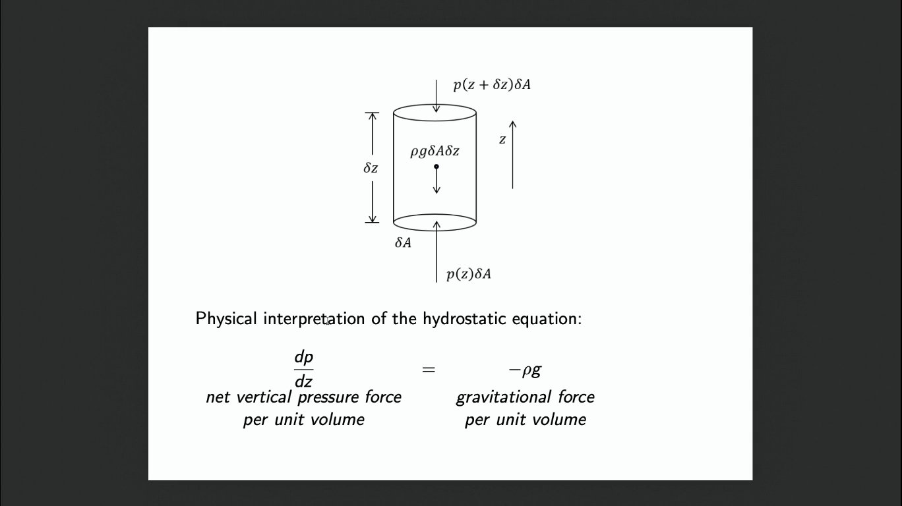
*Figure 10. Slide frame t2100 (35:00) shows upward pressure on the lower face, downward pressure on the upper face, and weight pointing down.*\

The hydrostatic equation is a **first-order ordinary differential equation** because it relates $p(z)$ and its first derivative in the single variable $z$. If $\rho$ is constant, integrate between heights $z_1$ and $z_2$ to find the difference between their pressures $p_1$ and $p_2$. The symbol $\Delta$ indicates the second value minus the first, so $\Delta p=p_2-p_1$ and $\Delta z=z_2-z_1$.

$$
p_2-p_1=-\rho g\int_{z_1}^{z_2}dz=-\rho g(z_2-z_1).
$$

$$
\boxed{\Delta p=-\rho g\Delta z}.
$$

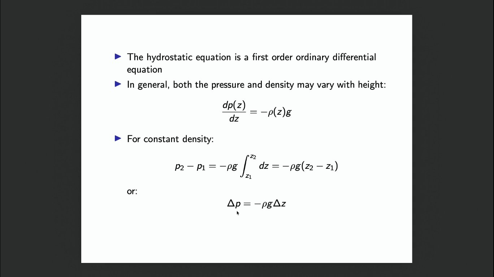
*Figure 11 - Slide frame t2340 (39:00), showing the general equation and its constant-density integral.*\

For a submerged point, it is convenient to use **depth** $h$, the vertical distance below the **free surface**, where the liquid meets the air in the lecture's example. The surface is at height $z_0$ and pressure $p_0$. Both $z_0$ and $h$ are measured in metres, and $p_0$ is measured in Pa.

$$
h=z_0-z.
$$

With constant density, the pressure difference is proportional to the depth difference $\Delta h$. The sign is positive because fluid at greater depth supports the weight of more fluid above it.

$$
\boxed{\Delta p=\rho g\Delta h}.
$$

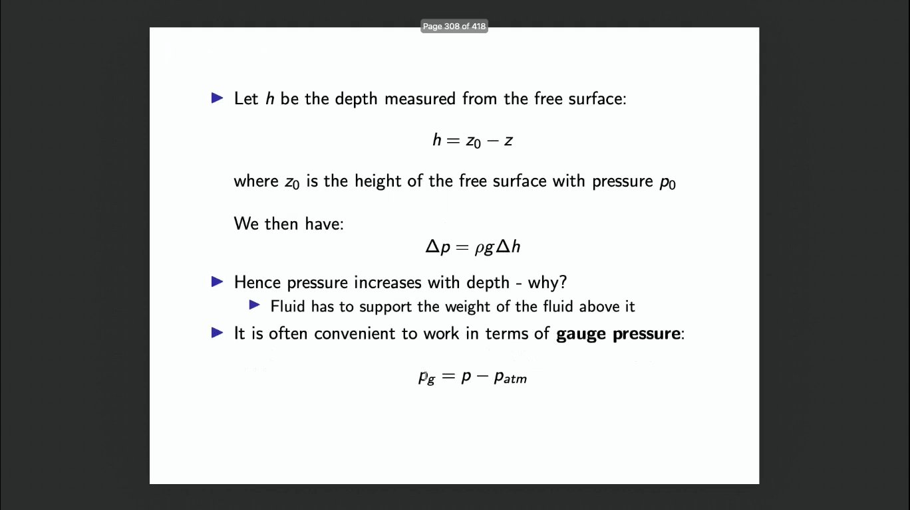
*Figure 12 - Slide frame t2580 (43:00), defining $h=z_0-z$ and $p_g=p-p_{atm}$.*\

**Gauge pressure** $p_g$ is pressure $p$ relative to atmospheric pressure $p_{atm}$. All three quantities are measured in Pa. If the relevant free surfaces are exposed to the same atmosphere, subtracting any two pressures cancels the shared atmospheric term.

$$
p_g=p-p_{atm},
$$

**Principle summary.** The general relation is $dp/dz=-\rho(z)g$. The shortcut $\Delta p=-\rho g\Delta z$ requires constant density, and the depth form changes the sign because $h$ increases downward.

**Common pitfall.** Do not use the constant-density formula for the atmosphere without checking the density assumption. The general differential equation remains the starting point when $\rho$ varies with height.

**Memory tip.** The pressure change has a minus sign with upward height and a plus sign with downward depth. The free surface has zero gauge pressure when exposed to the reference atmosphere.

## 6. Manometer example (43:07-52:32)

A manometer measures pressure indirectly. It uses hydrostatics to connect a visible difference in fluid-column height to the unknown difference in pressure.

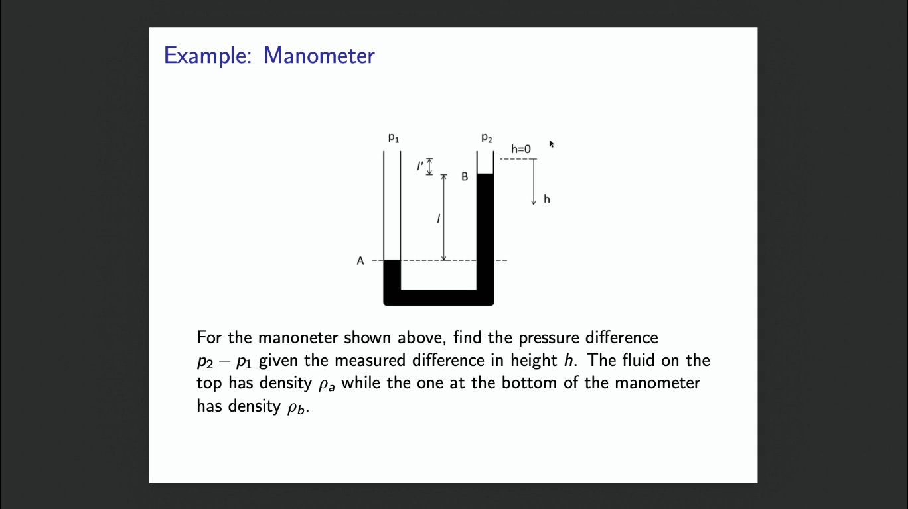
*Figure 13 - Slide frame t2700 (45:00), showing pressures $p_1$, $p_2$, fluids of densities $\rho_a$ and $\rho_b$, and the marked heights.*\

The diagram has a top fluid of density $\rho_a$ and a denser bottom manometer fluid of density $\rho_b$. The two connected pressures are $p_1$ and $p_2$, and the lecture considers $p_1>p_2$. The interfaces are at $A$ and $B$. The slide also marks a vertical distance $h$ from a level labelled $h=0$, but the final displayed relation uses $l$, the vertical separation between $A$ and $B$. The audio calls the observed height difference $l$. This note follows the displayed derivation and does not identify $h$ with $l$.

The pressures $p_1$, $p_2$ and $p_A$ are in Pa. Each density is in $\mathrm{kg\,m^{-3}}$ and is treated as constant within its own fluid. The length $l'$ is the vertical drop from the common connection level to $B$. Both $l'$ and $l$ are in metres. The problem statement calls the measured difference $h$ at 45:00, while the diagram and the 51:00 solution use $l$ for the interface separation.

### Worked example: pressure difference from a manometer

**What is asked.** Find $p_2-p_1$ from the manometer geometry and the known fluid densities.

**Why this route.** At equilibrium, two points at the same horizontal level in the same connected fluid have the same pressure. Choose the reference level through $A$, below which only the same bottom fluid remains. This makes the lower part cancel.

**Step 1.** On the left, start at pressure $p_1$ and descend through the upper fluid for the full distance $l'+l$. Add the two pressure increases for this same density to find $p_A$.

$$
p_A=p_1+\rho_a g l'+\rho_a g l.
$$

**Step 2.** Starting from the right pressure $p_2$, the column of top fluid contributes $\rho_a g l'$, while the bottom fluid contributes $\rho_b g l$:

$$
p_A=p_2+\rho_a g l'+\rho_b g l.
$$

**Step 3.** Equate the two expressions because both describe the same pressure at $A$:

$$
p_1+\rho_a g l'+\rho_a g l
=p_2+\rho_a g l'+\rho_b g l.
$$

**Step 4.** Subtract the first expression from the second. The common $p_A$ and $\rho_a g l'$ terms cancel:

$$
\boxed{p_2-p_1=(\rho_a-\rho_b)gl}.
$$

**Where each constant or coefficient comes from.** Each term has the form $\rho g L$, the pressure increase when moving downward a distance $L$ through a constant-density fluid. The density changes from $\rho_a$ to $\rho_b$ at the interface, so the two column contributions cannot be combined before writing both balances.

**Sanity check.** If $\rho_b>\rho_a$, then $p_2-p_1<0$, so $p_1>p_2$, consistent with the case described in the lecture. If the two densities were equal, the height difference would give no pressure difference in this displayed relation.

**Final answer.**

$$
\boxed{p_2-p_1=(\rho_a-\rho_b)gl}.
$$

**Common pitfall.** Do not cancel the two fluids' contributions as though their densities were equal. Only the portions containing the same fluid at the chosen reference level cancel. Also keep the sign convention: the displayed result is $p_2-p_1$, not $p_1-p_2$.

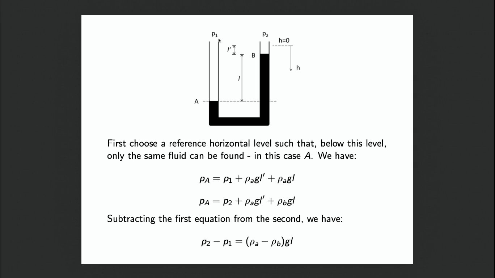
*Figure 14. Slide frame t3060 (51:00) shows the two routes to level $A$ and the resulting pressure difference.*\

To use the method, choose a level below which one fluid remains, use each column segment's density to find its pressure increase, and equate the pressures at the common level. The first two tutorial questions concern manometers and the third concerns atmospheric pressure. The lecturer closes by pointing ahead to forces on submerged surfaces.

**Principle summary.** A manometer turns a pressure measurement into a height measurement and uses the integrated hydrostatic equation piece by piece.

**Memory tip.** Move down, add $\rho gL$. Move up, subtract $\rho gL$. At a common level in one connected static fluid, pressures are equal.

## Key formula sheet

**Shear.** Use $\frac{d\theta}{dt}=\frac{du}{dy}$ for the local deformation rate of the one-dimensional shear flow in Section 1. Both sides have units of $\mathrm{s^{-1}}$. For a Newtonian fluid, $\tau=\mu\frac{du}{dy}$ gives the shear stress in Pa.

**Forces and stresses.** Use $F_g=\rho g\delta V$ for the weight magnitude in N of a small fluid element and $\tau=\frac{F}{A}$ for the stress in Pa associated with a force $F$ over area $A$.

**Local approximation.** Use $f(x_0+\delta x)\approx f(x_0)+\frac{df}{dx}(x_0)\delta x$ to estimate a nearby value from a known value and slope at $x_0$.

**Static pressure.** With $z$ increasing upward, $\frac{dp}{dz}=-\rho(z)g$ allows density to vary with height. For constant density, use $\Delta p=-\rho g\Delta z$, or $\Delta p=\rho g\Delta h$ with depth $h=z_0-z$. All pressure differences are in Pa.

**Pressure measurements.** Use $p_g=p-p_{atm}$ to reference a pressure to the atmosphere. For the U-tube geometry shown, use $p_2-p_1=(\rho_a-\rho_b)gl$ with interface separation $l$. Both results are in Pa.

## Self-check questions

**Q1.** Why does $d\theta/dt$ equal $du/dy$?\
**Answer.** The upper and lower layers have relative displacement $\delta u\,\delta t$. Dividing by the layer spacing and taking the small-increment limit gives $du/dy$.

**Q2.** Which forces remain in a static fluid?\
**Answer.** Pressure force and gravity. A static fluid cannot sustain shear stress.

**Q3.** What does the sign in $dp/dz=-\rho g$ mean?\
**Answer.** Pressure decreases upward, so the lower face pushes upward more strongly than the upper face pushes downward. The net pressure force balances gravity.

**Q4.** When may $\Delta p=-\rho g\Delta z$ be used?\
**Answer.** When the fluid is static and its density can be treated as constant over the height interval.

**Q5.** Why is gauge pressure useful?\
**Answer.** A surface exposed to the reference atmosphere has zero gauge pressure. When comparing two pressures that use this same reference, the atmospheric term cancels.

**Q6.** In the displayed manometer result, why do the $l'$ terms cancel?\
**Answer.** Both routes to level $A$ pass through the same top fluid over the same distance $l'$.

## Glossary

In **shear flow**, velocity changes across the layers. The **velocity gradient** $du/dy$ measures how much velocity changes per unit distance. The **shear strain rate** $d\theta/dt$ measures how fast the deformation angle changes.

A **steady flow** is independent of time at a fixed position. An **inviscid flow** is modelled with negligible viscous effects. In an **incompressible flow**, pressure changes leave density effectively unchanged. **Laminar flow** is ordered, while **turbulent flow** has chaotic motion across many scales.

**Hydrostatics** studies fluids at rest. **Depth** is the vertical distance below the free surface. **Gauge pressure** measures pressure relative to the atmosphere. A **manometer** infers pressure differences from fluid-column heights.

**Sources.** "ME MECH40002 - Fluid Mechanics 1 (2026-11-16)", transcript 00:21-56:41 with lecture coverage 00:36-52:32, and reproduced frames t0240, t0480, t0600, t0780, t0900, t0960, t1200, t1440, t1560, t2100, t2340, t2580, t2700 and t3060. The course questions were checked at t1020 and the force-balance notation at t1980 and t2040.
