# MECH40002 Fluid Mechanics 1 — Hydrostatic Forces on Flat Surfaces

This note covers the Imperial College London first-year lecture ME MECH40002 Fluid Mechanics 1 on 2026-11-23. The recording runs 59:54, and the teaching ends at about 54:50. This recording has no usable subtitles, so the whole note is built from what can be seen on screen: the slides, the lecturer's handwriting on the visualiser, and a class poll. Nothing the lecturer said aloud could be recovered. Every claim about "the slide" points to a frame timestamp. Where a frame is unreadable, the note says so instead of guessing.

## What this lecture is about

Last lecture gave the pressure at one point under water. This lecture asks the next question: if a whole wall, gate or window is under water, how big is the total push on it, where does that push act, and which way does it point? Think of a crowd leaning on a door. Each person pushes a little, and the people lower down push harder. To hold the door shut you need the total of all those pushes, and you need to know where that total acts. The tool for "adding up a push that is spread over an area" is a new kind of integral, the surface integral.

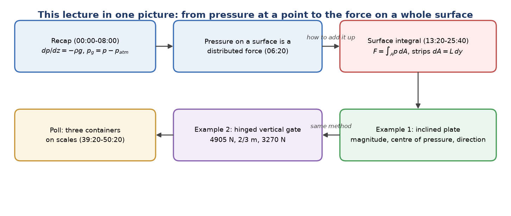

Figure 1. The whole lecture as one chain, built from the slide order in the frames. Drawn for this note.

## 0. Chapter map

| Part | Frames | Topic | Question it answers |
|---|---|---|---|
| 1 | 00:00–08:20 | Recap: hydrostatic equation, depth, gauge pressure | What did Chapter 1 end with? |
| 2 | 06:20–13:00 | Hydrostatic forces on flat surfaces | Why is the force on a surface "distributed", and what must we find? |
| 3 | 13:20–25:40 | The surface integral | How do we add up pressure over an area? |
| 4 | 26:00–35:40 | Example 1: inclined flat surface | Force, centre of pressure and direction on a tilted plate |
| 5 | 36:00–39:00 | Example 2: vertical gate | What force holds a hinged gate shut? |
| 6 | 39:20–50:20 | Poll: three containers on scales | Same depth, different shapes: which scale reads most? |
| 7 | 50:40–55:00 | Review slides and Problem Sheet 5 | What comes next? |

## 1. Recap: the hydrostatic equation, depth and gauge pressure (00:00–08:20)

The recording opens on a Chapter 1 slide, "Physical interpretation of the hydrostatic equation", which stays up until 05:20. It shows a small vertical cylinder of fluid with cross-section $\delta A$ and height $\delta z$. The pressure force on its bottom face is $p(z)\delta A$ pushing up, the pressure force on its top face is $p(z+\delta z)\delta A$ pushing down, and its weight is $\rho g\delta A\delta z$. Under the equation the slide writes two labels.

$$\frac{dp}{dz}=-\rho g$$

The left side is labelled "net vertical pressure force per unit volume" and the right side "gravitational force per unit volume". In plain words: in still water, the extra push from below on each cubic metre exactly holds up that cubic metre's weight. Here $p$ is pressure in Pa, $z$ is height in m (upwards positive), $\rho$ is density in kg/m³ and $g=9.81$ m/s². The minus sign says pressure falls as you go up.

At 05:40 and again, fully built, at 08:00, a slide introduces **depth**. Depth $h$ is measured downwards from the **free surface**, the top of the liquid where it meets the air. The free surface is at height $z_0$ with pressure $p_0$.

$$h=z_0-z,\qquad\Delta p=\rho g\Delta h$$

The slide then asks "Hence pressure increases with depth – why?" and answers "Fluid has to support the weight of the fluid above it". It ends with **gauge pressure**, pressure measured relative to the atmosphere.

$$p_g=p-p_{atm}$$

These slides are the end of Chapter 1, which the 2026-11-16 note already explains in full. Here they act as the starting point for today: pressure grows linearly with depth.

**Principle summary.** In still liquid, $p=p_0+\rho gh$, so pressure grows by the same amount for every metre you go down.

**Trap.** $z$ points up and $h$ points down, so $dp/dz=-\rho g$ but $dp/dh=+\rho g$. Mixing them flips the sign.

**Memory tip.** "Deeper means heavier water above you."

## 2. Pressure on a submerged surface is a distributed force (06:20–13:00)

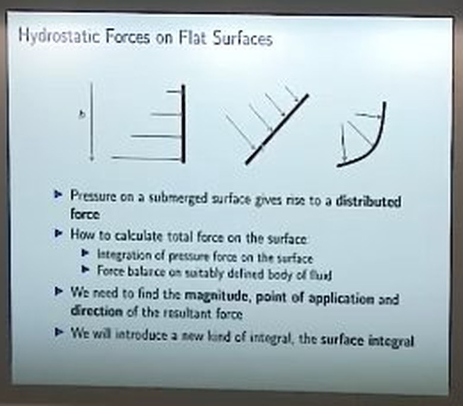

Figure 2. Slide frame 12:40, "Hydrostatic Forces on Flat Surfaces". Left: a vertical wall with a depth arrow $h$ and horizontal pressure arrows that grow longer with depth. Middle: an inclined wall with arrows normal to it. Right: a curved wall with arrows normal to the curve.

The bullets appear one by one between 06:20 and 10:20. First: "Pressure on a submerged surface gives rise to a **distributed force**". A distributed force is a push spread over an area, with a different strength at each point, like snow lying on a roof. Second: there are two ways to get the total force, "Integration of pressure force on the surface" and "Force balance on suitably defined body of fluid". Third: "We need to find the magnitude, point of application and direction of the resultant force". Fourth: "We will introduce a new kind of integral, the surface integral".

So what? A distributed force is awkward for design. To size a hinge, a bolt or a wall, an engineer wants one equivalent force, the **resultant force**, together with the single point where it acts. That point is the **centre of pressure**. The rest of the lecture is about finding those two things, plus the direction.

From 12:00 to 13:20 the side screens show the lecturer's handwriting: a graph of $f(x)$ against $x$, with thin vertical strips under the curve and one strip shaded. It is the familiar picture of an ordinary integral as a sum of thin strips, drawn just before the surface integral is introduced.

**Principle summary.** We replace a pressure spread over an area by one resultant force at the centre of pressure, normal to a flat surface.

**Trap.** Pressure is not a force. Pressure is force per area, in Pa; the force on a surface needs pressure times area, added up.

**Memory tip.** "Three questions for every surface: how big, where, which way."

## 3. The surface integral (13:20–25:40)

### 3.1 From $\delta F=p\,\delta A$ to $F=\int_A p\,dA$

The slide "Integration of Pressure Force on a Surface" builds up from 13:20 to 16:00. On a tiny piece of surface of area $\delta A$, the pressure is almost constant, so the force on that piece is pressure times area.

$$\delta F=p\,\delta A$$

The total force is the sum over all pieces, and in the limit of very small pieces the sum becomes an integral. The slide says "This integral is called a surface integral". The subscript $A$ under the integral sign means "add over the whole area $A$".

$$F=\int_A p\,dA,\qquad\int_A f(y)\,dA=\lim_{\delta A_i\to0}\sum_i f(y_i)\,\delta A_i$$

At 16:00 the slide adds: "General method for evaluating surface integrals will be covered in your maths courses, but we will learn now a method sufficient for plane surfaces and simple shapes".

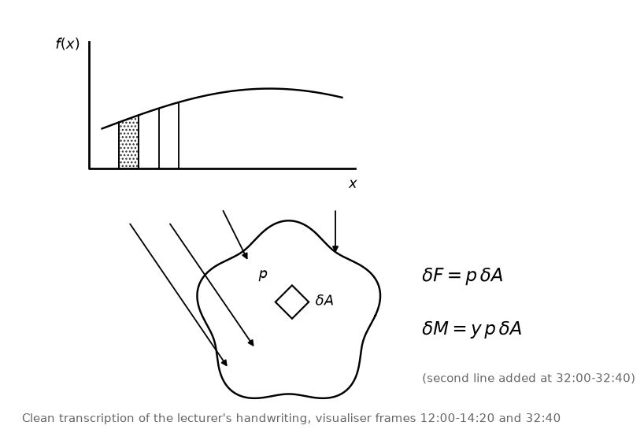

Figure 3. Transcription of the visualiser handwriting. The upper graph and the lower surface sketch appear at 12:00–14:20; the line $\delta M=y\,p\,\delta A$ is added at 32:00–32:40. Original frame kept as [frame_handwriting_surface_t1960.jpg](figures/frame_handwriting_surface_t1960.jpg).

The handwriting in Figure 3 puts the two ideas side by side. Above: an ordinary integral adds thin strips under a curve. Below: a surface integral adds tiny patches $\delta A$ on a surface, each pushed by its own pressure $p$. Later the lecturer adds a second line: each patch also has a turning effect, its **moment** $\delta M=y\,p\,\delta A$, about a chosen axis. That second line is what finds the centre of pressure in Part 4.

### 3.2 Turning a surface integral into an ordinary integral

The slide "The Surface Integral" (16:20–18:00) gives the trick for plane surfaces. If the function depends on $y$ only, cut the area into horizontal strips. Along one strip $y$ is the same everywhere, so the whole strip shares one value of $f(y)$. For a rectangle of width $L$, each strip of height $dy$ has area $L\,dy$. The slide adds: "If integrating with respect to $x$, choose vertical elements".

$$dA=L\,dy,\qquad\int_A f(y)\,dA=\int_{y_1}^{y_2}f(y)L\,dy=L\int_{y_1}^{y_2}f(y)\,dy$$

The slide's first test is the area itself, $f(y)=1$. At 20:20 it shows the result for the rectangle (the slide calls it a parallelogram):

$$\int_A dA=\int_{y_1}^{y_2}L\,dy=L(y_2-y_1)$$

That is width times height, as expected. The slide also warns: "For non-uniform elements, $dA$ will be a function of $y$". The triangle that follows is exactly that case.

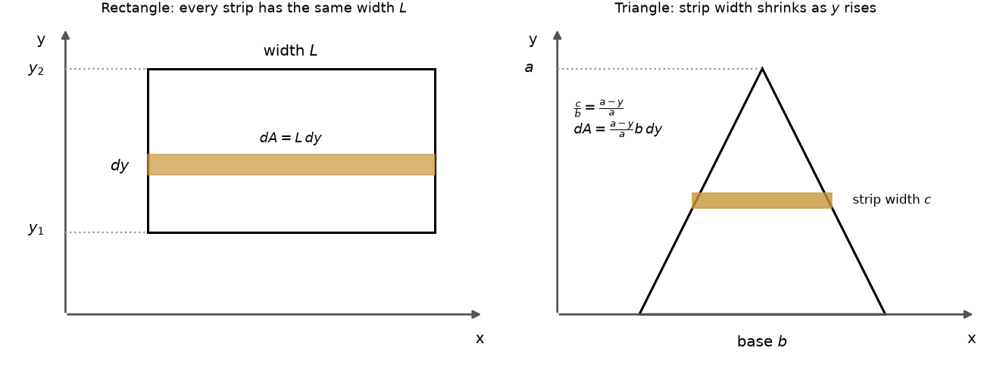

Figure 4. Strips on the two shapes used on the slides at 16:20–23:20. Drawn for this note to match the slide sketches.

| Item | Formula card: surface integral on a plane |
|---|---|
| Formula | $\int_A f(y)\,dA=\int_{y_1}^{y_2}f(y)\,w(y)\,dy$, where $w(y)$ is the strip width |
| Symbols | $A$ the area (m²); $dA$ a strip's area (m²); $w(y)$ the strip width at height $y$ (m): $L$ for a rectangle, $c=\frac{a-y}{a}b$ for the triangle |
| Conditions | Plane surface; the integrand depends on one coordinate only |
| Steps | Pick the coordinate the integrand depends on; cut strips across it; write $dA=w(y)\,dy$; integrate between the edges |
| Common error | Taking the strip width as constant when the shape narrows: the triangle would come out as $ab$, twice too big |

### Example 1. Area of a triangle by horizontal strips

**What is asked**

The slides at 20:40–23:20 set up a triangle of height $a$ and base $b$ sitting on the $x$ axis, and ask for its area by the strip method. The last slide stops at "Hence $\int_A dA=\int_0^a\frac{a-y}{a}b\,dy=$" with the right-hand side blank on the frame. So the result below is worked out in this note.

$$\text{triangle: height } a,\ \text{base } b:\qquad\text{find }\int_A dA$$

**Why this route**

This is a practice run for the pressure integrals to come. There, pressure depends on depth only, so horizontal strips are the natural cut. Using the triangle, whose answer you already know, lets you test the method before trusting it on a new problem. The new difficulty compared with the rectangle is that the strip width changes with $y$.

**Step 1: write the strip width with similar triangles**

The small triangle above the strip, of height $a-y$, has the same shape as the whole triangle, of height $a$. Matching sides gives the strip width $c$. This is the slide's own step at 21:20.

$$\frac{c}{b}=\frac{a-y}{a}\quad\Rightarrow\quad dA=c\,dy=\frac{a-y}{a}b\,dy$$

**Step 2: integrate from the base to the apex**

The strips run from $y=0$ at the base to $y=a$ at the apex. Pull the constant $b/a$ outside, then integrate $a-y$ term by term.

$$\int_0^a\frac{a-y}{a}b\,dy=\frac{b}{a}\left[ay-\frac{y^{2}}{2}\right]_0^a=\frac{b}{a}\left(a^{2}-\frac{a^{2}}{2}\right)$$

**Step 3: simplify**

$$\frac{b}{a}\cdot\frac{a^{2}}{2}=\frac{1}{2}ab$$

**Where the constant comes from**

The $\frac{1}{2}$ comes from integrating $y$, which gives $\frac{y^{2}}{2}$. Geometrically, the strip width falls linearly from $b$ to 0, so the average width is $b/2$, and the area is average width times height.

**Sanity check**

It matches the school formula for a triangle. Two copies of this triangle fit into an $a\times b$ rectangle, so half of $ab$ is right. With numbers, $a=2$ m and $b=3$ m give 3 m².

**Answer**

$$\int_A dA=\frac{1}{2}ab$$

**Trap**

Writing $dA=b\,dy$ with a fixed width gives $ab$, twice the true area. Writing $c=\frac{y}{a}b$ instead of $\frac{a-y}{a}b$ describes a triangle standing on its tip. For area alone it still gives $\frac{1}{2}ab$, but for a pressure integral it puts the wide part at the wrong depth.

Technique: the integral is the easy part; the real work is writing $dA$ as a function of $y$.

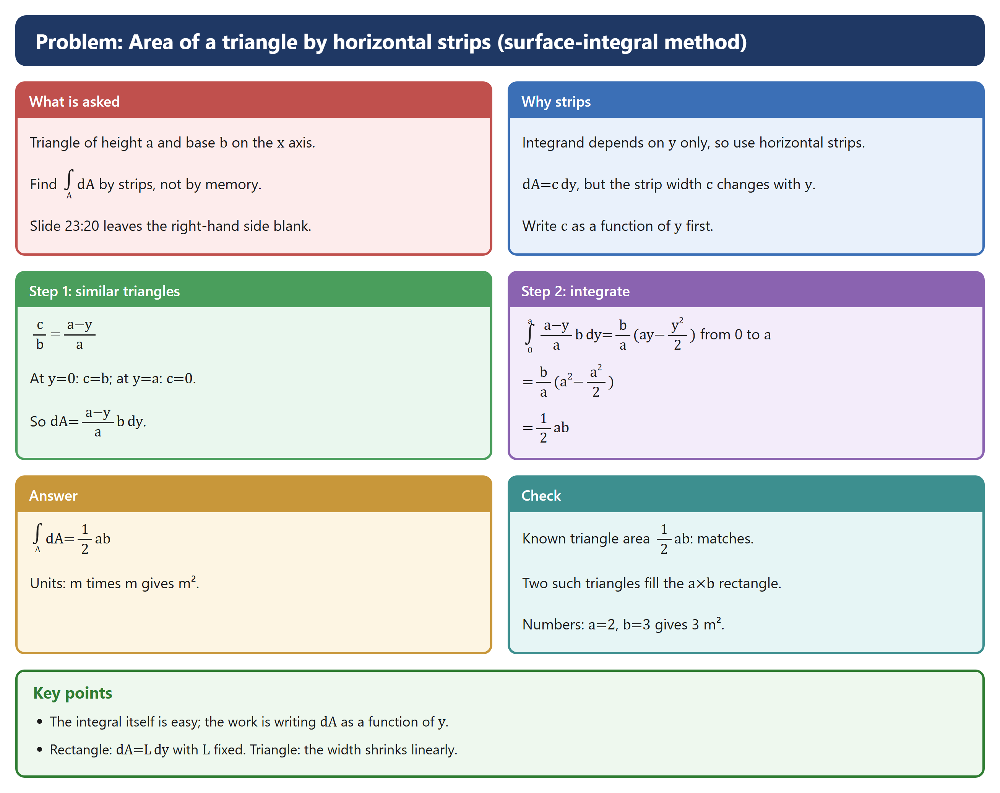

**Principle summary.** For a plane surface, cut strips along which the integrand is constant; the surface integral becomes an ordinary integral of $f$ times the strip width.

**Trap.** The strip width is geometry, not always a constant.

**Memory tip.** "Slice, measure the slice, add the slices."

## 4. Example: hydrostatic force on an inclined flat surface (26:00–35:40)

The slide "Example 1: Hydrostatic Force on an Inclined Flat Surface" (26:00) asks for the magnitude, point of application and direction of the pressure force on a flat rectangular surface $A$. The surface could be a gate or a window in a sloping wall. It runs from $y_1$ to $y_2$ along the wall, has width $L$ into the page, is inclined at angle $\theta$, sits under a fluid of constant density, and has atmospheric pressure acting on all surfaces.

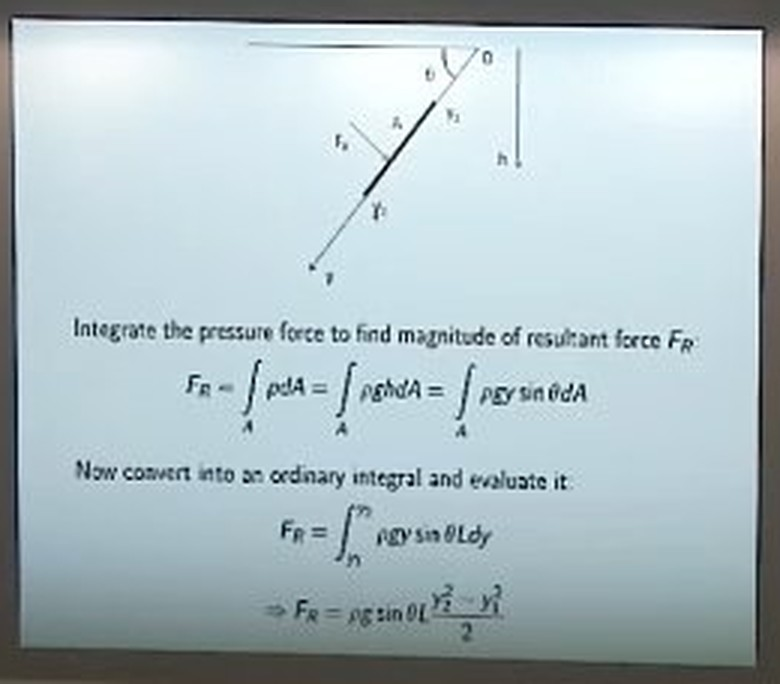

Figure 5. Slide frame 31:20. The free surface is the horizontal line through O. The $y$ axis runs down along the wall from O, $h$ is the vertical depth, and $F_R$ is drawn normal to the plate.

Two set-up moves on the slides at 27:00–29:40 make the problem simple. First, "No need to consider the atmospheric pressure, as it acts on all surfaces": air pushes on the dry side too, so it cancels and only gauge pressure matters. Second, measure $y$ along the wall from the free surface. A point at distance $y$ along a wall tilted at $\theta$ sits at depth $h=y\sin\theta$.

$$h=y\sin\theta,\qquad p=\rho gh=\rho gy\sin\theta$$

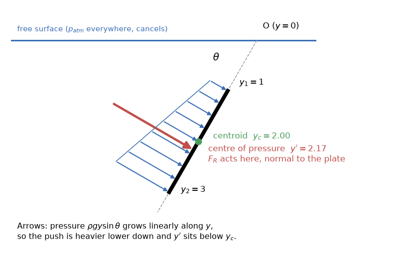

Figure 6. Why the centre of pressure sits below the middle of the plate. The numbers ($y_1=1$, $y_2=3$, $\theta=60^{\circ}$) are this note's own illustration. Drawn for this note.

| Item | Formula card: plane surface under liquid |
|---|---|
| Formulas | $F_R=\rho g\sin\theta\,L\frac{y_2^{2}-y_1^{2}}{2}$; $y'=\frac{2(y_2^{3}-y_1^{3})}{3(y_2^{2}-y_1^{2})}$ |
| Symbols | $F_R$ resultant force (N); $\rho$ density (kg/m³); $g$ 9.81 m/s²; $\theta$ wall angle from the free surface; $L$ width (m); $y_1$, $y_2$ distances of the edges along the wall from the free surface (m); $y'$ centre of pressure along the wall (m) |
| Conditions | Flat rectangle, constant density, gauge pressure (atmosphere on both sides), $y$ measured from the free surface |
| Steps | Write $p=\rho gy\sin\theta$; $dA=L\,dy$; integrate $p$ for $F_R$; integrate $y\,p$ and divide by $F_R$ for $y'$; direction normal to the plate |
| Common error | Measuring $y$ from the top edge of the plate instead of from the free surface; then $p$ is wrong everywhere |

### Example 2. Force and centre of pressure on an inclined plate

**What is asked**

This is the lecture's Example 1, shown on slides 26:00–35:40. Find the magnitude, the point of application and the direction of the force on the plate. The slides keep everything as symbols. At the end this note adds its own numbers to show the size of the answer.

$$\text{given } \rho,\ g,\ \theta,\ L,\ y_1,\ y_2:\qquad\text{find }F_R,\ y',\ \text{direction}$$

**Why this route**

Pressure changes along the plate, so "pressure times area" with one pressure would be wrong unless you know which pressure to use. Integrating $p\,dA$ handles the change directly, and the strips from Part 3 turn it into a one-line ordinary integral. The same strips give the moment, which is what locates the force.

**Step 1: integrate the pressure for the magnitude**

This is the slide at 30:00–31:00. Put $p=\rho gy\sin\theta$ and $dA=L\,dy$. Everything except $y$ is constant and comes outside.

$$F_R=\int_A p\,dA=\int_{y_1}^{y_2}\rho gy\sin\theta\,L\,dy=\rho g\sin\theta\,L\,\frac{y_2^{2}-y_1^{2}}{2}$$

**Step 2: use moments to find the centre of pressure**

This is the slide at 32:40–35:00. The single force $F_R$ at $y'$ must have the same moment about $y=0$ as all the strips together, each strip contributing $y\,p\,dA$. Divide by $F_R$. The factors $\rho g\sin\theta$ and $L$ cancel top and bottom.

$$y'F_R=\int_A y\,p(y)\,dA\quad\Rightarrow\quad y'=\frac{\rho g\sin\theta\int_{y_1}^{y_2}y^{2}L\,dy}{\rho g\sin\theta\int_{y_1}^{y_2}yL\,dy}=\frac{2(y_2^{3}-y_1^{3})}{3(y_2^{2}-y_1^{2})}$$

**Step 3: state the direction**

The slide at 35:20 says that for a flat surface the resultant is normal to the surface, because every element's force is normal to it. It adds that this is "not the case with curved surfaces".

**Step 4: put in illustrative numbers**

These numbers are this note's own, not from the slides: water, $\theta=60^{\circ}$, $y_1=1$ m, $y_2=3$ m, $L=2$ m.

$$F_R=1000\times9.81\times0.866\times2\times\frac{9-1}{2}=67{,}966\ \text{N},\qquad y'=\frac{2(27-1)}{3(9-1)}=2.17\ \text{m}$$

**Where the constant comes from**

The $\frac{1}{2}$ in $F_R$ comes from $\int y\,dy=\frac{y^{2}}{2}$. The $\frac{2}{3}$ in $y'$ is the ratio of $\int y^{2}dy=\frac{y^{3}}{3}$ to $\int y\,dy=\frac{y^{2}}{2}$. The $\sin\theta$ turns distance along the wall into vertical depth.

**Sanity check**

Independent route: the pressure at the plate's middle, $y_c=\frac{y_1+y_2}{2}$, times the area $L(y_2-y_1)$, gives $\rho g\sin\theta\frac{y_1+y_2}{2}L(y_2-y_1)$. That multiplies out to the same $F_R$, because $(y_2+y_1)(y_2-y_1)=y_2^{2}-y_1^{2}$. Limits: if the plate starts at the surface ($y_1=0$), then $y'=\frac{2}{3}y_2$. As the plate shrinks ($y_1\to y_2$), $y'$ approaches the middle. In the numbers, $y'=2.17$ m is below the middle at 2 m, as Figure 6 shows.

**Answer**

$$F_R=\rho g\sin\theta\,L\frac{y_2^{2}-y_1^{2}}{2},\qquad y'=\frac{2(y_2^{3}-y_1^{3})}{3(y_2^{2}-y_1^{2})},\qquad\text{direction normal to the plate}$$

**Trap**

Putting the resultant at the middle of the plate is the classic mistake. The pressure is larger lower down, so the force must act lower. In the numbers above that error is 0.17 m. Another mistake is writing $h=y\cos\theta$: with $\theta$ measured from the free surface, the depth uses $\sin\theta$.

Memory trick: force uses $\int p$, position uses $\int y\,p$ divided by the force.

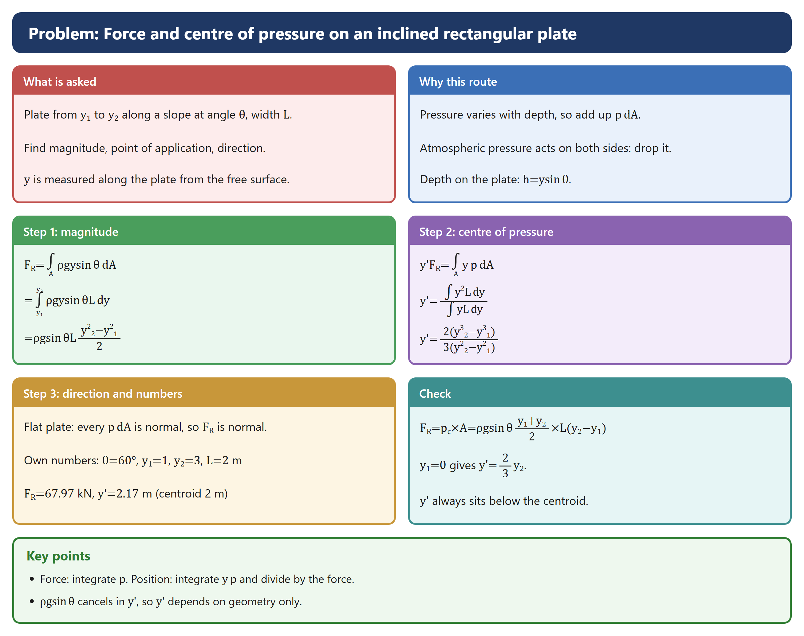

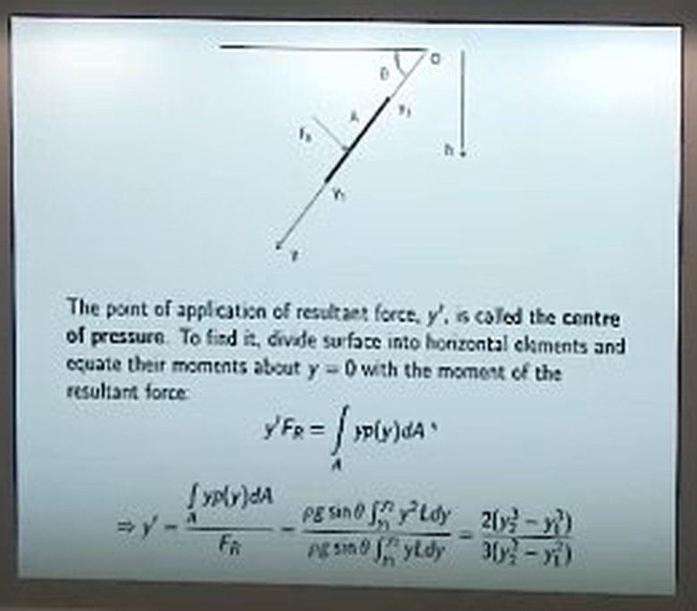

Figure 7. Slide frame 35:00, the centre-of-pressure result exactly as written on the slide.

**Principle summary.** On a flat plate the water force is $\int p\,dA$, it acts at $y'=\int y\,p\,dA/F_R$, and it points normal to the plate.

**Trap.** The centre of pressure is not the centroid; it is always deeper.

**Memory tip.** "Deeper pushes harder, so the push sits lower."

## 5. Example: a hinged vertical gate (36:00–39:00)

### Example 3. Force to hold the gate closed

**What is asked**

Slide 36:00, "Example 2: Vertical Gate". A rectangular gate sits just below the free surface of a water tank and is hinged at the top, at O. It is $L=1$ m long and $w=1$ m wide, and the system is open to the atmosphere. What force $F$, applied at the bottom of the gate, keeps it closed?

$$L=1\ \text{m},\quad w=1\ \text{m},\quad\rho=1000\ \text{kg/m}^{3},\quad g=9.81\ \text{m/s}^{2}:\qquad\text{find }F$$

**Why this route**

The slide at 37:00 says "For the gate to remain closed, the net moment about O must be zero". Taking moments about the hinge removes the hinge's own reaction force, which we do not know and do not need. That leaves only two unknowns: the water force with its position, and $F$. The water force comes from the Part 4 method with a vertical wall.

**Step 1: find the total water force**

The gate is vertical, so the depth is just $y$ (that is, $\sin90^{\circ}=1$). Atmospheric pressure is dropped, as the slide at 37:40 says.

$$F_{p,tot}=\rho g\int_0^L y\,w\,dy=1000\times9.81\times1\times\left[\frac{y^{2}}{2}\right]_0^1=4905\ \text{N}$$

**Step 2: find the centre of pressure**

This is the slide at 38:20. Here $\rho g w$ cancels top and bottom.

$$y'=\frac{\rho g\int_0^1y^{2}w\,dy}{\rho g\int_0^1y\,w\,dy}=\frac{1/3}{1/2}=\frac{2}{3}\ \text{m}$$

**Step 3: take moments about O**

This is the slide at 38:40. The water force at $\frac{2}{3}$ m below the hinge tries to swing the gate open. The applied force $F$ at the bottom, 1 m below the hinge, holds it shut.

$$F_{p,tot}\,y'=F\,L\quad\Rightarrow\quad F=\frac{F_{p,tot}\,y'}{L}=\frac{4905\times2/3}{1}=3270\ \text{N}$$

**Where the constant comes from**

4905 is $1000\times9.81\times\frac{1}{2}$: the $\frac{1}{2}$ comes from $\int_0^1y\,dy$. The $\frac{2}{3}$ is the same ratio as in Example 2 with $y_1=0$. 3270 is $\frac{2}{3}$ of 4905, because $F$ has a lever arm of 1 m and the water force has a lever arm of $\frac{2}{3}$ m.

**Sanity check**

The pressure at mid-depth is $\rho g\times0.5=4905$ Pa. Times the 1 m² area that gives 4905 N, the same total force. The slide at 38:40 shows 3270 N, which matches. The holding force is smaller than the water force because it sits at the end of the longest lever arm. That makes sense: a door handle placed far from the hinge needs the least effort.

**Answer**

$$F_{p,tot}=4905\ \text{N},\qquad y'=\frac{2}{3}\ \text{m},\qquad F=3270\ \text{N}$$

**Trap**

Putting the water force at mid-depth (0.5 m) gives $F=4905\times0.5=2453$ N, which is 25% too small. The gate would swing open. Taking moments about the bottom edge instead of the hinge brings in the unknown hinge reaction.

Exam tip: when a body is hinged, take moments about the hinge first.

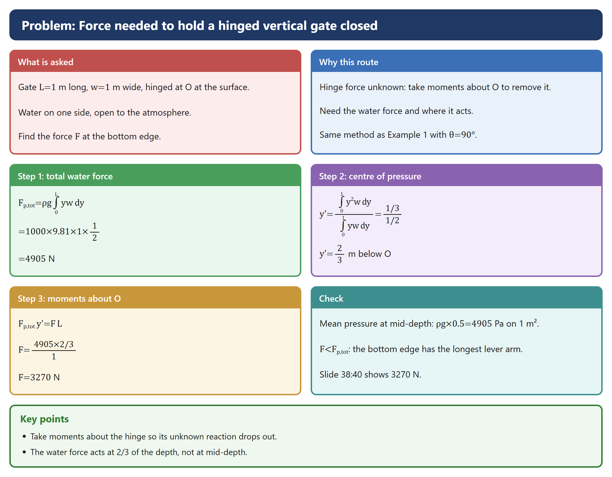

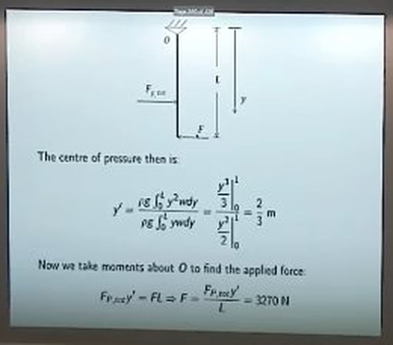

Figure 8. Slide frame 38:40, the gate's centre of pressure and the moment balance, with the answer 3270 N on the slide.

**Principle summary.** Hinge problem: water force from $\int p\,dA$, its position from moments, then one moment equation about the hinge.

**Trap.** On a gate reaching from the surface, the water force acts at two thirds of the depth, not at half.

**Memory tip.** "Hinge first, two thirds down."

## 6. Poll: three containers on scales (39:20–50:20)

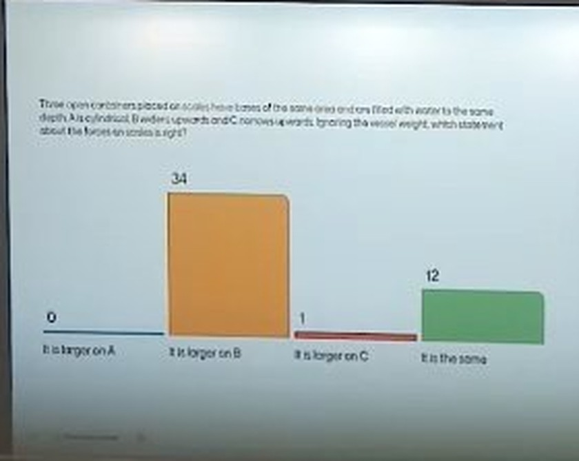

Figure 9. Poll frame 49:20 (Mentimeter). Final count on the frames: A 0, B 34, C 1, "It is the same" 12, with 47 of 48 responding.

The poll question reads: "Three open containers placed on scales have bases of the same area and are filled with water to the same depth. A is cylindrical, B widens upwards and C narrows upwards. Ignoring the vessel weight, which statement about the forces on scales is right?" The options are "It is larger on A", "on B", "on C" and "It is the same". The votes grew from 1 at 40:00 to the final count at 46:40 and stayed there until 50:20.

Figure 10. Transcription of the visualiser handwriting at 40:00–53:20. The dashed line marks the same water level in all containers; each has depth $h$ and base area $A$. Pressure strokes on B's walls and base were added at 48:20–49:20, and the bottom sketch with $W$ at about 50:00. The letters A, B, C above the containers are added in this note. Original frame kept as [frame_handwriting_containers_t3200.jpg](figures/frame_handwriting_containers_t3200.jpg).

No frame shows the official answer or the lecturer's explanation. The sketches show what he drew attention to: pressure normal to B's sloping walls, and a separate weight arrow $W$. The worked example below gives the physics, and it is this note's own reasoning.

### Example 4. Base force versus scale reading

**What is asked**

The poll gives no dimensions, so this example uses made-up ones. All three containers have base area $A=0.01$ m² and water depth $h=0.2$ m. They are circular frustums (cut-off cones) with top areas 0.01 m² for A, 0.03 m² for B and 0.0025 m² for C. Find the water force on each base and the reading on each scale.

$$A=0.01\ \text{m}^{2},\quad h=0.2\ \text{m},\quad A_{top}=0.01,\ 0.03,\ 0.0025\ \text{m}^{2}:\qquad\text{find }F_{base},\ \text{reading}$$

**Why this route**

The question mixes two different forces, and the poll split shows how easy they are to confuse. The base force comes from the pressure at the bottom, which by Part 1 depends only on depth. The scale reading comes from a force balance on the whole container plus water (the "force balance on a body of fluid" route from the 09:00 slide): the scale must hold up everything above it, which is the water's weight. Computing both shows where the difference goes.

**Step 1: the force on each base**

Same depth means the same pressure at the bottom, and the same base area, so the same force in all three.

$$F_{base}=\rho ghA=1000\times9.81\times0.2\times0.01=19.62\ \text{N}$$

**Step 2: the weight of water in each**

Use the frustum volume with bottom area $A_1$ and top area $A_2$, then $W=\rho gV$.

$$V=\frac{h}{3}\left(A_1+A_2+\sqrt{A_1A_2}\right):\qquad W_A=19.62\ \text{N},\quad W_B=37.49\ \text{N},\quad W_C=11.45\ \text{N}$$

**Step 3: account for the difference with the walls**

In B the sloping walls lean outward, so they carry part of the water: they push up on it with $37.49-19.62=17.87$ N. In C the walls lean inward over the water and push it down with $19.62-11.45=8.17$ N. That is why the base of C feels more than the weight of the water inside it. The scale, though, supports the whole vessel and the water, so it reads the water's weight.

$$\text{reading}=W:\qquad W_B=37.49>W_A=19.62>W_C=11.45\ \text{N}$$

**Where the constant comes from**

The $\frac{1}{3}$ in the frustum volume is the cone factor, the same $\frac{1}{3}$ as in $\frac{1}{3}\times$base$\times$height for a cone. The $\sqrt{A_1A_2}$ term accounts for the slanted sides. For A, $A_1=A_2$, so the formula gives $hA$, the ordinary cylinder.

**Sanity check**

For A the walls are vertical, so they cannot push vertically. The base force must equal the weight, and it does: 19.62 N both ways. Fill a flat dish and a narrow vase to the same depth on kitchen scales: the dish, which holds more water, reads more. That matches the B-largest answer.

**Answer**

$$F_{base}=19.62\ \text{N in A, B, C};\qquad\text{scale reading largest on B}$$

**Trap**

"Same depth, same pressure, so the same force on the scale" mixes up the base force with the scale reading; 12 votes went to "It is the same". The base force is indeed the same, but the walls also carry vertical forces, and the scale feels the walls too.

Exam tip: before calculating, ask which body you are balancing, the water or the base.

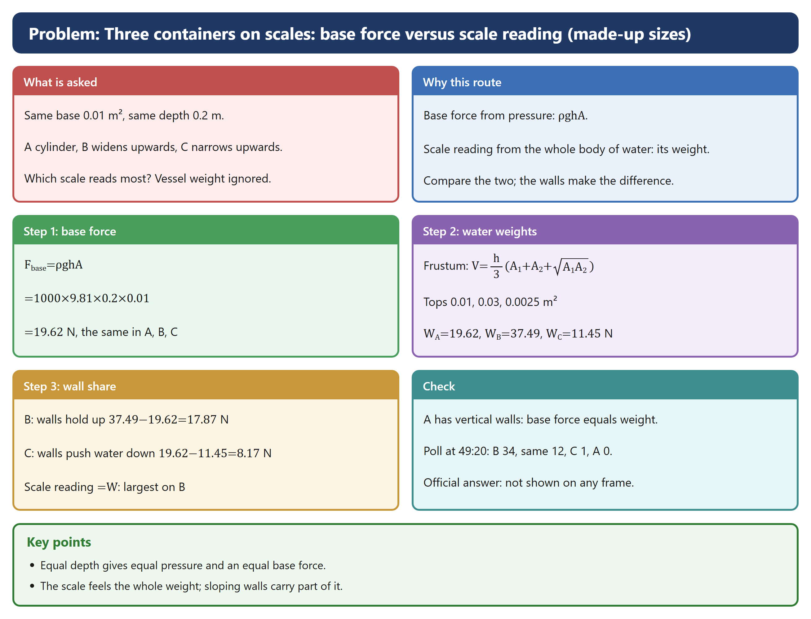

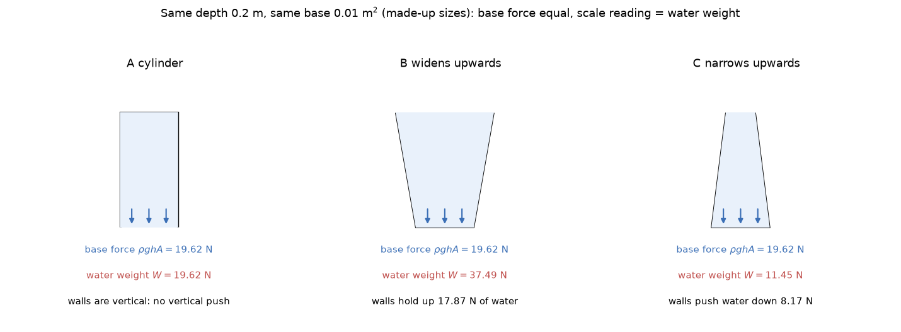

Figure 11. This note's force picture for the made-up sizes. Drawn for this note; it is not on any frame.

**Principle summary.** Pressure at a depth depends only on depth, but the force on a support depends on the whole force balance.

**Trap.** "Same pressure" does not mean "same total force on everything".

**Memory tip.** "The base feels depth; the scale feels weight."

## 7. Closing: review slides and Problem Sheet 5 (50:40–55:00)

After the poll the lecturer flicks back through earlier slides. The frame at 50:40 is a transition, with two Chapter 1 hydrostatic slides overlapping. From 51:00 to 52:20 a slide about a plate sliding down an oil film on a slope is shown: "Energy lost to heat is equal to the work of the viscous force", ending "Alternatively, since the speed is constant, the sum of forces must be zero, so the viscous force must be equal to the tangential weight component, $Mg\sin\theta$, which is the same as before." Which tutorial problem this belongs to cannot be read from the frames.

$$\tau A\ell=\mu\frac{du}{dy}A\ell=\mu\frac{V}{\delta}LW\ell$$

The middle line on the slide reads $\mu\frac{2V}{2\delta}LW\ell$, which simplifies to the right-hand side. From 52:40 the "Hydrostatic Forces on Flat Surfaces" slide is back up. At 53:40–54:20 the visualiser shows a problem booklet. Its heading reads "5 Hydrostatic forces on submerged surfaces, buo…", cut off at the right edge, presumably continuing with buoyancy. Questions 1–4 are visible, including a hinged door, a triangular gate and a conical buoy, but their numbers are not legible, so this note does not quote them. At 54:40 the booklet cover reads "… ME1 Fluid Mechanics … Department of Mechanical Engineering, Imperial College London". From 55:00 the projectors are off.

## Pitfalls and look-alikes

| Easily confused | The difference | Wrong result if mixed up |
|---|---|---|
| Pressure vs force | Pressure in Pa; force is $\int p\,dA$ in N | Units off by an area |
| Centroid vs centre of pressure | The centroid is the middle of the area; the centre of pressure is where $F_R$ acts, always deeper | Gate force 2453 N instead of 3270 N |
| $y$ along the wall vs depth $h$ | $h=y\sin\theta$ | Pressure wrong by a factor of $\sin\theta$ |
| Absolute vs gauge pressure | Atmosphere acts on both sides of a gate, so use gauge | A huge spurious force from $p_{atm}$ |
| Flat vs curved surface | Flat: $F_R$ normal to the surface. Curved: not in general | Wrong direction on curved walls |
| Base force vs scale reading | Base: $\rho ghA$. Scale: weight of the contents | Answering "the same" in the poll |
| Constant vs varying strip width | Rectangle $L$; triangle $\frac{a-y}{a}b$ | Triangle area doubled |

## Chapter summary and review sheet

| Idea | Key formula | Frame |
|---|---|---|
| Hydrostatic equation | $\frac{dp}{dz}=-\rho g$, $\Delta p=\rho g\Delta h$ | 00:00, 08:00 |
| Gauge pressure | $p_g=p-p_{atm}$ | 08:00 |
| Force on a surface | $F=\int_A p\,dA$ | 14:20 |
| Plane strips | $dA=L\,dy$; triangle $dA=\frac{a-y}{a}b\,dy$ | 18:00, 22:40 |
| Inclined plate force | $F_R=\rho g\sin\theta\,L\frac{y_2^{2}-y_1^{2}}{2}$ | 31:00 |
| Centre of pressure | $y'=\frac{2(y_2^{3}-y_1^{3})}{3(y_2^{2}-y_1^{2})}$ | 34:00 |
| Direction | Normal to a flat surface | 35:20 |
| Vertical gate | 4905 N at $\frac{2}{3}$ m; holding force 3270 N | 38:00–38:40 |

Short recipe: (1) drop atmospheric pressure if it acts on both sides; (2) choose $y$ from the free surface and write $p(y)$; (3) cut strips, write $dA$; (4) $F_R=\int p\,dA$; (5) $y'=\int y\,p\,dA/F_R$; (6) direction normal to a flat surface; (7) for gates, take moments about the hinge.

Memory trick: "Integrate $p$ for how big, integrate $y\,p$ for where, normal for which way."

## Frame evidence

| Time | What the frame shows | Supports |
|---|---|---|
| 00:00 | Slide: physical interpretation of $\frac{dp}{dz}=-\rho g$, cylinder element | Part 1 |
| 02:00 | Visualiser: a "Solutions" page of a booklet | Not used in the content |
| 05:40 | Slide: $h=z_0-z$, $\Delta p=\rho g\Delta h$ | Part 1 |
| 08:00 | Same slide completed: why pressure grows with depth, $p_g=p-p_{atm}$ | Part 1 |
| 12:40 | Slide: Hydrostatic Forces on Flat Surfaces, four bullets | Part 2 |
| 13:20 | Visualiser: $f(x)$ strips | Part 2 |
| 14:20 | Slide: $\delta F=p\delta A$, $F=\int_A p\,dA$; visualiser: surface element, $\delta F=p\,\delta A$ | Part 3.1 |
| 16:00 | Slide: limit-of-sum definition of the surface integral | Part 3.1 |
| 18:00 | Slide: $dA=L\,dy$, vertical elements for $x$ | Part 3.2 |
| 20:20 | Slide: $\int_A dA=\int L\,dy=L(y_2-y_1)$ | Part 3.2 |
| 22:40 | Slide: triangle, $\frac{c}{b}=\frac{a-y}{a}$, $dA=\frac{a-y}{a}b\,dy$ | Example 1 |
| 23:20 | Slide: $\int_A dA=\int_0^a\frac{a-y}{a}b\,dy=$ (result blank) | Example 1 |
| 26:00 | Slide: Example 1 statement | Part 4 |
| 29:40 | Slide: atmosphere cancels; $h=y\sin\theta$; $\rho gh=\rho gy\sin\theta$ | Part 4 |
| 31:00 | Slide: $F_R=\rho g\sin\theta L\frac{y_2^{2}-y_1^{2}}{2}$ | Example 2 |
| 32:40 | Visualiser: $\delta M=y\,p\,\delta A$ added | Part 3.1, Example 2 |
| 34:00 | Slide: $y'=\frac{2(y_2^{3}-y_1^{3})}{3(y_2^{2}-y_1^{2})}$ | Example 2 |
| 35:20 | Slide: resultant normal for flat, not for curved surfaces | Example 2 |
| 36:00 | Slide: Example 2, vertical gate, $L=w=1$ m | Example 3 |
| 38:00 | Slide: $F_{p,tot}=4905$ N | Example 3 |
| 38:40 | Slide: $y'=\frac{2}{3}$ m, $F=3270$ N | Example 3 |
| 39:20 | Mentimeter: three containers question, 0 votes | Part 6 |
| 41:20 | Votes B 17, C 1, same 4; visualiser: containers A, B, C | Part 6 |
| 46:40 | Final votes B 34, C 1, same 12, 47 of 48 | Part 6 |
| 49:20 | Visualiser: pressure strokes on B's walls and base | Part 6 |
| 50:00 | Visualiser: container sketch with a $W$ arrow | Part 6 |
| 51:00 | Slide: oil-film plate energy and force balance | Part 7 |
| 53:40 | Visualiser: Problem sheet 5 heading, questions 1–3 | Part 7 |
| 54:40 | Visualiser: booklet cover, ME1 Fluid Mechanics | Part 7 |
| 55:00 | Projectors off | End of lecture |

## Sources and open items

Source: the Panopto recording "ME MECH40002 Fluid Mechanics 1 (2026-11-23)", session id a41332ab-a7b0-4937-ada2-b4b4017a2d70, 3594 s. **No transcript available**: the transcript service returned an empty file on four attempts, so no spoken content is used anywhere in this note. Frames: 35 key frames chosen by screen change, plus 180 frames taken every 20 s; every frame was read at 3–5× magnification. Frame reading: claude. Key-frame timestamps: 00:00, 01:40, 02:00, 05:00, 10:00, 12:20, 12:40, 15:00, 20:00, 25:00, 30:00, 35:00, 39:20, 40:00, 40:20, 40:40, 41:00, 41:20, 45:00, 48:20, 48:40, 49:00, 49:20, 50:00, 50:40, 53:40, 54:40, 55:00, 55:20, 55:40, 56:20, 58:00, 58:20, 58:40, 59:00. The Frame evidence table above links each timestamp to the part of the note it supports.

Chapter label Ch2: no frame shows a chapter number. The first eight minutes repeat the last Chapter 1 slides (hydrostatic equation, depth, gauge pressure), which the 2026-11-16 Ch1 note already covers. Everything from 06:20 onward, the force on submerged surfaces, is new material that follows Chapter 1 and the Tutorial 3–4 note. The problem booklet shown at 53:40 is headed "5 Hydrostatic forces on submerged surfaces, buo…", which is a problem-sheet number, not a chapter number. So the content is judged as Chapter 2.

What this note adds that is not on any frame: the result $\frac{1}{2}ab$ in Example 1 (the slide leaves it blank); the illustrative numbers in Example 2 ($\theta=60^{\circ}$, $y_1=1$, $y_2=3$, $L=2$); all sizes and the physical answer in Example 4 (the official answer is not shown); Figures 1, 4, 6 and 11. Figures 3 and 10 are clean redraws of the handwriting, with the original frames kept beside them.

Unreadable or not shown on the frames:

| Time | What | How the note handles it |
|---|---|---|
| 01:40 | Visualiser page turning, motion blur | Not used |
| 23:20 | Right-hand side of the triangle-area integral is blank | Worked out in Example 1, marked as this note's own |
| 39:20–50:20 | Official answer to the poll | Not shown; Example 4 gives this note's physics answer |
| 50:00 | Meaning of the container sketch with $W$ | Described only as a container on a line with a downward $W$ |
| 50:40 | Transition frame, two slides overlapping | Recorded as a transition |
| 51:00–52:20 | Which tutorial problem the oil-film slide belongs to | Not identified |
| 53:40–54:20 | Problem Sheet 5 question text and numbers | Only the heading and question topics are quoted |
| 54:40 | Lecturer's name on the booklet cover | Partly blurred, not written |
