# Fluid Mechanics 1 - Tutorial Sheets 3 and 4: Viscous Force and the Hydrostatic Equation

This note works through every question of tutorial sheets 3 and 4 of Fluid Mechanics 1 (ME1, University of Bristol). For each question it first lists the formulas you will need, says in one line what each formula does, and then solves the question in the fixed eight-beat pattern: what is asked, why this route, numbered steps, where the coefficients come from, a sanity check, the answer, the trap, and a poster. The sheet's own answers are quoted so you can check yourself.

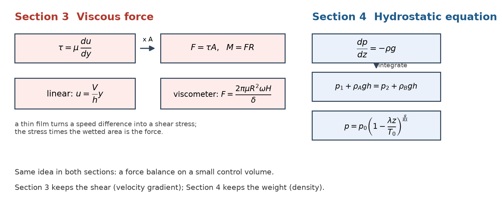

Figure 1: the two chains of ideas. Section 3 turns a velocity difference into a stress and then into a force; Section 4 turns a density and a height into a pressure.

## How to use this note

Read the formula list first and try to say out loud what each symbol means. If you can do that, the worked solution is mostly bookkeeping: substitute numbers, keep the units, check the sign. Do the numbers yourself with a calculator before reading the answer block, because the whole point of a tutorial sheet is the hand calculation.

## Master formula list

- $\tau=\mu\frac{du}{dy}$ — Newton's law of viscosity: shear stress equals viscosity times the velocity gradient
- $\nu=\frac{\mu}{\rho}$ — kinematic viscosity: viscosity divided by density, a diffusivity in $m^{2}/s$
- $F=\tau A$ — force on a surface equals the shear stress on it times the wetted area
- $M=FR$ — torque equals force times the radius it acts at
- $\frac{dp}{dz}=-\rho g$ — hydrostatic equation: pressure falls by $\rho g$ per metre of rise
- $p_{1}+\rho_{A}gh=p_{2}+\rho_{B}gh$ — two-fluid manometer balance along a U-tube
- $p=p_{0}\left(1-\frac{\lambda z}{T_{0}}\right)^{\frac{g}{R\lambda}}$ — pressure in an atmosphere whose temperature falls linearly with height

## Q3.1 Units of viscosity and of kinematic viscosity

### Formulas needed

- $\tau=\mu\frac{du}{dy}$ — the defining law; the units of $\mu$ can only come from here
- $[\tau]=N/m^{2}$ — stress has the unit of pressure, force per area
- $\left[\frac{du}{dy}\right]=\frac{1}{s}$ — a velocity divided by a length is a rate
- $\nu=\frac{\mu}{\rho}$ — kinematic viscosity, viscosity over density

**What is asked**

The question gives no numbers at all. It asks you to deduce, from Newton's law of viscosity alone, the SI unit of the dynamic viscosity $\mu$ and the SI unit of the kinematic viscosity $\nu$. A deduction means you must show the algebra, not quote the answer from memory.

**Why this route

Newton's law is the definition of $\mu$: the coefficient that makes stress proportional to the velocity gradient. Anything that defines a quantity also fixes its units, so the route is law, rearrange, substitute units. Memorising the unit would answer the wrong question, because the marker wants to see that you can build a unit from a formula.

**Step 1: write down the units on the right-hand side**

The stress is a force per unit area, and a force is a mass times an acceleration, so a stress is measured in newtons per square metre, which is also the pascal.

$$\tau=\mu\frac{du}{dy},\qquad [\tau]=\frac{N}{m^{2}},\qquad \left[\frac{du}{dy}\right]=\frac{m/s}{m}=\frac{1}{s}$$

**Step 2: isolate mu**

Divide both sides by the gradient. Dividing by a quantity measured in $1/s$ is the same as multiplying by seconds, so the second appears in the numerator of the unit.

$$\mu=\frac{\tau}{du/dy}\qquad\Rightarrow\qquad [\mu]=\frac{N/m^{2}}{1/s}=\frac{N\cdot s}{m^{2}}$$

**Step 3: convert newtons into base units**

A newton is a kilogram metre per second squared. Multiplying by one second cancels one power of seconds, and what is left is kilogram per metre per second.

$$N=\frac{kg\cdot m}{s^{2}}\qquad\Rightarrow\qquad [\mu]=\frac{kg\cdot m}{s^{2}}\cdot\frac{s}{m^{2}}=\frac{kg}{m\cdot s}$$

**Step 4: do the same for kinematic viscosity**

Kinematic viscosity is viscosity divided by density. The kilogram appears once in the numerator and once in the denominator, so it cancels, and what survives is an area per second: a diffusion coefficient, not a force coefficient.

$$\nu=\frac{\mu}{\rho},\qquad [\nu]=\frac{kg/(m\cdot s)}{kg/m^{3}}=\frac{m^{2}}{s}$$

**Where the constant comes from

There is no numerical constant in this question, but the same idea is at work: the single power of seconds in the numerator of $kg/(m\cdot s)$ is exactly the reciprocal of the $1/s$ in the velocity gradient. If you ever forget whether it is $kg/(m\cdot s)$ or $kg/(m\cdot s^{2})$, rebuild it from $\tau=\mu\,du/dy$ and the seconds will land in the right place.

**Sanity check

Put water at $20^{\circ}C$ into both units. Its viscosity is about $1.002\times10^{-3}$ $kg/(m\cdot s)$ and its density is $1000$ $kg/m^{3}$, so the kinematic viscosity is $1.002\times10^{-6}$ $m^{2}/s$, which is the familiar $1.0$ cSt from every viscosity table. The two units are therefore consistent with a real fluid.

**Answer

$$[\mu]=\frac{kg}{m\cdot s}=Pa\cdot s,\qquad [\nu]=\frac{m^{2}}{s}$$

The dynamic viscosity is measured in $kg/(m\cdot s)$, equivalently $Pa\cdot s$ or $N\cdot s/m^{2}$. The kinematic viscosity is measured in $m^{2}/s$, equivalently $10^{6}$ cSt.

**Trap

The classic slip is to write $[\mu]=kg/(m\cdot s^{2})$, which is a dynamic viscosity divided by seconds, or to give $\nu$ the unit $m^{2}/s^{2}$. Another slip is to use $N/m$ for stress. If your unit for $\nu$ contains a kilogram, you have divided by the wrong density power, because $\nu$ must be purely geometric plus time.

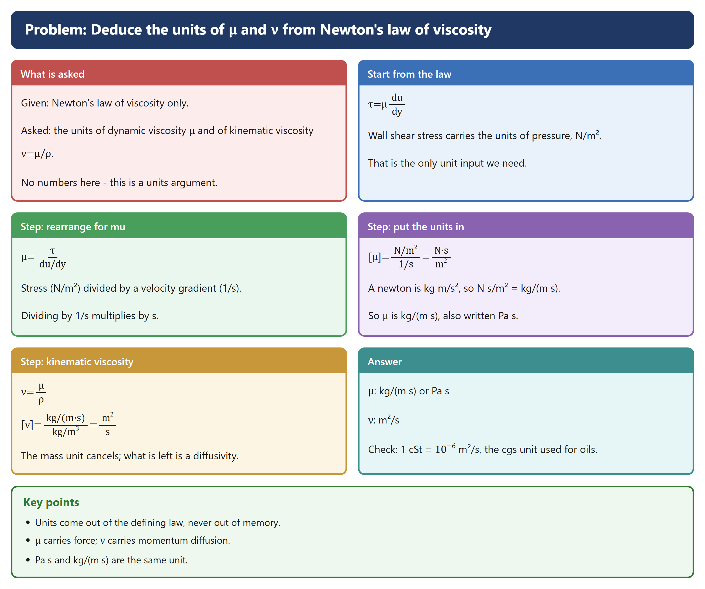

Poster 1: the four-step unit argument, with the working kept in view.

## Q3.2 How water and air viscosity change with temperature

### Formulas needed

- $\mu$ in $kg/(m\cdot s)$ — the quantity you are tabulating, not $\nu$
- $\nu=\frac{\mu}{\rho}$ — only needed if you want to compare with tables quoted in cSt
- $\frac{\mu_{water}}{\mu_{air}}$ — the ratio tells you which fluid is more viscous, and it is the number to report
- $Re=\frac{\rho V L}{\mu}$ — the reason viscosity matters at all: it sets the Reynolds number

**What is asked**

This is a data question. You must find the viscosity of water and of air at $20,30,\ldots,100^{\circ}C$ from a handbook, tabulate them, and then describe two things: how big the values are compared with each other, and which way each one moves as the temperature rises.

**Why this route

Viscosity is a measured property of a material, so there is no formula to derive it from at this level; the honest route is handbook data plus a physical reading of the trend. The physics differs between the two fluids, and that difference is the actual answer: liquids and gases have opposite temperature behaviour because their viscosity comes from different microscopic mechanisms.

**Step 1: read the tables**

All values below are typical handbook values (White, Fluid Mechanics) at $1$ atm; they are not measurements taken for this note.

| $T$ (C) | water $\mu$ ($10^{-3}$ $kg/(m\cdot s)$) | air $\mu$ ($10^{-5}$ $kg/(m\cdot s)$) |
|---|---|---|
| 20 | 1.002 | 1.81 |
| 30 | 0.798 | 1.86 |
| 40 | 0.653 | 1.91 |
| 50 | 0.547 | 1.95 |
| 60 | 0.467 | 2.00 |
| 70 | 0.404 | 2.04 |
| 80 | 0.355 | 2.09 |
| 90 | 0.315 | 2.13 |
| 100 | 0.282 | 2.17 |

**Step 2: compare magnitudes**

At room temperature water is about fifty-five times more viscous than air. The ratio is the useful number, because it tells you immediately why a water film can carry a load that an air film of the same thickness cannot.

$$\frac{\mu_{water}}{\mu_{air}}=\frac{1.002\times10^{-3}}{1.81\times10^{-5}}\approx 55.4$$

**Step 3: compare the trends**

Water loses viscosity as it warms, by a factor of about $3.6$ between $20$ and $100^{\circ}C$. Air gains viscosity over the same range, by a factor of about $1.2$. The two arrows point in opposite directions.

$$\frac{\mu_{water}(20)}{\mu_{water}(100)}=\frac{1.002}{0.282}\approx 3.55,\qquad \frac{\mu_{air}(100)}{\mu_{air}(20)}=\frac{2.17}{1.81}\approx 1.20$$

**Where the constant comes from

The factor $55$ is not magic, it is the density and molecule story in one number: water molecules are close together and stick through hydrogen bonds, air molecules are far apart and barely touch. That is also why warming water lowers its viscosity (the bonds loosen) while warming air raises its viscosity (the molecules move faster and swap momentum more briskly across a layer).

**Sanity check

Both columns are monotonically changing with no kink, and the orders of magnitude match every textbook: liquids sit near $10^{-3}$ and gases near $10^{-5}$ $kg/(m\cdot s)$. A useful mnemonic check is that air at $20^{\circ}C$ and water at $20^{\circ}C$ differ by roughly the ratio of their densities divided by the ratio of their kinematic viscosities, which is consistent with the numbers above.

$$\nu_{water}(20^{\circ}C)=\frac{1.002\times10^{-3}}{1000}=1.002\times10^{-6}\;m^{2}/s=1.0\;cSt$$

**Answer

Water: $\mu$ falls from $1.002\times10^{-3}$ to $0.282\times10^{-3}$ $kg/(m\cdot s)$ as $T$ goes from $20$ to $100^{\circ}C$. Air: $\mu$ rises from $1.81\times10^{-5}$ to $2.17\times10^{-5}$ $kg/(m\cdot s)$ over the same range. Water is about $55$ times more viscous at $20^{\circ}C$, and the two fluids move in opposite directions with temperature.

**Trap

The usual error is to quote kinematic viscosity from a table that lists cSt and then compare it with a dynamic viscosity, which mixes units and makes water look only about $0.5$ times air. Another is to write the temperature in kelvin inside a curve fit meant for celsius. Always write the unit next to every number.

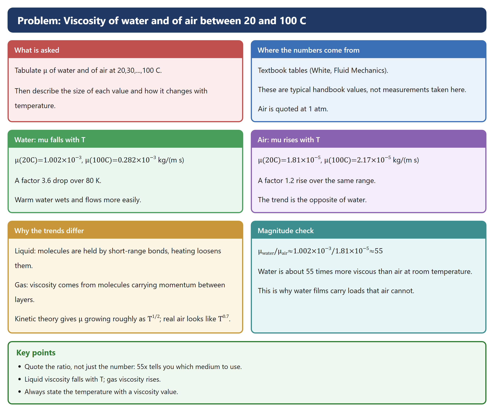

Poster 2: the table, the ratio and the two opposite trends.

## Q3.3 Ice skater on a thin water film

### Formulas needed

- $u(y)=\frac{V}{h}y$ — linear profile in a thin film with two no-slip walls
- $\tau=\mu\frac{du}{dy}=\mu\frac{V}{h}$ — constant shear stress, because the gradient is constant
- $F=\tau A$ — force on the wetted blade area
- $A=L\times w$ — the wetted area is blade length times blade width

**What is asked**

A skate blade of length $0.3$ m and width $2.5$ mm slides at $V=5$ m/s over ice, with a $h=0.002$ mm film of water at $0^{\circ}C$ ($\mu=1.76\times10^{-3}$ $kg/(m\cdot s)$) underneath. The profile is stated to be steady and linear, with $y=0$ at the ice. You are asked for the profile $u(y)$, a plot of it, and the viscous force on the blade.

**Why this route

Two no-slip conditions pin the profile: zero velocity at the stationary ice, blade velocity at the blade. A straight line is the only profile that satisfies both when there is no pressure gradient pushing the film along, so the gradient is the same at every height and the stress is constant. That is why this question needs no differential equation: the geometry already solved it.

**Step 1: build the profile**

The profile is a straight line from zero at the ice to $V$ at the blade, so the slope is $V$ divided by $h$. Substituting the numbers gives $2.5\times10^{6}$ per second times $y$ in metres.

$$u(y)=\frac{V}{h}y=\frac{5}{2\times10^{-6}}y=2.5\times10^{6}y$$

**Step 2: differentiate to get the stress**

The derivative of a straight line is its slope, so the stress is viscosity times $V/h$. With water at $0^{\circ}C$ this comes out at $4400$ Pa, which is about $4.4$ kPa, and it does not depend on $y$.

$$\tau=\mu\frac{du}{dy}=\mu\frac{V}{h}=1.76\times10^{-3}\times\frac{5}{2\times10^{-6}}=4400\;Pa$$

**Step 3: multiply by the wetted area**

The wetted area is the blade footprint, $0.3$ m by $2.5$ mm, which is $7.5\times10^{-4}$ square metres. Stress times area gives $3.3$ N, and the film pushes backwards on the blade, so the force on the blade is $-3.3$ N in the direction of travel.

$$A=0.3\times2.5\times10^{-3}=7.5\times10^{-4}\;m^{2},\qquad F=\tau A=4400\times7.5\times10^{-4}=3.3\;N$$

**Where the constant comes from

The $2.5\times10^{6}$ is just $5$ divided by $2\times10^{-6}$: a speed of $5$ m/s spread over a film only two micrometres thick. Thin films are stress amplifiers, and that is the whole physical message of the question. Divide the film thickness by ten and the force multiplies by ten.

**Sanity check

Ask what happens if the film doubles to $0.004$ mm: the slope halves, the stress halves and the force halves to $1.65$ N, which is what the $1/h$ dependence says. Ask what happens at walking speed $1.4$ m/s: the force drops to about $0.92$ N, roughly a tenth of body weight, which is the right order for a gliding skater.

**Answer

$$u(y)=2.5\times10^{6}y\;(m/s,\;y\;in\;m),\qquad F=-3.3\;N\;\text{on the blade}$$

The profile is linear with $u=2.5\times10^{6}y$, the shear stress is a constant $4400$ Pa, and the viscous force on the blade is $3.3$ N opposing the motion (the sheet writes $-3.3$ N to keep the sign).

**Trap

Do not use the gap cross-section $h$ times width as the area; the force acts on the flat footprint, length times width. Do not forget to convert $0.002$ mm to $2\times10^{-6}$ m, because mixing millimetres with metres gives a force a thousand times too large. And do not add a factor of two for "two surfaces", since only the blade face is wetted by the film.

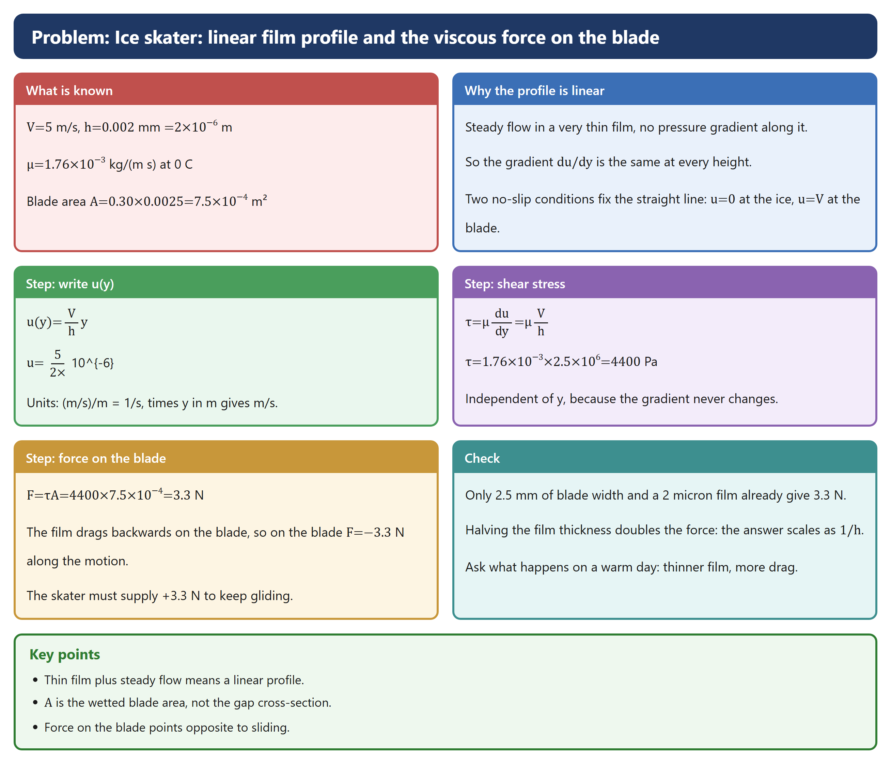

Poster 3: profile, stress, force and the check.

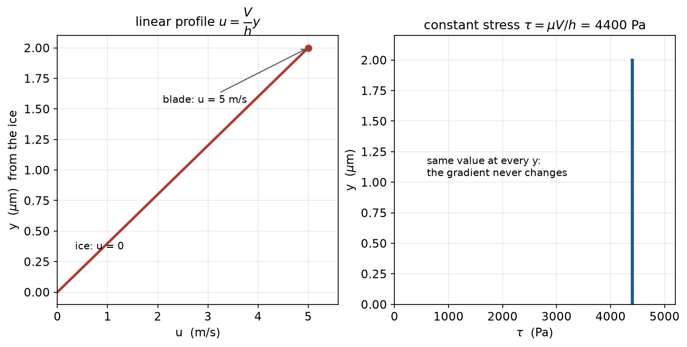

Figure 2: the linear profile and the flat stress curve of the skate film.

## Q3.4 Parabolic profile between parallel plates

### Formulas needed

- $u=u_{max}\left[1-\left(\frac{2y}{h}\right)^{2}\right]$ — the given profile, with $y=0$ on the centre line
- $\frac{du}{dy}=-u_{max}\frac{8y}{h^{2}}$ — differentiating the bracket, chain rule included
- $\tau=\mu\frac{du}{dy}=-\frac{8\mu u_{max}}{h^{2}}y$ — stress is linear in $y$
- $\tau_{wall}=\frac{4\mu u_{max}}{h}$ — magnitude at $y=\pm h/2$
- $F=\tau_{wall}A$ — force on a plate of area $A$

**What is asked**

A steady flow between two stationary horizontal plates has the given parabolic profile, with $h$ the plate separation and $y=0$ half way between them. The question asks: plot it and say where the maximum speed is; check the no-slip condition; show that the stress is $\tau=-8\mu u_{max}y/h^{2}$; find the force on a $2$ m$^{2}$ section of each plate for water at $25^{\circ}C$ with $u_{max}=0.1$ m/s and $h=0.2$ mm; and state the directions.

**Why this route

Everything here is differentiation and substitution: the profile is given, so you do not solve any flow equation, you just differentiate it to get the stress. The two ideas that make it more than algebra are that no-slip is a value check at the walls, and that the sign of the stress at each wall is what answers the direction part.

**Step 1: find the maximum and check no-slip**

The bracket is one minus a square, so it reaches its largest value of one where the square vanishes, at $y=0$: the fastest fluid is on the centre line. At the walls the bracket is $1-1=0$, so $u=0$ and no-slip holds.

$$u\left(\pm\frac{h}{2}\right)=u_{max}\left[1-\left(\frac{\pm h}{h}\right)^{2}\right]=u_{max}(1-1)=0$$

**Step 2: differentiate to get the stress**

Differentiating $\left(2y/h\right)^{2}$ gives $2\left(2y/h\right)\left(2/h\right)=8y/h^{2}$, so the velocity gradient is $-8u_{max}y/h^{2}$ and the stress is viscosity times that.

$$\frac{du}{dy}=u_{max}\left[-\frac{8y}{h^{2}}\right],\qquad \tau=\mu\frac{du}{dy}=-\frac{8\mu u_{max}}{h^{2}}y$$

**Step 3: put in the numbers for the wall stress**

At the wall the term $y$ equals half the gap, so the eight and the half cancel into a four: the wall stress is $4\mu u_{max}/h$. For water at $25^{\circ}C$ with a $0.2$ mm gap this is about $1.79$ Pa.

$$\tau_{wall}=\frac{8\mu u_{max}}{h^{2}}\cdot\frac{h}{2}=\frac{4\mu u_{max}}{h}=\frac{4\times8.93\times10^{-4}\times0.1}{2\times10^{-4}}=1.786\;Pa$$

**Step 4: force on each plate**

Multiply the wall stress by the plate area, $2$ square metres, to get $3.572$ N. The same magnitude appears on both plates because the profile is symmetric about the centre line.

$$F=\tau_{wall}A=1.786\times2=3.572\;N$$

**Step 5: decide the directions**

On the upper plate, $y$ is positive, so $du/dy$ is negative: the fluid speed decreases as you climb towards the wall, which means the wall drags the fluid backwards, towards the direction from which it came. By Newton's third law the fluid pulls the plate forwards. The lower plate is the mirror image, so the fluid again pulls that plate forwards, towards the flow direction.

$$\left(\frac{du}{dy}\right)_{y=+h/2}<0\;\Rightarrow\;\tau_{fluid}<0\;\Rightarrow\;F_{plate}>0$$

**Where the constant comes from

The eight is not a fitted number. It is the chain-rule factor from squaring $\left(2y/h\right)$: one factor of two from the square, one from the inner derivative $2/h$, and one more two from the $2y$. Write the chain rule out once and the eight is yours forever. The four at the wall then follows because $y=h/2$ halves the eight.

**Sanity check

The stress is zero on the centre line and largest at the walls, which is what a parabolic profile must do. Check the magnitude by the other route: $3.572$ N over $2$ m$^{2}$ is $1.786$ Pa, and dividing by the velocity gradient at the wall, $u_{max}/(h/2)=1000$ per second, gives $\mu=1.786\times10^{-3}$ $kg/(m\cdot s)$, which is water. Both routes agree with the sheet's answer of $3.572$ N.

**Answer

$$\tau=-\frac{8\mu u_{max}}{h^{2}}y,\qquad F=3.572\;N\;\text{on each plate},\qquad F_{fluid}\;\text{to the left, so}\;F_{plate}\;\text{to the right}$$

The maximum speed is on the centre line, no-slip holds at both walls, the stress is linear in $y$ with magnitude $1.786$ Pa at each wall, and the force on each $2$ m$^{2}$ plate section is $3.572$ N, directed with the flow.

**Trap

The most common error is to differentiate $\left(1-\left(2y/h\right)^{2}\right)$ and get $4u_{max}y/h^{2}$, dropping the factor of two from the square; the sheet's stated answer is the check. The next is to use $y=h$ instead of $y=h/2$ at the wall. A third is to answer the direction question with "opposite" for both plates, which contradicts the symmetry of the profile.

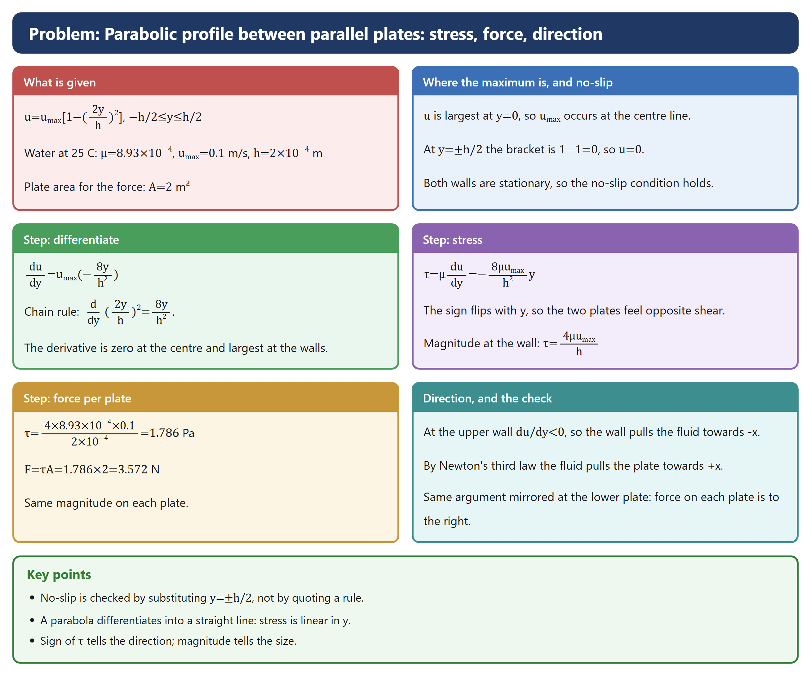

Poster 4: the five parts of Q3.4 in order.

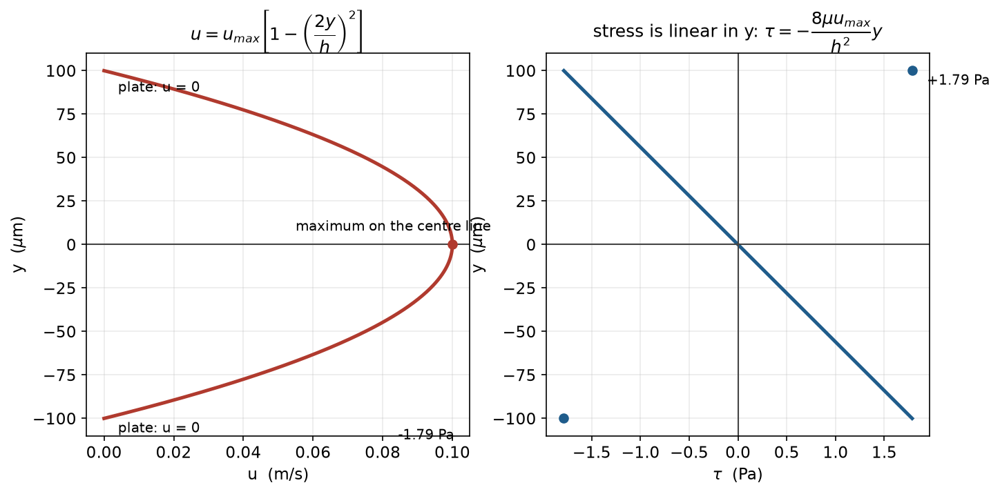

Figure 3: the parabolic profile gives a stress that is linear in $y$, with opposite signs at the two walls.

## Q3.5 Rotating-cylinder viscometer

### Formulas needed

- $\omega=\frac{2\pi N}{60}$ — convert revolutions per minute to radians per second
- $u(y)=\frac{\omega R}{\delta}y$ — linear profile across a narrow gap, $y=0$ at the static wall
- $\tau=\mu\frac{\omega R}{\delta}$ — constant stress in the gap
- $A=2\pi RH$ — wetted side area of the inner cylinder
- $F=\frac{2\pi\mu R^{2}\omega H}{\delta}$ — viscous force on the inner cylinder
- $M=FR$ — torque, and $\mu=\frac{M\delta}{2\pi R^{3}\omega H}$ when solved for the viscosity

**What is asked**

A cylinder of radius $R$ and height $H$ spins at angular speed $\omega$ inside a static cylinder, with a gap $\delta$ filled by a liquid of viscosity $\mu$. The profile is stated to be linear, with $y=0$ at the outer wall. You must find $u(y)$ and plot it, show that the force is $2\pi\mu R^{2}\omega H/\delta$, and then use $R=50$ mm, $H=150$ mm, $\delta=0.1$ mm, $N=100$ rpm and $M=0.6$ N m to find $\mu$.

**Why this route

The gap is a thousand times smaller than the radius, so the curved gap looks flat locally: the same linear-profile argument as in Q3.3 applies, with the blade speed replaced by the rotor surface speed $\omega R$. The only new ingredients are the curved area $2\pi RH$ and the torque arm $R$, and those two turn a force measurement into a viscosity measurement.

**Step 1: convert the rotation rate**

One revolution is $2\pi$ radians and one minute is sixty seconds, so $100$ rpm is $10.472$ radians per second. Do this first, because every later number depends on it.

$$\omega=\frac{2\pi N}{60}=\frac{2\pi\times100}{60}=10.472\;rad/s$$

**Step 2: write the profile**

With $y$ measured from the static outer wall, the speed rises linearly from zero to the rotor speed $\omega R$ over the gap $\delta$. The slope is therefore $\omega R/\delta$.

$$u(y)=\frac{\omega R}{\delta}y,\qquad u(\delta)=\omega R=0.524\;m/s$$

**Step 3: stress and force**

The stress is viscosity times the constant gradient. Multiplying by the wetted side area $2\pi RH$ gives the force, and the $R$ from the surface speed and the $R$ from the area combine into $R^{2}$.

$$\tau=\mu\frac{\omega R}{\delta},\qquad F=\tau(2\pi RH)=\frac{2\pi\mu R^{2}\omega H}{\delta}$$

**Step 4: torque, then solve for the viscosity**

Torque is force times radius, which brings in one more power of $R$ and gives $R^{3}$. Rearranging for $\mu$ puts everything else on the other side.

$$M=FR=\frac{2\pi\mu R^{3}\omega H}{\delta}\qquad\Rightarrow\qquad \mu=\frac{M\delta}{2\pi R^{3}\omega H}$$

**Step 5: substitute the numbers**

Put in $M=0.6$, $\delta=1\times10^{-4}$, $R=0.05$, $\omega=10.472$ and $H=0.15$. The numerator is $6\times10^{-5}$ and the denominator is $1.234\times10^{-3}$, so the viscosity is $0.04863$ $kg/(m\cdot s)$.

$$\mu=\frac{0.6\times1\times10^{-4}}{2\pi\times(0.05)^{3}\times10.472\times0.15}=0.04863\;kg/(m\cdot s)$$

**Where the constant comes from

The $2\pi$ is the circumference, because the wetted surface is a cylinder of circumference $2\pi R$ and height $H$. The $R^{3}$ is three powers of radius stacked up: one from the surface speed, one from the area, one from the torque arm. That bookkeeping is worth remembering, because it tells you instantly how a bigger drum changes the torque.

**Sanity check

Check the units: $N\cdot m\cdot m$ over $m^{3}\cdot s^{-1}\cdot m$ leaves $N\cdot s/m^{2}$, which is $kg/(m\cdot s)$. Check the size: $0.0486$ $kg/(m\cdot s)$ is about $49$ times water, the range of a light machine oil, so the answer is physically sensible. Check the trend: halving the gap would double the torque at the same speed, as the $1/\delta$ says.

**Answer

$$u(y)=\frac{\omega R}{\delta}y,\qquad F=\frac{2\pi\mu R^{2}\omega H}{\delta},\qquad \mu=0.04863\;kg/(m\cdot s)$$

The profile is linear across the gap, the force formula is confirmed, and the liquid's viscosity is $0.04863$ $kg/(m\cdot s)$, matching the sheet.

**Trap

Forgetting the factor $60$ turns $100$ rpm into $100$ rad/s and makes the viscosity about ten times too small. Using the diameter instead of the radius in $2\pi RH$ doubles the area. Including the two end faces would add a term the question deliberately ignores, so do not add it. And keep $R$ in metres, because using $50$ mm gives an answer off by $10^{3}$.

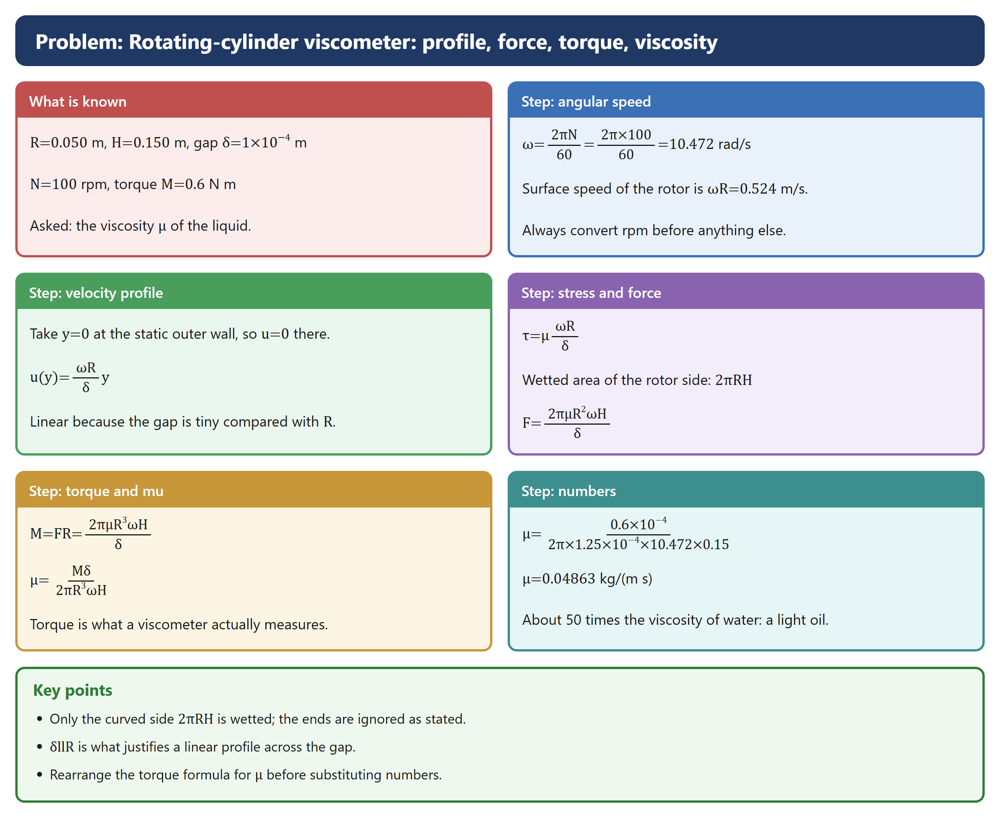

Poster 5: from rpm to viscosity in five steps.

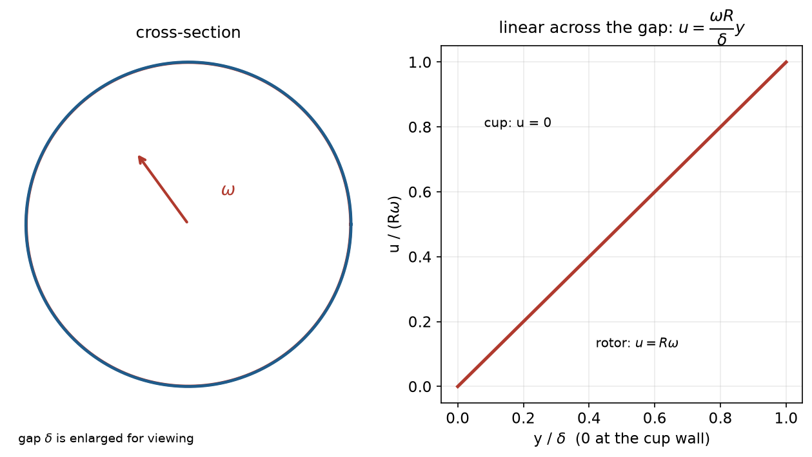

Figure 4: the cross-section of the viscometer and the linear profile across the narrow gap.

## Q4.1 Two-fluid manometer

### Formulas needed

- $\Delta p=\rho g\Delta z$ — pressure change along a static column of liquid
- $p_{1}+\rho_{A}gh=p_{2}+\rho_{B}gh$ — the balance when the two legs are compared at the same level
- $h=\frac{p_{1}-p_{2}}{(\rho_{B}-\rho_{A})g}$ — the reading solved for
- $\gamma=\rho g$ — specific weight, convenient when the two $g$ cancel

**What is asked**

A manometer is connected across two points of a tube where the pressure difference is $1200$ Pa. The tube contains a liquid of density $\rho_{A}=1000$ $kg/m^{3}$ and the manometer contains a second liquid of density $\rho_{B}=3000$ $kg/m^{3}$. Find the height difference $h$ that the manometer shows.

**Why this route

A manometer is solved by walking along the tube and adding or subtracting $\rho g\Delta z$ for every vertical segment, then setting the two paths to the same point equal. There is no integration and no flow assumption, because the fluid in the tube and in the manometer is at rest in the sense that only hydrostatics matters.

**Step 1: choose a datum**

Take the lower mercury level as the datum. On the left leg the column above that level is liquid $A$ of height $h$; on the right leg it is liquid $B$ of the same height $h$.

$$p_{1}+\rho_{A}gh=p_{2}+\rho_{B}gh$$

**Step 2: solve for h**

Collect the $h$ terms on one side: the pressure difference equals the density difference times $g$ times $h$. Dividing gives $h$ in terms of known numbers.

$$p_{1}-p_{2}=(\rho_{B}-\rho_{A})gh\qquad\Rightarrow\qquad h=\frac{p_{1}-p_{2}}{(\rho_{B}-\rho_{A})g}$$

**Step 3: substitute**

With $1200$ Pa, a density difference of $2000$ $kg/m^{3}$ and $g=9.81$, the height is $0.0612$ m, that is $61.2$ mm.

$$h=\frac{1200}{(3000-1000)\times9.81}=0.0612\;m=61.2\;mm$$

**Where the constant comes from

The $2000$ is the difference of the two densities, and that difference is the whole point of a two-fluid manometer: the heavy liquid pushes down harder on one side, and the light liquid on the other, so only the mismatch registers. If both legs had the same liquid the reading would be zero however large the pressure difference.

**Sanity check

Put $\rho_{B}=\rho_{A}=1000$ into the formula: the denominator vanishes and no finite reading can balance a finite pressure difference, which is exactly what a single-fluid U-tube does when both ends are at the same height. Check the size: $61$ mm of a liquid three times denser than water holding $1.2$ kPa is about $2000\times9.81\times0.061\approx1.2$ kPa, consistent.

**Answer

$$h=61.2\;mm$$

The manometer reads $61.2$ mm of the heavy liquid, agreeing with the sheet's answer.

**Trap

Using only $\rho_{B}$ gives $1200/(3000\times9.81)=40.8$ mm, which is $20$ mm short: the light liquid above the heavy one pushes back and must be subtracted. Another error is to add the heights from the two legs, when they are the same height $h$ measured from the same datum.

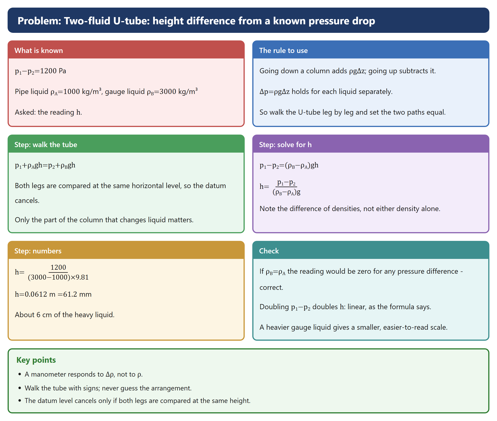

Poster 6: the datum, the balance and the 61.2 mm.

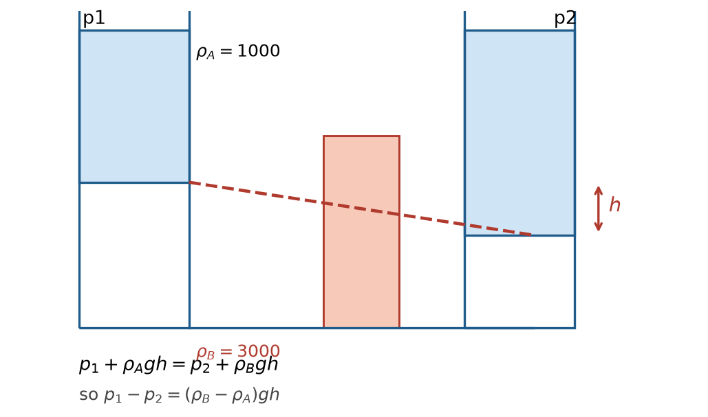

Figure 5: walking the tube from one leg to the other, with the datum at the lower liquid level.

## Q4.2 Inclined pipe with a mercury manometer

### Formulas needed

- $\Delta p=\rho g\Delta z$ — only the vertical height enters, never the pipe length
- $\Delta z=L\sin\theta$ — vertical rise of the inclined run
- $p_{A}+\rho_{w}gh+\rho_{w}gL\sin\theta=p_{B}+\rho_{m}gh$ — the balance from A to B
- $p_{A}-p_{B}=(\rho_{m}-\rho_{w})gh-\rho_{w}gL\sin\theta$ — solved form

**What is asked**

Water flows along a pipe inclined at $\theta=30^{\circ}$. A mercury manometer is connected at A and B, $L=1.5$ m apart along the pipe, and shows a level difference $h=150$ mm. With $\rho_{w}=1000$ and $\rho_{m}=13550$ $kg/m^{3}$, find $p_{A}-p_{B}$.

**Why this route

Same walk-the-tube method as Q4.1, with one extra idea: along the inclined run the vertical rise is $L\sin\theta$, not $L$. The pipe may be a metre and a half long, but gravity only cares about the fifteen centimetres of extra height the incline buys.

**Step 1: resolve the incline**

The run of $1.5$ m at $30^{\circ}$ rises $1.5\times0.5=0.75$ m vertically. That is the number gravity uses, and the $1.5$ m itself never appears again.

$$\Delta z=L\sin\theta=1.5\times0.5=0.75\;m$$

**Step 2: walk from A to B**

Start at A, go down to the manometer through water of height $h$, then up the inclined run of vertical height $L\sin\theta$, then back up through mercury of height $h$ to B. Downward legs add pressure, upward legs subtract it.

$$p_{A}+\rho_{w}gh+\rho_{w}gL\sin\theta=p_{B}+\rho_{m}gh$$

**Step 3: solve, then substitute**

Collect the pressure difference on the left. The mercury term is worth $18.47$ kPa and the water term on the incline is worth $7.36$ kPa, so the difference is $11.11$ kPa.

$$p_{A}-p_{B}=(\rho_{m}-\rho_{w})gh-\rho_{w}gL\sin\theta$$

$$p_{A}-p_{B}=12550\times9.81\times0.15-1000\times9.81\times1.5\times0.5=18467-7357=11110\;Pa$$

**Where the constant comes from

The $12550$ is $13550-1000$: the mercury column is balanced against a water column of the same height, so only the surplus counts. The half in $\sin30^{\circ}=0.5$ is why the incline contributes exactly half of $L$. Both are bookkeeping you can re-derive on the spot.

**Sanity check

Each $0.1$ m of mercury is worth about $12.5$ kPa, so $0.15$ m gives the $18.5$ kPa seen above, and subtracting the water column must leave something of order $10$ kPa, not $1$ kPa and not $100$ kPa. Also check the sign: A is the lower point and carries more liquid column, so $p_{A}>p_{B}$ is the physically expected answer, and the calculation agrees.

**Answer

$$p_{A}-p_{B}=11.11\;kPa$$

This matches the sheet's answer of $11.11$ kPa.

**Trap

Using $L$ instead of $L\sin\theta$ gives $18467-14715=3.75$ kPa, which is wrong by a factor of three; the angle is there precisely to stop you doing that. Forgetting the $\rho_{m}-\rho_{w}$ difference and using $\rho_{m}$ alone gives about $19.9$ kPa. And swapping A and B flips the sign, so keep the walk direction straight.

Poster 7: incline, balance and 11.11 kPa.

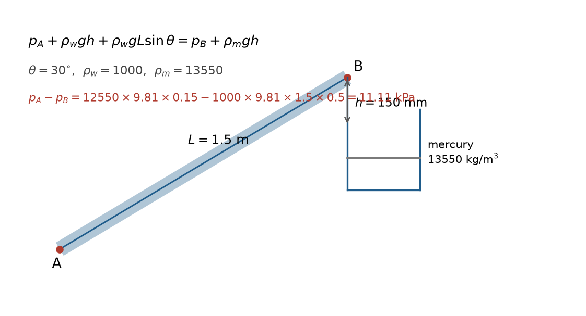

Figure 6: the vertical rise $L\sin\theta$ and the mercury level difference $h$ in the inclined pipe.

## Q4.3 Atmosphere with a linear lapse rate

### Formulas needed

- $\frac{dT}{dz}=-\lambda$ — the temperature falls linearly with height, $\lambda=0.0065$ K/m
- $p=\rho RT$ — the ideal gas law, used to eliminate the density
- $\frac{dp}{dz}=-\rho g$ — the hydrostatic equation
- $\frac{dp}{dz}=-\frac{pg}{R(T_{0}-\lambda z)}$ — the two laws combined, as the question asks you to show
- $\frac{dp}{p}=-\frac{g}{R}\frac{dz}{T_{0}-\lambda z}$ — separated for integration
- $p=p_{0}\left(1-\frac{\lambda z}{T_{0}}\right)^{\frac{g}{R\lambda}}$ — the integrated result

**What is asked**

The atmosphere's temperature falls with height as $dT/dz=-\lambda$ with $\lambda=0.0065$ K/m, and the air obeys the ideal gas law. You must first show that the pressure obeys the combined differential equation, and then use $p_{0}=1.013$ bar, $T_{0}=288$ K, $R=287$ N m/(kg K) and $g=9.81$ m/s$^{2}$ to find the pressure at $5$ km.

**Why this route

Two laws are true at once: hydrostatics says pressure falls with height because of the weight of air above, and the gas law says density is not constant because both pressure and temperature change. Substituting the gas law into the hydrostatic equation produces one equation in one unknown, $p(z)$, and that is exactly what integration needs.

**Step 1: combine the two laws**

Replace the density in the hydrostatic equation by $p/(RT)$ and replace $T$ by its height dependence $T_{0}-\lambda z$. The result is the equation the question asks you to show.

$$\frac{dp}{dz}=-\rho g=-\frac{pg}{R(T_{0}-\lambda z)}$$

**Step 2: separate the variables**

Move everything containing $p$ to the left and everything containing $z$ to the right. Both sides are now ready to integrate.

$$\frac{dp}{p}=-\frac{g}{R}\frac{dz}{T_{0}-\lambda z}$$

**Step 3: integrate both sides**

The left integral is a logarithm of pressure. On the right, the standard result $\int\frac{dz}{T_{0}-\lambda z}=-\frac{1}{\lambda}\ln(T_{0}-\lambda z)$ supplies the extra factor $1/\lambda$, which is where the exponent comes from.

$$\int\frac{dp}{p}=-\frac{g}{R}\int\frac{dz}{T_{0}-\lambda z}\qquad\Rightarrow\qquad \ln\frac{p}{p_{0}}=\frac{g}{R\lambda}\ln\frac{T_{0}-\lambda z}{T_{0}}$$

**Step 4: take exponentials**

Raise $e$ to both sides; the right-hand logarithm turns into a power. The result is a power law in the bracket $1-\lambda z/T_{0}$.

$$p=p_{0}\left(1-\frac{\lambda z}{T_{0}}\right)^{\frac{g}{R\lambda}}$$

**Step 5: substitute for 5 km**

Compute the exponent once, $g/(R\lambda)=5.259$. The bracket at $5$ km is $1-32.5/288=0.88715$, so the pressure is $1.013$ bar times $0.88715$ to the power $5.259$, which is $0.5397$ bar.

$$\frac{g}{R\lambda}=\frac{9.81}{287\times0.0065}=5.259,\qquad 1-\frac{0.0065\times5000}{288}=0.88715$$

$$p=1.013\times(0.88715)^{5.259}=1.013\times0.5328=0.5397\;bar$$

**Where the constant comes from

The exponent $g/(R\lambda)$ appears because dividing by the temperature gradient $-\lambda$ contributes a factor $1/\lambda$. Physically it compares the weight of a column against the thermal energy: a large $g$ or small $\lambda$ means pressure drops fast, and the exponent is large. Check that it is dimensionless: $m/s^{2}$ over $(m^{2}/(s^{2}K))\cdot(K/m)$ leaves nothing.

**Sanity check

Set $\lambda=0$ and the bracket becomes an exponential limit, giving $p=p_{0}e^{-gz/(RT_{0})}$, the isothermal result, which is $0.556$ bar at $5$ km: slightly higher than $0.5397$ because a cooling atmosphere is denser and sheds pressure faster. Standard atmosphere tables give about $0.54$ bar at $5$ km, so the answer sits where it should.

**Answer

$$p(5\;km)=0.5397\;bar$$

The pressure at $5$ km is $0.5397$ bar, matching the sheet, and the differential equation was shown in Step 1.

**Trap

Putting $T$ in celsius turns the bracket negative and the power of a negative number is undefined. Forgetting to convert $1.013$ bar to $10^{5}$ Pa matters only if you mix units with $\rho$; here the answer is requested in bar, so keep bar all the way. And a common slip is to integrate as if the atmosphere were isothermal, which gives $0.556$ bar instead of $0.5397$.

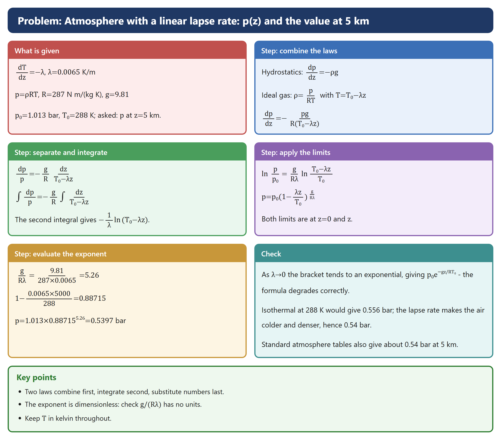

Poster 8: combine, separate, integrate, substitute.

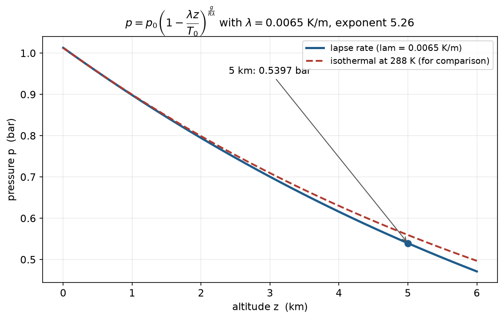

Figure 7: pressure against altitude for the lapse-rate model, with the isothermal curve for comparison.

## Symbols used in these sheets

| Symbol | Meaning | Unit |
|---|---|---|
| $\mu$ | dynamic viscosity | $kg/(m\cdot s)$ |
| $\nu$ | kinematic viscosity | $m^{2}/s$ |
| $\tau$ | shear stress | $Pa$ |
| $u$ | velocity along the surface | $m/s$ |
| $y$ | distance normal to the surface | $m$ |
| $h$, $\delta$ | film or gap thickness | $m$ |
| $p$ | pressure | $Pa$ |
| $\rho$ | density | $kg/m^{3}$ |
| $z$ | height above the datum | $m$ |
| $\omega$ | angular speed | $rad/s$ |

## One-page recap

- Section 3 always goes velocity gradient, then stress, then force, then torque if something rotates
- A linear profile gives a constant stress; a parabolic profile gives a stress that is linear in $y$
- Only the wetted area carries the force, and only the vertical height carries the pressure
- Manometer problems are solved by walking the tube in one direction, adding when you go down and subtracting when you go up
- In an atmosphere with a linear lapse rate the answer is a power law, not an exponential

## Check your own numbers

The eight sheet answers are: $3.1$ units $kg/(m\cdot s)$ and $m^{2}/s$; $3.3$ force $3.3$ N; $3.4$ force $3.572$ N per plate; $3.5$ viscosity $0.04863$ $kg/(m\cdot s)$; $4.1$ height $61.2$ mm; $4.2$ pressure difference $11.11$ kPa; $4.3$ pressure $0.5397$ bar. If your number differs in the third figure, redo the unit conversion before checking your algebra.

Source: tutorial_sheets_and_solutions.pdf, section 3 (Viscous force, Q1 to Q5) and section 4 (Hydrostatic equation, Q1 to Q3). Sheet answers are quoted at the end of each section.
