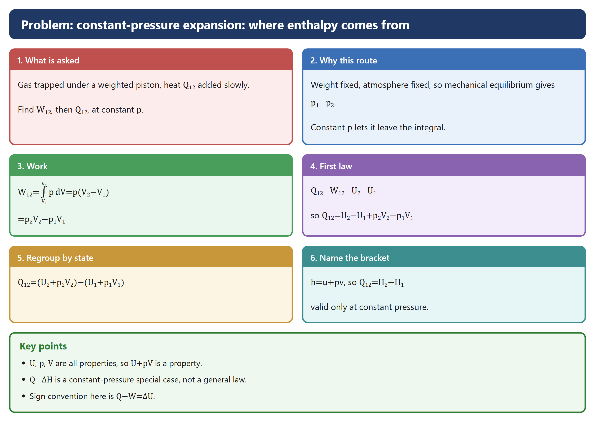
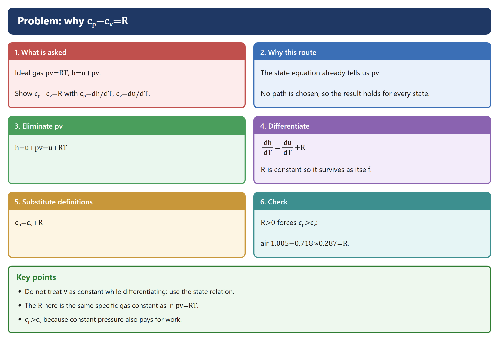
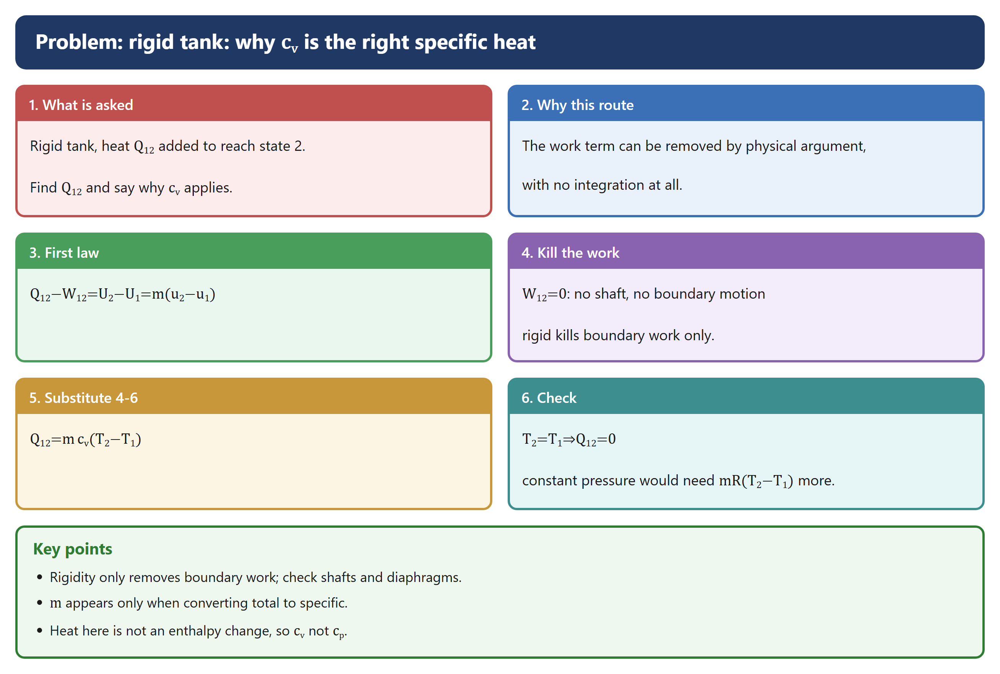
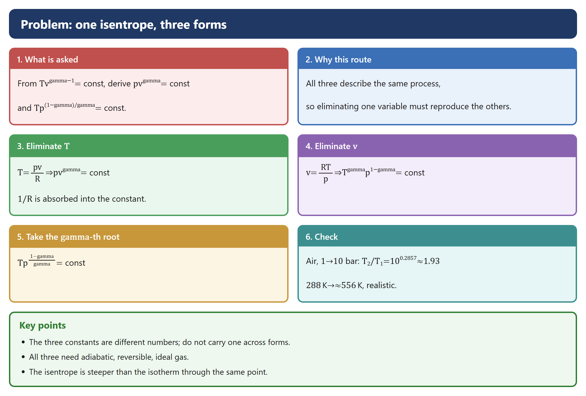

# Enthalpy, Specific Heats and the Perfect-Gas Approximation

Course: MECH40003 Thermodynamics 1. Date: 19 November 2026. Recording title: ME MECH40003 - Thermodynamics 1 CAGB-02-200 2026-11-19. Handout: ME1 Thermodynamics Lecture Notes (2026-27), Chapter 4, Properties of Substances, equations 4-6, 4-7, 4-8.

Duration: the Panopto session lasts 59:59 and every timestamp below uses that time base. The teaching runs from about 03:03 to 58:19. The first three minutes are captions of the room before the lecture starts, and the last minute is room noise.

Panopto recording: [Open the recording](https://imperial.cloud.panopto.eu/Panopto/Pages/Viewer.aspx?id=dd8c567f-e8e3-4a08-9d5c-b4d300d485cf).

Sources: the automatic English captions of this session, and fourteen screen-capture frames of the slide and board stream, read directly at 03:00, 07:50, 19:10, 24:00, 26:00, 34:10, 36:30, 45:00, 48:50, 50:00, 51:50, 53:00, 54:20 and 57:00. Those frames carry the progress-test wording, the steam warning, the enthalpy derivation, the specific-heat name and measurement slides, equations 4-6 to 4-8, the $\gamma$ slide, the bicycle pump, and the whole isentropic derivation including the integrating step, the $R/c_{v}=\gamma-1$ substitution, the polytropic label and the two starred constant lines. The captions garble many symbols, so formulas were rebuilt from context and then checked against the frames wherever a frame covers them. Editorial explanations and independent checks are marked as additions.

## What this lecture is about

The lecture answers a question that looks trivial and turns out not to be: when you heat a gas that is free to expand against a constant outside pressure, where does the energy go? Part of it raises the internal energy, and part of it does work on the surroundings. Those two parts travel together so reliably that engineers give their sum a name. That name is enthalpy.

Once enthalpy exists, the two specific heats stop being two unrelated numbers. They differ by exactly the gas constant, and that relation lets the whole chapter be written with $c_v$, $c_p$ and one ratio $\gamma$.

## 1. Course arrangements and exam warning (03:03-07:00)

The lecture opens with the class's progress on the online exercises rather than with thermodynamics. The teacher shows this year's progress beside last year's and says the class is tracking slightly ahead. Two warnings follow, and both are worth recording.

The first warning is about the progress test. It covers everything up to and including Chapter 4, and it is compulsory: the teacher says coming to sit it is a must. It does not count towards the module mark. It is marked by hand by about ten markers, returned when the new term starts, and returned with written annotations underlining where reasoning went wrong, followed by full solutions. The teacher's reason for this design is that a computerised right-or-wrong result would tell you nothing about where you actually slipped.

The teacher also names an exam topic. Expect a question on **steam**. You must recognise when steam is changing phase and switch to a different method from the one used for gases. He describes Chapter 4 as one of the most difficult topics in the module and spends three lectures on it.

## 2. Where the course is and why a new gas model is needed (07:00-11:30)

The course has covered the introduction, the frameworks and basic concepts, and the forms of energy. It is now inside Chapter 4, properties of substances. The teacher says the four-block diagram of a power plant should be remembered, because the laboratory this year revolves around it.

The previous lecture introduced the **kinetic theory of ideal gases**, which is a way of simplifying a complicated reality so that problems become solvable. He warns that the assumptions of that theory must be checked before it is used: whenever you apply it, ask whether the assumptions hold for this particular problem.

Experiments over small temperature ranges show that internal energy depends on temperature alone. That is the observation which makes the rest of the chapter possible.

## 3. Enthalpy from constant-pressure expansion (11:58-20:30)

Consider a piston holding a trapped gas, loaded with a weight so that it presses down. The gas is at state 1 with $p_1$, $V_1$, $T_1$. Heat $q$ is supplied slowly, the gas expands, the piston rises, and the process stops at state 2 with $p_2$, $V_2$, $T_2$.

The teacher asks the class whether the pressure changes, and answers it himself with an argument rather than a formula: the weight has not changed, the atmosphere outside has not changed, nothing was said about the force field changing, so a mechanical equilibrium of the piston forces the two pressures to be equal.

$$
p_{1}=p_{2}=p
$$

Because the heat is supplied slowly, the process is **quasi-equilibrium**, which is the condition that lets the first law and the integral of $p\,dV$ be used at all.

The teacher then writes himself a note, and it is a genuinely useful one. He says the work expression below assumes the process is **reversible**, that the word will not fully make sense for a few months, and that it will ring a bell when the class revises for the exam. He recalls a demonstration from an earlier lecture: a paddle stirred honey and the honey warmed up, and no one could get that work back out of the honey by letting it stir the paddle in return. That irreversibility is exactly what the reversible idealisation ignores. Chapters 6 and 7 return to it.

### Example 1. Work, the first law and enthalpy (13:19-20:30)

**What is asked**

A trapped gas expands at constant pressure $p$ from state 1 to state 2 while heat $Q_{12}$ is supplied. Find the work $W_{12}$, then the heat $Q_{12}$, and identify what the bracket structure of the result means. The knowns are $p$, $V_{1}$, $V_{2}$, $U_{1}$, $U_{2}$.

**Why this route**

The first law is the only energy bookkeeping available, and it needs the work as an input, so the work must be found first. Because the pressure is constant it can come out of the integral, which is what makes this example tractable by hand; a varying pressure would need the process path before any integration could be done.

**Step 1**

$$
W_{12}=\int_{V_{1}}^{V_{2}}p\,dV=p\left(V_{2}-V_{1}\right)=p_{2}V_{2}-p_{1}V_{1}
$$

This step computes the work. On a $p$-$V$ diagram the integral is the area under the path; with $p$ constant that area is a rectangle of height $p$ and width $V_{2}-V_{1}$. The last equality uses $p_{1}=p_{2}$, so the same number can be written either way.

**Step 2**

$$
Q_{12}-W_{12}=U_{2}-U_{1}
$$

This step states the first law for the trapped system, in the sign convention where heat into the system and work done by the system appear on the same side with opposite signs. Energy is conserved: what enters as heat either leaves as work or stays as internal energy.

**Step 3**

$$
Q_{12}=U_{2}-U_{1}+p_{2}V_{2}-p_{1}V_{1}
$$

This step substitutes the work into the first law and solves for the heat. Beyond constant pressure and quasi-equilibrium, one more assumption is hidden here: the work is boundary work only, with no shaft work and no electrical work crossing the boundary. Without that, $W_{12}$ would contain terms that cannot be paired with $U$ at each state.

**Step 4**

$$
Q_{12}=\left(U_{2}+p_{2}V_{2}\right)-\left(U_{1}+p_{1}V_{1}\right)
$$

This step regroups the terms by state rather than by type. That regrouping is the whole point of the lecture: each bracket now contains only quantities belonging to one state, so the right side is a difference between two states rather than a sum of four separate terms.

**Where the constant comes from**

Nothing is being adjusted here; the regrouping is an identity. Take the previous line and pair $U_{2}$ with $p_{2}V_{2}$ and $U_{1}$ with $p_{1}V_{1}$: the sum of the four terms is unchanged, because addition can be reassociated freely. What is new is the interpretation, not the algebra. Because $U$, $p$ and $V$ are all **properties** of the state, so is their combination, and that is why the combination earns a symbol.

**Sanity check**

Set $V_{2}=V_{1}$. The piston does not move, so the work vanishes: $p(V_{2}-V_{1})=0$. Then $Q_{12}=U_{2}-U_{1}$. All the heat goes into internal energy, as it does in the rigid-container case later in the lecture. Next, check the units. Pressure times volume is force per area times volume, or force times length. So $U$ and $pV$ both have units of energy and can be added in the brackets.

**Answer**

$$
\boxed{h=u+pv},\qquad Q_{12}=H_{2}-H_{1}
$$

In this course, $h=u+pv$ is the **specific enthalpy**, or enthalpy per unit mass. The lower-case symbol denotes an intensive property, which is independent of the amount of material. The capital form $H=U+pV$ is the enthalpy of the whole system. It is extensive, so it depends on the amount of material.

**Trap**

The first trap is to call $Q_{12}=H_{2}-H_{1}$ a general law. It is not. The precise statement is

$$
Q_{12}-\Delta H=-\int_{1}^{2}V\,dp
$$

so the heat equals the enthalpy change only when the pressure is constant along the whole path, not merely equal at the two ends. A second requirement hides in the same line: there must be no shaft work and no electrical work, because otherwise $W_{12}$ contains terms that cannot be paired with $U$ at each state. Constant pressure alone does not exclude those, and a varying pressure does not by itself break the relation; the two conditions are separate. The second trap is the sign convention: $Q-W=\Delta U$ here, not $Q+W=\Delta U$. The third is a language trap. The teacher says "the force field has not changed" to justify $p_{1}=p_{2}$, which is an argument about mechanical equilibrium: the weight and the atmosphere exert the same forces at both states, so the trapped gas must push back with the same pressure. That is a reason, not an assumption.

## 4. Perfect gas: why the specific heats are constant (29:46-34:30)

The curve of internal energy against temperature for an ideal gas is not a straight line over a huge range of temperatures. The teacher's argument for treating $c_v$ as constant is geometric, and it is worth following carefully because it is the only new idea in this section.

Zoom into any small portion of a smooth curve and it looks straighter the more you zoom. Over a small enough temperature range the curve can be replaced by a straight line, and a straight line has a single gradient. That single gradient is $c_v$, so $c_v$ becomes a constant over that range. A **perfect gas** is defined as an ideal gas over a temperature range small enough for this replacement to be safe.

The relationship between ideal and perfect gases comes up as a class vote, and the result is instructive. The class splits roughly half saying all perfect gases are ideal gases and most of the rest undecided. The answer is that perfect gas is a **subcategory** of ideal gas: every perfect gas is also an ideal gas, but not every ideal gas is a perfect gas, because being perfect adds the extra demand that the specific heats be constant.

With that, the chapter's three equations follow. From the linear relation between $u$ and $T$:

$$
u_{2}-u_{1}=c_{v}\left(T_{2}-T_{1}\right)\tag{4-6}
$$

Then from the definition $h=u+pv$ together with the ideal gas law $pv=RT$:

$$
h-u=RT\quad\Longrightarrow\quad\frac{dh}{dT}-\frac{du}{dT}=R\quad\Longrightarrow\quad c_{p}-c_{v}=R\tag{4-7}
$$

And because $R$ is a constant and $c_{v}$ is constant, $c_{p}$ must be constant too, so:

$$
h_{2}-h_{1}=c_{p}\left(T_{2}-T_{1}\right)\tag{4-8}
$$

### Example 2. Derive $c_p-c_v=R$ (32:18-34:04)

**What is asked**

For an ideal gas with equation of state $pv=RT$ and enthalpy defined by $h=u+pv$, show that $c_{p}-c_{v}=R$. The quantities are defined in general as the partial derivatives $c_{p}=\left(\partial h/\partial T\right)_{p}$ and $c_{v}=\left(\partial u/\partial T\right)_{v}$. For an ideal gas, $u$ and $h$ depend on temperature alone, so those partial derivatives reduce to ordinary derivatives.

**Why this route**

Differentiating a difference is the shortest route because the ideal gas law already tells us what $p v$ equals. No experiment is needed, and no path is chosen: this is a statement about properties of states, not about a process. That is why the derivation holds for every ideal gas regardless of how it got to its state.

**Step 1**

$$
h=u+pv\quad\text{and}\quad pv=RT\quad\Longrightarrow\quad h=u+RT
$$

This step eliminates $pv$ in favour of $R$ and $T$. The ideal gas law is being used as an equation of state, which is legitimate only under the ideal gas assumptions.

**Step 2**

$$
\frac{dh}{dT}=\frac{du}{dT}+R
$$

This step differentiates with respect to $T$. For an ideal gas $u$ and $h$ depend on temperature alone, so a partial derivative at fixed other variables is the same thing as an ordinary derivative, and writing $du/dT$ or $dh/dT$ is legitimate. The gas constant is a constant, so its derivative is zero and it survives as itself. This is the step the teacher says students should get comfortable with: not hard mathematically, but it must be automatic by exam time.

**Step 3**

$$
c_{p}=\frac{dh}{dT},\qquad c_{v}=\frac{du}{dT}\quad\Longrightarrow\quad c_{p}=c_{v}+R
$$

This step substitutes the definitions of the two specific heats. The definition is what makes the previous line into a statement about $c_{p}$ and $c_{v}$ rather than about $h$ and $u$.

**Where the constant comes from**

The $R$ that appears is the same specific gas constant that appears in $pv=RT$; it is not a new number and it is not fitted. Its numerical value depends on which gas you are dealing with, because the constant in the equation of state does. That is why $c_{p}-c_{v}$ differs between gases while the structure of the relation does not.

**Sanity check**

Since $R>0$ always, the result predicts $c_{p}>c_{v}$ for every ideal gas. That matches the physics: heating at constant pressure allows the gas to expand and do work, so more heat is needed to reach the same temperature rise than at constant volume. A second check is to insert a known value: for air, $c_{p}$ is about $1.005$ and $c_{v}$ about $0.718$ in $\text{kJ/(kg K)}$, and their difference is about $0.287$, which is $R$ for air. The relation is consistent with tabulated data.

**Answer**

$$
c_{p}-c_{v}=R
$$

**Trap**

The trap is to differentiate $pv=RT$ with respect to $T$ while treating $v$ as a constant. At constant pressure $v$ is not constant, and at constant volume $p$ is not constant; the definition of $c_{p}$ and $c_{v}$ is about which of them is held fixed, but the identity $h=u+RT$ holds for the state regardless. Differentiating the state relation is the safe move, because a state relation does not care about paths.

## 5. Gamma and how the specific heats are measured (34:13-45:00)

The ratio of the two specific heats is given its own symbol:

$$
\gamma=\frac{c_{p}}{c_{v}}
$$

The teacher explains why this is worth doing: the derived relations he is about to present contain only $\gamma$, and tables supply $\gamma$ directly, which speeds up calculations. For a perfect gas where both specific heats are constant, $\gamma$ is constant as well.

He then explains where the names of the two specific heats come from, using two experiments. First the constant-volume case: a rigid container, meaning one that does not flex, bulge or change shape, traps a gas. Heat is supplied, the pressure rises, then an insulated lid is put on and the state is reached. The first law gives:

$$
Q_{12}-W_{12}=U_{2}-U_{1}
$$

and here $W_{12}=0$, because nothing moves: there is no shaft, no boundary displacement, and no diaphragm crossing. So the whole heat goes into internal energy, and $c_{v}$ is literally the heat needed per unit temperature rise at constant volume.

The constant-pressure case is Example 1 above, where the piston is free to move against a fixed weight. Part of the heat becomes work, so the same temperature rise needs more heat. That is the origin of the name $c_{p}$, and it is also why $c_{p}>c_{v}$.

**The mistake the teacher marks with a huge star.** The names of the two specific heats come from the experiments used to measure them; they do not restrict where the symbols may be used. He says that this is the most common mistake found in exam papers, and asks the class to put a huge star beside it: $c_{v}$ and $c_{p}$ are not tied to constant-volume or constant-pressure processes. For a perfect gas $u$ and $h$ are functions of temperature alone, so $\Delta u=c_{v}\Delta T$ holds for any process, not only a constant-volume one. What does depend on the path is $Q$: only at constant volume is the heat equal to $\Delta U$.

The constant-volume experiment therefore provides a way to measure $c_{v}$. Equation 4-6 applies to any process in a perfect gas.

The teacher uses a bicycle pump as an everyday example of **fully resisted adiabatic** compression. With the pump insulated and its valve shut, the gas is compressed to a smaller volume at a higher pressure, and no heat escapes. He points to the data and formula handbook and the ideal gas tables for data on air and other substances.

At 47:22-47:58, the teacher asks students to use the printed handbook in place of the PDF. Turning the pages helps you remember where each table is. The handbook contains hundreds of formulas and thousands of entries, and in the exam you need to find the value you are looking for quickly.

### Example 3. Heating a rigid tank (37:10-39:30)

**What is asked**

A rigid tank of fixed volume holds a fixed mass of perfect gas at state 1. Energy is supplied as heat across the boundary until state 2 is reached; there is no shaft and no electrical work, and changes in bulk kinetic and potential energy are negligible. Find $Q_{12}$ in terms of temperature. The tank does not flex, bulge or change shape, so the boundary is fixed throughout, not merely equal at the two ends.

**Why this route**

The first law is again the only bookkeeping, but this time the work term can be removed without any integration at all. That is why the constant-volume case is the clean way to measure $c_{v}$: the work term disappears for reasons you can state out loud, not through algebra.

**Step 1**

$$
Q_{12}-W_{12}=U_{2}-U_{1}=m\left(u_{2}-u_{1}\right)
$$

This step writes the first law. Multiplying the change in specific internal energy by the mass gives the change in total internal energy. The lecture uses both forms, with capital letters denoting the whole system.

**Step 2**

$$
W_{12}=0
$$

This step drops the work term on the strength of the stated problem, checking each candidate against that statement rather than assuming. The boundary is rigid and fixed for the whole process, so there is no boundary work. There is no shaft, so there is no shaft work. The energy crosses the boundary as heat, not as electrical work.

**Step 3**

$$
Q_{12}=m\left(u_{2}-u_{1}\right)=m\,c_{v}\left(T_{2}-T_{1}\right)
$$

This step substitutes the perfect gas relation 4-6. The specific heat that appears is the constant-volume one; that matches how $c_{v}$ is measured, although 4-6 itself holds for any process in a perfect gas.

**Where the constant comes from**

The factor $m$ converts the specific internal energy change to a total change. It drops out when working per unit mass. Equation 4-6 supplies $c_{v}$ as the coefficient. It is constant because of the perfect gas assumption in Section 4. The rigidity of the tank eliminates boundary work.

**Sanity check**

Set $T_2=T_1$: then $Q_{12}=0$, which is right, no temperature change and no heat needed. Reverse the process: cooling gives a negative $Q_{12}$, meaning heat leaves. Compare with the constant-pressure case: for the same temperature rise the constant-pressure answer $m c_{p}(T_{2}-T_{1})$ exceeds it by exactly $mR(T_{2}-T_{1})$, which is the expansion work the gas would have done.

**Answer**

$$
Q_{12}=m\,c_{v}\left(T_{2}-T_{1}\right)
$$

**Trap**

The first trap is to assert $W=0$ merely because the container is rigid, without checking whether anything else does work; rigidity removes boundary work, nothing else. The second trap is a confusion the teacher marks with a star: this example uses $c_{v}$ because the volume is fixed and the heat equals $\Delta U$, not because $c_{v}$ is only valid at constant volume. For a perfect gas, $\Delta u=c_{v}\Delta T$ is true for every process; what depends on the path is $Q$. Using $c_{p}$ here out of habit is the third error.

## 6. Isentropic relations and what they require (45:00-55:00)

The last block derives a family of relations that appear in the data book. The teacher is candid that the algebra is long: he says he does not expect the class to follow every substitution, that it is "just maths", and that they should go home and convince themselves he made no mistake.

The starting point is the differential form of the first law for a quasi-equilibrium process:

$$
\delta q-\delta w=du
$$

For an adiabatic process there is no heat crossing the boundary, so $\delta q=0$ and the first law collapses to $du=-p\,dv$. Substituting the differential form of the work, $p\,dv=RT\,dv/v$, and the perfect gas relation $du=c_{v}\,dT$:

$$
c_{v}\,dT=-\frac{RT}{v}\,dv\quad\Longrightarrow\quad\frac{c_{v}}{T}\,dT=-\frac{R}{v}\,dv
$$

Separating the variables puts every $T$ on one side and every $v$ on the other, which is what makes the equation integrable. Integrating both sides gives logarithms, because the integral of $1/T$ is $\ln T$:

$$
c_{v}\ln T=-R\ln v+\text{constant}\quad\Longrightarrow\quad\ln T+\frac{R}{c_{v}}\ln v=\text{constant}
$$

At this stage the coefficient is $R/c_{v}$. Use $c_{p}-c_{v}=R$ from equation 4-7 and divide by $c_{v}$. The result $R/c_{v}=(c_{p}-c_{v})/c_{v}=\gamma-1$ provides the substitution.

$$
\frac{R}{c_{v}}=\frac{c_{p}-c_{v}}{c_{v}}=\gamma-1
$$

Substitute $R/c_v=\gamma-1$ to obtain $\ln T+(\gamma-1)\ln v=\text{constant}$. Rearranging in logarithmic form gives $\ln\left[v^{-(\gamma-1)}\right]=\ln\left[K'T\right]$. Exponentiate to obtain $v^{-(\gamma-1)}=K'T$, then rearrange to get the standard form.

$$
Tv^{\gamma-1}=\text{constant}
$$

Using $pv=RT$ to eliminate $T$ gives a second form, and eliminating $v$ instead gives a third:

$$
pv^{\gamma}=\text{constant},\qquad Tp^{\frac{1-\gamma}{\gamma}}=\text{constant}
$$

The board labels the family **polytropic** relations, with the conditions **adiabatic, reversible, ideal gas** written beside them and the name **isentropic** given as the equivalent. It also writes the constants separately: one curve carries $\beta_{1}$ so that $p_{1}V_{1}^{\gamma}=p_{2}V_{2}^{\gamma}=\beta_{1}$, and a different curve carries $\beta_{2}$ so that $p_{3}V_{3}^{\gamma}=\beta_{2}=p_{4}V_{4}^{\gamma}$. The two stars the teacher adds sit exactly on those lines.

All three are in the data book, which is why the teacher does not make the class memorise the derivation. What must be remembered is the **condition**. These relations hold only for an adiabatic, reversible process with no irreversibility, and the constants in the exponents require $c_{v}$ and $c_{p}$ to be constant, which means a perfect gas rather than merely an ideal one. The teacher says "ideal gas" out loud; given Section 4's distinction, the stricter and correct requirement is perfect gas. He marks the word reversible as a note to his future self exactly here, says he is going to add another word that he does not explain at this point, and states the conditions as adiabatic, reversible and ideal gas, with no irreversibility present.

### Example 4. From $Tv^{\gamma-1}$ to the other two forms (52:35-54:05)

**What is asked**

Starting from $Tv^{\gamma-1}=\text{constant}$ for an isentropic process in a perfect gas, derive $pv^{\gamma}=\text{constant}$ and $Tp^{(1-\gamma)/\gamma}=\text{constant}$. The knowns are the equation of state $pv=RT$ and the definition $\gamma=c_{p}/c_{v}$.

**Why this route**

All three forms say the same thing about the same process; they differ only in which two variables are kept. Since the equation of state links $p$, $v$ and $T$, eliminating one variable from the first form must reproduce the others. This is worth doing once by hand, because in an exam the form you need is usually not the one you remember.

**Step 1**

$$
T=\frac{pv}{R}\quad\Longrightarrow\quad\frac{pv}{R}\,v^{\gamma-1}=\text{constant}\quad\Longrightarrow\quad pv^{\gamma}=\text{constant}
$$

This step eliminates $T$ and gives the second form. The $1/R$ is constant, so it can be absorbed into the constant on the right; this is why the three forms have different constants but the same name.

**Step 2**

$$
v=\frac{RT}{p}\quad\Longrightarrow\quad T\left(\frac{RT}{p}\right)^{\gamma-1}=\text{constant}\quad\Longrightarrow\quad T^{\gamma}p^{1-\gamma}=\text{constant}
$$

This step instead eliminates $v$. The result as written has $T$ in the power $\gamma$; the standard form solves for $T$ alone.

**Step 3**

$$
\left(T^{\gamma}p^{1-\gamma}\right)^{1/\gamma}=\text{constant}\quad\Longrightarrow\quad Tp^{\frac{1-\gamma}{\gamma}}=\text{constant}
$$

This step takes the $\gamma$-th root of both sides. Taking a root of a constant gives another constant, so the right side stays a constant. The exponent on $p$ becomes $(1-\gamma)/\gamma$, which is the form the data book prints.

**Where the constant comes from**

Each constant in the three forms is a different number for the same process, and none of them is a universal constant like $R$. The exponent $\gamma$ stays fixed because both specific heats are constants for a perfect gas, so their ratio is a pure number decided once by the gas.

**Sanity check**

Take air, $\gamma=1.4$, and compress it reversibly and adiabatically from $1$ bar to $10$ bar. The third form predicts $T_{2}/T_{1}=(p_{2}/p_{1})^{(\gamma-1)/\gamma}=10^{0.4/1.4}=10^{0.2857}\approx1.93$. So starting at $288\,\text{K}$ the gas reaches about $556\,\text{K}$, which is a realistic bicycle-pump-type temperature rise and is consistent with the compression being adiabatic. Monatomic gases have $\gamma=1.67$ and heat up faster under the same compression, which also matches physical experience.

**Answer**

$$
pv^{\gamma}=\text{constant},\qquad Tv^{\gamma-1}=\text{constant},\qquad Tp^{\frac{1-\gamma}{\gamma}}=\text{constant}
$$

**Trap**

The trap the teacher marks with a star is not mixing the three forms with each other; it is using one form across two different isentropes. A single isentropic curve has one constant, so states on the same curve satisfy $p_{1}v_{1}^{\gamma}=p_{2}v_{2}^{\gamma}$. States on two different curves do not share a constant, and writing $p_{1}v_{1}^{\gamma}=p_{3}v_{3}^{\gamma}$ for points on different curves is the error he singles out. A related trap is to mix the three forms themselves and use, say, $pv^{\gamma}$ for a constant-temperature process, or to carry a constant from one form into another; the three constants are different numbers. A second trap is to forget that all three require the same conditions: adiabatic, reversible, ideal gas. On a $p$-$v$ diagram the isentrope is steeper than the isotherm through the same point, because $\gamma>1$, and confusing the two curves is the graphical version of this error.

## 7. Closing warning about the online platform (57:45-58:19)

The lecture ends with a warning that belongs to the course rather than to the thermodynamics. The online exercise platform is run by a student group. The captions render its name as "magnets", which is unreliable, so the name is not guessed here. The teacher states that it is not overseen by academics, that it has historically contained a large number of mistakes, and that these mistakes have confused students badly. Using it is at your own risk.

The same point had a practical counterpart near the start: the class was told to prepare from the tutorial sheets rather than hunt for the progress test paper, and the progress test itself was shown to be a diagnostic rather than a graded exercise.

## 8. Summary, traps and memory hooks

The lecture is one long chain and is best remembered as a chain. Heat a gas at constant pressure; the heat splits into internal energy plus work; the two parts belong to the same state and so can be bracketed; the bracket is named enthalpy; differentiating enthalpy against temperature gives $c_{p}$ and differentiating $u$ gives $c_{v}$; the two differ by exactly the gas constant; their ratio is $\gamma$; and $\gamma$ turns up again in the adiabatic relations.

The equations, with their handout numbers:

| Equation number | Equation |
|---|---|
| 4-6 | $u_{2}-u_{1}=c_{v}\left(T_{2}-T_{1}\right)$ |
| 4-7 | $c_{p}-c_{v}=R$ |
| 4-8 | $h_{2}-h_{1}=c_{p}\left(T_{2}-T_{1}\right)$ |

**Common pitfalls**

- Treating $Q=\Delta H$ as general. It is the constant-pressure special case, and the pressure had to be constant for it to work.
- Using the isentropic relations without checking the conditions first: adiabatic, reversible, ideal gas, with no irreversibility.
- Confusing ideal gas with perfect gas. Perfect is the subcategory where the specific heats are constant.
- Trusting the student-run exercise platform. The teacher states it is unvetted and has contained many errors.
- Treating enthalpy as a new kind of energy. It is a bookkeeping combination of properties, which is why it is a property.

**Memory hooks**

Think of enthalpy as "internal energy plus the rent you pay to occupy volume". The $pv$ term is the work you had to do to make room for the gas at that pressure, so it travels with the internal energy whenever the pressure is fixed, which is the common case in plant equipment.

For the two specific heats, remember that constant pressure is the harder job: you heat, the gas expands, it does work, so you must pay more heat for the same temperature rise. That single sentence gives you $c_{p}>c_{v}$ without any algebra.

## 9. Open items

Three things in this lecture are worth checking against the printed handout before relying on them.

The first is a number that appears once and never again: at 05:58 the captions pick up something like "this is 5%", and it is not clear whether that refers to the online exercises or to the progress test, given that the same passage says the test has no impact on marks. Worth replaying the audio. The second has now been settled by the frames: the board names the family polytropic, states the conditions as adiabatic, reversible, ideal gas, and gives isentropic as the equivalent name. What the captions render unclearly is only the teacher's spoken aside about a further word he does not explain. The third item has been settled and is recorded here because it once looked ambiguous: equation 4-6 is printed for unit mass, using lower-case $u$, and the whole-system form is obtained by multiplying by $m$. The capital letters in the derivation belong to the general first law, not to 4-6.
