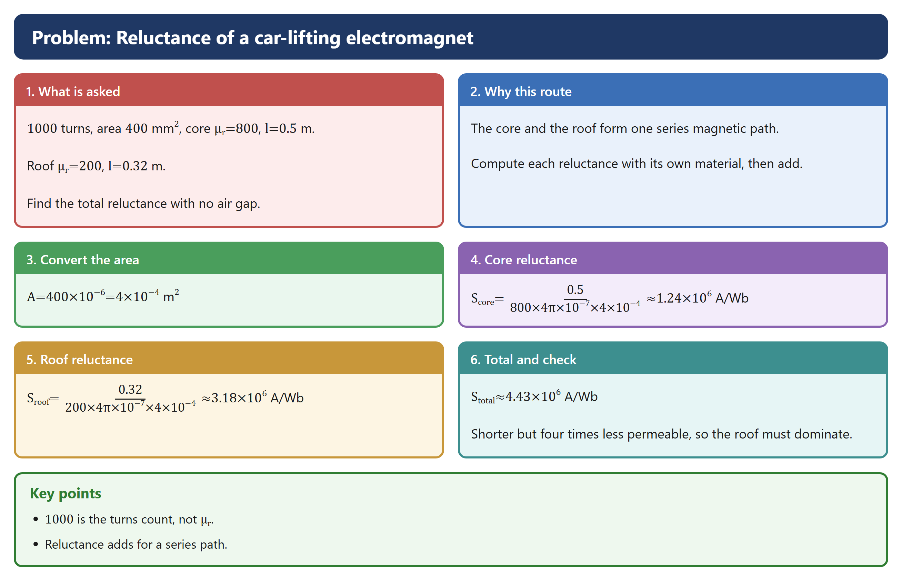
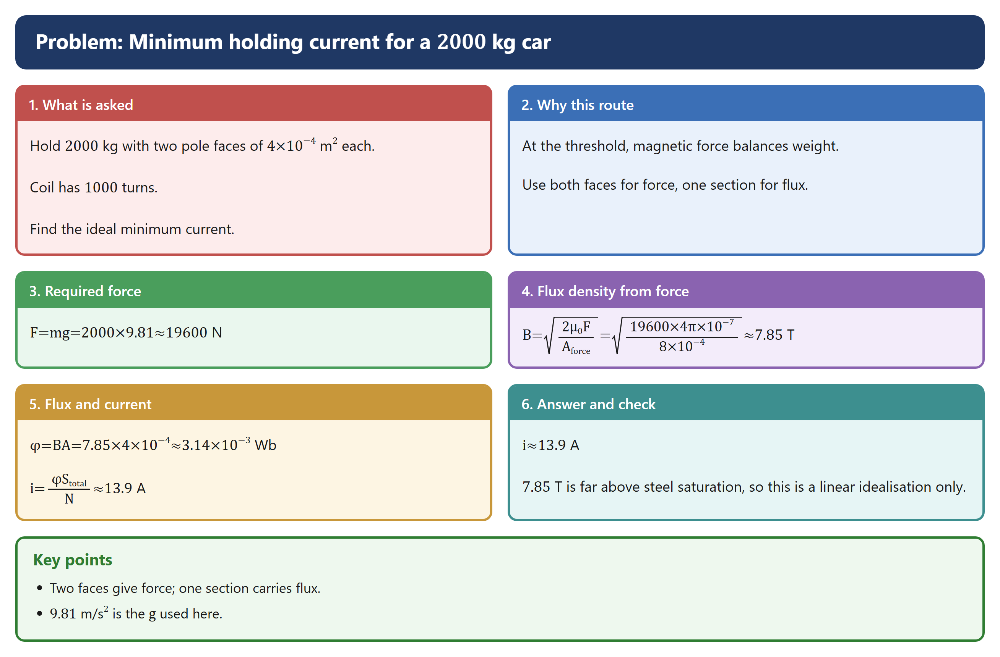
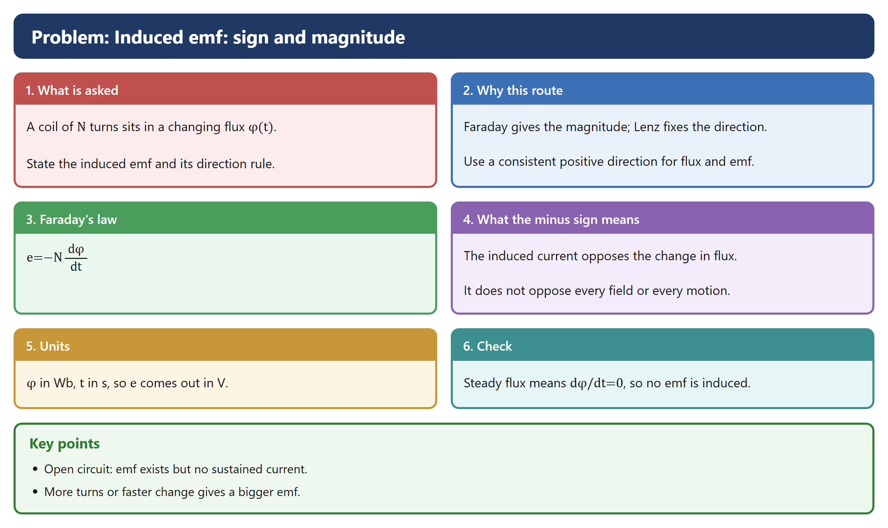
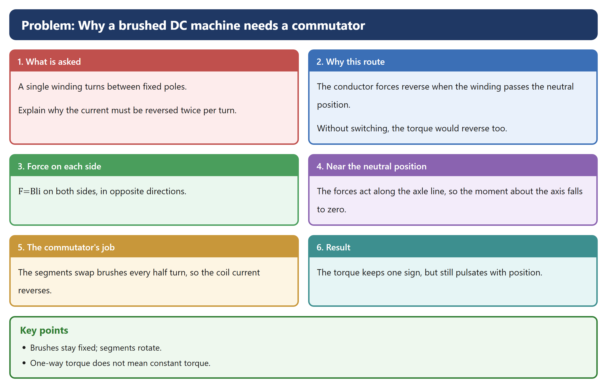

# MECH40004 Mechatronics 1 - Electromagnets and Electric Machines

The recording is *ME MECH40004 - Mechatronics 1*, dated 2026-11-16. This note covers 01:40-59:50 of the [Panopto recording](https://imperial.cloud.panopto.eu/Panopto/Pages/Viewer.aspx?id=23926888-9991-475b-89de-b4b4017beda8): sections 1-3 cover electromagnets and machines, sections 4-7 cover induction, the commutator and torque ripple.

## 1. Electromagnet Force Calculation And Magnetic Reluctance (01:40-13:20)

An **electromagnet** uses current in a coil to create a magnetic field. A magnetic core guides the field through a useful path. In the lecturer's lifting example, a U-shaped core touches a steel car roof: the roof completes the magnetic path, and the two pole faces pull on it.

A **magnetic circuit** is a model of the path followed by magnetic flux. Its **reluctance** describes how much the path resists establishing flux: a longer path or a material less able to carry magnetic field gives a larger reluctance.

For a uniform section, the board gives:

$$S=\frac{l}{\mu_{r}\mu_{0}A}$$

Here $S$ is reluctance, measured in A/Wb; $l$ is the mean magnetic path length in metres, m; $A$ is the cross-sectional area in square metres, $m^{2}$; $\mu_{r}$, read "mu sub r", is dimensionless relative permeability; and $\mu_{0}$, read "mu nought", is the permeability of free space, approximately $4\pi\times10^{-7}$ H/m. **Permeability** $\mu=\mu_r\mu_0$ measures how easily a material allows magnetic flux to form, and $\mu_r$ compares the material with empty space.

The coil provides **magnetomotive force** $Ni$, measured in ampere-turns: $N$ is the number of turns, and $i$ is current in amperes, A. **Magnetic flux** $\phi$, read "phi", is measured in webers, Wb. For this ideal series magnetic circuit, the board uses the total reluctance, which is the sum of the reluctances of every section the flux passes through:

$$\phi=\frac{Ni}{S_{total}}$$

**Magnetic flux density** $B$, measured in teslas, T, tells us how much flux passes through a unit area. For a uniform field normal to the cross-section:

$$B=\frac{\phi}{A}$$

For the idealised static pole-face force, the board writes the following magnitude. The relevant permeability for the air region is $\mu_{0}$, and the area used is the area of the pole face or faces contributing to the force.

$$F=\frac{B^{2}A}{2\mu_{0}}$$

Here $F$ is force in newtons, N. This is a static force at a specified geometry and flux density, not a force that remains unchanged as the gap or current changes. The model assumes an approximately uniform field and neglects effects such as field spreading at the edges.

### Example 1. Reluctance of a car-lifting electromagnet

**What is asked**

Find the total reluctance when there is no air gap and the roof touches both pole faces. The coil has $1000$ turns; both sections have cross-sectional area $400\ \mathrm{mm}^{2}$. The core has relative permeability $800$ and mean path length $0.5\ \mathrm{m}$, made of $0.30+0.10+0.10$ m. The steel roof has relative permeability $200$, thickness $20$ mm and $0.30$ m between the poles. Its mean path length is $0.32\ \mathrm{m}$, from $0.01+0.30+0.01=0.32\ \mathrm{m}$.

**Why this route**

The flux goes through the core and then the roof in one series path. Calculate each reluctance with its own material and path length, then add them. The number of turns is needed for flux or current, but not for the reluctance calculation itself.

**Step 1**

$$A=400\times10^{-6}=4\times10^{-4}\ \mathrm{m}^{2}$$

Because $1$ mm $=10^{-3}$ m, one square millimetre is $10^{-6}$ m$^{2}$, so $400\ \mathrm{mm}^{2}=400\times10^{-6}=4\times10^{-4}\ \mathrm{m}^{2}$. This converts the given cross-section into square metres before substitution.

**Step 2**

$$S_{core}=\frac{0.5}{800\times4\pi\times10^{-7}\times4\times10^{-4}}\approx1.24\times10^{6}\ \mathrm{A/Wb}$$

This gives the reluctance of the U-shaped core.

**Step 3**

$$S_{roof}=\frac{0.01+0.30+0.01}{200\times4\pi\times10^{-7}\times4\times10^{-4}}\approx3.18\times10^{6}\ \mathrm{A/Wb}$$

This gives the roof reluctance, using the mean path through the steel.

**Step 4**

$$S_{total}=S_{core}+S_{roof}\approx4.43\times10^{6}\ \mathrm{A/Wb}$$

This adds the two series reluctances; the specified zero-length air gaps add no reluctance in this ideal model.

**Where the constant comes from**

The core path is $0.30+0.10+0.10=0.50\ \mathrm{m}$. The roof path is $0.01+0.30+0.01=0.32\ \mathrm{m}$: each $0.01\ \mathrm{m}$ term is half of the $20\ \mathrm{mm}$ roof thickness, taken once at each end. The lecturer initially wrote $1000$ for the core relative permeability, then corrected it to $800$.

**Sanity check**

The roof path is shorter by a factor of only about $1.6$ ($0.5$ m against $0.32$ m), but its relative permeability is only one quarter of the core's ($200$ against $800$). The permeability effect is larger, so the roof reluctance should be about $4/1.6\approx2.6$ times the core reluctance. The calculated $3.18\times10^{6}$ against $1.24\times10^{6}\ \mathrm{A/Wb}$ agrees with that estimate.

**Answer**

$$S_{total}\approx4.43\times10^{6}\ \mathrm{A/Wb}$$

**Pitfalls**

Do not use $1000$ turns as the core relative permeability, and do not treat $400\ \mathrm{mm}^{2}$ as $400\times10^{-3}\ \mathrm{m}^{2}$.

**Principle recap**

Reluctance belongs to a magnetic path section. For an ideal series path, add the sections; then use magnetomotive force divided by total reluctance to find flux.

**Pitfalls**

Flux and flux density are different: $\phi$ is the flux through the section, while $B$ is that flux divided by the local area.

**Memory tip**

Think "longer path: harder; larger area or higher permeability: easier".

## 2. Magnetic Force Analysis With Air Gaps (13:20-23:24)

The key distinction in the lifting example is between one magnetic path and two pulling faces. The same series flux passes through each pole, but each pole face contributes force. Therefore, for two identical faces, the total force is twice the force at one face.

Even when the initial gap is zero, the lecturer explains the force using a very small imagined separation: pulling the roof away would create two air gaps. This is the limiting, idealised force model used here; it is not a claim that a real gap has no effect.

### Example 2. Minimum holding current for a car

**What is asked**

Using the same core and roof as Example 1, find the ideal minimum current to hold a $2000\ \mathrm{kg}$ car when the two faces touch. Each pole has area $4\times10^{-4}\ \mathrm{m}^{2}$, and the coil has $1000$ turns.

**Why this route**

At the holding threshold, the total magnetic force balances the weight. Use both faces to find the required $B$, then use the area of one magnetic-circuit cross-section to find flux and current.

**Step 1**

$$F=mg=2000\times9.81\approx19600\ \mathrm{N}$$

This obtains the required holding force. Here $m$ is mass in kilograms, kg, and $g$ is gravitational acceleration in $\mathrm{m/s}^{2}$.

**Step 2**

$$A_{force}=2\times4\times10^{-4}=8\times10^{-4}\ \mathrm{m}^{2}$$

This obtains the combined area of the two identical force-producing faces.

**Step 3**

$$B=\sqrt{\frac{2\mu_{0}F}{A_{force}}}=\sqrt{\frac{19600\times4\pi\times10^{-7}}{4\times10^{-4}}}\approx7.85\ \mathrm{T}$$

This rearranges the force equation to obtain the required flux density. The 2 in $2\mu_0$ cancels the 2 in $A_{force}=2\times4\times10^{-4}$, which came from the two faces, so the expression reduces to $B=\sqrt{\mu_0F/(4\times10^{-4})}$.

**Step 4**

$$\phi=BA=7.85\times4\times10^{-4}\approx3.14\times10^{-3}\ \mathrm{Wb}$$

This obtains the flux in the single series magnetic path, using one local cross-section rather than the combined force area.

**Step 5**

$$i=\frac{\phi S_{total}}{N}\approx\frac{3.14\times10^{-3}\times4.43\times10^{6}}{1000}\approx13.9\ \mathrm{A}$$

This uses the reluctance from Example 1 to obtain the ideal holding current.

**Where the constant comes from**

The factor $2$ in $A_{force}=2	imes4	imes10^{-4}$ counts the two equal pole-face forces, not two parallel flux paths; the $2$ in $2\mu_0$ comes from the force formula itself, not two parallel flux paths. The value $9.81\ \mathrm{m/s}^{2}$ is the gravitational acceleration used in the example. The board corrects the exponent in $\mu_{0}$ to $-7$.

**Sanity check**

Each face must supply about half the load, or $9800\ \mathrm{N}$. Substituting $B\approx7.85\ \mathrm{T}$ and one face's area into the single-face force formula gives approximately that force. Steel **saturates**: above roughly $1.5$-$2$ T, a general figure not taken from this lecture, its permeability drops sharply and extra current adds little extra flux. So $7.85$ T is unreachable, the constant-permeability model fails, and $13.9$ A is only an ideal textbook value.

**Answer**

$$i_{hold}\approx13.9\ \mathrm{A}$$

**Pitfalls**

Do not double the area again when calculating $\phi=BA$: the two poles are in one series flux path. The answer is an ideal static threshold, not a verified safe lifting current.

For a nonzero **air gap**, the magnetic path includes air, whose relative permeability is approximately one. In the same simplified model, increasing gap length raises total reluctance. With current and geometry otherwise fixed, flux and flux density decrease, so the static pulling force decreases.

**Pull-in current** is the current needed to start pulling the armature across a specified gap against its opposing load. **Holding current** is the current needed to keep it held after contact. Under the same load in the lecturer's model, pull-in current is greater because the initial gap weakens the force.

An **economiser** can initially supply the higher pull-in current and then reduce current after contact. The reduced current still has to be sufficient for the actual load and operating conditions.

**Principle recap**

A gap increases reluctance; at fixed current this reduces flux and force. Two equal pole faces contribute two forces, even though the flux follows one series path.

**Pitfalls**

The zero-gap holding result cannot be applied unchanged to a larger starting gap. Comparing force at different gaps requires recalculating the flux density for each position.

**Memory tip**

"Gap up, reluctance up, flux down, force down" - provided the current and the other model assumptions stay fixed.

## 3. Electric Machines Convert Energy Between Electrical and Mechanical Forms (23:24-33:40)

An **electric machine** can convert energy between electrical and mechanical forms. In **motor operation**, electrical energy enters and mechanical energy leaves; in **generator operation**, mechanical energy enters and electrical energy leaves. The same machine can operate in either mode under suitable conditions.

Most machines discussed here rotate. The **rotor** rotates, while the **stator** remains stationary. The lecturer notes that linear motors also exist, but they are outside the present course scope.

Machines may use **direct current**, DC, or **alternating current**, AC. The slide identifies the course focus as the **brushed DC machine**: understanding its basic principles helps with other machine types.

A current-carrying conductor placed in an external magnetic field experiences a magnetic force, the macroscopic form of the **Lorentz force** on moving charges. For a straight conductor of length $l$ carrying current $i$ at right angles to a uniform field $B$, the magnitude is:

$$F=Bli$$

Here $F$ is force in N, $B$ is magnetic flux density in T, $l$ is the length of conductor inside the field in m, and $i$ is current in A. For motor direction, **Fleming's left-hand rule** uses the index finger for field direction, the middle finger for current direction, and the thumb for force direction.

If a constant force acts along the direction of motion, mechanical work is force times distance; power is force times velocity. Let $W$ be work in joules, J; $d$ be distance in m; $P$ be power in watts, W; and $v$ be velocity in m/s:

$$W=Fd,\qquad P=Fv$$

In motor operation the machine is an electrical load because it takes electrical energy, and a mechanical source because it supplies mechanical energy. A real machine also has losses, so output energy is not generally equal to electrical input energy.

At 33:40 the slide introduces **Faraday's law of electromagnetic induction**: changing the flux linking a circuit induces an **electromotive force**, or EMF. The slide writes:

$$E=N\frac{d\phi}{dt}$$

Here $E$ is the magnitude of the induced EMF in volts, V; $N$ is the number of turns; $\phi$ is flux in Wb; and $t$ is time in seconds, s. The slide writes the magnitude without a minus sign. The signed version, $e=-N\frac{d\phi}{dt}$, appears in section 4 and carries a minus sign that expresses the opposing direction described by Lenz's law. An induced EMF can exist in an open circuit, but sustained current needs a closed conducting path.

**Principle recap**

Current and magnetic field produce force; motion and changing flux linkage produce induced EMF. These effects connect the electrical and mechanical sides of the same machine.

**Pitfalls**

Do not confuse the rotor with the stator. Do not assume motor operation needs a different physical machine from generator operation. Do not assume an induced emf guarantees current in an open circuit.

**Memory tip**

Rotor rotates; stator stays. In motor operation, electrical energy goes in and mechanical energy comes out.

## 4. Electromagnetic Induction And Lenz's Law Principles (35:40-45:00)

**Electromagnetic induction** means that a changing magnetic flux linking a circuit produces an **electromotive force**. An electromotive force, or emf, is a voltage that can drive current; it is measured in volts, V. A moving wire in a magnetic field is one way to produce this change.

In **generator operation**, an external mechanical input moves the conductor and supplies energy. The induced emf can drive current when the circuit is closed. The generator is therefore a load on the mechanical system and a source for the electrical system. Its resisting torque, the torque that opposes the applied rotation, does not mean that energy disappears: the mechanical work done against it becomes electrical energy and losses.

In **motor operation**, electrical energy enters the machine and mechanical energy leaves it. The same machine can exhibit both induction and magnetic-force effects at once; the net direction of energy transfer distinguishes its operating mode.

**Lenz's law** describes direction: the induced emf tends to drive a current whose effect opposes the change that produced it. It does not mean that the induced current always opposes every existing current or that a magnetic field always opposes motion.

For a closed circuit with a consistent choice of positive direction, a useful statement is:

$$e=-N\frac{d\phi}{dt}$$

Here $e$, read "e", is induced emf in V; $N$ is the number of turns, with no unit; $\phi$, read "phi", is magnetic flux through each turn in webers, Wb; and $t$ is time in seconds, s. This form assumes the same flux links each turn. The minus sign expresses Lenz's law relative to the chosen positive directions.

A simple direction example: if an external action increases the flux through a closed loop, the induced current creates a magnetic field that tends to oppose that increase. If the flux decreases instead, its effect tends to oppose the decrease.

For a straight conductor, **Fleming's left-hand rule** relates field, conventional current and motor force. The index finger points along the field, the middle finger along current and the thumb along force. **Fleming's right-hand rule** is used for generation: index finger for field, thumb for motion and middle finger for induced conventional current in a closed circuit.

The lecture next considers continuous rotation. Faraday's 1821 motor used a wire near a magnet and a mercury bath to maintain a moving electrical contact. Its rotational symmetry allowed the wire to keep moving around the magnet, but the arrangement was difficult to use for useful mechanical output. Mercury is hazardous; the historical device is not a safe home experiment.

A later **homopolar motor** demonstration uses a battery, magnet and wire. In the diagram, the current in the wire and the magnetic field produce a force that turns the wire about the axis, so the wire rotates. The lecturer notes that this simple arrangement is mechanically fragile and awkward for delivering useful power.

To build a more useful model, support a wire winding on a rotating form, provide an axle and place the winding between north and south magnetic poles. The drawn uniform field is an approximation: real field lines can spread near the edges, and pole shapes or low-reluctance materials can help guide the field.

**Principle recap**

A changing flux produces emf; in a closed circuit the induced current's effect opposes the change. Mechanical and electrical energy exchange through the same machine.

**Pitfalls**

An induced emf can exist in an open circuit, but a sustained circuit current requires a closed conducting path. A generator's resisting torque does not mean that energy disappears.

**Memory tip**

Left hand: motor force. Right hand: generator induction. Lenz: oppose the change, not simply the field.

## 5. Commutator Design In Brushed DC Machines (45:00-50:30)

A current-carrying winding in a magnetic field experiences forces on its two sides. Because the currents on opposite sides run in opposite directions, the forces can form a **torque**: a turning effect about the axle, measured in newton metres, N·m.

With the field direction and the winding current fixed, the winding can reach a position where the forces have no turning effect about the axis. If it passes that position without reversing the winding current, the torque tends to act in the opposite rotational direction, so it cannot maintain the desired one-way drive.

A **commutator** is a rotating electrical switch. In the basic design, the two insulated copper segments rotate with the rotor and connect to the two ends of the winding. Stationary, spring-loaded **brushes** press against the segments and connect them to the external DC supply.

As the rotor passes the switching position, the segments exchange which brush they touch. The current in a given winding reverses approximately every half-turn, reversing its conductor forces at the appropriate position so that the torque continues in the intended rotational direction.

In the lecturer's simplified single-winding picture, the segment gap briefly interrupts current near the switching position. Rotor inertia can carry it across the gap, but inertia alone cannot guarantee starting if the rotor starts from, or stops at, a zero-torque position.

A minimal example is to follow one marked end of the coil. Before the half-turn, this end touches the positive brush through one segment. After the segments exchange brushes, the same end touches the negative brush through that same rotating segment. The supply polarity has not changed, but the current through the marked coil reverses.

**Principle recap**

The brushes remain fixed while the commutator rotates. The changing contacts between brushes and segments reverse the winding current and preserve the intended torque direction.

**Pitfalls**

The DC supply does not have to reverse for the current in a particular rotating winding to reverse. Also, one-way torque does not mean nonzero torque at every angle.

**Memory tip**

Fixed brushes, rotating segments, switched coil current.

## 6. Torque Ripple Reduction Through Multiple Windings (50:30-54:10)

Even if the torque of a single winding stays in the desired direction, its turning effect changes with rotor position. **Torque ripple** is this variation of torque as the rotor turns. The lecture's single-winding graph, drawn for constant current, falls to zero twice per revolution.

The relevant issue is the turning effect of the forces about the axle, not simply how close a wire looks to a magnet. At the zero-torque position in the simplified model, the forces have no effective moment about the axis.

Add a second winding at a different angle and use the commutator to switch the appropriate connections. When one winding is near a weak-torque position, the other can contribute torque. The two-winding graph in the lecture remains above zero but still has visible ripple.

With many appropriately distributed windings and commutator segments, their contributions overlap more evenly. The illustrated torque becomes much smoother, although not perfectly flat. The lecture photograph shows the real arrangement of windings, commutator segments and a brush.

For the illustrated many-winding machine, the slide gives the approximate proportional relationship, valid at constant magnetic field:

$$T_{0}=K_{t}i_{0}$$

$T_{0}$, read "T zero", is the representative torque read from the graph in N·m; $i_{0}$, read "i zero", is current in amperes, A; and $K_{t}$, read "K sub t", is the torque constant in N·m/A. This simplified proportional model applies for the stated machine and operating assumptions; the small remaining ripple is not represented by the constant value.

A minimal comparison is to look at a position where the first winding has zero torque: a suitably placed second winding can still exert a turning effect. This explains why the combined curve need not fall to zero.

The same arrangement can generate electricity when an external source turns it. If its electrical circuit is closed, the induced current interacts with the field and produces a torque that opposes the imposed rotation. This is Lenz's law seen from the shaft.

**Principle recap**

Angularly offset windings fill in one another's weak-torque regions. More appropriately arranged windings can reduce, but do not necessarily eliminate, torque ripple.

**Pitfalls**

The smooth-torque formula is an approximation, not proof that every instantaneous torque is identical. The plotted curves assume constant current.

**Memory tip**

Stagger the windings so one can pull when another is weak.

## 7. Wrap-up (54:10-59:50)

The lecture has connected electromagnetic force, induction and energy transfer to the structure of a simple brushed DC machine. A magnetic field, rotating windings, brushes and a commutator together allow electrical and mechanical systems to exchange energy.

The closing slide previews the link between circuit elements and mechanical systems, modelling an electric machine as a circuit element, and motor characteristic graphs. It recommends reading sections 5.6-5.8 for the next lecture.

The slide is followed by the desktop at 54:20; the specified frames at 59:30 and 59:50 are black. These frames do not establish additional teaching content.

**Principle recap**

Motor operation transfers energy from electrical to mechanical form; generator operation transfers it in the other direction.

**Pitfalls**

Do not treat the preview of next week's modelling as a derivation already covered in this recording segment.

**Memory tip**

Field, current and motion are linked; ask which side supplies energy.

## Open items

- **Recording duration:** the task states 60:00, while the captured transcript metadata states 53:48. Check the Panopto player's duration; this discrepancy does not change the requested 01:40-33:40 range.

- **Chapter number:** the 23:20 title slide says Chapter 5, while the 24:10 collage says Chapter 8. The supplied handout calls Electric Machines Chapter 5. Check the lecturer's slides around 23:20-24:10 before treating the collage number as the course chapter number.

- **Subtitles and corrected constants:** around 06:27-06:47 the lecturer corrects the core relative permeability from $1000$ to $800$; around 14:10-14:22 the exponent in $\mu_{0}$ is corrected to $-7$. Use the corrected values.

- **Machine type:** the 27:31 automatic caption says "brushless", but the visible slide and handout say brushed DC machines. Check the audio around 27:31 if the exact spoken word matters.

- **Force formula on the electric-machines slide:** the supplied 32:50 image shows the work-done slide rather than the earlier force-equation slide. The perpendicular-conductor formula in this note is supported by the handout text and the lecturer's explanation; check the recording around 30:57-31:28 for the exact slide notation.
