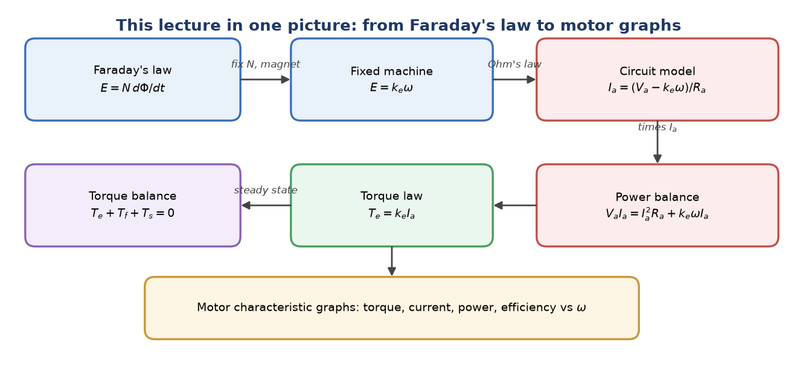
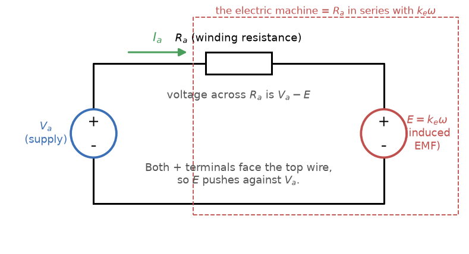
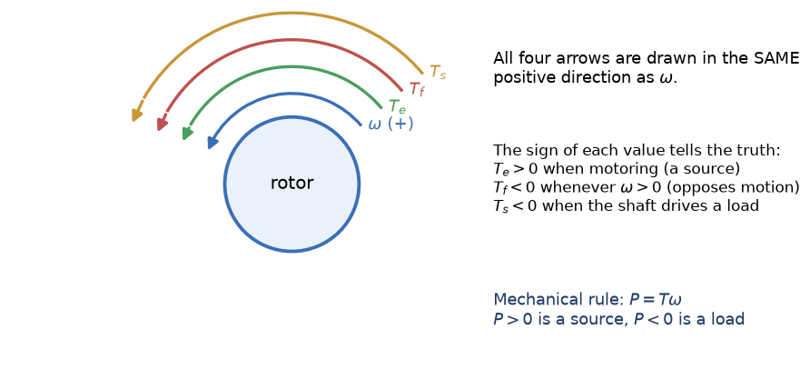
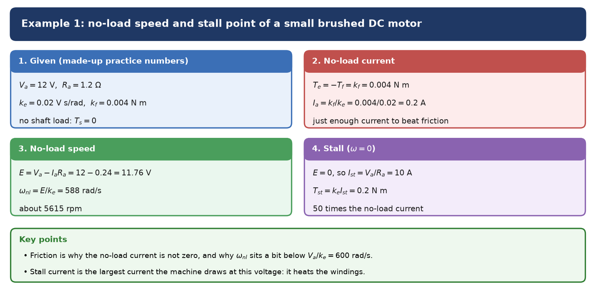
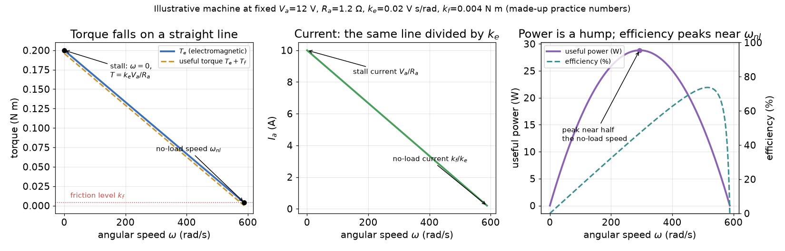
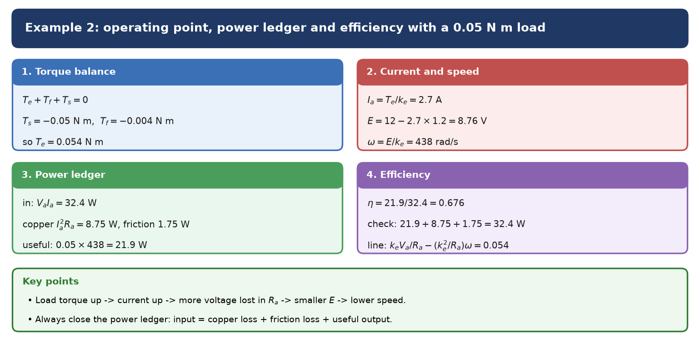

# MECH40004 Mechatronics 1 — The Brushed DC Machine as a Circuit Element

This note covers the Imperial College London first-year lecture ME MECH40004 Mechatronics 1 on 2026-11-23. The recording runs 51:40 and the teaching content runs from 03:32 to 51:40. It is written only from the automatic transcript, because the video and slides could not be downloaded. Every place where the lecturer points at a slide is described in words, and the source is always the transcript.

## What this lecture is about

Last week the lecturer showed how a brushed DC machine is built. This week he turns the machine into a model you can calculate with. The plan is simple. First, squeeze all the physics of the machine into one number, the **machine constant** $k_e$. Then draw the machine as a tiny circuit, a voltage source plus a resistor. Then connect the electrical side to the mechanical side with one torque law. Finally, draw the **motor characteristic graphs**, which tell you at a glance how torque, current, power and efficiency change with speed.

Why should a mechanical engineer care? If you design a pump, a robot joint or a conveyor driven by a motor, you must know what speed and torque the motor will actually give under your load. You also have to design the electrical supply that feeds it. The model in this lecture is the bridge between those two jobs.

Figure 1. The whole lecture in one chain. Each box is one idea, and each arrow is the step that turns one idea into the next. This figure is drawn for this note from the transcript, not copied from a slide.

## 0. Chapter map

The table below lists the parts of the lecture in their original order, with the question each part answers.

| Part | Time | Topic | Question it answers |
|---|---|---|---|
| 1 | 03:32–09:36 | Progress test notice | What is in the test and what are the rules? |
| 2 | 09:36–13:31 | Recap and IEC symbols | What did we learn last week, and how is a machine drawn? |
| 3 | 13:31–16:35 | Machine constant $k_e$ | Why does the induced EMF depend only on speed? |
| 4 | 16:35–21:07 | Circuit model and current | What current flows when we apply a voltage? |
| 5 | 21:07–24:00 | Power balance, torque law | Where does the electrical power go, and what torque appears? |
| 6 | 24:00–28:02 | Lenz's law, induced EMF | Why does the motor stop speeding up? Why "induced", not "back" EMF? |
| 7 | 28:02–35:03 | Sign conventions, inertia | Which torques count as sources or loads, and why ignore inertia? |
| 8 | 35:03–42:30 | Three torques, no-load speed | How do the torques balance in steady state? |
| 9 | 42:30–50:32 | Characteristic graphs | How do torque, current, power and efficiency vary with speed? |
| 10 | 50:32–51:40 | Summary and reading | What comes next? |

## 1. Progress test notice (03:32–09:36)

The lecturer first explained the Mechatronics progress test. It covers everything up to and including electromagnetism in chapter 4. Electric machines, last week and this week, are not in it, but you should still do their tutorial questions. The test runs on an online system the transcript calls "Mobius". The questions will almost certainly be numerical, with no multiple choice, no equation entry and no sketches.

The test lasts 40 minutes but is designed to be finished in about 30. It counts 0% towards the year mark, but you must attend in person in the computer room. You may use only the test system: no AI, no internet, no tablets and no programmable or graphing calculators. Bring pens, paper, a basic calculator, the data and formula book, and your ID card. The ID card is how staff check that you were really in the room. There are no marks for working: a wrong final answer is simply wrong.

Why sit a test worth nothing? It is a health check. If you fail several, the department will contact you and help you build a study plan. Failing is a warning sign, not a punishment. The summer exams are different: full exam conditions on paper, with calculators and formula books provided. The lecturer had not yet decided the number of questions; he guessed 3 or 4. This number is uncertain in the transcript.

## 2. Recap and the IEC machine symbols (09:36–13:31)

An **electric machine** here means a rotating device that converts between mechanical power and electrical power, in either direction. Last week covered three ideas. The **Lorentz force**: a current in a magnetic field feels a force. **Induced EMF**: a wire moving through a magnetic field gets a voltage across it. **Lenz's law**: the effect you create always pushes back against the change that caused it.

The lecturer summed up Lenz's law with a joke: whatever you do, the system tries to make your life harder. When the machine is a motor, the spinning creates an EMF that opposes the applied voltage. When it is a generator, the current it produces creates a torque that opposes the torque you put in.

The **IEC (International Electrotechnical Commission)** publishes the world's electrical standards, just as mechanical drawing has its own standards. The slide showed the IEC symbols for a machine that is motoring and one that is generating. The lecturer rarely uses them. He prefers to draw the circuit model of the machine itself, because that model can be calculated with and a bare symbol cannot.

## 3. The machine constant $k_e$ (13:31–16:35)

In plain words: for one particular motor, the voltage it generates is just "a fixed number times how fast it spins". That fixed number is $k_e$.

Start from **Faraday's law**. The induced EMF equals the number of turns $N$ times the rate of change of **flux linkage** $\Phi$:

$$E=N\frac{d\Phi}{dt}$$

In a **permanent magnet** brushed DC machine almost everything in this formula is frozen at the factory. The magnet strength, the number of windings, the rotor length and diameter and the materials cannot change unless you damage the machine. The only thing left that changes how fast the flux through the winding changes is the rotor's **angular velocity** $\omega$. So all the frozen physics can be packed into one constant.

$$E=k_e\,\omega$$

The units follow from the formula. $E$ is a voltage in volts and $\omega$ is in radians per second. So $k_e$ must be volts divided by radians per second, which is volt-seconds per radian.

$$[k_e]=\frac{V}{rad/s}=\frac{V\cdot s}{rad}$$

So what? Once you know $k_e$ for a motor, and identical siblings from the same factory share it, you can predict its EMF at any speed with one multiplication. Change anything physical, such as the magnet or the windings, and $k_e$ changes.

| Item | Formula card: induced EMF |
|---|---|
| Formula | $E=k_e\omega$ |
| Symbols | $E$ induced EMF (V); $k_e$ machine constant (V s/rad); $\omega$ angular velocity (rad/s) |
| Conditions | Permanent-magnet machine, nothing physical changes; $\omega$ in rad/s, not rpm |
| Steps | Convert speed to rad/s, then multiply by $k_e$ |
| Common error | Using rpm directly: 3000 rpm is $3000\times2\pi/60=314$ rad/s, not 3000 |

## 4. The circuit model and the armature current (16:35–21:07)

In plain words: from the outside, the machine looks like a small battery whose voltage grows with speed, in series with the resistance of its copper wire.

The lecturer drew the machine as a **Thévenin source**: an EMF $E=k_e\omega$ in series with a resistance. The transcript writes this name as "Tevin" and "Teflon", which are ASR errors. The resistance is the **armature resistance** $R_a$, the total resistance of all the wire wound in the machine. Machines contain a lot of wire, so $R_a$ is not negligible. He put "source" in inverted commas: the machine looks like a source, but when it is motoring it actually behaves as an electrical load.

Figure 2. The circuit model. The dashed box is the machine: $R_a$ in series with $k_e\omega$. The current $I_a$ is measured flowing from the supply into the machine. Drawn for this note from the transcript description.

Which way is $E$ positive? You choose. The rule is: $E$ is positive when the machine turns in the direction you have called positive. If you spin a small motor by hand and it gives a positive voltage, that spin direction becomes your positive direction. Clockwise or anticlockwise does not matter, as long as you stay consistent.

Now apply a voltage $V_a$ and let the machine settle at a steady speed $\omega$. Only one idea from network analysis is needed: **Ohm's law**. The voltage across the resistor is the supply voltage minus the EMF, so:

$$I_a=\frac{V_a-E}{R_a}=\frac{V_a-k_e\omega}{R_a}$$

If $V_a>E$, current flows into the machine against its EMF. Then $E>0$ and $I_a>0$, so the power $EI_a$ taken in by the EMF is positive. Under the **passive sign convention** from network analysis, positive absorbed power means a load. That is exactly what we want: a motor should look like an electrical load to the circuit that drives it.

| Item | Formula card: armature current |
|---|---|
| Formula | $I_a=(V_a-k_e\omega)/R_a$ |
| Symbols | $V_a$ applied armature voltage (V); $R_a$ armature resistance ($\Omega$); $I_a$ armature current (A), positive into the machine |
| Conditions | Steady state; current direction and EMF direction as in Figure 2 |
| Steps | Find $E=k_e\omega$; subtract from $V_a$; divide by $R_a$ |
| Common error | Dividing $V_a$ alone by $R_a$ at every speed. That is only true at stall, $\omega=0$ |

## 5. Power balance and the torque law (21:07–24:00)

In plain words: the electrical power you feed in splits into two parts. Part of it heats the copper wire. The rest becomes the mechanical power that turns the shaft.

Rearrange the current equation to make $V_a$ the subject, then multiply both sides by $I_a$:

$$V_a=I_aR_a+k_e\omega$$

$$V_aI_a=I_a^{2}R_a+k_e\omega I_a$$

Read the three terms one by one. $V_aI_a$ is the electrical power supplied. $I_a^{2}R_a$ is the power turned into heat in the winding resistance, which is wasted. The units must match across an equation, so the third term must also be a power. A machine produces torque, so this third term is the **electromagnetic power**, the mechanical power developed by the machine.

From mechanics, mechanical power equals torque times angular velocity. Call the torque the machine develops the **electromagnetic torque** $T_e$:

$$k_e\omega I_a=T_e\,\omega\quad\Rightarrow\quad T_e=k_eI_a$$

The $\omega$ on both sides cancels, which is allowed whenever the machine is turning, $\omega\neq0$. The surprise is that the same constant $k_e$ links speed to voltage and current to torque. Some books call the torque version $k_T$, the **torque constant**. For every machine in Mechatronics 1 you can prove $k_T=k_e$, with the same number. Its units N m/A look different from V s/rad but are equal. The lecturer will only use $k_e$.

| Item | Formula card: electromagnetic torque |
|---|---|
| Formula | $T_e=k_eI_a$ |
| Symbols | $T_e$ electromagnetic torque (N m); $k_e$ same constant as before (N m/A = V s/rad); $I_a$ current (A) |
| Conditions | Same machine, same sign convention as the circuit |
| Steps | Find $I_a$ from the circuit, multiply by $k_e$; or reverse: $I_a=T_e/k_e$ |
| Common error | Treating $T_e$ as the useful shaft torque. Friction still has to be subtracted (Part 8) |

## 6. Lenz's law and why we say "induced EMF" (24:00–28:02)

As the motor speeds up, $k_e\omega$ grows, so $V_a-k_e\omega$ shrinks. The current shrinks, so the accelerating torque $T_e=k_eI_a$ shrinks too. In this ideal model, acceleration stops when $E$ rises all the way to $V_a$, because then $I_a=0$ and $T_e=0$.

The lecturer put a question mark on this. Something must still push against friction, or the machine would slow down. Zero torque forever is too good to be true. Part 8 fixes this by adding friction.

Many people call $E$ the **back EMF** because it opposes the applied voltage. The lecturer asked us to call it the **induced EMF** instead. The reason is generality: $E$ depends only on $\omega$, not on how the machine got to that speed. When the machine is a generator there is no applied voltage to oppose, yet the same $E=k_e\omega$ still appears. One model then covers both modes. You are modelling "an electric machine that happens to be motoring", not "a motor".

## 7. Sign conventions and why inertia is ignored (28:02–35:03)

In plain words: electrical and mechanical engineers decide "source" and "load" with opposite habits. The model has to respect both.

On the mechanical side, power is $P=T\omega$. If the torque has the same sign as the angular velocity, it helps the motion, $P>0$, and the torque is a **source** of mechanical power. If the torque has the opposite sign, it brakes the motion, $P<0$, and it is a mechanical **load**. On the electrical side, under the passive sign convention, positive absorbed power means a load. The two fields are each self-consistent, but opposite. The lecturer's point: accept both and join them carefully in the middle.

The positive direction of $\omega$ is free to choose, but $E$ and $\omega$ must share it. Two machines wired differently can spin opposite ways for the same voltage, which is why the lecturer does not fix clockwise or anticlockwise. The transcript says the Mechanics module MECH40009 measures angles positive anticlockwise. Mechatronics does not insist on it. Electric machines are reversible, so negative $\omega$ is allowed too.

For rotation, Newton's second law reads moment of inertia times angular acceleration equals the sum of torques. Electrical engineers write the moment of inertia as $J$ because $I$ is already taken by current.

$$J\frac{d\omega}{dt}=\sum T$$

Mechatronics 1 ignores $J$. Everything in this module is a **steady state**: you predict the speed the system settles at, but not how long it takes to get there. Setting the left side to zero gives the steady-state torque balance used below. The price is that you cannot model acceleration or transients.

Figure 3. All torques are drawn in the positive direction of $\omega$. Their signs, not their arrows, tell you what they do. Drawn for this note from the transcript.

## 8. Three torques, steady-state balance and the no-load speed (35:03–42:30)

The lecturer defines three torques on the rotor, all drawn in the positive direction of $\omega$.

| Torque | Meaning | Sign when motoring with $\omega>0$ |
|---|---|---|
| $T_e$ | Electromagnetic torque, $k_eI_a$ | Positive, a mechanical source |
| $T_f$ | Lumped friction loss | Always opposite to $\omega$, so negative |
| $T_s$ | External shaft torque from what you drive (pump, robot joint, compressor) | Negative, a mechanical load |

Real machines also lose power to **windage**, the viscous drag of air inside the machine, and their friction changes with temperature. The lecturer lumps all of that into one friction term to keep the model simple. The basic model is a constant friction magnitude $k_f$:

$$T_f=-\operatorname{sgn}(\omega)\,k_f$$

Here $\operatorname{sgn}(\omega)$ means "the sign of $\omega$": $+1$ if $\omega>0$ and $-1$ if $\omega<0$. The minus sign makes friction always oppose motion. The transcript writes "sign" as "sine", an ASR error. A slightly more realistic model, which may appear in a test, makes friction grow with speed:

$$T_f=-k_f\,\omega$$

Note the units differ between the two models: $k_f$ is in N m in the first and in N m s/rad in the second. With $J$ ignored, the steady-state torque balance is:

$$T_e+T_f+T_s=0$$

| Item | Formula card: steady-state torque balance |
|---|---|
| Formula | $T_e+T_f+T_s=0$, with $T_f=-\operatorname{sgn}(\omega)k_f$ |
| Symbols | $T_e$ electromagnetic, $T_f$ friction, $T_s$ shaft torque (all N m, all drawn positive with $\omega$) |
| Conditions | Steady speed (inertia term zero); friction model as stated in the question |
| Steps | Put in the known torques with their signs; solve for $T_e$; then $I_a=T_e/k_e$ |
| Common error | Entering a load as $+0.05$ instead of $-0.05$ N m, which gives a current that is too small |

Friction is always there, but the shaft load can be zero. That special case defines the **no-load speed**. With $T_s=0$ the balance gives $T_e=-T_f$, and since $T_f$ is negative, $T_e$ is positive. So a small current still flows, just enough to overcome friction:

$$I_{nl}=\frac{k_f}{k_e},\qquad \omega_{nl}=\frac{V_a-I_{nl}R_a}{k_e}$$

So the "too good to be true" question from Part 6 is answered. $E$ never quite reaches $V_a$. It stops just below, and the small gap drives the current that beats friction. The transcript around 46:34 garbles this current as "KF over E". From $T_e=k_eI_a$ the correct form is $k_f/k_e$.

### Example 1. No-load speed and stall point

**What is asked**

The lecturer ran out of time before his worked example, so this one uses made-up practice numbers that match the lecture's model. A small permanent-magnet brushed DC motor runs from a fixed supply. Find the no-load current and speed, then the stall current and stall torque.

$$V_a=12\ \text{V},\quad R_a=1.2\ \Omega,\quad k_e=0.02\ \text{V s/rad},\quad k_f=0.004\ \text{N m},\quad T_s=0$$

**Why this route**

No-load and stall are the two ends of the straight torque-speed line in Part 9. Each end has one quantity that is known for free. At no load the shaft torque is zero, so the torque balance gives the current directly. At stall the speed is zero, so the EMF vanishes and Ohm's law gives the current directly. We use those free facts instead of solving simultaneous equations.

**Step 1: find the no-load current from the torque balance**

With no shaft load, the electromagnetic torque only has to cancel friction. Friction is $-k_f$ for positive speed, so $T_e=+k_f$. Divide by $k_e$ to turn torque into current.

$$T_e=-T_f=k_f=0.004\ \text{N m},\qquad I_{nl}=\frac{T_e}{k_e}=\frac{0.004}{0.02}=0.2\ \text{A}$$

**Step 2: find the no-load speed from the circuit**

Rearrange the circuit equation for $E$, then divide by $k_e$ to get speed. The resistor drops only $0.2\times1.2=0.24$ V, so $E$ is just below the supply.

$$E=V_a-I_{nl}R_a=12-0.24=11.76\ \text{V},\qquad \omega_{nl}=\frac{E}{k_e}=\frac{11.76}{0.02}=588\ \text{rad/s}$$

**Step 3: set the speed to zero for stall**

At stall the rotor is held still, so $E=k_e\times0=0$. The whole supply voltage now sits across $R_a$.

$$I_{st}=\frac{V_a}{R_a}=\frac{12}{1.2}=10\ \text{A},\qquad T_{st}=k_eI_{st}=0.02\times10=0.2\ \text{N m}$$

**Where the constant comes from**

The 588 is slightly less than $V_a/k_e=600$ rad/s, which is the speed you would get with no friction at all. The missing 12 rad/s comes from the 0.24 V lost in $R_a$, divided by $k_e=0.02$. The factor 50 between stall and no-load current is $10/0.2$: stall current is set by $R_a$, no-load current is set by friction.

**Sanity check**

Units: V divided by V s/rad gives rad/s, and V s/rad times A gives W s/rad, which is N m. Size: 588 rad/s is $588\times60/(2\pi)\approx5615$ rpm, a normal speed for a small hobby motor. Limits: if $k_f=0$, the no-load current would be zero and the speed would be exactly 600 rad/s, matching Part 6.

**Answer**

$$I_{nl}=0.2\ \text{A},\quad \omega_{nl}=588\ \text{rad/s},\quad I_{st}=10\ \text{A},\quad T_{st}=0.2\ \text{N m}$$

**Trap**

The transcript at 47:04 says the stall current is "I a times RA". That is an ASR or slip error. Multiplying current by resistance gives a voltage, not a current. The correct stall current is $V_a/R_a$. A second trap is forgetting friction and writing $\omega_{nl}=V_a/k_e=600$ rad/s.

Technique: when a line has two ends, find each end from the one quantity that vanishes there.

## 9. Motor characteristic graphs (42:30–50:32)

In plain words: at a fixed supply voltage, the harder you load a DC motor, the slower it turns, and it does so along a straight line.

Start from the power balance. Substitute $I_a=T_e/k_e$ and rearrange so that $T_e$ is the subject:

$$T_e=\frac{k_eV_a}{R_a}-\frac{k_e^{2}}{R_a}\,\omega$$

With $V_a$ fixed, both $k_eV_a/R_a$ and $k_e^{2}/R_a$ are constants. So torque against speed is a straight line, like $y=mx+c$. The intercept on the torque axis is the stall torque, and the slope is $-k_e^{2}/R_a$. Because $T_e=k_eI_a$, current against speed is the same line scaled by $1/k_e$. The lecturer's reading: when you add load torque, the machine needs more current. More current needs a bigger gap $V_a-E$, so $E$ must fall, which means the speed falls.

| Item | Formula card: torque-speed line |
|---|---|
| Formula | $T_e=k_eV_a/R_a-(k_e^{2}/R_a)\omega$ |
| Symbols | Intercept $k_eV_a/R_a$ = stall torque (N m); slope $-k_e^{2}/R_a$ (N m s/rad) |
| Conditions | Fixed $V_a$, steady state, $R_a$ and $k_e$ constant |
| Steps | Mark the stall point ($\omega=0$) and the no-load point, then join them with a straight line |
| Common error | Reading useful torque from this line. $T_e$ includes the part eaten by friction |

The $T_e$ line does not reach zero torque at the no-load speed. It stops at the friction level $k_f$, because even with no load the machine must still supply the friction torque. The **useful torque** is what is left after friction: $T_e+T_f$, which equals $-T_s$. The lecturer said he will say more about this next week.

The **useful power** is useful torque times speed. It is zero at stall, because $\omega=0$. It is zero at no load, because the useful torque is zero. In between it forms a hump shaped like a parabola. A quick sketching rule from the lecturer: the peak is at about half the stall torque and about half the no-load speed. So you can sketch it from three points, the two zeros and the half-way peak.

The **efficiency** is useful output divided by electrical input:

$$\eta=\frac{(T_e+T_f)\,\omega}{V_aI_a}$$

It includes both the friction loss and the copper loss $I_a^{2}R_a$. At low speed the current is huge, so the copper loss dominates and efficiency is poor. Efficiency rises as speed rises and current falls, and its peak sits close to the no-load speed. The transcript says "close to normal speed", which is an ASR error for "no-load speed". Near the very top it drops back to zero, because useful output vanishes at no load.

Figure 4. Characteristic graphs drawn from the formulas above with the Example 1 numbers. Useful power peaks at 293 rad/s, about half of 588. Efficiency peaks at about 74% near 516 rad/s. The lecturer described these graphs from his slides; this figure is computed for this note.

### Example 2. A loaded operating point and its power ledger

**What is asked**

Same motor as Example 1, made-up practice numbers. It now drives a load that applies a shaft torque of 0.05 N m against the motion. Find the current, the speed, the input power, each loss, the useful power and the efficiency.

$$T_s=-0.05\ \text{N m},\quad T_f=-0.004\ \text{N m},\quad V_a=12\ \text{V},\quad R_a=1.2\ \Omega,\quad k_e=0.02\ \text{V s/rad}$$

**Why this route**

The load is given as a torque, so we enter through the mechanical side: torque balance first, then the torque law gives current, then the circuit gives speed. Going the other way would need the speed first, which we do not have. A power ledger at the end checks every number at once, because nothing can vanish: input must equal losses plus output.

**Step 1: solve the torque balance for T_e**

Put both negative torques into the balance. The motor must supply the load torque plus the friction torque.

$$T_e=-T_f-T_s=0.004+0.05=0.054\ \text{N m}$$

**Step 2: find the current and the speed**

Divide torque by $k_e$ for current. Then subtract the resistor drop from the supply to get $E$, and divide by $k_e$ for speed.

$$I_a=\frac{0.054}{0.02}=2.7\ \text{A},\qquad E=12-2.7\times1.2=8.76\ \text{V},\qquad \omega=\frac{8.76}{0.02}=438\ \text{rad/s}$$

**Step 3: write the power ledger**

Input is $V_aI_a$. Copper loss is $I_a^{2}R_a$. Friction loss is $k_f\omega$. Useful output is the load torque magnitude times speed.

$$P_{in}=12\times2.7=32.4\ \text{W},\quad P_{Cu}=2.7^{2}\times1.2=8.75\ \text{W},\quad P_f=0.004\times438=1.75\ \text{W},\quad P_{out}=0.05\times438=21.9\ \text{W}$$

**Step 4: compute the efficiency**

$$\eta=\frac{P_{out}}{P_{in}}=\frac{21.9}{32.4}=0.676$$

**Where the constant comes from**

The 0.054 is the load 0.05 plus the friction 0.004: the motor pays for both. The speed dropped from 588 to 438 rad/s because the current rose from 0.2 to 2.7 A, so the resistor now eats $2.7\times1.2=3.24$ V instead of 0.24 V. That is 3 V less for $E$, and $3/0.02=150$ rad/s less speed.

**Sanity check**

Ledger: $21.9+8.75+1.75=32.4$ W, equal to the input, so no power has gone missing. Line check: the torque-speed line gives $0.02\times12/1.2-(0.02^{2}/1.2)\times438=0.2-0.146=0.054$ N m, the same $T_e$. Trend: more load gave lower speed, as Part 9 predicts.

**Answer**

$$I_a=2.7\ \text{A},\quad \omega=438\ \text{rad/s},\quad P_{out}=21.9\ \text{W},\quad \eta\approx67.6\%$$

**Trap**

Writing the load as $+0.05$ N m gives $T_e=-0.05+0.004$, a negative torque that makes no sense for a motor. Another trap is computing efficiency as $T_e\omega/(V_aI_a)=0.054\times438/32.4=73\%$. That counts friction as useful output and overstates the efficiency.

Exam tip: close the power ledger every time. If it does not balance, a sign is wrong somewhere.

## 10. Summary and reading (50:32–51:40)

The lecturer summed up three things: the electric machine model as a circuit element, the DC machine model in motoring, and the motor characteristic graphs. He did not reach his worked example and will do it next week. Reading for next week is sections 5.9 to 5.10 of the notes. His office hours are on Canvas.

## Pitfalls and look-alikes

| Easily confused | The difference | Wrong result if mixed up |
|---|---|---|
| Induced EMF vs back EMF | Same $E=k_e\omega$; "induced" also works when generating | You build a separate generator model for no reason |
| $T_e$ vs useful torque | Useful torque is $T_e+T_f=-T_s$ | Efficiency overstated (73% instead of 67.6% in Example 2) |
| Stall current vs no-load current | Stall: $V_a/R_a$, large. No-load: $k_f/k_e$, small | Mixing them is off by a factor of 50 in Example 1 |
| Mechanical vs electrical sign rule | Mechanical: $P>0$ is a source. Electrical (passive): $P>0$ is a load | Load torque entered with the wrong sign |
| rad/s vs rpm | $E=k_e\omega$ needs rad/s | 3000 rpm read as 3000 rad/s gives an EMF about 9.5 times too big |
| Constant vs speed-dependent friction | $-\operatorname{sgn}(\omega)k_f$ vs $-k_f\omega$, and $k_f$ has different units | Wrong friction torque at any speed other than 1 rad/s |

## Chapter summary and review sheet

| Idea | Key formula | One-line meaning |
|---|---|---|
| Machine constant | $E=k_e\omega$ | Fixed physics packed into one number |
| Circuit model | $I_a=(V_a-k_e\omega)/R_a$ | Machine = EMF plus winding resistance |
| Power balance | $V_aI_a=I_a^{2}R_a+k_e\omega I_a$ | Input = copper heat + mechanical power |
| Torque law | $T_e=k_eI_a$ | Same constant links current to torque |
| Torque balance | $T_e+T_f+T_s=0$ | Steady state, inertia ignored |
| No-load point | $I_{nl}=k_f/k_e$ | Just enough current to beat friction |
| Stall point | $I_{st}=V_a/R_a$, $T_{st}=k_eV_a/R_a$ | Largest current and torque |
| Characteristic | $T_e=k_eV_a/R_a-(k_e^{2}/R_a)\omega$ | Straight line: more load, less speed |
| Efficiency | $\eta=(T_e+T_f)\omega/(V_aI_a)$ | Peaks close to the no-load speed |

Short solving recipe: (1) convert speed to rad/s; (2) write the torque balance with signs; (3) $I_a=T_e/k_e$; (4) $E=V_a-I_aR_a$; (5) $\omega=E/k_e$; (6) close the power ledger.

Memory trick: "Speed makes voltage, current makes torque, and it is the same $k_e$ both ways."

## Sources and open items

Source: the automatic transcript of "ME MECH40004 Mechatronics 1 (2026-11-23)", 51:40, from Panopto. The video returned HTTP 403, so no slide or video frame was seen. The sentence "slide showed" always means the lecturer described it aloud. All figures are drawn for this note with Matplotlib. Example numbers are made up for practice and are marked so.

Chapter range Ch5: the lecturer said the progress test covers "up to and including electromagnetism in chapter four", and that electric machines (last week and this week) are not in it. He set sections 5.9 to 5.10 as next week's reading. So today's material is chapter 5. The exact section numbers covered today were not spoken.

ASR doubts, each judged from context:

| Time | Transcript says | Judged as |
|---|---|---|
| 04:38 | Mobius / Morbius | The online test system Möbius |
| 09:03 | number of questions "3 or 4" | Not decided by the lecturer; uncertain |
| 13:31 | "in a country" | Probably "in a circuit"; uncertain |
| 17:01, 17:35 | Tevin / Teflon source | Thévenin source |
| 28:35 | "NEC four 40,009" | MECH40009 Mechanics |
| 37:32, 38:02 | "minus sine omega" | $-\operatorname{sgn}(\omega)$, the sign of $\omega$ |
| 40:32 | "TS is never going to be zero because the friction" | Friction $T_f$ is never zero; the shaft load $T_s$ can be zero |
| 41:02 | "t is equal to f ... minus t f" | $T_e=-T_f$ at no load |
| 45:02 | "telegraphs" | "these graphs" |
| 46:34 | "TF which is equal to ECR", "KF over E" | $T_f$ at no load; $I_{nl}=k_f/k_e$ |
| 47:04 | stall current "I a times RA" | $I_{st}=V_a/R_a$ |
| 49:32 | "half the saw torque" | Half the stall torque |
| 50:32 | peak efficiency "close to normal speed" | Close to the no-load speed |
