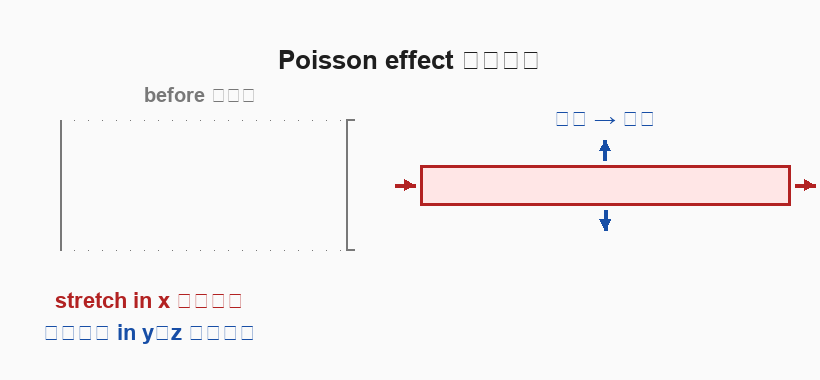
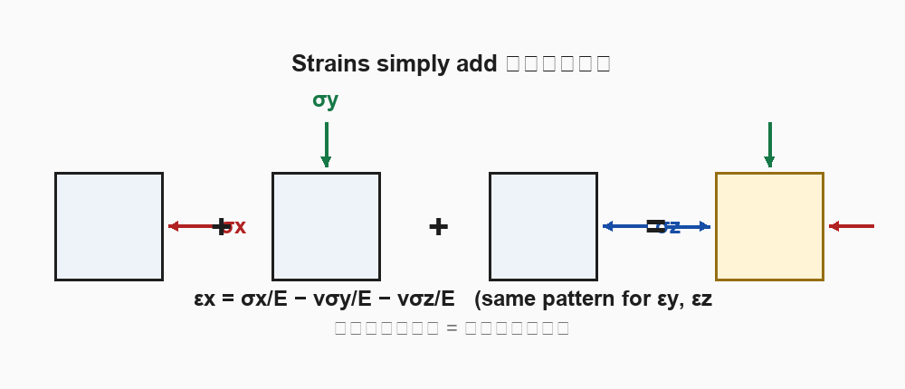
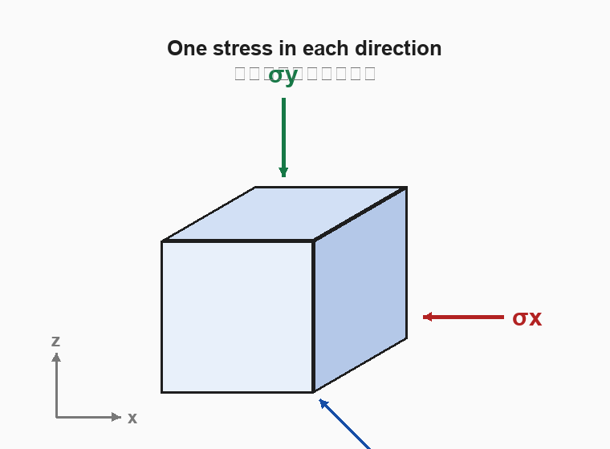
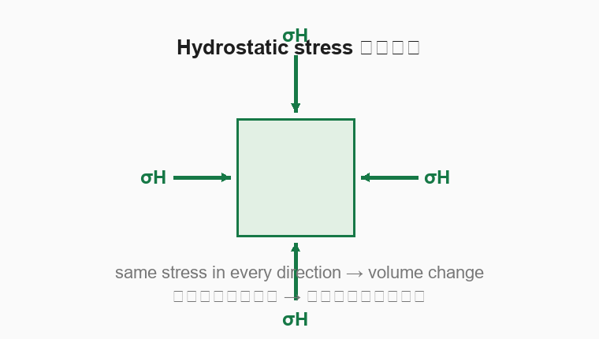
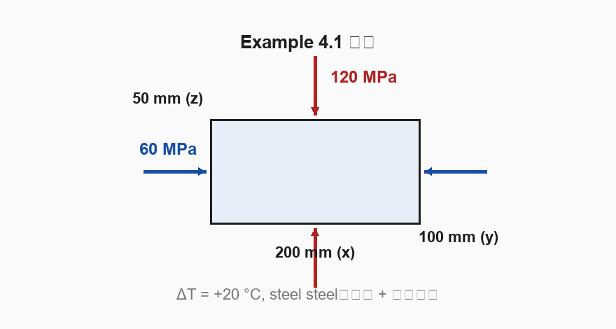

# ME1 Stress Analysis (MECH40005) — 3D Hooke's Law

> **Source**: *ME1 Stress Analysis Lecture Notes 2026-27*, **Ch. 4.4 Stress and strain in three dimensions** (pp. 33-37, including 4.4.1, 4.4.2 and Example 4.1)
> **Style**: plain language throughout; technical terms and key points in **bold**.
> **Prerequisite**: Young's modulus E, 1D Hooke's law σ = Eε, and a first look at Poisson's ratio.

---

## Contents

1. [Why 1D is not enough](#s1)
2. [The Poisson effect](#s2)
3. [Superposition gives the three equations](#s3)
4. [The table method for exams](#s4)
5. [Adding thermal strain](#s5)
6. [Hydrostatic stress and volumetric strain](#s6)
7. [The E, ν, K relation](#s7)
8. [Worked Example 4.1](#s8)
9. [Formula quick reference](#s9)
10. [Common mistakes](#s10)
11. [Self-test](#s11)
12. [Plain-text formulas](#s12)
13. [Glossary](#s13)

---

<a id="s1"></a>
## 1. Why 1D is not enough

In one dimension you only needed **one stress** matched with **one strain**: σ = Eε, and that was the end of it. But real parts are three-dimensional: pull a rubber block in one direction and the other two directions change shape as well. So one equation is no longer enough; you have to track the strain in **x, y and z** at the same time.

**Key idea**: a stress in one direction creates strains in **all three** directions, and if the material is **linearly elastic**, the strains simply **add up**.

**Key points**: the one-dimensional form σ = Eε is only a special case. In three dimensions every stress reaches beyond its own direction, so work out each stress contribution first and then add them. Memory hook: **one stress, three strain contributions**.

---

<a id="s2"></a>
## 2. The Poisson effect

Stretch a rubber band and it gets **longer**, and it also gets **thinner**. That sideways shrinking is the **Poisson effect**. The amount of sideways shrink per unit of stretch is **Poisson's ratio ν**:

$$\nu=-\frac{\text{lateral strain}}{\text{axial strain}}$$

Read the expression as: Poisson's ratio equals minus (lateral strain divided by axial strain).

For most metals ν ≈ **0.3**. The minus sign is there because the lateral strain has the **opposite sign** to the axial one (stretch gives shrink).

Typical values from the course notes:

| Material | ν | Material | ν |
|---|---|---|---|
| **Rubber** | **0.5** | Ice | 0.33 |
| Lead | 0.4-0.5 | Polystyrene foam | 0.30 |
| Polystyrene | 0.35 | **Steel** | **0.29-0.3** |
| Brass | 0.33 | Beryllium | 0.08 |

**Rubber's ν = 0.5 is special**: it means **no volume change**, so rubber is **incompressible**. Remember this; it comes back in Section 7.

<p align="center">
  
</p>

**Key points**: stretch means thinning, and the ratio is ν; metals are usually taken as **0.3** and rubber as **0.5** (incompressible). Pitfall: do not drop the minus sign. When you write εy = −νσx/E in an exam, that minus sign is the whole point of ν.

---

<a id="s3"></a>
## 3. Superposition gives the three equations

Put a small block in three dimensions and apply one normal stress on each pair of faces: **σx, σy, σz**, all drawn as tension here. Each stress contributes to the strain in every direction:

| Contribution | εx | εy | εz |
|---|---|---|---|
| from **σx** | $+\sigma_x/E$ | $-\nu\sigma_x/E$ | $-\nu\sigma_x/E$ |
| from **σy** | $-\nu\sigma_y/E$ | $+\sigma_y/E$ | $-\nu\sigma_y/E$ |
| from **σz** | $-\nu\sigma_z/E$ | $-\nu\sigma_z/E$ | $+\sigma_z/E$ |

Reading the table: **a stress stretches its own direction** (positive, σ/E) **and squeezes the other two** (negative, −νσ/E). Now add each column and you have the 3D Hooke's law:

$$\boxed{\;\varepsilon_x=\frac{1}{E}\big[\sigma_x-\nu(\sigma_y+\sigma_z)\big]\;}\qquad
\varepsilon_y=\frac{1}{E}\big[\sigma_y-\nu(\sigma_x+\sigma_z)\big]\qquad
\varepsilon_z=\frac{1}{E}\big[\sigma_z-\nu(\sigma_x+\sigma_y)\big]$$

These three equations **are** the **3D Hooke's law**; the course notes introduce them with exactly the sentence "these three equations are called...". They are probably the **most-used equations in Chapter 4**, so learn them **by heart**.

<p align="center">
  
</p>

<p align="center">
  
</p>

**Key points**: the memory template is one sentence — **own direction pulls itself, the others squeeze it**. The diagonal entries are +σ/E and the off-diagonal entries are −νσ/E. Compact form of the three equations: εx = [σx − ν(σy+σz)]/E, and you get the other two by cycling the letters. Pitfall: **σy appears inside the formula for εx**, so never substitute only the stress of the same direction.

---

<a id="s4"></a>
## 4. The table method for exams

The course notes work this with a **table**, and it is the **safest exam recipe**, because you cannot forget a term:

1. **Draw the table**: rows are the contributions of the three stresses, columns are x, y and z.
2. **Fill each row**: the own direction gets +σ/E, the other two get −νσ/E.
3. **Add each column** to get εx, εy and εz.

That is all there is to it. No memorising three separate formulas, because the table **generates** them.

**Key points**: in the exam, draw the 3x3 table first and then sum down each column. Memory hook: **the table method is insurance against missing terms**. For a problem like Example 4.1, with several stresses plus a temperature change, the table method is almost the only route that does not go wrong.

---

<a id="s5"></a>
## 5. Adding thermal strain

Heat the material and it expands, even with **zero stress**. That free expansion is the **thermal strain**:

$$\varepsilon_{thermal}=\alpha\,\Delta T$$

where **α** is the **coefficient of thermal expansion** (steel: α ≈ 12×10⁻⁶ /°C). To use it, simply **add it on** to each direction of the 3D Hooke's law:

$$\varepsilon_x=\frac{\sigma_x-\nu(\sigma_y+\sigma_z)}{E}+\alpha\Delta T\qquad(\text{same for } y,z)$$

The notes say exactly this: "**add these thermal strains to those due to stress**".

**Key points**: thermal strain is a **free term**, present without any stress. Pitfall: **substitute a negative number for σ under compression**, while αΔT is always positive for a temperature rise. The two signs do not interfere; each term is added on its own.

---

<a id="s6"></a>
## 6. Hydrostatic stress and volumetric strain (4.4.1)

**Hydrostatic stress** means the stress is **the same in every direction**: σx = σy = σz = σH. Deep water is the classic example, a squeeze of equal magnitude from all sides.

Under hydrostatic stress the strain is equal in every direction as well, so the block **changes volume but not shape**. Define the **volumetric strain v** as the change of volume over the original volume:

$$v=\frac{\Delta V}{V}$$

The **bulk modulus K** is then simply that ratio:

$$K=\frac{\sigma_H}{v}$$

and it is a **material property**, just like E.

<p align="center">
  
</p>

**Key points**: hydrostatic stress is a uniform squeeze. The effect is **volume squashed, shape unchanged**. K = σH/v, a sibling of E. Memory hook: **E handles stretching, K handles squeezing**.

---

<a id="s7"></a>
## 7. The E, ν, K relation (4.4.2)

The three elastic constants are **not independent**. Here is the derivation in four small steps, exactly the route the notes take:

1. Stresses σx, σy, σz act on a block. The strained volume has each edge multiplied by (1+ε):
$$V_{new}=V(1+\varepsilon_x)(1+\varepsilon_y)(1+\varepsilon_z)$$

2. Expand and **ignore products of two small strains** (ε×ε terms are far too small, so drop them; this is what the notes mean by "ignore terms where two or three strain values are multiplied"):
$$v=\varepsilon_x+\varepsilon_y+\varepsilon_z$$

3. Substitute the three equations of the 3D Hooke's law:
$$v=\frac{1-2\nu}{E}(\sigma_x+\sigma_y+\sigma_z)$$

4. For hydrostatic stress (all σ = σH):
$$v=\frac{3(1-2\nu)\,\sigma_H}{E}\quad\Rightarrow\quad \boxed{\;K=\frac{E}{3(1-2\nu)}\;}$$

Sanity checks: ν = 0.3 and E = 200 GPa give K ≈ 200/(3×0.4) ≈ **167 GPa**, a typical value for steel, so the result checks out. As ν → 0.5 the denominator → 0, so **K → ∞**: rubber is incompressible, which links back to Section 2.

The notes flag this result as important: "**an important equation... features on several past exam papers**".

**Key points**: one line connects the whole argument — **volumetric strain v = εx+εy+εz** (higher-order small terms dropped) → substitute into the three equations → **K = E/[3(1−2ν)]**. Pitfall: the coefficient of ν is **(1−2ν)**, not (1−ν). At ν = 0.5 the modulus K blows up because the material is incompressible, which is physically consistent.

---

<a id="s8"></a>
## 8. Worked Example 4.1

<p align="center">
  
</p>

**Problem**: A steel plate **200 mm × 100 mm × 50 mm** is heated by **ΔT = +20 °C** while a **compressive** stress of **120 MPa** acts vertically and **60 MPa** acts on the smallest faces. Find the **volume increase**; then find the stress needed on the previously free edges so that the **100 mm dimension does not change**.

*(The numbers on the notes page were not fully extracted, so standard steel values are assumed)*: E = 200 GPa, ν = 0.3, α = 12×10⁻⁶/°C. Axes: **x = 200 mm (longest)**, **y = 100 mm**, **z = 50 mm (thickness)**; so σz = **−120 MPa**, σy = **−60 MPa** and σx = 0.

**Step 1 — table plus thermal strain** (the thermal term adds αΔT = 240×10⁻⁶ to every direction):

| | εx | εy | εz |
|---|---|---|---|
| elastic part | $\frac{0-0.3(-60-120)}{E}$ | $\frac{-60-0.3(0-120)}{E}$ | $\frac{-120-0.3(0-60)}{E}$ |
| MPa to strain | $+270\times10^{-6}$ | $-120\times10^{-6}$ | $-510\times10^{-6}$ |
| plus thermal strain | $+240\times10^{-6}$ | $+240\times10^{-6}$ | $+240\times10^{-6}$ |
| **total** | $+510\times10^{-6}$ | $+120\times10^{-6}$ | $-270\times10^{-6}$ |

**Step 2 — volumetric strain** (notes' step (c): add the linear strains):
$$v=\varepsilon_x+\varepsilon_y+\varepsilon_z=(510+120-270)\times10^{-6}=360\times10^{-6}$$

**Step 3 — volume change**:
$$\Delta V=v\,V=360\times10^{-6}\times(200\times100\times50)\;\text{mm}^3=\boxed{360\ \text{mm}^3}$$

**Step 4 — part 2, force εy = 0** (notes' step (e): "set εy ..."; the second part asks for zero strain in the y direction):
$$0=\frac{\sigma_y-\nu(\sigma_x+\sigma_z)}{E}+\alpha\Delta T
\;\Rightarrow\;
\sigma_y=\nu\sigma_z-E\alpha\Delta T=0.3(-120)-200\,000\times12\times10^{-6}\times20$$
$$\sigma_y=-36-48=-84\ \text{MPa}$$

The result is negative, so under the tension-positive convention $-84$ MPa means compression.

**Key points**: the main line is three steps — **draw the table → sum each column → v is the sum of the three strains → ΔV = vV**. The second part runs the formula backwards: set the target strain to zero and solve for the unknown stress. Pitfalls: **put a minus sign on compression**, **do not forget the thermal strain**, and keep the units consistent (MPa against GPa needs a factor of 1000).

---

<a id="s9"></a>
## 9. Formula quick reference

| Name | Formula | When to use |
|---|---|---|
| 1D Hooke | σ = Eε | uniaxial tension |
| **3D Hooke** | $\varepsilon_x=\dfrac{\sigma_x-\nu(\sigma_y+\sigma_z)}{E}$ (cycle y, z) | any three-dimensional stress state |
| Poisson | $\nu=-\varepsilon_{lateral}/\varepsilon_{axial}$ | lateral deformation |
| Thermal | $\varepsilon_{th}=\alpha\Delta T$ | temperature change |
| Volumetric strain | $v=\varepsilon_x+\varepsilon_y+\varepsilon_z$ | small-strain premise |
| v in terms of stress | $v=\dfrac{(1-2\nu)(\sigma_x+\sigma_y+\sigma_z)}{E}$ | after substituting the three equations |
| **Bulk modulus** | $K=\dfrac{E}{3(1-2\nu)}=\dfrac{\sigma_H}{v}$ | hydrostatic problems, **past exam questions** |

---

<a id="s10"></a>
## 10. Common mistakes

1. **Forgetting the other stresses**: the formula for εx contains σy and σz, so substituting only σx loses half the marks.
2. **Sign errors on compression**: compression means a negative σ, while thermal strain is positive for a temperature rise. Keep the two sign conventions from fighting each other.
3. **Wrong ν coefficient**: it is **(1−2ν)**, not (1−ν) and not 3ν.
4. **Adding strains across mixed units**: με (10⁻⁶), percent, MPa and GPa; convert first, then add.
5. **Confusing volumetric strain with volume change**: v is the ratio, and ΔV = v×V is the amount in mm³.
6. **Products in large deformation**: v = εx+εy+εz holds only for **small strain**; dropping the εε terms when expanding (1+εx)(1+εy)(1+εz) comes with conditions.

---

<a id="s11"></a>
## 11. Self-test

**Q1 (basic)**
σx = 150 MPa (tension), σy = −50 MPa (compression), σz = 0, E = 200 GPa, ν = 0.3. Find the strain in the x direction.

> **A1**: εx = [150 − 0.3(−50+0)]/200 000 = (150+15)/200 000 = **8.25×10⁻⁴ = 825 με**. Do not forget that σy is negative, which **increases** εx.

**Q2 (hydrostatic)**
A steel block carries σH = 100 MPa in all directions, with E = 200 GPa and ν = 0.3. Find the volumetric strain v and the volume decrease ΔV for a block of V = 1 m³.

> **A2**: v = 3(1−2ν)σH/E = 3(0.4)(100)/200 000 = **6×10⁻⁴**; ΔV = 6×10⁻⁴ m³ = **0.6 L decrease**.

**Q3 (concept)**
Why does K tend to infinity as ν tends to 0.5?

> **A3**: K = E/[3(1−2ν)]; at ν = 0.5 the denominator vanishes, so the material is incompressible, as with rubber, and the bulk modulus is infinite.

**Q4 (exam style)**
For Example 4.1, show that the volumetric strain can be written as v = (1−2ν)(σx+σy+σz)/E + 3αΔT, that is, express the volumetric strain including temperature in terms of stress and temperature.

> **A4**: Add the three Hooke equations; the ν terms combine to −ν(2σx+2σy+2σz)/E... (each σ appears twice with −ν) so εx+εy+εz = (1−2ν)(σx+σy+σz)/E, then + 3αΔT. In the three equations every σ is used twice with −ν, so the sum comes out exactly as (1−2ν), and the thermal strain contributes 3αΔT over the three directions.

---

<a id="s12"></a>
## 12. Plain-text formulas (fallback for renderers)

```
3D Hooke:
  eps_x = (sigma_x - nu*(sigma_y + sigma_z)) / E
  eps_y = (sigma_y - nu*(sigma_x + sigma_z)) / E
  eps_z = (sigma_z - nu*(sigma_x + sigma_y)) / E
Thermal:
  eps_thermal = alpha * dT          (add to each direction)
Poisson:
  nu = - eps_lateral / eps_axial
Volumetric strain:
  v = eps_x + eps_y + eps_z
  v = (1 - 2*nu)*(sigma_x + sigma_y + sigma_z) / E
  v = 3*(1 - 2*nu)*sigma_H / E      (hydrostatic)
Bulk modulus:
  K = sigma_H / v = E / (3*(1 - 2*nu))
Example 4.1 (E=200 GPa, nu=0.3, alpha=12e-6/C):
  eps = [510, 120, -270]e-6, v = 360e-6, dV = +360 mm^3
  eps_y = 0  ->  sigma_y = nu*sigma_z - E*alpha*dT = -84 MPa (compression)
```

---

<a id="s13"></a>
## 13. Glossary

| English | Symbol | One-line meaning |
|---|---|---|
| normal stress | σ | stress perpendicular to a face, positive in tension and negative in compression |
| linearly elastic | — | recovers on unloading, with stress proportional to strain |
| Poisson's ratio | ν | the ratio by which the material thins as it is stretched |
| hydrostatic stress | σH | equal normal stress in every direction |
| volumetric strain | v | ΔV/V, the fractional change of volume |
| bulk modulus | K | resistance to volume compression |
| coefficient of thermal expansion | α | the free stretch per degree of temperature rise |
| superposition | — | each stress contribution adds independently |

---

*End of note · Based strictly on course notes Ch. 4.4 · Figures are self-drawn schematics*
