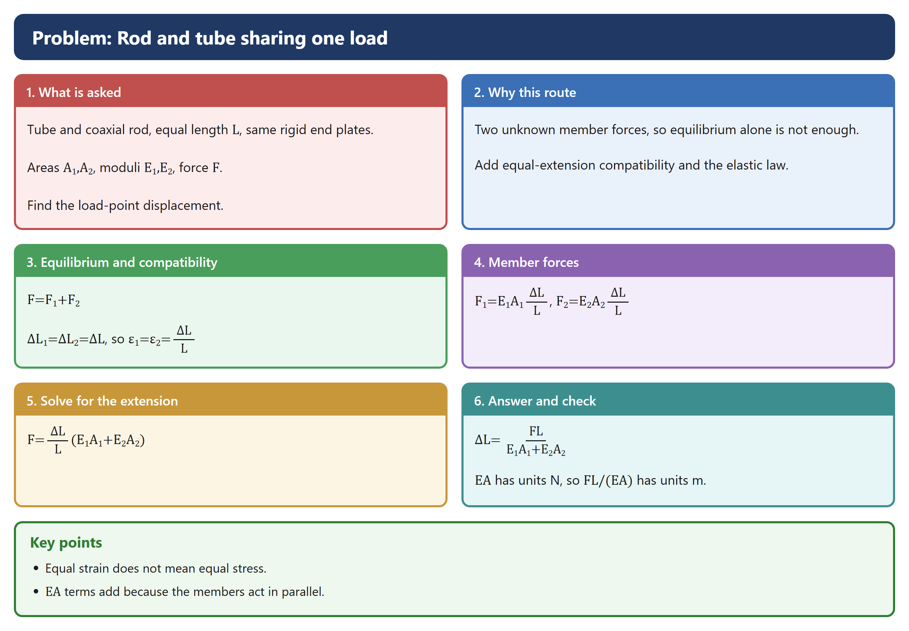
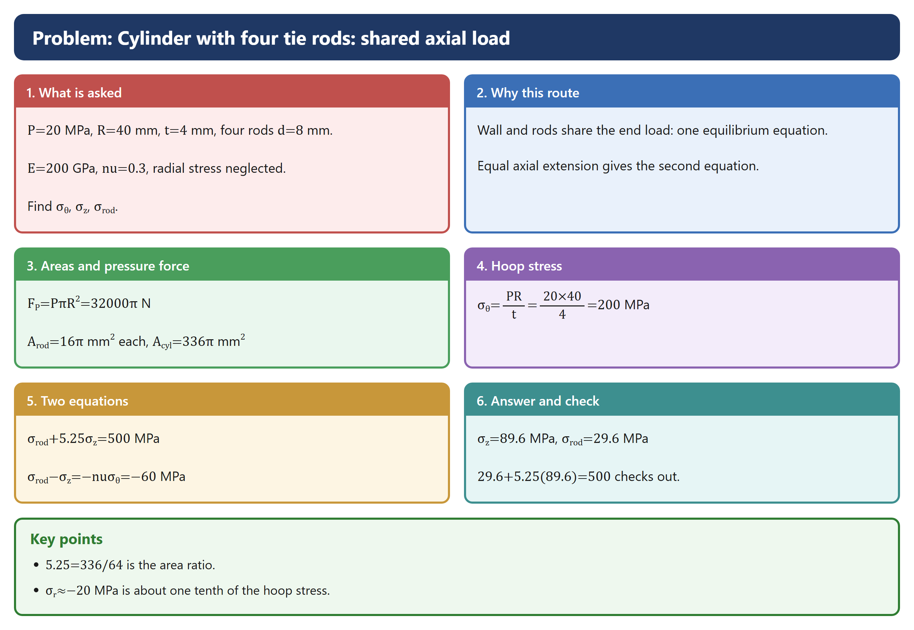

# MECH40005 Stress Analysis: 3D Strain, Pressure Vessels and Indeterminate Systems

Recording: *ME MECH40005 - Stress Analysis*, dated 2026-11-17. This note covers 01:20–54:50 of the [Panopto recording](https://imperial.cloud.panopto.eu/Panopto/Pages/Viewer.aspx?id=aeccb52c-3995-4703-b70d-b4bf0109221a). Sources: automatic English captions, the 37 full-size slide screenshots listed in the frame plan, and the handout.

## 1. Three-Dimensional Strains in Pressure Vessels (01:20–08:34)

A **pressure vessel** holds a fluid under pressure. To describe how it changes shape, choose a direction and compare a length after deformation with its original length. **Strain**, read "epsilon" and written $\varepsilon$, is this change divided by the original length; it has no unit.

For the axial direction $z$, let $L$ be the original length and $\Delta L$ its change, both in metres. Then **axial strain** is:

$$\varepsilon_z=\frac{\Delta L}{L}$$

For the circumferential direction $\theta$, let $R$ be the original radius and $\Delta R$ its change, both in metres. **Hoop strain** measures stretching around the circumference. The original circumference is $2\pi R$, and the new circumference is $2\pi(R+\Delta R)$:

$$\varepsilon_\theta=\frac{2\pi(R+\Delta R)-2\pi R}{2\pi R}=\frac{\Delta R}{R}$$

The same result follows from a small arc: its original length is $R\Delta\theta$, and its new length is $(R+\Delta R)\Delta\theta$, provided the angle $\Delta\theta$, in radians, remains the same. For a uniformly expanding sphere, the two tangential directions $\theta$ and $\phi$ have equal strain:

$$\varepsilon_\theta=\varepsilon_\phi=\frac{\Delta R}{R}$$

As a small illustration, if a cylinder of radius $1$ m expands by $0.001$ m, its hoop strain is $0.001$, or $0.1$%. This is a ratio, not a length.

**Principle recap**

Strain compares the change in a selected length with that length before deformation.

**Pitfalls**

$\Delta R/R$ is hoop strain; it is not the strain through the wall thickness.

**Memory tip**

Choose the direction first, then use change divided by original length.

## 2. Pressure Vessel Stress Analysis and Components (08:34–14:04)

**Stress**, written $\sigma$ and read "sigma", is force per unit area; its unit is the pascal, $1$ Pa $=1$ N/m$^{2}$. A cylinder wall has hoop, axial and radial directions. **Radial stress** acts through the thickness, while radial strain describes the thickness change.

For a thin, closed-ended cylinder whose end-pressure load is carried by its wall, the usual membrane estimates are:

$$\sigma_\theta=\frac{PR_i}{t},\qquad \sigma_z=\frac{PR_i}{2t}$$

Here $P$ is the internal pressure relative to the outside pressure, in Pa; $R_i$ is the inner radius and $t$ is wall thickness, both in metres. The axial formula must not be used unchanged when tie rods also carry the end load.

Take tension as positive. At the inner surface the radial stress equals $-P$ exactly when the outside pressure is the reference zero, and it rises to zero at the free outer surface. The slide writes $\sigma_r=P$ as the magnitude only, not as a tensile sign convention. In the thin-wall approximation, the radial stress is often neglected compared with the larger hoop stress.

If the original and final wall thicknesses are $t$ and $t'$, the average through-thickness strain is:

$$\varepsilon_r=\frac{t'-t}{t}$$

For example, if the wall becomes thinner, $t'<t$ and $\varepsilon_r$ is negative. This definition applies to both a cylindrical and a spherical wall.

**Principle recap**

Pressure creates stresses in different directions; the radial stress can be small even though radial strain is not zero.

**Pitfalls**

Do not confuse the pressure magnitude with the signed radial stress, and do not use the closed-cylinder axial formula, which assumes the wall alone carries the end load, for a vessel with tie rods.

**Memory tip**

Hoop goes around, axial goes along, radial goes through the wall.

## 3. 3D Stress-Strain Relationships and Thermal Effects (14:04–17:11)

A material stretched in one direction can contract in the other directions. **Poisson's ratio**, written $\nu$ and read "nu", measures this transverse response and has no unit. **Young's modulus**, $E$ in Pa, measures stiffness: a larger $E$ gives less elastic strain under the same stress.

For a linearly elastic, isotropic material, with normal stresses in three perpendicular directions and tension positive, the relations are:

$$\varepsilon_x=\frac{\sigma_x-\nu(\sigma_y+\sigma_z)}{E}+\alpha\Delta T$$

$$\varepsilon_y=\frac{\sigma_y-\nu(\sigma_z+\sigma_x)}{E}+\alpha\Delta T$$

$$\varepsilon_z=\frac{\sigma_z-\nu(\sigma_x+\sigma_y)}{E}+\alpha\Delta T$$

Here $\alpha$, read "alpha", is the coefficient of linear thermal expansion in K$^{-1}$, and $\Delta T$ is the temperature change in K. The term $\alpha\Delta T$ is the free thermal strain in each direction; a constrained body can develop stress as well.

For a small illustration, if only $\sigma_x$ is applied and temperature is unchanged, $\varepsilon_x=\sigma_x/E$ while $\varepsilon_y=\varepsilon_z=-\nu\sigma_x/E$. The same pull produces axial extension and transverse contraction.

**Principle recap**

Each normal strain combines its own stress, the other two stresses through Poisson's ratio, and any thermal strain.

**Pitfalls**

Do not omit one transverse stress or divide the thermal term by $E$ again.

**Memory tip**

Own stress first, subtract the other two with $\nu$, divide by $E$, then add temperature.

## 4. Stress Analysis in Cylindrical Pressure Vessels (17:11–19:45)

A curved wall still follows the same material law; only the direction names change. For a cylinder, use hoop $\theta$, radial $r$ and axial $z$:

$$\varepsilon_\theta=\frac{\sigma_\theta-\nu(\sigma_z+\sigma_r)}{E}+\alpha\Delta T$$

$$\varepsilon_r=\frac{\sigma_r-\nu(\sigma_z+\sigma_\theta)}{E}+\alpha\Delta T$$

$$\varepsilon_z=\frac{\sigma_z-\nu(\sigma_\theta+\sigma_r)}{E}+\alpha\Delta T$$

For a sphere, replace the axial direction with the second tangential direction $\phi$. The same cyclic pattern applies to $\theta$, $r$ and $\phi$. Under the thin-wall approximation, $\sigma_r$ may be omitted from the stress terms, but the remaining hoop stresses can still produce radial strain.

For example, with no temperature change and negligible $\sigma_r$, the cylinder's radial strain is approximately $-\nu(\sigma_z+\sigma_\theta)/E$; two tensile stresses can therefore make the wall thinner.

**Principle recap**

Rename the three directions without changing the structure of the three-dimensional law.

**Pitfalls**

Neglecting radial stress does not mean setting radial strain to zero.

**Memory tip**

Cylinder: around, through, along. Sphere: two tangents and through.

## 5. Volumetric Strain in Elastic Deformation Analysis (19:45–30:04)

**Volumetric strain** is the change in volume divided by the original volume. If $V$ is original volume and $\Delta V$ its change, both in m$^{3}$, then $\varepsilon_v=\Delta V/V$ is dimensionless.

For a small rectangular material element, each new edge is its old edge multiplied by one plus the strain in that direction. Multiplying the three factors and dropping products of small strains gives:

$$\frac{\Delta V}{V}=(1+\varepsilon_x)(1+\varepsilon_y)(1+\varepsilon_z)-1\approx\varepsilon_x+\varepsilon_y+\varepsilon_z$$

For the enclosed volume of a cylinder, $V=\pi R^{2}L$. A **partial derivative** describes how a function changes when one variable changes while the others are held fixed. Using first-order changes:

$$\Delta V\approx\frac{\partial V}{\partial R}\Delta R+\frac{\partial V}{\partial L}\Delta L=2\pi RL\Delta R+\pi R^{2}\Delta L$$

Divide by the original volume and substitute the strain definitions:

$$\frac{\Delta V}{V}\approx2\frac{\Delta R}{R}+\frac{\Delta L}{L}=2\varepsilon_\theta+\varepsilon_z$$

For the enclosed volume of a uniformly expanding sphere, $V=\frac{4}{3}\pi R^{3}$, so the corresponding first-order result is:

$$\frac{\Delta V}{V}\approx3\frac{\Delta R}{R}=3\varepsilon_\theta$$

For example, a cylinder with $\varepsilon_\theta=0.001$ and $\varepsilon_z=0.0005$ has an approximate enclosed-volume strain of $0.0025$. The factor $2$ appears because the radius is squared in the cylinder-volume formula.

**Principle recap**

For small deformations, retain first-order strain terms and choose the volume whose change is requested.

**Pitfalls**

The solid-block formula concerns material volume; the cylinder and sphere formulas above concern enclosed volume. They are not interchangeable.

**Memory tip**

Cylinder: two hoop contributions plus one axial. Sphere: three times the hoop strain.

## 6. Load Sharing in Composite Rod-Tube Systems (30:04–37:04)

Two members connected between the same rigid end plates must move together. **Compatibility** expresses that geometric requirement. **Equilibrium** says the forces on a stationary body balance; when equilibrium alone cannot determine every unknown, the system is **statically indeterminate**.

### Example 1. A tube and rod sharing a load

**What is asked**

Member 1 is the tube and member 2 is the coaxial rod; they have equal original length $L$ and are attached to the same rigid end plates. Their areas are $A_1,A_2$ in m$^{2}$ and moduli are $E_1,E_2$ in Pa. One plate is fixed and a force $F$ in N pulls the other. Find the displacement of the loaded plate.

**Why this route**

The force balance has two unknown member forces, so add equal-extension compatibility and the linear elastic law.

**Step 1**

$$F=F_1+F_2,\qquad \Delta L_1=\Delta L_2=\Delta L,\qquad \varepsilon_1=\varepsilon_2=\frac{\Delta L}{L}$$

This gives force balance and the common strain; equal original lengths are needed for equal extensions to imply equal strains.

**Step 2**

$$F_1=E_1A_1\frac{\Delta L}{L},\qquad F_2=E_2A_2\frac{\Delta L}{L}$$

This converts each member's common strain into its force using stress equals modulus times strain.

**Step 3**

$$F=\frac{\Delta L}{L}(E_1A_1+E_2A_2)$$

This combines equilibrium with the material laws and leaves one unknown displacement.

**Where the constant comes from**

The two $EA$ terms add because the members act in parallel and their forces add; neither member is assumed to carry half the load.

**Sanity check**

$EA$ has units N, so $FL/(E_1A_1+E_2A_2)$ has units m. If the stiffness $E_2A_2$ of member 2, the rod, tends to zero, the result becomes the single-tube extension $FL/(E_1A_1)$.

**Answer**

$$\Delta L=\frac{FL}{E_1A_1+E_2A_2}$$

The load-point displacement equals this common extension under the stated fixed-end conditions.

**Pitfalls**

Equal strain does not imply equal stress when the moduli differ; equal stress does not imply equal forces when areas differ.

**Principle recap**

Solve an indeterminate load-sharing problem with equilibrium, compatibility and a material law together.

**Pitfalls**

Balance forces, not stresses directly.

**Memory tip**

Forces balance; connected ends move together; material law joins the two.

## 7. Calculating Axial Loads in Rods and Cylinders (37:04–46:28)

In the hydraulic example, pressure pushes an end plate outward. Both the cylindrical wall and four tie rods resist that force. A **free-body diagram** isolates the end plate and shows every force acting on it.

The given inner diameter is $80$ mm, wall thickness is $4$ mm, rod diameter is $8$ mm and pressure is $20$ MPa. Thus the inner radius is $40$ mm. Use $1$ MPa $=1$ N/mm$^{2}$ when areas are calculated in mm$^{2}$.

The pressure acts on the inner circular area. Each rod carries its stress times its own circular area. Here $R$ is the inner radius, $R=R_i=40$ mm. The wall area can be written using the mean radius $R+t/2$:

$$F_P=P\pi R^{2},\qquad A_{rod}=\frac{\pi d_{rod}^{2}}{4},\qquad A_{cyl}=\pi[(R+t)^{2}-R^{2}]=2\pi(R+t/2)t$$

Here $F_P$ is pressure force in N; $d_{rod}$ is rod diameter in mm; $A_{rod}$ and $A_{cyl}$ are areas in mm$^{2}$. With these values, $F_P=32000\pi$ N, $A_{rod}=16\pi$ mm$^{2}$ and $A_{cyl}=336\pi$ mm$^{2}$.

The resulting equilibrium equation contains two unknown stresses. A second equation must come from compatibility, not from force balance alone.

**Principle recap**

Pressure force equals pressure times the loaded area; internal member force equals stress times its own cross-sectional area.

**Pitfalls**

Use the inner circle for pressure, the annulus for the wall, and count all four rods.

**Memory tip**

One pressure circle, four rod circles, one wall annulus.

## 8. Pressure Vessel Stress Analysis Using Equilibrium (46:28–54:50)

The end plates make the rods and cylinder extend together, so their axial strains are equal. Their axial stresses differ because the hoop stress also changes the cylinder's axial strain through Poisson's ratio, while the rod has no hoop stress.

### Example 2. A pressure cylinder with four tie rods

**What is asked**

For the cylinder in Section 7, both the wall and rods are steel with $E=200$ GPa and $\nu=0.3$. Find the rod stress, cylinder axial stress and cylinder hoop stress using the lecture's thin-wall approximation.

**Why this route**

The pressure force is shared between wall and rods. Equilibrium supplies one equation; equal axial strain supplies another. The hoop stress is found separately from thin-wall pressure equilibrium.

**Step 1**

$$\sigma_\theta=\frac{PR_i}{t}=\frac{20\times40}{4}=200\ \mathrm{MPa}$$

This gives the cylinder hoop stress using pressure in MPa and lengths in mm. This step uses the inner radius, while Step 2 uses the mean-radius wall area; that mix is a deliberate thin-wall approximation.

**Step 2**

$$4(16\pi)\sigma_{rod}+(336\pi)\sigma_{z,cyl}=32000\pi$$

This balances the four rod forces and the wall force against the pressure force; stresses are in MPa and areas in mm$^{2}$.

**Step 3**

$$\frac{\sigma_{rod}}{E}=\frac{\sigma_{z,cyl}-\nu(\sigma_\theta+\sigma_r)}{E},\qquad \sigma_r\approx 0$$

This expresses equal axial strain. It adopts the lecture's approximation $\sigma_r\approx0$, whose accuracy is discussed after the figure below. There is no temperature change in this example.

**Step 4**

$$\sigma_{rod}+5.25\sigma_{z,cyl}=500,\qquad \sigma_{rod}-\sigma_{z,cyl}=-60$$

This reduces equilibrium and compatibility to two equations in two stresses, both measured in MPa.

**Step 5**

$$6.25\sigma_{z,cyl}=560,\qquad \sigma_{z,cyl}=89.6,\qquad \sigma_{rod}=29.6$$

This solves the equations for the cylinder axial stress and the stress in each rod, in MPa.

**Where the constant comes from**

The $5.25$ is $336/64$, the ratio of wall area to total rod area. The $500$ is $32000/64$. The $60$ is $\nu\sigma_\theta=0.3\times200$ MPa.

**Sanity check**

Substitution gives $29.6+5.25\times89.6=500$ and $29.6-89.6=-60$. Both equations are satisfied, and all three resulting stresses are tensile under the adopted sign convention.

**Answer**

$$\sigma_{rod}=29.6\ \mathrm{MPa},\qquad \sigma_{z,cyl}=89.6\ \mathrm{MPa},\qquad \sigma_\theta=200\ \mathrm{MPa}$$

These are the lecture's results using the mean-radius wall area and neglected radial stress. They are approximate thin-wall results, not a detailed end-region solution.

**Pitfalls**

Do not set the rod and cylinder stresses equal merely because their strains are equal. Do not use the ordinary closed-cylinder axial stress formula, because the rods share the end load.

The approximation $\sigma_r\approx0$ needs care here: the inner-surface magnitude is about $20$ MPa, one tenth of the $200$ MPa hoop stress. Near the end plates, the uniform long-cylinder model may also miss local end effects.

**Principle recap**

Equilibrium determines the combined load, while compatibility and the three-dimensional material law determine its distribution.

**Pitfalls**

The hoop stress contributes to axial strain even though it is not an axial force on the end plate.

**Memory tip**

First balance the end plate; then match the extensions; finally solve the stresses.

## Open items

1. At 12:20–12:30 the slide writes $\sigma_r=P$, while the later worked slide at 53:00 writes an approximately compressive $\sigma_r=-P$. Check the radial-stress sign against the 09:30–12:30 and 49:28–50:07 explanation; the note uses tension positive and treats the earlier expression as a magnitude.

2. At 24:10, the cuboid slide's intermediate $y$ and $z$ edge-change lines appear to repeat an $x$ subscript, although their final factors and the strain definitions require $\varepsilon_y$ and $\varepsilon_z$. Check 20:22–21:21 against the slide before treating those intermediate printed lines as authoritative.

3. At 53:00 the worked slide gives $29.6$ MPa and $89.6$ MPa, while the extracted handout gives approximately $33$ MPa and $93$ MPa. The handout values are reproduced by taking the wall area as $2\pi R_i t=320\pi$ mm$^{2}$ instead of $336\pi$ mm$^{2}$; check the original handout and the lecture's 42:35–46:05 derivation before comparing the two answers.

4. The handout is numbered in a different chapter order from the lecture slides: the extracted handout table of contents places bending in Chapter 5, while the lecture's pressure-vessel material follows the strain and stress chapters. Chapter numbers in this note follow the lecture slides, and the handout is used only for wording and section naming.
