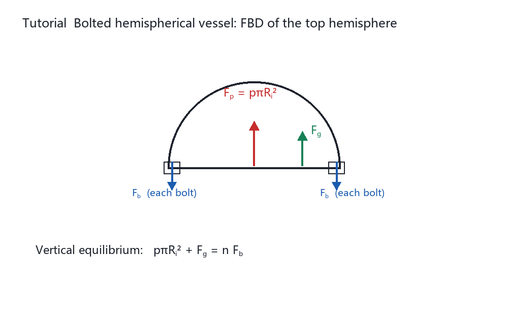
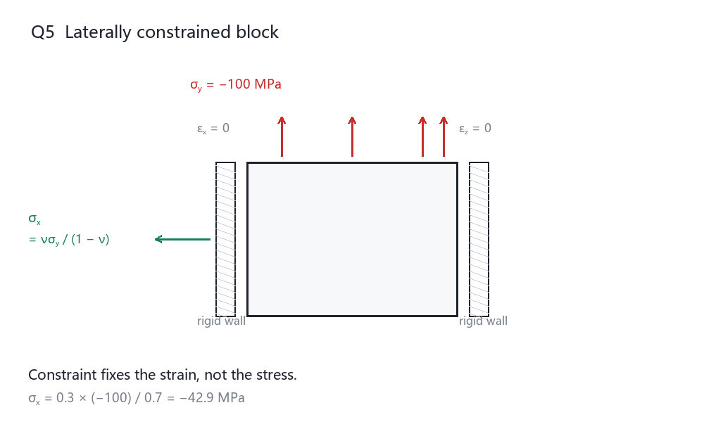
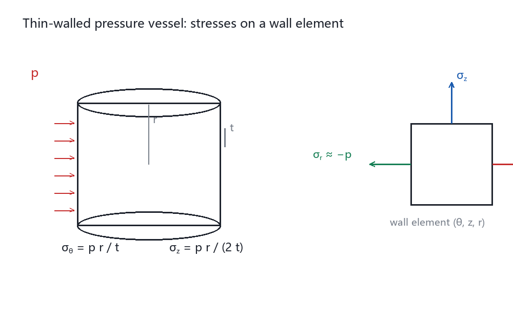
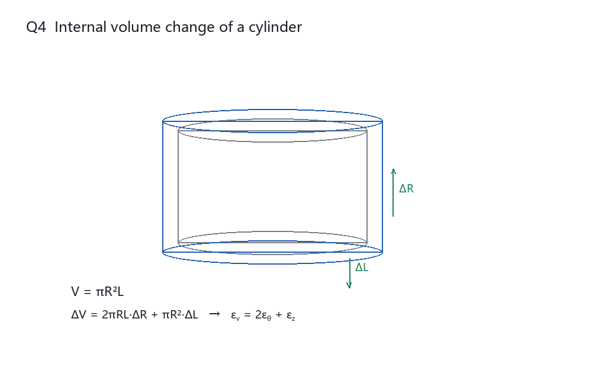
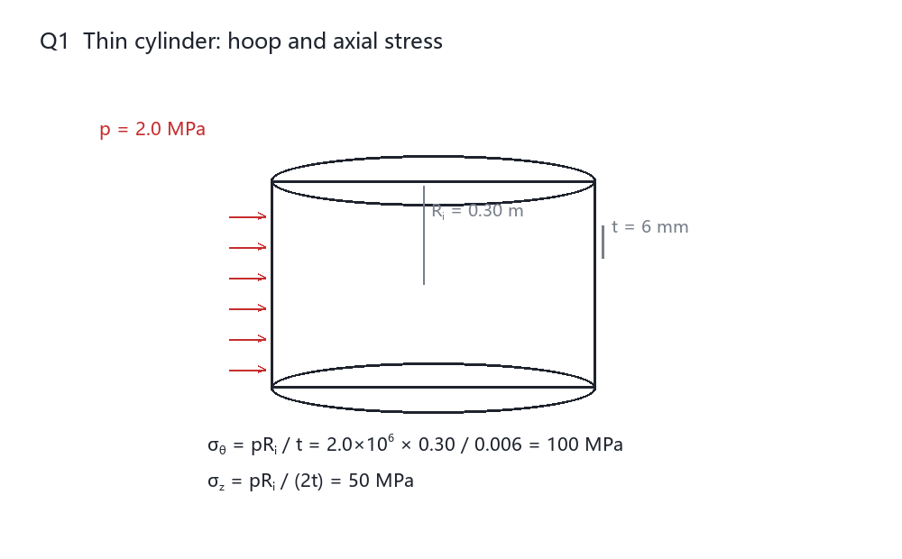
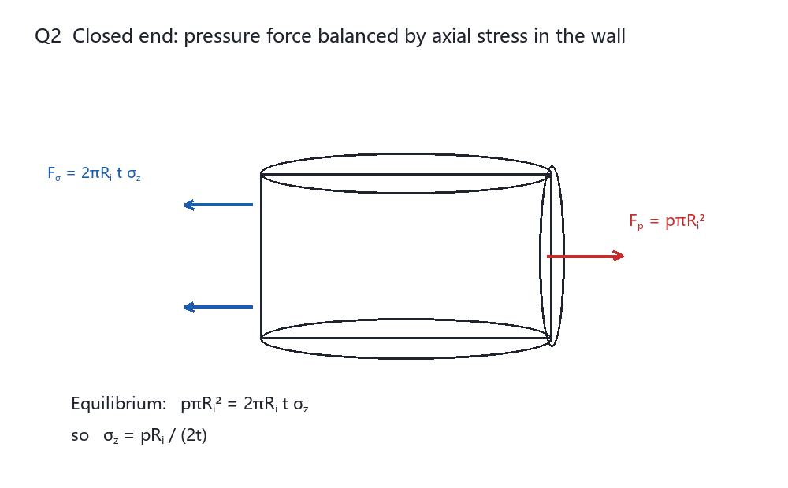
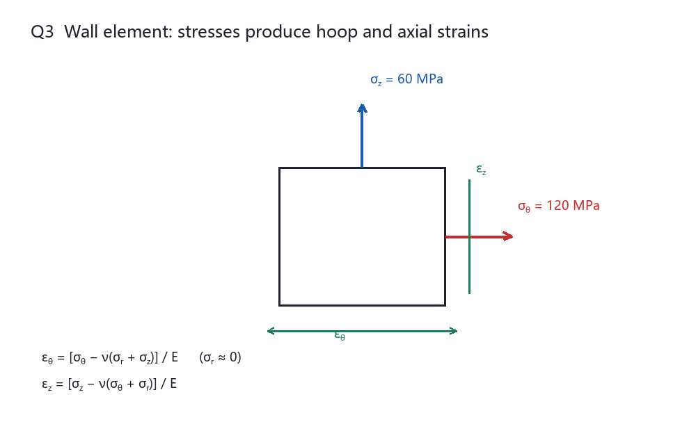
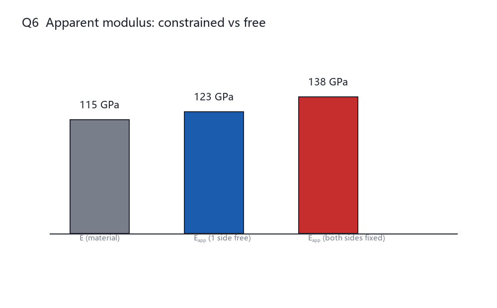
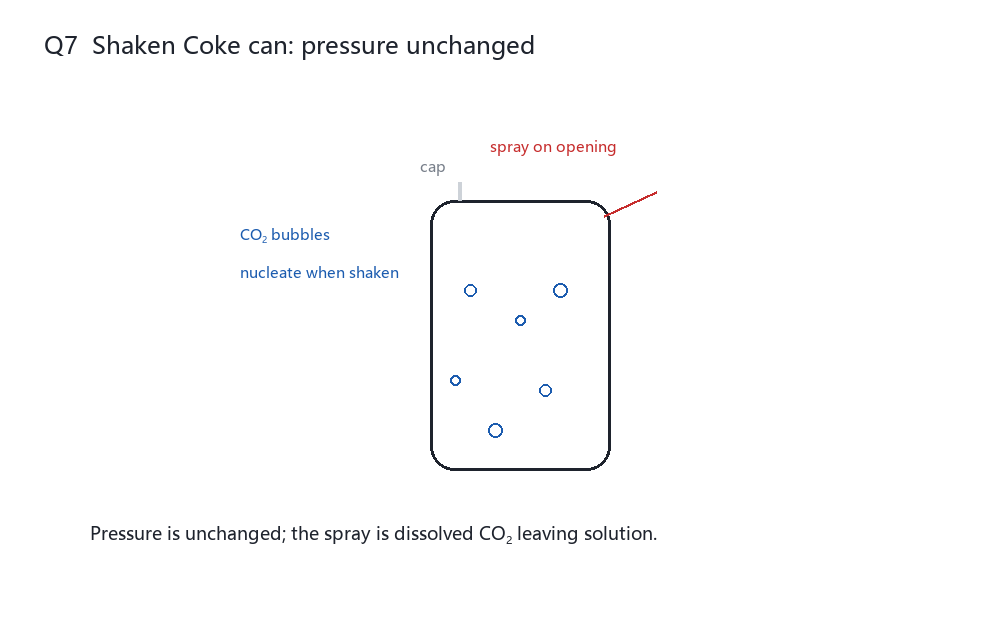
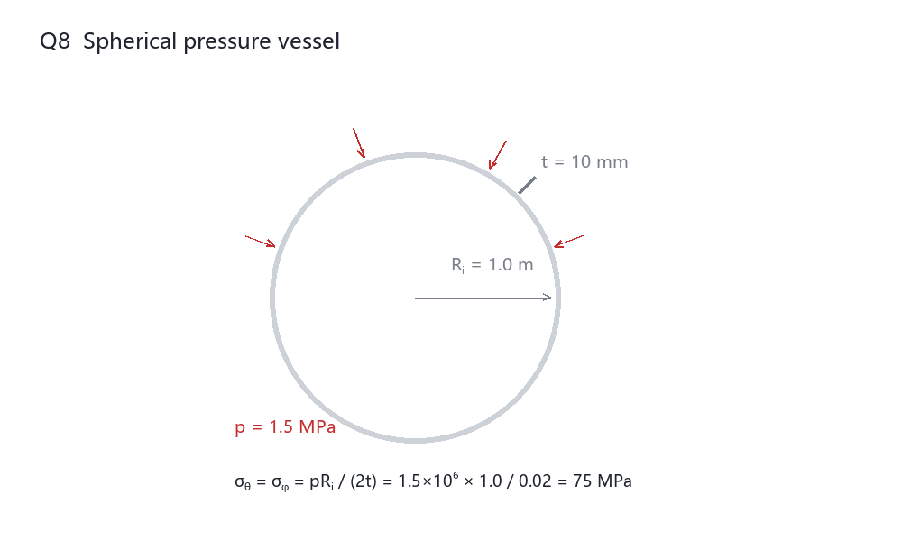

# ME1 Stress Analysis (MECH40005) — Lecture 6
## Constrained blocks, apparent modulus and thin-walled pressure vessels

> **Course**: ME1 Stress Analysis, MECH40005 (Autumn 2026-27)
> **Lecture**: Lecture 6, Panopto recording, 10 November 2026 (about 60 minutes)
> **Course notes**: *ME1 Stress Analysis Lecture Notes 2026-27*, Ch. 3.2, Ch. 4.2-4.7 (pp. 26-44)
> **Language**: English text, the language of the examination.

---

## Contents

1. [Lecture map](#map)
2. [Tutorial: bolted hemispherical pressure vessel](#tutorial)
3. [Worked exam question: constrained block and apparent modulus](#block)
4. [Stresses in thin-walled pressure vessels](#pv-stress)
5. [Stresses and strains in the vessel wall](#strains)
6. [3D Hooke's law for shells](#hooke)
7. [The Coke can question (class discussion)](#coke)
8. [Volumetric strain of a cylindrical shell](#volumetric)
9. [Formula sheet](#formulas)
10. [Common mistakes and exam technique](#mistakes)
11. [Self-test with answers](#selftest)
12. [Glossary](#glossary)

---

## 1. Lecture map

| Part | Content | Notes |
|---|---|---|
| 1 | Tutorial question: a bolted hemispherical vessel with a gasket, and the free-body analysis of the seal | Ch. 1-3 |
| 2 | Worked exam question: a laterally constrained cast-iron block and its **apparent Young's modulus** | Ch. 4.4, 4.6 |
| 3 | Thin-walled pressure vessels: hoop, axial and spherical shell stress formulas | Ch. 3.2 |
| 4 | Strains in cylindrical and spherical shells | Ch. 4.5 |
| 5 | 3D Hooke's law applied to shells, including thermal strain | Ch. 4.4, 4.7.3 |
| 6 | Volumetric strain of a cylindrical shell, derived with partial derivatives | Ch. 4.7.1 |
| 7 | Coke can case study: does shaking change the internal pressure? | Class discussion |

**Key points:** This lecture is a bridge. It first applies the 3D Hooke's law to a general block, then fits it onto the geometry of a pressure vessel, and finally derives the volumetric strain used for vessel design and for strain-gauge measurement.

---

## 2. Tutorial: bolted hemispherical pressure vessel

### 2.1 Physical set-up

Each hemisphere carries a **flange**, with a **gasket** clamped between them, and the joint is tightened with bolts. The gasket is a mechanical seal, usually of rubber, synthetic rubber or cardboard, with a central hole that lets the fluid through. Tightening the bolts puts the gasket in compression, which seals the two hemispheres together.

**Key points:** The figure in the question does not show how the force is transmitted, which is where many people get stuck. The key is to work out first which surface touches which, and which part pushes which.

### 2.2 Method: free body diagram (FBD)

  

<em>Figure 2 — Free body diagram of the top hemisphere: internal pressure, gasket reaction and bolt force</em>

The first step is a free body diagram. Cut the component to expose the unknown internal force.

1. Cut along the **bolts** and replace them with $n$ axial forces $F_b$.
2. Cut along the **gasket**; the gasket is in compression, so it pushes **upwards** on the top hemisphere with reaction $F_g$.
3. Keep the internal pressure $p$ acting on the inner surface.

**Key idea:** the resultant of pressure over a curved surface equals the pressure times the **projected area**, which here is the area of the equatorial plane:

$$
F_p = p\,\pi R_i^{2}
$$

Vertical equilibrium of the top hemisphere:

$$
p\,\pi R_i^{2} + F_g = n\,F_b
$$

so the bolt tensile stress is

$$
\sigma_b = \frac{F_b}{A_b} = \frac{p\,\pi R_i^{2} + F_g}{n A_b}
$$

**Key points:**
- Cut where you want the internal force: cut the bolts to get the bolt force, cut the gasket to get the gasket reaction.
- Do not add the pressure up along the curved surface; use the projected area $\pi R_i^2$ directly.
- Equilibrium has only three groups of forces: internal pressure upwards plus gasket reaction upwards equals bolt forces downwards.
- This cut, replace and balance routine comes back later when the wall stresses of the vessel are analysed.

---

## 3. Worked exam question: constrained block and apparent modulus

### 3.1 Data

A cast-iron block is compressed along its length, while its sides are held so that no lateral strain can occur.

| Quantity | Value |
|---|---|
| Length L | 150 mm |
| Cross-section | 625 mm² (25 mm × 25 mm) |
| Compressive force F | 90 kN |
| Young's modulus E | 115 GPa |
| Poisson's ratio ν | 0.25 |

Coordinate system: $y$ is the loading (longitudinal) direction and $x$, $z$ are the two lateral directions.

  

<em>Figure 3 — Laterally constrained block: the constraint acts on the strain, not on the stress</em>

**Key points:** Always set up the coordinate system first in this kind of question, otherwise the subscripts on σ and ε will not line up.

### 3.2 Case 1: both lateral faces constrained

Given $\varepsilon_x = \varepsilon_z = 0$.

**Step 1 — stress from the load:**

$$
\sigma_y = \frac{-F}{A} = \frac{-90\times10^{3}}{625\times10^{-6}} = -144\ \text{MPa}
$$

(Compression is taken as negative.)

**Step 2 — lateral stress produced by the constraint:**

$$
\varepsilon_x = \frac{1}{E}\left[\sigma_x-\nu(\sigma_y+\sigma_z)\right] = 0
$$

By symmetry $\sigma_x=\sigma_z$, so

$$
\sigma_x(1-\nu) = \nu\sigma_y
\quad\Longrightarrow\quad
\sigma_x=\sigma_z=\frac{\nu\sigma_y}{1-\nu}
= \frac{0.25(-144)}{0.75} = -48\ \text{MPa}
$$

**Step 3 — longitudinal strain:**

$$
\varepsilon_y=\frac{1}{E}\left[\sigma_y-\nu(\sigma_x+\sigma_z)\right]
=\frac{1}{115\times10^{9}}\left[-144\times10^{6}-0.25(-96\times10^{6})\right]
=-1.04\times10^{-3}
$$

**Step 4 — change in length and apparent modulus:**

$$
\Delta L=\varepsilon_y L=(-1.04\times10^{-3})(0.150\ \text{m})
= -1.57\times10^{-4}\ \text{m}
= -0.157\ \text{mm}
$$

$$
E_{\text{app}}=\frac{\sigma_y}{\varepsilon_y}
=\frac{-144\times10^{6}}{-1.04\times10^{-3}}
\approx 138\ \text{GPa}
$$

### 3.3 Case 2: one lateral face free

Now $\varepsilon_x=0$ still holds, but $\sigma_z=0$ because the face is free:

$$
\varepsilon_x=\frac{1}{E}\left[\sigma_x-\nu(\sigma_y+0)\right]=0
\quad\Longrightarrow\quad
\sigma_x=\nu\sigma_y=0.25(-144)=-36\ \text{MPa}
$$

$$
\varepsilon_y=\frac{1}{E}\left[\sigma_y-\nu\sigma_x\right]
=\frac{1}{115\times10^{9}}\left[-144\times10^{6}+9\times10^{6}\right]
=-1.17\times10^{-3}
$$

$$
\Delta L=-0.176\ \text{mm},
\qquad
E_{\text{app}}\approx 123\ \text{GPa}
$$

### 3.4 Comparison and interpretation

| Case | σx | σz | εy | ΔL | E_app |
|---|---|---|---|---|---|
| Both lateral faces constrained | −48 MPa | −48 MPa | −1.04×10⁻³ | −0.157 mm | **138 GPa** |
| One lateral face free | −36 MPa | 0 | −1.17×10⁻³ | −0.176 mm | **123 GPa** |

**Three conclusions:**

1. **The apparent modulus exceeds the material modulus** (138 GPa > 115 GPa). The lateral constraint prevents Poisson contraction, so lateral compressive stress builds up, and that stress makes the block contract an extra amount along its length, which makes the whole system look stiffer.
2. **Weaker constraint gives a lower apparent modulus**: removing one constraint drops the value from 138 GPa to 123 GPa, which is still above 115 GPa.
3. **The apparent modulus is a system property, not a material constant**; it depends on the boundary conditions.

**Key points:**
- The constraint restricts the **strain** (εx = 0), not the stress: the constraint generates the stress σx.
- Do not leave out the Poisson terms in σx and σz when computing εy; that is the easiest place to lose marks.
- The apparent modulus is measured stress divided by measured strain, not a value read from a table.

### 3.5 Exam technique emphasised in class

- **Carry the algebra to the end before substituting numbers**, which reduces rounding error.
- Work entirely in **SI units** (N, m, Pa): convert 90 kN and mm² first.
- **Sanity check**: elastic strains are usually of order **0.2%**; if you get microstrain or a 10% strain, the units are probably wrong.
- **Watch the signs**: compression is negative, and a negative ΔL means shortening.

---

## 4. Stresses in thin-walled pressure vessels

A vessel is thin-walled when the radius is much larger than the wall thickness; in this course that means $r/t \gtrsim 10$.

**Key points:** "Thin-walled" is an approximation condition. When $r/t \gtrsim 10$ the stress may be taken as uniform through the thickness and the radial stress may be neglected.

  

<em>Figure 1 — Hoop, axial and radial stresses (θ, z, r) on a wall element of a thin-walled cylinder</em>

### 4.1 Cylindrical vessel

**Hoop (circumferential) stress:** cut along a diameter and keep one half. The pressure acts on the projected area $2R_i\Delta z$ and is balanced by the hoop stress on the two wall sections ($2t\Delta z$):

$$
2pR_i\Delta z = 2\sigma_\theta t \Delta z
\quad\Longrightarrow\quad
\sigma_\theta=\frac{pR_i}{t}
$$

**Axial stress:** cut across a cross-section. The pressure on the end cap $\pi R_i^{2}p$ is balanced by the axial stress on the annular wall area $2\pi R_i t$:

$$
\pi R_i^{2}p = 2\pi R_i t\,\sigma_z
\quad\Longrightarrow\quad
\sigma_z=\frac{pR_i}{2t}=\frac{\sigma_\theta}{2}
$$

**Open-ended cylinder:** for a pipe, or for a hydraulic cylinder that passes the force on to an external load, the wall does not carry the axial force, so $\sigma_z=0$.

**Key points:**
- Hoop stress is **twice** the axial stress, which is why pipes always split **lengthwise**.
- Before asking whether σz must be computed, check whether the ends are closed and whether they are attached to the wall.

### 4.2 Spherical vessel

Every section through the centre of a sphere is equivalent, so the membrane stress is the same in every direction:

$$
\sigma_\theta=\sigma_\phi=\frac{pR_i}{2t}
$$

**Key points:** For the same radius and the same wall thickness, the stress in a spherical shell is only half that in a cylindrical shell, which is why high-pressure gas is stored in spherical tanks.

### 4.3 Examples given in the lecture

- a steam-engine cylinder, a cylindrical pressure vessel;
- hydraulic rams on an excavator arm, two thin-walled cylinders;
- a football, a spherical pressure vessel;
- a Coke can, the case study in Section 7.

---

## 5. Stresses and strains in the vessel wall

### 5.1 Radial stress

The radial stress varies through the wall thickness: $-p$ at the inner surface and 0 at the outer surface, so its largest magnitude is $p$. Meanwhile

$$
\sigma_\theta=\frac{pr}{t}, \qquad \sigma_z=\frac{pr}{2t}
$$

are $r/t \gtrsim 10$ times larger, so the radial stress is **neglected** in thin-walled vessel design.

**Important reminder (a common pitfall):** the radial **stress** may be neglected, but the radial **strain** may not. It follows from all three stresses:

$$
\varepsilon_r=\frac{1}{E}\left[\sigma_r-\nu(\sigma_\theta+\sigma_z)\right]
$$

**Key points:** Many students reason from "σr is small" straight to "εr is small", which is wrong: εr comes mainly from the Poisson effect of σθ and σz.

### 5.2 Shell strains

**Axial strain:** defined directly from the extension

$$
\varepsilon_z=\frac{\Delta L}{L}
$$

**Hoop strain:** obtained from the change in circumference. Before deformation the circumference is $2\pi R$, afterwards it is $2\pi(R+\Delta R)$:

$$
\varepsilon_\theta=\frac{2\pi(R+\Delta R)-2\pi R}{2\pi R}
=\frac{\Delta R}{R}
$$

Note that $\Delta R/R$ is the **hoop strain**, not the radial strain, even though the displacement is radial.

**Spherical shell:** by symmetry every great circle carries the same hoop strain

$$
\varepsilon_\theta=\varepsilon_\phi=\frac{\Delta R}{R}
$$

**Key points:** Remember the three pairings: axial strain with ΔL/L, hoop strain with ΔR/R, radial strain with Δt/t.

---

## 6. 3D Hooke's law for shells

Replace $(x,y,z)$ with the cylinder directions $(\theta,r,z)$ or the sphere directions $(\theta,r,\phi)$, and add the thermal strain $\alpha\Delta T$:

**Cylinder:**

$$
\varepsilon_\theta=\frac{1}{E}\left[\sigma_\theta-\nu(\sigma_r+\sigma_z)\right]+\alpha\Delta T
$$

$$
\varepsilon_r=\frac{1}{E}\left[\sigma_r-\nu(\sigma_\theta+\sigma_z)\right]+\alpha\Delta T
$$

$$
\varepsilon_z=\frac{1}{E}\left[\sigma_z-\nu(\sigma_\theta+\sigma_r)\right]+\alpha\Delta T
$$

**Sphere:**

$$
\varepsilon_\theta=\frac{1}{E}\left[\sigma_\theta-\nu(\sigma_r+\sigma_\phi)\right]+\alpha\Delta T
$$

$$
\varepsilon_r=\frac{1}{E}\left[\sigma_r-\nu(\sigma_\theta+\sigma_\phi)\right]+\alpha\Delta T
$$

$$
\varepsilon_\phi=\frac{1}{E}\left[\sigma_\phi-\nu(\sigma_\theta+\sigma_r)\right]+\alpha\Delta T
$$

**Key points:** The structure is always own-direction stress minus ν times the other two stresses, and the temperature term is identical in all three directions; only the coordinate names change.

---

## 7. The Coke can question

**Question:** does the pressure inside a sealed Coke can rise when the can is shaken?

**Answer: no, the pressure does not change.**

The spray comes from carbon dioxide dissolved in the drink. Shaking creates tiny bubbles that act as **nucleation sites**; when the can is opened the CO₂ comes out of solution rapidly and pushes liquid out.

**Key points:**
- Shaking only creates small bubbles, that is nucleation points, which let the CO₂ escape more easily; **the pressure inside the can does not change because of the shaking**.
- When the can is opened the pressure drops sharply, the dissolved CO₂ escapes quickly and carries liquid with it, hence the spray.

**How can this be proved without damaging the can?**

- Destructive route: fit a **tyre valve** to the lid and measure the pressure directly, but this damages the can.
- Better route: measure the **deformation of the can wall** with **strain gauges**. If the pressure changed, the hoop and axial strains would change:

$$
\varepsilon_\theta=\frac{\Delta R}{R}, \qquad \varepsilon_z=\frac{\Delta L}{L}
$$

Then invert Hooke's law together with the pressure-vessel stress formulas to recover the pressure. This is an **indirect measurement**: measure strain, infer stress, infer pressure.

**Key points:** The value of this question is that it links the abstract Hooke's law to a quantity you can actually measure; in engineering, strain is often easier to measure than stress.

---

## 8. Volumetric strain of a cylindrical shell

The internal volume of a cylinder is

  

<em>Figure 5 — Under pressure the radius and length change together, so the volume increment follows from the total differential</em>

$$
V=\pi R^{2}L
$$

After pressurising, both $R$ and $L$ change, so use the **total differential**:

$$
\delta V=\frac{\partial V}{\partial R}\delta R+\frac{\partial V}{\partial L}\delta L
$$

where

$$
\frac{\partial V}{\partial R}=2\pi RL,
\qquad
\frac{\partial V}{\partial L}=\pi R^{2}
$$

so

$$
\delta V=2\pi RL\,\delta R+\pi R^{2}\,\delta L
$$

Divide by $V=\pi R^{2}L$:

$$
\varepsilon_v=\frac{\delta V}{V}
=2\frac{\delta R}{R}+\frac{\delta L}{L}
=2\varepsilon_\theta+\varepsilon_z
$$

**Spherical shell:** $V=\tfrac{4}{3}\pi R^{3}$, so

$$
\varepsilon_v=3\frac{\delta R}{R}=3\varepsilon_\theta
$$

**Key points:**
- Cylinder: εv = 2εθ + εz; sphere: εv = 3εθ. Do not mix them up: the cylinder is not 3ε.
- The derivation is for the **internal volume**, so the change in wall thickness does not enter the formula; a change in wall thickness changes the volume of material, not the volume available to the fluid.
- Use: estimate how much extra liquid must be pumped in to pressurise a vessel; it is also the conversion used in strain-gauge measurement.

---

## 9. Formula sheet

| Quantity | Formula | Note |
|---|---|---|
| Cylinder hoop stress | σθ = p Ri / t | r/t ≳ 10 |
| Cylinder axial stress | σz = p Ri / (2 t) | closed ends; zero when open |
| Spherical shell stress | σθ = σφ = p Ri / (2 t) | half the cylinder value |
| Radial stress | σr ≈ −p (inner) to 0 (outer) | negligible for a thin wall |
| Axial strain | εz = ΔL / L | — |
| Hoop strain | εθ = ΔR / R | from the change in circumference |
| Radial strain | εr = Δt / t | not negligible |
| Cylinder 3D Hooke's law | εθ = [σθ − ν(σr + σz)] / E + αΔT | cycle θ, r, z |
| Cylinder volumetric strain | εv = 2 εθ + εz | internal volume |
| Sphere volumetric strain | εv = 3 εθ | — |
| Apparent modulus | E_app = σ / ε (measured) | system property |

**Note:** the table writes the formulas in plain characters so that they display in any Markdown previewer; the formulas in the body text are still LaTeX.

---

## 10. Common mistakes and exam technique

1. **Using R instead of Ri**: the thin-wall assumption gives $R_m\approx R_i$, but be consistent throughout.
2. **Forgetting to distinguish closed from open ends**: $\sigma_z=pR_i/2t$ holds only with closed ends; for a pipe $\sigma_z=0$.
3. **Thinking "radial stress negligible implies radial strain negligible"**: wrong, the radial strain follows from all three stresses.
4. **Treating $\Delta R/R$ as the radial strain**: it is the hoop strain.
5. **Writing the cylinder volumetric strain as 3ε**: wrong, it is $2\varepsilon_\theta+\varepsilon_z$; the factor 3 belongs to a spherical shell or to a hydrostatically loaded block.
6. **Dropping the thermal term** $\alpha\Delta T$ when the temperature changes.
7. **Forgetting that the constraint generates lateral stress** in the constrained-block question: the constraint acts on the strain (εx=0), not on the stress.
8. **Units**: kN to N, mm² to m²; compression carries a minus sign.

**Reminder:** these eight items cover essentially every mark-losing point in this lecture, so run through them before the exam.

---

## 11. Self-test with answers

> Each question has a figure (Figure Q1-Q8); look at the figure before answering.

### Q1 Thin cylinder stresses

  

<em>Figure Q1 — Thin cylinder: $R_i=0.30$ m, $t=6$ mm, $p=2.0$ MPa</em>

A thin cylinder has $R_i=0.30$ m, $t=6$ mm, $p=2.0$ MPa. Find $\sigma_\theta$ and $\sigma_z$.

### Q2 Why $\sigma_z=\sigma_\theta/2$

  

<em>Figure Q2 — Closed end: the pressure $p\pi R_i^2$ is balanced by the axial stress on the wall area $2\pi R_i t$</em>

Explain why the axial stress is half the hoop stress in a closed cylinder.

### Q3 Strains from stresses

  

<em>Figure Q3 — Stresses and the corresponding strains on a wall element ($\sigma_\theta=120$ MPa, $\sigma_z=60$ MPa)</em>

A steel cylinder has $E=200$ GPa, $\nu=0.3$, $\sigma_\theta=120$ MPa, $\sigma_z=60$ MPa and $\sigma_r\approx0$. Find $\varepsilon_\theta$ and $\varepsilon_z$.

### Q4 Volume change

  

<em>Figure Q4 — The radius and the length change together, which changes the internal volume</em>

A cylinder has $R=0.25$ m and $L=1.2$ m, with $\varepsilon_\theta=4\times10^{-4}$ and $\varepsilon_z=1.5\times10^{-4}$. Find $\varepsilon_v$ and $\Delta V$.

### Q5 Lateral stress in a constrained block

  

<em>Figure Q5 — Both sides rigidly constrained, $\sigma_y=-100$ MPa</em>

A block is compressed by $\sigma_y=-100$ MPa while both lateral strains are held at zero ($E=120$ GPa, $\nu=0.3$). Find $\sigma_x$ and $E_{\text{app}}$.

### Q6 Apparent vs material modulus

  

<em>Figure Q6 — Three cases compared: material $E$, one side free, both sides constrained</em>

Give two reasons why the apparent modulus of a constrained block exceeds $E$.

### Q7 Shaking a Coke can

  

<em>Figure Q7 — Shaking only creates bubble nucleation sites and does not change the pressure in the can</em>

Does shaking a sealed Coke can raise the internal pressure? Explain.

### Q8 Spherical tank stress

  

<em>Figure Q8 — Spherical tank with $R_i=1.0$ m, $t=10$ mm, $p=1.5$ MPa</em>

A spherical tank has $R_i=1.0$ m, $t=10$ mm, $p=1.5$ MPa. Find the membrane stress.

### Answers

1. σθ = 2.0×10⁶×0.30/0.006 = **100 MPa**; σz = **50 MPa**.
2. The pressure on the end cap $p\pi R_i^2$ is carried by the wall area $2\pi R_i t$, while the wall area that corresponds to the hoop force is only half of that, so the stress is halved.
3. εθ = [120 − 0.3(0+60)]×10⁶ / 200×10⁹ = **5.1×10⁻⁴**; εz = [60 − 0.3(120)]×10⁶ / 200×10⁹ = **1.2×10⁻⁴**.
4. εv = 2εθ + εz = **9.5×10⁻⁴**; V = πR²L = 0.2356 m³; ΔV ≈ **2.24×10⁻⁴ m³ (0.224 L)**.
5. σx = νσy/(1−ν) = 0.3(−100)/0.7 = **−42.9 MPa**; εy = [−100 − 0.3(−85.7)]×10⁶ / 120×10⁹ = **−6.19×10⁻⁴**; E_app = **161 GPa**.
6. (1) The lateral constraint prevents Poisson contraction. (2) The lateral compressive stress it produces then causes extra longitudinal contraction, so the block looks stiffer.
7. No. The pressure stays the same; shaking only produces nucleation sites for CO₂ bubbles, and when the can is opened the gas is released rapidly and ejects the liquid.
8. σ = pRi/(2t) = 1.5×10⁶×1.0/0.02 = **75 MPa**.

---

## 12. Glossary

| English | Symbol / note |
|---|---|
| hoop (circumferential) stress | σθ |
| axial stress | σz |
| radial stress | σr ≈ −p |
| membrane stress | spherical shell, σθ = σφ |
| thin-walled | r/t ≳ 10 |
| apparent Young's modulus | E_app = σ/ε |
| Poisson contraction | lateral contraction |
| thermal strain | αΔT |
| volumetric strain | εv = ΔV/V |
| total differential | δV = ∂V/∂R·δR + ∂V/∂L·δL |
| partial derivative | ∂V/∂R |
| gauge / strain gauge | measures εθ, εz |
| free body diagram | FBD |
| projected area | πRi² |
| gasket | compressed seal at the joint |
| flange | mating face of the joint |
| nucleation site | CO₂ bubbles |
| open-ended cylinder | σz = 0 |
| closed-end cylinder | σz = pRi/2t |
| constrained block | εx = εz = 0 |

---

---

## 13. Appendix: plain-text formulas (displayable in any previewer)

If a Markdown previewer does not support LaTeX, the forms below can be read directly:

| Quantity | Plain text |
|---|---|
| Cylinder hoop stress | sigma_theta = p * Ri / t |
| Cylinder axial stress | sigma_z = p * Ri / (2*t) |
| Spherical shell stress | sigma_theta = sigma_phi = p * Ri / (2*t) |
| Radial stress | sigma_r ≈ -p (inner surface) ... 0 (outer surface) |
| Axial strain | epsilon_z = ΔL / L |
| Hoop strain | epsilon_theta = ΔR / R = (2π(R+ΔR) − 2πR) / (2πR) |
| Radial strain | epsilon_r = Δt / t |
| Cylinder 3D Hooke's law | epsilon_theta = [sigma_theta − ν(sigma_r + sigma_z)] / E + αΔT |
| Sphere 3D Hooke's law | epsilon_theta = [sigma_theta − ν(sigma_r + sigma_phi)] / E + αΔT |
| Cylinder volumetric strain | epsilon_v = 2*epsilon_theta + epsilon_z |
| Sphere volumetric strain | epsilon_v = 3*epsilon_theta |
| Volume (cylinder) | V = π * R² * L |
| Total differential | δV = (∂V/∂R)δR + (∂V/∂L)δL |
| Apparent modulus | E_app = sigma / epsilon |
| Lateral stress in a constrained block | sigma_x = ν * sigma_y / (1 − ν) |
| Bolt stress | sigma_b = (p*π*Ri² + F_g) / (n * A_b) |

---

## 14. Follow-up work

- **Tutorial Sheet 4**: explicitly required in class; the constrained-block question is exam style.
- Revise **Ch. 3.2** (derivation of the vessel stresses) and **Ch. 4.4-4.7** (3D Hooke's law, shell strains, apparent modulus, volumetric strain).
- The next lecture continues the course sequence with **bending of beams**: shear force and bending moment diagrams.

**Summary:** this lecture contains only three things: (1) a constraint changes the apparent stiffness; (2) a thin-walled vessel carries three stresses (σθ, σz, σr) with three corresponding strains; (3) the derivation and use of the volumetric strain εv. Master these three and nearly every question on this lecture falls into place.
