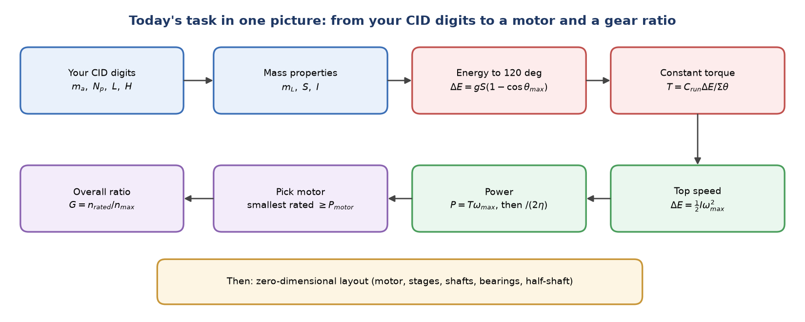
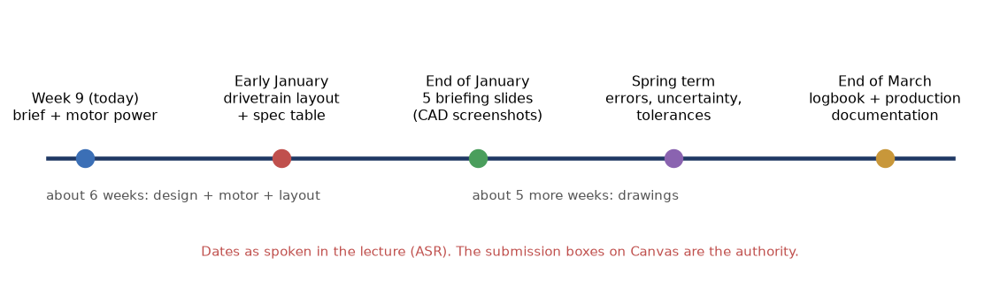
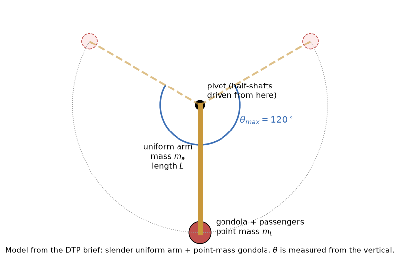
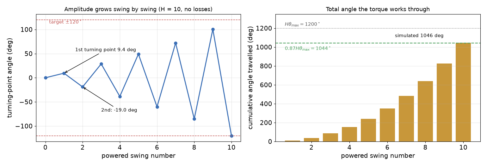
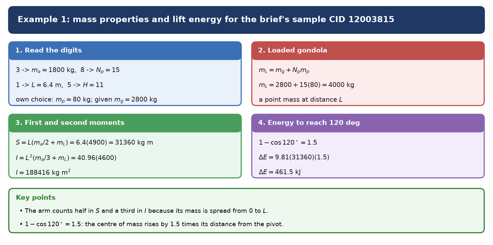
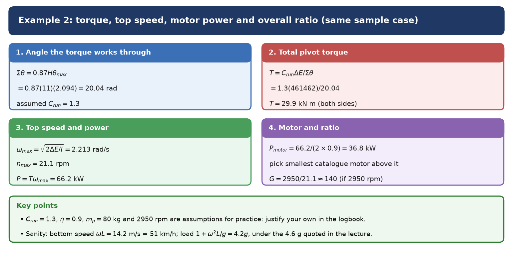
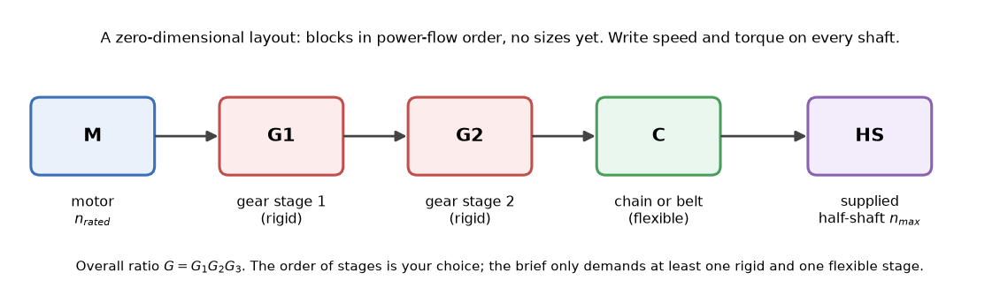

# MECH40007 Design and Manufacture 1 — The DTP Brief: Designing a Drivetrain for a Pendulum Ride

This note covers the Imperial College London first-year lecture ME MECH40007 Design and Manufacture 1 on 2026-11-23. The recording runs 59:57. Teaching runs from 03:03 to 52:10, and after that only students' questions to the lecturer are recorded. The note is written from the automatic transcript, because the video and slides could not be downloaded. The formulas come from the DTP brief PDF that is already in this workspace (version 20261120), because the lecturer said "these are the equations you will have to use" while showing a slide the transcript cannot show. Every formula below is marked with its source.

## What this lecture is about

This lecture launches the **DTP (Drive Transmission Project)**, the single piece of coursework that decides your Design and Manufacture 1 mark. The lecturer called it "your exam". You play the drivetrain specialist for a giant swinging pendulum ride. The head designer, the lecturer, has already designed the frame, the arm and the gondola. Your job is the motor and the gears, chains or belts between the motor and the pivot. Today's concrete goal is small: work out how much torque and power the ride needs, then pick a motor.

Figure 1. Today's calculation chain. Each box needs only the box before it. The chain follows the order the lecturer described: "once we've got the mass properties we can get a torque; once we have torque we can get power". Drawn for this note.

## 0. Chapter map

| Part | Time | Topic | Question it answers |
|---|---|---|---|
| 1 | 03:03–10:30 | IMechE Design Challenge invitation | What is the extra-curricular competition and should I join? |
| 2 | 10:30–13:31 | DTP timing | When is each submission due? |
| 3 | 13:31–19:34 | Design context: pendulum rides | What machine are we designing for and what can go wrong? |
| 4 | 19:34–29:30 | What needs to be done | What exactly must my drivetrain include? |
| 5 | 29:30–38:04 | Assessment and support | How is it marked and who helps me? |
| 6 | 38:04–47:05 | Where to start: mass, torque, power | How do I get from my CID to a power figure? |
| 7 | 47:05–52:10 | Motor choice, layout, advice | How do I pick a motor and sketch the layout? |

## 1. Invitation to the IMechE Design Challenge (03:03–10:30)

The lecturer leads Imperial's Racing Green student teams. He invited first-years to the **IMechE Design Challenge**, a competition run by the Institution of Mechanical Engineers in which universities build a small robot-like device. The transcript writes "iMac", an ASR error. Two years ago an Imperial first-year team built a small vehicle that had to drive to a target and return to exactly where it started; the most accurate wins. This year's device sounded like a "line launcher", which is uncertain in the transcript.

Why bother? His argument: nearly everyone gets top marks, so marks do not set you apart in a job interview. What interviewers want to hear about is soft skills: a teammate you clashed with, a supplier who let you down, parts that never turned up. Hands-on building is also something AI cannot yet do for you. It is extra work on top of the course, so join only if you can commit.

Practical details: teams need at least three people. The team leader emails him the names and CID numbers. There is a kick-off meeting in January, and the competition is usually around Easter, in March or April, depending on the host university. You will probably need to stay in London over the Easter break. He joked that UCL, whose first-year design project is this challenge, has beaten Imperial into second place every year, and he wants a team to finally win.

## 2. DTP timing (10:30–13:31)

Figure 2. The DTP timeline as spoken in the lecture. The submission boxes on Canvas are the authority if anything differs.

Today is week 9. The first submission, in the first week of January, is the **drivetrain layout** plus the specification table. At the end of January come the **briefing slides**. Over the six design weeks there are five lectures and six tutorials with your design tutor, plus CAD drop-in sessions in January. The second half of the spring term introduces errors, uncertainties and tolerances. At the very end, around the end of March, you submit the logbook and the **production documentation**, a set of drawings.

A warning about the logbook: much of the conduct-of-task mark depends on it. Scan it with your phone regularly from now on. If you lose the physical book and have no copy, you lose quite a few marks.

## 3. Design context: pendulum rides (13:31–19:34)

The idea came to the lecturer on holiday, on a pendulum ride with two huge motors overhead. He quoted UK customers spending almost £2 billion a year on amusement rides, with one such pendulum ride costing about £8–10 million. These figures are from the transcript and were not checked.

He then talked through a photo of a real ride's drivetrain at a theme park. The park and ride names are unclear in the transcript. The motor looked like 200–300 kW. A chain drive pulls the carriages, and there is a big gearbox. The motor shaft and the output shaft are at right angles, which points to **bevel gears**, the gears used between shafts at 90 degrees. The teeth are probably helical because of the high loads. A large hydraulic cylinder appears to move an idler sprocket to keep the chain tight. He stressed this was his own guess from a photo.

Things do go wrong. He mentioned two incidents in North America. In one, teenagers were stuck in the air for about half an hour. In the other, a Vancouver inspection report, staff heard loud bangs and found that one planet gear in a planetary gearbox had broken into pieces. So: get the drivetrain right.

The given design is modular, so customers can order a smaller or bigger ride. The brief's ranges are 7–16 passengers and a pivot-to-gondola distance of 6.0–9.6 m. The ride swings up to 120 degrees from the vertical on each side, not a full loop. A standard limits the acceleration at the bottom; the transcript gives 4.6 g. Two motors, one per side, drive a multi-stage transmission.

Figure 3. The calculation model from the brief: a slender uniform arm plus a point-mass gondola, swinging up to $\theta_{max}=120^{\circ}$ each side. Drawn for this note.

## 4. What needs to be done (19:34–29:30)

**Step A: the design brief.** Make a table of every input and decision: assigned data, operating requirements, fixed constraints. It works like a contract between you, the designer, and the customer. Many entries you will not know today; it is a **live document** that you update as you go. The lecturer will not hand you all the numbers. Many must come from your own research, with the reasoning written down.

**Operating requirements** means anything about how the drive will be used that changes the design. How long must it last? What safety factor? Is it clean or dirty, rained on, near strong magnetic fields? Just make a list of what matters.

The lecturer then asked for the name of the factor you multiply motor power by to get the **design power**. He could not recall it, and nobody in the room answered on the recording. In belt and chain selection catalogues this is usually called the **service factor**. That name is this note's interpretation, not something said in the lecture.

**Step B: the layout.** Start with a clear hand sketch of one side. The fixed rule is that the drivetrain must contain **at least one rigid stage and at least one flexible stage**. A **rigid drive** is gears: the shafts are locked together by meshing teeth. A **flexible drive** is a chain, an HTD toothed belt or a V-belt: a loop connects the shafts. The lecturer admitted this is not realistic, since real rides seldom have more than a two-stage gearbox. He wants you to practise both kinds.

**Two identical drivetrains, design one.** Seen from the top, a motor and multi-stage transmission sit on each side of the pivot and connect to a supplied **half-shaft**. You design one side only. In CAD you can mirror it to the other side. You may modify the half-shaft, for example lengthen it or change its diameter, as long as it still fits the ride. Everything must sit on the service platforms. That is not a written rule, but there is plenty of room.

What you do not need to design: a soft-start device is fitted, which keeps the design power down. Lubrication, guards and electronic control are already done. Manufacturing is limited to milling and turning, the workshop processes you have seen. No hot-rolled or forged parts.

## 5. Assessment and support (29:30–38:04)

There is a CAD progress test, three DTP submissions and a logbook submission, all already on Canvas. **Conduct of task** is 20% of the whole module. You earn it with the layout and with visible project management: an updated brief each week, meeting minutes from tutorials, and **action lists** that record who does what and when. The lecturer said that on big multi-company projects one company is sometimes hired only to keep these lists.

A key point: your numbers will not be marked. Partly because checking every logbook calculation is impractical, and partly because you may use AI for calculations. What is marked is how you record, organise and justify. The briefing slides at the end of January are five slides of CAD screenshots explaining how your design works, focused on shaft design and the bearing arrangement. The heaviest piece is the production documentation: assembly and manufacturing instructions.

Support comes mainly from your **design tutor**, who also marks you. Ten tutors have ten backgrounds and may give different advice. Follow your own tutor. This is not mathematics: an answer is right when its context is written down. Tutors can advise but cannot say "this is worth a 5 or a 6". Optional Lambda Feedback exercises cover parts of the assignment, and from January there is a Canvas Q&A for general questions about the assignment.

**AI-proofing the logbook.** Most of it must be in your own handwriting: sketches, calculations, iterations. If you use AI, print the prompt and the answer and stick them in, but not all the time. A logbook with no mistakes looks suspicious. The lecturer wants to see big red crosses over half a page: "this was wrong, start again on the next page".

**Individual input.** Your case comes from the last four digits of your **CID** (College ID number). The transcript writes "sed number" and "CI the number". Each digit picks one value from a table in the brief. The lecturer's example: last digit 5 gives 11 powered swings, which matches the brief's table. Because the motor catalogue has only a limited range, many students end up with the same motor.

| CID digit (from the end) | Quantity | Digit 0 | Step per digit | Digit 9 |
|---|---|---|---|---|
| 4th | Arm mass $m_a$ | 1200 kg | +200 kg | 3000 kg |
| 3rd | Passengers $N_p$ | 7 | +1 | 16 |
| 2nd | Pivot distance $L$ | 6.0 m | +0.4 m | 9.6 m |
| last | Powered swings $H$ | 6 | +1 | 15 |

The table is from the DTP brief (Table 1). A **powered swing** is one pass from one turning point to the opposite one, so a full there-and-back swing is two powered swings.

## 6. Where to start: mass, torque and power (38:04–47:05)

In plain words: the motor's job is to pump enough energy into the pendulum, a little on every swing, so that after $H$ swings it reaches 120 degrees. If you know how much energy that is, and over how much total angle the motor pushes, you know the torque. Torque times top speed gives power.

The lecturer said he first planned to use the full nonlinear second-order differential equations of the pendulum. He then simplified, because the full version made life more complicated than needed. The simplification: the motors apply a **constant torque** at the pivot during the run-up, always in the direction of motion. The motor reverses at each turning point.

### 6.1 Mass properties

From the brief, the **loaded gondola mass** is the empty gondola, $m_g=2800$ kg, plus the passengers:

$$m_L=m_g+N_pm_p$$

The passenger mass $m_p$ is yours to choose and justify. The **first mass moment** $S$ about the pivot is each mass times its distance from the pivot. The uniform arm's mass sits on average at its middle, $L/2$, and the gondola sits at $L$:

$$S=L\left(\frac{m_a}{2}+m_L\right)$$

The **mass moment of inertia** $I$ is each mass times its distance squared. For a slender uniform rod turning about one end this gives $m_aL^{2}/3$, and for a point mass at $L$ it gives $m_LL^{2}$:

$$I=L^{2}\left(\frac{m_a}{3}+m_L\right)$$

$S$ tells you how hard gravity pulls the pendulum back down. $I$ tells you how hard it is to spin up. The transcript calls them "first mass moment" and "second order of mass moment", where the lecturer said he needed more coffee.

### 6.2 Energy to reach 120 degrees

Raising the pendulum's centre of mass, which is at distance $S/m$ from the pivot, through angle $\theta$ lifts it by $(S/m)(1-\cos\theta)$. So the potential energy needed is:

$$\Delta E=gS\left(1-\cos\theta_{max}\right),\qquad 1-\cos120^{\circ}=1-(-0.5)=1.5$$

At 120 degrees the centre of mass is above the pivot, so it has risen 1.5 times its distance from the pivot.

### 6.3 The constant-torque energy method

For straight-line motion, work is force times distance. For rotation, work is torque times **angular displacement** $\theta$ in radians. A constant torque $T$ pushing through a total angle $\Sigma\theta$ does work $T\,\Sigma\theta$.

The lecturer said this is the only part you really need to get your head around. The total angle is not just 120 degrees. It is the sum of every swing. He showed a short video with 10 powered swings: the first swing reaches about 9 degrees, then it swings all the way back to about −19 degrees, so after two swings the angle travelled is already 37 degrees. The amplitude grows swing after swing, and the angle travelled keeps adding up.

The brief approximates the total as:

$$\Sigma\theta\approx0.87\,H\,\theta_{max}$$

Where does 0.87 come from? It is not explained in the lecture or the brief, so this note checked it by simulation. Assume constant torque, no losses, a start at rest at the bottom, and energy at each turning point equal to the work done so far. Choose the torque so that swing $H$ ends at exactly 120 degrees. For $H=6$, 10, 11 and 15 the ratio $\Sigma\theta/(H\theta_{max})$ comes out as 0.874, 0.871, 0.871 and 0.871. The same simulation with $H=10$ gives a first turning point of 9.4 degrees, a second of −19.0 degrees, and 37.8 degrees travelled after two swings. That matches the lecturer's "nine, minus nineteen, thirty-seven".

Figure 4. Energy simulation of the run-up, done for this note. The left panel reproduces the lecturer's spoken numbers. The right panel shows why $\Sigma\theta$ is about 0.87 of $H\theta_{max}$ rather than all of it: the early swings are small.

Real rides lose energy every swing. The lecturer asked the class what makes the system imperfect: damping, friction in the pivot bearings, losses in the drivetrain, and air resistance, since the gondola reaches about 60–70 km/h. The brief covers these with a **run-up allowance** $C_{run}>1$, which multiplies the energy needed:

$$\Delta E=\frac{T_{total}\,\Sigma\theta}{C_{run}}\quad\Rightarrow\quad T_{total}=\frac{C_{run}\,\Delta E}{\Sigma\theta}$$

How big should $C_{run}$ be: 5% extra, 50% extra? That is your design choice. Research it and write the reference in your logbook. Do not just write "15%"; write why.

### 6.4 Top speed, power, motor and ratio

All the energy pumped in shows up as kinetic energy at the bottom of the swing, where the speed is greatest:

$$\Delta E=\frac{1}{2}I\omega_{max}^{2}\quad\Rightarrow\quad\omega_{max}=\sqrt{\frac{2\Delta E}{I}},\qquad n_{max}=\frac{60\,\omega_{max}}{2\pi}$$

The required power is the torque at the highest speed. There are two motors, each with a drivetrain efficiency $\eta$, so each motor must supply:

$$P_{required}=T_{total}\,\omega_{max},\qquad P_{motor}=\frac{P_{required}}{2\eta}$$

The lecturer warned that you do not know $\eta$ yet, because you have not chosen chains, belts or gears. You still need a number now, so assume one and come back later. Design is "two steps forward, one step back". Build an Excel calculator so that when an assumption changes, everything updates.

Finally, pick the smallest motor in the catalogue whose rating is at least $P_{motor}$. The brief specifies 2-pole AC induction motors. Then the overall transmission ratio is motor rated speed over pendulum top speed:

A note on the motor type: an **AC induction motor** is the common mains-powered industrial motor. "2-pole" means that on a 50 Hz supply its magnetic field turns at 3000 rpm, and the shaft runs a little slower, typically around 2900–2950 rpm at full load. The exact rated speed is in the catalogue.

$$G=\frac{n_{rated}}{n_{max}}$$

| Item | Formula card: from energy to motor |
|---|---|
| Formulas | $\Delta E=gS(1-\cos\theta_{max})$; $T_{total}=C_{run}\Delta E/\Sigma\theta$; $\omega_{max}=\sqrt{2\Delta E/I}$; $P_{motor}=T_{total}\omega_{max}/(2\eta)$; $G=n_{rated}/n_{max}$ |
| Symbols | $g$ 9.81 m/s²; $S$ kg m; $I$ kg m²; $\Sigma\theta$ in rad; $T_{total}$ N m (both sides together); $\omega_{max}$ rad/s; $n$ rpm; $\eta$ no units |
| Conditions | Constant-torque model, losses lumped into $C_{run}$; slender arm plus point-mass gondola; two equal drives |
| Steps | Mass properties, then energy, then torque, then speed, then power, then motor, then ratio |
| Common error | Leaving $\Sigma\theta$ in degrees: 1150 instead of 20.04 rad makes the torque 57 times too small |

### Example 1. Mass properties and lift energy

**What is asked**

Use the sample CID from the brief, 12003815. Its last four digits are 3, 8, 1, 5. Find the loaded gondola mass, the first mass moment, the moment of inertia, and the energy to lift the pendulum to 120 degrees. Passenger mass is an assumption, taken as 80 kg here.

$$m_a=1800\ \text{kg},\quad N_p=15,\quad L=6.4\ \text{m},\quad m_g=2800\ \text{kg},\quad m_p=80\ \text{kg}$$

**Why this route**

Every later number (torque, speed, power) needs $S$, $I$ and $\Delta E$, so they come first. Using the brief's lumped model, a uniform arm plus a point mass, means three short formulas instead of an integral over a real CAD shape. That is the level of accuracy the DTP asks for.

**Step 1: read the digits and find the gondola mass**

Read each digit from the table in Part 5: 3 gives 1800 kg, 8 gives 15 passengers, 1 gives 6.4 m, 5 gives 11 swings.

$$m_L=2800+15\times80=4000\ \text{kg}$$

**Step 2: find S and I**

$$S=6.4\times\left(\frac{1800}{2}+4000\right)=6.4\times4900=31\,360\ \text{kg m}$$

$$I=6.4^{2}\times\left(\frac{1800}{3}+4000\right)=40.96\times4600=188\,416\ \text{kg m}^{2}$$

**Step 3: find the lift energy**

$$\Delta E=9.81\times31\,360\times1.5=461\,462\ \text{J}\approx461.5\ \text{kJ}$$

**Where the constant comes from**

The $1/2$ in $S$ is because a uniform arm's mass is centred at its midpoint. The $1/3$ in $I$ comes from integrating $r^{2}$ along a uniform rod from 0 to $L$: $\int_0^L r^{2}\,dr=L^{3}/3$. The 1.5 is $1-\cos120^{\circ}$. The 2800 kg empty gondola mass is fixed by the brief.

**Sanity check**

The centre of mass is at $S/(m_a+m_L)=31\,360/5800=5.41$ m from the pivot, between the arm's midpoint (3.2 m) and the gondola (6.4 m), and close to the heavy gondola, as expected. Lifting 5800 kg by $1.5\times5.41=8.1$ m takes $5800\times9.81\times8.1=461$ kJ, the same energy by a second route.

**Answer**

$$m_L=4000\ \text{kg},\quad S=31\,360\ \text{kg m},\quad I=188\,416\ \text{kg m}^{2},\quad\Delta E\approx461.5\ \text{kJ}$$

**Trap**

Using $1-\cos120^{\circ}=0.5$ by forgetting that $\cos120^{\circ}$ is negative gives one third of the true energy, 154 kJ. Using $m_aL^{2}/12$, the moment of inertia of a rod about its centre, instead of $m_aL^{2}/3$ about its end underestimates $I$.

Exam tip: this is your design specification table's first block. Write the values and the reason for $m_p$ in the logbook.

### Example 2. Torque, top speed, motor power and overall ratio

**What is asked**

Continue with the same sample case. The assumptions below are practice values that you must replace with your own justified choices: run-up allowance $C_{run}=1.3$, drivetrain efficiency $\eta=0.9$, and a 2-pole motor rated speed of 2950 rpm. Find the total pivot torque, the top speed, the power per motor and the overall ratio.

$$\Delta E=461\,462\ \text{J},\quad I=188\,416\ \text{kg m}^{2},\quad H=11,\quad\theta_{max}=\frac{2\pi}{3}\ \text{rad}$$

**Why this route**

The brief's constant-torque energy method needs only energy and total angle, not the swing-by-swing dynamics. It turns a nonlinear differential equation into arithmetic. We then reuse $\Delta E$ for the top speed, so no new physics is needed.

**Step 1: find the total angle in radians**

$$\Sigma\theta=0.87\times11\times\frac{2\pi}{3}=9.57\times2.094=20.04\ \text{rad}$$

**Step 2: find the total pivot torque**

$$T_{total}=\frac{C_{run}\,\Delta E}{\Sigma\theta}=\frac{1.3\times461\,462}{20.04}=29\,930\ \text{N m}\approx29.9\ \text{kN m}$$

**Step 3: find the top speed and the power**

$$\omega_{max}=\sqrt{\frac{2\times461\,462}{188\,416}}=\sqrt{4.898}=2.213\ \text{rad/s},\qquad n_{max}=\frac{60\times2.213}{2\pi}=21.1\ \text{rpm}$$

$$P_{required}=29\,930\times2.213=66.2\ \text{kW},\qquad P_{motor}=\frac{66.2}{2\times0.9}=36.8\ \text{kW}$$

**Step 4: choose the motor and the ratio**

Pick the smallest motor in the Canvas catalogue rated at least 36.8 kW. The catalogue was not available for this note. If its sizes follow the common IEC steps, that would be a 37 kW motor. Then:

$$G=\frac{n_{rated}}{n_{max}}=\frac{2950}{21.1}\approx140$$

**Where the constant comes from**

The 0.87 is the brief's run-up factor, verified by the simulation in Figure 4. The 2 in $2\eta$ is the two motors sharing the load equally. The $2\pi/3$ is 120 degrees in radians. The 60 and $2\pi$ convert rad/s to rpm.

**Sanity check**

Bottom speed of the gondola: $\omega_{max}L=2.213\times6.4=14.2$ m/s, which is 51 km/h. That is plausible against the lecturer's 60–70 km/h for the largest rides. Load felt at the bottom: $1+\omega_{max}^{2}L/g=1+31.3/9.81=4.2$ g, below the 4.6 g limit quoted in the lecture. This 4.2 g check is this note's own addition. A ratio of about 140 is too much for one gear pair, which explains why the brief expects a multi-stage drive.

**Answer**

$$T_{total}\approx29.9\ \text{kN m},\quad n_{max}\approx21.1\ \text{rpm},\quad P_{motor}\approx36.8\ \text{kW each},\quad G\approx140$$

**Trap**

Forgetting to divide by 2 for two motors picks a motor twice too big, 73.6 kW. Forgetting $C_{run}$ undersizes the torque by 30%. Using degrees in $\Sigma\theta$ gives a torque of only 522 N m. And do not agonise over 15% versus 16.5%: the lecturer's advice was that perfect is the enemy of good.

Technique: keep the whole chain in one spreadsheet, so a new $\eta$ or $C_{run}$ updates the motor choice in one click.

## 7. Motor choice, layout and advice (47:05–52:10)

The lecturer's slide example needed 72 kW, divided by an efficiency figure, and he picked the motor just above it. The transcript says "80", which may be a catalogue size or an ASR error. The rule is the one in Example 2: the closest motor that is big enough.

Next comes the **zero-dimensional layout**, drawn by hand. Use simple block symbols for the motor and each transmission stage, in power-flow order, with no sizes yet. Write the speed and torque on every shaft. Last year's example was motor, **spur gear** first stage, spur gear second stage, and finally a chain or belt drive. The last item is garbled in the transcript as "double drive". The lecture notes contain more layouts, for a motorbike and for a Tesla car, and there was a similar Lambda exercise.

Figure 5. What a zero-dimensional layout means: blocks in power-flow order, no dimensions. The order of stages here is only an illustration. Drawn for this note; use the symbols recommended in the lecture notes.

The overall ratio is shared between the stages: $G=G_1G_2G_3$. With $G\approx140$, for example, three stages of about 5.2 each would do, since $5.2^{3}\approx140$.

His closing advice, in order of importance. This is the only assessment in DMF1, so the brief is long; take time to absorb it. You have six weeks, so do not panic if you do not finish the motor selection in the first tutorial. Estimates are fine if you give their context. Do not keep redesigning ("chain first, no, gears first"): the order makes no difference, so decide and start calculating. Before the tutorial, read the brief, note your deadlines, and get going with the numbers.

## Pitfalls and look-alikes

| Easily confused | The difference | Wrong result if mixed up |
|---|---|---|
| $S$ vs $I$ | $S=\sum mr$ (gravity, energy); $I=\sum mr^{2}$ (spin-up, top speed) | Top speed wrong if $S$ is used in $\frac{1}{2}I\omega^{2}$ |
| Arm $1/2$ vs $1/3$ | $1/2$ in $S$ (midpoint); $1/3$ in $I$ (rod about its end) | $I$ wrong by tens of percent |
| $\theta_{max}$ vs $\Sigma\theta$ | 120 degrees is the target; $\Sigma\theta$ is the total angle the torque works through | Torque about 9.6 times too big with $H=11$ |
| Required power vs motor power | $P_{motor}=P_{required}/(2\eta)$ | Motor twice too big, or too small if $\eta$ is ignored |
| Rigid vs flexible drive | Gears vs chain or belt; the DTP needs at least one of each | Layout rejected |
| Numbers vs process | Numbers are not marked; recording and justification are | Effort spent in the wrong place |

## Chapter summary and review sheet

| What | Key formula or rule | Source |
|---|---|---|
| Gondola mass | $m_L=m_g+N_pm_p$, $m_g=2800$ kg | Brief 4.1 |
| First mass moment | $S=L(m_a/2+m_L)$ | Brief 4.1 |
| Moment of inertia | $I=L^{2}(m_a/3+m_L)$ | Brief 4.1 |
| Lift energy | $\Delta E=gS(1-\cos\theta_{max})$, $\theta_{max}=120^{\circ}$ | Brief 4.3; lecture 40:32 |
| Total angle | $\Sigma\theta\approx0.87H\theta_{max}$ | Brief 4.2; lecture 42:02 |
| Torque | $T_{total}=C_{run}\Delta E/\Sigma\theta$ | Brief 4.3; lecture 44:00 |
| Top speed | $\Delta E=\frac{1}{2}I\omega_{max}^{2}$ | Brief 4.3; lecture 41:05 |
| Motor power | $P_{motor}=T_{total}\omega_{max}/(2\eta)$ | Brief 4.3; lecture 45:34 |
| Ratio | $G=n_{rated}/n_{max}$ | Brief 4.3 |
| Drive rule | At least one rigid and one flexible stage | Lecture 26:32 |

To-do for this week: read the brief; write your four input values from your CID; choose and justify $m_p$, $C_{run}$ and $\eta$; compute $P_{motor}$; pick a motor; start the logbook and the live specification table.

Memory trick: "Mass, energy, torque, speed, power, motor, ratio: each one needs only the one before."

## Sources and open items

Sources: (1) the automatic transcript of "ME MECH40007 Design and Manufacture 1 (2026-11-23)", 59:57, from Panopto. The video returned HTTP 403, so no slide was seen. (2) The DTP brief PDF (course material, not included in this repository), "ME1 DMF DTP Assignment, Design & Manufacture, Academic Year 2026-27", version 20261120, used for formulas, the CID table and the scope rules. All figures are drawn for this note. The 0.87 check and the 4.2 g check are this note's own calculations.

Chapter label Ch9: the lecturer did not mention a lecture-notes chapter. He said "this is where we are, week nine", and the brief sits under "Week 9 DTP assignment" on Canvas. So "Ch9" here means week 9, not a chapter of the notes. This is also the first note in the "MECH40007 Design and Manufacture 1" folder.

ASR doubts, each judged from context:

| Time | Transcript says | Judged as |
|---|---|---|
| 03:32 | "iMac Design Challenge" | IMechE Design Challenge |
| 04:05 | "repeating car" | A small vehicle that returns to its start; exact name uncertain |
| 04:37 | "a line launcher" | This year's device; uncertain |
| 07:00 | "a bit of GTP" | Unclear; possibly DTP |
| 07:00 | "S.W. hex space", "pit garage" | Workshop spaces; names uncertain. The brief says "STW-level manufacturing" |
| 14:34 | "Fruit Park", "Hyperion" | Theme park and ride names unclear |
| 16:30 | "Oak Park" | Incident location unclear |
| 19:00 | "4.6 G", "reliable lidar and some motors" | 4.6 g acceleration limit; probably "reliable AC induction motors" (the brief says 2-pole AC induction) |
| 25:05–25:37 | factor for design power, name not recalled | Probably the service factor; this note's interpretation |
| 26:32 | "Could be HDD" | HTD toothed belt |
| 36:31 | "sed number", "CI the number" | CID number |
| 39:35 | "Christmas coming" | Unclear aside |
| 42:34–43:00 | "nine degrees", "-19", "37" | Matches the simulation: 9.4, −19.0, 37.8 degrees |
| 47:35 | "less to 80" | Motor size chosen above 72 kW; exact value uncertain |
| 48:31 | "finally a double drive" | Probably a chain or belt drive |
| 48:31 | "Terminators motor bike" | A motorbike layout example in the notes; name uncertain |
