# MECH40008 Computing 1 — Progress Test and Exam Review (Lectures 1–7)

> **Course**: MECH40008 Mathematics and Computing 1, programming stream (Python).
> **Scope**: everything in Canvas course 9711, Computing modules — chapters 1 to 5 in depth, chapters 6 and 7 at the level the example sheets demand.
> **Exams**: progress test 9 December, CAGB 200, 45 minutes, first five lectures, half gym and half problem set, compulsory but not graded; final 19 March at 09:30, 90 minutes, closed book, with a data and syntax sheet supplied.
> **Date**: 2026-11-22, rebuilt from Canvas. **Sources**: the course-information sheet, the official 139-page notes, the Introductory Examples Sheet and Sheets 1 to 4, published solutions for the introductory sheet and Sheet 1, and the five online gyms.
> **Structure**: section 0 how to use this review, then chapters 1 to 7, then the Canvas question map and the Canvas sheet solutions, then tracing drills, simulated paper A, mixed questions, where marks are lost, the last thirty minutes, the one-page revision sheet, the answer key, the coverage table and the glossary.

## Contents

- [How to use this review](#how-to-use-this-review)
  - [0.1 Where the scope comes from](#01-where-the-scope-comes-from)
  - [0.2 Spending forty-five minutes](#02-spending-forty-five-minutes)
  - [0.3 Three habits](#03-three-habits)
  - [0.4 What past papers exist](#04-what-past-papers-exist)
- [Question-type map](#question-type-map)
  - [0.5 What Canvas actually says about the exam](#05-what-canvas-actually-says-about-the-exam)
  - [Canvas question map](#canvas-question-map)
- [Types and floating point: why 0.1 + 0.2 is not 0.3](#types-and-floating-point-why-01-02-is-not-03)
  - [1.1 What this chapter is about](#11-what-this-chapter-is-about)
  - [1.2 Mechanisms you must know](#12-mechanisms-you-must-know)
  - [1.3 What the code looks like](#13-what-the-code-looks-like)
  - [1.4 Worked example E1: a value of 35000 that will not fit in a 16-bit register](#14-worked-example-e1-a-value-of-35000-that-will-not-fit-in-a-16-bit-register)
  - [1.4b How this chapter is examined](#14b-how-this-chapter-is-examined)
  - [1.5 Multiple-choice questions (8)](#15-multiple-choice-questions-8)
  - [1.6 Chapter traps](#16-chapter-traps)
- [Variables and functions: names, return and scope](#variables-and-functions-names-return-and-scope)
  - [2.1 What this chapter is about](#21-what-this-chapter-is-about)
  - [2.2 Mechanisms you must know](#22-mechanisms-you-must-know)
  - [2.3 What the code looks like](#23-what-the-code-looks-like)
  - [2.4 Worked example E2: a unit error of 4.45 and a lost spacecraft](#24-worked-example-e2-a-unit-error-of-445-and-a-lost-spacecraft)
  - [2.4b How this chapter is examined](#24b-how-this-chapter-is-examined)
  - [2.5 Multiple-choice questions (8)](#25-multiple-choice-questions-8)
  - [2.6 Chapter traps](#26-chapter-traps)
- [Control flow: the order of branches is the logic](#control-flow-the-order-of-branches-is-the-logic)
  - [3.1 What this chapter is about](#31-what-this-chapter-is-about)
  - [3.2 Mechanisms you must know](#32-mechanisms-you-must-know)
  - [3.3 What the code looks like](#33-what-the-code-looks-like)
  - [3.4 Worked example E3: one false signal and a lost lander](#34-worked-example-e3-one-false-signal-and-a-lost-lander)
  - [3.4b How this chapter is examined](#34b-how-this-chapter-is-examined)
  - [3.5 Multiple-choice questions (8)](#35-multiple-choice-questions-8)
  - [3.6 Chapter traps](#36-chapter-traps)
- [Data structures: lists, dictionaries, tuples and aliasing](#data-structures-lists-dictionaries-tuples-and-aliasing)
  - [4.1 What this chapter is about](#41-what-this-chapter-is-about)
  - [4.2 Mechanisms you must know](#42-mechanisms-you-must-know)
  - [4.3 What the code looks like](#43-what-the-code-looks-like)
  - [4.4 Worked example E4: Challenger and what "failure rate" means](#44-worked-example-e4-challenger-and-what-failure-rate-means)
  - [4.4b How this chapter is examined](#44b-how-this-chapter-is-examined)
  - [4.5 Multiple-choice questions (8)](#45-multiple-choice-questions-8)
  - [4.6 Chapter traps](#46-chapter-traps)
- [Algorithms and complexity: Big-O, search and sorting](#algorithms-and-complexity-big-o-search-and-sorting)
  - [5.1 What this chapter is about](#51-what-this-chapter-is-about)
  - [5.2 Mechanisms you must know](#52-mechanisms-you-must-know)
  - [5.3 What the code looks like](#53-what-the-code-looks-like)
  - [5.4 Worked example E5: search the likeliest patch of ocean first](#54-worked-example-e5-search-the-likeliest-patch-of-ocean-first)
  - [5.4b How this chapter is examined](#54b-how-this-chapter-is-examined)
  - [5.5 Multiple-choice questions (8)](#55-multiple-choice-questions-8)
  - [5.6 Chapter traps](#56-chapter-traps)
- [NumPy and matplotlib: the parts Sheets 3 and 4 use](#numpy-and-matplotlib-the-parts-sheets-3-and-4-use)
  - [6.1 Arrays do arithmetic element by element](#61-arrays-do-arithmetic-element-by-element)
  - [6.2 Matrices: the star is elementwise, the at sign is matrix product](#62-matrices-the-star-is-elementwise-the-at-sign-is-matrix-product)
  - [6.3 Plotting data you did not invent](#63-plotting-data-you-did-not-invent)
  - [Example E6: eighty pulses without eighty loops](#example-e6-eighty-pulses-without-eighty-loops)
- [Scientific Python: functions that return, random numbers and pandas](#scientific-python-functions-that-return-random-numbers-and-pandas)
  - [7.1 Functions that return, loops that accumulate](#71-functions-that-return-loops-that-accumulate)
  - [7.2 Random numbers, Monte Carlo, and the square-root law](#72-random-numbers-monte-carlo-and-the-square-root-law)
  - [7.3 pandas: split, apply, combine in one call](#73-pandas-split-apply-combine-in-one-call)
  - [Example E7: Buffon's needle and the square-root law](#example-e7-buffons-needle-and-the-square-root-law)
- [Canvas sheet solutions: every part, with the number it prints](#canvas-sheet-solutions-every-part-with-the-number-it-prints)
  - [S0Q1: names, operators and type errors](#s0q1-names-operators-and-type-errors)
  - [S0Q2: branches in order, and the three arguments of range](#s0q2-branches-in-order-and-the-three-arguments-of-range)
  - [S0Q3: a function that returns, a loop that calls it](#s0q3-a-function-that-returns-a-loop-that-calls-it)
  - [S0Q4: linspace, one plot, and a function called in a loop](#s0q4-linspace-one-plot-and-a-function-called-in-a-loop)
  - [S0Q5: a forty-year simulation, then a plot, then a function](#s0q5-a-forty-year-simulation-then-a-plot-then-a-function)
  - [S1Q1: cancellation, and the one rearrangement that fixes it](#s1q1-cancellation-and-the-one-rearrangement-that-fixes-it)
  - [S1Q2: addition is not associative](#s1q2-addition-is-not-associative)
  - [S1Q3: print versus return, and a margin that never updates](#s1q3-print-versus-return-and-a-margin-that-never-updates)
  - [S1Q4: range, crossover speed and the battery you cannot buy](#s1q4-range-crossover-speed-and-the-battery-you-cannot-buy)
  - [S2Q1: one list shared by every instance](#s2q1-one-list-shared-by-every-instance)
  - [S2Q2: a next-word dictionary, then entropy](#s2q2-a-next-word-dictionary-then-entropy)
  - [S2Q3: counting zeros and finding the longest run are different questions](#s2q3-counting-zeros-and-finding-the-longest-run-are-different-questions)
  - [S2Q4: a greedy plan is not the fastest plan](#s2q4-a-greedy-plan-is-not-the-fastest-plan)
  - [S3Q1: eighty pulses, drawn in an order that occludes correctly](#s3q1-eighty-pulses-drawn-in-an-order-that-occludes-correctly)
  - [S3Q2: three duplicate checks, three different costs](#s3q2-three-duplicate-checks-three-different-costs)
  - [S3Q3: rotating a stress tensor and checking it did not cheat](#s3q3-rotating-a-stress-tensor-and-checking-it-did-not-cheat)
  - [S3Q4: latitude, longitude, and a histogram that hides a choice](#s3q4-latitude-longitude-and-a-histogram-that-hides-a-choice)
  - [S4Q1: ten-dimensional Monte Carlo, and why a grid cannot compete](#s4q1-ten-dimensional-monte-carlo-and-why-a-grid-cannot-compete)
  - [S4Q2: one groupby, one agg, three columns](#s4q2-one-groupby-one-agg-three-columns)
  - [S4Q3: two printed outputs the sheet's own dictionary cannot produce](#s4q3-two-printed-outputs-the-sheets-own-dictionary-cannot-produce)
  - [S4Q4: Buffon's needle, and the square-root law on one plot](#s4q4-buffons-needle-and-the-square-root-law-on-one-plot)
  - [S4Q5: peak grows, energy does not](#s4q5-peak-grows-energy-does-not)
  - [Canvas gyms and the shape of a gym question](#canvas-gyms-and-the-shape-of-a-gym-question)
- [Tracing drills](#tracing-drills)
  - [D1 A loop with an accumulator and a skip](#d1-a-loop-with-an-accumulator-and-a-skip)
  - [D2 Alias, slice copy and one list](#d2-alias-slice-copy-and-one-list)
  - [D3 A while loop that stops early](#d3-a-while-loop-that-stops-early)
  - [D4 One dictionary, two names](#d4-one-dictionary-two-names)
  - [D5 What may change inside a tuple or a string](#d5-what-may-change-inside-a-tuple-or-a-string)
- [Simulated paper A](#simulated-paper-a)
  - [A1 Types, floor division and float comparison](#a1-types-floor-division-and-float-comparison)
  - [A2 A mutable default argument and a fixed version](#a2-a-mutable-default-argument-and-a-fixed-version)
  - [A3 A loop that skips and stops](#a3-a-loop-that-skips-and-stops)
  - [A4 One grid, three names](#a4-one-grid-three-names)
- [Twelve mixed questions](#twelve-mixed-questions)
- [Where marks are lost](#where-marks-are-lost)
- [The last thirty minutes](#the-last-thirty-minutes)
- [One-page revision sheet](#one-page-revision-sheet)
  - [7.1 Formula card](#71-formula-card)
  - [7.2 Complexity table](#72-complexity-table)
  - [7.3 Trap list, to read five minutes before the test](#73-trap-list-to-read-five-minutes-before-the-test)
- [Answer key](#answer-key)
- [Coverage table](#coverage-table)
- [Canvas sheet coverage](#canvas-sheet-coverage)
- [Glossary](#glossary)
- [Self-check](#self-check)

## How to use this review

### 0.1 Where the scope comes from

In the 13 November lecture the lecturer said the 9 December progress test **covers the first five lectures of this term** and takes about 45 minutes. Half of it is gym material, half is problem-set-style work, and starred challenge questions are normally not examined. The final exam is on 19 March at 09:30 and runs for 90 minutes with a similar structure.

Canvas course 9711 is now the source of truth for this review. Its Computing module holds fourteen files and six links: the one-page course and exam information, the official 139-page notes, one 26-page problem-set PDF containing the Introductory Examples Sheet and Examples Sheets 1 to 4, published solutions for the introductory sheet and for Sheet 1 only, the lecture annotations, a notebook, and five online gyms. The 9 December progress test covers the first five lectures; the March final covers all nine, and Sheets 3 and 4 already use NumPy, matplotlib and random sampling, so lectures 6 and 7 cannot honestly be left out.

So this review is layered rather than narrowed: chapters 1 to 5 get the full treatment, and chapters 6 and 7 get exactly the machinery that Sheets 3 and 4 ask for, linked to the two lecture notes that cover them in full.

### 0.2 Spending forty-five minutes

| Stage | Time | What to do |
| --- | --- | --- |
| First pass | 25 min | Work down the paper, bank the predict-the-output and find-the-bug questions |
| Second pass | 12 min | Come back for concept discrimination and complexity questions |
| Finish | 8 min | Check boundaries: half-open ranges, $\ge$ versus $>$, $\text{None}$ versus empty |

A workable rhythm for the whole paper: first sweep the questions you can already do and bank the predict-the-output and find-the-bug marks, then come back to the concept and complexity items, and leave the last few minutes for boundary checks such as inclusive versus exclusive limits and None versus empty.

| --- | --- | --- |

Predict-the-output questions must be done on paper. Verify each answer two independent ways: substitute an endpoint, and check the order of magnitude.

### 0.3 Three habits

1. **Name the type before you compute**: a $/$ always returns a float, and $\text{print}$ always returns $\text{None}$.
2. **Name the structure before you discuss the algorithm**: "is this a list, a dictionary or a set" is worth more marks than "how do I write the loop".
3. **Count the innermost statement**: every complexity answer comes from how many times that one line runs.

### 0.4 What past papers exist

There are no past exam papers to cite, and I am not going to pretend otherwise. Canvas holds no earlier Computing exam paper: the only assessment material is the course-information sheet, the official notes, six example sheets, two published solution PDFs and five gyms. The shared Mechnet archive has no Computing folder at all. So every question in this review that is not a Canvas question is labelled as written to the same style, and every solution to Sheets 2 to 4 is my own work, because Canvas publishes none.

---

## Question-type map

Every question on a forty-five-minute paper is one of about twenty shapes. The table below is the whole map: read the wording in the second column, recognise it, and the third column tells you what to write first. If a question does not fit any row, it is a combination of two rows, so split it into two and answer each half with its own route.

| --- | --- | --- | --- | --- |

Three habits make this table usable under time pressure. First, name the chapter before answering, because the chapter tells you which formula or which object rule applies. Second, write the first stroke from the fourth column even when you are unsure of the answer: a stated route earns method marks. Third, when a question spans two rows, answer them in order and keep the two answers visibly separate, so a marker can award them independently.

### 0.5 What Canvas actually says about the exam

The course-information sheet is one page long and settles the logistics in a way a lecture recap does not. Progress test: 9 December, CAGB 200, 45 minutes, covering the first five lectures, half gym-style and half problem-set-style, compulsory but not counting towards the grade.

Marks: 20 per cent from three of your four tutorial participations, 80 per cent from the final examination. Final: 19 March at 09:30, 90 minutes, in CAGB 203, 761 and 762, closed book, pen and paper, with a data and syntax sheet supplied.

The exam repeats the test structure: half gym-style, half problem-set-style. Two starred rules matter. In a gym the last few challenge questions are not examinable. In a problem sheet the starred parts are not examinable without hints, which in an exam means not examinable.

Two support dates belong in a calendar: progress-test feedback at 13:00 on 4 January in CAGB 664, and the exam revision session at noon on 8 March in CAGB 664.

Read this as a constraint on practice rather than trivia: an hour spent on a starred part is an hour taken from the unstarred half that carries the marks. Everything in this review that is not marked starred is practice that can pay off on the day.

### Canvas question map

One row per part, 68 rows in all, with the chapter that teaches it and the solution block that answers it. Sheet 0 is the introductory sheet; sheets 1 to 4 are the four exam-style sheets. Starred parts are listed so you can see what you are skipping, not so that you practise them.

| Sheet | Q | Part | What the part drills | Ch | Star | Solution |
| --- | --- | --- | --- | --- | --- | --- |
| S0 | 1 | i | unquoted word raises NameError | 2.2 | no | S0Q1 |
| S0 | 1 | ii | operators including the power operator | 1.2 | no | S0Q1 |
| S0 | 1 | iii | str plus int raises TypeError | 1.2 | no | S0Q1 |
| S0 | 1 | iv | input returns text, so add numbers with int | 1.2 | yes | S0Q1 |
| S0 | 2 | i | if, elif, else and the boundary at 25 and 10 | 3.2 | no | S0Q2 |
| S0 | 2 | ii | range start, stop and step | 3.2 | no | S0Q2 |
| S0 | 2 | iii | an if inside a loop | 3.2 | yes | S0Q2 |
| S0 | 3 | i | a function that returns a value | 2.2 | no | S0Q3 |
| S0 | 3 | ii | a loop that calls a function | 3.2 | no | S0Q3 |
| S0 | 3 | iii | thresholds inside a classifier | 2.2 | yes | S0Q3 |
| S0 | 4 | i | linspace, array arithmetic and one plot | 6.1 | no | S0Q4 |
| S0 | 4 | ii | two curves and a legend | 6.1 | no | S0Q4 |
| S0 | 4 | iii | a plotting function called in a loop | 6.1 | yes | S0Q4 |
| S0 | 5 | i | repayment function with max | 7.1 | yes | S0Q5 |
| S0 | 5 | ii | forty-year simulation loop | 7.1 | yes | S0Q5 |
| S0 | 5 | iii | plotting a list built in a loop | 6.1 | yes | S0Q5 |
| S0 | 5 | iv | wrapping the simulation in a function | 7.1 | yes | S0Q5 |
| S1 | 1 | - | cancellation in sqrt of x squared plus one minus x | 1.4 | no | S1Q1 |
| S1 | 2 | i | addition is not associative in floating point | 1.2 | no | S1Q2 |
| S1 | 2 | ii | shuffled sums give many totals | 1.2 | no | S1Q2 |
| S1 | 2 | iii | chunked sums depend on the chunk size | 1.2 | yes | S1Q2 |
| S1 | 2 | iv | batch invariance and what the fix costs | 1.2 | yes | S1Q2 |
| S1 | 3 | i | trace a function that prints instead of returning | 3.2 | no | S1Q3 |
| S1 | 3 | ii | scope of local assignment and return versus print | 2.2 | no | S1Q3 |
| S1 | 3 | iii | rewrite add_reserve so the margin is correct | 2.2 | no | S1Q3 |
| S1 | 4 | i | crossover speed by balancing drag and rolling resistance | 2.3 | no | S1Q4 |
| S1 | 4 | ii | range at two speeds against 660 km | 2.3 | no | S1Q4 |
| S1 | 4 | iii | battery capacity required at 70 mph | 2.3 | yes | S1Q4 |
| S2 | 1 | i | class attribute shared by every instance | 4.2 | no | S2Q1 |
| S2 | 1 | ii | one line in init to give each instance its own list | 4.2 | no | S2Q1 |
| S2 | 1 | iii | bump_until returns a count | 4.2 | yes | S2Q1 |
| S2 | 2 | i | build a next-word dictionary with lists | 4.2 | no | S2Q2 |
| S2 | 2 | ii | missing key, empty list, and a safe accessor | 4.2 | no | S2Q2 |
| S2 | 2 | iii | tie-breaking in most_common, then generate text | 4.2 | no | S2Q2 |
| S2 | 2 | iv | zero-order and first-order entropy | 5.2 | yes | S2Q2 |
| S2 | 3 | i | trace two loops that count zeros | 3.2 | no | S2Q3 |
| S2 | 3 | ii | name the functions and write docstrings | 2.2 | no | S2Q3 |
| S2 | 3 | iii | longest run disagrees on one turbine | 3.2 | no | S2Q3 |
| S2 | 4 | i | which airfields are reachable with the reserve | 2.3 | no | S2Q4 |
| S2 | 4 | ii | greedy plan of stops and total time | 2.3 | no | S2Q4 |
| S2 | 4 | iii | a closed airfield makes the trip faster | 5.2 | yes | S2Q4 |
| S3 | 1 | i | five synthetic pulses | 6.1 | no | S3Q1 |
| S3 | 1 | ii | eighty pulses with no ticks | 6.1 | no | S3Q1 |
| S3 | 1 | iii | fill_between so nearer pulses occlude | 6.1 | yes | S3Q1 |
| S3 | 2 | i | complexity of three duplicate checks | 5.2 | no | S3Q2 |
| S3 | 2 | ii | timing experiment on log-log axes | 5.2 | no | S3Q2 |
| S3 | 2 | iii | the ratio at the largest n and what it means | 5.2 | no | S3Q2 |
| S3 | 3 | i | rotate a stress tensor with R sigma R transpose | 6.2 | no | S3Q3 |
| S3 | 3 | ii | star is elementwise, at is matrix product | 6.2 | no | S3Q3 |
| S3 | 3 | iii | scan angles for zero shear | 6.2 | no | S3Q3 |
| S3 | 3 | iv | eigenvalues and the trace and determinant invariants | 6.2 | yes | S3Q3 |
| S3 | 4 | i | extract latitude, longitude and category arrays | 6.3 | no | S3Q4 |
| S3 | 4 | ii | unique with counts, then sort them | 6.3 | no | S3Q4 |
| S3 | 4 | iii | scatter with transparency and one marked point | 6.3 | no | S3Q4 |
| S3 | 4 | iv | two-dimensional histogram with a colour bar | 6.3 | no | S3Q4 |
| S3 | 4 | v | bin size changes the hotspot story | 6.3 | yes | S3Q4 |
| S4 | 1 | - | ten-dimensional Monte Carlo integral near 0.243 | 7.2 | no | S4Q1 |
| S4 | 2 | i | groupby with one agg call on the lift-to-drag ratio | 7.3 | no | S4Q2 |
| S4 | 2 | ii | best config, spread and count together | 7.3 | no | S4Q2 |
| S4 | 3 | - | replace words and keep punctuation | 4.2 | no | S4Q3 |
| S4 | 4 | i | Buffon needle estimator without a loop | 7.2 | no | S4Q4 |
| S4 | 4 | ii | two hundred seeds and their spread | 7.2 | no | S4Q4 |
| S4 | 4 | iii | root-mean-square error against N | 7.2 | no | S4Q4 |
| S4 | 4 | iv | darts and needle: same rate, different variance | 7.2 | yes | S4Q4 |
| S4 | 5 | i | the toy blow-up profile | 7.2 | yes | S4Q5 |
| S4 | 5 | ii | peak grows while the trapezium integral stays flat | 7.2 | yes | S4Q5 |
| S4 | 5 | iii | bounded energy with an unbounded peak | 7.2 | yes | S4Q5 |
| S4 | 5 | iv | a space-scale picture of the spike | 7.2 | yes | S4Q5 |

The chapter column doubles as a study order. If you have an hour, work down the rows whose star column says no and whose chapter is 1 to 5; if you have three hours, add rows 6.1 to 7.3, because the final examination reaches them even though the December test does not.

Every row marked starred is still worth reading once. The point is not to solve it under time pressure but to know what the question is doing, so that a hint in the exam, if one is given, does not arrive as a surprise.

---

## Types and floating point: why 0.1 + 0.2 is not 0.3

### 1.1 What this chapter is about

One sentence: **a computer cannot store most decimals, only the nearest value it can represent.**

Type this and you meet the whole chapter at once:

```python
>>> 0.1 + 0.2 == 0.3
False
```

Nothing is broken. The hardware is doing exactly what the standard says. This chapter takes that from "why" to "what to do about it": how numbers are stored, where the error comes from, when it matters, and how to guard against it in code.

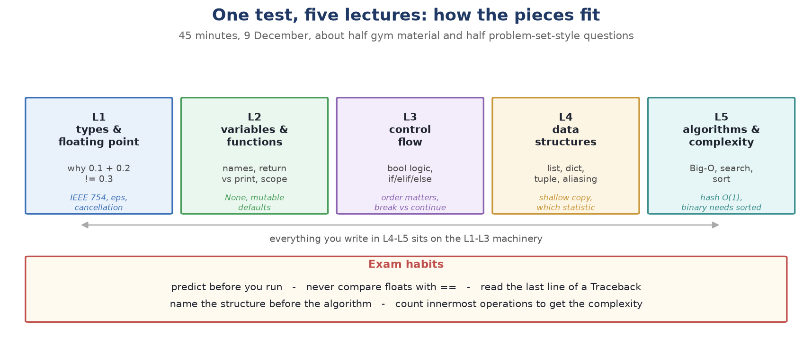

The first stop on the map is values. The next four lectures all sit on top of them: values are function inputs, conditions, container items and data for algorithms. A measurement rounded at this first stop is still that rounded value when it reaches the fourth stop.


The second figure is the core picture: a floating-point number line is a **ruler with uneven marks**. The marks are dense near $1$ and sparse near $10^{100}$, yet both regions carry the same number of significant digits.

**Remember this: floating-point precision is relative, not absolute.**

### 1.2 Mechanisms you must know

**(1) Four basic types.** Every object has a type, and the type decides which operations make sense.

| Type | Example | Used for |
| --- | --- | --- |
| $\text{int}$ | $\text{count} = 10$ | counts, indices |
| $\text{float}$ | $\text{temp} = 98.6$ | measurements, real numbers |
| $\text{str}$ | $\text{name} = \text{"Alice"}$ | text, labels |
| $\text{bool}$ | $\text{done} = \text{False}$ | yes/no conditions |

| --- | --- | --- | --- |

Inspect it with $\text{type}(x)$. First trap: **the division operator $/$ always returns a float**, even when two integers divide exactly.

$$16 / 2 = 8.0 \quad (\text{float}), \qquad 16 // 2 = 8 \quad (\text{int})$$

$//$ is **floor division**: $7//2=3$, and $-7//2=-4$ (it floors, it does not truncate towards zero).

**(2) Python integers have no upper limit.** Integers are arbitrary precision; the only limit is memory, and running out raises $\text{MemoryError}$. Integer arithmetic is therefore exact: no rounding and no silent overflow.

Most languages and NumPy arrays store integers in a fixed number of bits, usually 32 or 64. A signed 64-bit integer stops at

$$2^{63}-1 = 9\,223\,372\,036\,854\,775\,807$$

and beyond that it **wraps round silently**. Ariane 5 is exactly this kind of limit.

**(3) A float is 64 bits, stored as IEEE 754 double precision.** The value occupies 64 bits (8 bytes) in three fields:

$$v = (-1)^{s}\,(1.f_1f_2\cdots f_{52})_2 \times 2^{\,e - 1023}, \qquad (1.f)_2 = 1 + \sum_{i=1}^{52} f_i 2^{-i}$$

The fields are one sign bit $s$, an 11-bit exponent $e$ and 52 fraction bits $f_1\cdots f_{52}$. Two details matter:

- **Hidden bit**: after binary normalisation the digit before the point is always $1$, so it is not stored. The stored fraction is 52 bits, but the **effective precision is $52+1=53$ bits**.
- **Bias**: the true exponent $E$ can be negative, but the 11-bit field holds an unsigned integer from $0$ to $2047$. So $e = E + 1023$ is stored and $1023$ is subtracted on the way back. Normalised numbers use $-1022 \le E \le 1023$; $e=0$ and $e=2047$ are reserved for zero, subnormals, infinity and $\text{NaN}$.

**(4) Why floats rather than fixed point.** Three reasons:

- **Dynamic range**: a 64-bit float covers about $2.2\times 10^{-308}$ to $1.8\times 10^{308}$. Fixed point (say "store speed in tenths of a metre per second as an integer") forces you to decide the decimal point in advance, and no single scale covers both the mass of an electron and the distance to a star. The exponent field rescales automatically.
- **Hardware speed**: CPUs have dedicated floating-point units; adds and multiplies are pipelined. Arbitrary-precision integer arithmetic slows down as the numbers grow.
- **Predictable memory**: every float is exactly 8 bytes, so arrays pack tightly. Python's arbitrary-precision integers vary in length and cannot be laid out in one contiguous block.

**(5) Is double precision enough?** Single precision (32 bits) gives about 7 significant decimal digits; double precision (64 bits) gives about 15–16. Engineering work needs the latter, which is why Python's $\text{float}$ is always double precision. Use $\text{numpy.float32}$ in large arrays when 15 digits are unnecessary.

**(6) The floating-point number line.** Between two consecutive powers of two the representable numbers are **equally spaced**; crossing a power of two **doubles** the spacing:

$$\text{between } 1 \text{ and } 2:\ \ \Delta = 2^{-52}, \qquad \text{between } 2 \text{ and } 4:\ \ \Delta = 2^{-51}$$

$$\text{between } 2^{52} \text{ and } 2^{53}:\ \Delta = 1, \qquad \text{between } 2^{53} \text{ and } 2^{54}:\ \Delta = 2$$

**Machine epsilon** is the gap between $1.0$ and the next representable float:

$$\varepsilon_{\text{mach}} = 2^{-52} \approx 2.220\times 10^{-16}$$

A common misstatement is that "$\varepsilon$ is the smallest $x$ with $1+x \ne 1$". **It is not.** Every arithmetic result is rounded to the nearest float, so anything slightly larger than $\varepsilon/2$ already rounds up. The useful statement: **one rounding changes a number by at most $\varepsilon/2 \approx 1.1\times 10^{-16}$ of its size**, which is precisely what "about 16 significant digits" means.

**(7) Past $2^{53}$, adding 1 changes nothing.**

$$2^{53} = 9\,007\,199\,254\,740\,992, \qquad \text{float}(2^{53}) + 1 = \text{float}(2^{53})$$

The spacing just below $2^{53}$ is 1 and just above it is 2, so adding 1 lands exactly halfway between two representable values and rounds back to the even one, while adding 2 does move. **Consequence**: integers above $2^{53}$ may lose precision when converted to float.

**(8) 0.1 cannot be stored exactly, so 0.1+0.2 is not 0.3.** In binary, $0.1$ repeats forever:

$$0.1 = 0.0001100110011\ldots_2 = 1.100110011\ldots_2 \times 2^{-4}$$

With only 52 fraction bits it must be cut and rounded. The same happens to $0.2$ and $0.3$, and **their errors do not cancel**, so the sum $0.1+0.2$ is slightly larger than the stored $0.3$ and $==$ returns $\text{False}$.

**(9) Absorption and catastrophic cancellation.** These two effects cause most numerical errors in scientific code.

**Absorption**: a small number added to a much larger one disappears if it is below half the local spacing.

$$1 + 10^{-16} = 1 \quad (\text{True in Python})$$

**Catastrophic cancellation**: two nearly equal numbers subtracted. The subtraction is exact, but the leading digits cancel and what remains is dominated by the rounding error already inside the operands.

```python
a = 1 + 1e-15          # the rounding error is already inside a
print(a - 1)           # 1.1102230246251565e-15, not 1e-15
```

$a$ itself was accurate to 16 digits; after subtracting 1 the answer is wrong by about 11% in its first digit. The fix is not more precision but a **rewritten formula** with no subtraction:

$$\frac{1-\cos x}{x^{2}} \quad \longrightarrow \quad \frac{2\sin^{2}(x/2)}{x^{2}}$$

The two are algebraically identical, but the second never subtracts and stays accurate for small $x$.

**(10) Special values and tolerances.** $\text{inf}$ appears when a floating result overflows, for example $1\text{e}308\times1\text{e}308$; $\text{nan}$ (not a number) comes from $\text{float('nan')}$ or from a library call that has no defined result, because plain $0/0$ and $0.0/0.0$ raise $\text{ZeroDivisionError}$, and $1\text{e}308^{2}$ raises $\text{OverflowError}$ instead of returning $\text{inf}$. $\text{nan}$ equals nothing, itself included, so $\text{nan} == \text{nan}$ is $\text{False}$ while $\text{nan} \ne \text{nan}$ is $\text{True}$; test it with $\text{math.isnan}$.

So do not lean on exact equality for results that travelled different calculation paths; compare with a tolerance:

```python
import math
math.isclose(0.1 + 0.2, 0.3, rel_tol=1e-9)     # True
```

$\text{rel\_tol}$ is a relative tolerance: $1\text{e-}9$ means "about 9 significant digits agree". The test is $|a-b| \le \max(\text{rel\_tol}\cdot\max(|a|,|b|),\ \text{abs\_tol})$, so the relative part vanishes near zero and you must pass an $\text{abs\_tol}$ of the size that matters there. Exact cases still work: $0.5 == 0.5$ and $\text{math.isclose}(0.0, 0.0)$ are both $\text{True}$.

### 1.3 What the code looks like

**Example 1: true division versus floor division.**

```python
print(16 / 2)      # 8.0  always a float
print(16 // 2)     # 8    int
print(7 // 2)      # 3    floors
print(-7 // 2)     # -4   floors towards minus infinity, not -3
```

The last line is the one people miss: flooring walks left along the number line, so $-3.5$ becomes $-4$.

**Example 2: the truth about 0.1+0.2.**

```python
print(0.1 + 0.2)              # 0.30000000000000004
print(0.1 + 0.2 == 0.3)       # False
import math
print(math.isclose(0.1 + 0.2, 0.3, rel_tol=1e-9))   # True
```

The first line shows the extra bit; the third gives the answer an engineer wants.

**Example 3: absorption.**

```python
print(1 + 1e-16 == 1)     # True: below half a gap at 1.0
print(1 + 1e-15 == 1)     # False: larger than half a gap
```

The threshold is $\varepsilon/2 \approx 1.1\times 10^{-16}$.

**Example 4: adding 1 past $2^{53}$ does nothing.**

```python
x = float(2**53)
print(x + 1 == x)     # True
print(x + 2 == x)     # False: the spacing is exactly 2
```

**Example 5: cancellation and the rewritten formula.**

```python
import math
x = 1e-8
print((1 - math.cos(x)) / x**2)          # 0.0: the numerator is rounded to 0
print(2 * math.sin(x/2)**2 / x**2)       # 0.5: accurate after rewriting
```

Both should be $0.5$. The first collapses because $\cos x$ rounds to exactly $1.0$.

### 1.4 Worked example E1: a value of 35000 that will not fit in a 16-bit register

Ariane 5's inertial reference software encoded speed as a fixed-point integer. A non-negative speed $v$ in $\text{m s}^{-1}$ is stored as $\text{int}(10v)$ and decoded by dividing by 10. Take $v = 3500.0$ and answer: (a) what integer is stored, of what type, and does it fit a **signed 16-bit** field? (b) how much do "truncate then scale" and "scale then truncate" differ? (c) if the field must cover $0\sim 4000\ \text{m s}^{-1}$ with decoded spacing at most $0.1$, does $\text{int}(5v)$ work?

The criterion here is not floating-point accuracy but the **range of a fixed-width field**. The number of bits is fixed, so the set of representable integers is fixed, and the only possible failure is "does not fit". So: encode to an integer, then compare with the field limits. You may not argue "Python computed 35000, so it is fine"; Python integers are arbitrary precision and the failure happens **at the transfer**, not in the arithmetic.

**Step 1: encode and look at the type**

$$\text{stored} = \text{int}(10 \times 3500.0) = 35000$$

This gives the integer $35000$ of type $\text{int}$, decoding back to $35000/10 = 3500.0\ \text{m s}^{-1}$. The value is right.

**Step 2: compare with the signed 16-bit range**

$$-2^{15} \le n \le 2^{15}-1 \quad \Longrightarrow \quad -32768 \le n \le 32767$$

$$35000 > 32767 \quad \Longrightarrow \quad \text{does not fit}$$

The largest decodable speed is

$$\frac{32767}{10} = 3276.7\ \text{m s}^{-1} < 3500\ \text{m s}^{-1}$$

**Step 3: compare the two orders of operations**

$$\text{int}(v)\times 10 = 123 \times 10 = 1230 \quad \text{vs} \quad \text{int}(10v) = \text{int}(1237.5) = 1237$$

With $v = 123.75$: the first truncates to $123$, throws away $0.75$ and multiplies to $1230$ (decoded $123.0$); the second multiplies to $1237.5$ and truncates to $1237$ (decoded $123.7$). **Truncating after scaling cannot recover the lost digit.**

$32768$ and $32767$ are $2^{15}$ and $2^{15}-1$: one of the sixteen bits is the sign, leaving fifteen for the magnitude. The positive side has one fewer code because zero occupies a slot.

$35000$ is simply $10\times 3500.0$. The spacing $0.1\ \text{m s}^{-1}$ comes from the scale factor 10: adjacent integers differ by 1, so decoded values differ by $1/10$.

**(c) Does a scale factor of 5 work?** The range does:

$$\frac{32767}{5} = 6553.4\ \text{m s}^{-1} > 4000\ \text{m s}^{-1}$$

but the resolution does not:

$$\frac{1}{5} = 0.2\ \text{m s}^{-1} > 0.1\ \text{m s}^{-1}$$

**At a fixed bit width, range and resolution trade against each other**, exactly as on the floating-point number line in section 1.2(6). The fix is to keep scale 10 and widen the destination to signed 32 bits, with an explicit physical range check.

Three independent checks. Magnitude: $3500\ \text{m s}^{-1}$ scaled by 10 is $3.5\times 10^{4}$, the same order as the 16-bit ceiling $3.28\times 10^{4}$ and slightly larger, which matches a "just over the limit" accident. Endpoints: $v=0$ encodes to $0$; $v=3276.7$ encodes to $32767$ exactly at the ceiling; $v=3276.8$ encodes to $32768$ and overflows. Logic: the active and backup systems ran the **same software**, so the same input produced the same illegal conversion; **duplicating hardware does not remove a shared assumption**.

$$\text{stored} = 35000 > 32767 \ \Rightarrow\ \text{overflow}, \qquad v_{\max} = \frac{32767}{10} = 3276.7\ \text{m s}^{-1}$$

Scaling before truncating is required; a scale factor of 5 keeps the range but drops the spacing to $0.2$, which fails the requirement; use a 32-bit field with a range check.

- Believing "Python computed 35000, so it is fine": the overflow happens when the value is **put into the fixed-width field**.
- Treating $\text{int}()$ as rounding: it truncates, so $\text{int}(1237.5)=1237$.
- Truncating before scaling: the lost digit never comes back.
- Checking range but not resolution: a smaller scale factor fits larger speeds but coarser spacing.
- Trusting the backup: same source code, same failure.

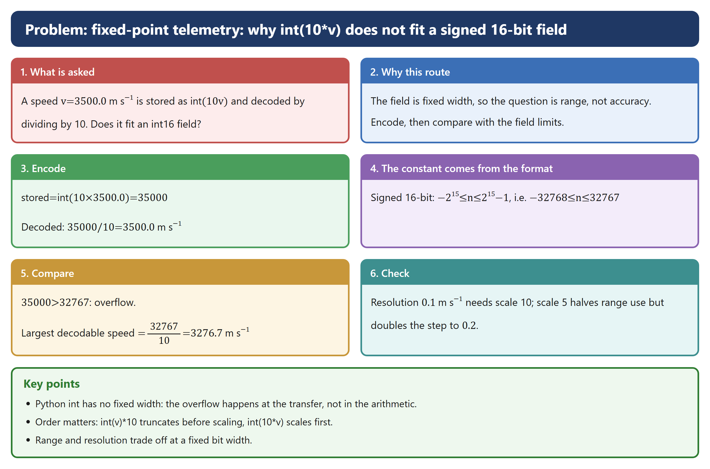

### 1.4b How this chapter is examined

Chapter 1 is examined in two shapes. The short shape asks you to predict a printed value: a division that surprises you, an integer that overflows a fixed-width register, or a comparison of two floats that should be equal and is not. The long shape asks you to explain: "state why" is a real one or two marks, and the marker wants the mechanism, which is that a binary mantissa with finitely many bits cannot hold most decimals, so the stored value is the nearest one and the arithmetic inherits that error. Writing "because of precision" earns nothing, because it restates the symptom.

### 1.5 Multiple-choice questions (8)

**Q1.1** What does $\text{print}(0.1 + 0.2 == 0.3)$ output?

- A. $\text{True}$
- B. $\text{False}$
- C. $\text{None}$
- D. an error

- A. $\text{True}$
- B. $\text{False}$
- C. $\text{None}$

**Answer: B**

Why: $0.1$, $0.2$ and $0.3$ all repeat in binary and are rounded when stored in 52 bits; the errors do not cancel, so the sum differs from the stored $0.3$.

The other options: A is mathematical intuition, not floating-point fact; C is wrong because a comparison returns a bool; D is wrong because the syntax is valid. Use $\text{math.isclose}$ when you mean "close enough".

</details>

**Q1.2** How many bits does an IEEE 754 double take, and how many are the fraction field?

- A. 32 bits, 23 fraction bits
- B. 64 bits, 52 fraction bits
- C. 64 bits, 53 fraction bits
- D. 80 bits, 64 fraction bits

**Answer: B**

Why: double precision is $1+11+52=64$ bits: one sign, eleven exponent, fifty-two fraction.

The other options: A is single precision; C confuses effective precision (53, including the hidden bit) with the field width; D describes extended precision.

</details>

**Q1.3** What is $\text{float}(2^{53}) + 1 == \text{float}(2^{53})$, and why?

- A. $\text{False}$, because adding 1 always changes something
- B. $\text{True}$, because $x+1$ is exactly halfway between $x$ and $x+2$ and rounds to the even one
- C. $\text{True}$, because Python integers overflow
- D. an error

**Answer: B**

Why: the gap doubles at every power of two, so it is $1$ on $[2^{52},2^{53})$ and $2$ on $[2^{53},2^{54})$, and $x+1$ is exactly halfway between $x$ and $x+2$, which rounds to the even value $x$; $x+2$ is representable.

The other options: A ignores the spacing; C is wrong because Python integers do not overflow; D is wrong, and the silence is exactly what makes this dangerous.

</details>

**Q1.4** What is the correct way to test whether two floats are "equal"?

- A. $a == b$
- B. $\text{abs}(a-b) < 1\text{e-}6$ with a fixed threshold
- C. $\text{math.isclose}(a, b, \text{rel\_tol}=1\text{e-}9)$
- D. convert both to strings and compare

- A. $a == b$
- C. $\text{math.isclose}(a, b, \text{rel\_tol}=1\text{e-}9)$

**Answer: C**

Why: $\text{isclose}$ uses a relative tolerance that scales with magnitude, which matches the relative nature of floating-point precision.

The other options: A is almost always false; B is too strict near $10^{6}$ and too loose near $10^{-6}$; D compares printed strings, which collapses formatting and storage into one question, since $\text{str}(1.0)$ and $\text{str}(1.00)$ are both $\text{'1.0'}$ and neither tells you the stored bits. An absolute tolerance answers a different question: how far from the target counts as close.

</details>

**Q1.5** What is $\text{print}(1 + 1\text{e-}16 == 1)$?

- A. $\text{True}$, because $1\text{e-}16$ is below half the gap at $1.0$
- B. $\text{False}$, because any non-zero addition changes the result
- C. $\text{True}$, because Python uses integers internally
- D. an error

**Answer: A**

Why: the gap at $1.0$ is $\varepsilon = 2.22\times 10^{-16}$ and half of it is about $1.11\times 10^{-16}$; $1\text{e-}16$ is smaller, so it rounds back to $1.0$. This is absorption.

The other options: B ignores rounding; C is wrong because a Python float is a hardware double; D is wrong.

</details>

**Q1.6** Which statement about $\varepsilon_{\text{mach}} = 2^{-52}$ is correct?

- A. It is the smallest positive float
- B. It is the smallest $x$ with $1+x \ne 1$
- C. It is the gap between $1.0$ and the next float, and one rounding changes a number by at most $\varepsilon/2$ of its size
- D. It equals $2^{-53}$

**Answer: C**

Why: $\varepsilon = 2^{-52}$ is the **gap** at $1.0$; because results round to nearest, anything slightly above half the gap moves up, so the "smallest $x$" phrasing is sloppy.

The other options: A is off by hundreds of orders of magnitude; B is the common misstatement; D is half a gap.

</details>

**Q1.7** What is the range of a signed 16-bit integer?

- A. $0 \sim 65535$
- B. $-32768 \sim 32767$
- C. $-32767 \sim 32767$
- D. $-65536 \sim 65535$

**Answer: B**

Why: one bit is the sign and fifteen carry the magnitude, so the negative side reaches $-2^{15}$ and the positive side stops at $2^{15}-1$.

The other options: A is unsigned 16-bit; C forgets the extra negative code; D is a wider format.

</details>

**Q1.8** What are $\text{int}(123.75) \times 10$ and $\text{int}(10 \times 123.75)$?

- A. both $1237$
- B. $1230$ and $1237$
- C. $1240$ and $1237$
- D. $1237$ and $1230$

**Answer: B**

Why: the first truncates to $123$ and multiplies; the second multiplies to $1237.5$ and truncates to $1237$.

The other options: A ignores the order of the truncation; C treats truncation as rounding; D reverses the order. Truncating after scaling cannot recover the lost digit.

</details>

### 1.6 Chapter traps

- Writing $0.1+0.2 == 0.3$: it prints $\text{False}$; use $\text{math.isclose}$.
- Using $\text{rel\_tol}$ against zero: the test never passes; use $\text{abs\_tol}$.
- Calling $\varepsilon$ "the smallest positive number" or "the smallest $x$ with $1+x\ne 1$".
- Judging equality with a fixed $1\text{e-}6$ threshold: it fails as soon as the magnitude changes.
- Truncating before scaling: the decoded value comes back short.
- Treating a fixed-width integer like a Python integer: it wraps silently past its range, which is how Ariane 5 was lost.
- Subtracting two nearly equal numbers: the leading digits vanish, so rewrite the formula instead of raising precision.
- Assuming adding 1 always changes a float: past $2^{53}$ it does not.

---

## Variables and functions: names, return and scope

### 2.1 What this chapter is about

One sentence: **a variable is a name, and a function is a name for a stretch of computation.**

Chapter 1 was about what a value looks like. This chapter is about how values get called up and reused. Two things are examined again and again: a function that only prints **returns nothing**, and **assignment does not copy**.

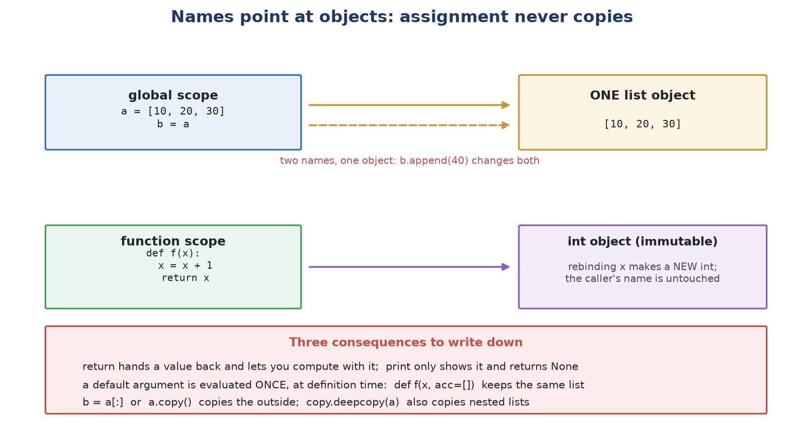

The top half shows two names pointing at one list; the bottom half shows a local name inside a function. The arrows point at **objects**; a name is only an arrow.

**Remember this: assignment labels, it does not photocopy; only return hands the result out.**

### 2.2 Mechanisms you must know

**(1) A variable is a name, not a box.** Writing

$$x = 10$$

does not mean $x$ equals $10$; it means: evaluate the right-hand side, get an object, then make the name $x$ refer to it. So

$$x = x + 1$$

reads as "read the current value of $x$, add one, then point $x$ at the new result". The right-hand $x$ uses the **old** value.

**(2) Naming rules.** Letters, digits and underscores only, and it may not start with a digit. Names are case-sensitive ($\text{mass}$ and $\text{Mass}$ are different). Keywords such as $\text{if}$, $\text{for}$, $\text{def}$ and $\text{return}$ cannot be used.

One trap: **do not shadow built-ins.**

```python
sum = 0        # legal, but sum no longer refers to the built-in function
sum([1, 2])    # TypeError: int object is not callable
```

After that line the built-in sum is hidden. Use $\text{total}$ instead.

**(3) What a function is for.** A function packs a computation behind a name. Three benefits:

- **Reuse**: write a formula once and call it many times.
- **Clarity**: a good name says what is computed, not just how.
- **Testing**: a small function can be checked on simple inputs.

**(4) The anatomy of def.**

```python
def distance(x1, y1, x2, y2):
    """Return the Euclidean distance between two 2D points."""
    d = ((x2 - x1)**2 + (y2 - y1)**2)**0.5
    return d
```

```python
def distance(x1, y1, x2, y2):
    """Return the Euclidean distance between two 2D points."""
    d = ((x2 - x1)**2 + (y2 - y1)**2)**0.5
    return d
```

- $\text{def}$: the keyword that starts a definition.
- $\text{distance}$: the function name, following the variable naming rules.
- $\text{(x1, y1, x2, y2)}$: **parameters**, the local names for the inputs.
- The triple-quoted line: the **docstring**, documentation for humans.
- The indented block: the body, which only runs when the function is called.
- $\text{return}$: hands the result back and ends the call immediately.

**(5) return and print are different things.** The first trap of the chapter.

$\text{print}$ shows a value to a human and returns $\text{None}$; $\text{return}$ hands the value to the program.

```python
def double(x):
    print(x * 2)      # prints only, no return

print(double(5))      # prints 10, then prints None
double(5) + 15        # TypeError: unsupported operand type(s) for +: NoneType and int
```

Notice the order: $10$ comes from the inner print, then $\text{None}$ is what the call actually returned. Fix it with return:

```python
def double(x):
    return x * 2

double(5) + 15        # 25
```

**Remember this: a number that appeared on screen is not a number you hold.**

**(6) Three kinds of arguments.**

```python
def power(base, exponent=2):
    return base ** exponent

power(3)                      # positional, exponent takes the default, 9
power(3, 3)                   # positional, matched by order, 27
power(3, exponent=3)          # keyword, matched by name, 27
```

```python
def power(base, exponent=2):
    return base ** exponent

power(3)
power(3, 3)
power(3, exponent=3)
```

- **Positional**: matched by order.
- **Keyword**: matched by name, so order does not matter.
- **Default**: used when the argument is omitted.

**(7) A mutable default is evaluated once.** Second trap:

```python
def collect(x, acc=[]):
    acc.append(x)
    return acc

collect(1)      # [1]
collect(2)      # [1, 2]  <-- not [2]
```

The default list is created **once, when the function is defined**, and every call shares it. Write

```python
def collect(x, acc=None):
    if acc is None:
        acc = []
    acc.append(x)
    return acc
```

**(8) Scope.** Calling a function creates a **local scope**; names inside live there and vanish when the function returns.

$$\text{inside: } y=7 \quad\Longrightarrow\quad \text{outside: } y \text{ does not exist}$$

A function can **read** outer names, but rebinding the same name inside creates a new local and leaves the outer one alone, and reading that name before the assignment raises $\text{UnboundLocalError}$. Rebinding a module-level name needs $\text{global}$, rebinding a name in the enclosing function needs $\text{nonlocal}$; mutating a shared object in place needs neither declaration. The course discourages both keywords, so return a value instead.

**(9) Functions calling functions.** Splitting a problem into small functions is the main way to keep complexity down: five well-named functions read like five physical ideas rather than a pile of algebra.

### 2.3 What the code looks like

**Example 1: assignment is an action, not an equation.**

```python
x = 10
x = x + 1
print(x)      # 11
```

The second line evaluates $10+1=11$ and then makes $x$ refer to $11$.

**Example 2: a function wraps a formula and can be reused and tested.**

```python
def kinetic_energy(m, v):
    return 0.5 * m * v**2

print(kinetic_energy(2.0, 3.0))    # 9.0
print(kinetic_energy(10.0, 4.0))   # 80.0
```

Inputs are mass and speed, output is energy; $0.5\times 2\times 3^{2}=9$ checks out.

**Example 3: a function that only prints hands back nothing.**

```python
def average(a, b):
    print((a + b) / 2)

result = average(4, 8)     # screen: 6.0
print(result)              # screen: None
```

Anything computed from $\text{result}$ will fail. This is the most common find-the-bug question in the exam.

**Example 4: swapping two variables the wrong way.**

```python
a = 1
b = 2
a = b      # a becomes 2, the old 1 is lost
b = a      # b becomes 2 as well
print(a, b)   # 2 2
```

Either use a temporary variable, or use tuple assignment $\text{a, b = b, a}$.

### 2.4 Worked example E2: a unit error of 4.45 and a lost spacecraft

In Mars Climate Orbiter, the module that computed thruster impulse produced pound-force seconds while the navigation module consumed newton-seconds. Given $1\ \text{lbf}\approx 4.448\ \text{N}$, by what factor is the impulse misread? And what would have happened if the computing function had printed instead of returned?

There is only one route for units: convert both to a common basis and compare. The thrust curve is irrelevant; only the ratio of the two unit systems matters. Structurally the bug is not in the formula but in the **interface contract**: a returned value must carry its unit, otherwise the caller can only guess.

**Step 1: write both impulses**

$$I_{\text{calc}} = F\,\Delta t \quad \text{in}\ \text{lbf}\cdot\text{s}, \qquad I_{\text{used}} = I_{\text{calc}}\ \text{treated as}\ \text{N}\cdot\text{s}$$

The number is used unchanged; what is wrong is the label, not the multiplication.

**Step 2: compute the ratio**

$$\frac{I_{\text{used}}}{I_{\text{true}}} = \frac{1\ \text{N}\cdot\text{s}}{1\ \text{lbf}\cdot\text{s}} = \frac{1}{4.448} \approx 0.2248$$

The value is only $22.5\%$ of the true impulse.

**Step 3: turn the bias into accumulated error**

$$\Delta I = (4.448 - 1)\,I_{\text{calc}} \approx 3.45\,I_{\text{calc}}$$

Each burn's computed impulse is only about $22.5\%$ of the impulse actually applied, so the miss per burn is about $3.45$ times the computed value, and the error accumulates with the number of burns.

$4.448$ is not arbitrary: one pound-force is the weight of one pound mass under standard gravity.

$$1\ \text{lbf} = 0.45359237 \times 9.80665 \approx 4.4482\ \text{N}$$

So one pound-force second comes out at 4.448 newton seconds, which rounds to 4.45.

Reverse the direction: if the navigation side had misread $\text{N}\cdot\text{s}$ as $\text{lbf}\cdot\text{s}$, the ratio would be $4.448$, i.e. too large, not too small. The observed factor $0.2248$ matches "computed in $\text{lbf}\cdot\text{s}$, consumed as $\text{N}\cdot\text{s}$". Order of magnitude: $0.2248\times 4.448\approx 1.000$, so the two ends close.

On the function level: had the impulse function only printed, the caller would receive $\text{None}$ and raise $\text{TypeError}$ immediately. **The accident happened precisely because the function returned a perfectly good number**; the value was fine, the unit was not documented. Working code is not the same as correct code.

$$\frac{I_{\text{used}}}{I_{\text{true}}} = \frac{1}{4.4482} \approx 0.2248, \qquad \text{bias factor} \approx 4.45$$

Treating the same number as two different units makes the computed impulse about $4.45$ times too small (the real burn is that much larger), and once that bias is carried through a whole flight the trajectory is hopelessly off.

- Reading $4.45$ as $4.45\%$: it is a factor; $0.2248$ is the fraction.
- Believing "it returned a number, so it is right": right type, wrong unit is the hardest class of bug.
- Computing a single burn: the damage is the **accumulation** over the mission.

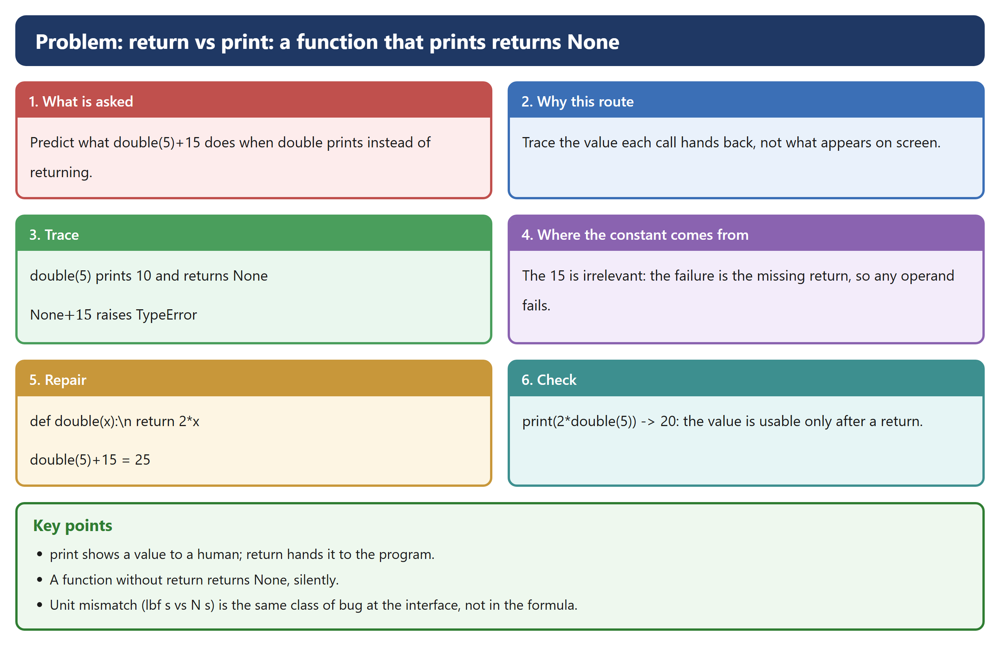

### 2.4b How this chapter is examined

Chapter 2 is examined as find-the-bug and as short trace. Find-the-bug gives you a function and asks why the second call returns something different from the first: the usual answer is a mutable default argument, built once at definition time. Short trace gives you a function that prints instead of returning, or that rebinds a name inside its own body, and asks what the caller sees: the answer is `None`, or the global unchanged. Both shapes reward the same sentence, "assigning inside a function creates a local name unless `global` is declared", so learn that sentence as a sentence.

### 2.5 Multiple-choice questions (8)

**Q2.1** What does this program output?

```python
def double(x):
    print(x * 2)

print(double(5))
```

- A. $10$
- B. $10$ then $\text{None}$
- C. $\text{None}$
- D. $\text{TypeError}$

- A. $10$
- C. $\text{None}$

**Answer: B**

Why: the inner call prints $10$ and returns $\text{None}$; the outer print then shows $\text{None}$.

The other options: A misses the outer print; C misses the inner print; D only happens when the $\text{None}$ is used in arithmetic.

</details>

**Q2.2** After these three lines, what are $a$ and $b$?

```python
a = 5
b = a
a = a + 1
```

Pick one of the options below.

- A. $a=6$, $b=6$
- B. $a=6$, $b=5$
- C. $a=5$, $b=6$
- D. $a=6$, $b=\text{None}$

- A. $a=6$, $b=6$
- B. $a=6$, $b=5$
- C. $a=5$, $b=6$
- D. $a=6$, $b=\text{None}$

**Answer: B**

Why: integers are immutable. $b=a$ points $b$ at $5$; $a=a+1$ creates a new $6$ and re-points $a$, leaving $b$ at $5$.

The other options: A treats names as storage cells; C reverses the order; D is unrelated, assignment never produces $\text{None}$. With a mutable value such as a list the answer changes, which is the chapter 4 trap.

</details>

**Q2.3** Which definition makes $\text{power(3)}$ return $9$?

- A. $\text{def power(base, exp): return base ** exp}$
- B. $\text{def power(base, exp=2): return base ** exp}$
- C. $\text{def power(base=2, exp): return base ** exp}$
- D. $\text{def power(base, exp): return base * exp}$

**Answer: B**

Why: the default lets the second argument be omitted, so $3^{2}=9$.

The other options: A raises $\text{TypeError}$ for a missing argument; C is a syntax error because a defaulted parameter must follow the non-defaulted ones; D computes $3\times 2=6$.

</details>

**Q2.4** What do the two calls print?

```python
def collect(x, acc=[]):
    acc.append(x)
    return acc

print(collect(1))
print(collect(2))
```

- A. $[1]$ and $[2]$
- B. $[1]$ and $[1, 2]$
- C. $[1]$ and $[]$
- D. an error

**Answer: B**

Why: the default list is created once at definition time, so both calls share it and the second sees the first append.

The other options: A is the intuitive but wrong answer; C implies a clearing that never happens; D is wrong, and the silence is what makes it dangerous. Fix: default to $\text{None}$ and build a fresh list inside.

</details>

**Q2.5** Which statement about $\text{return}$ and $\text{print}$ is correct?

- A. They are equivalent
- B. $\text{print}$ returns to the caller and $\text{return}$ only displays
- C. $\text{return}$ hands the value back and ends the function; $\text{print}$ only displays and the function returns $\text{None}$
- D. Every function must use both

**Answer: C**

Why: only $\text{return}$ hands a value out; $\text{print}$ writes to the screen.

The other options: A conflates them; B reverses them; D is not required by any language rule.

</details>

**Q2.6** Does this program raise an error?

```python
def f():
    total = 10

f()
print(total)
```

- A. prints $10$
- B. prints $\text{None}$
- C. raises $\text{NameError}$
- D. raises $\text{TypeError}$

**Answer: C**

Why: $\text{total}$ is local and disappears when the call returns, so the name does not exist outside.

The other options: A assumes locals leak; B requires an existing name whose value is $\text{None}$; D is unrelated. Return the value if you need it.

</details>

**Q2.7** Which definition is bad practice?

- A. $\text{def area(r): return 3.14159 * r**2}$
- B. $\text{def mean(a, b): return (a + b) / 2}$
- C. $\text{def sum(x): return x + 1}$
- D. $\text{def f(x, y=1): return x * y}$

**Answer: C**

Why: $\text{sum}$ is a built-in name; redefining it hides the built-in for the rest of the program.

The other options: A, B and D are all legal and normal. Naming is style, but shadowing a built-in causes real bugs.

</details>

**Q2.8** Which expression successfully computes twice the average of 4 and 8?

- A. $\text{print((4+8)/2) * 2}$
- B. $((4+8)/2) * 2$
- C. $x = \text{print}((4+8)/2)$ then $x * 2$
- D. impossible without a variable

- A. $\text{print((4+8)/2) * 2}$
- B. $\text{((4+8)/2) * 2}$

**Answer: B**

Why: it is a pure expression that evaluates to $12$.

The other options: A multiplies the return value of print, which is $\text{None}$; C does the same through a variable; D is false.

</details>

### 2.6 Chapter traps

- Printing instead of returning: the caller receives $\text{None}$ and the next arithmetic step raises $\text{TypeError}$.
- A default of $\text{acc=[]}$: every call shares one list, so the second call returns $[1, 2]$.
- Assuming $b = a$ copies a list: both names point at one object.
- Shadowing built-ins such as $\text{sum}$ or $\text{list}$: the built-in becomes unreachable.
- Expecting a function to change an immutable argument in place: the outer value never changes.
- Treating units as comments: right type, wrong unit, program runs, result is wrong by a factor.
- Swapping the argument order: $\text{power(3, 2)}$ is not $\text{power(2, 3)}$.

---

## Control flow: the order of branches is the logic

### 3.1 What this chapter is about

One sentence: **the program stops running straight down and starts deciding and repeating.**

The first two chapters were straight lines. This chapter adds junctions ($\text{if}$) and loops ($\text{while}$, $\text{for}$). Two things are examined: **the order of branches is the logic**, and **inside a loop somebody must make progress**.

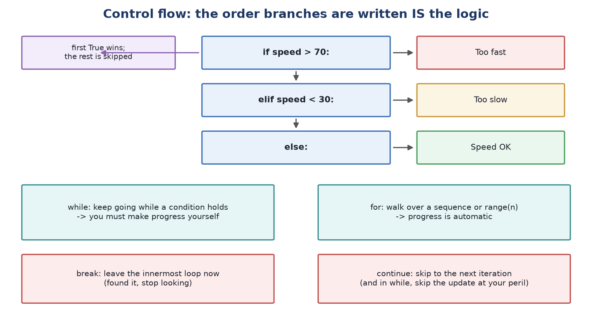

Three things to keep from the figure: $\text{if}/\text{elif}/\text{else}$ is tried top to bottom and stops at the first hit; $\text{while}$ must make progress itself; $\text{for}$ makes progress automatically.

**Remember this: branches are tried in written order and the first hit wins; a loop with nobody making progress never ends.**

### 3.2 Mechanisms you must know

**(1) Booleans.** Two values, $\text{True}$ and $\text{False}$, capitalised, type $\text{bool}$. Comparisons produce them.

- $==$ tests equality; $=$ assigns. Do not confuse them.
- $<$, $>$, $\le$, $\ge$ compare magnitude.
- $\text{is}$ tests whether two names refer to the **same object**, not whether values are equal. Use $\text{is None}$ for $\text{None}$ and $==$ for values.
- Comparisons chain: $0 \le x < 10$ means both conditions, exactly as in mathematics, and chapter 4 uses it for interval filtering.
- Chapter 1 still applies: **never compare floats with $==$**; use $\text{math.isclose}$.

$$x = 3 \quad\Longrightarrow\quad x == 3\ \text{is}\ \text{True}, \qquad x != 3\ \text{is}\ \text{False}$$

**(2) Precedence.** Brackets, then function calls and arithmetic, then comparisons, then $\text{not}$, then $\text{and}$, then $\text{or}$.

$$\text{not}\ 10 > 5\ \text{and}\ \text{True}\ \text{or}\ 1 \ne 1 \;\equiv\; ((\text{not}(10>5))\ \text{and}\ \text{True})\ \text{or}\ (1\ne 1) = \text{False}$$

Step by step: $10>5$ is $\text{True}$, negated gives $\text{False}$; $\text{False}$ and $\text{True}$ gives $\text{False}$; $1\ne 1$ is $\text{False}$; $\text{False}$ or $\text{False}$ gives $\text{False}$. When unsure, add brackets: they cost nothing.

**(3) Short-circuit evaluation.** In $\text{A and B}$, if $\text{A}$ is false the whole expression is false and $\text{B}$ is never evaluated. In $\text{A or B}$, if $\text{A}$ is true, $\text{B}$ is skipped.

This lets the first test **guard** the second:

```python
x = 0
if x != 0 and (10 / x) > 1:     # with x = 0 the division never runs
    print("safe")
```

Swap the two conditions and you get $\text{ZeroDivisionError}$.

**(4) Truthiness.** These are false as conditions: $0$, $0.0$, $\text{None}$, the empty string, the empty list, the empty dictionary. Almost everything else is true. $\text{if readings:}$ asks "is there anything in it". While learning, explicit conditions such as $\text{if n != 0:}$ read better.

**(5) if / elif / else.** Tried top to bottom; **the first true branch runs and everything below is skipped**. So the order is the logic: write $\text{if x > 18}$ before $\text{elif x > 21}$ and the second branch is unreachable.

```python
speed = 45
if speed > 70:
    print("Too fast")
elif speed < 30:
    print("Too slow")
else:
    print("Speed OK")
```

**(6) while: repeat an unknown number of times.** It runs while the condition holds, and **you** must change something:

```python
x = 0
while x < 3:
    print(x)
    x += 1        # forget this and the loop never ends
```

Forgetting the increment, or skipping it with $\text{continue}$, is an infinite loop.

**(7) for: a known number of repetitions, or a walk over a sequence.**

$$\text{range}(\text{start},\ \text{stop},\ \text{step}), \qquad \text{stop excluded}$$

$$\text{range}(\text{start},\ \text{stop},\ \text{step}), \qquad \text{stop excluded}$$

- $\text{range}(5)$ gives $0,1,2,3,4$: five values, no $5$.
- $\text{range}(2, 10, 3)$ gives $2,5,8$.
- $\text{range}(10, 0)$ is **empty**, because the default step is $+1$ and $10$ is already past $0$. Count down with $\text{range}(10, 0, -1)$.

The half-open convention matches indexing from zero and returns in chapter 4 slicing. If you only need the values, iterate the sequence directly: $\text{for r in readings:}$ is clearer than $\text{for i in range(len(readings)):}$.

**(8) Nested loops.** The outer loop runs $m$ times and the inner $n$ times, so the body runs $mn$ times. Indentation decides which statements belong to which level, and statements after the inner loop belong to the outer one. This is where the $O(n^{2})$ of chapter 5 comes from.

**(9) break and continue.**

- $\text{break}$ leaves the **innermost** loop immediately.
- $\text{continue}$ skips the rest of the current iteration and starts the next.
- In nested loops, $\text{break}$ only leaves the inner one.

In a $\text{while}$ loop, a $\text{continue}$ that jumps over the update creates an infinite loop.

### 3.3 What the code looks like

**Example 1: order decides the logic.**

```python
x = 25
if x > 18:
    print("A")
elif x > 21:
    print("B")
else:
    print("C")
```

This prints $A$. $B$ can never print, because any $x$ reaching the second test already passed the first. Sort the thresholds to make all three reachable.

**Example 2: short-circuit guards a division.**

```python
x = 0
y = 10
if x != 0 and (y / x) > 1:
    print("safedivisionperformed")
```

Nothing prints and nothing crashes: the first condition is false, so the right side never runs.

**Example 3: range is half-open.**

```python
for i in range(5):
    print(i)          # 0 1 2 3 4

for i in range(10, 0, -1):
    print(i)          # 10 9 8 ... 1

for i in range(10, 0):
    print(i)          # nothing at all
```

The third loop prints nothing, which is a favourite exam question.

**Example 4: continue filters bad readings.**

```python
readings = [50, 90, -1, 70, -1, 100]
total = 0
for r in readings:
    if r < 0:
        continue          # skip invalid readings
    total += r
print(total)              # 310
```

Six readings, two skipped, $50+90+70+100=310$.

**Example 5: break leaves only the inner loop.**

```python
for outer in ["A", "B"]:
    print(outer)
    for inner in range(3):
        if inner == 1:
            break
        print(inner)
```

This prints $A\ 0\ B\ 0$: the inner loop is cut each time but the outer one continues.

### 3.4 Worked example E3: one false signal and a lost lander

Mars Polar Lander's descent is divided into control cycles. In cycle $i$, $\text{height}[i]$ is the height above ground (metres, non-increasing) and $\text{touch}[i]$ says whether the touchdown sensor fired. Two rules must hold: readings above the enabling height $h_{\text{enable}}$ must have **no effect**, and touchdown is declared on the **second consecutive** triggered cycle. How do you write this, and why can a single spurious pulse not cut the engines?

One $\text{if}$ cannot express two rules. This needs a **gate** (only readings at or below the enabling height count) and a **counter** (how many consecutive cycles fired). A gate is a Boolean; "consecutive" is a count; both must be stored. That is the structural difference from a single-condition question: state has to survive between cycles.

**Step 1: write the two rules as a state machine**

$$\text{armed}_i = \left[\, \text{height}[i] \le h_{\text{enable}} \,\right], \qquad c_i = c_{i-1}+1 \ \text{if}\ \text{armed}_i \wedge \text{touch}[i],\ \text{else}\ 0$$

The counter increments only when the height is low enough and the sensor fired; every other case resets it, which is what "consecutive" means.

**Step 2: declare touchdown**

$$\text{landing} = \left[\, c_i \ge 2 \,\right]$$

Testing $\ge 2$ rather than $== 2$ tolerates a repeated delivery in one cycle.

```python
def touchdown_cycle(height, touch, h_enable):
    count = 0
    for i in range(len(height)):
        if height[i] <= h_enable and touch[i]:
            count += 1
        else:
            count = 0
        if count >= 2:
            return i
    return None
```

The function returns the first cycle that satisfies the rule, or $\text{None}$.

The $2$ is not estimated: the rule says "two consecutive cycles". The $\le$ follows the sentence "above the enabling height must have no effect": at exactly the enabling height the sensor is allowed to work. Both come straight from the wording.

A spurious-pulse case: $\text{height}=[1000, 900, 200, 150, 40]$, $\text{touch}=[\text{T}, \text{F}, \text{F}, \text{F}, \text{F}]$, $h_{\text{enable}}=300$. The first two cycles are gated out, so the count stays $0$; below $200$ nothing fires, so it stays $0$ and the call returns $\text{None}$: no engine cut. A genuine landing: $\text{height}=[40, 20]$, $\text{touch}=[\text{T}, \text{T}]$ reaches $\text{count}=2$ at the second cycle and returns $1$.

$$\text{arm at } h<h_{\text{enable}},\quad \text{count consecutive triggers},\quad \text{fire when } c_i \ge 2$$

A single pulse can only reach $1$, so it cannot cut the engines; the gate plus the counter is exactly what separates "one misread" from "actually landed".

- Chaining the two rules with $\text{elif}$: one rule swallows the other.
- Writing only $\text{if touch[i]}$: a high-altitude false trigger cuts the engines.
- Incrementing but not resetting: two non-consecutive triggers add up and "consecutive" is lost.
- Using $\text{continue}$ where $\text{break}$ is meant.


### 3.4b How this chapter is examined

Chapter 3 is examined by predictable output on a piece of control flow you have not seen before. Two shapes dominate. The branch shape reorders `if` and `elif` so that a broad condition swallows a specific one, and the mark is lost by reading only the first line that matches. The loop shape mixes `break`, `continue` and an accumulator, and the mark is lost by tracing only the passes that print. Write one line per pass, including skipped passes, and the answer becomes mechanical.

### 3.5 Multiple-choice questions (8)

**Q3.1** What does this print?

```python
x = 25
if x > 18:
    print("A")
elif x > 21:
    print("B")
else:
    print("C")
```

- A. $A$
- B. $B$
- C. $A$ then $B$
- D. $C$

- A. $\text{A}$
- B. $\text{B}$
- D. $\text{C}$

**Answer: A**

Why: $x>18$ is true, so the first branch runs and the rest of the chain is skipped.

The other options: B assumes the chain picks the "better" branch; C assumes several branches can run; D requires all earlier tests to fail.

</details>

**Q3.2** What does $\text{print(not True or True and not False)}$ print?

- A. $\text{True}$
- B. $\text{False}$
- C. $\text{None}$
- D. an error

- A. $\text{True}$
- B. $\text{False}$
- C. $\text{None}$

**Answer: A**

Why: $\text{not}$ applies first, then $\text{and}$, then $\text{or}$: $\text{False or (True and True)} = \text{False or True} = \text{True}$.

The other options: B evaluates $\text{or}$ before $\text{and}$; C is not a Boolean result; D is not a syntax error.

</details>

**Q3.3** What happens here?

```python
x = 0
while x < 3:
    if x == 1:
        continue
    print(x)
    x += 1
```

- A. prints $0\ 1\ 2$
- B. prints $0\ 2$
- C. prints $0$ then hangs
- D. raises an error

**Answer: C**

Why: at $x=1$ the $\text{continue}$ skips the increment, so $x$ stays $1$ and the condition stays true forever.

The other options: A ignores continue; B assumes continue advances something; D is wrong, and the hang is why this bug is hard to find. Move the increment above the $\text{continue}$ or use a $\text{for}$ loop.

</details>

**Q3.4** How many times does $\text{range}(10, 0)$ iterate?

- A. 10
- B. 9
- C. 0
- D. infinitely many

**Answer: C**

Why: the default step is $+1$ and the start is already past the stop, so the sequence is empty.

The other options: A and B assume range counts down automatically; D is impossible because range is finite. Write $\text{range}(10, 0, -1)$ to count down.

</details>

**Q3.5** How many times does the body run?

```python
count = 0
for i in range(0, 5, 2):
    for j in range(i):
        count += 1
```

Pick one of the options below.

- A. 4
- B. 6
- C. 10
- D. 15

**Answer: B**

Why: $i$ takes $0, 2, 4$, so the inner loops run $0$, $2$ and $4$ times: $0+2+4=6$.

The other options: A miscounts the inner lengths; C assumes $i$ runs over all integers; D multiplies $5\times 3$ and ignores that the inner count varies.

</details>

**Q3.6** Which condition safely avoids division by zero?

- A. $\text{if (y / x) > 1 and x != 0:}$
- B. $\text{if x != 0 and (y / x) > 1:}$
- C. $\text{if x != 0 or (y / x) > 1:}$
- D. $\text{if not x == 0 or (y / x) > 1:}$

**Answer: B**

Why: $\text{and}$ short-circuits left to right, so when $x$ is $0$ the division is never evaluated.

The other options: A divides before testing; C and D use $\text{or}$, which does not guard the second operand.

</details>

**Q3.7** What does this print?

```python
for outer in ["A", "B"]:
    print(outer)
    for inner in range(3):
        if inner == 1:
            break
        print(inner)
```

- A. $A\ 0\ 1\ 2\ B\ 0\ 1\ 2$
- B. $A\ 0\ B\ 0$
- C. $A\ 0\ 1\ B\ 0\ 1$
- D. $A\ 0$

- A. $\text{A}\ 0\ 1\ 2\ \text{B}\ 0\ 1\ 2$
- B. $\text{A}\ 0\ \text{B}\ 0$
- C. $\text{A}\ 0\ 1\ \text{B}\ 0\ 1$
- D. $\text{A}\ 0$

**Answer: B**

Why: break leaves only the inner loop; the outer loop continues and the inner loop restarts.

The other options: A is the output without break; C misplaces where break takes effect; D assumes break ends everything.

</details>

**Q3.8** What is the clearest way to test whether $\text{values}$ has any content?

- A. $\text{if len(values) > 0:}$
- B. $\text{if values:}$
- C. $\text{if values != None:}$
- D. $\text{if values is True:}$

**Answer: B**

Why: an empty list is false and a non-empty list is true, so $\text{if values:}$ means "has content".

The other options: A works but is verbose; C is true for an empty list as well, so it misjudges; D is never true for a list.

</details>

### 3.6 Chapter traps

- Writing $\text{elif}$ thresholds in the wrong order: the later branch becomes dead code.
- Forgetting the update in $\text{while}$, or skipping it with $\text{continue}$: infinite loop.
- Mixing up half-open ranges: $\text{range}(5)$ is five values and $\text{range}(10,0)$ is empty.
- Swapping $\text{and}$ and $\text{or}$: the guard disappears and you divide by zero.
- Expecting $\text{break}$ to leave every loop: it leaves only the innermost one.
- Writing $\text{if x = 3}$: a syntax error.
- Comparing floats with $==$ instead of $\text{math.isclose}$.
- Confusing truthiness with "equals $\text{True}$": an empty list is false but is not equal to $\text{True}$.

---

## Data structures: lists, dictionaries, tuples and aliasing

### 4.1 What this chapter is about

One sentence: **choose the wrong structure and even a good algorithm is slow; get aliasing wrong and changing one thing changes two.**

The previous chapters handled a single number. Engineering handles collections: a set of measurements, a table from temperature to fault count, a point. This chapter gives three containers and spends most of its time on the trap: **assignment is not copying**.

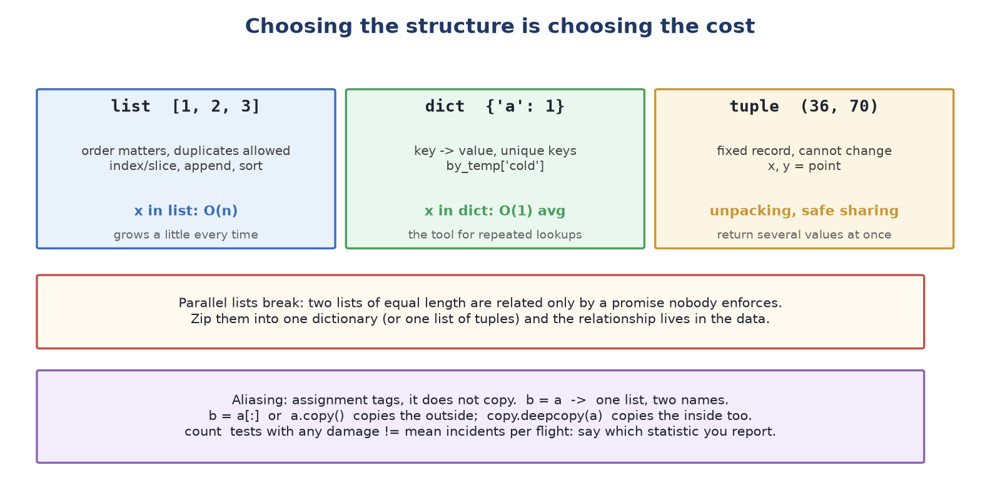

One line from the figure: **order and duplicates need a list, fast lookup needs a dictionary, a fixed record that must not change needs a tuple.**

**Remember this: lists keep order, dictionaries keep lookups, tuples keep promises.**

### 4.2 Mechanisms you must know

**(1) Lists.** Ordered, duplicates allowed, mutable, written with square brackets:

$$\text{readings} = [50, 90, 75], \qquad \text{readings}[0] = 50, \quad \text{readings}[-1] = 75$$

- Index from $0$; $-1$ is the last item.
- Slicing $\text{readings}[1:3]$ takes items $1$ and $2$: **half-open**, the same convention as $\text{range}$.
- $\text{append}$ adds at the end; $\text{len}$ gives the size.
- Membership $x\ \text{in list}$ is a **linear scan**, $O(n)$: in the worst case the whole list is examined.

**(2) Dictionaries.** Keys mapped to values, written with braces:

$$\text{by\_temp} = \{60{:}\ [2, 0],\ 70{:}\ [1]\}, \qquad \text{by\_temp}[60] = [2, 0]$$

- Keys are unique and hashable: numbers, strings and tuples work; lists do not.
- $\text{in}$ and lookup by key are $O(1)$ on average: no scanning, the position is computed.
- $\text{items()}$ yields key and value together; $\text{setdefault(key, [])}$ creates a default when the key is missing.
- Iteration follows insertion order; sort explicitly with $\text{sorted(by\_temp.items())}$.

**(3) Tuples.** Parentheses, immutable once built:

$$\text{point} = (36,\ 70), \qquad x, y = \text{point}$$

- The slots are fixed, so a tuple is hashable — and can be a dictionary key — only when every element is hashable: $\text{hash}((1,2))$ works, $\text{hash}((1,[2]))$ raises $\text{TypeError}$. Sharing it is safe from rebinding, not from mutating a list inside it.
- Unpacking assigns several names at once; swapping variables relies on it.
- A function returning several values returns one tuple.

**(4) Aliasing: assignment only labels.** The biggest trap in the chapter:

```python
a = [10, 20, 30]
b = a             # no copy: two names, one list
b.append(40)
print(a)          # [10, 20, 30, 40]
```

To copy, slice or call $\text{copy}$:

$$b = a[:] \quad \text{or} \quad b = a.\text{copy}()$$

Both are **shallow copies**: only the outer level is copied and any nested lists are still shared. Use $\text{copy.deepcopy}(a)$ for nested structures.

**(5) Why parallel lists break.** Two lists of equal length are related only by the promise that index $i$ belongs to the same record:

```python
temps  = [60, 70, 60]
faults = [1, 0, 0]
```

Delete one item or sort one list and the correspondence is gone. Put the relationship into the data:

```python
records = [(60, 1), (70, 0), (60, 0)]
```

or group the values into a dictionary. **A relationship either lives in the data or it will eventually fail.**

**(6) How to choose.** Ask three questions: is order needed, is fast lookup by key needed, must the record be unchangeable. The answers point to list, dictionary and tuple respectively. Real programs mix them: a dictionary of groups, values that are lists, keys that are tuples.

### 4.3 What the code looks like

**Example 1: indexing and slicing.**

```python
values = [10, 20, 30, 40, 50]
print(values[0])      # 10
print(values[-1])     # 50
print(values[1:3])    # [20, 30]  half-open
print(len(values))    # 5
```

**Example 2: grouping by temperature.**

```python
records = [(60, 1), (70, 0), (60, 0)]
groups = {}
for temp, faults in records:
    groups.setdefault(temp, []).append(faults)
print(groups)     # {60: [1, 0], 70: [0]}
```

$\text{setdefault}$ takes care of "the key does not exist yet".

**Example 3: aliasing versus a shallow copy.**

```python
a = [1, 2]
b = a          # alias
c = a[:]       # shallow copy
a.append(3)
print(b)       # [1, 2, 3]  followed
print(c)       # [1, 2]     unchanged
```

**Example 4: tuple unpacking swaps values.**

```python
a, b = 1, 2
a, b = b, a
print(a, b)    # 2 1
```

The right-hand side is packed into a tuple first, then unpacked, so no temporary variable is needed.

**Example 5: the grouping trap that overwrites.**

```python
def group(records):
    groups = {}
    for temp, faults in records:
        if temp not in groups:
            groups[temp] = []
        groups[temp].append(faults)
    return groups
```

The name of the game is "create the list once, then append". Writing $\text{groups[temp] = [faults]}$ replaces the earlier records for that temperature with the newest one.

### 4.4 Worked example E4: Challenger and what "failure rate" means

A set of test records gives, for each test, a temperature and the number of damaged seals. (a) group by temperature; (b) for an interval $[\text{low},\ \text{high})$ return the number of tests and the fraction with any damage; (c) explain why averaging the two interval fractions directly is wrong and how to pool them.

A statistic is meaningless until the denominator is named. There are two different quantities here: **incidents per flight** (numerator incidents, denominator flights) and **fraction of tests with any damage** (numerator damaged tests, denominator tests). The question asks for the second, so the records must be expanded to one row per test and counted. Averaging an average gets the weights wrong.

**Step 1: group**

$$\text{groups}[t] = [\, f_1, f_2, \dots \,], \qquad t = \text{temperature}$$

One position per test.

**Step 2: filter the interval and count**

$$\text{tests} = \sum_{t \in [\text{low},\text{high})} \#\text{groups}[t], \qquad \text{faulty} = \sum_{t \in [\text{low},\text{high})} \#\{\, f \in \text{groups}[t] : f > 0 \,\}$$

Two counters; a test with $f=0$ enters only the denominator.

**Step 3: divide**

$$\text{fraction} = \frac{\text{faulty}}{\text{tests}}$$

This is a weighted average, weighted by the number of tests.

In the worked data the interval $[60, 80)$ holds five tests, three of them damaged, so $\text{fraction}=3/5=0.6$. Suppose the cold group is $2/3$ and the warm group $1/2$; averaging the fractions gives

$$\frac{2/3 + 1/2}{2} = \frac{7}{12} \approx 0.583$$

but if the cold group has three tests and the warm group two, the correct pooling is

$$\frac{3\cdot \frac{2}{3} + 2 \cdot \frac{1}{2}}{3+2} = \frac{2+1}{5} = 0.6$$

The difference comes from the weights $3$ and $2$: averaging gives the smaller group too much say. So $0.583$ versus $0.6$ is a weighting error, not rounding.

Count directly: $\text{faulty}=3$, $\text{tests}=5$, so $3/5=0.6$, inside $[0,1]$ and equal to the weighted formula. Check the empty interval: it must return $(0, \text{None})$, because $0/0$ is undefined. **No data and no failures are different statements.**

$$\text{fraction}([\text{low},\text{high})) = \frac{\#\{\text{tests with any damage}\}}{\#\{\text{tests}\}}, \qquad \text{cold}\ [0,66): 1.0,\quad \text{warm}\ [66,100): 0.158$$

The cold group is entirely damaged; about one warm test in six is. On 28 January 1986 the launch temperature was about $36\ ^\circ\text{F}$ against a previous minimum of $53\ ^\circ\text{F}$, outside the range the data covered. That extrapolation, not the arithmetic, was the risk.

- Mixing incidents per flight with the fraction of damaged tests.
- Averaging two percentages: $0.583$ instead of $0.6$.
- Dropping the $f=0$ tests from the denominator: the fraction is inflated.
- Writing the interval closed: it is half-open, like slices and range.

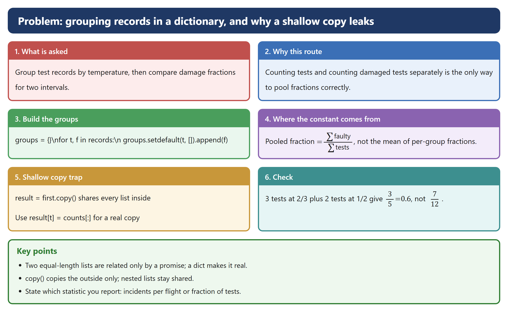

### 4.4b How this chapter is examined

Chapter 4 is examined by "what does the program print" on two names for one object. The examiner builds a short list or dictionary, aliases it with a plain assignment, copies it in one of the three ways, mutates one name, and asks for every printed value. The whole mark comes from counting objects first, names second. A second shape asks a definition question: why a list cannot be a dictionary key, why a tuple holding a list can still change, why removing items while iterating skips elements.

### 4.5 Multiple-choice questions (8)

**Q4.1** What does this print?

```python
a = [1, 2, 3]
b = a
b.append(4)
print(a)
```

- A. $[1, 2, 3]$
- B. $[1, 2, 3, 4]$
- C. $[4]$
- D. an error

- A. $[1, 2, 3]$
- B. $[1, 2, 3, 4]$
- C. $[4]$

**Answer: B**

Why: $b=a$ gives the same list a second name, so the append is visible through $a$.

The other options: A assumes a copy; C treats append as a replacement; D is wrong. Use $a[:]$ to copy.

</details>

**Q4.2** Which structure best supports repeatedly testing whether a student number is present?

- A. a list
- B. a dictionary or a set
- C. a tuple
- D. a string

**Answer: B**

Why: hashing gives $O(1)$ average membership, so repeated lookups do not slow down.

The other options: A is $O(n)$ per test; C is also linear, only immutable; D is a substring search, even slower.

</details>

**Q4.3** With $\text{values} = [10, 20, 30, 40, 50]$, what is $\text{values[1:3]}$?

- A. $[10, 20, 30]$
- B. $[20, 30]$
- C. $[20, 30, 40]$
- D. $[30]$

**Answer: B**

Why: slicing is half-open, so it takes indices $1$ and $2$.

The other options: A starts too early; C includes index $3$; D takes one item.

</details>

**Q4.4** Which really copies the nested list $\text{a} = [[1,2],[3,4]]$?

- A. $b = a$
- B. $b = a[:]$
- C. $b = \text{copy.deepcopy}(a)$
- D. $b = a.append([])$

**Answer: C**

Why: deepcopy copies the inner lists too, so changing $b$ cannot touch $a$.

The other options: A is an alias; B is shallow, so $a[0]$ is still shared; D appends to $a$ and returns $\text{None}$.

</details>

**Q4.5** What does $\text{groups.setdefault(60, []).append(1)}$ do when key $60$ is absent?

- A. raises $\text{KeyError}$
- B. creates $\text{groups[60] = []}$ and then appends $1$
- C. does nothing
- D. clears the dictionary

**Answer: B**

Why: setdefault inserts the default when the key is missing and returns it, so the append lands in the new list.

The other options: A is what plain $\text{groups[60]}$ would do; C is the behaviour when the key exists; D is unrelated.

</details>

**Q4.6** Why are two parallel lists fragile?

- A. lists are slow
- B. the correspondence exists only as a promise, so sorting or deleting breaks it
- C. lists cannot hold numbers
- D. lists cannot have equal length

**Answer: B**

Why: nothing in the data enforces that index $i$ belongs to the same record.

The other options: A is irrelevant to correctness; C is false; D is false. Fix: one list of tuples or a dictionary.

</details>

**Q4.7** What type does $\text{def stat(xs): return len(xs), sum(xs)}$ return?

- A. two independent values
- B. one tuple
- C. a list
- D. a dictionary

**Answer: B**

Why: comma-separated return values are packed into a tuple such as $(3, 6)$.

The other options: A is the usual misreading; C needs brackets; D needs braces.

</details>

**Q4.8** Why is returning $\text{fraction}=0$ for an empty interval a problem?

- A. it is not a problem
- B. it says "nothing failed" when the truth is "no data", which can invert the conclusion
- C. it raises $\text{ZeroDivisionError}$
- D. it returns $\text{None}$

**Answer: B**

Why: $0/0$ is undefined; reporting $0$ claims everything was fine when in fact nothing is known.

The other options: A ignores the meaning; C would happen if the division were attempted; D describes the recommended fix of returning $(0, \text{None})$.

</details>

### 4.6 Chapter traps

- Assuming $b = a$ copies: the original data gets modified through the alias.
- Treating a shallow copy as a deep one: nested lists stay shared.
- Building a fresh list for every record: earlier records for that key are overwritten.
- Sorting one of two parallel lists: the pairing is destroyed.
- Expecting dictionary order to be sorted: it is insertion order; sort explicitly.
- Reporting an average when the question asks for a fraction of tests.
- Using a list as a dictionary key: unhashable, $\text{TypeError}$; use a tuple.

---

## Algorithms and complexity: Big-O, search and sorting

### 5.1 What this chapter is about

One sentence: **running is not enough; you need to know how much slower it gets as the data grows.**

One and the same mathematical function, written two ways: one chokes at $n=40$, the other reaches $n=1000$ in tens of microseconds. The first program is not wrong, it is using the wrong method. This chapter provides the ruler: how the cost grows with problem size.

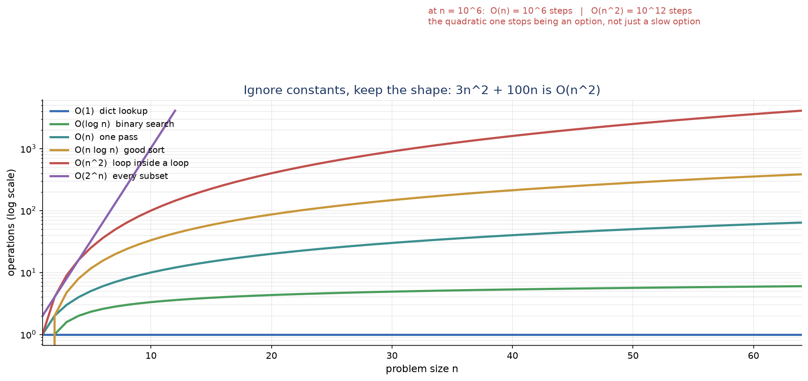

The horizontal axis is $n$ and the vertical axis is operations on a log scale. Once the exponential curve lifts, nothing saves it.

**Remember this: keep the shape of the growth, drop the constants.**

### 5.2 Mechanisms you must know

**(1) The definition.** Wall-clock time cannot measure an algorithm: it depends on the laptop and on whatever else is running. What matters is how $T(n)$ grows with $n$:

$$T(n) = O(f(n)) \quad \Longleftrightarrow \quad \text{for large } n,\ T(n) \le C\,f(n)$$

Only the **dominant term** survives; constant factors and lower-order terms are dropped:

$$3n^{2} + 100n = O(n^{2}), \qquad \frac{n^{2}}{2} + 5n = O(n^{2})$$

**(2) The common classes.** The right column is the order of operations at $n=10^{6}$:

| Class | Big-O | Typical source | $n=10^{6}$ |
| --- | --- | --- | --- |
| constant | $O(1)$ | dictionary lookup | $1$ |
| logarithmic | $O(\log n)$ | binary search | $20$ |
| linear | $O(n)$ | one pass | $10^{6}$ |
| linearithmic | $O(n\log n)$ | a good sort | $2\times 10^{7}$ |
| quadratic | $O(n^{2})$ | loop inside a loop | $10^{12}$ |
| exponential | $O(2^{n})$ | every subset | $10^{301030}$ |

| --- | --- | --- | --- |

Learn to reproduce this table. $10^{12}$ operations is slow but feasible; $10^{301030}$ exceeds the number of atoms in the observable universe.

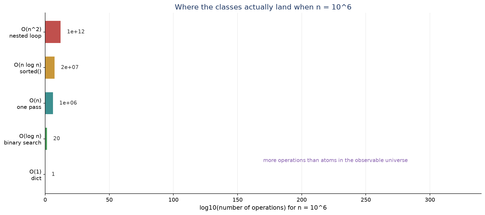

The six bars are operation counts at the same problem size $n=10^{6}$, on a log scale. The three on the left sit almost on the axis; the exponential bar has left the chart. **Same problem size, hundreds of thousands of orders of magnitude apart.** That is why complexity beats memorising seconds: the seconds change with the laptop, the order of magnitude does not.

**(3) How to count.** Count how often the **innermost statement** runs as a function of $n$, then keep the dominant term.

```python
total = 0
for i in range(n):
    total += x[i] * y[i]
```

The multiply runs $n$ times: $O(n)$.

```python
for i in range(n):
    for j in range(n):
        result[i] += A[i][j] * x[j]
```

The multiply runs $n^{2}$ times: $O(n^{2})$.

```python
steps = 0
while n > 1:
    n = n // 2
    steps += 1
```

$n$ halves each round, so the count is $\Theta(\log n)$: exactly $\lfloor\log_{2} n\rfloor$ halvings for a positive integer $n$. For $n=16$ that is $4$ rounds; for $n=1000$ the sequence is $1000\to500\to250\to125\to62\to31\to15\to7\to3\to1$, which is $9$ rounds.

**(4) The exponential recursion trap.** Naive Fibonacci satisfies

$$T(n) = T(n-1) + T(n-2) + O(1) \quad \Longrightarrow \quad T(n) = O(\varphi^{n}),\ \varphi = \frac{1+\sqrt{5}}{2}\approx 1.618$$

Measured: every increase of $5$ in $n$ multiplies the time by about $11$, because $\varphi^{5}\approx 11.09$. The loop version is $O(n)$.

**(5) Search: the structure sets the cost.**

- $x\ \text{in list}$: linear scan, $O(n)$.
- $x\ \text{in dict}$ or $\text{set}$: hash lookup, $O(1)$ average.
- $\text{list.index}(x)$: linear, raises $\text{ValueError}$ when absent.
- A sorted list supports binary search, $O(\log n)$; $\text{bisect.bisect\_left}$ implements it.

$$\text{ten million lookups: list } \approx 0.08\ \text{s}, \qquad \text{set } \approx 2\times 10^{-6}\ \text{s}$$

Four orders of magnitude. Convert once and all later lookups are cheap.

**(6) Why binary search needs sorted data.** Every step discards half the list based on whether the middle element is larger or smaller. Without sorting, "smaller than the middle" says nothing about which half contains the target.

**(7) Sorting: use the built-ins.**

```python
sorted(data)                 # returns a new list
data.sort()                  # in place, returns None
sorted(parts, key=mass, reverse=True)   # custom key, descending
```

- $\text{key=}$ takes the **function itself** (no brackets), or a $\text{lambda}$.
- $\text{reverse=True}$ sorts downwards.
- Tuples compare element by element.

**(8) The cost of three sorts.**

- Bubble sort: about $n^{2}/2$ comparisons, $O(n^{2})$.
- Quicksort: partition then recurse, $O(n\log n)$ on average, $O(n^{2})$ worst case.
- Built-in: $O(n\log n)$, running in compiled code.

| $n$ | bubble | quicksort | built-in |
| --- | --- | --- | --- |
| 1000 | 0.033 s | 0.0008 s | 0.00012 s |
| 2000 | 0.144 s | 0.0017 s | 0.00021 s |
| 4000 | 0.577 s | 0.0035 s | 0.00045 s |
| 8000 | 2.339 s | 0.0098 s | 0.00101 s |

Measured on random integer arrays of the stated size, in seconds:

| --- | --- | --- | --- |
| 1000 | 0.033 s | 0.0008 s | 0.00012 s |
| 2000 | 0.144 s | 0.0017 s | 0.00021 s |
| 4000 | 0.577 s | 0.0035 s | 0.00045 s |
| 8000 | 2.339 s | 0.0098 s | 0.00101 s |

Doubling $n$ quadruples bubble sort but only doubles quicksort.

**(9) Is sorting before searching worth it?** For one lookup, no: $O(n\log n)$ exceeds one $O(n)$ pass. For $m$ lookups, sorting plus $m$ binary searches costs $O(n\log n + m\log n)$ against $O(mn)$, so it wins as soon as $m$ grows.

### 5.3 What the code looks like

**Example 1: counting operations.**

```python
def count_pairs(n):
    total = 0
    for i in range(n):
        for j in range(i):
            total += 1
    return total
```

The inner loop runs $0+1+\dots+(n-1)=\frac{n(n-1)}{2}$ times, still $O(n^{2})$: halving the inner loop does not change the class.

**Example 2: a set turns lookup into a constant.**

```python
numbers = list(range(10_000_000))
numbers_set = set(numbers)
print(9_999_999 in numbers)       # True, about 0.08 s
print(9_999_999 in numbers_set)   # True, about 0.000002 s
```

**Example 3: sorting by a custom key.**

```python
parts = [("bolt", 0.02), ("panel", 2.1), ("washer", 0.004)]
heaviest = sorted(parts, key=lambda p: p[1], reverse=True)
print(heaviest[0])     # ('panel', 2.1)
```

**Example 4: binary search only works on sorted data.**

```python
import bisect
data = [1, 3, 5, 7, 9]
print(bisect.bisect_left(data, 5))       # 2
print(bisect.bisect_left([9, 1, 5], 5))  # meaningless: not sorted
```

The second call does not raise; it simply returns nonsense. **It does not check that you sorted.**

### 5.4 Worked example E5: search the likeliest patch of ocean first

After AF447, the search area is divided into cells with a probability (percent, summing to $100$) that the wreckage lies in each. (a) rank by probability descending and give the cumulative probability of the first two cells; (b) write a function returning the shortest prefix whose cumulative probability reaches a target such as $70\%$ or $90\%$; (c) after a cell is searched and nothing is found, the remaining probabilities are rescaled to sum to $100$: must they be re-sorted?

When every cell costs the same to search, the optimal strategy is to search in descending probability: for a fixed number of cells the covered probability is the sum of those cells. This becomes "sort, then prefix-sum", costing $O(n\log n)$ instead of enumerating orderings. So: fix the order by sorting, then sweep once.

**Step 1: sort**

$$\text{ranked} = \text{sorted}(\text{cells},\ \text{key}=\text{probability},\ \text{reverse}=\text{True})$$

Without $\text{reverse=True}$ the most likely cell is searched last.

**Step 2: accumulate**

$$S_k = \sum_{j=1}^{k} p_j, \qquad k^{\ast} = \min\{\, k : S_k \ge \text{target} \,\}$$

The condition is $\ge$: reaching the target exactly counts.

```python
def search_prefix(ranked, target):
    names, total = [], 0
    for name, p in ranked:
        names.append(name)
        total += p
        if total >= target:
            break
    return names
```

This step yields the prefix list, and the loop stops at the first element that reaches the target.

With the sample data the ranking is $B(45), D(30), C(15), A(10)$, summing to $100$.

- target $70$: $45<70$, adding $30$ gives $75\ge 70$, so the prefix is $[B, D]$: two cells.
- target $90$: $75<90$, adding $15$ gives $90\ge 90$, so the prefix is $[B, D, C]$: three cells.

The numbers $75$ and $90$ are additions, not guesses. Un-sorted, the order $A, C, D, B$ needs $10+15+30=55$ and then $100$ to pass $70$, that is four cells; sorting cuts it to two.

Two independent checks. First, a prefix sum cannot exceed $100$: $75$ and $90$ pass. Second, monotonicity: a larger target cannot need fewer cells, and indeed $70\to 90$ takes two to three. On cost: sorting is $O(n\log n)$ and the sweep is $O(n)$, so the total is $O(n\log n)$.

For part (c): the cleared cell gets probability $0$ and every remaining probability is multiplied by the same positive constant $c = 100/55$. **Multiplying by a positive constant preserves order**, so the ranking stands and the cleared cell is simply removed.

$$p_i < p_j \quad \Longleftrightarrow \quad c\,p_i < c\,p_j \quad (c>0)$$

$$\text{sort descending} \Rightarrow \text{accumulate} \Rightarrow \text{stop at the first } S_k \ge \text{target}, \qquad O(n\log n)$$

Target $70$ gives $[B, D]$ at $75\%$; target $90$ gives $[B, D, C]$ at $90\%$; rescaling needs no re-sort.

- Forgetting $\text{reverse=True}$: the least likely cell is searched first.
- Using $>$ instead of $\ge$: one extra cell when the total lands exactly on the target.
- Re-sorting after every update: rescaling does not change order.
- Sorting inside the loop: $O(n^{2}\log n)$.
- Assuming greedy is always optimal: with unequal survey times, ranking by probability per hour can fail.


### 5.4b How this chapter is examined

Chapter 5 is examined by attaching a complexity to a snippet, and the snippet is always a loop nest. Count the innermost statement, not the number of loops: two loops over the same list give $n^{2}$, two loops over the same list where the inner one starts at the outer index give about $n^{2}/2$, which is still $O(n^{2})$. A second shape asks for the precondition rather than the complexity: binary search needs a sorted list, so an unsorted list invalidates both the answer and the method. Keep the sentence "count the innermost statement" ready, because it converts a guess into work you can show.

### 5.5 Multiple-choice questions (8)

**Q5.1** What is the complexity of $T(n) = 3n^{2} + 100n + 7$?

- A. $O(n)$
- B. $O(n^{2})$
- C. $O(n^{2} + n)$
- D. $O(3n^{2})$

**Answer: B**

Why: for large $n$ the square term dominates; the constant $3$ and the linear term are dropped.

The other options: A drops the square; C is not a canonical form; D keeps a constant factor.

</details>

**Q5.2** What is the complexity here?

```python
total = 0
for i in range(n):
    for j in range(n):
        total += A[i][j] * x[j]
```

- A. $O(n)$
- B. $O(n\log n)$
- C. $O(n^{2})$
- D. $O(2^{n})$

**Answer: C**

Why: the outer loop runs $n$ times and the inner loop $n$ times each, so the body runs $n^{2}$ times.

The other options: A sees only one loop; B has no halving; D has no subset enumeration.

</details>

**Q5.3** What is the complexity of $\text{while n > 1: n = n // 2}$?

- A. $O(1)$
- B. $O(\log n)$
- C. $O(n)$
- D. $O(n\log n)$

**Answer: B**

Why: $n$ halves each round, so about $\log_{2} n$ rounds are needed.

The other options: A the count depends on $n$; C that is a loop decrementing by one; D there is no second loop.

</details>

**Q5.4** To test membership repeatedly among $10^{7}$ integers, what is best?

- A. scan the list with $\text{in}$ each time
- B. convert once to a set, then test with $\text{in}$
- C. sort it and scan from the start each time
- D. store it in a tuple and test with $\text{in}$

**Answer: B**

Why: hashing gives $O(1)$ per test, and one $O(n)$ conversion pays for all later lookups.

The other options: A and D are linear scans; C still scans, ignoring the order (binary search would be needed).

</details>

**Q5.5** Binary search requires that the data is

- A. integers
- B. sorted
- C. free of duplicates
- D. stored in a list

**Answer: B**

Why: each step uses the comparison with the middle element to discard half, which is only valid when the data is ordered.

The other options: A floats work too; C duplicates are allowed; D tuples and arrays work too.

</details>

**Q5.6** What is the difference between $\text{sorted(data)}$ and $\text{data.sort()}$?

- A. none
- B. the first returns a new list; the second sorts in place and returns $\text{None}$
- C. the first only works on numbers
- D. the second returns a sorted copy

**Answer: B**

Why: sorted is a built-in function returning a new list; sort is a method mutating the list and returning $\text{None}$.

The other options: A ignores the return value, and $x = \text{data.sort()}$ gives $\text{None}$; C sorted handles strings and tuples; D reverses them.

</details>

**Q5.7** The complexity of naive recursive Fibonacci is about

- A. $O(n)$
- B. $O(n\log n)$
- C. $O(\varphi^{n})$ with $\varphi\approx 1.618$
- D. $O(n^{2})$

- A. $O(n)$
- B. $O(n\log n)$
- C. $O(\varphi^{n})$, $\varphi\approx 1.618$
- D. $O(n^{2})$

**Answer: C**

Why: each call splits into two, so the work grows exponentially at the golden ratio; measured, every extra $5$ in $n$ multiplies the time by $11$.

The other options: A is the loop version; B is unrelated to sorting; D is far slower than exponential growth would allow at $n=100$.

</details>

**Q5.8** For a single lookup, "sort then binary search" compared with one linear scan is

- A. always faster
- B. usually slower, because sorting costs $O(n\log n)$, more than one $O(n)$ pass
- C. the same
- D. incomparable

**Answer: B**

Why: sorting dominates; only many lookups amortise it.

The other options: A holds only for many lookups; C ignores the sorting cost; D is false, complexities compare directly.

</details>

### 5.6 Chapter traps

- Keeping constants and lower-order terms: write $O(n^{2})$, not $O(3n^{2}+100n)$.
- Believing a shorter inner loop changes the class: $n(n-1)/2$ is still $O(n^{2})$.
- Binary searching unsorted data: no error, no meaning.
- Forgetting $\text{reverse=True}$ when the largest should come first.
- Sorting inside a loop: $O(n\log n)$ becomes $O(n^{2}\log n)$.
- Repeated $\text{in}$ tests on a list: convert to a set once.
- Writing $x = \text{data.sort()}$: $\text{None}$ is not a list.
- Assuming greedy is always optimal: unequal costs break it.

---

## NumPy and matplotlib: the parts Sheets 3 and 4 use

### 6.1 Arrays do arithmetic element by element

```python
import numpy as np
x = np.linspace(0.0, 1.0, 5)      # 5 points, both ends included
print(x)                           # [0.   0.25 0.5  0.75 1.  ]
print(x ** 2)                      # [0.     0.0625 0.25   0.5625 1.    ]
print(np.arange(0, 1, 0.25))       # [0.   0.25 0.5  0.75]  -- stop is excluded
```

The two array builders differ in the one way that matters for plots. `linspace(a, b, n)` takes the number of points and always hits both ends; `arange(a, b, step)` takes the spacing and stops before $b$. For a pulse that must be drawn from 0 to 40, use linspace, otherwise the last point is missing and the curve visibly stops short.

```python
import numpy as np
import matplotlib.pyplot as plt

def pulse(x, t, width):
    return np.exp(-((x - t) / width) ** 2)

x = np.linspace(0.0, 40.0, 4001)
for t in (10.0, 14.0, 18.0):
    plt.plot(x, pulse(x, t, 0.8), label=f"t = {t}")
plt.xlabel("time")
plt.ylabel("signal")
plt.legend()
plt.show()
```

Three curves from one function, three lines of plotting code. The loop is over the parameters, not over the samples: the 4001 samples are handled by one array operation each time. That is the pattern Sheet 3 Question 1 needs, and it is why eighty pulses cost eighty lines rather than eighty thousand points.

### 6.2 Matrices: the star is elementwise, the at sign is matrix product

For two-dimensional arrays the star keeps the element-by-element meaning, so `sigma * sigma` squares every entry and is not $sigma^2$ in the matrix sense. The matrix product is `@`, so `R @ sigma @ R.T` is the similarity transformation that rotates a stress tensor. Writing the star where the at sign belongs is one of the two errors that costs the most marks in Sheet 3 Question 3; the other is forgetting the transpose, which leaves a $2	imes2$ by $2	imes2$ product that runs happily and returns a non-symmetric matrix.

```python
import numpy as np
sigma = np.array([[120.0, 40.0], [40.0, 20.0]])
angle = np.radians(30.0)
R = np.array([[np.cos(angle), np.sin(angle)],
              [-np.sin(angle), np.cos(angle)]])
sigma_rot = R @ sigma @ R.T
print(np.round(sigma_rot, 2))   # [[129.64 -23.3 ], [-23.3 10.36]]
print(np.round(np.linalg.eigvalsh(sigma), 2))   # [ 5.97 134.03]
```

The two invariants give a free check that no marker can argue with. Trace and determinant do not change under a rotation, so a rotated matrix whose trace is not 140 or whose determinant is not 800 is wrong, full stop. Trace is 140 because $120 + 20 = 140$, and the determinant is 800 because $120 	imes 20 - 40^2 = 800$.

### 6.3 Plotting data you did not invent

Real data arrives as three parallel arrays: one number per record per column. The first job is to count categories with $\text{np.unique(..., return\_counts=True)}$, which returns sorted labels and their counts in one call, not in a loop. The second job is to plot honestly: transparency for overplotted points, a colour bar whenever colour carries a number, and a stated bin size whenever a histogram hides a choice.

```python
import numpy as np
import matplotlib.pyplot as plt

labels, counts = np.unique(category, return_counts=True)
order = np.argsort(counts)[::-1]
plt.bar(labels[order], counts[order])

plt.scatter(lon, lat, s=4, alpha=0.15)
plt.hist2d(lon, lat, bins=25)
plt.colorbar(label="Number of reports")

plt.loglog(ns, times, "o-")
plt.xlabel("list size")
plt.ylabel("seconds")
```

Transparency, bins and logarithmic axes each answer a question that a default plot answers wrongly. `alpha=0.15` turns a solid blob into a density you can read; `bins=25` versus `bins=50` can move an apparent hotspot, which is exactly what Sheet 3 Question 4 asks you to notice; a log-log axis turns a power law into a straight line whose slope is the exponent, which is how the timing experiment in Sheet 3 Question 2 is marked.

### Example E6: eighty pulses without eighty loops

**What is asked.** Sheet 3 Question 1 wants eighty curves of one pulse shape at eighty arrival times, with later pulses drawn on top and no tick labels, because eighty labels are unreadable. What is required is one array of times, one array of heights per pulse, and a plotting loop over the eighty parameters.

**Why this route.** The shape is one formula $y = e^{-((x-t)/w)^2}$ and only $t$ changes, so the expensive object is the sample grid, built once, and the loop runs over the eighty values of $t$. Rebuilding the grid inside the loop would repeat the same 4001 numbers eighty times.

**Step 1: build the grid once.** One call gives 4001 equally spaced samples 0.01 apart, so a pulse of width 0.8 collects about eighty samples and comes out smooth.

$$x = \text{linspace}(0,\ 40,\ 4001),\qquad \Delta x = \frac{40}{4000} = 0.01$$

**Step 2: evaluate one curve per call.** The call returns a height array the same length as $x$; the divisor 0.8 is the pulse width and changes the fatness of the curve, never its peak.

$$y_t = \exp\left[-\left(\frac{x - t}{0.8}\right)^{2}\right]$$

**Step 3: draw later pulses on top.** Matplotlib stacks later calls above earlier ones, so the arrival times must be plotted smallest first; plotting them the other way needs an explicit z-order on every line.

$$z_{\text{later}} > z_{\text{earlier}} \;\Longleftrightarrow\; \text{plot order}$$

**Step 4: drop eighty labels.** Above ten curves the tick labels overlap into a black band, so switching them off is part of the answer rather than a cosmetic choice.

$$\text{ticks} = \varnothing \quad\text{when}\quad n_{\text{curves}} \gg 10$$

**Where the constant comes from.** 4001 is not arbitrary: 40 divided into 4000 intervals gives 0.01, and a width of 0.8 needs a few dozen samples on each side to look smooth, which is $0.8/0.01 = 80$ samples. Writing 400 instead would give spacing 0.1 and only eight samples per pulse, which draws a zig-zag.

**Sanity check.** Substituting $x = t$ makes the exponent zero and the height 1, so all eighty peaks must have the same height; a visibly short peak means its arrival time fell outside the grid or the width was typed wrong.

**Answer.** One grid, one shape function, one loop over the parameters:

$$\{x\}_{4001},\quad y_t = e^{-((x-t)/0.8)^2},\quad t \in \{t_1, \dots, t_{80}\}$$

**Trap.** Three ways to lose marks: \text{arange}(0, 40, 0.01) misses the last point, so the curve stops short; rebuilding $x$ inside the loop wastes eighty grid builds; and no alpha or linewidth turns eighty curves into one black mass. The quietest one is putting $t$ outside the loop, which draws all eighty pulses in the same place so the figure shows a single line.

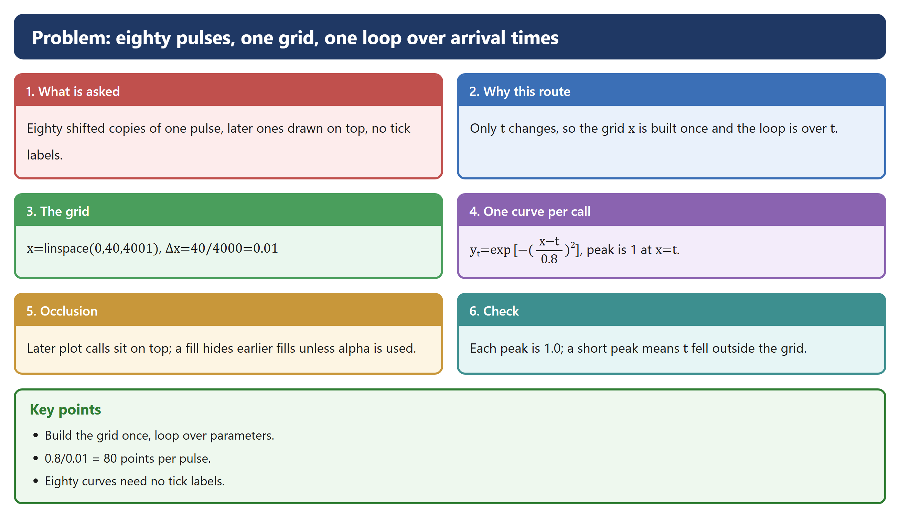

## Scientific Python: functions that return, random numbers and pandas

### 7.1 Functions that return, loops that accumulate

A function that prints its answer hands nothing back: the caller receives `None`, and the next arithmetic operation fails with a `TypeError`. A function that returns its answer hands back a number that can be stored, compared and plotted. Sheet 1 Question 3 is built entirely on that difference, and so is every simulation in the course: a yearly step is a function that returns the new balance.

```python
def yearly_step(debt, salary, rate):
    interest = debt * rate
    repayment = min(0.09 * salary, debt)
    return debt + interest - repayment

debt = 80000.0
for year in range(40):
    debt = yearly_step(debt, 35000.0, 0.065)
```

The loop looks trivial and is the whole point: $\text{debt = yearly\_step(...)}$ works because the function returns a number. With a printing function the second iteration would add `None` to a float and the program would stop with a message about unsupported operand types.

### 7.2 Random numbers, Monte Carlo, and the square-root law

Monte Carlo replaces an integral with an average. Sample the region uniformly, evaluate the integrand at each sample, average, and multiply by the volume. For the ten-dimensional integral in Sheet 4 Question 1 the region is the unit cube, so the volume is 1 and the estimate is just the mean of $1/(1 + \sum x_i^2)$.

```python
import numpy as np
rng = np.random.default_rng(1)
N = 1_000_000
points = rng.random((N, 10))
values = 1.0 / (1.0 + np.sum(points ** 2, axis=1))
print(values.mean())        # 0.2429 for this seed, target 0.243
```

The error of an average of $N$ independent samples falls as $1/\sqrt{N}$, so four more digits cost sixteen times the samples. That single sentence explains why Monte Carlo wins in ten dimensions (a grid with 10 points per axis already needs $10^{10}$ evaluations) and why it is hopeless for one dimension when a quadrature rule is available.

$$\text{error} \propto \frac{\sigma}{\sqrt{N}}$$

Here $\sigma$ is the standard deviation of one sample, not of the sample mean; the standard deviation of the mean is $\sigma/\sqrt{N}$, which is where the rule comes from, and it is why raising $N$ from $10^{4}$ to $10^{5}$ moves the root-mean-square error only from 0.0252 to 0.00707, a ratio of 3.56 against the predicted 3.16.

### 7.3 pandas: split, apply, combine in one call

`groupby` does no arithmetic; it only records how rows should be split, which is why it returns a GroupBy object you can print and see nothing useful. `.agg([...])` then applies each function to each group and stacks the answers into one row per group. Selecting one column before `.agg` is what keeps the result readable, and `count` (not `size`) is the one that ignores missing values.

```python
df["ld_ratio"] = df["lift_N"] / df["drag_N"]
summary = df.groupby("config")["ld_ratio"].agg(["mean", "std", "count"])
print(summary.round(3))
```

One agg call returns the mean, the standard deviation and the count side by side. The standard deviation uses $n-1$ in the denominator, so with five repeat runs it is the sample standard deviation, not the population one; quoting it as if it were exact is the difference between "Winglet is better by 2.2" and "Winglet is better by 2.2 with a spread of 0.6 over five runs".

### Example E7: Buffon's needle and the square-root law

**What is asked.** Sheet 4 Question 4 wants $\pi$ estimated by needle throws, first with one million throws, then with two hundred independent seeds to see the spread, then the root-mean-square error against $N$ to test the $1/\sqrt{N}$ law. No loop over individual needles: the throws must be arrays.

**Why this route.** A needle of length $L$ at angle $\theta$ crosses a line when its centre falls within $(L/2)\sin\theta$ of one, so the crossing probability is $2L/(\pi D)$ with $D$ the line spacing. Setting $L = D$ gives $P = 2/\pi$, which inverts to $\pi \approx 2N/N_{\text{cross}}$, and both the angle and the centre can be drawn as arrays.

**Step 1: draw angles and centres.** The angle only needs a quarter turn, because the other three quadrants repeat the same information by symmetry, and the centre only needs half the spacing.

$$\theta \sim U\!\left(0, \tfrac{\pi}{2}\right),\qquad d \sim U\!\left(0, \tfrac{D}{2}\right)$$

**Step 2: test the crossing.** The test returns a boolean array whose sum is the crossing count; with $L = D = 1$ the right-hand side is $\tfrac12 \sin\theta$.

$$\text{cross} \iff d \le \frac{L}{2}\sin\theta$$

**Step 3: invert the ratio.** One million throws with seed 42 cross 637,904 times, which gives $\hat{\pi} = 2 \times 10^{6}/637{,}904 = 3.1355$.

$$\hat{\pi} = \frac{2N}{N_{\text{cross}}}$$

**Step 4: watch the error fall.** The root-mean-square error drops from 0.241 at $N = 100$ to 0.00707 at $N = 10^{5}$, a ratio of 34.1 against the predicted $\sqrt{1000} = 31.6$.

$$\text{RMSE}(N) \propto \frac{1}{\sqrt{N}}$$

**Where the constant comes from.** The 2 in $2/\pi$ is not a slip: a needle can cross a line with either end leading, and when the length equals the spacing the two orientations add up to exactly 2. Writing $\pi \approx N/N_{\text{cross}}$ gives about 1.57, wrong by a factor of two, and the error is stable enough to look plausible.

**Sanity check.** Two hundred seeds of ten thousand throws give a mean of 3.1449, a spread of 0.0249, and a range from 3.0859 to 3.2352; $\pi = 3.1416$ sits inside the cloud, which is what rules out a systematic bias.

**Answer.** One array simulation plus one square-root law:

$$\hat{\pi} = \frac{2N}{N_{\text{cross}}},\qquad \text{RMSE}(N) \propto N^{-1/2}$$

**Trap.** Three ways to lose marks: setting the needle length different from the spacing but still using $2N/N_{\text{cross}}$ instead of $2LN/(D N_{\text{cross}})$; reseeding once and assuming every later call repeats, when each call advances the generator; and plotting RMSE against $N$ on ordinary axes, where the power law looks like nothing at all.

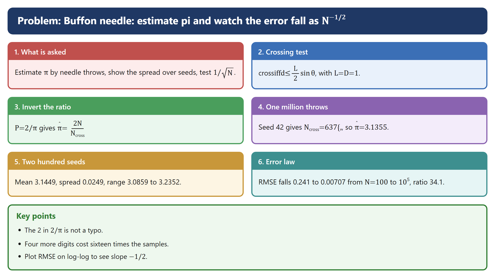

## Canvas sheet solutions: every part, with the number it prints

Every number below was produced by running the code shown, not by copying a printed answer key. The introductory sheet and Sheet 1 have Canvas solutions; Sheets 2 to 4 do not, so those answers are mine, written to the style of the published ones.

### S0Q1: names, operators and type errors

The four parts test one thing each: an unquoted name is a variable, not a string; an operator does what its symbol says; text and number cannot be added; and input always hands back text.

```python
name = John          # NameError: name 'John' is not defined
name = "John"        # fine: a string
print(7 // 2, 7 % 2, 2 ** 10, 7 / 2)     # 3 1 1024 3.5
print("total: " + 42)                    # TypeError: can only concatenate str (not "int") to str
print("total: " + str(42))               # total: 42
age = int(input("age? "))                # input gives text; int converts it
```

Part (i) fails at the parse-free moment Python looks up the name: `John` has never been assigned, so the program stops with NameError. Part (ii) prints `3 1 1024 3.5` because `//` keeps the floor, `%` keeps the remainder, `**` is a power and a single `/` always returns a float. Part (iii) is a TypeError, not a silent `"total: 42"`. Part (iv), the starred one, is the same trap one step later: `"12" + "34"` gives `"1234"`, not 46, so anything arithmetic needs `int()` or `float()` first.

### S0Q2: branches in order, and the three arguments of range

An `if/elif/else` chain stops at the first true test, so the order of the tests is the logic; a test placed too early swallows the cases below it. `range(start, stop, step)` includes start, excludes stop, and steps by step.

```python
for i in range(1, 10, 3):
    print(i)                    # 1 4 7
for n in range(1, 6):
    if n % 2 == 0:
        print(n, "even")        # 2 even / 4 even
```

Part (i): with thresholds 25 and 10 written as `if t > 25` first, a temperature of exactly 25 falls through to the next test, which is the answer the sheet is fishing for, because `>` and $\ge$ differ only at the boundary. Part (ii): `range(1, 10, 3)` gives 1, 4, 7 and not 10, because the stop value is excluded. Part (iii), starred, adds the `if` inside the loop; the loop still runs all five values, it just prints on two of them.

### S0Q3: a function that returns, a loop that calls it

A function returns a value with `return`; without it the caller gets `None`. A loop over data calls the function once per item and does something with each result.

```python
def rectangle_area(width, height):
    return width * height

total = 0
for w, h in [(2.0, 3.0), (1.5, 4.0), (10.0, 0.5)]:
    total += rectangle_area(w, h)
print(total)        # 17.0

def classify(mark):
    if mark >= 70:
        return "distinction"
    if mark >= 60:
        return "merit"
    if mark >= 40:
        return "pass"
    return "fail"

print(classify(69.9), classify(70.0))    # merit distinction
```

The returned value is what makes the accumulation possible: $\text{total += rectangle\_area(...)}$ only works because a number comes back. In the starred part the thresholds are checked from the top, so 69.9 stops at the second test and 70.0 at the first; swapping the order would label 70.0 as merit, which is the mistake the part is designed to catch.

### S0Q4: linspace, one plot, and a function called in a loop

Plotting needs two arrays of the same length. `np.linspace(a, b, n)` builds the sample grid once, a function turns the grid into heights, and `plt.plot` draws one curve per call.

```python
import numpy as np
import matplotlib.pyplot as plt

def f(x):
    return np.sin(x) * np.exp(-0.2 * x)

x = np.linspace(0.0, 10.0, 500)
plt.plot(x, f(x), label="damped sine")
for k in (0.1, 0.3):
    plt.plot(x, f(x) * np.exp(-k * x), label=f"extra damping {k}")
plt.legend()
plt.xlabel("x")
plt.ylabel("amplitude")
plt.show()
```

Part (i) is the plain curve; part (ii) puts a second curve on the same axes and needs `label` plus `plt.legend()` or the reader cannot tell which is which. Part (iii), starred, calls the same function inside a loop over the parameter, which is the same pattern as Example E6.

### S0Q5: a forty-year simulation, then a plot, then a function

The repayment model is a state machine with one number of state, the outstanding debt. Each year applies interest to the debt, subtracts the repayment, and stores the new debt back into the same name.

```python
def yearly_repayment(debt, salary, rate=0.065):
    interest = debt * rate
    paid = min(0.09 * salary, debt + interest)
    return debt + interest - paid

debt = 80000.0
history = []
for year in range(40):
    debt = yearly_repayment(debt, 35000.0)
    history.append(debt)
print(round(history[0], 2), round(history[-1], 2))

plt.plot(range(1, 41), history)
plt.xlabel("year")
plt.ylabel("outstanding debt")
plt.show()
```

Two details decide whether the simulation is right. `min(0.09 * salary, debt + interest)` stops the debt going negative, which a careless version does in the last years and then shows the bank paying the graduate. And $\text{debt = yearly\_repayment(debt, ...)}$ reuses the name on purpose: the new debt is the state for the next year. Part (iv), starred, is the wrapper: once the loop is inside a function, the salary and the starting debt become parameters and the history becomes the return value, which is what makes the printing version testable.

### S1Q1: cancellation, and the one rearrangement that fixes it

$\sqrt{x^{2}+1}-x$ subtracts two nearly equal numbers when x is large, so the true answer 5e-9 is destroyed by the subtraction of 1e8 from 1e8. Multiplying by the conjugate turns the difference into a quotient of two large numbers, which loses nothing.

```python
import math
x = 1e8
print(x * x + 1 == x * x)                     # True  -- the 1 is gone
print(math.sqrt(x * x + 1) - x)               # 0.0
print(1.0 / (math.sqrt(x * x + 1) + x))       # 5e-09
```

The check `x*x + 1 == x*x` being `True` is the whole diagnosis: a double holds about sixteen significant digits, and $10^{16} + 1$ needs seventeen, so the 1 is rounded away before the square root is even taken. Both formulas are algebraically identical, and only one of them is numerically usable; that is the difference between a correct formula and a correct program.

### S1Q2: addition is not associative

Floating-point addition rounds at every step, so $(a+b)+c$ and $a+(b+c)$ can differ. Shuffling a list changes the order of the additions, and chunking changes it again, which is why a distributed sum is not automatically the same sum.

```python
a, b, c = 0.1, 1e20, -1e20
print((a + b) + c)     # 0.0
print(a + (b + c))     # 0.1

import random
vals = [1e-10, 1e-5, 1e-2, 1, -1e-10, -1e-5, -1e-2, -1]
random.seed(8)
totals = set()
for _ in range(10000):
    random.shuffle(vals)
    totals.add(sum(vals))
print(len(totals), min(totals), max(totals))   # 9 -6.55e-17 6.55e-17

def chunked(xs, k):
    return sum(sum(xs[i:i + k]) for i in range(0, len(xs), k))
print([chunked(vals, k) for k in (1, 2, 4, 8)])  # 0.0 8.08e-19 0.0 0.0
```

Part (i) is the smallest possible demonstration: $10^{20}$ swallows 0.1 completely, so the sum is 0 or 0.1 depending only on where the small number sits. Part (ii) shows nine different totals for ten thousand shuffles of the same eight numbers, all within $\pm 6.6\times10^{-17}$ of zero, which is the size of one rounding step at these magnitudes. Part (iii), starred, shows the chunk size changing the answer: only two distinct values survive here, but the number of distinct values is the point. Part (iv), also starred, asks how to buy batch invariance: $\text{math.fsum}$ keeps an exact running total and gives one answer for every order, at the cost of a slower loop, or sort by magnitude first, which costs $O(n\log n)$.

### S1Q3: print versus return, and a margin that never updates

The fuel check has three parts: compute the rate, multiply by the distance, subtract from the tank. The trap is that the function that should apply the safety margin assigns to its own parameter, so the caller's number never changes.

```python
rate = 1.2 + 2e-5 * 220 ** 2       # 2.168 L/km
needed = 15 * rate                  # 32.52 L
print(round(rate, 3), round(needed, 2), round(25.0 - needed, 2))   # 2.168 32.52 -7.52

def add_reserve(fuel, fraction):
    fuel = fuel * (1 + fraction)    # rebinding a local: caller unaffected
    return fuel

def decision(fuel, distance, v, reserve):
    need = distance * (1.2 + 2e-5 * v ** 2)
    add_reserve(need, reserve)
    return fuel - need              # need is the ORIGINAL value

print(decision(25.0, 15.0, 220.0, 0.05))    # -7.52
print(decision(40.0, 15.0, 220.0, 0.05))    # 7.48
```

Part (i): 220 km/h gives 2.168 L/km, so 15 km needs 32.52 L. Part (ii): 25 L minus 32.52 L is $-7.52$, and the sheet's trace wants exactly that number with the correct sign. Part (iii): $\text{add\_reserve(need, reserve)}$ computes `need * 1.05` and throws it away, so the decision is still $-7.52$ instead of $-8.98$; the fix is $\text{need = add\_reserve(need, reserve)}$. A second car with a 40 L tank prints 7.48 and passes, which shows the bug only bites near the boundary, and that is why it survives a quick check.

### S1Q4: range, crossover speed and the battery you cannot buy

Two forces set the range: rolling resistance grows like $v$ in the fuel rate, aerodynamic drag grows like $v^{2}$ in the force and like $v^{3}$ in the power. Below the crossover speed the car is limited by rolling, above it by drag, and the range has a maximum at the crossover.

```python
import math
m, Cr, Cd, A, rho, g = 1800.0, 0.01, 0.23, 2.22, 1.225, 9.81
v_cross = math.sqrt(2 * Cr * m * g / (Cd * A * rho))     # 23.76 m/s
E = 75 * 3.6e6
def rng(v):
    return E / (Cr * m * g + 0.5 * Cd * A * rho * v ** 2) / 1000.0
print(round(v_cross, 2), round(v_cross * 3.6, 1))    # 23.76 85.5
print(round(rng(31.29), 1), round(rng(22.35), 1))    # 565.9 823.3
print(round((Cr*m*g + 0.5*Cd*A*rho*31.29**2) * 660 / 3.6e6, 2))   # 87.47 kWh
```

Part (i): setting the two forces equal gives $v = \sqrt{2C_r m g/(C_d A \rho)} = 23.76$ m/s, which is 85.5 km/h, so at 70 mph (31.3 m/s) the car is above the crossover. Part (ii): 31.3 m/s gives 565.9 km against a 660 km target, so the answer to "can it reach the next charger" is no; 22.35 m/s gives 823.3 km, so slowing down is not a small effect but a 46 per cent gain. Part (iii), starred: the energy actually needed for 660 km at 70 mph is 87.47 kWh, against a 75 kWh battery, so the car cannot do it even with the last electron; the answer is a required capacity, not a yes or no.

### S2Q1: one list shared by every instance

A list written in the class body belongs to the class, not to each instance, so every counter appends to the same history. The fix is one line in $\text{\_\_init\_\_}$, which gives each instance its own list.

```python
class Counter:
    history = []                 # class attribute: shared
    def __init__(self, value):
        self.value = value
    def bump(self):
        self.value += 1
        self.history.append(self.value)

a, b = Counter(0), Counter(10)
a.bump(); b.bump()
print(a.history, b.history, a.history is b.history)   # [1, 11] [1, 11] True

class Fixed:
    def __init__(self, value):
        self.value = value
        self.history = []        # one list per instance
    def bump(self):
        self.value += 1
        self.history.append(self.value)
    def bump_until(self, target):
        n = 0
        while self.value < target:
            self.bump(); n += 1
        return n

f = Fixed(0)
print(f.bump_until(5), f.value, f.history)   # 5 5 [1, 2, 3, 4, 5]
```

Part (i): both counters print `[1, 11]` because `a.history` and `b.history` are the same object, and `is` proves it. Part (ii): the one-line fix is `self.history = []` in $\text{\_\_init\_\_}$, which creates a fresh list per instance. Part (iii), starred: $\text{bump\_until}$ returns the number of bumps, not the final value, and those differ when the target is reached from a non-zero start.

### S2Q2: a next-word dictionary, then entropy

The model is a dictionary from a word to the list of words that followed it. Building it is one pass over adjacent pairs; generating text is repeatedly looking up the current word and picking one successor; entropy measures how surprised the model is.

```python
log = ("fluid mechanics is the study of equilibrium and motion of fluids "
       "under the action of forces while in solid mechanics equilibrium "
       "and motion are of approximately equal importance in fluid "
       "mechanics the study of equilibrium is but a very small part the "
       "vast majority of fluid mechanics is about fluids in motion")
words = log.split()
next_words = {}
for i in range(len(words) - 1):
    next_words.setdefault(words[i], []).append(words[i + 1])
print(len(next_words), next_words["of"])
# 28 ['equilibrium', 'fluids', 'forces', 'approximately', 'equilibrium', 'fluid']

def successors(model, word):
    return model.get(word, [])
print(successors(next_words, "turbulence"))     # []

def most_common(options):
    counts = {}
    for w in options:
        counts[w] = counts.get(w, 0) + 1
    best = options[0]
    for w in options:
        if counts[w] > counts[best]:
            best = w
    return best

def generate(model, start, n):
    out = [start]
    while len(out) < n:
        opts = successors(model, out[-1])
        if not opts:
            break
        out.append(most_common(opts))
    return out
print(" ".join(generate(next_words, "fluid", 12)))
# fluid mechanics is the study of equilibrium and motion of equilibrium and
```

Part (i): 52 words give 51 transitions and 28 distinct contexts, and `"of"` has six successors. Part (ii): `model[word]` raises KeyError for a word never seen, while `model.get(word, [])` returns an empty list, which the generator needs because a dead end must end the sentence rather than crash. Part (iii): $\text{most\_common}$ compares counts in list order, so ties go to the word that appeared first, not to an alphabetical winner; the generated line above shows the model falling into a two-word loop, which is the honest behaviour of a first-order model. Part (iv), starred: the zero-order entropy is $H_0 = -\sum p(w)\log_2 p(w) = 4.522$ bits, the first-order entropy averages that over contexts and gives $H_1 = 0.819$ bits, an 81.9 per cent reduction, because 20 of the 28 contexts have only one successor and cost nothing to predict.

### S2Q3: counting zeros and finding the longest run are different questions

One function counts how many readings are zero; the other finds how many zeros in a row at worst. Two signals can agree on the count and disagree on the run, which is exactly what the sheet builds its answer around.

```python
readings = {"A1": [2.1, 2.4, 0.0, 2.2], "A2": [0.0, 2.3, 0.0, 2.1],
            "B1": [1.8, 0.0, 0.0, 1.9], "B2": [0.0, 0.0, 0.0, 0.0]}

def count_zeros(data):
    return {k: sum(1 for x in v if x <= 0) for k, v in data.items()}

def longest_zero_run(data):
    result = {}
    for k, v in data.items():
        run = best = 0
        for x in v:
            if x > 0:
                run = 0
                continue
            run += 1
            best = max(best, run)
        result[k] = best
    return result

print(count_zeros(readings))          # A1 1, A2 2, B1 2, B2 4
print(longest_zero_run(readings))     # A1 1, A2 1, B1 2, B2 4
```

Part (i): A2 has two zeros, so its count is 2. Part (ii): the two functions need names that say which question they answer; `p` and `q` make a wrong call invisible in review, and one docstring per function is the cheapest fix. Part (iii): A2 disagrees, with count 2 and run 1, which is the whole point of the sheet: a sensor that drops out twice briefly is a different fault from a sensor that drops out for two readings in a row, and only the run tells them apart.

### S2Q4: a greedy plan is not the fastest plan

The greedy rule takes the farthest reachable airfield every time, which uses the fewest stops. It does not minimise time, because a nearer stop with a fast turnaround can beat a farther one with a slow one.

```python
def fuel_per_km(v, headwind):
    return (22.0 + 0.00028 * v ** 2) / (v - headwind)

V, HW, TANK, RESERVE, GOOSE = 250.0, 25.0, 300.0, 30.0, 3400.0
fields = [("Stornoway", 300, 100), ("Vagar", 700, 80), ("Reykjavik", 1200, 150),
          ("Kulusuk", 1450, 8), ("Nuuk", 2200, 60), ("Narsarsuaq", 2500, 80),
          ("Iqaluit", 2900, 100)]
fpm = fuel_per_km(V, HW)       # 0.17556 L/km
```

Part (i): from the start the reachable set is Stornoway, Vagar, Reykjavik and Kulusuk, because 300 L covers $300/0.17556 = 1708$ km and the 30 L reserve removes another 171 km, so the effective reach is about 1537 km. Part (ii): the greedy plan stops at Kulusuk (45.4 L left, 31.8 min refuel) and then at Iqaluit, 17.18 h in total. Part (iii), starred: closing Kulusuk forces a longer first leg to Reykjavik and the total time drops to 16.68 h, which is the sheet's point that a greedy plan is optimal for the number of stops and not for the clock.

### S3Q1: eighty pulses, drawn in an order that occludes correctly

The curves are the same shape at different arrival times, so one grid and eighty evaluations suffice. Drawing later pulses on top requires plotting in time order, and any background pulse that should sit behind must be drawn first.

```python
x = np.linspace(0.0, 40.0, 4001)
times = [8.0 + 0.25 * i for i in range(80)]
for t in times:
    plt.plot(x, np.exp(-((x - t) / 0.8) ** 2), color="C0", alpha=0.6)
plt.xticks([])          # eighty labels would be unreadable
plt.show()

# occlusion: plot the background first, then the one that must sit on top
plt.plot(x, np.exp(-((x - 10.0) / 0.8) ** 2), color="C1", linewidth=3)
plt.plot(x, np.exp(-((x - 10.0) / 0.8) ** 2), color="C0", linewidth=1)
```

Part (i): five pulses are readable drawn individually. Part (ii): at eighty, the ticks must go, otherwise the axis becomes a black band. Part (iii), starred: $\text{fill\_between}$ fills the area under a curve with a solid colour, so a later filled pulse hides an earlier one completely; that is why the order of the fill calls is the answer, and why `alpha` plus drawing from far to near is what makes the fan visible.

### S3Q2: three duplicate checks, three different costs

A nested double loop compares every pair and costs $O(n^{2})$; sorting first and then looking at neighbours costs $O(n\log n)$; a set costs $O(n)$ expected. The measured growth is what turns the algebra into a number.

```python
import time, random
def nested(xs):
    for i in range(len(xs)):
        for j in range(i + 1, len(xs)):
            if xs[i] == xs[j]:
                return True
    return False

def sorted_pair(xs):
    s = sorted(xs)
    return any(a == b for a, b in zip(s, s[1:]))

def set_pair(xs):
    return len(set(xs)) != len(xs)

random.seed(3)
for n in (500, 1000, 2000):
    xs = random.sample(range(n * 100), n)
    t0 = time.perf_counter(); nested(xs); t1 = time.perf_counter()
    sorted_pair(xs); t2 = time.perf_counter()
    set_pair(xs); t3 = time.perf_counter()
    print(n, round(t1 - t0, 4), round(t2 - t1, 5), round(t3 - t2, 5))
# 500  0.0033  6e-05  2e-05
# 1000 0.0123  1.3e-04 3e-05
# 2000 0.0484  2.5e-04 1.1e-04
```

Part (i): the three functions answer the same question, so the only difference is cost. Part (ii): the experiment doubles $n$ twice, and the nested column grows by 3.7 and then 3.9, which is the $n^{2}$ signature ($2^{2} = 4$), while the sort column grows by about 2.1 each time ($2\log 2 \approx 2.1$) and the set column roughly doubles. Part (iii): at the largest $n$ the nested loop is 194 times slower than the set, so the ratio is not a preference but a decision: pick the set unless you need the actual duplicate pairs.

### S3Q3: rotating a stress tensor and checking it did not cheat

The rotation is $\sigma' = R\sigma R^{\mathsf{T}}$ with $R$ built from $\cos\theta$ and $\sin\theta$. Trace and determinant are invariants, so they must not move; the principal angle is where the off-diagonal entry vanishes.

```python
import numpy as np
sigma = np.array([[120.0, 40.0], [40.0, 20.0]])
def rot(sig, deg):
    a = np.radians(deg)
    R = np.array([[np.cos(a), np.sin(a)], [-np.sin(a), np.cos(a)]])
    return R @ sig @ R.T
print(np.round(rot(sigma, 30), 2))            # [[129.64 -23.3 ], [-23.3 10.36]]
print(np.round(np.linalg.eigvalsh(sigma), 2)) # [  5.97 134.03]
print(np.trace(sigma), np.linalg.det(sigma))  # 140.0 800.0
print(np.trace(rot(sigma, 75)), np.linalg.det(rot(sigma, 75)))   # 140.0 800.0
```

Part (i): rotating 30 degrees gives a normal stress of 129.64 on the first face and a shear of $-23.3$, whose sign says the rotated face is being slid in the negative direction. Part (ii): `*` would square each entry, `@` multiplies matrices; the transpose is what makes the result symmetric, and a missing transpose still runs and produces a non-symmetric matrix. Part (iii): scanning the angle in 0.1 degree steps puts the zero shear at 109.3 degrees, where the normal stresses are 5.97 and 134.03, matching the eigenvalues. Part (iv), starred: `eigvalsh` returns the eigenvalues sorted, and the trace 140 and determinant 800 stay fixed through every rotation, which is the independent check.

### S3Q4: latitude, longitude, and a histogram that hides a choice

The data arrives as parallel arrays, one value per report per column. Counting categories, plotting points with transparency and binning into a 2D histogram are three different verbs, and the bin width is a choice the plot does not expose.

```python
labels, counts = np.unique(category, return_counts=True)
print(labels, counts)                       # residential park road industrial
                                            # 284 123 112 81
order = np.argsort(counts)[::-1]
plt.bar(labels[order], counts[order])

plt.scatter(lon, lat, s=4, alpha=0.15)
plt.plot(-0.13, 51.5, "r*", markersize=12)  # one marked site

h, xe, ye = np.histogram2d(lon, lat, bins=25)
plt.hist2d(lon, lat, bins=25); plt.colorbar(label="reports")
```

Part (i): the three arrays are extracted independently and must stay aligned; zip them only for display, never for counting. Part (ii): $\text{np.unique(..., return\_counts=True)}$ gives sorted labels and counts, so sorting by count needs `np.argsort` on the counts, not on the labels. Part (iii): `alpha=0.15` is what turns overlapping points into density; a marked site is added as a separate `plot` call. Part (iv): the 2D histogram prints the counts per cell, and the colour bar is what makes the colours mean something. Part (v), starred: at $25\times25$ bins only 62.6 per cent of cells are empty and the hottest cell holds 14 reports, at $50\times50$ the empty fraction rises to 83.0 per cent and the hottest cell holds 7; the hotspot does not move, but its apparent sharpness does, so any claim about a hotspot must state the bin size.

### S4Q1: ten-dimensional Monte Carlo, and why a grid cannot compete

The integral is the average of $1/(1+\sum x_i^{2})$ over the unit cube, so the volume is 1 and the estimate is a mean. In ten dimensions a grid with ten points per axis needs $10^{10}$ evaluations, while a million random points give three good digits.

```python
import numpy as np
rng = np.random.default_rng(1)
N = 1_000_000
pts = rng.random((N, 10))                  # (N, 10) in one call
vals = 1.0 / (1.0 + np.sum(pts ** 2, axis=1))
print(round(vals.mean(), 4))               # 0.2429
```

The `axis=1` is the whole vectorisation: summing along axis 1 collapses the ten coordinates of each point into one number, and `vals` keeps length $N$. Change it to `axis=0` and the result is a ten-vector of averages over points, which has the right shape and the wrong meaning, and the estimate quietly becomes a number near 0.9 instead of 0.243. The value 0.2429 agrees with the sheet's quoted 0.243, which is what a correct implementation with a different seed should do.

### S4Q2: one groupby, one agg, three columns

`groupby` only splits; `.agg` computes. Selecting the ratio column before `.agg` keeps one column of results per statistic, and `count` tells you how many runs each mean is built from.

```python
df["ld_ratio"] = df["lift_N"] / df["drag_N"]
summary = df.groupby("config")["ld_ratio"].agg(["mean", "std", "count"]).round(3)
print(summary)
```

The printed table is Baseline 14.192 with a spread of 0.531 over 5 runs, Slotted 14.981 with 0.349, and Winglet 16.399 with 0.602. Part (i) wants exactly this shape: three groups, three statistics, no loops. Part (ii): Winglet has the highest mean, but the gap to Slotted is 1.4 while its own spread is 0.6 over five runs, so the honest statement is "Winglet is ahead, and the repeatability is about 0.6", not "Winglet is 1.4 better" as if the means were exact.

### S4Q3: two printed outputs the sheet's own dictionary cannot produce

This question is worth doing carefully because the sheet prints two outputs that its own $\text{gpt\_dict}$ cannot reproduce. The dictionary lists `"important"` twice, once as `"crucial"` and later as `"load-bearing"`; Python keeps the last one, so `important` becomes `load-bearing`, not the `crucial` in the printed answer. And `"area"` maps to `"landscape"`, so `areas` can become `landscapes` or stay `areas`, but never `realms`.

```python
gpt_dict = {"important": "crucial", "use": "leverage", "unknown": "layers of uncertainty",
            "show": "underscore", "opinion": "subjective assessment", "many": "a myriad of",
            "problem": "challenge", "error": "interesting correction", "area": "landscape",
            "important": "load-bearing", "help": "facilitate", "clear": "nuanced",
            "very": "deeply"}
print(gpt_dict["important"])          # load-bearing -- the duplicate key wins

def remove_punct(s):
    return "".join(ch for ch in s if ch.isalnum())

def gpt_speakify(s, gpt_dict):
    out = []
    for word in s.split():
        core = remove_punct(word)
        out.append(word.replace(core, gpt_dict[core]) if core in gpt_dict else word)
    return " ".join(out)

text = "this is a very important problem, and we can use data to help."
print(gpt_speakify(text, gpt_dict))
# this is a deeply load-bearing challenge, and we can leverage data to facilitate.
```

The punctuation survives because the replacement is done on the whole word: `"problem,".replace("problem", "challenge")` gives `"challenge,"`, comma included. The plural `problems` cannot be reached this way, because $\text{remove\_punct("problems")}$ is `"problems"`, which is not a key, so the word is left alone; the sheet's `challenges` needs a stem match, which is a different function. Both discrepancies are worth writing down rather than papering over: the printed answer is what the author intended, and the dictionary is what the code obeys.

### S4Q4: Buffon's needle, and the square-root law on one plot

Each throw samples an angle and a distance from the nearest line; the needle crosses when the distance is below $(L/2)\sin\theta$. With $L$ equal to the line spacing the crossing probability is $2/\pi$, so $\pi \approx 2N/N_{\text{cross}}$.

```python
import numpy as np
def buffon_pi(n, seed):
    np.random.seed(seed)
    ang = np.random.uniform(0, np.pi / 2, n)
    d = np.random.uniform(0, 0.5, n)
    return 2 * n / np.sum(d <= 0.5 * np.sin(ang))

print(round(buffon_pi(1_000_000, 42), 4))                   # 3.1355
ests = [buffon_pi(10_000, s) for s in range(200)]
print(round(np.mean(ests), 4), round(np.std(ests), 4))      # 3.1449 0.0249
print(round(min(ests), 4), round(max(ests), 4))             # 3.0859 3.2352
```

Part (i): one million throws give 3.1355, which is 0.0061 below $\pi$ and inside the expected spread for that $N$. Part (ii): two hundred seeds of ten thousand throws give a mean of 3.1449, a spread of 0.0249 and a range from 3.0859 to 3.2352, so $\pi$ sits inside the cloud with no visible bias. Part (iii): the root-mean-square error falls from 0.241 at $N = 100$ to 0.00707 at $N = 10^{5}$, a factor of 34.1 for a thousandfold increase in $N$, against the predicted $\sqrt{1000} = 31.6$; the log-log plot of RMSE against $N$ is a straight line of slope $-1/2$, which is the check the question asks for. Part (iv), starred: darts inside a square estimate $\pi/4$ with probability $\pi/4$ and variance about $0.785 \times 0.215$, while the needle's indicator has probability $2/\pi \approx 0.637$ and variance about $0.637 \times 0.363$, so per throw the dart is slightly more variable; the needle wins only when you count the work per useful sample, which is not the same comparison.

### S4Q5: peak grows, energy does not

The toy profile $u_n(x) = \sqrt{n}\,(1 - n|x|)$ on $|x| \le 1/n$ has peak $\sqrt{n}$ and integral $1/\sqrt{n}$, so its energy $\int u_n^{2}$ is constant at $2/3$ while the peak diverges. This is the finite-time blow-up caricature, and it is the cleanest example in the whole course of "one quantity bounded, another not".

```python
import numpy as np
def toy(n, x):
    return np.where(np.abs(x) <= 1.0 / n, np.sqrt(n) * (1 - n * np.abs(x)), 0.0)
x = np.linspace(-1, 1, 2001)
for n in (1, 4, 16, 64):
    y = toy(n, x)
    print(n, round(y.max(), 3), round(np.trapezoid(y ** 2, x), 4))
# 1  1.0  0.6667
# 4  2.0  0.6667
# 16 4.0  0.6668
# 64 8.0  0.6680
```

Part (i): the profile is a triangle of height $\sqrt{n}$ and half-width $1/n$, and the trapezium rule on 2001 points reproduces its energy to four decimals. Part (ii): the peak doubles each time $n$ is multiplied by four, exactly as $\sqrt{n}$ says, and the energy stays at $2/3$ within $2\times10^{-3}$; the small drift at $n = 64$ is the grid, not the maths, because a triangle of half-width $1/64$ is only $31$ points wide on this grid. Part (iii): energy bounded and peak unbounded is a counterexample to "bounded energy implies bounded solution", so any existence proof that only controls $\int u^{2}$ cannot rule out blow-up. Part (iv), starred: the space-scale picture is the answer to "how can it be bounded and unbounded at once", because the profile narrows as it grows, keeping the area of $u^{2}$ fixed while the height rises.

### Canvas gyms and the shape of a gym question

A gym is a browser page of short exercises with instant feedback, hosted at the teaching site under the ME1Computing folder. There are five of them for this course and they are public, so you can open them without a login. They matter because half of both the progress test and the final is gym-style, which means "predict the output", "fix the bug" and "fill the blank", not long derivations.

| Gym | What it drills | Read with |
| --- | --- | --- |
| [control_shape](https://imperialbubblelab.github.io/teaching/ME1Computing/control_shape.html) | trace if/elif chains and loop boundaries on a grid | chapter 3 |
| [control_gym](https://imperialbubblelab.github.io/teaching/ME1Computing/control_gym.html) | branches, while, break and continue | chapter 3 |
| [data_structures_gym](https://imperialbubblelab.github.io/teaching/ME1Computing/data_structures_gym.html) | list aliasing, dictionaries, tuples | chapter 4 |
| [algorithms_gym](https://imperialbubblelab.github.io/teaching/ME1Computing/algorithms_gym.html) | linear versus binary search, sorting cost | chapter 5 |
| [numpy_gym](https://imperialbubblelab.github.io/teaching/ME1Computing/numpy_gym.html) | array arithmetic, broadcasting, matrix product | chapter 6 |
| [scientific_python_gym](https://imperialbubblelab.github.io/teaching/ME1Computing/scientific_python_gym.html) | pandas and Monte Carlo in one notebook-sized session | chapter 7 |

The last few questions of every gym are starred challenges and are not examinable, so a twenty-minute session should stop at the first starred question and go back over the unstarred ones, because those are the ones that reappear in the test with different numbers.

Practice a gym by writing the expected output on paper before pressing run. When the page disagrees with the paper, the disagreement is the lesson, and it is worth more than ten pages of reading that produces no disagreement at all.

## Tracing drills

Predict-the-output questions are decided on paper, never by running the code. The whole mark turns on one habit: write the value of every changing variable after every pass, before you commit to an answer. The five drills below are the shapes that appear most often, and each one teaches a rule you can carry into the hall.

### D1 A loop with an accumulator and a skip

```python
total = 0
for i in range(1, 6):
    if i % 2 == 0:
        continue
    total += i * i
print(total)
```

List one line per pass, including the passes that `continue` throws away. A skipped pass still consumed one value of $i$, so it belongs in the trace; that is exactly where marks are lost.

$$\text{pass }1:\quad i=1,\quad i\bmod 2=1,\quad \text{total}=0+1=1$$

$$\text{pass }2:\quad i=2,\quad i\bmod 2=0,\quad \text{continue},\quad \text{total}=1$$

$$\text{pass }3:\quad i=3,\quad \text{total}=1+9=10$$

$$\text{pass }4:\quad i=4,\quad \text{continue},\quad \text{total}=10$$

$$\text{pass }5:\quad i=5,\quad \text{total}=10+25=35$$

The answer is $\text{total}=35$, and two independent checks support it: the odd squares below six sum to $1+9+25=35$, and the addition ran three times, not five, because two passes were skipped.

### D2 Alias, slice copy and one list

```python
a = [1, 2, 3]
b = a
c = a[:]
b.append(4)
c.append(5)
print(a, b, c)
```

The question is not what `append` does; it is how many list objects exist. There are two: the one that `a` and `b` both name, and the fresh one that `a[:]` built for `c`. Appending through `b` mutates the shared object, so `a` moves with it; appending through `c` touches the separate object, so `a` stops changing.

$$b=a:\quad \text{one object},\quad a=b=[1,2,3]$$

$$c=a[:]:\quad \text{second object},\quad c=[1,2,3]$$

$$b.\text{append}(4):\quad a=b=[1,2,3,4],\quad c=[1,2,3]$$

$$c.\text{append}(5):\quad a=b=[1,2,3,4],\quad c=[1,2,3,5]$$

The printed line is $[1,2,3,4]\ [1,2,3,4]\ [1,2,3,5]$. The check: replace `b = a` with `b = a[:]` and redo it; if the printed `a` then stops moving, you had the alias step right.

### D3 A while loop that stops early

```python
n = 10
while n > 0:
    n -= 3
    if n == 1:
        break
print(n)
```

Write down the value of $n$ after the subtraction, not before it: the test `n == 1` runs on the new value, and `break` leaves the loop at once, so what gets printed is the value that triggered the break.

$$\text{test }1:\quad n=10-3=7,\quad n>0\ \text{true},\quad \text{continue}$$

$$\text{test }2:\quad n=7-3=4,\quad \text{continue}$$

$$\text{test }3:\quad n=4-3=1,\quad n==1,\quad \text{break}$$

$$\text{printed}:\quad n=1$$

Without the `break` the sequence would be $10\to7\to4\to1\to-2$ and the printed value would be $-2$, so the `break` saves exactly one pass.

### D4 One dictionary, two names

```python
d = {"x": 1}
e = d
e["y"] = 2
print(d, len(d))
```

Assigning a dictionary never copies it. `e = d` gives one object a second name, so the new key shows through both names and the length is two.

$$d=\{\text{x}:1\}\Rightarrow e=d\ \text{names the same object}$$

$$e[\text{y}]=2\Rightarrow d=e=\{\text{x}:1,\text{y}:2\},\quad \text{len}=2$$

Two independent dictionaries would need `e = dict(d)` or `e = d.copy()`; neither appears, so the answer stays "one object, two names".

### D5 What may change inside a tuple or a string

```python
t = (1, [2])
t[1].append(3)
print(t)

s = "ab"
s[0] = "c"
```

A tuple is immutable in the sense that its slots cannot be rebound; it does not freeze the objects those slots point at. Slot 1 still names the same list, so calling `append` on that list is legal and changes what the tuple shows. A string is different: it has no mutable slots at all, so character assignment raises `TypeError` and the string stays as it was.

$$t=(1,[2])\Rightarrow t[1].\text{append}(3)\Rightarrow t=(1,[2,3])$$

$$t[1]=[9]\Rightarrow \text{TypeError},\quad \text{tuple slot cannot be rebound}$$

$$s=\text{ab};\ s[0]=\text{c}\Rightarrow \text{TypeError},\quad s\ \text{stays ab}$$

Two questions asked in the margin cover almost every predict-the-output item: am I rebinding a slot or mutating an object, and is this type mutable at all. List is mutable and rebindable, tuple is not rebindable, string is neither, dictionary is both.

---

## Simulated paper A

This is a fifty-mark paper in the shape of the progress test: four questions, no starred parts, no calculator beyond arithmetic. Time yourself, write only on paper, and mark yourself against the eight-beat solutions that follow each question. Every question here is written to the lecture scope, so none of it is a past-paper question.

### A1 Types, floor division and float comparison

```python
x = 3500
y = -3500
print(x // 400, y // 400)
print(x % 400, y % 400)
print(3 * 0.1 == 0.3)
```

**What is asked** — Five printed values: two results of floor division, two remainders, and one boolean. Full marks need the values plus one sentence on why the boolean is the value it is. No explanation of the division direction, no full marks.

**Why this route** — Every symbol here is decided by Python's definitions, not by the numbers: `//` is defined as the floor of the true quotient, and `%` is defined so that the identity below holds for any sign combination, so the route is to apply the definitions in order rather than to divide and round by intuition.

$$\frac{3500}{400}=8.75 \;\Longrightarrow\; \left\lfloor 8.75\right\rfloor = 8$$

$$\frac{-3500}{400}=-8.75 \;\Longrightarrow\; \left\lfloor -8.75\right\rfloor = -9$$

The first line gives $8$, and the second gives $-9$: floor always moves toward minus infinity, which for a negative number is away from zero.

$$a = b\left\lfloor \frac{a}{b}\right\rfloor + (a \bmod b)$$

$$3500 = 400\times 8 + 300 \;\Longrightarrow\; 3500 \bmod 400 = 300$$

$$-3500 = 400\times(-9) + 100 \;\Longrightarrow\; -3500 \bmod 400 = 100$$

Substituting the floors from step 1 leaves $300$ and $100$, and both remainders come out with the sign of the divisor, which is the property that makes the identity work for negatives.

$$3\times 0.1 = 0.30000000000000004 \;\ne\; 0.3$$

$$0.1 \approx 0.1000000000000000055511151231257827$$

The product is one unit in the last place away from $0.3$, so `==` returns `False`; the cause is that $0.1$ is stored as the nearest binary fraction, and the doubling error surfaces at the sixteenth significant digit.

**Where the constant comes from** — $8$ and $-9$ come from the two floors, $300$ and $100$ from the identity, so nothing here is a guess. The one subtle constant is the extra digit in $0.30000000000000004$: it is not a typo, it is the shortest decimal that round-trips to the stored double.

**Sanity check** — Substituting back gives the two identities $3500=3200+300$ and $-3500=-3600+100$, both true; and a second check on the boolean is that $0.1+0.2$ shows the same one-digit excess, so the pattern is consistent rather than a one-off.

**Answer**

$$8,\quad -9,\quad 300,\quad 100,\quad \text{False}$$

**Trap** — Truncating instead of flooring gives the pair $(-8,\,-300)$, which still satisfies $a=bq+r$ but breaks Python's rule that the remainder takes the sign of the divisor; pairing $q=-8$ with Python's own remainder $+100$ gives $400\times(-8)+100=-3100\ne-3500$, which is how the identity actually falls apart. Writing "floating point is imprecise" without the mantissa explanation loses the explanation mark.


### A2 A mutable default argument and a fixed version

```python
def add_item(item, basket=[]):
    basket.append(item)
    return len(basket)

def add_item2(item, basket=None):
    if basket is None:
        basket = []
    basket.append(item)
    return basket

print(add_item("a"), add_item("b"), add_item("c"))
print(add_item2("a"), add_item2("b"))
```

**What is asked** — Two printed lines, plus the reason the first function behaves differently on its second and third call, plus what the second function prints.

**Why this route** — The two functions differ in exactly one place, the default value, so the route is to ask when each default is evaluated. Default values are evaluated once, when the `def` statement runs, not once per call; that single fact decides both lines.

$$\text{call }1: \text{basket}\to L_1,\quad \text{call }2: \text{basket}\to L_1,\quad \text{call }3: \text{basket}\to L_1$$

The default list $L_1$ is created once at definition, so all three calls append to the same object, and the returned lengths are $1,2,3$.

$$\text{add\_item}(x, [\,])\Rightarrow \text{basket}\to L_{\text{new}}$$

Passing a list yourself replaces the default, so the guard only matters when the argument is omitted; the default object survives between calls in either case.

$$\text{basket}=\text{None}\Rightarrow \text{basket}\to L_2 \text{ (fresh each call)}$$

In the second function the default is `None`, which is immutable, and a fresh list is built inside the body on every call, so the two calls give $['a']$ and $['b']$.

**Where the constant comes from** — The numbers $1,2,3$ are the lengths after each append, so they come from counting appends to one object; the second line's two single-element lists come from counting objects, one per call.

**Sanity check** — Run the first function twice more in your head: the lengths keep climbing, which is the signature of a persistent object; if the printed lengths restarted at $1$, the default would have been rebuilt and the answer would be wrong.

**Answer**

$$1\ 2\ 3 \qquad\text{then}\qquad [\text{a}]\ [\text{b}]$$

**Trap** — Saying "the default is re-created each call" gives $1\ 1\ 1$ and loses the whole question; the fix is not to forbid defaults but to use an immutable sentinel such as `None` and build inside the body.

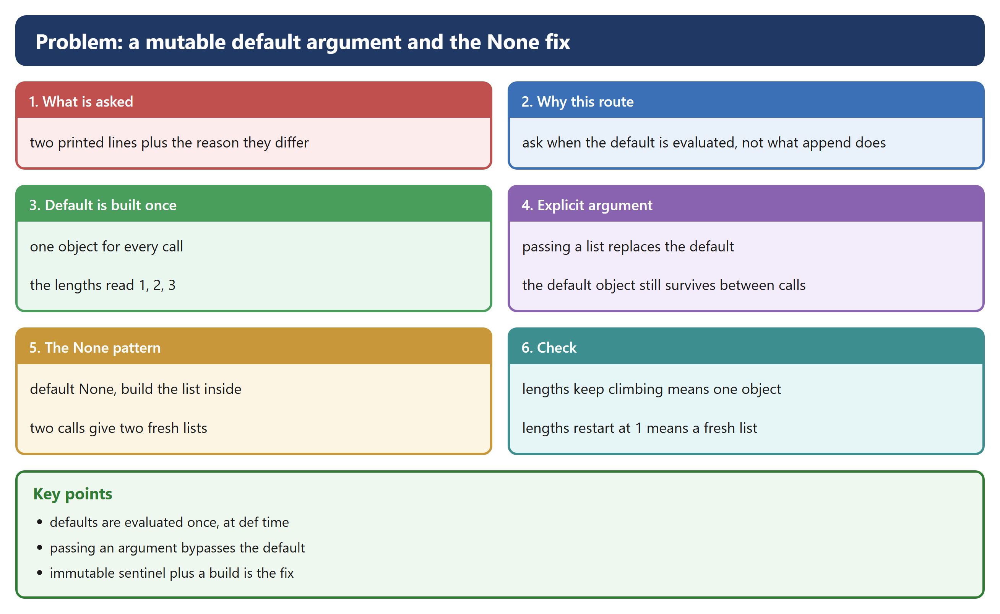

### A3 A loop that skips and stops

```python
total = 0
for n in range(1, 8):
    if n % 3 == 0:
        continue
    if total + n > 10:
        break
    total += n
print(total, n)
```

**What is asked** — The two values printed, and which pass ended the loop.

**Why this route** — There are two exit conditions on the same pass, `continue` before the accumulator and `break` before it, so the only reliable route is a pass-by-pass table with the order of the two tests preserved.

$$n=1:\ total=0+1=1 \qquad n=2:\ total=1+2=3$$

$$n=3:\ 3\bmod 3=0 \Rightarrow \text{continue} \qquad n=4:\ total=3+4=7$$

$$n=5:\ 7+5=12>10 \Rightarrow \text{break}$$

The first two passes add, the third is skipped before it can add, the fourth adds, and the fifth trips the guard and leaves.

$$\text{printed}:\quad \text{total}=7,\quad n=5$$

`break` leaves the loop without executing the body's remaining statements, so $n$ keeps the value that triggered it, $5$, and `total` keeps the last value it had, $7$.

$$\text{without the break}:\ total=1+2+4+5+7=19$$

Removing the guard lets every non-multiple-of-three pass add, and the sum would be $19$, so the guard changes the answer rather than merely ending it early.

**Where the constant comes from** — $12$ is the first running total that exceeds $10$, which is why the loop stops at $n=5$ and not at $n=4$; the threshold $10$ and the addend $5$ together decide that pass.

**Sanity check** — Two checks: the three added values are $1,2,4$, and $1+2+4=7$ matches the printed total; and the loop index reached $5$ while `range` would have gone to $7$, so the `break` is confirmed active.

**Answer**

$$\text{total}=7,\qquad n=5$$

**Trap** — Adding on the `continue` pass gives $10$ and then a different $n$; and forgetting that `break` skips the rest of the body gives $n=4$ from a lazily read table.


### A4 One grid, three names

```python
grid = [[1, 2], [3, 4]]
cp = grid[:]
deep = [row[:] for row in grid]
cp[0].append(9)
deep[1].append(8)
print(grid)
print(cp)
print(deep)
```

**What is asked** — Three printed lists, and the reason `cp` and `grid` change together while `deep` does not.

**Why this route** — Three names, three different amounts of copying: plain assignment would share everything, a slice copies one level, and a comprehension over slices copies two. The route is to draw the object graph, not to remember the words "shallow" and "deep".

$$\text{cp} = \text{grid}[:] \Rightarrow \text{new outer list},\ \text{same inner rows}$$

The slice builds a new outer list whose three slots point at the same inner lists, so the rows are shared even though the container is not.

$$\text{deep} = [\,row[:]\ \text{for}\ row\ \text{in}\ \text{grid}\,] \Rightarrow \text{new rows too}$$

The comprehension applies the slice to each row, so `deep` has new inner lists and shares nothing mutable with `grid`.

$$\text{cp}[0].\text{append}(9) \Rightarrow \text{grid} = [[1,2,9],[3,4]]$$

$$\text{deep}[1].\text{append}(8) \Rightarrow \text{deep} = [[1,2],[3,4,8]]$$

The first append goes through a shared row, so both `grid` and `cp` show it; the second goes into a private row, so only `deep` shows it.

**Where the constant comes from** — The $9$ lands in row $0$ because that is the row `cp` shares; the $8$ lands in row $1$ because `deep` owns its rows; both indices come straight from the code, not from counting.

**Sanity check** — Count mutable objects before and after: two original rows plus two copies is four, and the printed output must show exactly one row changed in two lists and one row changed in one list, which it does.

**Answer**

$$\text{grid} = [[1,2,9],[3,4]],\quad \text{cp} = [[1,2,9],[3,4]],\quad \text{deep} = [[1,2],[3,4,8]]$$

**Trap** — Trusting the slice as a full copy gives `deep` sharing rows and a wrong third line; and `copy.deepcopy` is not needed here, so answering with library calls instead of the object graph loses the explanation mark.

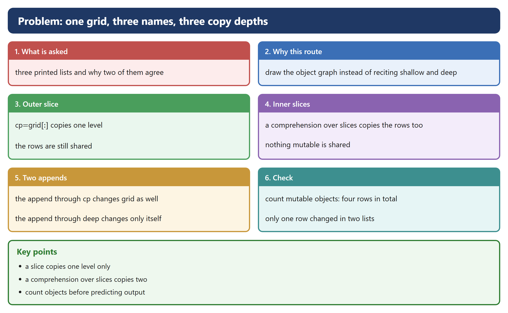

---

## Twelve mixed questions

**Q6.1** What does this print?

```python
def f(xs):
    total = 0
    for x in xs:
        total += x
    return total

print(f([0.1, 0.2]) == 0.3)
```

- A. $\text{True}$
- B. $\text{False}$
- C. $\text{None}$
- D. an error

- A. $\text{True}$
- B. $\text{False}$
- C. $\text{None}$

**Answer: B**

Why: $0.1$ and $0.2$ already carry rounding when stored, so their sum differs from the stored $0.3$ (chapter 1).

The other options: A is the mathematical intuition; C the function returns a bool; D the syntax and types are fine. Use $\text{math.isclose}$.

</details>

**Q6.2** Where does this code go wrong?

```python
def add_item(x, bucket=[]):
    bucket.append(x)
    return bucket

print(add_item(1))
print(add_item(2))
```

- A. the first call fails
- B. the second prints $[1, 2]$, because the default list is created once
- C. the second prints $[2]$
- D. append cannot be used with a default argument

**Answer: B**

Why: the default is evaluated once at definition time, so both calls share one list (chapter 2).

The other options: A it does not fail, and the silence is the danger; C is intuitive but wrong; D is false. Default to $\text{None}$ and build the list inside.

</details>

**Q6.3** To count "how many tests at each temperature", the best structure is

- A. two lists of equal length
- B. a dictionary mapping temperature to a count or a list
- C. a tuple
- D. a string

**Answer: B**

Why: a key-to-value map expresses "temperature leads to records" directly, with $O(1)$ lookup and no fragility when sorting (chapter 4).

The other options: A relies on index alignment; C is immutable and cannot take new keys; D means writing your own parser.

</details>

**Q6.4** What is the time complexity?

```python
count = 0
for i in range(n):
    j = 0
    while j < n:
        count += 1
        j += 2
```

- A. $O(\log n)$
- B. $O(n)$
- C. $O(n^{2})$
- D. $O(n\log n)$

**Answer: C**

Why: the outer loop runs $n$ times; the inner loop advances by $2$ and so runs $n/2$ times, which is still $O(n)$; the product is $O(n^{2})$ (chapter 5).

The other options: A the inner loop does not halve; B only one loop is counted; D there is no logarithmic structure, and stepping by two is linear.

</details>

**Q6.5** What does this print?

```python
a = [1, 2, 3]
b = a[:]
b.append(4)
print(len(a), len(b))
```

- A. $4\ 4$
- B. $3\ 4$
- C. $3\ 3$
- D. $4\ 3$

**Answer: B**

Why: $a[:]$ is a shallow copy, so appending to $b$ leaves $a$ alone (chapter 4).

The other options: A is what $b = a$ would give; C ignores the append; D reverses the order.

</details>

**Q6.6** Does this loop terminate?

```python
n = 10
while n != 1:
    if n % 2 == 0:
        n = n // 2
    else:
        n = 3 * n + 1
```

- A. no, $n$ keeps growing
- B. yes: $10\to5\to16\to8\to4\to2\to1$, six passes through the body
- C. no, because there is no break
- D. it raises $\text{ZeroDivisionError}$

**Answer: B**

Why: $10$ halves to $5$, the odd branch maps $5$ to $16$, then halving reaches $1$; that is six passes through the body, and the seventh check sees $n=1$ and exits (chapter 3).

The other options: A even steps divide immediately; C a break is not needed when the condition eventually turns false; D there is no division by zero.

</details>

**Q6.7** To group $10^{6}$ records by temperature and then print in temperature order, you should

- A. group in a dictionary and print $\text{sorted(groups.items())}$
- B. keep a list in arrival order
- C. group in a set
- D. group in a tuple

**Answer: A**

Why: the dictionary does the grouping with $O(1)$ lookups, and sorted fixes the order: two jobs, two tools (chapters 4 and 5).

The other options: B is insertion order, not temperature order; C loses the key-to-value link; D is immutable.

</details>

**Q6.8** Which test is most likely to misbehave?

- A. $\text{if } x \ne 0:\ y = 10 / x$
- B. $\text{if } x == 0.1 + 0.2:\ \text{print("hit")}$
- C. $\text{if } 0 \le x < 10:\ \text{print("in range")}$
- D. $\text{if isinstance}(x, \text{int}):\ \text{print("int")}$

- A. $\text{if } x \ne 0:\ \ y = 10 / x$
- B. $\text{if } x == 0.1 + 0.2:\ \ \text{print}("hit")$
- C. $\text{if } 0 \le x < 10:\ \ \text{print}("in range")$
- D. $\text{if } \text{isinstance}(x, \text{int}):\ \ \text{print}("int")$

**Answer: B**

Why: comparing floats with $==$ almost never succeeds; use $\text{math.isclose}(x, 0.3)$ (chapters 1 and 3).

The other options: A guards before dividing; C is a legal chained comparison; D is a fine type test.

</details>

**Q6.9** What does this print?

```python
def g(n):
    if n <= 1:
        return 1
    return n * g(n - 1)

print(g(4))
```

- A. $4$
- B. $10$
- C. $24$
- D. infinite recursion

- A. $4$
- B. $10$
- C. $24$

**Answer: C**

Why: this is the factorial, $4\times 3\times 2\times 1 = 24$, and the base case $n\le 1$ stops the recursion (chapters 2 and 3).

The other options: A only one level; B that is a sum; D the base case prevents it.

</details>

**Q6.10** A counter $c_i$ increments only when the height is below the gate and the sensor fired, and resets otherwise. Which test is right?

- A. $\text{if } \text{touch}[i]:\ c += 1$
- B. $\text{if } h[i] < h_{\text{enable}} \text{ and } \text{touch}[i]:\ c += 1\ \text{else}:\ c = 0$
- C. $\text{if } h[i] < h_{\text{enable}}:\ c += 1$
- D. $c = c + 1$ every cycle

- A. $\text{if } \text{touch}[i]:\ c += 1$
- B. $\text{if } h[i] < h_{\text{enable}} \text{ and } \text{touch}[i]:\ c += 1\ \text{else}:\ c = 0$
- C. $\text{if } h[i] < h_{\text{enable}}:\ c += 1$

**Answer: B**

Why: it expresses both the gate and the count, and resets in every other case, which is what "consecutive" requires (chapter 3, E3).

The other options: A drops the gate; C drops the trigger; D ignores the data entirely.

</details>

**Q6.11** "Sort then binary search" beats one linear scan when

- A. always
- B. never
- C. $m$ is large enough that $O(n\log n + m\log n) < O(mn)$
- D. it does not depend on $m$

**Answer: C**

Why: sorting is a one-off investment and each binary search is cheap, so more lookups amortise it (chapter 5).

The other options: A fails for a single lookup; B ignores repeated lookups; D is false.

</details>

**Q6.12** What is wrong here?

```python
def mean(readings):
    total = 0
    for r in readings:
        total = total + r
    print(total / len(readings))

x = mean([1, 2, 3]) * 2
```

- A. the loop is wrong
- B. $\text{mean}$ prints but never returns, so $x$ is $\text{None}$ and $\text{None}\times 2$ raises $\text{TypeError}$
- C. len cannot be used on a list
- D. nothing

**Answer: B**

Why: $2.0$ appears on screen, but the call returns $\text{None}$ and the multiplication fails (chapter 2).

The other options: A the loop is correct; C len works on lists; D it crashes. Replace print with return.

</details>

## Where marks are lost

Every line below is a real way this paper takes marks off, written as "if you write this, you lose that". Read it the night before and again in the corridor: most of the loss is not ignorance, it is a habit that looked harmless while revising.

1. Writing "floating point is inaccurate" without naming the cause → lose the explanation mark, because the binary mantissa cannot store $0.1$ exactly and the sum lands on the nearest representable value.
2. Calling $2^{15}$ the largest signed 16-bit value → lose the arithmetic, the range is $-2^{15}$ to $2^{15}-1$.
3. Answering `7 // 2` and `-7 // 2` with the same sign rule → lose both, floor division rounds toward minus infinity, not toward zero.
4. Treating `/` as integer division when both operands are ints → lose the type mark, in Python 3 a single slash always returns a float.
5. Explaining `print` as if it returned its argument → lose the return-value mark, it returns `None`.
6. Claiming a function can rebind a global by plain assignment → lose the scope mark, assignment inside a function always creates a local name unless `global` is declared.
7. Saying a mutable default argument is "created fresh each call" → lose the mechanism mark, the default object is built once at definition time.
8. Saying a list passed into a function is copied → lose the aliasing mark, the function receives a reference to the same object.
9. Writing the loose condition first in an `if/elif` chain → lose the branch that never runs, and the marker sees the dead branch immediately.
10. Counting `range(a, b)` as $b-a+1$ values → lose the loop count, the stop value is exclusive.
11. Treating `continue` as `break` in a trace → lose the whole output, a skipped pass still consumes one value.
12. Claiming both sides of `and` always run → lose the short-circuit mark, the moment the left side is false the right side never evaluates.
13. Saying `b = a` copies the list → lose every later output, both names point at one object.
14. Saying a tuple is completely immutable, including what it holds → lose the counter-example, the slots are fixed but a contained list can still be mutated.
15. Using a list as a dictionary key → lose the statement, keys must be hashable and a list is not.
16. Reporting the complexity of two nested loops over the same list as $n+n$ → lose it twice, the inner statement runs $n$ times for each of $n$ outer passes.
17. Binary-searching an unsorted list and reporting $O(\log n)$ → lose the premise and the result, halving only works after sorting.
18. Confusing "stable sort" with "fast sort" → lose the definition mark, stable means equal keys keep their original relative order.
19. Claiming $n\log n$ is always faster than $n^{2}$ → lose the nuance, below the crossover the constants decide.
20. Leaving a complexity answer as a bare $O(\cdot)$ with no counted line → lose the method, the marker wants the innermost statement and how many times it runs.
21. Writing $8$ for $16/2$ → lose the output mark, because a single slash returns $8.0$.
22. Fixing a comparison with zero by setting $\text{rel\_tol}$ → lose the fix, only an absolute tolerance can pass near zero.
23. Defining machine epsilon as the smallest positive float → lose the definition, it is the gap between $1.0$ and the next float, $2^{-52}$.
24. Reaching for $\text{global}$ when the question wants a result → lose the reasoning, the expected fix is to return the value and catch it outside.
25. Shadowing a builtin such as $\text{sum}$ with a variable → lose the find-the-bug mark, because the builtin is no longer callable.

## The last thirty minutes

Do these seven things in this order and stop when the time is gone. Nothing here needs new thinking, which is the point: the last half hour is for converting things you already know into marks.

1. Minutes 30 to 22: re-read the question-type map and say the first stroke for each row out loud.
2. Minutes 22 to 15: redo the trace drills on blank paper, all five, without looking at the answers.
3. Minutes 15 to 10: write down the four numeric facts you are least sure of ($2^{15}-1$, floor division on negatives, $\log n$ halving, $n\log n$ crossover).
4. Minutes 10 to 6: check that your calculator is in the right mode and that you know how to write a tolerance comparison.
5. Minutes 6 to 3: skim the chapter traps of Ch1 and Ch3, the two chapters where wording decides the answer.
6. Minutes 3 to 1: pack pens, water, student card; close every note.
7. Last minute: breathe, and decide that any question you cannot start gets its "first stroke" line written before you leave it.

---

## One-page revision sheet

### 7.1 Formula card

$$\varepsilon_{\text{mach}} = 2^{-52} \approx 2.22\times 10^{-16}, \qquad v = (-1)^{s}(1.f)_2\,2^{e-1023}$$

$$2^{53} = 9\,007\,199\,254\,740\,992, \qquad \text{float}(2^{53})+1 = \text{float}(2^{53})$$

$$-2^{15} \le n_{\text{int16}} \le 2^{15}-1, \qquad \text{int}(10v)\ \text{scales first, truncates second}$$

$$\theta = \frac{\sum \text{faulty}}{\sum \text{tests}}\ \text{(pooled, not averaged)}, \qquad \varphi = \frac{1+\sqrt{5}}{2}\approx 1.618$$

### 7.2 Complexity table

| Big-O | Name | Typical source | operations at $n=10^{6}$ |
| --- | --- | --- | --- |
| $O(1)$ | constant | dictionary or set lookup | $1$ |
| $O(\log n)$ | logarithmic | binary search, halving loop | $20$ |
| $O(n)$ | linear | one pass | $10^{6}$ |
| $O(n\log n)$ | linearithmic | a good sort | $2\times 10^{7}$ |
| $O(n^{2})$ | quadratic | loop inside a loop | $10^{12}$ |
| $O(2^{n})$ | exponential | every subset, naive recursion | $10^{301030}$ |

| --- | --- | --- | --- |

### 7.3 Trap list, to read five minutes before the test

- $0.1+0.2 \ne 0.3$; compare floats with $\text{math.isclose}$, and use $\text{abs\_tol}$ near zero.
- The gap doubles at every power of two; past $2^{53}$ adding $1$ changes nothing.
- Fixed-width integers wrap silently; $\text{int}()$ truncates; scale before truncating.
- A function that only prints returns $\text{None}$.
- A default of $\text{acc=[]}$ is created once and shared by every call.
- $\text{elif}$ order is the logic; test the strictest threshold first.
- A $\text{while}$ loop must make progress; a $\text{continue}$ over the update hangs.
- $\text{range}(a, b)$ is half-open; $\text{range}(10, 0)$ is empty.
- $x\ \text{in list}$ is $O(n)$; $x\ \text{in dict}$ or set is $O(1)$ average.
- $\text{data.sort}()$ returns $\text{None}$; $\text{sorted(data)}$ returns a new list.
- Binary search needs sorted data, otherwise the answer is meaningless and no error is raised.
- Assignment does not copy; $\text{copy()}$ is shallow; nested structures need $\text{deepcopy}$.

## Answer key

| Chapter | Questions | Answers |
| --- | --- | --- |
| Ch1 | Q1.1 – Q1.8 | B B B C A C B B |
| Ch2 | Q2.1 – Q2.8 | B B B B C C C B |
| Ch3 | Q3.1 – Q3.8 | A A C C B B B B |
| Ch4 | Q4.1 – Q4.8 | B B B C B B B B |
| Ch5 | Q5.1 – Q5.8 | B C B B B B C B |
| mixed | Q6.1 – Q6.12 | B B B C B B A B C B C B |

| --- | --- | --- |
| Ch1 | Q1.1 – Q1.8 | B B B C A C B B |
| Ch2 | Q2.1 – Q2.8 | B B B B C C C B |
| Ch3 | Q3.1 – Q3.8 | A A C C B B B B |
| Ch4 | Q4.1 – Q4.8 | B B B C B B B B |
| Ch5 | Q5.1 – Q5.8 | B C B B B B C B |

## Coverage table

| Notes chapter | Section | Covered in |
| --- | --- | --- |
| Ch1 Types and Floating Point | 1.1–1.2 types, int and float | §1.2(1)(2) |
| | 1.3 IEEE 754 double format | §1.2(3) |
| | 1.4 the floating-point number line | §1.2(6)(7) |
| | 1.5 absorption, cancellation, special values | §1.2(9)(10) |
| | 1.6 Ariane 5 | §1.4 E1 |
| Ch2 Variables and Functions | 2.1–2.3 variables and anatomy of a function | §2.2(1)–(4) |
| | 2.4 return vs print | §2.2(5) |
| | 2.5–2.7 arguments, scope, nested calls | §2.2(6)–(9) |
| | 2.8 Mars Climate Orbiter | §2.4 E2 |
| Ch3 Control Flow | 3.1 booleans and logic | §3.2(1)–(4) |
| | 3.2 if/elif/else | §3.2(5) |
| | 3.3–3.4 while and for | §3.2(6)(7) |
| | 3.5 break and continue | §3.2(9) |
| | 3.6 Mars Polar Lander | §3.4 E3 |
| Ch4 Data Structures | 4.1–4.3 lists, dictionaries, tuples | §4.2(1)–(3) |
| | 4.4 aliasing | §4.2(4) |
| | 4.5 choosing the right structure | §4.2(5)(6) |
| | 4.6 Challenger | §4.4 E4 |
| Ch5 Algorithms and Complexity | 5.1 Big-O notation | §5.2(1)–(4) |
| | 5.2 search | §5.2(5)(6) |
| | 5.3 sorting | §5.2(7)(8)(9) |
| | 5.4 Air France 447 | §5.4 E5 |

| --- | --- | --- |
| | §1.6 Ariane 5 | §1.4 E1 |
| | §2.4 return vs print | §2.2(5) |
| | §2.8 Mars Climate Orbiter | §2.4 E2 |
| | §3.2 if/elif/else | §3.2(5) |
| | §3.6 Mars Polar Lander | §3.4 E3 |
| | §4.6 Challenger | §4.4 E4 |
| Ch5 Algorithms and Complexity | §5.1 Big-O | §5.2(1)–(4) |
| | §5.4 Air France 447 | §5.4 E5 |

## Canvas sheet coverage

Every Canvas item that carries questions is listed here with the part of this review that answers it. The two published solution PDFs are used as a style reference, not copied.

| Canvas item | Questions | Answered in |
| --- | --- | --- |
| Introductory Examples Sheet | 5 questions, 17 parts | S0Q1 to S0Q5 |
| Examples Sheet 1 | 4 questions, 11 parts | S1Q1 to S1Q4 |
| Examples Sheet 2 | 4 questions, 13 parts | S2Q1 to S2Q4 |
| Examples Sheet 3 | 4 questions, 15 parts | S3Q1 to S3Q4 |
| Examples Sheet 4 | 5 questions, 12 parts | S4Q1 to S4Q5 |
| Official notes, chapters 1 to 5 | the whole of the course so far | chapters 1 to 5 |
| Official notes, chapters 6 and 7 | NumPy, matplotlib, pandas, Monte Carlo | chapters 6 and 7 |

The coverage claim is deliberately narrow: every part of every sheet is answered above, but the notes' chapters 8 and 9 are not in this review, because no example sheet touches them and the final examination's coverage of them is a separate matter.

## Glossary

| Term | One-line meaning |
| --- | --- |
| floating point | a real number stored as sign, exponent and fraction, with relative precision |
| machine epsilon | the gap between $1.0$ and the next float, $2^{-52}$ |
| rounding | moving a computed value to the nearest representable float |
| absorption | a small addend disappearing when added to a much larger number |
| catastrophic cancellation | subtracting nearly equal numbers and losing the leading digits |
| silent overflow | a fixed-width integer wrapping round to a wrong value without an error |
| fixed point | an integer encoding with the decimal point fixed in advance |
| in-place | mutating the original object, as $\text{list.sort}()$ does |
| shallow copy | copying only the outer container, still sharing the inner objects |
| aliasing | two names referring to one object |
| vectorisation | writing arithmetic once over a whole array instead of looping in Python |
| broadcasting | stretching length-one axes so two arrays of different shapes can be combined |
| view | an array that shares memory with another instead of copying it |
| Monte Carlo | estimating a quantity by averaging random samples |
| pseudo-random generator | a deterministic rule that produces numbers that pass as random, restarted by a seed |
| groupby | a lazy split of rows into groups, waiting for an aggregate to finish the job |
| scope | the region in which a name is visible |
| docstring | the triple-quoted description under a function definition |
| short-circuit evaluation | skipping the second operand once the outcome is known |
| half-open interval | an interval that includes the lower bound and excludes the upper |
| hash | a computed location that gives average $O(1)$ lookup |
| complexity | how cost grows with problem size |
| linearithmic | $O(n\log n)$, the typical cost of a good sort |
| common-mode failure | duplicates sharing one assumption, so both fail together |

| --- | --- | --- |

## Self-check

- Coverage: every section of notes Ch1–Ch5, item by item in the §9 coverage table (20 rows).
- Worked examples: 9 (E1–E5 and the four questions of simulated paper A), all written to the eight-part template, each with its own poster.
- Questions: $8\times 5 + 12 + 4 = 56$: forty multiple-choice, twelve mixed and four simulated, each with an answer and the reasoning that reaches it.
- Figures: 7 concept figures plus 9 posters, 16 references in total, no duplicates and none missing, all pointing at existing files under `figures/`.
- Formulas: inline $\ldots$ and display math with $\ldots$ throughout; no align environment, no boxed, no newcommand.
- Numbers rechecked: $2^{-52}\approx 2.22\times10^{-16}$, $2^{53}=9\,007\,199\,254\,740\,992$, $32767/10=3276.7$, $3/5=0.6$, $\varphi^{5}\approx 11.09$, all restated exactly as the notes give them.
