# MECH40008 — Chapter 6 NumPy and Matplotlib (Handout §6.1–6.5)

> Course — MECH40008 Mathematics and Computing 1 · 2026-11-13 · Lecture 6
> Sources — The lecture caption track, the course handout (Lecture 6, printed pages 81–100), and the slide and terminal screenshots.
> Source coverage — §0–§6 mainly follow the 2026-11-13 recording. §7–§12 and E9 draw on the official handout. The astype copy parameter, isclose, and the in-place and out exceptions are marked as additional notes on NumPy behaviour. Printed page numbers refer to the handout footers and differ from the PDF page indices.
> Structure — §0 exam information → §1–§6 recorded lecture and E1–E8 → E9 heat diffusion (handout §6.5) → §7–§11 handout supplements → §12 coverage table → formula card / quick check / scope / glossary
> Background — Ch 7–9 cover the analysis topics (remainders, Taylor series and partial derivatives). This lecture returns to computing and shows how to group calculations into one round and plot the data.

## Contents

- 0. Exams and support
- 1–5. NumPy arrays vs lists → initialisation and indexing → 2D arrays and matrices → linear algebra → vectorisation
- 6. Matplotlib import pitfalls → one API per plot type → subplots → log axes → meshgrid + contourf
- 7–11. Handout supplements covering dtype and integer overflow → views and copies → reductions along axes and broadcasting → argsort and Boolean operations → saving figures and plot checklist
- Worked examples E1–E9 (eight parts each — question / approach / steps / sources of values / check / answer / pitfalls / figure)
- 12. Official handout coverage table (Tables 13–15, Exercises 32–36, §6.5)
- Formula card · Quick check · Scope · Glossary

## 0. Exams and support (Section 0)

### 0.1 Course structure and pace (3:01–3:50)

There are 9 lectures this term. The whole of next term is reserved for revision, with no new material. The lecturer said the pace is fast by design. Concentrating teaching in the first term avoids examining the material immediately after it is taught.

### 0.2 Tutorials, drop-in sessions and office hours (3:50–6:09)

- **Tutorials** are 20-minute question-and-answer sessions, rather than time set aside for independent study. Finish the problem set beforehand and bring your questions. The 3/54 tutorial participations count towards 20% of the overall mark.
- **Drop-in sessions** take place on Fridays at 09:00, three times per term. Check the timetable for dates.
- **Office hours** are on Mondays from 16:00 to 17:30 in Guild Building 605. The lecturer moved the start from next term to this term, beginning the following Monday.

### 0.3 Progress Test (4:19–5:06)

The Progress Test is on 9 December in the same classroom. It lasts about 45 minutes and covers the first 5 lectures. Attendance is compulsory. The test is ungraded and serves as practice for the final exam. Half of it draws on Gym material and half uses problem-set-style questions. The hardest questions at the end of the Gym are designed to stretch you beyond exam level.

### 0.4 Feedback and revision sessions (6:13–6:47)

- Progress Test feedback is on 4 January. The 1-hour session goes through each question, and marked papers are returned.
- The pre-exam revision session is on 8 March in CAB 664.

### 0.5 Final Exam (7:11–9:02)

The closed-book, pen-and-paper exam is on 19 March at 09:30 and lasts 90 minutes. It follows the same format as the Progress Test. Star questions are generally excluded. If one appears, it will come with extensive hints. Consult Canvas under M1 Computing Exam and Support Information for the details.

---

## 1. Why use arrays? Lists vs contiguous memory (Section 6.1, 9:20–19:47)

### 1.1 What is NumPy? (9:20–10:08)

NumPy is Python's computing engine for calculations and simulations. It lets you use existing, highly optimised algorithms without writing them from scratch. Use this standard import.

```python
import numpy as np
```

np is an alias. Any valid name works, but np is the convention other Python users recognise.

### 1.2 How lists use memory (12:02–14:05)

A list stores references to objects scattered across memory. The lecturer illustrated this with five numbers, 3, 1, 4, 0 and 5.0, stored in separate locations. Each operation must find and fetch the values, perform the calculation and retrieve the result. This adds overhead, like searching a messy room every time you need something.

### 1.3 How arrays use memory (14:05–15:22)

An array is an ordered collection of elements of the same type, stored in one contiguous block of memory. Think of packing items into a box you can move in one go. In the lecturer's post office analogy, mailing 5 letters with a list takes 5 trips. With an array, you send all 5 in one trip.

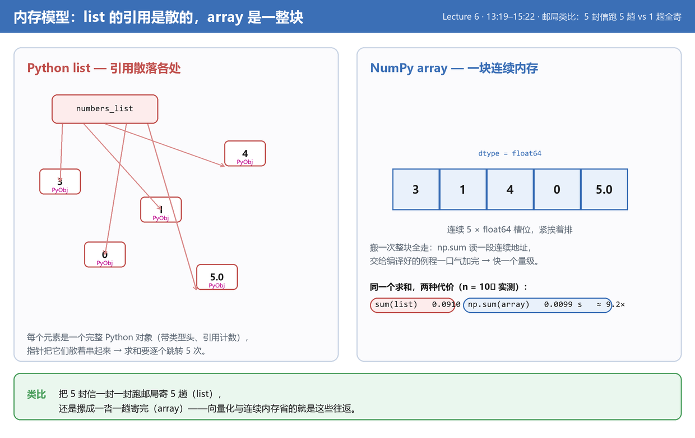

### 1.4 Timing experiment for sum(list) and np.sum(array) (15:28–18:23)

The lecturer timed the sum of $10^{6}$ integers during the lecture.

```python
import time
import numpy as np

numbers_list = list(range(10**6))
numbers_array = np.array(numbers_list)

start = time.perf_counter()
total = sum(numbers_list)
print("list:", time.perf_counter() - start)

start = time.perf_counter()
total = np.sum(numbers_array)
print("np:", time.perf_counter() - start)
```

The measured times were **0.0910 s for the list and 0.0099 s for NumPy, a speedup of about 9.2 times**. The lecturer rounded these to "0.01 seconds, about 10 times". The notes retain the original precision.

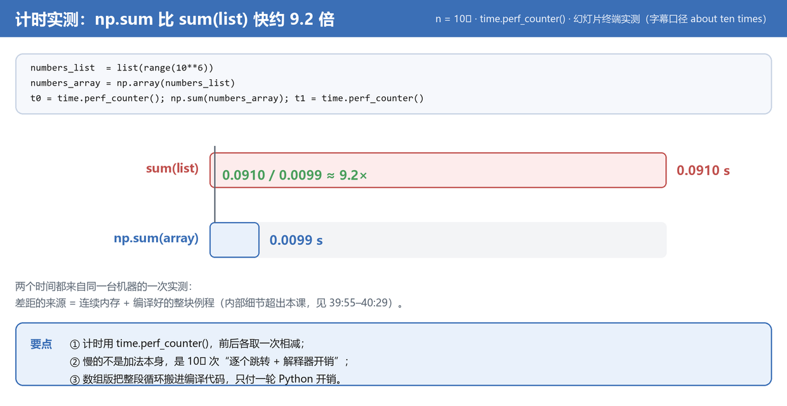

### 1.5 Why NumPy is faster (18:44–19:47)

np.sum combines compiled code with contiguous memory. Python's built-in sum can also be used efficiently, but its straightforward use here is slower than np.sum. The lecturer left the details of how compiled code works to the numerical analysis course.

---

### Example E1 — Timing list sum and NumPy sum (15:28–18:23)

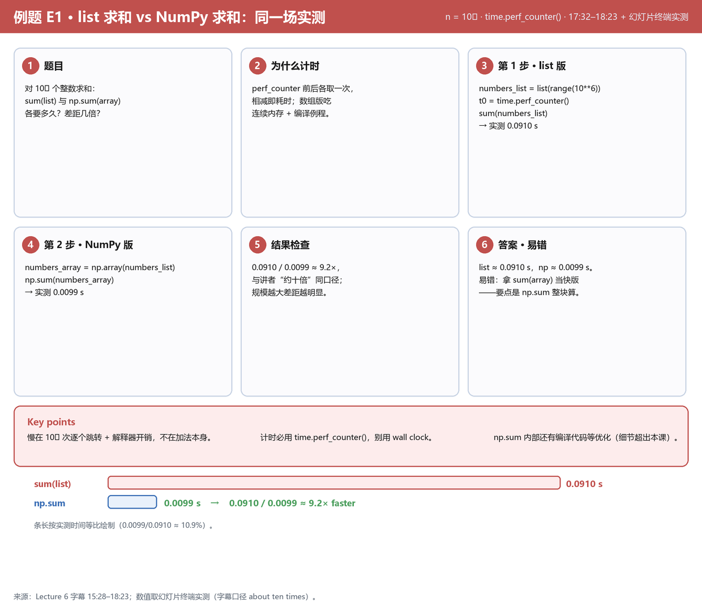

**What is asked**

Sum $10^{6}$ integers. Use time.perf_counter to time the calculation for a list and an np.array, then calculate the speedup.

**Why this route**

This is a small controlled experiment to measure the speedup from contiguous memory and compiled routines. The data are the same in both cases. Only the container changes, from a list to an np.array.

**Step 1. Prepare the data**

$$n = 10^{6}, \qquad \text{numbers\_list} = [0, 1, 2, \ldots, n-1], \qquad \text{numbers\_array} = \text{np.array}(\text{numbers\_list})$$

This gives two containers with identical contents.

**Step 2. Time each sum**

$$t_{\text{list}} = \text{perf\_counter}_{\text{end}} - \text{perf\_counter}_{\text{start}} = 0.0910\,\text{s}$$

$$t_{\text{np}} = \text{perf\_counter}_{\text{end}} - \text{perf\_counter}_{\text{start}} = 0.0099\,\text{s}$$

This gives two measured elapsed times.

**Step 3. Calculate the speedup**

$$\text{speedup} = \frac{t_{\text{list}}}{t_{\text{np}}} = \frac{0.0910}{0.0099} \approx 9.2$$

This gives the factor by which the NumPy calculation is faster.

**Where the values come from**

The lecturer chose $10^{6}$ integers so the difference would be measurable. The values 0.0910 s and 0.0099 s come from the terminal screenshot in the slides. The lecturer rounded the NumPy time to 0.01 s and the speedup to about 10 times.

**Sanity check**

$0.0099 \times 9.2 = 0.09108 \approx 0.0910$, so the numbers agree. A speedup near 10 matches the lecturer's rounded description.

**Answer**

$$t_{\text{list}} = 0.0910\,\text{s}, \quad t_{\text{np}} = 0.0099\,\text{s}, \quad \text{speedup} \approx 9.2\times$$

**Common pitfalls**

Using sum(array) calls Python for each array element and loses the optimisation provided by np.sum(array). Import time and use perf_counter, a high-resolution timer for measuring elapsed time, instead of time.time.

---

## 2. Array initialisation (Section 6.1 continued, 19:54–24:46)

### 2.1 Arrays of zeros and ones (19:54–20:43)

np.zeros(n) creates n copies of 0.0, and np.ones(n) creates n copies of 1.0. Both return floating-point arrays by default. The 2D version np.zeros((m, n)) creates m rows and n columns.

Handout Table 13 also lists np.arange(a, b, s). It starts at a, uses step s and **excludes b**. It works like range but returns an array and accepts floating-point steps. Rounding can affect floating-point steps. Use linspace when you need a fixed number of points and reliable endpoints.

### 2.2 Creating arrays from lists (21:22)

np.array([1, 2, 3]) converts a list to an array. In 2D, write one list per row, as in np.array([[2, 1], [1, 3]]).

### 2.3 Evenly spaced points with linspace (23:01–24:06)

np.linspace(a, b, n) gives n evenly spaced points on $[a, b]$ and **includes both endpoints**. For example, range(0, 10) excludes 10, while linspace(0, 10, 11) includes it.

### 2.4 Logarithmically spaced points with logspace (24:14–24:46)

np.logspace(a, b, n) produces n evenly spaced points on a logarithmic scale. Handout Table 13 emphasises that a and b are **exponents**. Thus logspace(-3, 0, 4) runs from $10^{-3}$ to $10^{0}$ and gives $[0.001, 0.01, 0.1, 1]$, including both endpoints. Use it for values spanning several orders of magnitude. The lecturer did not demonstrate this example in the recording.

---

### Example E2 — Endpoints in linspace and range (23:01–24:06)

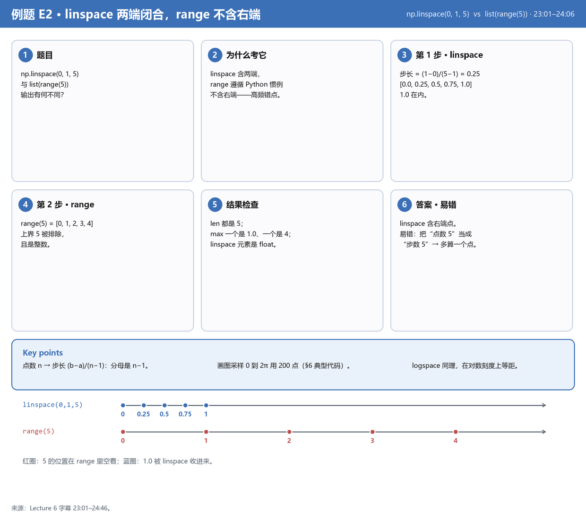

**What is asked**

Compare the outputs of np.linspace(0, 1, 5) and list(range(5)). Explain how their endpoints differ.

**Why this route**

linspace includes both endpoints. range excludes the right endpoint. This is a common beginner mistake. When linspace sets the points for a plot or a numerical integration grid, getting the endpoints wrong shifts the whole grid.

**Step 1. Evaluate linspace**

$$\text{np.linspace}(0, 1, 5) = [0.0,\ 0.25,\ 0.5,\ 0.75,\ 1.0]$$

There are 5 points, with a step of $\frac{1-0}{5-1} = 0.25$, including 1.0.

**Step 2. Evaluate range**

$$\text{list}(\text{range}(5)) = [0,\ 1,\ 2,\ 3,\ 4]$$

There are 5 integers, ending before 5.

**Step 3. Compare the outputs**

$$\max(\text{linspace}) = 1.0 = b, \qquad \max(\text{range}) = 4 = n - 1$$

**Where the values come from**

For linspace, $n$ counts points. The $n$ points divide the interval into $n-1$ steps. Python's range follows the convention of including the start and excluding the stop.

**Sanity check**

Both outputs have length 5. Four linspace steps of 0.25 take you from 0 to 1. Four range steps of 1 take you from 0 to 4.

**Answer**

$$\text{linspace}(0,1,5) = [0.0,\ 0.25,\ 0.5,\ 0.75,\ 1.0], \quad \text{range}(5) = [0, 1, 2, 3, 4]$$

**Common pitfalls**

linspace(0, 10, 10) gives $[0, 1.11, 2.22, \ldots, 10]$, so the values are not 10 consecutive integers. Count points and steps separately. For a step of 0.1 on $[0,1]$, use linspace(0, 1, 11).

---

## 3. Indexing, slicing and element-wise operations (Section 6.1 continued, 25:17–30:07)

### 3.1 Indexing and slicing (25:17–26:20)

The rules match those for lists. x[0] selects the first element, x[-1] the last, x[1:4] the second through fourth, and x[::2] every other element.

### 3.2 Element-wise arithmetic (26:27–27:21)

x + 10 adds 10 to each element, x * y multiplies corresponding elements, and x ** 2 squares each element. These expressions work on whole arrays without a for loop.

### 3.3 Mathematical functions (27:43)

Universal functions (ufuncs) such as np.sin(x), np.cos(x), np.exp(x) and np.sqrt(x) apply to each element of an array in one call. Handout Table 14 points out that math.sin accepts only scalars, so use NumPy's version for arrays. The compiled function still processes every element.

### 3.4 Reductions (27:53–28:10)

np.sum(x), np.mean(x), np.max(x) and np.min(x) each reduce the array to one number.

### 3.5 Boolean comparisons and mask indexing (28:18–29:44)

x < 65 returns a Boolean array (True/False). x[x < 65] selects elements that meet the condition. The lecturer emphasised that it **returns a new array and leaves the original unchanged**.

### 3.6 Conditional reductions (29:50–30:07)

np.sum(x[x < 65]) first selects matching elements, then sums them. This one line replaces a for loop with an if statement.

---

### Example E3 — Selecting and summing with a Boolean mask (28:18–30:07)


**What is asked**

Given $x = [10,\ 20,\ 30,\ 40,\ 50,\ 60,\ 70]$, use a Boolean mask to sum all elements less than 45.

**Why this route**

Mask indexing followed by reduction is a standard vectorisation pattern. One line, np.sum(x[x < 45]), replaces a for loop and an if test.

**Step 1. Build the mask**

$$\text{mask} = x < 45 = [\text{True},\ \text{True},\ \text{True},\ \text{True},\ \text{False},\ \text{False},\ \text{False}]$$

This gives a Boolean array.

**Step 2. Select the matching elements**

$$x[\text{mask}] = [10,\ 20,\ 30,\ 40]$$

This gives the selected subarray.

**Step 3. Sum the selected elements**

$$\text{np.sum}(x[\text{mask}]) = 10 + 20 + 30 + 40 = 100$$

**Where the values come from**

The question specifies the threshold 45. The sum $10+20+30+40=100$ is easy to check by hand.

**Sanity check**

A for loop also gives 100. The original array x stays unchanged because mask indexing returns a new array.

**Answer**

$$\sum_{x_i < 45} x_i = 100$$

**Common pitfalls**

Avoid x.sum(x < 45). It is an incorrect call because sum does not accept a Boolean mask in that argument position. Remember that mask indexing creates a new array and leaves x unchanged.

---

## 4. 2D arrays and matrices (Section 6.2, 30:21–37:05)

### 4.1 Arrays and matrices (21:36–22:44, 30:21–30:39)

An array is a general-purpose object that can hold a table of numbers. A matrix is a 2D array that follows matrix operation rules. As the lecturer put it, a matrix is a 2D array you treat according to those rules.

### 4.2 Creating a 2D array and reading its shape (30:48–31:51)

Write one list per row in np.array([[2, 1], [1, 3]]). a.shape returns (2, 2), with the number of rows first and the number of columns second.

### 4.3 Indexing (31:51–32:57)

a[0, 1] selects the first row and second column. a[1] selects a whole row, and a[:, 0] selects a whole column. Always put the row index first.

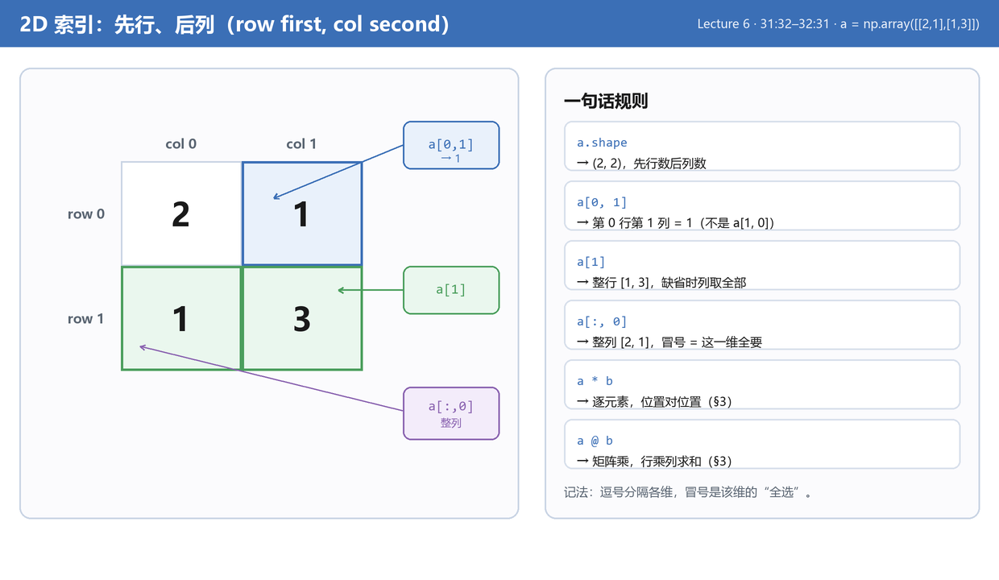

### 4.4 Element-wise multiplication and matrix multiplication (33:10–35:21)

a * b multiplies corresponding elements. a @ b performs matrix multiplication by summing products across a row and a column. The two operators produce different matrices.

### 4.5 Determinants, inverses and solving linear systems (35:32–37:05)

np.linalg.det(a) calculates the determinant, np.linalg.inv(a) calculates the inverse, and np.linalg.solve(A, b) solves $Ax = b$. solve avoids forming the inverse and is usually more stable and faster than inv(A) @ b.

Use a **residual check** for floating-point calculations because exact equality is fragile. For $$r = Ax-b$$, the handout uses np.allclose(A @ x, b) to check whether all components are within tolerance. As an additional NumPy detail, np.isclose(A @ x, b) returns a Boolean array with one check per component. For this A, det(A) returns about $5.000000000000001$, while the theoretical value is 5. Avoid det(A) == 0 as a test for singularity. Passing a singular matrix to solve raises LinAlgError.

**Handout Exercise 33 quick answers**. For $P=\begin{pmatrix}1&2\\3&4\end{pmatrix}$ and $v=(1,1)^{T}$, P has shape $(2,2)$. P[1,0] is 3, and P[:,1] is $[2,4]$. The sum along axis=0 is $[4,6]$. The element-wise square is $\begin{pmatrix}1&4\\9&16\end{pmatrix}$, the matrix square is $\begin{pmatrix}7&10\\15&22\end{pmatrix}$, and Pv is $[3,7]$. Solving $Px=(5,11)^{T}$ gives $x=(1,2)^{T}$. Use allclose to check the residual $Px-b$.

---

### Example E4 — Element-wise multiplication and matrix multiplication (33:10–35:21)


**What is asked**

Given $A = \begin{pmatrix} 2 & 1 \\ 1 & 3 \end{pmatrix}$ and $B = \begin{pmatrix} 1 & 0 \\ 2 & 1 \end{pmatrix}$, calculate A*B element-wise and A@B as a matrix product.

**Why this route**

Confusing * with @ is a common mistake in NumPy matrix calculations. The choice of operator changes the result.

**Step 1. Multiply element-wise**

$$A * B = \begin{pmatrix} 2 \times 1 & 1 \times 0 \\ 1 \times 2 & 3 \times 1 \end{pmatrix} = \begin{pmatrix} 2 & 0 \\ 2 & 3 \end{pmatrix}$$

Multiply the entries at each position independently.

**Step 2. Multiply the matrices**

$$A @ B = \begin{pmatrix} 2 \times 1 + 1 \times 2 & 2 \times 0 + 1 \times 1 \\ 1 \times 1 + 3 \times 2 & 1 \times 0 + 3 \times 1 \end{pmatrix} = \begin{pmatrix} 4 & 1 \\ 7 & 3 \end{pmatrix}$$

Sum the products of the entries in a row and a column. This is the standard linear algebra definition.

**Step 3. Check that matrix multiplication is non-commutative**

$$B @ A = \begin{pmatrix} 2 & 1 \\ 5 & 5 \end{pmatrix} \neq A @ B$$

**Where the values come from**

Element-wise multiplication uses a separate product at each position. Matrix multiplication uses $C_{ij} = \sum_k A_{ik} B_{kj}$, the sum of products across a row and a column. Matrix multiplication is non-commutative in general.

**Sanity check**

$A * B$ and $A @ B$ give different results. Also, $A @ B \neq B @ A$. Check each entry by hand.

**Answer**

$$A * B = \begin{pmatrix} 2 & 0 \\ 2 & 3 \end{pmatrix}, \qquad A @ B = \begin{pmatrix} 4 & 1 \\ 7 & 3 \end{pmatrix}$$

**Common pitfalls**

Using * for a matrix product gives the wrong result. Use @ or np.matmul and check the order of the factors.

---

### Example E5 — Solving a system of linear equations (36:04–37:05)


**What is asked**

Solve $Ax = b$ where $A = \begin{pmatrix} 2 & 1 \\ 1 & 3 \end{pmatrix}$ and $b = \begin{pmatrix} 3 \\ 5 \end{pmatrix}$.

**Why this route**

np.linalg.solve is more stable and faster than np.linalg.inv(A) @ b. It calls LAPACK factorisation routines directly and avoids computing an inverse.

**Step 1. Call solve**

$$x = \text{np.linalg.solve}(A, b)$$

**Step 2. Verify the solution**

$$Ax = \begin{pmatrix} 2 & 1 \\ 1 & 3 \end{pmatrix} \begin{pmatrix} 0.8 \\ 1.4 \end{pmatrix} = \begin{pmatrix} 2 \times 0.8 + 1.4 \\ 0.8 + 3 \times 1.4 \end{pmatrix} = \begin{pmatrix} 3.0 \\ 5.0 \end{pmatrix} = b \checkmark$$

**Where the values come from**

Eliminate by hand using $2x_1 + x_2 = 3$ and $x_1 + 3x_2 = 5$. Double the second equation and subtract the first to get $5x_2 = 7$, so $x_2 = 1.4$. Substitute back to obtain $x_1 = 0.8$.

**Sanity check**

Both checks pass. $2(0.8) + 1.4 = 3.0$ and $0.8 + 3(1.4) = 5.0$. The residual is zero.

**Answer**

$$x = \begin{pmatrix} 0.8 \\ 1.4 \end{pmatrix}$$

**Common pitfalls**

Forming np.linalg.inv(A) @ b is less stable and slower. b should have shape (2,) or (2, 1). An incorrect shape can cause a broadcasting error.

---

## 5. Vectorisation from 9 rounds of overhead to 1 (Section 6.1 wrap-up, 37:12–39:13)

### 5.1 Definition (37:12–37:31)

Vectorisation replaces Python loops with array operations.

### 5.2 Comparing the number of rounds (38:01–39:06)

Find the sum of squares of $a = [3, 3, 3, 8, 4]$.

- **Loop version**. There are 5 squarings and 4 additions, for 9 rounds of per-element Python overhead.
- **Vectorised version**. One a*a and one np.sum together count as 1 round of Python-level call overhead.

The lecturer's "one round" refers to Python interpreter overhead. It implies neither $O(1)$ time complexity nor a single pass over the underlying data. a*a still processes n elements, and np.sum reduces the n results. Asymptotic time remains $O(n)$. Vectorisation cuts trips through the interpreter by letting compiled code process elements in batches.

The post office analogy applies again. You can make 5 trips or send all 5 letters in one trip.

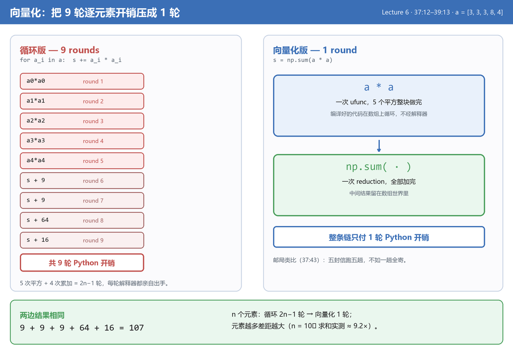

### 5.3 Why learn loops first? (39:24–39:43)

Loops show what the underlying operations do and how to do the work without array routines. For practical calculations, vectorise by default because it is much faster.

### 5.4 Further optimisation (39:55–41:44)

np.sum benefits from both contiguous memory and compiled code. The lecturer's LLM optimisation experiment moved from a for loop to vectorisation, then to parallelisation and CPU-specific optimisation. This course covers the vectorisation stage. The numerical analysis course addresses the deeper details.

### 5.5 Handout Exercise 34 on loops with recurrence dependencies

$$x_0=1,\qquad x_i=2x_{i-1}\quad\Rightarrow\quad x_i=2^{i},\quad i=0,\ldots,9$$

Element i depends on element i−1, so this recurrence cannot be replaced directly by independent array updates. An explicit formula gives another route. Use x = 2.0 ** np.arange(10) to obtain $[1,2,4,\ldots,512]$. This distinguishes a time loop that must be retained from a sequence you can rebuild using a closed form.

---


## 6. Plotting with Matplotlib (Section 6.3, 41:52–52:15)

This part covers four operations. Import pyplot correctly, get fig and ax together, choose a plot for the data type, and use meshgrid to build a grid for contourf. The lecturer said at 52:09 that Matplotlib is learnt by doing, and Gym practice is more effective than listening.

### 6.1 A common import mistake (41:52–42:37)

Matplotlib is the main Python plotting package, although some users prefer other packages. The most common mistake is in the import. Import the pyplot module from within Matplotlib.

Correct import

```python
from matplotlib import pyplot as plt
```

Common import mistake

```python
import matplotlib as plt   # Incorrect: plt has no plot attribute, so the call fails
```

The lecturer said they had made this mistake many times. Check this line before checking the plotting syntax.

### 6.2 Plotting one array against another (42:42–43:40)

Start with an x array. The lecturer used values from 0 to 6 at intervals of about 0.01. Apply a function such as np.sin to get a y array, then plot y against x.

### 6.3 Six plot types and their APIs (43:45–47:53)

| Plot type | API | Number of input arrays | Lecturer's explanation |
|---|---|---|---|
| Line | ax.plot(x, y) | 2 | Always connects points in array order (46:23) |
| Scatter | ax.scatter(x, y) | 2 | Use for paired discrete observations (46:01–46:38) |
| Bar | ax.bar(cats, vals) | 2 | Pairs categories with values (46:23–46:39) |
| Histogram | ax.hist(data, bins=N) | 1 plus bins | Adjust bins to set the number of intervals along the x-axis (46:39–46:58) |
| Error bars | ax.errorbar(x, y, yerr) | 3 | The error values form a third array (43:48–44:19) |
| Uncertainty band | ax.fill_between(x, lo, hi) | 3 | Shades the region from mean−std to mean+std (47:15–47:53) |

errorbar uses three arrays (43:59). One gives x, one gives y, and one gives the uncertainty at each point. The task determines what the bars show. They can represent the standard deviation of repeated measurements, instrument precision, or the half-width of a confidence interval. In handout Exercise 36, err gives the supplied measurement uncertainty. For fill_between, the lecturer used arrays of time, mean and standard deviation to shade the region between mean−std and mean+std. The same method works for any pair of lower and upper curves.

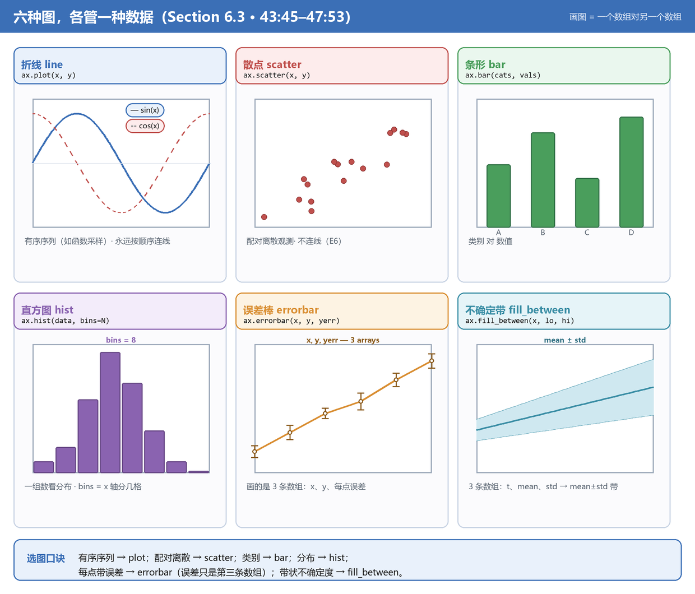

### 6.4 Typical plotting code and plt.subplots (44:35–45:53)

```python
from matplotlib import pyplot as plt
import numpy as np

x = np.linspace(0, 2*np.pi, 200)        # 200 evenly spaced points from 0 to 2pi, including both endpoints
fig, ax = plt.subplots()                # Unpack the figure and axes in one assignment
ax.plot(x, np.sin(x), label='sin(x)')   # Solid line
ax.plot(x, np.cos(x), '--', label='cos(x)')  # Dashed line
ax.set_xlabel('x')
ax.legend()
plt.show()
```

fig, ax = plt.subplots() unpacks two objects in one Python assignment. The figure is the canvas, and the axes define a set of coordinate axes. The benefit is clearer when one figure contains several subplots (45:05). The final three lines label the x-axis, add a legend and display the plot. The legend uses the label strings passed to plot. Without labels it has no entries to show.

### 6.5 Using a log axis to straighten exponential decay (48:45–49:12)

Exponential decay gives a curve on linear axes and a straight line on logarithmic axes. Consider a log axis when a report shows exponential behaviour. Take the logarithm of $y=e^{-kt}$.

$$\ln y = -kt$$

With only the y-axis on a log scale, $\ln y$ against $t$ is a straight line with slope $-k$. The lecturer referred to a log-log plot, but a logarithmic y-axis alone straightens pure exponential decay. Use ax.set_yscale('log') for y and set_xscale for x. See §11.1 for four log plotting methods and the restriction to positive values.

### 6.6 Plotting a field with meshgrid and contourf (49:17–51:47)

The last question in the fluids tutorial gives cylinder flow in cylindrical coordinates, with velocity quadratic in r. Convert it to Cartesian coordinates to plot it. The lecturer used the following code.

```python
from matplotlib import pyplot as plt
import numpy as np

x = np.linspace(-1, 1, 201)
y = np.linspace(-1, 1, 201)
X, Y = np.meshgrid(x, y)       # Build a 2D grid from the 1D x and y arrays
Z = X**2 + Y**2                # r^2 = x^2 + y^2, one value per grid point
fig, ax = plt.subplots()
ax.set_aspect('equal')         # Match x and y scales to keep circles round
cf = ax.contourf(X, Y, Z, levels=20)
fig.colorbar(cf)
plt.show()
```

A filled contour plot needs a z value at every grid point. meshgrid turns the 1D x and y arrays into two coordinate matrices of the same shape. The lecturer described it as a net at 50:00. You can then evaluate any $z(x,y)$ across the entire grid.

The lecturer found levels=20 too bright and reduced it to make the plot easier to read (50:44–50:55). levels sets the number of contour bands, like bins in a histogram. ax.set_aspect('equal') makes the x and y units the same length so that concentric circles stay round.

Viewed along r in cylindrical coordinates, the flow profile is a parabola seen from the side (51:05–51:37). In Cartesian coordinates, contourf shows concentric circles from above. The lecturer compared these with the contours on an Ordnance Survey walking map. The flow value is highest on the axis and decreases outwards. In the demonstration $z=x^{2}+y^{2}$, the centre is the minimum, 0, and the value increases outwards. Both produce concentric circles with the colour progression reversed, as when reversing the sign of the field, for example $z=1-x^{2}-y^{2}$.

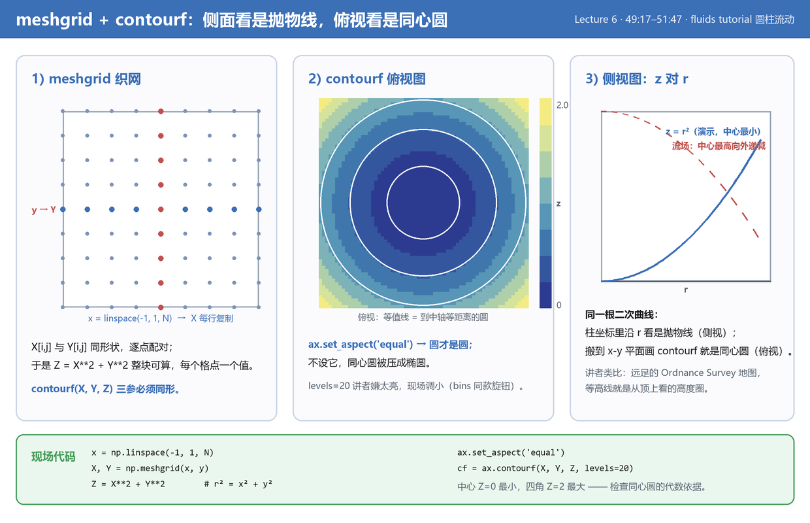

### 6.7 Problem Set 3 Q1 on recreating an album cover (48:00–48:40)

Recreate a rock album cover in Matplotlib by combining the six or seven plot types above in a single figure. The lecturer said the problem is deliberately hard. Once you can do it, you can draw almost any plot.

### 6.8 The lecturer's advice on practising (51:55–52:15)

The lecturer deliberately kept this part short. Matplotlib is learnt by doing. Work through the Gym plotting exercises, then use Matplotlib in reports. That is more effective than listening to a lecture.

---

### Example E6 — How a line plot connects observations (46:01–46:38)

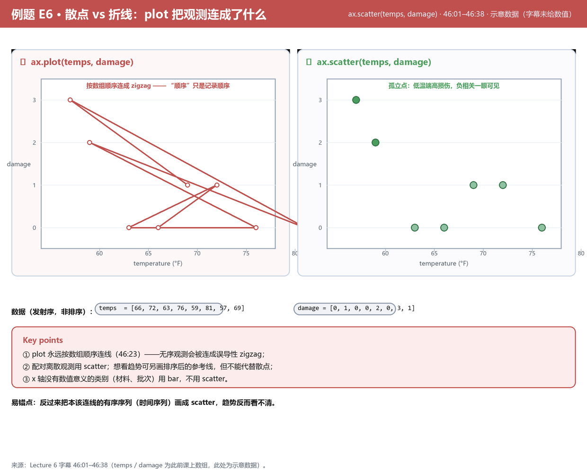

**What is asked**

The transcript refers to temps and damage, two arrays from an earlier class. The lecturer gave no values, so this example uses 8 illustrative observations. The arrays are in recording order (launch order), rather than temperature order.

$$\text{temps} = [66,\ 72,\ 63,\ 76,\ 59,\ 81,\ 57,\ 69], \qquad \text{damage} = [0,\ 1,\ 0,\ 0,\ 2,\ 0,\ 3,\ 1]$$

Plot the paired observations correctly and explain why ax.plot gives a misleading result.

**Why this route**

These are unordered, paired discrete observations. ax.plot joins adjacent points in array order, as the lecturer explained at 46:23. Use ax.scatter to show each observation on its own. That makes the tendency towards more damage at lower temperatures visible without implying a connection between observations.

**Step 1. Make two paired arrays of equal length**

```python
import numpy as np
from matplotlib import pyplot as plt

temps  = np.array([66, 72, 63, 76, 59, 81, 57, 69])
damage = np.array([0, 1, 0, 0, 2, 0, 3, 1])
```

The two arrays have equal length, with one observation at each matching position.

**Step 2. Draw a scatter plot**

```python
fig, ax = plt.subplots()
ax.scatter(temps, damage)
ax.set_xlabel('temperature')
ax.set_ylabel('damage')
```

Each observation is a separate point. The cold observations at 57 and 59 have damage values of 3 and 2 respectively, while the warm observations at 76 and 81 have zero damage. The negative association is easy to see.

**Step 3. Use plot to see the misleading connections**

$$\text{plot}(\text{temps},\ \text{damage}) \quad \to \quad \text{zigzag}$$

```python
ax.plot(temps, damage)        # Incorrect: connects points in array order
```

The line jumps from 66 to 72, back to 63, then up to 76, and continues to zigzag through the launch sequence. This can look like a physical oscillation, although the order is simply the order of recording.

**Where the values come from**

The illustrative data pair the lower temperatures (57, 59) with higher damage (3, 2), and the higher temperatures (76, 81) with zero damage. This makes the negative association visible on a scatter plot. Eight points are enough to show the zigzag on a line plot without overcrowding it.

**Sanity check**

Sort the 8 observations by temperature to get (57, 3), (59, 2), (63, 0), (66, 0), (69, 1), (72, 1), (76, 0), (81, 0). Damage generally rises as temperature falls, with 3 and 2 at the two coldest points. Both plots show the same 8 points. The line plot also joins them.

**Answer**

$$\text{paired discrete data} \Rightarrow \text{scatter}(\text{temps},\ \text{damage}); \qquad \text{plot is for ordered sequences only}$$

**Common pitfalls**

A line plot gives unordered observations a misleading zigzag. A scatter plot can make the trend harder to read in an ordered sequence, such as a time series, when the points should be connected. Use a bar chart when the x-axis holds non-numeric categories such as materials or batches.

---

### Example E7 — Cylinder-flow contours viewed from above with meshgrid and contourf (49:17–51:47)

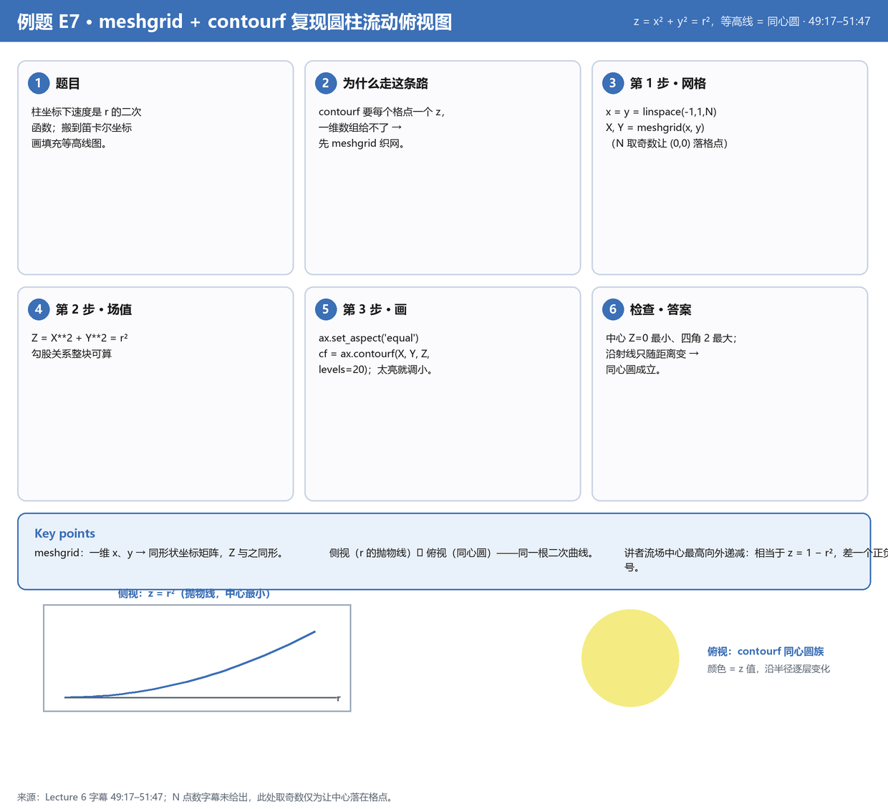

**What is asked**

The velocity of cylinder flow in cylindrical coordinates is quadratic in r. Convert it to Cartesian coordinates and draw filled contours on $[-1,1]\times[-1,1]$. Explain why the contours are concentric circles and whether the centre or the outer edge has the higher value.

**Why this route**

contourf needs each grid point $(X_{ij},Y_{ij})$ to have a value $Z_{ij}$. The 1D x and y arrays alone do not specify those grid points. Use meshgrid to build the grid. Since $z=x^{2}+y^{2}$ is the Cartesian form of $r^{2}$, it is a straightforward way to plot a quadratic function of r across the field. This recreates the visualisation in the last question of the fluids tutorial.

**Step 1. Define the 1D coordinates and build the grid**

$$x = \text{linspace}(-1,1,N), \qquad y = \text{linspace}(-1,1,N), \qquad X, Y = \text{meshgrid}(x, y)$$

The lecturer wrote linspace(-1, 1, ...) without a point count. Use an odd N, such as 201, so $(0,0)$ lies exactly on a grid point. meshgrid returns two coordinate matrices of the same shape. X repeats the x coordinates in each row, and Y repeats the y coordinates in each column. Matching entries form coordinate pairs.

**Step 2. Calculate the field across the grid**

$$Z = X^{2}+Y^{2} = r^{2}$$

By Pythagoras, $r^{2}=x^{2}+y^{2}$. Each grid point now holds its squared distance from the central axis.

**Step 3. Plot the field and set equal scales**

```python
fig, ax = plt.subplots()
ax.set_aspect('equal')
cf = ax.contourf(X, Y, Z, levels=20)
fig.colorbar(cf)
```

levels sets the number of contour bands. The lecturer started at 20 and reduced it because the plot was too bright. set_aspect gives the x and y units the same length so the circles stay round.

**Where the values come from**

There is no adjustable coefficient in $Z=X^{2}+Y^{2}$. It is simply $r^{2}$, an elementary quadratic in r. The lecturer chose the domain $[-1,1]$, which gives $Z=2$ at each corner. N affects smoothness but not the shape. The lecturer started with levels=20.

**Sanity check**

Make three checks. The centre $Z(0,0)=0$ is the minimum. The four corners $Z(\pm1,\pm1)=2$ are the maxima. On any ray from the centre, $Z$ depends only on distance, regardless of direction. Hence the contours are concentric circles. The lecturer's flow is highest at the centre and decreases outwards, as in $z=1-x^{2}-y^{2}$. This reverses the sign and adds a constant while preserving the concentric circles.

**Answer**

$$z = x^{2}+y^{2} \ \text{on } [-1,1]^{2} \Rightarrow \text{concentric rings}, \qquad z \in [0, 2]$$

**Common pitfalls**

The three arrays in contourf(X, Y, Z) must be in that order and have matching shapes. In this example, passing the 1D arrays directly without meshgrid causes a shape error. Without ax.set_aspect('equal'), circles stretch into ovals and distort the top view. Too many levels make the bands harsh. The lecturer reduced the number from 20.

---

### Example E8 — Reducing 9 rounds of Python overhead to 1 with vectorisation (37:12–39:13)


(This example goes with §5 on vectorisation. It comes near the end because it combines the earlier array operations and reduction.)

**What is asked**

For $a=[3,\ 3,\ 3,\ 8,\ 4]$, calculate the sum of squares $\sum_{i=0}^{4} a_i^{2}$. Count the rounds of per-element Python overhead in the loop version and the rounds in the vectorised version, then give the result of each method.

**Why this route**

The lecturer defined vectorisation at 37:20 as replacing Python loops with array operations. In the loop, the interpreter works on each element separately. The array version hands the whole array to a compiled ufunc in one call. The lecturer's post office analogy at 37:43 was that it is quicker to post five letters in one trip than to make five trips. Counting rounds makes the overhead explicit.

**Step 1. Square and add individual elements in a loop**

$$s = 0; \qquad \text{for } a_i \text{ in } a: \ s = s + a_i \times a_i$$

There are 5 multiplications and 4 additions, for 9 per-element operations. Each incurs Python interpreter overhead. The result is $s=107$.

**Step 2. Use array operations on the whole array**

$$s = \text{np.sum}(a \times a)$$

a*a makes one ufunc call to square all 5 elements. A reduction then adds the results. The lecturer described the whole sequence as "only one round of Python overhead". It also gives $s=107$.

**Step 3. Check both results by hand**

$$3^{2}+3^{2}+3^{2}+8^{2}+4^{2} = 9+9+9+64+16 = 107$$

**Where the values come from**

$3^{2}=9$ appears three times, and the other squares are $8^{2}=64$ and $4^{2}=16$. The total is $27+64+16=107$. The count of 9 comes from $n+(n-1)=2n-1$, with $n=5$ squarings and $n-1=4$ additions. The vectorised batch is counted as 1 round. In general, for $n$ elements, the loop incurs $2n-1$ rounds of per-element Python overhead. Vectorisation uses a constant number of Python-level calls, while the underlying work remains $O(n)$.

**Sanity check**

The interpreter loop and the compiled array operations both give 107. The quick arithmetic check $27+80=107$ also agrees. When $n=5$, $2n-1=9$ matches the count in Step 1. The timing experiment in §1 shows the same principle on a larger scale. Summing $10^{6}$ elements took 0.0910 s with a list and 0.0099 s with NumPy, a speedup of about $9.2\times$.

**Answer**

$$\sum_{i=0}^{4} a_i^{2} = 107; \qquad \text{rounds: } 2n-1 = 9 \ \to \ 1$$

**Common pitfalls**

np.sum(a)**2 squares the sum and gives $21^{2}=441$. For the sum of squares, write np.sum(a*a). In Python, ^ is bitwise XOR, so use a**2 or a*a to square the elements. A loop may look clearer, but the lecturer recommended vectorising practical calculations by default (39:43). Loops are taught first to show the underlying operations.

---

### Example E9 — Heat diffusion with aliasing, three slices and double-buffer snapshots (Handout §6.5, printed pages 96–100)

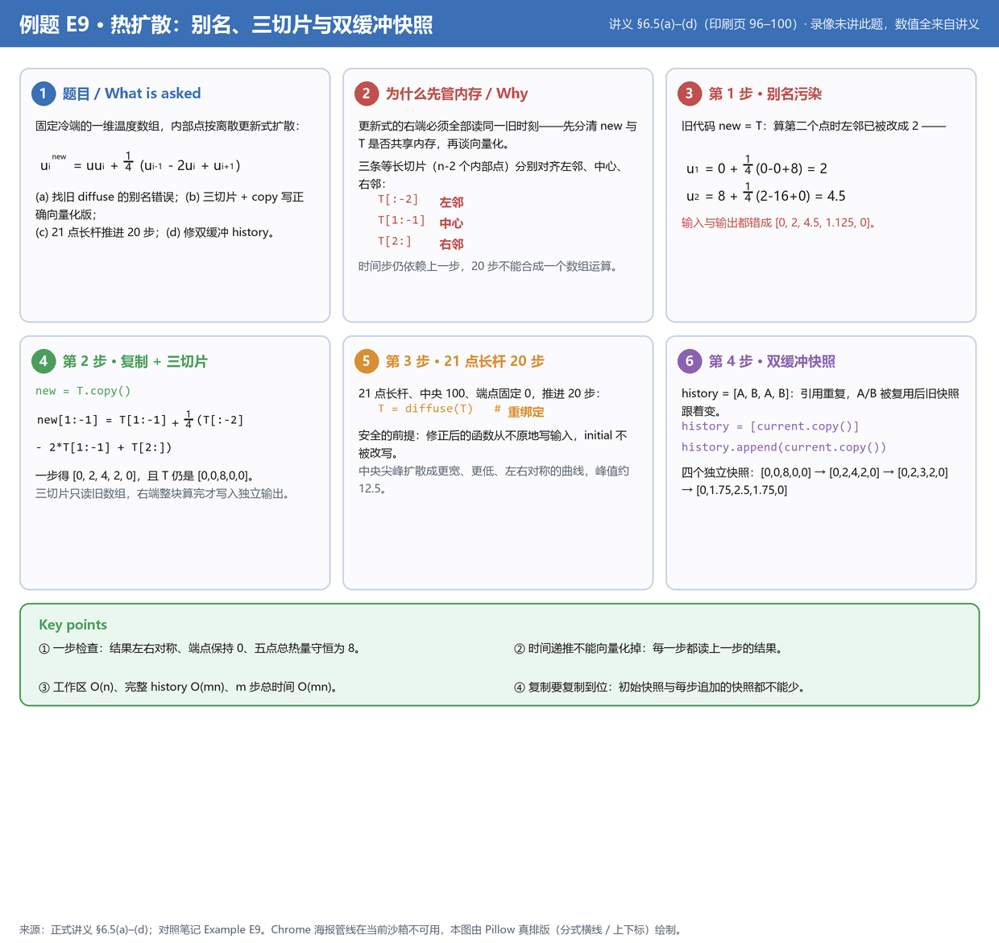

**Source coverage**. This worked example follows official handout §6.5(a)–(d) and was outside the recorded lecture. All array values, the 21-point rod, the 20 steps and the three-step double-buffer test come from the handout.

**What is asked**

You are given a 1D temperature array with fixed endpoints. The interior points diffuse according to a discrete update rule. (a) Find the incorrect array produced by aliasing in the old diffuse function. (b) Write a correct vectorised version using three aligned slices and copy. (c) Advance the state of a 21-point rod by 20 steps while preserving the initial state. (d) Fix the history in the double-buffer version and give the space complexity for the work arrays and snapshots.

**Why this route**

Every value on the right-hand side of the update must come from the same old time step. Resolve any shared memory between the input and output before vectorising. The three slices align left neighbours, centres and right neighbours, so you can update all interior points at once. Each time step still depends on the one before it, so the 20 steps cannot be combined into independent array updates. Double buffering reuses the work arrays. If history stores references, later writes change earlier entries. Copy each snapshot instead.

**Step 1. Reproduce the order-dependent error in the old code**

$$u_1=0+\frac14(0-0+8)=2,\qquad u_2=8+\frac14(2-16+0)=4.5,\qquad u_3=0+\frac14(4.5-0+0)=1.125$$

In the old code, new and T refer to the same array. For the second interior point, the left neighbour has already changed to 2. For the third, it has already changed to 4.5. As a result, both the input and the returned array incorrectly become $[0,2,4.5,1.125,0]$.

**Step 2. Copy the array for output and use three slices to read the old array**

$$\text{new}[1:-1]=T[1:-1]+\frac14\left(T[:-2]-2T[1:-1]+T[2:]\right)$$

The three slices each have length $n-2$ and line up point by point. The whole right-hand side is evaluated before writing to the independent output.

```python
def diffuse(T):
    new = T.copy()
    new[1:-1] = T[1:-1] + 0.25 * (
        T[:-2] - 2*T[1:-1] + T[2:]
    )
    return new
```

For the five-point initial state, the correct output is $[0,2,4,2,0]$ and T remains $[0,0,8,0,0]$.

**Step 3. Advance the rod by 20 steps**

$$T^{(k+1)}=\text{diffuse}\left(T^{(k)}\right),\qquad k=0,1,\ldots,19$$

Each call returns an independent array, so T = diffuse(T) rebinds the name T and leaves initial unchanged.

```python
x = np.linspace(0, 1, 21)
initial = np.zeros(21)
initial[10] = 100.0
T = initial

for step in range(20):
    T = diffuse(T)

fig, ax = plt.subplots()
ax.plot(x, initial, label="Initial")
ax.plot(x, T, label="After 20 steps")
ax.set_xlabel("Position along rod")
ax.set_ylabel("Temperature")
ax.legend()
plt.show()
```

The handout describes the central spike spreading into a wider, lower, symmetric curve. The peak is about 12.5 and the endpoints stay at 0. T = initial is safe here **only because the corrected function leaves the input untouched**. The old function writes to the input.

**Step 4. Identify repeated references in the double-buffer history**

$$\text{history}=[A,B,A,B],\qquad (A,B)\leftarrow(B,A)$$

In the three-step test, history[0] and history[2] point to A. history[1] and history[3] point to B. A ends up holding the state at Step 2, and B holds the state at Step 3. Consequently, history[0] incorrectly shows $[0,2,3,2,0]$ in place of the initial state.

Add a copy in both of these places.

```python
history = [current.copy()]
# After swapping current and work at each step:
history.append(current.copy())
```

The list now stores independent snapshots of the states at the time they were appended. Later writes to the two work arrays leave the snapshots intact.

**Step 5. Calculate the working space, history storage and runtime**

$$\text{working storage}=O(n),\qquad \text{history storage}=O((m+1)n)=O(mn),\qquad \text{time}=O(mn)$$

Double buffering uses two work arrays of length n. Storing m steps and the initial state requires $m+1$ independent arrays. Each update visits the interior points, so m steps still take $O(mn)$ time. Vectorisation does not reduce that to $O(1)$.

**Where the values come from**

The handout specifies the coefficient $\frac14$, the five-point initial state $[0,0,8,0,0]$, the 21-point rod with 100 at the centre, the 20 steps and the three-step double-buffer test. The incorrect 4.5 arises when the second interior point reads the overwritten left neighbour, 2. The correct 4 comes from $8+\frac14(0-16+0)$. Each neighbouring point receives a share of $8/4$ from the central spike, giving 2 on each side.

**Sanity check**

The correct one-step result is symmetric, retains zero endpoints and still sums to 8 across the five points. The incorrect result breaks symmetry and overwrites the input. After 20 steps the result should remain symmetric, with zero endpoints and a central peak of about 12.5. initial must still contain just one non-zero value, 100. An independent scalar loop that reads from a copy of the old array should agree with the three-slice result at each step. Re-run the numeric assertions described in the example.

**Answer**

$$\text{buggy}:[0,2,4.5,1.125,0],\qquad \text{correct}:[0,2,4,2,0]$$

The corrected double-buffer approach gives these four independent snapshots.

$$[0,0,8,0,0],\quad [0,2,4,2,0],\quad [0,2,3,2,0],\quad [0,1.75,2.5,1.75,0]$$

The working space is $O(n)$ and the full history takes $O(mn)$.

**Common pitfalls**

If you replace the loop with slicing but retain new = T, the input is still overwritten in place. T = diffuse(T) cannot protect initial when the old function has already altered it. Copy the initial snapshot as well as the snapshots inside the loop, or history[0] changes when A is reused. Keep a loop for the time recurrence. The $O(n)$ double-buffer work space accounts only for the two work arrays.

---

## 7. Data types, dtype, astype and integer overflow (Handout §6.1 supplement)

> The recording covered why arrays are faster than lists. The handout also explains **the type of each element and how many bytes it occupies**. Choosing the wrong type can produce incorrect results without raising an error.

### 7.1 dtype describes the memory layout

Every element shares the type recorded in `.dtype`. This lets NumPy determine the number of bytes per element and the starting address of element $i$, so it can scan the contiguous block in one go.

```python
import numpy as np

x = np.array([3.0, 1.0, 4.0, 1.0, 5.0])
print(x)         # [3. 1. 4. 1. 5.]   No commas and a trailing decimal point
print(x.dtype)   # float64
print(x.itemsize)  # 8  Bytes per element
```

The printed format helps identify the object. A list prints as `[3.0, 1.0, ...]`, while an array prints as `[3. 1. 4. 1. 5.]`. Square brackets without commas indicate the array here.

The common types $\text{float64}$ and $\text{int64}$ use 8 bytes per element, and $\text{float32}$ uses 4. Storing $10^{6}$ elements of type $\text{float64}$ takes $8\times10^{6}$ bytes, or about 8 MB. Multiply the element count by the bytes per element to estimate memory use.

### 7.2 Integer arrays can overflow silently

Python `int` has arbitrary precision and does not overflow, as covered in Lecture 1. **NumPy integers have a fixed width**, usually 64 bits, with this upper limit:

$$2^{63}-1 = 9\,223\,372\,036\,854\,775\,807 \approx 9.22\times10^{18}$$

Values above the limit wrap around without an error. The handout example recalls Ariane 5:

```python
a = np.arange(10_000_000)        # dtype = int64 because the arguments are integers
print(np.dot(a, a))              # 1291890006563070912  -- Silent error
```

The exact value is

$$\sum_{i=0}^{n-1} i^{2} = \frac{(n-1)n(2n-1)}{6} \approx 3.33\times10^{20}, \quad n=10^{7}$$

This exceeds $9.22\times10^{18}$ by about 36 times and cannot fit in $\text{int64}$. Only the low 64 bits remain, giving an integer that looks random but is valid for the type. **There is no exception or warning.**

Check the dtype and the largest possible value first. Sums, dot products and factorials can grow beyond the capacity of a fixed-width integer. Print the dtype first if the result looks suspicious.

Conversion to float avoids integer wraparound but **does not guarantee exact large integers**. IEEE 754 double precision represents every integer exactly only up to $2^{53}$. For example, converting $2^{53}+1$ to float rounds it to $2^{53}$. For an exact large integer result, use a suitable representation such as Python's arbitrary-precision integers and account for the extra time or memory. This precision detail supplements the recording with NumPy and floating-point behaviour.

### 7.3 astype copies by default and can reuse memory when possible (Additional NumPy behaviour)

astype defaults to copy=True and returns an independent array even if the target dtype is unchanged. copy=False tells it to avoid a copy where possible. It still creates a new array if the dtype must change.

```python
a = np.array([1.7, 2.9, -1.7])
print(a.astype(int))               # [ 1  2 -1], truncated towards zero
b = np.arange(3)
c = b.astype(b.dtype)              # Default: copy=True
d = b.astype(b.dtype, copy=False)  # Can reuse b's memory in this case
print(np.shares_memory(b, c))      # False
print(np.shares_memory(b, d))      # True
```

astype(int) truncates towards zero. Use np.round for rounding. float32 uses about 4 bytes and gives about 7 significant decimal digits. It saves memory at the cost of precision. Decide whether to convert based on the error budget and the dtype.

---

## 8. Views and copies, and how slices share memory (Handout §6.1 supplement)

### 8.1 List slices copy data and array slices return views

This is the **first** difference in behaviour between arrays and lists and the one the handout calls a "critical difference".

```python
arr = np.array([10, 20, 30, 40, 50])
chunk = arr[1:4]
chunk[0] = 99
print(arr)      # [10 99 30 40 50]  -- The original array changed
```

The slice `arr[1:4]` keeps a start, length and stride that refer to the same memory. The data are left in place. This is aliasing, as in Lecture 4, here at the level of array elements.

NumPy returns a view by default because copying an array on every slice would be expensive for large arrays. Use `.copy()` when you need an independent array.

```python
chunk = arr[1:4].copy()
chunk[0] = -1
print(arr)      # [10 99 30 40 50]  Keeps 99 from the last step; writing -1 to the copy leaves arr unchanged
```

### 8.2 Which operations share memory?

| Expression | Result | Does changing it affect the original array? |
|---|---|---|
| `arr[1:4]` | View | Yes |
| `arr[::2]` | View | Yes |
| `arr[arr > 20]` | New array | No |
| `arr.copy()` | New array | No |
| `arr + 1`, `np.sin(arr)` | New array by default | No |
| `arr += 1` | In-place update | Yes |
| `np.add(arr, 1, out=arr)` | out directs the result back into arr | Yes |

Basic slicing usually returns a view and Boolean indexing returns a new array. Ordinary arr + 1 and np.sin(arr) allocate a result by default. In-place operators and a ufunc's out parameter can instead write to existing storage. These last two cases clarify NumPy behaviour beyond the handout table.

### 8.3 An aliasing bug with `new = T`

The handout's last worked example illustrates this bug.

```python
def diffuse(T):
    new = T                      # Incorrect: two names refer to one array
    for i in range(1, len(T) - 1):
        new[i] = T[i] + 0.25 * (T[i-1] - 2*T[i] + T[i+1])
    return new
```

Writing `new[i]` also writes `T[i]`. Step $i$ therefore reads the **already updated** $T[i-1]$. This mixes old and new values and overwrites the input. Start with `new = T.copy()` to fix it.

In the **old** diffuse function above, new = T creates an alias. The loop changes both T and the caller's initial array. A later assignment T = diffuse(T) only rebinds the local name to the same modified object. Rebinding cannot protect the input.

An independent result requires new = T.copy() and right-hand sides that all read from the old T. Then T = diffuse(T) can rebind T while leaving initial unchanged. Check whether the function body writes to its input in place.

**Handout Exercise 32 quick answers**. Boolean indexing on $[5,3,8,1]$ selects $[5,8]$. There are two elements greater than 4. If b is a view, b[0]=99 also changes a[0] to 99. If a is a Python list, a[:2] is a copy and the final print still gives 1.

---

## 9. Reductions along axes and broadcasting (Handout §6.2 supplement)

> axis and M + np.array([100, 200, 300]) come from the handout. keepdims and newaxis are additional NumPy details to explain array shapes.

### 9.1 axis specifies which dimension the reduction removes

```python
M = np.array([[1, 2, 3],
              [4, 5, 6]])
print(np.sum(M))              # 21        All elements
print(np.sum(M, axis=0))      # [5 7 9]   One sum per column
print(np.sum(M, axis=1))      # [ 6 15]   One sum per row
```

The handout says that $\text{axis}=0$ collapses the rows, leaving one value per column. Reducing an array of shape $(2,3)$ along $\text{axis}=0$ gives shape $(3,)$. Dimension 0 disappears and the other dimension remains.

So $\text{axis}=k$ means to sum along dimension $k$ and remove dimension $k$. $\text{mean}$, $\text{max}$, $\text{std}$ and $\text{argmax}$ follow the same convention.

### 9.2 keepdims preserves a shape that can broadcast

```python
col_mean = np.mean(M, axis=0)            # Shape (3,)
col_mean_k = np.mean(M, axis=0, keepdims=True)   # Shape (1, 3)
print((M - col_mean_k).shape)            # (2, 3)  Subtract each column's own mean
```

Without `keepdims`, $(2,3)-(3,)$ still works by broadcasting. Changing the reduction to the other axis can leave incompatible shapes. Use `keepdims=True` to preserve the reduced dimension when you need to centre the data and then process it row by row.

### 9.3 Broadcasting allows element-wise operations on different shapes

Broadcasting **expands** a smaller array to a compatible shape without copying its data. Apply these three rules.

1. Compare dimensions one at a time, starting from the right.
2. Dimensions are compatible if they match or if one is 1. In the latter case, NumPy broadcasts the dimension of size 1.
3. NumPy raises an error if the dimensions differ and neither is 1.

$$(2,3)\ \text{vs}\ (3,) \Rightarrow (2,3); \qquad (2,3)\ \text{vs}\ (2,) \Rightarrow \text{ValueError}$$

```python
M = np.array([[1, 2, 3], [4, 5, 6]])
print(M + np.array([100, 200, 300]))
# [[101 202 303]
#  [104 205 306]]   The same offsets apply to every row, so column 0 gains 100 throughout
```

The handout describes this as "one entry per column combines with every row". An array of length 3 supplies one offset per column.

### 9.4 Using newaxis to make a column vector

To add a different number to **each row**, you need two offsets for the two rows. `M + np.array([10, 20])` fails because broadcasting compares dimensions from the right. For $(2,3)$ and $(2,)$, 3 and 2 conflict. Convert the length-2 array to shape $(2,1)$.

```python
row_bias = np.array([10, 20])[:, np.newaxis]   # Shape (2, 1)
print((M + row_bias))
# [[11 12 13]
#  [24 25 26]]
```

`[:, np.newaxis]`, `[:, None]` and `reshape(2, 1)` are equivalent here. Use whichever you find clearest.

---

## 10. Sorting, paired data and Boolean operations (Handout §6.1–6.2 supplement)

### 10.1 Using argsort to sort without losing pairs

Lecture 4 showed what happens when you sort temperature and damage separately. The observations lose their original pairings. `np.argsort` returns the **index order**. Index both arrays with the same sequence to preserve the pairs.

```python
# Use the 8 points from E6, a different dataset from the handout's 23 original observations
temps  = np.array([66, 72, 63, 76, 59, 81, 57, 69])
damage = np.array([0, 1, 0, 0, 2, 0, 3, 1])

order = np.argsort(temps)          # Indices for ascending order: [6, 4, 2, 0, 7, 1, 3, 5]
print(temps[order][:4])            # [57 59 63 66]
print(damage[order][:4])           # [ 3  2  0  0]  The same observations remain paired
```

`argsort` returns indices in sorted order and leaves the original array untouched. Use those indices to retrieve sorted values. For descending order, append `[::-1]`.

### 10.2 Boolean operations with &, | and ~ need parentheses around each comparison

`and`, `or` and `not` operate on individual truth values. Using them on whole arrays raises `ValueError` because the array's truth value is ambiguous. Use `&`, `|` and `~` for element-wise operations.

```python
x = np.array([66, 70, 57, 53, 67, 58])
print(x[(x > 55) & (x < 65)])   # [57 58]
print(x[~(x > 65)])             # Negate the comparison, equivalent to x[x <= 65]
print(np.sum(x > 65))           # 3   Counts each True as 1
```

Keep the parentheses. `&` binds more tightly than `>`, so `x > 55 & x < 65` is parsed as `x > (55 & x) < 65`.

### 10.3 Masks, counts and conditional means

```python
cold = temps <= 65
print(np.sum(cold))                # Number of cold days, counting each True as 1
print(np.sum(damage[cold]))        # Total damage on cold days
print(np.mean(damage[cold]), np.mean(damage[~cold]))   # Mean damage on cold days and on other days
```

This replaces the loop, counter and running sum from Lecture 4. **Build a mask, index with that mask, and reduce the result.** Each step takes one line.

---

## 11. Plotting methods, grids, saving figures and a checklist (Handout §6.3 supplement)

### 11.1 Four methods for logarithmic axes

§6.5 showed how taking a logarithm straightens exponential decay. These are the four plotting methods available on `ax`.

| Method | x-axis | y-axis | When to use it |
|---|---|---|---|
| `ax.plot` | Linear | Linear | Data span just one order of magnitude |
| `ax.semilogy` | Linear | Log | Exponential growth or decay across several orders of magnitude |
| `ax.semilogx` | Log | Linear | x spans several orders of magnitude |
| `ax.loglog` | Log | Log | Power laws with both variables spanning orders of magnitude |

You can change the scales on an existing axes with ax.set_yscale("log") or ax.set_xscale("log").

Log-log axes are useful in reports. Taking logarithms of any power law $y = c\,x^{k}$ gives

$$\log y = \log c + k\log x$$

This is a straight line with slope $k$. To see whether sorting time is $\propto n^{2}$, **measure the slope** directly from the plot. If an error falls with $N$ according to $N^{-1/2}$, the log-log slope is $-0.5$.

**Handout Exercise 35 quick answer**. The runtime of recursive Fibonacci grows asymptotically like $c\varphi^{n}$. This exponential growth gives a curve on log-log axes. Use semilogy to obtain

$$\log T(n)\approx\log c+n\log\varphi$$

The horizontal n-axis is linear and the vertical time axis is logarithmic. The slope $\log\varphi$ gives the change in log runtime for a unit increase in n. On a log-log plot, the slope of a straight line instead gives the power-law exponent.

**Log axes require positive values (supplement)**. $\log 0$ is undefined. When the data contain zero or negative values, Matplotlib can mask those points. A segment of the curve can disappear, usually with a warning instead of an error. Check the minimum first. If zero is a placeholder, for example for no damage recorded or a value below the detection limit, deliberately exclude those entries or replace them with NaN before plotting.

### 11.2 Faster plotting of a 2D field with imshow

`ax.contourf(X, Y, T)` draws filled contours. `ax.imshow(T)` displays the array directly as an image, with no need for $X$ or $Y$ grids. It is much faster, but it gives no contour lines and the colour transitions are less clean. Use imshow for data with one value per cell, such as photos, thermal images and stress maps. Use contourf when you need to read contour values.

### 11.3 How subplots returns arrays of axes

```python
fig, axes = plt.subplots(2, 2)
axes[0, 0].plot(x, y1)
axes[1, 1].hist(data, bins=20)
```

When $n_{\text{rows}}>1$ and $n_{\text{cols}}>1$, `axes` is 2D and `axes[i, j]` selects a panel. For one row of several panels, `axes` is 1D and you use `axes[i]`. Using `axes[i, j]` on a 1D array gives `IndexError: too many indices`. Calling `axes.plot` directly on a 2D array gives `AttributeError`, since an ndarray has no `.plot` method. The error tells you whether you supplied too many indices or tried to call a method on the array itself.

Disable squeeze if you want to index all grids the same way.

```python
fig, axes = plt.subplots(2, 2, squeeze=False)   # Always returns a 2D array
axes[1, 0].plot(x, y)                           # Always index as axes[i, j]
```

The default squeeze=True returns a single Axes for 1×1 and a 1D array for 1×N. This reduces indexing when the layout is simple, but the indexing changes with the shape. Use squeeze=False to keep indexing consistent, especially when plotting in a loop.

### 11.4 The file extension selects vector or raster output

```python
fig.savefig("oring.pdf", bbox_inches="tight")   # Vector: reports and LaTeX
fig.savefig("oring.png", dpi=200)               # Raster: slides and web pages
```

Follow these two rules.

- **Choose the file format by extension.** PDF and SVG preserve lines and text when enlarged, so they suit reports. PNG stores a grid of pixels. Its resolution depends on `dpi`, which defaults to 100. Use at least 200 for projection.
- **Call `savefig` before `plt.show()`.** In many environments, show closes the figure, so saving afterwards produces a blank image. bbox_inches="tight" trims the surrounding whitespace.

(Supplement) When generating figures in a loop, call `plt.close(fig)` after saving each one. Otherwise, figure objects accumulate in memory and can slow the machine after a few hundred figures.

### 11.5 The handout's eight rules for clear plots

> "A plot is an argument." The Challenger engineers had the right data but did not communicate what it meant clearly.

1. **Label both axes with the quantity and unit.** Write Temperature (°F). A label such as temps leaves the unit unclear, and an unlabelled axis is like a table without a heading.
2. **Match the plot to the data.** Use lines for continuous or ordered data, points for independent observations, bars for one value per category and histograms for distributions. **Leave points unconnected when their order has no meaning.**
3. **Make each curve identifiable.** For more than one curve, add a legend or label each curve directly. Use line styles or markers as well as colours so colour-blind readers and readers of monochrome printouts can tell the curves apart. More than five curves on one axes is usually too many. Use subplots.
4. **Use honest axis limits and ticks.** Start bar charts at 0. Avoid truncating the vertical axis to make differences look bigger.
5. **Show uncertainty when it is available.** Use error bars or a shaded band. A value shown without its uncertainty can suggest more precision than the data support.
6. **Choose an appropriate colour map for 2D fields.** The default `viridis` changes brightness monotonically and is readable by colour-blind readers and in greyscale. **Avoid `jet`**, which can create apparent boundaries where none exist. For positive and negative values with a meaningful zero, such as stress, use a diverging colour map such as `RdBu`.
7. **Make figures readable at their final size.** Set the intended size with `figsize`, use large enough text and call fig.tight_layout() to prevent labels overlapping.
8. **Use the caption to explain the figure.** In reports, say what is plotted and where to look. Reserve plot titles for slides.

**Handout Exercise 36 revised example**. The original joins independent measurements, omits the uncertainty given in err, and lacks a legend for the two series. Both axes also lack quantity labels and units. Show measured points with error bars, keep a continuous line for the theoretical values, and save before displaying.

```python
fig, ax = plt.subplots()
ax.errorbar(load, defl, yerr=err, fmt="o", label="Measured")
ax.plot(load, theory, label="Beam theory")
ax.set_xlabel("Load (kN)")
ax.set_ylabel("Deflection (mm)")
ax.legend()
fig.tight_layout()
fig.savefig("bridge_test.pdf", bbox_inches="tight")
plt.show()
```

### 11.6 Object-oriented ax methods and pyplot functions (Supplement)

There are two equivalent ways to draw the same plot.

```python
plt.plot(x, y)                        # pyplot style: use the current figure

fig, ax = plt.subplots()              # OO style: get the figure and axes objects first
ax.plot(x, y)
```

pyplot takes less code and acts on an implicit current figure and axes. With multiple subplots or a loop, the current target can change, and you do not have a fig object to call savefig on. In object-oriented code, ax[i, j].plot identifies a specific panel and fig.savefig saves a specific figure. The handout and recording use this style. Start scripts and report plots with fig, ax = plt.subplots(). Reserve plt for subplots, show and occasional tight_layout calls.

---

## 12. Official handout coverage table (printed pages 81–100)

This **reference table** shows where the notes cover the handout's core material. Its scope is the main points, with individual figures, wording and optional details outside that scope. Where the recording and handout differ, the notes identify their sources separately.

| Handout item | Core points | Where covered | Coverage details |
|---|---|---|---|
| Table 13, printed p. 84 | zeros/ones/arange/linspace/logspace, endpoints and exponent arguments | §2, E2 | Includes the floating-point arange endpoint caveat |
| Table 14, printed p. 85 | Indexing, element-wise arithmetic, ufuncs, reductions and Boolean selection | §3, §10, E3 | Distinguishes math.sin from NumPy ufuncs |
| Table 15, printed p. 92 | Choosing plot, semilogy, semilogx or loglog | §11.1 | Includes the power-law slope and Exercise 35 |
| Exercise 32, printed p. 87 | Boolean selection, counts and slice views | §3, §8 | Gives quick answers to all four parts |
| Exercise 33, printed p. 89 | 2D indexing, axis, two forms of multiplication and linear solves | §4, §9, E4–E5 | Gives numerical answers and a residual check |
| Exercise 34, printed p. 90 | Recurrence dependencies and limits of vectorisation | §5.5, E9(c) | Also gives the closed-form method using $2^{i}$ |
| Exercise 35, printed p. 92 | Use semi-log axes in place of log-log axes for exponential growth | §11.1 | Slope $\log\varphi$ |
| Exercise 36, printed p. 96 | Error bars, legend, axis labels and units, and plot type | §11.5 | Includes revised code |
| §6.5(a)–(d), printed pp. 96–100 | Heat diffusion, three slices, 20 steps, double-buffer snapshots and complexity | E9 | Includes both the incorrect and correct arrays and all eight example parts |

## Lecture 6 Formula Card

(Covers the recording, the official handout and E1–E9. See §1–§5 for NumPy, §6 and §11 for Matplotlib, and E9 for handout §6.5.)

| Situation | Formula or fact | Use or conditions |
|---|---|---|
| linspace samples | $\text{linspace}(a,b,n)$ gives $n$ points, includes both endpoints and uses step $\frac{b-a}{n-1}$ | range excludes the right endpoint (E2) |
| Timing | $t = t_{\text{end}} - t_{\text{start}}$ using time.perf_counter | Sum of $10^{6}$ elements took 0.0910 s for a list and 0.0099 s for NumPy, a speedup of about $9.2\times$ (E1) |
| Boolean mask | mask = x < 45, then x[mask] selects the matches | mask is a Boolean array and the selection returns a new array (E3) |
| Element-wise vs matrix multiplication | $*$ multiplies corresponding entries. $@$ sums products across a row and a column | A*B and A@B give different results (E4) |
| Linear solve | $Ax=b \Rightarrow$ np.linalg.solve(A, b) | More stable and faster than forming inv(A)@b by hand (E5) |
| Rounds of vectorisation overhead | $2n-1$ rounds of Python loop overhead $\to$ a constant number of array calls | Asymptotic time is still $O(n)$, not $O(1)$ (E8) |
| Sum of squares | $\sum_i a_i^{2}$ = np.sum(a*a) | np.sum(a)**2 gives the square of the sum, $(\sum_i a_i)^{2}$ |
| errorbar | Three arrays for x, y and error | Errors can be standard deviations, measurement errors or confidence-interval half-widths (6.3, 11.5) |
| Uncertainty band | fill_between(x, mean−std, mean+std) | Three arrays for t, mean and std (6.3) |
| Log axis | $y=e^{-kt} \Rightarrow \ln y = -kt$ (straight line with slope $-k$) | Use for exponential behaviour in reports (6.5) |
| Grid | $X, Y = $ meshgrid(x, y), with Z of the same shape | The three arrays passed to contourf must have matching shapes (6.6) |
| Cylinder flow | $r^{2}=x^{2}+y^{2}$ gives concentric contours | Side view is a parabola and top view shows rings (E7) |
| dtype overflow | Fixed-width integers wrap around when out of range. float can lose large integer precision | Check dtype, value range and precision budget first (§7) |
| Views and copies | Basic slices share memory, copy is independent, and in-place or out operations write back to the original | astype defaults to copy=True (§7–§8) |
| Axis reduction and broadcasting | axis=0 collapses the rows. $(2,3)+(3,)\to(2,3)$ | Column offsets broadcast directly. Row offsets need shape $(2,1)$ (§9) |
| Sorting paired observations | order=argsort(temps), then use the same order to index damage | Keep observations paired by sorting the indices once (§10) |
| Matrix residual | $r=Ax-b$. allclose gives a single result, and isclose checks each component | Avoid det == 0 and exact equality for floating-point values (§4.5) |
| Heat diffusion | Three slices read the old T, with new=T.copy() | Incorrect $[0,2,4.5,1.125,0]$. Correct $[0,2,4,2,0]$ (E9) |
| Double-buffer history | Two work arrays use $O(n)$. The $m+1$ independent snapshots take $O(mn)$ | Copy the initial state and each subsequent history entry (E9) |

## Quick check (answers below)

1. Why does plt.plot fail after import matplotlib as plt? What is the correct import?
2. Should you use plot or scatter for unordered paired observations? Why?
3. Which arrays do errorbar and fill_between need?
4. Which logarithmic axes should you use for exponential decay and for a power law?
5. Why do you need meshgrid before contourf here? What happens without equal aspect?
6. What do the endpoint arguments and other parameters of linspace and logspace mean?
7. For $a=[3,3,3,8,4]$, what do np.sum(a*a) and np.sum(a)**2 each return?
8. Does vectorisation make the calculation $O(1)$ or reduce it to one pass over the underlying data?
9. Why can a fixed-width integer dot product fail silently? Does converting to float preserve large integers exactly?
10. Does astype copy by default? What does copy=False guarantee, and when can it still make a copy?
11. How do basic slicing, copy, arr+=1 and out=arr each affect the original array?
12. What shape results from summing a $(2,3)$ array along axis=0? How do you add row offsets?
13. How does argsort preserve the pairing between temps and damage?
14. Which residual and API can check the solution of $Ax=b$? How do isclose and allclose differ?
15. Why does the old heat diffusion code produce $[0,2,4.5,1.125,0]$? What is the correct result?
16. When does T = diffuse(T) preserve initial? Why does the old function change it?
17. Why must double-buffer history copy the initial state and every subsequent step?
18. How much storage is required for all snapshots of n points and m steps? Can you vectorise the time recurrence?

**Answers**

1. That import loads the package without pyplot. Use import matplotlib.pyplot as plt or from matplotlib import pyplot as plt.
2. Use scatter. plot connects points in storage order, which has no physical meaning here.
3. errorbar takes x, y and an error per point. fill_between takes the independent variable and the lower and upper bounds, often calculated from mean and std.
4. For exponential decay, use a logarithmic y-axis and a linear x-axis. For a power law, use log-log axes, where the slope gives the exponent.
5. Each grid point needs a z value, and X, Y and Z need the same shape. Unequal axis scales turn circles into ovals.
6. linspace(a,b,n) produces n linearly spaced points and includes a and b. For logspace, a and b are base-10 exponents, and both endpoints are included.
7. The results are 107 and $21^{2}=441$, respectively.
8. Both multiplication and reduction still process every element. Vectorisation reduces calls through the Python interpreter while asymptotic time remains $O(n)$.
9. Fixed-width integers wrap around when they exceed their range. Double-precision float can also lose precision. Converting $2^{53}+1$ loses the 1.
10. The default is copy=True. copy=False allows reuse where possible. A required dtype conversion still creates a copy.
11. A basic slice shares memory. copy is independent. Both arr+=1 and out=arr write back in place.
12. The result has shape $(3,)$. Change the length-2 row offset array to shape $(2,1)$, for example with [:, np.newaxis].
13. Index both arrays with the same order array to keep each observation paired.
14. Compute $r=Ax-b$. allclose returns one Boolean for the full result. isclose returns a Boolean array with one entry per element.
15. Aliasing mixes the old and new values and biases the result in the direction of the loop. The correct result is $[0,2,4,2,0]$, and the input stays unchanged.
16. When diffuse avoids in-place writes to the input and returns an independent array. The old function modifies the input before rebinding, and rebinding cannot undo that change.
17. The two work arrays are reused in turn. Without copies, multiple history entries point to the same final state.
18. $O((m+1)n)=O(mn)$. Vectorise the updates across interior spatial points. Keep the time loop because each step depends on the previous one.

## Scope of this note

This file covers the 2026-11-13 Lecture 6 recording, the core points in official handout §6.1–6.5, and E1–E9. The timestamps in §0–§6 come from the recording. §7–§12, the quick answers to Exercises 32–36, and E9 draw on the handout. The astype arguments, isclose, keepdims, newaxis and the in-place and out exceptions are marked as additional notes on NumPy behaviour beyond the recorded explanations.

**Outside the scope**. The internals of the compiled code used by np.sum (39:55–40:29), the LLM experiment in automated optimisation (40:29–41:44), the recreation of the album cover in Problem Set 3 Q1 (48:00–48:40), and the individual Gym exercises (51:55–52:15). See §0 and Canvas for exam arrangements.

The captions omit the E6 temps/damage values, so E6 uses clearly labelled illustrative data. They also omit the E7 grid point count. E9 follows the official handout's values and §6.5(a)–(d). Richardson's teaching model and the original dam calculation are distinct.

**Limits of source verification**. Neither of the two available Python environments had a PDF reading library, and the system had no usable pdftotext, pdftoppm or mutool. Following the instructions, no reinstall or custom PDF parser was attempted. As a result, the original PDF could not be rendered again for visual checking page by page. Printed page references and text were checked against a text extraction of the handout. This extraction can lose symbols and spaces, so §12 covers the main points only. The original PDF was left unchanged.

**Self-check**. Run python _tools/check_math_style.py, python _tools/check_example_depth.py, python _tools/check_note_links.py, and and re-run the numeric checks in the examples. The E1–E8 figure links are unchanged. For E9, figures/ex_l6_e9_diffusion.png is reserved for a later plotting pass. Until the figure exists, the link checker will flag it, and a repository-wide pass remains unverified.

## Glossary

| Term | English | Short definition |
|---|---|---|
| NumPy array | array | A contiguous block of same-type elements and the basic NumPy object |
| Python list | list | A general-purpose Python container that stores scattered references and is slower for numerical calculations |
| Contiguous storage | contiguous memory | Elements stored next to one another so they can be read, written or moved together |
| Universal function | ufunc | A compiled function such as np.sin that operates element by element on a whole array |
| Array reduction | reduction | An operation that combines an array into one value, such as sum, mean, max or min |
| Selection mask | boolean mask | An array of True and False results from a comparison, used to select elements |
| Vectorised computation | vectorisation | Replacing Python loops with array operations |
| Round of overhead | one round of overhead | The fixed interpreter cost for one element-wise operation |
| Matrix product | matrix multiplication | Sum of products across a row and a column, using @ |
| Component-wise product | element-wise product | Multiplying corresponding entries using * |
| Canvas | figure | The whole canvas on which a plot is drawn |
| Plotting axes | axes | The set of coordinate axes within a figure, with methods for drawing on them |
| Plotting module | pyplot | The Matplotlib plotting interface module to import |
| Line chart | line plot | plot joins points in array order |
| Scatter chart | scatter plot | scatter draws individual points without connecting lines |
| Histogram plot | histogram | hist counts values in bins |
| Measurement error bar | error bar | A vertical line showing the error at each point, supplied in a third array |
| Shaded uncertainty | uncertainty band | The band between mean±std drawn by fill_between |
| Log scale | log axis | A logarithmic coordinate scale that can straighten exponential decay |
| Coordinate grid | meshgrid | Builds 2D coordinate matrices from 1D x and y arrays |
| Filled contour plot | filled contour | contourf shades bands of grid point values |
| Equal axis scaling | equal aspect | Equal x and y unit lengths keep circles round |
| Data type | dtype | The fixed-width array element type, which determines range, memory use and precision |
| Array view | view | An alternative way to index data that shares the original array's memory |
| Solution residual | residual | $r=Ax-b$, used as an independent check on a numerical solution |
| Alternating buffers | double buffering | Alternating reads and writes between two work arrays to keep old and new states separate |
| State snapshot | snapshot | An independent copy of the state made when adding it to history |
