# MECH40008 - 11 November 2026

## Visual notes (Chapter 7-8): remainder, Leibniz rule, ratio test

> **In 60 seconds:** three tools. **In 15 minutes:** how to use them on exam questions.  

  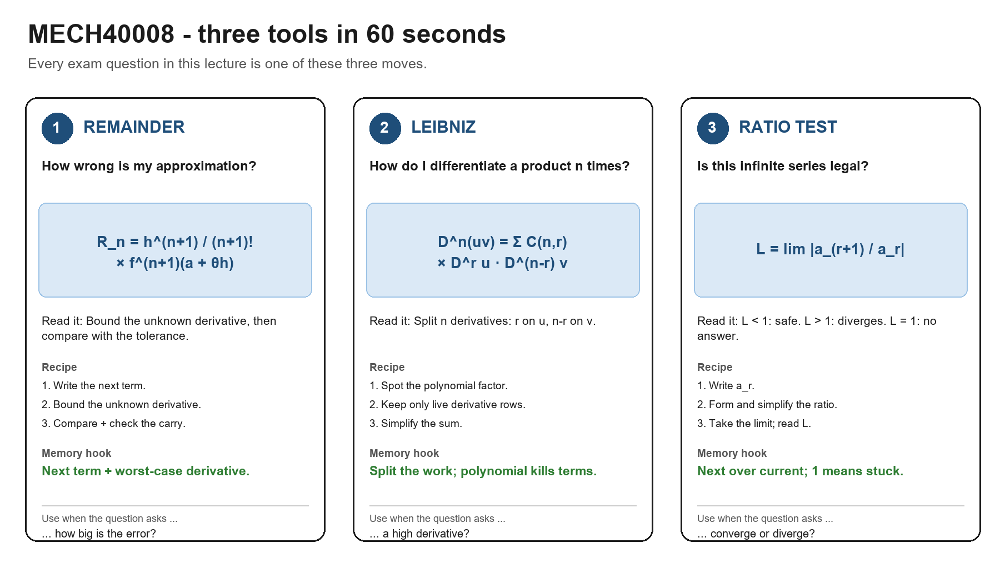

---

## 0. Start here

Every question in this lecture is one of three moves. Find the question type first; the tool follows.

| Question | Tool | One-line answer |
|---|---|---|
| How big is the error? | **Remainder** | Bound the next term, then compare with the tolerance. |
| Differentiate a product n times? | **Leibniz rule** | Split the $n$ derivatives between the factors. |
| Does the series converge? | **Ratio test** | $L<1$ means absolute convergence, $L>1$ means divergence, and $L=1$ is inconclusive. |

First bound the error, then find the higher derivatives, then test the series for convergence.

  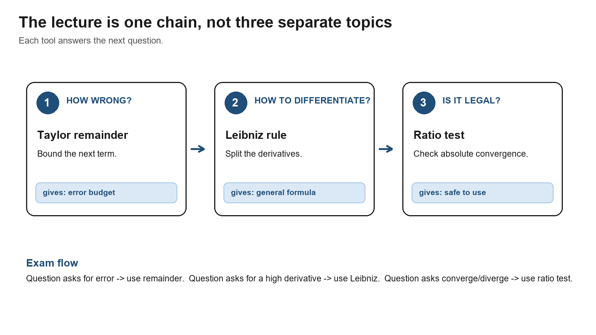

### Symbols you need

| Symbol | Meaning | Notes |
|---|---|---|
| $f$ | the function being approximated | |
| $a$ | expansion point | |
| $h$ | the step away from $a$ | |
| $n$ | derivative order, a non-negative integer | |
| $R_{n}$ | remainder after $n+1$ terms | |
| $\theta$ | unknown number between 0 and 1 | |
| $D$ | derivative operator | |
| $L$ | limit in the ratio test | |
| $a_{r}$ | general term of a series | |

---

## 1. Remainder: how wrong is my approximation?

### 1.1 The question

You approximate $\sin 46^\circ$ with only three terms of its Taylor series. The approximation looks precise, but how much can it be off? The remainder answers that question.

  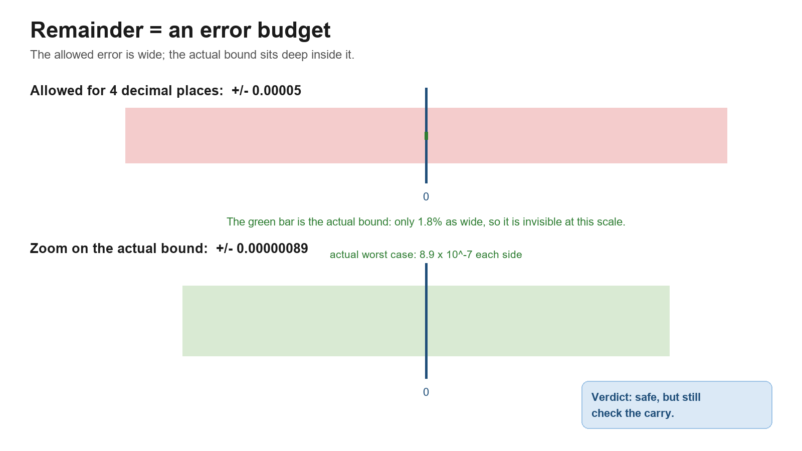

**One-line answer:** the remainder is the next term, with its derivative evaluated at an unknown point. Bound that derivative, and you have a guaranteed error budget.

### 1.2 The formula

$$R_n=\frac{h^{n+1}}{(n+1)!}f^{(n+1)}(a+\theta h),\qquad 0\le\theta\le 1.$$

**Read it:** $h$ is the step; $n+1$ is the next power and factorial; $f^{(n+1)}$ is the next derivative; $\theta$ is an unknown point between $a$ and $a+h$. You do **not** solve for $\theta$; you bound the derivative.

### 1.3 The four-step recipe

| Step | Do this | Notes |
|---:|---|---|
| 1 | Write the next term. | |
| 2 | Replace the unknown derivative with its maximum possible magnitude. | |
| 3 | Compare the bound with the allowed tolerance. | |
| 4 | Add and subtract the bound and check the target digit. | |

### 1.4 Worked example: sin 46° to 4 d.p.

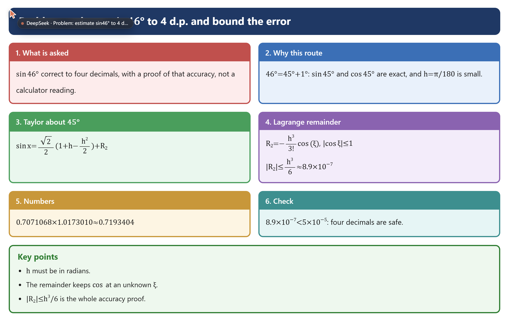

**What is asked**

Find $\sin 46^\circ$ to four decimal places and use the remainder to justify the rounded value. Choose an expansion point, decide how many terms to keep and bound the part you leave out.

**Why this route**

The angle $46^\circ$ has no standard exact value for $\sin 46^\circ$. The angle $45^\circ$ does, and the values of $\sin 45^\circ=\cos 45^\circ=1/\sqrt2$ are known there. Write $46^\circ$ as $45^\circ$ plus a small increment and expand about $45^\circ$. A smaller increment means you need fewer terms.

**Step 1. Find the increment $h$**

$$h=46^\circ-45^\circ=1^\circ=\frac{\pi}{180}\approx 0.017453$$

Convert to radians because the derivative formulas assume radian measure. Treating $1$ as a number in degrees would introduce a factor of $57$. Since $h\approx 1.75\times10^{-2}$, the increment is small enough for two or three terms.

**Step 2. Write the expansion about $45^\circ$**

$$\sin\left(\frac{\pi}{4}+h\right)=\sin\frac{\pi}{4}+h\cos\frac{\pi}{4}-\frac{h^{2}}{2!}\sin\frac{\pi}{4}-\frac{h^{3}}{3!}\cos\frac{\pi}{4}+\cdots$$

**Where the common factor $1/\sqrt2$ comes from**

At $x=\pi/4$, both $\sin$ and $\cos$ equal $1/\sqrt2$. The $k$th Taylor term is $\frac{f^{(k)}(\pi/4)}{k!}h^{k}$. Successive derivatives of $\sin$ cycle through signed versions of $\pm\sin$ and $\pm\cos$, whose values at $\pi/4$ have magnitude $\pm1/\sqrt2$. So factor out $1/\sqrt2$.

$$\sin\left(\frac{\pi}{4}+h\right)=\frac{1}{\sqrt2}\left(1+h-\frac{h^{2}}{2!}-\frac{h^{3}}{3!}+\cdots\right)$$

The signs in brackets repeat in the pattern $+,-,-,+,\ldots$. Successive derivatives give $\cos$, then $-\sin$, then $-\cos$, then return to $\sin$, completing a cycle of four.

**Step 3. Keep three terms and calculate the approximation**

$$1+0.017453-\frac{0.017453^{2}}{2}=1.017301\quad\Rightarrow\quad \sin 46^\circ\approx\frac{1}{\sqrt2}\times1.017301=0.7193404$$

When doing the calculation, multiply by $1/\sqrt2=0.7071068$ directly. Using $0.707$ would lose three digits of precision.

**Step 4. Show that the remainder is small enough**

The first omitted term, with the derivative evaluated at an intermediate point, gives the remainder.

$$R_2=-\frac{h^{3}}{3!}\cos\left(\frac{\pi}{4}+\theta h\right),\qquad 0<\theta<1$$

Taylor's theorem guarantees the existence of an intermediate point $\theta$. To bound the error, use the fact that $\cos$ always lies in $[-1,1]$. Replace the whole cosine factor by its maximum possible magnitude, $1$.

$$|R_2|\le\frac{h^{3}}{6}=\frac{1}{6}\left(\frac{\pi}{180}\right)^{3}\approx 8.9\times10^{-7}$$

**Where $8.9\times10^{-7}$ comes from**

Calculate $h\approx 1.745\times10^{-2}$ and $h^{3}\approx 5.31\times10^{-6}$, then divide by $3!=6$ to get $8.9\times10^{-7}$. The $6$ comes from the factorial in the Taylor formula. The division makes the cubic term another order of magnitude smaller.

**Sanity check**

The tolerance for four decimal places is $0.5\times10^{-4}=5\times10^{-5}$. Our bound is about $56$ times smaller. Check rounding at both ends of the interval, $0.7193404-0.0000009=0.7193395$ and $0.7193404+0.0000009=0.7193413$. Both round to $0.7193$. Verify the size of the bound and the rounding before claiming four decimal places.

**Answer**

$$\sin 46^\circ\approx 0.7193\quad\left(|R_2|\le 8.9\times10^{-7}<5\times10^{-5}\right)$$

> **Common pitfall.** The remainder bound $8.9\times10^{-7}$ establishes an error smaller than the tolerance $5\times10^{-5}$. For a true value near a boundary such as $0.7193499\ldots$, rounding can still change the fourth digit. Calculate to the fifth decimal place first and check how the bounds round before reporting the fourth.

### 1.5 Trap: a small remainder alone cannot guarantee four decimal places

A bound smaller than the tolerance is necessary, but not sufficient. You must check the carry. If the approximation sits near a rounding boundary, even a tiny error can flip the fourth digit.

Also: always round a bound **up**. If the true maximum is $8.86\times 10^{-7}$, write $8.9\times 10^{-7}$, never $8.8\times 10^{-7}$.

### 1.6 Tighter bound (bonus)

On $[\pi/4,\ \pi/4+h]$, cosine is positive and decreasing, so its maximum is $1/\sqrt{2}$. Hence

$$|R_2|\le\frac{h^3}{6\sqrt2}\approx 6.3\times10^{-7}.$$

This problem only needs the simpler bound.

### 1.7 30-second check

**Q:** Why can we ignore the unknown $\theta$?  
**A:** Because we replace the whole cosine factor by its worst-case size, $1$. That removes $\theta$ completely.

---

## 2. Leibniz rule: differentiate a product n times

### 2.1 The question

Differentiate $uv$ once, twice, three times. The coefficients come out as $1$, then $1,2,1$, then $1,3,3,1$. Why? Because each derivative chooses which factor to hit.

  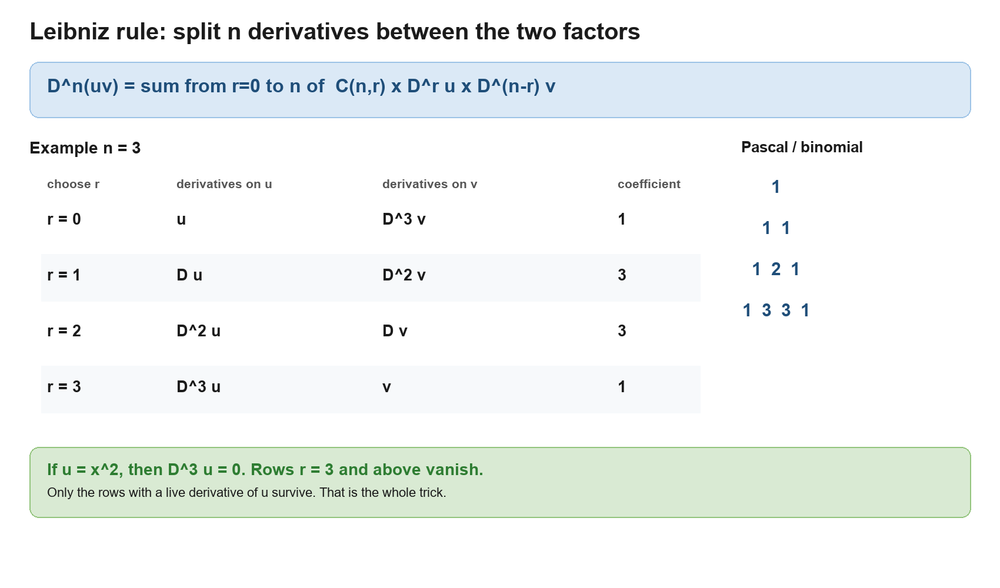

**One-line answer:** split $n$ derivatives into $r$ on $u$ and $n-r$ on $v$; the number of ways to split is the binomial coefficient.

### 2.2 The formula

$$D^n(uv)=\sum_{r=0}^{n}\binom{n}{r}D^ru\,D^{n-r}v.$$

**Read it:** $D^{n}$ means differentiate $n$ times; $r$ counts how many derivatives go on $u$; $n-r$ go on $v$; $\binom{n}{r}$ counts the possible splits.

### 2.3 The three-step recipe

| Step | Do this | Notes |
|---:|---|---|
| 1 | Identify the polynomial factor. | |
| 2 | Keep only the terms where its derivative is nonzero. | |
| 3 | Simplify the remaining sum. | |

### 2.4 Worked example: $x^{2}e^{x}$

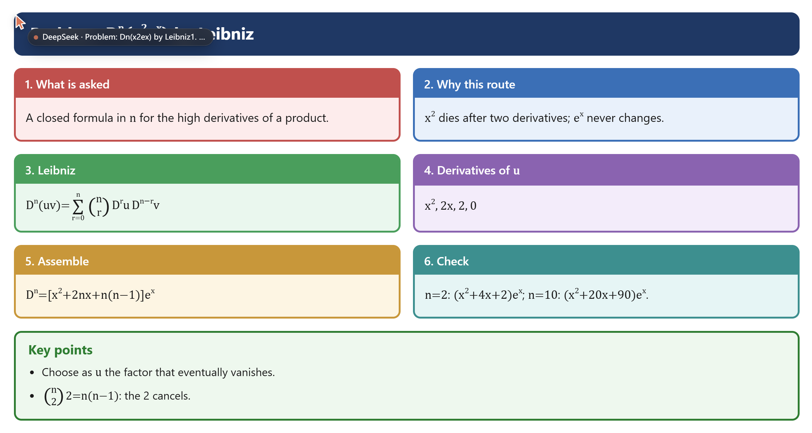

**What is asked**

Find $D^{n}(x^{2}e^{x})$, the derivative of $x^{2}e^{x}$ of order $n$. The formula should let you substitute a specific value of $n$, such as $n=4$.

**Why this route**

Repeated use of the product rule doubles the number of terms at each step, as in $2^{k}$, giving sixteen terms after four derivatives and thirty-two after five. Leibniz's rule gives the whole result in a single sum. It distributes $n$ derivatives between the two factors using binomial coefficients.

**Step 1. Choose which factor is $u$**

Set $u=x^{2}$ and $v=e^{x}$. The third derivative of $x^{2}$ is $0$, so only a few terms survive in the sum. Every derivative of $e^{x}$ gives the same function. You can also choose $u=e^{x}$, with the same amount of work.

**Step 2. List the derivatives of $u$**

$$u=x^{2},\qquad u'=2x,\qquad u''=2,\qquad u^{(k)}=0\ (k\ge 3)$$

Only $0,1,2$ contribute as values of $k$, leaving at most three terms. In general, the polynomial limits the number of surviving terms to its degree plus 1, independent of how large $n$ becomes.

**Step 3. Apply Leibniz's rule**

$$D^{n}(x^{2}e^{x})=\binom{n}{0}x^{2}D^{n}e^{x}+\binom{n}{1}(2x)D^{n-1}e^{x}+\binom{n}{2}(2)D^{n-2}e^{x}$$

Each term multiplies the derivative of $u$ of order $k$ by the derivative of $v$ of order $n-k$ and the binomial coefficient $\binom{n}{k}$. Include $\binom{n}{2}$ in the last term.

**Step 4. Simplify the coefficients**

$$\binom{n}{0}=1,\qquad \binom{n}{1}=n,\qquad \binom{n}{2}=\frac{n(n-1)}{2}$$

Since $D^{k}e^{x}=e^{x}$, factor $e^{x}$ out of all three terms.

$$D^{n}(x^{2}e^{x})=\left[x^{2}+2nx+2\cdot\frac{n(n-1)}{2}\right]e^{x}=\left[x^{2}+2nx+n(n-1)\right]e^{x}$$

**Where the $n(n-1)$ coefficient comes from: why the third term is not $2\binom n2$**

In $2\binom{n}{2}=2\cdot\frac{n(n-1)}{2}=n(n-1)$, the factor $2$ comes from $u''=2$ and cancels the $2$ in the denominator of $\binom{n}{2}$. A common exam mistake is to omit the factor $2$ and write $\frac{n(n-1)}{2}e^{x}$.

**Sanity check**

Substituting $n=4$ gives $\left[x^{2}+8x+12\right]e^{x}$. Check by differentiating directly. The first derivative is $D(x^{2}e^{x})=(x^{2}+2x)e^{x}$, then $(x^{2}+4x+2)e^{x}$, then $(x^{2}+6x+6)e^{x}$. The fourth derivative is $(x^{2}+8x+12)e^{x}$, in agreement with the formula.

**Answer**

$$D^{n}(x^{2}e^{x})=\left[x^{2}+2nx+n(n-1)\right]e^{x},\qquad D^{4}(x^{2}e^{x})=(x^{2}+8x+12)e^{x}$$

> **Common pitfall.** For $x^{2}$, only $r=0,1,2$ give surviving terms. The terms with $r\ge3$ are all zero. Listing terms all the way to an unspecified $n$ leaves the number of terms open-ended. Another common mistake is to write Leibniz's rule as $D^{n}u\,D^{n}v$.

### 2.5 Inverse sine expansion: $\arcsin x$ to $x^{7}$

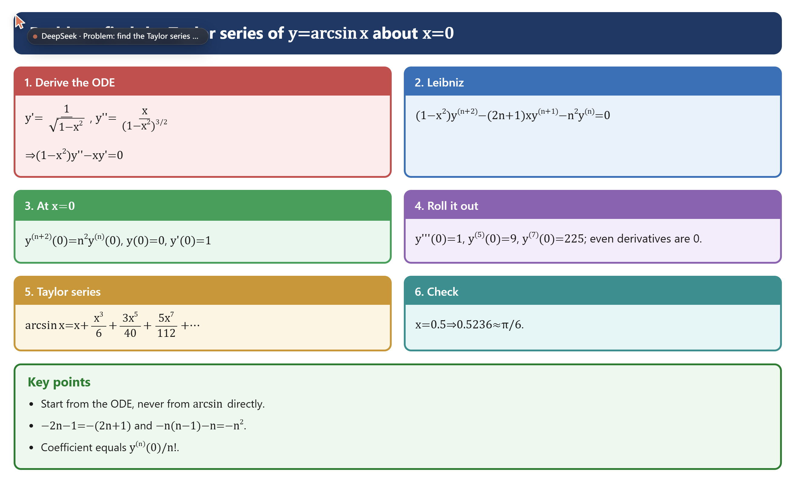

This example sets out a method used throughout the course. Turn the function into a differential equation, apply Leibniz's rule to get a recurrence, then substitute into the Taylor formula. The same method applies to later problems with a function multiplied by a derivative.

**What is asked**

Expand $y=\arcsin x$ about $x=0$ through the term in $x^{7}$.

$$y=a_0+a_1x+a_2x^{2}+a_3x^{3}+\cdots,\qquad a_k=\frac{y^{(k)}(0)}{k!}$$

We therefore need each value in $y^{(k)}(0)$. Repeatedly differentiating $\arcsin$ gives increasingly complicated expressions involving the square root. That makes it impractical to go directly to the seventh derivative.

**Step 1. Turn $\arcsin$ into an ordinary differential equation**

$$y'=\frac{1}{\sqrt{1-x^{2}}}=(1-x^{2})^{-1/2}$$

Remove the square root to make higher derivatives easier. First multiply both sides by the square root.

$$\sqrt{1-x^{2}}\,y'=1$$

Differentiate again with respect to $x$. Apply the product rule on the left, using $\frac{d}{dx}(1-x^{2})^{1/2}=\frac{1}{2}(1-x^{2})^{-1/2}(-2x)=-\frac{x}{\sqrt{1-x^{2}}}$.

$$\frac{-x}{\sqrt{1-x^{2}}}\,y'+\sqrt{1-x^{2}}\,y''=0$$

Multiply both sides by $\sqrt{1-x^{2}}$ to eliminate the square root.

$$(1-x^{2})y''-xy'=0$$

**Why this route**

The equation contains only $y'$ and $y''$, multiplied by polynomials. This suits Leibniz's rule because successive derivatives of a polynomial eventually become $0$, leaving only two or three terms.

**Step 2. Differentiate the first part $(1-x^{2})y''$ a total of $n$ times**

Set $u=1-x^{2}$ and $v=y''$. List the derivatives of $u$.

$$u=1-x^{2},\qquad u'=-2x,\qquad u''=-2,\qquad u^{(k)}=0\ (k\ge3)$$

Only three terms survive.

$$\left[(1-x^{2})y''\right]^{(n)}=(1-x^{2})y^{(n+2)}+\binom{n}{1}(-2x)y^{(n+1)}+\binom{n}{2}(-2)y^{(n)}$$

Simplify each term. The second uses $\binom n1=n$ and gives $-2nxy^{(n+1)}$. The third is $-2\binom n2=-2\cdot\frac{n(n-1)}{2}=-n(n-1)$. This gives the following result.

$$(1-x^{2})y^{(n+2)}-2nxy^{(n+1)}-n(n-1)y^{(n)}$$

**Step 3. Differentiate the second part $-xy'$ a total of $n$ times**

Set $u=-x$ and $v=y'$. Since $u'=-1$ and $u''=0$, only two terms survive.

$$\left[-xy'\right]^{(n)}=-xy^{(n+1)}+\binom{n}{1}(-1)y^{(n)}=-xy^{(n+1)}-ny^{(n)}$$

**Step 4. Combine the terms and trace the origins of $2n+1$ and $n^{2}$**

The two parts add to $0$.

$$(1-x^{2})y^{(n+2)}-2nxy^{(n+1)}-n(n-1)y^{(n)}-xy^{(n+1)}-ny^{(n)}=0$$

First collect the terms containing $x\,y^{(n+1)}$. Combining $-2n$ and $-1$ gives $-(2n+1)$. The coefficient $2n+1$ is the sum of $2n$ from Leibniz's rule and $1$ from the second part.

Next collect the terms containing $y^{(n)}$ to obtain $-n(n-1)-n=-n^{2}+n-n=-n^{2}$. The coefficient $n^{2}$ comes from adding $n(n-1)$ and $n$, where the terms in $n$ cancel.

$$(1-x^{2})y^{(n+2)}-(2n+1)xy^{(n+1)}-n^{2}y^{(n)}=0$$

**Step 5. Set $x=0$ to obtain the recurrence**

In the first term, setting $x=0$ gives $1-x^{2}=1$, leaving $y^{(n+2)}(0)$.
In the second term, setting $x=0$ makes the factor $x$ vanish. This removes the entire term from the equation at $x=0$.
The third term becomes $-n^{2}y^{(n)}(0)$.

$$y^{(n+2)}(0)-n^{2}y^{(n)}(0)=0\quad\Longrightarrow\quad y^{(n+2)}(0)=n^{2}y^{(n)}(0)$$

The recurrence gives the derivative two orders higher from a known value, without further differentiation.

**Step 6. Work from the starting values to the seventh derivative**

Calculate the two starting values directly, $y(0)=\arcsin 0=0$ and $y'(0)=\frac{1}{\sqrt{1-0}}=1$.

| $n$ | Recurrence | Value |
|---:|---|---:|
| 0 | $y''(0)=0^{2}y(0)$ | $0$ |
| 1 | $y'''(0)=1^{2}y'(0)$ | $1$ |
| 2 | $y^{(4)}(0)=2^{2}y''(0)=4\times0$ | $0$ |
| 3 | $y^{(5)}(0)=3^{2}y'''(0)=9\times1$ | $9$ |
| 4 | $y^{(6)}(0)=4^{2}y^{(4)}(0)=16\times0$ | $0$ |
| 5 | $y^{(7)}(0)=5^{2}y^{(5)}(0)=25\times9$ | $225$ |

**Pattern.** The even sequence starts at $y(0)=0$ and stays at $0$ whatever the multiplier. The odd sequence starts at $y'(0)=1$ and multiplies by a square at each two-order step. Thus $\arcsin$ is an odd function and its series has only odd powers.

  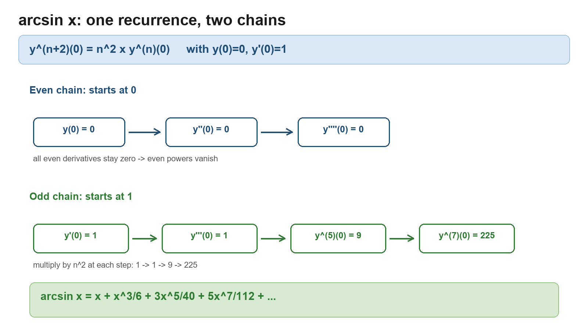

**Step 7. Substitute into the Taylor formula and reduce each fraction**

$$y(x)=0+1\cdot x+\frac{0}{2!}x^{2}+\frac{1}{3!}x^{3}+\frac{0}{4!}x^{4}+\frac{9}{5!}x^{5}+\frac{0}{6!}x^{6}+\frac{225}{7!}x^{7}+\cdots$$

Drop the $0$ term and calculate the three remaining terms individually.

$$\frac{1}{3!}=\frac{1}{6},\qquad \frac{9}{5!}=\frac{9}{120}=\frac{3}{40},\qquad \frac{225}{7!}=\frac{225}{5040}=\frac{5}{112}$$

**Where $\frac{3}{40}$ and $\frac{5}{112}$ come from**

Use $5!=120$. In $\frac{9}{120}$, divide the numerator and denominator by $3$ to get $\frac{3}{40}$. The common divisor of $9$ and $120$ is $3$. Use $7!=5040$, then divide the numerator and denominator of $\frac{225}{5040}$ by $45$ to get $\frac{5}{112}$. An unreduced fraction is equivalent, but reduce it fully when you can in an exam.

**Sanity check**

When $x$ is small, the leading behaviour is $\arcsin x\approx x$. The first term of the series is $x$, as expected. Next use $y'=\frac{1}{\sqrt{1-x^{2}}}\approx 1+\frac{x^{2}}{2}$. Termwise differentiation should give $1+\frac{x^{2}}{2}+\frac{3x^{4}}{8}$. Differentiating the series gives $1+\frac{3x^{2}}{6}+\frac{15x^{4}}{40}=1+\frac{x^{2}}{2}+\frac{3x^{4}}{8}$, which agrees.

**Answer**

$$\arcsin x=x+\frac{x^{3}}{6}+\frac{3x^{5}}{40}+\frac{5x^{7}}{112}+\cdots$$

**Derivation flow to remember for the exam**

1. Start from $y=\arcsin x$ and find $y^{(k)}(0)$.
2. Differentiate to eliminate the square root and obtain the ODE $(1-x^{2})y''-xy'=0$.
3. Apply Leibniz's rule to differentiate the whole equation $n$ times.
4. Collect like terms to get $(1-x^{2})y^{(n+2)}-(2n+1)xy^{(n+1)}-n^{2}y^{(n)}=0$.
5. Set $x=0$ to get the recurrence $y^{(n+2)}(0)=n^{2}y^{(n)}(0)$.
6. Use the initial values $0,1$ to obtain $1,0,1,0,9,0,225$.
7. Substitute into $\sum\frac{y^{(k)}(0)}{k!}x^{k}$ and reduce the fractions to get the final series.

**Where the constant comes from**

The coefficients come from $\frac{y^{(n)}(0)}{n!}$. The value $y'(0)=1$ gives $1$ for the term in $x$. The value $y^{(3)}(0)=1$ gives $\frac{1}{6}$ for the term in $x^{3}$. The next two values, $y^{(5)}(0)=9$ and $y^{(7)}(0)=225$, give $\frac{9}{120}=\frac{3}{40}$ and $\frac{225}{5040}=\frac{5}{112}$, respectively.

> **Common pitfall.** The recurrence $y^{(n+2)}(0)=n^{2}y^{(n)}(0)$ was obtained specifically at $x=0$. The even derivatives vanish there, and $y^{(2k)}$ can be nonzero elsewhere.

### 2.6 Common pitfalls

$D^{n}$ only makes sense for a non-negative integer $n$. The sum collapses only when one factor is a polynomial; if both factors are $e^{x}$ and $\sin x$, every term survives.

### 2.7 30-second check

**Q:** Why are all even derivatives of $\arcsin x$ at 0 equal to zero?  
**A:** The recurrence links $n$ to $n+2$. The even chain starts at $y(0)=0$, so it stays zero.

---

## 3. Ratio test: does the series converge?

### 3.1 The question

A Taylor series represents the function where it converges to that function. Absolute convergence is a stronger condition than convergence. The ratio test helps check for absolute convergence.

**Definition.** $\sum a_{r}$ is **absolutely convergent** if $\sum |a_{r}|$ converges. If a series is absolutely convergent, it is convergent; the converse is not always true.

  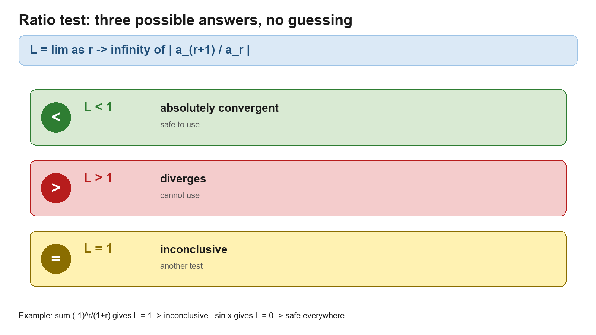

### 3.2 The formula

$$L=\lim_{r\to\infty}\left|\frac{a_{r+1}}{a_r}\right|.$$

**Read it.** The current term is $a_{r}$ and the next term is $a_{r+1}$. The quantity $L$ is the limit of the absolute value of the next term divided by the current term.

### 3.3 The four-step recipe

| Step | Do this | Notes |
|---:|---|---|
| 1 | Write the general term $a_{r}$. | |
| 2 | Form $a_{r+1}/a_{r}$, then take its absolute value. | |
| 3 | Take the limit $r\to\infty$. | |
| 4 | Use $L$ to decide what the test gives. | |

### 3.4 Example 1: a case with $L=1$

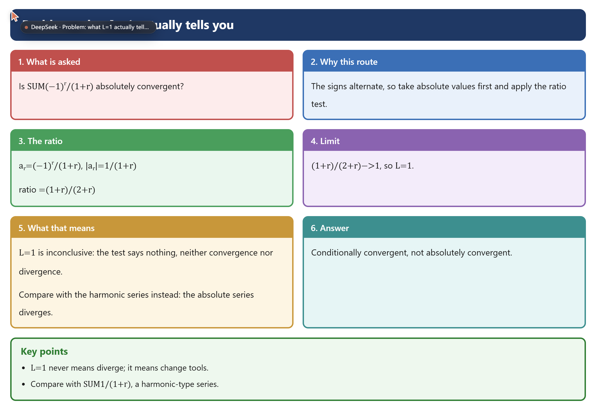

**What is asked**

Determine whether the alternating harmonic series $\sum_{r\ge0}\dfrac{(-1)^{r}}{1+r}=1-\dfrac12+\dfrac13-\dfrac14+\cdots$ converges absolutely.

**Why this route**

The factor $(-1)^{r}$ alternates the sign. Taking absolute values removes it and gives $\sum\frac{1}{1+r}$, the terms of the harmonic series. The ratio test looks for shrinkage in the absolute ratio of consecutive terms.

**Step 1. Write the general term and take its absolute value**

$$a_r=\frac{(-1)^{r}}{1+r},\qquad |a_r|=\frac{1}{1+r}$$

**Step 2. Form the ratio**

$$\left|\frac{a_{r+1}}{a_{r}}\right|=\frac{1/(2+r)}{1/(1+r)}=\frac{1+r}{2+r}$$

Dividing by a fraction is the same as multiplying by its reciprocal. Invert $1+r$ to get $\frac{r+1}{r+2}$.

**Step 3. Take the limit**

$$\frac{r+1}{r+2}=\frac{1+1/r}{1+2/r}\longrightarrow 1\quad(r\to\infty)$$

This gives $L=1$.

**Step 4. State the conclusion**

The ratio test is inconclusive at $L=1$. Use another test to decide convergence or divergence. Here $\frac{1}{1+r}$ has the same order as the harmonic series, so comparison gives divergence for the series of absolute values. The original series converges conditionally, meaning that the series itself converges and the series of absolute values diverges.

**Sanity check**

Read $L=1$ as saying that consecutive terms are nearly the same size. Here $1/(1+r)$ and $1/(2+r)$ are indeed nearly equal. This is typical of harmonic-type series and explains why the ratio test is inconclusive.

**Answer**

$$L=1\ \Rightarrow\ \text{inconclusive};\quad \sum\frac{(-1)^{r}}{1+r}\ \text{conditionally convergent, not absolutely}$$

**Where the constant comes from**

In $\frac{r+1}{r+2}=\frac{1+1/r}{1+2/r}$, the numerator and denominator are of the same order, so the limit in $L=1$ is $\frac{1}{1}=1$. This value $1$ reflects the fact that consecutive harmonic terms are almost the same size and is independent of the particular $\frac12,\frac13$.

> **Common pitfall.** At $L=1$, the ratio test gives no conclusion about convergence or divergence. A common exam error is to report divergence from this result alone. Apply another test. Here comparison with the harmonic series gives divergence for the series of absolute values.

### 3.5 Example 2: the sine series

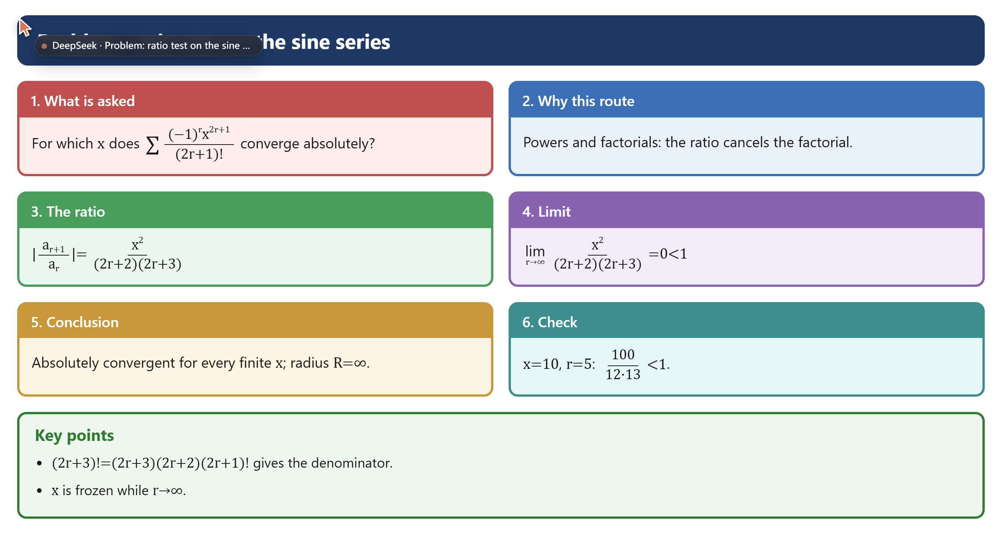

**What is asked**

Determine for which values of $x$ the series $\sin x=\sum_{r\ge0}\dfrac{(-1)^{r}x^{2r+1}}{(2r+1)!}$ converges absolutely.

**Why this route**

The series contains powers of $x$ and factorials. Compare the next term with the current one using the ratio test. The factorials cancel, leaving a simple limit. The test applies to a **fixed** value of $x$, so fix $x$ before taking $r\to\infty$.

**Step 1. Identify the general term**

$$a_r=\frac{(-1)^{r}x^{2r+1}}{(2r+1)!}$$

The power is $2r+1$ and the factorial is $(2r+1)!$. Both grow with the term index, and the factorial makes the terms shrink quickly.

**Step 2. Form the absolute ratio**

$$\left|\frac{a_{r+1}}{a_{r}}\right|=\frac{|x|^{2r+3}/(2r+3)!}{|x|^{2r+1}/(2r+1)!}=|x|^{2}\cdot\frac{(2r+1)!}{(2r+3)!}$$

**Where $(2r+2)(2r+3)$ comes from**

Using $(2r+3)!=(2r+3)(2r+2)(2r+1)!$, the factorial ratio reduces to $\frac{1}{(2r+2)(2r+3)}$. The extra powers in the numerator give $|x|^{2}$. Combine these results.

$$\left|\frac{a_{r+1}}{a_{r}}\right|=\frac{x^{2}}{(2r+2)(2r+3)}$$

**Step 3. Take the limit for fixed $x$**

Treat $x$ as fixed. When $r\to\infty$, the denominator satisfies $\to\infty$.

$$L=\lim_{r\to\infty}\frac{x^{2}}{(2r+2)(2r+3)}=0\quad(\text{any finite }x)$$

**Why $x$ must be fixed before taking the limit.** The test applies to a given $x$. Take $r\to\infty$ while treating $x$ as constant.

**Step 4. State the conclusion**

Since $L=0<1$, the series converges absolutely for every fixed $x$. The interval of convergence is the whole real line $(-\infty,\infty)$. This is the usual result for entire functions such as $\sin$, $\cos$ and $e^{x}$.

**Sanity check**

Take $x=10$. Although $10^{2r+1}$ initially grows quickly, the factorial grows faster. The ratio $\frac{100}{(2r+2)(2r+3)}$ is already below $1$ by $r=5$. Even a large $x$ is eventually outweighed by the factorial.

**Answer**

$$L=\frac{x^{2}}{(2r+2)(2r+3)}\to 0<1\ \Rightarrow\ \text{absolutely convergent for every finite }x$$

> **Common pitfall.** Fix $x$, then take $r\to\infty$. Taking $x\to\infty$ first gives the wrong value for $L$. The condition $L=0$ addresses convergence. Use the remainder to find how many terms give four decimal places.

### 3.6 Common pitfall

$L=1$ is **not** a result. It means this test has nothing to say. Write "inconclusive" and use another test.

### 3.7 30-second check

**Q:** The ratio test gives $L=1$. What can you conclude?  
**A:** Nothing about convergence or divergence; the test is inconclusive.

---

## 4. Mixed drill

Work through each of the three problems using the six-part worked-example format, then check your answers.

**1.** Find an upper bound on the remainder when approximating $\sin 46^\circ$ with three terms.

- Key idea. Use the next term for the remainder, with $R_2=-\frac{h^{3}}{3!}\cos(\cdot)$ and $h=\pi/180$.
- Calculation. Start from $|R_2|\le\frac{h^{3}}{6}$. Substitute $h\approx1.745\times10^{-2}$ to get $h^{3}\approx5.31\times10^{-6}$.
- Answer. The bound is $|R_2|\le 8.9\times10^{-7}$, about 56 times smaller than the four-decimal-place tolerance $5\times10^{-5}$.

**2.** Find $D^{4}(x^{2}e^{x})$.

- Key idea. Apply Leibniz's rule with $u=x^{2}$. Its third derivative is zero, leaving only three terms.
- Calculation. Start from $D^{n}=\left[x^{2}+2nx+n(n-1)\right]e^{x}$. Substitute $n=4$ to get $x^{2}+8x+12$.
- Answer. $D^{4}(x^{2}e^{x})=(x^{2}+8x+12)e^{x}$.

**3.** Apply the ratio test to $\sum \frac{x^{r}}{r!}$.

- Key idea. The general term is $a_r=\frac{x^{r}}{r!}$. Cancel the factorials in the ratio.
- Calculation. Obtain $\left|\frac{a_{r+1}}{a_{r}}\right|=\frac{|x|}{r+1}\to 0$, independent of $x$.
- Answer. $L=0<1$, so the series converges absolutely for every $x$. This is the series for $e^{x}$.

## 5. Formula card

$$R_n=\frac{h^{n+1}}{(n+1)!}\,f^{(n+1)}(a+\theta h),\qquad 0\le\theta\le 1$$

$$D^{n}(uv)=\sum_{r=0}^{n}\binom{n}{r}D^{r}u\,D^{n-r}v$$

$$y^{(n+2)}(0)=n^{2}y^{(n)}(0),\qquad \arcsin x=x+\frac{x^{3}}{6}+\frac{3x^{5}}{40}+\frac{5x^{7}}{112}+\cdots$$

$$L=\lim_{r\to\infty}\left|\frac{a_{r+1}}{a_{r}}\right|,\qquad L<1:\ \text{absolutely convergent},\quad L>1:\ \text{divergent},\quad L=1:\ \text{inconclusive}.$$

---

## 6. Glossary

| Term | Notes | Plain meaning |
|---|---|---|
| **Remainder** | | The part left out when the series is truncated. |
| **Upper bound** | | A number the error cannot exceed. |
| **Leibniz rule** | | The product rule applied $n$ times. |
| **Binomial coefficient** | | The number of ways to split $n$ derivatives between the factors. |
| **Recurrence** | | A formula that gives a higher derivative from a lower one. |
| **Absolute convergence** | | The series of absolute values also converges. |
| **Ratio test** | | Check the limit of the absolute ratio of consecutive terms. |
| **Inconclusive** | | The test gives no answer. |

---

## 7. Where to go next

This visual version is the only record of Lecture 16. It explains the ideas before applying them to exam questions. The full v1 notes for this lecture are still to be written. The [course formula sheet](./CHEATSHEET.md) collects the formulas and common exam pitfalls.

For a ten-minute review before the exam, see the [course reference sheet](./CHEATSHEET.md) for formulas, a short tip and the numbers to remember.

*Source: MECH40008 Mathematics and Computing 1, Panopto replay, 11 November 2026. Formulas follow the lecture slides; the final ratio-test limit was completed because the lecture stopped just before writing it.*
