# MECH40008 - 12 November 2026

  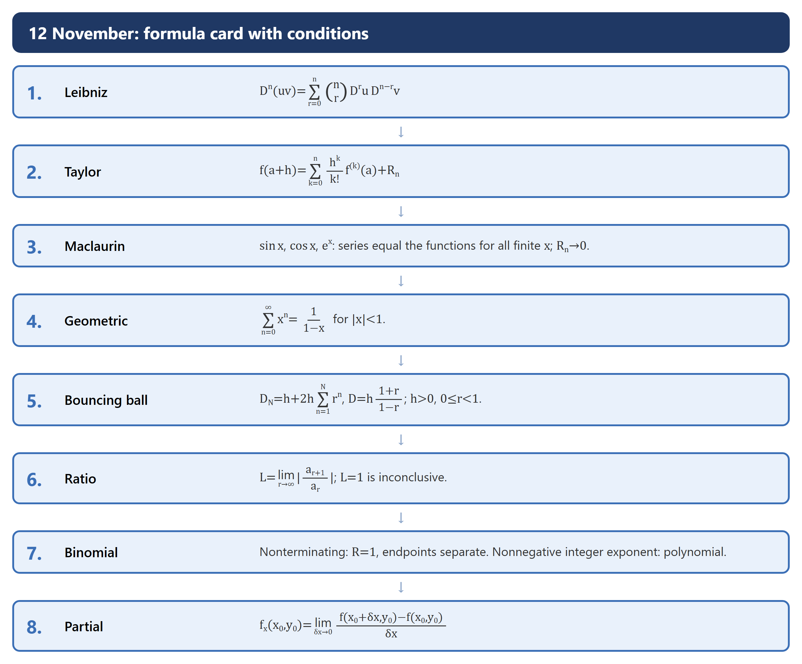

## Lecture notes (Chapter 7-9): Leibniz rule, Maclaurin validity, the bouncing ball, the binomial series, partial derivatives

> **In 60 seconds:** Leibniz keeps the derivative count small, the ratio test decides convergence, a bouncing ball is a geometric series, the binomial series is legal only inside $|x|<1$, and a partial derivative is an ordinary derivative with one variable frozen.  
> **In 15 minutes:** every derivation, every worked example and every trap below, in the order the lecture used them.

*Source: MECH40008 Mathematics and Computing 1, Panopto replay, 12 November 2026 (1:00:00). This was the makeup lecture for the broken lectern on Tuesday; the first five minutes are a recap of Lecture 16 (11 November).*

---

## 0. Where this lecture sits

| Section | Topic | Why it is here |
|---|---|---|
| 1 | Leibniz rule | the tool from last lecture, needed for the series work |
| 2 | Maclaurin validity | why $\sin x$, $\cos x$, $e^x$ are legal for any finite $x$ |
| 3 | Bouncing ball | a real problem that only a series can finish |
| 4 | Absolute convergence and the ratio test | the convergence decision used in 2, 3 and 5 |
| 5 | Binomial series | the series with a finite interval |
| 6 | Partial derivatives | the next topic, first definition only |
| 7 | Exam-style question, traps, answers, formula card, glossary | how to revise it |

**Prerequisites**: product rule, chain rule, factorials and limits of partial sums.

  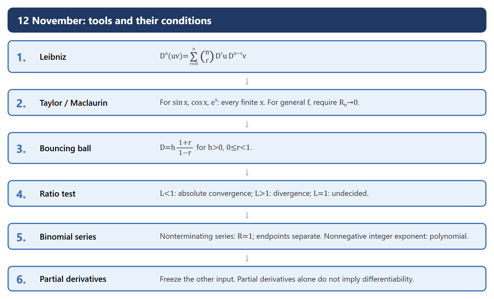

### Symbols you need

| Symbol | Meaning | Role |
|---|---|---|
| $f$ | Function | The quantity to approximate or differentiate |
| $a$ | Expansion point | Centre of the series |
| $h$ | Step | Distance from $a$ |
| $x$ | Variable | Input to the series |
| $n$ | Derivative order | The $n$-th derivative is $D^n$ or $f^{(n)}$ |
| $r$ | Summation index | Also the bounce coefficient in §3 |
| $C(n,r)$ | Binomial coefficient | Also written $\binom{n}{r}$ |
| $R_n$ | Remainder | What is left after the $n$-th term |
| $\theta$ | Unknown number | Lies between $0$ and $1$ |
| $L$ | Limit | Used in the ratio test |
| $a_r$ | General term | An individual term of the series |
| $D_N$ | Total distance | Measured after $N$ bounces |
| $f_x$ | Partial derivative | Differentiate $f$ with respect to $x$ |

---

## 1. Leibniz rule

### 1.1 Statement

$$D^n(uv)=\sum_{r=0}^{n}\binom{n}{r}D^{r}u\,D^{n-r}v,\qquad \binom{n}{r}=\frac{n!}{r!\,(n-r)!}.$$

It is the binomial theorem with $D$ in place of multiplication. The lecture's advice was blunt: memorise the pattern, do not dig it out of the formula book during an exam - rummaging costs time.

### 1.2 Why it is true

Induction on $n$. The step is one product rule applied to the $n=k$ expansion:

$$D^{k+1}(uv)=D\left[\sum_{r=0}^{k}\binom{k}{r}D^{r}u\,D^{k-r}v\right]=\sum_{r=0}^{k}\binom{k}{r}D^{r+1}u\,D^{k-r}v+\sum_{r=0}^{k}\binom{k}{r}D^{r}u\,D^{k+1-r}v.$$

For the step to $k+1$, re-index the first sum with $s=r+1$ and use $\binom{k}{s-1}+\binom{k}{s}=\binom{k+1}{s}$ to combine terms. That gives the $(k+1)$-th row of the binomial coefficients.

### 1.3 The shortcut that matters

If $u$ is a polynomial of degree $m$, then $D^{r}u=0$ for $r>m$, so **only $m+1$ rows survive**.

  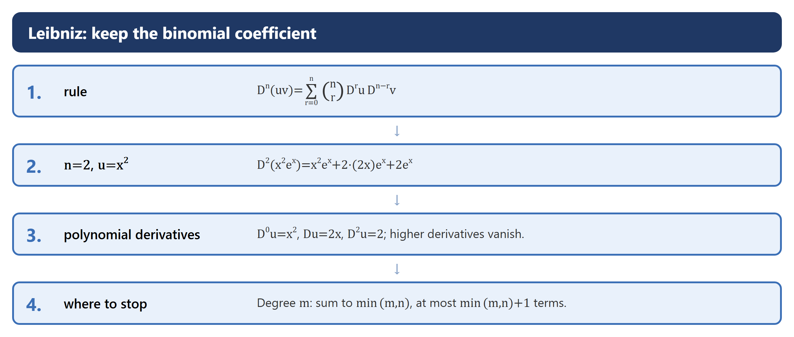

### 1.4 Worked example A: $x^2e^x$

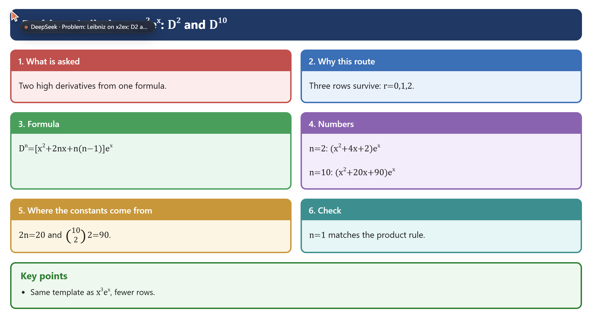

**What is asked**

Find $D^{2}(x^{2}e^{x})$ and $D^{10}(x^{2}e^{x})$. Repeated differentiation becomes unwieldy, so find a formula into which you can substitute $n$ directly.

**Why this route**

The third derivative of $x^{2}$ is $0$, so only the first three rows of the Leibniz expansion survive ($r=0,1,2$). Every derivative of $e^{x}$ is still $e^{x}$, so it is a common factor.

**Step 1. Write the Leibniz formula**

$$D^{n}(uv)=\sum_{r=0}^{n}\binom{n}{r}D^{r}u\,D^{n-r}v$$

**Step 2. Choose $u$**

$$u=x^{2},\quad v=e^{x}\ \Rightarrow\ D^{0}u=x^{2},\ D^{1}u=2x,\ D^{2}u=2,\ D^{3}u=0,\ D^{k}v=e^{x}$$

Choose $x^{2}$ as $u$. Its higher derivatives are all $0$, so the rows with $r\ge 3$ disappear.

**Step 3. Substitute and collect terms**

$$D^{n}(x^{2}e^{x})=\left[\binom{n}{0}x^{2}+\binom{n}{1}2x+\binom{n}{2}2\right]e^{x}=\left[x^{2}+2nx+n(n-1)\right]e^{x}$$

**Step 4. Substitute values of $n$**

$$n=2:\ D^{2}=(x^{2}+4x+2)e^{x},\qquad n=10:\ D^{10}=(x^{2}+20x+90)e^{x}$$

**Where the constants come from**

The $2$ in $2nx$ comes from differentiating $x^{2}$ to get $2x$. The factor $2$ cancels in $\binom{n}{2}\cdot 2=\frac{n(n-1)}{2}\cdot 2$, leaving $n(n-1)$. When $n=10$, $\binom{10}{2}=45$, so $45\cdot2=90$ as expected.

**Sanity check**

Substituting $n=1$ gives $x^{2}+2x$. Multiplying by $e^{x}$ gives $(x^{2}+2x)e^{x}=D(x^{2}e^{x})$, which agrees with the product rule result $2xe^{x}+x^{2}e^{x}$.

**Answer**

$$D^{n}(x^{2}e^{x})=\left[x^{2}+2nx+n(n-1)\right]e^{x};\quad D^{2}=(x^{2}+4x+2)e^{x},\ D^{10}=(x^{2}+20x+90)e^{x}$$

**Common pitfalls in example A**

Writing $D^{n}u\,D^{n}v$ gives the wrong formula. The orders are $D^{r}$ on one factor and $D^{n-r}$ on the other. Check $n=1$: only the two terms $x^{2}+2x$ should remain. A third term means the $r=2$ row was kept.

### 1.5 Worked example B: $x^3e^x$

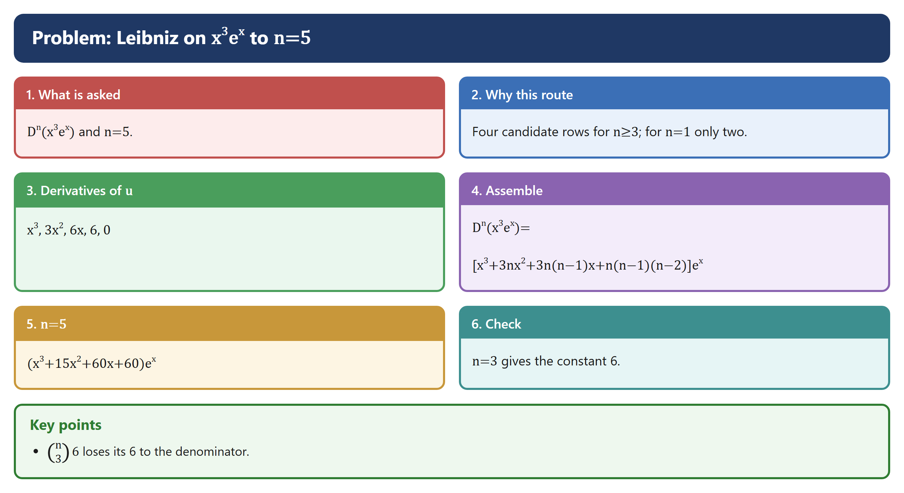

**What is asked**

Apply the same method to $x^{3}e^{x}$. Find $D^{n}$ and evaluate it for $n=5$.

**Why this route**

The fourth derivative of $x^{3}$ is zero, so **four rows** survive ($r=0,1,2,3$). The method is the same, with one additional row.

**Step 1. List the derivatives of $u$**

$$u=x^{3}:\ x^{3},\ 3x^{2},\ 6x,\ 6,\ 0$$

**Step 2. Write out the Leibniz expansion**

$$D^{n}(x^{3}e^{x})=\left[\binom{n}{0}x^{3}+\binom{n}{1}3x^{2}+\binom{n}{2}6x+\binom{n}{3}6\right]e^{x}$$

**Step 3. Evaluate the binomial coefficients**

$$\binom{n}{1}=n,\quad \binom{n}{2}\cdot 6=3n(n-1),\quad \binom{n}{3}\cdot 6=n(n-1)(n-2)$$

This gives

$$D^{n}(x^{3}e^{x})=\left[x^{3}+3nx^{2}+3n(n-1)x+n(n-1)(n-2)\right]e^{x}$$

**Where the constants come from**

In the last row, $\binom{n}{3}\cdot 6=\frac{n(n-1)(n-2)}{6}\cdot 6$. The $6$ cancels, leaving a product of three consecutive factors starting at $n$. For $n<3$, one factor is $0$, so the product is $0$.

**Step 4. Substitute $n=5$**

$$n=5:\ 3n=15,\ 3n(n-1)=60,\ n(n-1)(n-2)=60\ \Rightarrow\ (x^{3}+15x^{2}+60x+60)e^{x}$$

**Sanity check**

For $n=3$, $n(n-1)(n-2)=6$, which agrees with the direct third derivative $(x^{3}+9x^{2}+18x+6)e^{x}$. For $n=1$, only the rows $r=0,1$ survive. The three-factor product contains a factor of $0$, and the formula reduces to $(x^{3}+3x^{2})e^{x}$, exactly as the product rule gives: $(x^{3}e^{x})'=(3x^{2}+x^{3})e^{x}$.

**Answer**

$$D^{n}(x^{3}e^{x})=\left[x^{3}+3nx^{2}+3n(n-1)x+n(n-1)(n-2)\right]e^{x},\qquad D^{5}=(x^{3}+15x^{2}+60x+60)e^{x}$$

**Common pitfalls in example B**

The polynomial factor $x^{3}$ contributes at most four rows ($r=0,1,2,3$). Every term with $r\ge4$ is zero. Trying to list all the derivatives of $e^{x}$ separately would give infinitely many rows. Also, $n(n-1)(n-2)$ already vanishes when $n=1,2$, so those values need no separate treatment.

### 1.6 Worked example C: the arcsin recurrence

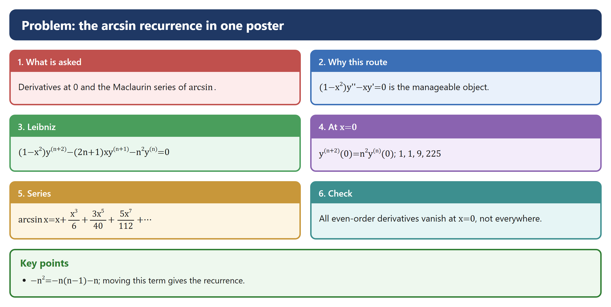

**What is asked**

Find the derivatives of $y=\arcsin x$ at $x=0$ and use them to write its Maclaurin series. The square root involving $1-x^{2}$ prevents direct use of the formulas for $\sin$.

**Why this route**

Successive derivatives of $\arcsin$ are awkward to calculate directly. Start with $y'=1/\sqrt{1-x^{2}}$, square it and use the result to obtain the differential equation $(1-x^{2})y''-xy'=0$. Differentiate the equation to order $n$ using Leibniz's rule. The resulting relation between $y^{(n+2)}$ and $y^{(n)}$ gives the recurrence at zero. The 11 November notes give the full seven-step version.

**Step 1. Obtain the differential equation**

$$y'=\frac{1}{\sqrt{1-x^{2}}}\ \Rightarrow\ (1-x^{2})(y')^{2}=1\ \Rightarrow\ (1-x^{2})y''-xy'=0$$

**Step 2. Differentiate both sides to order $n$ and expand through $r=2$**

$$(1-x^{2})y^{(n+2)}-(2n+1)x\,y^{(n+1)}-n^{2}y^{(n)}=0$$

**Where $(2n+1)$ and $n^{2}$ come from**

Apply Leibniz's rule to $(1-x^{2})y''$. Because $1-x^{2}$ is quadratic, only the three terms with $r=0,1,2$ survive, and all terms with $r\ge3$ are zero. The $r=0$ term gives $(1-x^{2})y^{(n+2)}$. The $r=1$ term gives $-2nx\,y^{(n+1)}$. The $r=2$ term gives $-n(n-1)y^{(n)}$. Expanding $-xy'$ gives two terms, $-xy^{(n+1)}$ and $-ny^{(n)}$. Combining the coefficients from the two products gives

$$-2n-1=-(2n+1),\qquad -n(n-1)-n=-n^{2}$$

**Step 3. Set $x=0$ to eliminate the middle term**

$$y^{(n+2)}(0)=n^{2}\,y^{(n)}(0)$$

**Step 4. Use the initial values to find successive derivatives**

$$y(0)=0,\ y'(0)=1\ \Rightarrow\ y^{(3)}=1,\ y^{(5)}=9,\ y^{(7)}=225$$

At $x=0$, all even-order derivatives are $0$ because $\arcsin$ is odd. This concerns their values at zero. The derivative $y^{(2k)}$ can take non-zero values elsewhere.

**Step 5. Assemble the series**

$$\arcsin x=x+\frac{x^{3}}{6}+\frac{3x^{5}}{40}+\frac{5x^{7}}{112}+\cdots$$

The coefficients come from $\frac{y^{(n)}(0)}{n!}$ and are $1/6$, $9/120=3/40$ and $225/5040=5/112$.

**Sanity check**

At $x=0.5$, the first four terms give $0.5+0.0208333+0.0023438+0.0003488=0.5235258557$. The exact value is $\arcsin 0.5=\pi/6=0.5235987756$, so the error is about $7.29\times10^{-5}$. Four terms give three decimal places. Use the remainder to assess the fourth. The recurrence also checks out: $n=3$ gives $y^{(5)}=9$, and $n=5$ gives $y^{(7)}=25\cdot9=225$. The square factor comes from $n^{2}$.

**Answer**

$$(1-x^{2})y''-xy'=0\ \Rightarrow\ y^{(n+2)}(0)=n^{2}y^{(n)}(0)\ \Rightarrow\ \arcsin x=x+\frac{x^{3}}{6}+\frac{3x^{5}}{40}+\frac{5x^{7}}{112}+\cdots$$

> **Trap**
> Use $D^{r}u$ and $D^{n-r}v$. Their orders add up to $n$. The rule needs one factor differentiated $n-r$ times. Writing $D^{n}u\,D^{n}v$, with two $D^{n}$ operators, gives the wrong formula.

**30-second check:** For $u=x^2$, how many rows survive at $n=7$? Three ($r=0,1,2$).

---

## 2. Maclaurin series: valid for every finite $x$

### 2.1 Statement

$$f(x)=\sum_{r\ge 0}\frac{f^{(r)}(0)}{r!}x^{r}\qquad(\text{Maclaurin}=\text{Taylor about }a=0),$$

$$\sin x=x-\frac{x^3}{3!}+\frac{x^5}{5!}-\cdots,\qquad \cos x=1-\frac{x^2}{2!}+\frac{x^4}{4!}-\cdots,\qquad e^{x}=1+x+\frac{x^2}{2!}+\frac{x^3}{3!}+\cdots$$

### 2.2 Which $x$ are allowed

For $a_r=\dfrac{(-1)^{r}x^{2r+1}}{(2r+1)!}$ (the $\sin x$ coefficients):

$$L=\lim_{r\to\infty}\left|\frac{a_{r+1}}{a_r}\right|=\lim_{r\to\infty}\left|\frac{x^{2}}{(2r+3)(2r+2)}\right|=0\qquad\text{for every fixed finite }x.$$

$L=0<1$ for every finite $x$, so the series converges absolutely for every finite $x$; the radius of convergence is infinite. The same computation with $\dfrac{x^{2r}}{(2r)!}$ covers $\cos x$, and $\dfrac{1}{r!}$ covers $e^x$.

  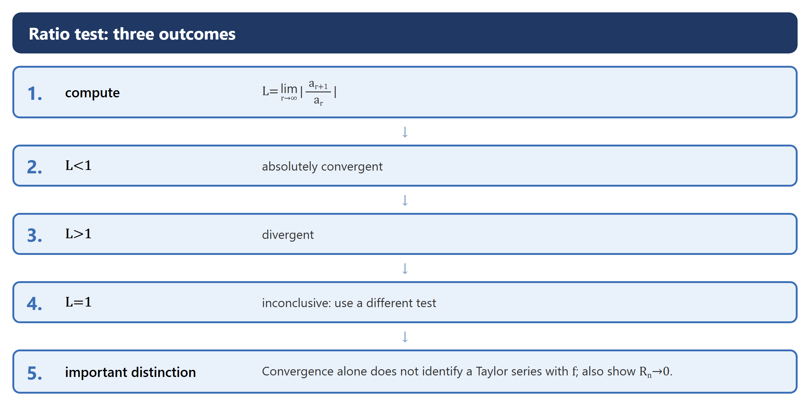

### 2.3 The mechanism

The factorial in the denominator grows faster than any power of $x$. For fixed $x$, take $r>2|x|$. From then on, the ratio is below $\tfrac12$ ($1/2$), so comparison with a geometric series whose terms halve proves convergence.

### 2.4 Convergence is not accuracy

$L=0$ says the Taylor series converges, i.e. the partial sums have a limit. It does **not** by itself say that limit is $f(x)$: that needs the remainder to vanish, $R_n(x)\to0$. Even then it says nothing about how many terms are needed for 4 decimal places.

> **Trap**
> "Radius of convergence is infinite" is not "the remainder is small". Two different questions, two different tools.

**30-second check:** At $x=100$, is the term ratio eventually below 1? Yes. $\dfrac{10000}{(2r+3)(2r+2)}<1$ once $r\ge 50$.

---

## 3. The bouncing ball

### 3.1 The problem, as given

> A ball dropped from height $h$ bounces and returns to height $rh$, where $r<1$ is the bounce coefficient. Find an expression for the total distance $D$ after $N$ bounces. What is the limit as $N\to\infty$ - does the series converge, why, and to what? Rafael Nadal drops a tennis ball with $r=0.7$ from $h=1.5$ m.

### 3.2 Modelling

- Fall 1: $h$ - one length.
- Bounce $n$: up $r^{n}h$, down $r^{n}h$ - two lengths.

  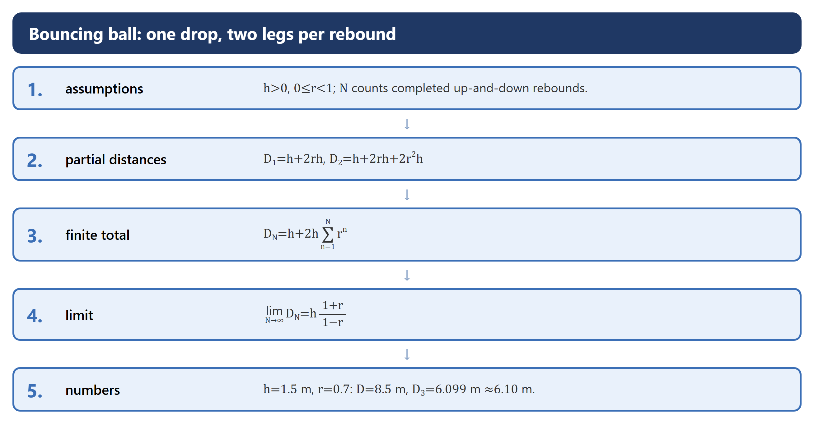

$$D_N=h+2rh+2r^2h+\cdots+2r^{N}h=h+2h\sum_{n=1}^{N}r^{n}.$$

This is the only correct bookkeeping for $N$ bounces: the initial fall counted once, every bounce counted twice. Do not rewrite it as $h(1+r^{N})+2h\sum_{n=1}^{N}r^{n}$ - that counts the final up-and-down twice.

### 3.3 Finite $N$ first

$$\sum_{n=1}^{N}r^{n}=\frac{r(1-r^{N})}{1-r},\qquad D_N=h+\frac{2hr(1-r^{N})}{1-r}.$$

### 3.4 The limit

Since $r<1$, $r^{N}\to 0$:

$$D=h+2h\cdot\frac{r}{1-r}=h\,\frac{1+r}{1-r}.$$

This uses the geometric series, taken as known:

$$\sum_{n\ge 0}x^{n}=\frac{1}{1-x}\quad(|x|<1),\qquad \sum_{n\ge 1}r^{n}=\frac{1}{1-r}-1=\frac{r}{1-r}.$$

### 3.5 Why the series converges

With $a_n=r^{n}$:

$$L=\lim_{n\to\infty}\left|\frac{a_{n+1}}{a_n}\right|=\lim_{n\to\infty}\left|\frac{r^{n+1}}{r^{n}}\right|=|r|=r<1.$$

$L<1$ means absolutely convergent, hence convergent. The lecture underlined exactly this: the ratio test is why the limit is allowed to be taken.

### 3.6 The numbers

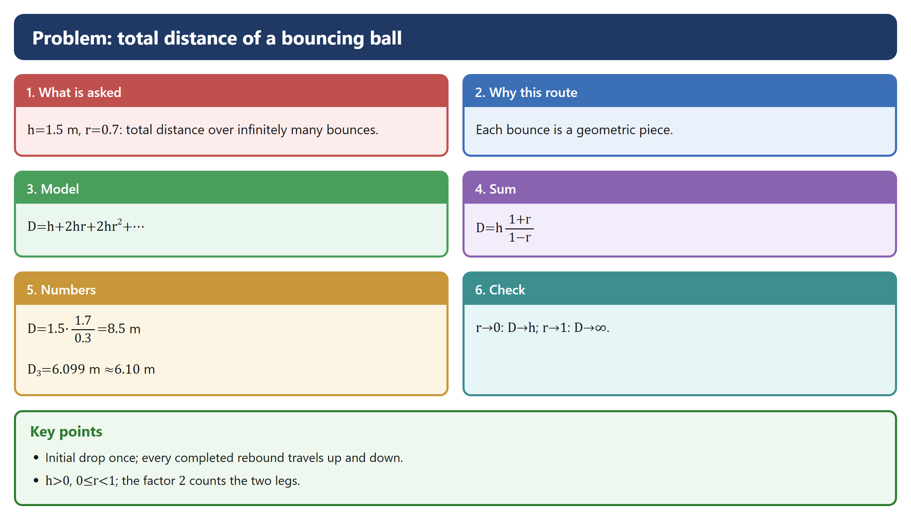

**What is asked**

A ball falls from $h=1.5$ m and returns to a fraction $r=0.7$ of its previous height on each bounce. Find the total distance $D$ over infinitely many bounces and check the partial sum at $N=3$.

**Why this route**

The distance is the initial drop plus a trip up and down on every bounce. The distances follow a geometric pattern, so they can be summed. Write the model before substituting numbers.

**Step 1. Write the distance as a series**

$$D=h+2hr+2hr^{2}+2hr^{3}+\cdots=h+2h\sum_{n\ge1}r^{n}$$

**Where the factor of 2 comes from**

The first segment is just the drop ($h$). On each bounce the ball **goes up and comes back down**, so every term after the first is multiplied by $2$. This factor is easy to miss.

**Step 2. Sum the geometric series**

$$\sum_{n\ge1}r^{n}=\frac{r}{1-r}\ \Rightarrow\ D=h+\frac{2hr}{1-r}=h\cdot\frac{1+r}{1-r}$$

**Step 3. Substitute $h=1.5,\ r=0.7$**

$$D=1.5\cdot\frac{1.7}{0.3}=1.5\cdot5.6\overline{6}=8.5\ \text{m}$$

**Step 4. Calculate the partial sum for $N=3$**

$$D_3=1.5+3(0.7+0.49+0.343)=1.5+3(1.533)=1.5+4.599=6.10\ \text{m}$$

The partial sum leaves out infinitely many segments, so $D_3<D$. The numbers agree: $6.10<8.5$.

**Sanity check**

$$r\to0:\ D\to h=1.5\ \text{m}\quad(\text{no bounce, just the drop}),\qquad r\to1:\ D\to\infty\quad(\text{never stops})$$

As $r\to0$, the ball does not bounce and the distance is just the initial drop. As $r\to1$, the bouncing continues indefinitely and the total distance diverges.

Both limits make sense. The denominator $1-r$ makes the distance grow as the bouncing lasts longer. Take $h=2,\ r=0.8$ as another check. Then $D=2\cdot\frac{1.8}{0.2}=18$ m, which is finite and greater than $2$ m.

**Answer**

$$D=h\frac{1+r}{1-r},\qquad h=1.5,\ r=0.7\ \Rightarrow\ D=8.5\ \text{m},\quad D_3=6.10\ \text{m}$$

> **Trap**
> Missing the factor 2 is the classic error: every bounce except the first drop is travelled twice (up and down). Forgetting it gives $\frac{h}{1-r}=5$ m, which is too small.

**30-second check:** $h=2$, $r=0.8$ gives $D=2\cdot\frac{1.8}{0.2}=18$ m. Is $D>h$, with $D$ finite? Yes, $18$ m is finite and greater than $2$ m.

---

## 4. Absolute convergence and the ratio test

### 4.1 Statement

$$L=\lim_{r\to\infty}\left|\frac{a_{r+1}}{a_r}\right|$$

| Value of $L$ | Verdict | What it means |
|---|---|---|
| $L<1$ | Absolute convergence | The original series converges |
| $L>1$ | Divergence | The terms grow, so $a_r\not\to 0$ |
| $L=1$ | Inconclusive | Use a different test |

Absolute convergence means $\sum|a_r|$ converges. If the absolute series converges, the signed series does too, and that is why alternating signs can only help.

### 4.2 Why it works, in one line

If $\left|\frac{a_{r+1}}{a_r}\right|\le q<1$ eventually, then $|a_r|\le Cq^{r}$, and comparison with a geometric series finishes the job.

### 4.3 Where it was used today

| Series | $L$ | Verdict |
|---|---|---|
| $\sin x$, $\cos x$, $e^{x}$ | $0$ | converges for every finite $x$ |
| $\sum r^{n}$ | $r$ | converges iff $r<1$; gives $D=h\frac{1+r}{1-r}$ |
| $(1+x)^{n}$ | $|x|$ | converges iff $|x|<1$ |

### 4.4 Cases where the test says nothing

$$\sum_{r}\frac{1}{r}:\ L=\lim\frac{r}{r+1}=1,\ \text{inconclusive, and the harmonic series diverges},$$
$$\sum_{r}\frac{1}{r^{2}}:\ L=\lim\frac{r^{2}}{(r+1)^{2}}=1,\ \text{inconclusive, but it converges},$$
$$\sum_{r}\frac{(-1)^{r}}{r}:\ \text{convergent, but not absolutely convergent}.$$

The third line is the reason "absolutely convergent" is a stronger statement than "convergent".

> **Trap**
> $L=1$ is not an answer; write "inconclusive" and change tool (comparison test, integral test, alternating series test).

**30-second check:** For $a_r=\frac{3^{r}}{r!}$, the ratio test gives $L=\lim\frac{3}{r+1}=0$, so the series converges.

---

## 5. The binomial series

### 5.1 The expansion

$$(1+x)^{n}=1+nx+\frac{n(n-1)}{2!}x^{2}+\frac{n(n-1)(n-2)}{3!}x^{3}+\cdots\qquad\text{(any real }n\text{)}$$

This is the Taylor series at $x=0$ of $(1+x)^{n}$, valid for any real $n$, not only positive integers. For $n=\tfrac12$ it is the square-root expansion; for $n=-1$ it is $\frac{1}{1+x}$.

### 5.2 The interval

With $a_r=\binom{n}{r}x^{r}$:

$$\frac{a_{r+1}}{a_r}=\frac{n-r}{r+1}x,\qquad L=|x|\lim_{r\to\infty}\left|\frac{n/r-1}{1+1/r}\right|=|x|.$$

$$L<1\iff|x|<1:\quad \text{the ratio test certifies convergence on }-1<x<1,\quad \text{radius }1,$$
$$\text{at }x=\pm 1\text{ the ratio test gives }L=1\text{ and decides nothing.}$$

For a non-terminating series, $L<1\iff|x|<1$ tells you where the **ratio test** certifies convergence. At $|x|>1$ it gives $L>1$, so the series diverges because the terms grow. At $x=\pm1$ it gives $L=1$, so the full convergence set requires a separate argument for the endpoints.

The series terminates **exactly** when $n$ is a non-negative integer. For every other real $n$, including negative integers such as $n=-1$ or $n=-2$, the coefficients never vanish. The resulting infinite series has radius $1$. At the endpoint $x=1$, it converges for $n>-1$ and diverges for $n\le-1$. The ratio test alone gives no verdict at $x=\pm1$ ($L=1$).

  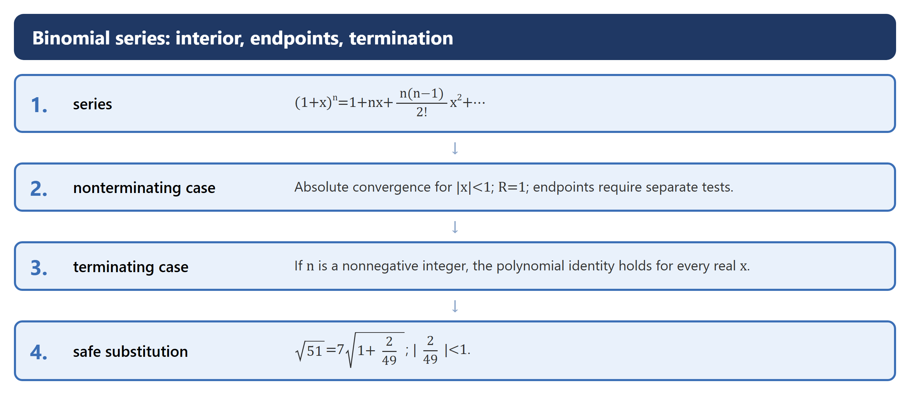

### 5.3 Why we force $(1+\varepsilon)^{n}$

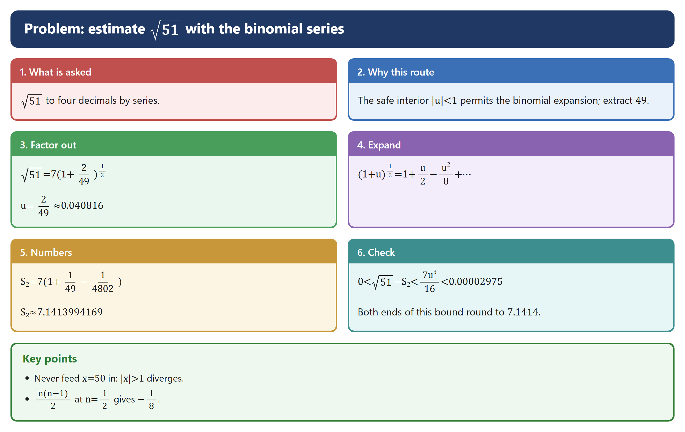

**What is asked**

Use the binomial series to estimate $\sqrt{51}$ to four decimal places.

**Why this route**

The expansion $(1+x)^{n}=1+nx+\frac{n(n-1)}{2}x^{2}+\cdots$ applies for $|x|<1$. To put $51$ into a usable $(1+\varepsilon)$ form, first factor out the nearest perfect square, $49$.

**Step 1. Factor out the perfect square**

$$\sqrt{51}=\sqrt{49\left(1+\frac{2}{49}\right)}=7\left(1+\frac{2}{49}\right)^{1/2}$$

**Step 2. Check that the correction is small enough**

$$u=\frac{2}{49}=0.040816\ldots,\qquad |u|<1\ \checkmark$$

**Step 3. Expand to second order**

$$(1+u)^{1/2}=1+\frac{u}{2}-\frac{u^{2}}{8}+\cdots$$

**Where $-\frac{u^{2}}{8}$ comes from**

In the general formula, the coefficient of $x^{2}$ is $\frac{n(n-1)}{2}$. Substituting $n=\frac12$ gives $\frac{(1/2)(-1/2)}{2}=-\frac18$. The negative sign comes from $n-1=-\frac12$.

**Step 4. Calculate each term**

$$\frac{u}{2}=0.020408,\qquad \frac{u^{2}}{8}=\frac{1}{4802}=0.0002083$$

**Step 5. Combine the terms**

$$\sqrt{51}\approx7(1+0.020408-0.000208)=7(1.020200)=7.14140$$

**Sanity check**

The true value is $7.141428\ldots$, so the error is about $3\times10^{-5}$ and $7.1414$ is correct to four decimal places. As expected, $\sqrt{51}$ is slightly greater than $7$.

**What not to do**

Substituting $x=50$ directly in $(1+x)^{1/2}$ gives $|x|=50>1$. The series diverges there as its terms grow. First factor the expression so the series argument is $1$ plus a small correction.

**Answer**

$$\sqrt{51}=7\left(1+\tfrac{2}{49}\right)^{1/2}\approx7.14140\quad(\text{true }7.141428\ldots)$$

> **Trap**
> "The ratio test gives $L=1$ at $x=1$" does not mean the series diverges there; it means this test cannot tell you. Endpoint behaviour needs a separate argument.

**30-second check:** What is $(1+x)^{-1}$ to second order? $1-x+x^{2}$.

---

## 6. Partial differentiation: the first definition

### 6.1 The idea

Let $z=f(x,y)$. Hold $y$ fixed at $y_0$. Then $z=f(x,y_0)$, so $z$ is a function of $x$ alone and you can differentiate it in the usual way.

### 6.2 The limit definition (Eq. 9.1)

$$\left.\frac{\partial f}{\partial x}\right|_{(x_0,y_0)}=\lim_{\delta x\to 0}\frac{f(x_0+\delta x,\,y_0)-f(x_0,y_0)}{\delta x}=f_x.$$

Notation: $f_x$, $\dfrac{\partial f}{\partial x}$ and $D_1f$ all mean the same thing here.

### 6.3 Geometric meaning

The lecture's remark: the surface "has no vertical cliffs". Careful: this is only intuition about continuity. Two partial derivatives existing does **not** give a tangent plane - differentiability requires $\Delta f=f_x\Delta x+f_y\Delta y+o(\sqrt{\Delta x^{2}+\Delta y^{2}})$, and a sufficient condition is that the partials are continuous near the point ($C^{1}$). Each partial on its own only describes one coordinate direction.

### 6.4 Worked example (extra practice, separate from the handout example)

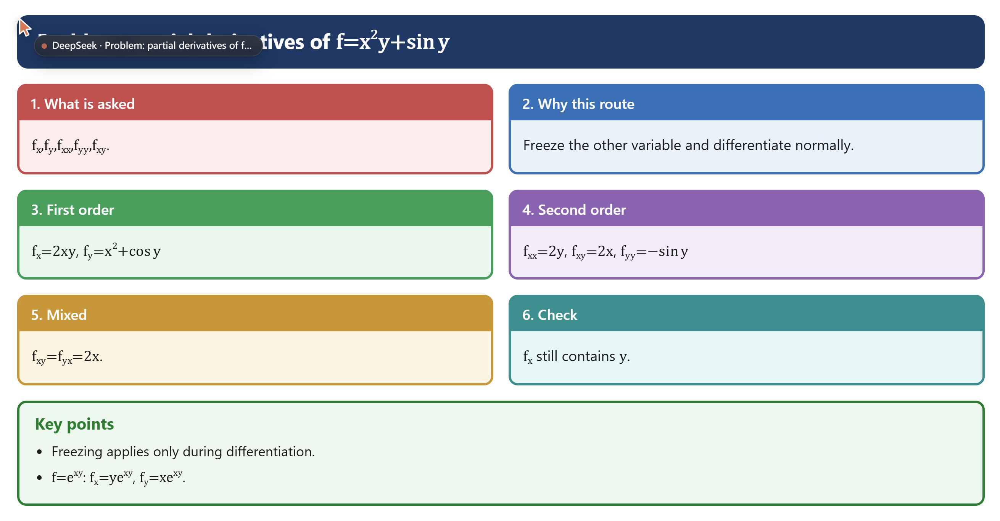

**What is asked**

$$f(x,y)=x^{2}y+\sin y$$

Find $f_x,\ f_y,\ f_{xx},\ f_{yy},\ f_{xy}$.

> **The handout example**: E3 on p. 97 uses $f=x^{2}y+x\sin y$, with a factor of $x$ in front of $\sin$. Its answers are $f_x=2xy+\sin y$ and $f_y=x^{2}+x\cos y$. This practice problem uses $x^{2}y+\sin y$, so keep the two functions separate. For notes on Sections 9.1-9.4, see [MECH40008_Ch9-9_2026-11-13_Partial_Differentiation.md](./MECH40008_Ch9-9_2026-11-13_Partial_Differentiation.md).

**Why this route**

A partial derivative holds one variable fixed and differentiates with respect to the other as in ordinary single-variable calculus. At each step, identify the variable to differentiate and the one to treat as constant.

**Step 1. Differentiate with respect to $x$, holding $y$ constant**

$$f_x=\frac{\partial}{\partial x}\left(x^{2}y+\sin y\right)=2xy+0=2xy$$

**Where the $\sin y$ term goes and why it disappears**

When differentiating with respect to $x$, the whole term $\sin y$ is constant, so its derivative is $0$.

**Step 2. Differentiate with respect to $y$, holding $x$ constant**

$$f_y=\frac{\partial}{\partial y}\left(x^{2}y+\sin y\right)=x^{2}+\cos y$$

In $x^{2}y$, the coefficient $x^{2}$ is constant, so the derivative is $x^{2}$. The derivative of $\sin y$ is $\cos y$.

**Step 3. Find the second derivatives starting from $f_x$**

$$f_{xx}=\frac{\partial}{\partial x}(2xy)=2y,\qquad f_{xy}=\frac{\partial}{\partial y}(2xy)=2x$$

**Step 4. Find the second derivatives starting from $f_y$**

$$f_{yy}=\frac{\partial}{\partial y}(x^{2}+\cos y)=-\sin y,\qquad f_{yx}=\frac{\partial}{\partial x}(x^{2}+\cos y)=2x$$

**Sanity check**

The mixed partials satisfy $f_{xy}=f_{yx}=2x$. They agree when they are continuous, which provides a check. Also, $f_x$ still contains $y$, and $f_y$ still contains $x$. These are still functions of two variables rather than constants.

**Answer**

$$f_x=2xy,\quad f_y=x^{2}+\cos y,\quad f_{xx}=2y,\quad f_{yy}=-\sin y,\quad f_{xy}=2x$$

> **Trap**
> $f_x$ is still a function of both variables. Freezing happens during the differentiation only, and the result goes back in afterwards.

**30-second check:** For $f=e^{xy}$, the derivatives are $f_x=ye^{xy}$ and $f_y=xe^{xy}$. Both expressions, $ye^{xy}$ and $xe^{xy}$, retain the common exponential $e^{xy}$, so the presence of $y$ in $f_y$ is expected. The factor in front identifies the direction here: $y$ for $f_x$, and $x$ for $f_y$.

---

## 7. One exam-style question

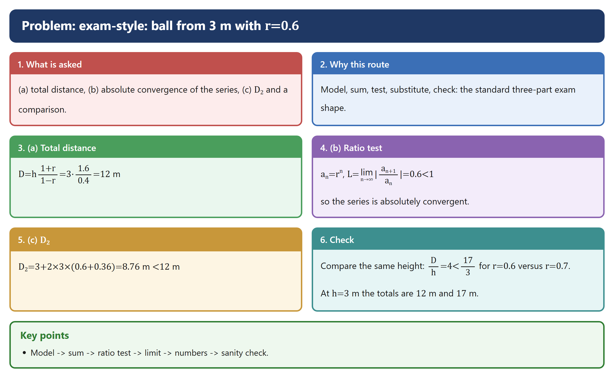

**What is asked**

A ball falls from $h=3$ m with $r=0.6$. (a) Find the total distance over infinitely many bounces. (b) Decide whether the underlying series converges absolutely. (c) Find $D_2$ and compare it with the total.

**Why this route**

This common exam structure combines three tasks. Model the distance with a geometric sum, use the ratio test to check convergence, then calculate a partial sum to check that the result makes sense.

**Step 1. (a) Use the total-distance formula**

$$D=h\frac{1+r}{1-r}=3\cdot\frac{1.6}{0.4}=3\cdot4=12\ \text{m}$$

**Step 2. (b) Write the general term and apply the ratio test**

$$a_n=r^{n},\qquad L=\lim_{n\to\infty}\left|\frac{a_{n+1}}{a_n}\right|=r=0.6<1$$

Since $L<1$, the series converges absolutely and therefore converges. Here every term is non-negative, so ordinary and absolute convergence are equivalent.

**Step 3. (c) Include only the first two bounces**

$$D_2=3+2\cdot3(0.6+0.36)=3+6(0.96)=8.76\ \text{m}$$

The partial sum leaves out infinitely many segments, so $8.76<12$.

**Sanity check**

Compare like with like by using $D/h$. With $r=0.6$, $D/h=4$. With $r=0.7$, the ratio is $(1+0.7)/(1-0.7)=17/3\approx5.67$. As $4<17/3$, the lower bounces give a shorter distance relative to the drop height, as expected. The distances $12$ m and $8.5$ m start from different values of $h$.

**Answer**

$$D=12\ \text{m};\quad a_n=r^{n},\ L=0.6<1\ \Rightarrow\ \text{absolutely convergent};\quad D_2=8.76\ \text{m}<12\ \text{m}$$

The total distance is $D=12$ m, the series converges absolutely, and $D_2=8.76$ m is below the limit of $12$ m.

**Where the constant comes from**

The $4$ in $4h$ comes from evaluating $(1+r)/(1-r)$ at $r=0.6$. The ratio is $(1.6)/(0.4)=4$, so $D=4h=12$ m. The $0.96$ used to obtain $D_2=8.76$ is $r+r^{2}=0.6+0.36$. Each of those two bounces has an upward and a downward leg, giving a multiplier of $2h$ rather than $h$. The limit $L=0.6$ equals the common ratio because the general term is $r^{n}$.

**Common pitfalls**

First, count both the upward and downward legs of every bounce. A one-way count halves the contribution of the bounces. Second, keep $h$ fixed when comparing $D_2$ with $D$, or use $D/h$ to compare cases with different heights. Third, use $D_2<D$ and the fact that $D$ is the limit. The argument does not rest on inferring boundedness of the sequence directly from convergence of the partial sums.

**Reusable method**: Model the distance, sum the series, apply the ratio test, take the limit, substitute the numbers and check the result.

## 8. Traps in one table

| # | Trap | Fix |
|---|---|---|
| 1 | Leibniz with both factors differentiated $n$ times | split $r$ and $n-r$ |
| 2 | Expanding every row when one factor is a polynomial | keep rows $r\le \deg u$ |
| 3 | "Radius infinite" read as "remainder small" | use $R_n$ for accuracy |
| 4 | Bouncing ball without the factor 2 | every bounce is up + down |
| 5 | $r=1$ treated as finite | $\frac{1}{1-r}$ diverges |
| 6 | $L=1$ used as a verdict | change test |
| 7 | Binomial with $|x|>1$ | rewrite as $\left(1+\text{small}\right)^{n}$ |
| 8 | $f_x$ treated as a constant | it still depends on $x$ and $y$ |

---

## 9. Self-check and mixed drill

**Answers to the 30-second checks**

1. $D^{3}(x^{3}e^{x})$: four rows, $\left(x^{3}+9x^{2}+18x+6\right)e^{x}$.
2. $L$ for $\frac{3^{r}}{r!}$: $0$.
3. Ball $r=0.8$, $h=2$: $18$ m.
4. $\sum\frac{1}{r}$: $L=1$, inconclusive; diverges.
5. $f=e^{xy}$: $f_x=ye^{xy}$.
6. $(1+x)^{1/2}$ to first order: $1+\frac{x}{2}$.

**Mixed drill**

1. $D^{3}(x^{3}e^{x})$ - how many rows survive? **Four** ($r=0..3$), because $x^{3}$ is cubic.
2. For $a_r=\frac{3^{r}}{r!}$, find $L$. **$L=\lim\frac{3}{r+1}=0$**, so it converges regardless of $x$.
3. A ball with $r=0.8$ dropped from $2$ m - total distance? **$2\cdot\frac{1.8}{0.2}=18$ m**.
4. Why does $\sum\frac{1}{r}$ defeat the ratio test? **$L=1$, inconclusive**; the harmonic series diverges anyway.
5. $f(x,y)=e^{xy}$ - find $f_x$. **$f_x=ye^{xy}$**.

---

## 10. Formula card

$$\textbf{Leibniz:}\quad D^{n}(uv)=\sum_{r=0}^{n}\binom{n}{r}D^{r}u\,D^{n-r}v$$

$$\textbf{Taylor:}\quad f(a+h)=\sum_{k=0}^{n}\frac{h^{k}}{k!}f^{(k)}(a)+R_n$$

$$\textbf{Maclaurin:}\quad \sin x,\ \cos x,\ e^{x}\ \text{converge for every finite }x\ (L=0)$$

$$\textbf{Geometric:}\quad \sum_{n\ge 0}x^{n}=\frac{1}{1-x},\quad |x|<1$$

$$\textbf{Bouncing:}\quad D_N=h+2h\sum_{n=1}^{N}r^{n}\ \longrightarrow\ D=h\frac{1+r}{1-r}$$

$$\textbf{Ratio test:}\quad L=\lim\left|\frac{a_{r+1}}{a_r}\right|;\quad L<1\ \text{yes},\ L>1\ \text{no},\ L=1\ \text{undecided}$$

$$\textbf{Binomial:}\quad (1+x)^{n}=1+nx+\frac{n(n-1)}{2!}x^{2}+\cdots,\quad |x|<1,\ \text{radius }1$$

$$\textbf{Partial:}\quad f_x=\lim_{\delta x\to 0}\frac{f(x_0+\delta x,y_0)-f(x_0,y_0)}{\delta x}\qquad(\text{Eq. }9.1)$$

---

## 11. Glossary

| Term | Short description | One-line meaning |
|---|---|---|
| Leibniz rule | Higher-order product differentiation | Product rule for the $n$-th derivative |
| Maclaurin series | Expansion at zero | Taylor series about $a=0$ |
| Absolute convergence | Convergence after taking magnitudes | $\sum|a_r|$ converges, so $\sum a_r$ does too |
| Bounce coefficient | Height ratio | Fraction of height recovered per bounce, $r<1$ |
| Geometric series | Constant-ratio sum | The ratio between consecutive terms is constant |
| Interval of convergence | Convergent inputs | The values of $x$ for which the series converges |
| Radius of convergence | Distance from the centre to either endpoint | Half-width of the convergence interval |
| Partial derivative | Rate along a coordinate direction | Derivative with the other variables held fixed |

---

## 12. Where to go next

- **Partial differentiation** continues next lecture: higher partials, the chain rule in two variables, and stationary points.
- **Series practice:** the ratio test is the workhorse, but keep the comparison test ready for $L=1$.
- **Exam drill:** the formula card in §10 plus [CHEATSHEET](./CHEATSHEET.md) is the ten-minute revision pass.

*Source: MECH40008 Mathematics and Computing 1, Panopto replay, 12 November 2026 (1:00:00). Formulas follow the lecture slides; the partial-derivative section follows Eq. (9.1) of the course text as shown in the lecture.*
