# MECH40008 - Chapter 9 Partial Differentiation(9.1-9.4)

  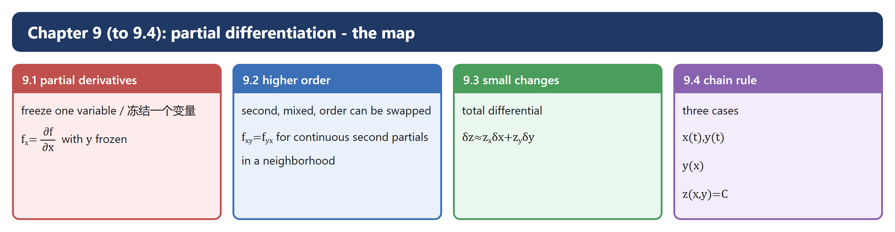

## Lecture notes (Chapter 9, sections 9.1-9.4): partial derivatives, small changes, total derivatives

> **In 60 seconds:** a partial derivative freezes all but one variable; repeating that operation gives the second and mixed partials; the total differential $dz=z_xdx+z_y dy$ is the exact linear part, while a finite change satisfies $\Delta z\approx dz$; the chain rule follows every path from input to output, for $x(t),y(t)$, then for $y(x)$, then implicitly for $z(x,y)=C$.
>
> **Panopto verification:** this lecture recording revisits partial differentiation, higher-order and mixed partials, small changes, total differentials and error propagation. The automatic transcript is reliable for the broad sequence, but formulas and symbols below are checked against the handout; see the timestamp audit in §5.

*Panopto recording checked: "ME MECH40008 - Mathematics and Computing 1 CAGB-02-200 2026-11-13", 59:57. The transcript is auto-generated and may confuse $d$, $\Delta$, $\delta$, $x/y$, or formula subscripts.*  
> **In 15 minutes:** the eleven worked examples E1-E11 below, in the order the handout used them, each with the eight-beat template and a fixed poster slug.

*Source: MECH40008 Mathematics and Computing 1, Autumn 2026-27 lecture handout, Chapter 9 sections 9.1-9.4, printed pages 94-106 (PDF pages 103-115). The date in the filename is the compilation date, not a lecture date.*

---

## 0. Where this chapter sits

| Section | Topic | Why it is here |
|---|---|---|
| 9.1 | Functions of several independent variables | defines evaluation, continuity and the first partials |
| 9.2 | Higher order partial derivatives | second and mixed partials, when the order can be swapped |
| 9.3 | Small changes | the total differential and signed relative error |
| 9.4 | Total derivatives / chain rule | three cases: $x(t),y(t)$; $y(x)$; $z(x,y)=C$ |
| 9.5-9.9 | Change of variables, Taylor series, stationary points, contour plots, problems | **Outside the scope of these notes.** This file covers sections 9.1-9.4. Later batches will add the remaining sections to the same file. |

**Prerequisites.** Single-variable differentiation, the product and chain rules, factorials, basic trigonometry and the idea of a limit.

### Symbols you need

| Symbol | Meaning | Notes |
|---|---|---|
| $f(x,y)$ or $z(x,y)$ | a function of two independent variables | |
| $f_x$, $\frac{\partial f}{\partial x}$ | partial derivative with respect to $x$ | |
| $f_{xy}$, $\frac{\partial^{2}f}{\partial y\partial x}$ | mixed partial derivative | differentiate first with respect to $x$, then with respect to $y$ |
| $\delta x$, $\delta y$ | small changes in the inputs | |
| $\delta z$ | approximate change in the output | |
| $\frac{dz}{dt}$ | total derivative along a path | |

### Coverage map (11 examples labelled as such in the handout)

| ID | Handout page | Topic | Section in these notes | Poster slug |
|---|---|---|---|---|
| E1 | 94 | Evaluating $f=x^{2}+xy+y^{2}$ | §1 | ex_ch9_e1_eval |
| E2 | 97 | First partials of $x^{3}+y^{3}+x^{2}y+xy$ | §2 | ex_ch9_e2_poly_first |
| E3 | 97 | $x^{2}y+x\sin y$, with $\sin$ multiplied by $x$ | §2 | ex_ch9_e3_xsiny |
| E4 | 98-99 | Second and mixed partials of the same function as E2 | §2 | ex_ch9_e4_poly_second |
| E5 | 99 | First and second partials of $\exp(x^{2}y)$ | §2 | ex_ch9_e5_exp |
| E6 | 100 | Relative error in the disc's moment of inertia $I=Ma^{2}/2$ | §3 | ex_ch9_e6_disc |
| E7 | 101 | Relative change in $T=2\pi\sqrt{l/g}$ | §3 | ex_ch9_e7_pendulum |
| E8 | 102 | Error and branches for $z^{2}=x^{2}+2y$ | §3 | ex_ch9_e8_implicit |
| E9 | 104 | Chain rule for $z=e^{xy^{2}},\ x=t^{2},\ y=\sin t$ | §4 (9.4.1) | ex_ch9_e9_chain_t |
| E10 | 105 | $z=\arctan(x/y),\ y=\sin x$ | §4 (9.4.2) | ex_ch9_e10_chain_x |
| E11 | 106 | Finding $dy/dx$ for the implicit function $xy+\sin y=0$ | §4 (9.4.3) | ex_ch9_e11_implicit |

E2 and E4 use the same function to teach different ideas, so they remain separate worked examples with eight parts each. E4 covers second and mixed partials and explains the condition for exchanging the order of differentiation. The three cases in sections 9.4.1 ($x(t),y(t)$), 9.4.2 ($y(x)$) and 9.4.3 ($z(x,y)=C$) correspond to E9, E10 and E11 respectively.

## 1. Functions of several independent variables (9.1, p.94-98)

A function of two independent variables assigns one output to each ordered pair $(x,y)$ in its domain. Evaluating it means substituting the given values or expressions for every $x$ and $y$.

**Continuity.** At $(x_0,y_0)$, continuity means

$$\lim_{(x,y)\to(x_0,y_0)}f(x,y)=f(x_0,y_0),$$

The limit must equal $f(x_0,y_0)$ along **every** path in the plane, including paths other than the two coordinate directions. For polynomials and the elementary functions built from them, continuity holds wherever the formula is defined. Check denominators, roots and logarithms for domain restrictions.

**Differentiability and $C^{1}$.** For $f$ to be differentiable, it must have a tangent plane. This requires more than the existence of both partial derivatives.

$$\Delta f=f_x\,\Delta x+f_y\,\Delta y+o\!\left(\sqrt{\Delta x^{2}+\Delta y^{2}}\right).$$

A **sufficient** condition is that the partial derivatives exist and are continuous in a neighbourhood of the point ($f\in C^{1}$). The lecture's "no vertical cliffs" remark describes an intuition about continuity. Establishing partial derivatives or a tangent plane requires its own test.

**Partial derivative (Eq. 9.1, p.96).** Hold $y$ fixed at $y_0$ and differentiate with respect to $x$ as for a function of one variable.

$$f_x(x_0,y_0)=\lim_{\delta x\to 0}\frac{f(x_0+\delta x,y_0)-f(x_0,y_0)}{\delta x}.$$

**Geometric meaning (Figure 2d, p.97).** The vertical plane $y=y_0$ cuts the surface along a curve. At $(x_0,y_0)$, the slope of that curve is $f_x$. Swapping the roles gives $f_y$, the slope along the curve defined by $x=x_0$.

> **Common pitfall.** When both partial derivatives exist, all we know from them are the coordinate-direction slopes. That is what the lecture's "no vertical cliffs" remark describes. Differentiability and the existence of a tangent plane require more.

### Example E1 - evaluating a two-variable function (p.94)

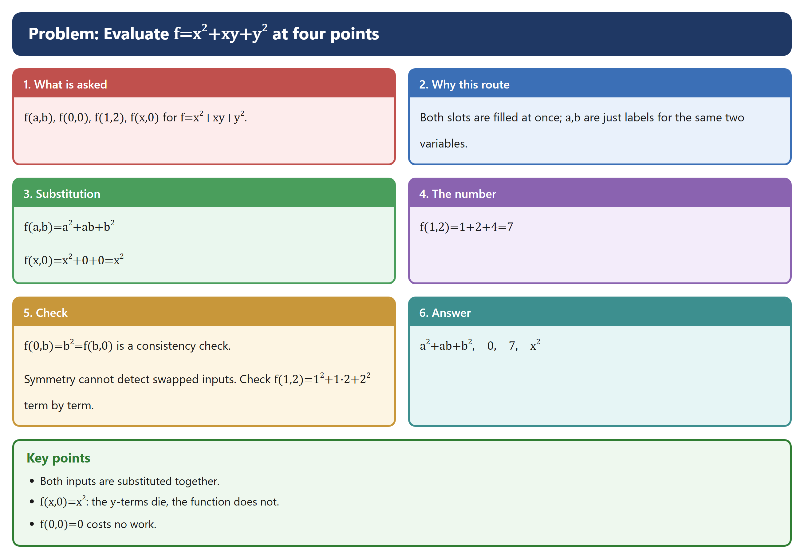

**What is asked**

$$f(x,y)=x^{2}+xy+y^{2}$$

Find $f(a,b),\ f(0,0),\ f(1,2),\ f(x,0)$.

**Why this route**

Replace every $x,y$ in the formula with the given values or expressions, then simplify. Section 9.1 introduces substitution because every partial derivative later in the chapter builds on it.

**Step 1. Substitute $(a,b)$**

$$f(a,b)=a^{2}+ab+b^{2}$$

This gives a general value in terms of letters, with no numerical terms to cancel.

**Step 2. Substitute $(0,0)$ and $(1,2)$**

$$f(0,0)=0^{2}+0\cdot0+0^{2}=0,\qquad f(1,2)=1^{2}+1\cdot2+2^{2}=7$$

For $(0,0)$, all three terms are zero. For $(1,2)$, the terms are $1,2,4$, which add up to $7$.

**Step 3. Substitute $(x,0)$, holding $y$ at $0$**

$$f(x,0)=x^{2}+x\cdot0+0^{2}=x^{2}$$

With $y=0$, the two terms containing $y$ vanish, leaving $x^{2}$.

**Where the constant comes from**

The three terms in $f(1,2)=7$ come from $x^{2}=1$, $xy=2$ and $y^{2}=4$. There are no other coefficients to account for. The result $f(x,0)=x^{2}$ follows because both $xy$ and $y^{2}$ have a factor of $0$.

**Sanity check**

The symmetry $f(x,y)=f(y,x)$ means that $f(a,b)=a^{2}+ab+b^{2}$ must be symmetric in $a,b$, which it is. The sign of $f(1,2)=7>0$ also agrees with $x^{2}+xy+y^{2}=(x+y/2)^{2}+3y^{2}/4\ge0$.

**Answer**

$$f(a,b)=a^{2}+ab+b^{2},\quad f(0,0)=0,\quad f(1,2)=7,\quad f(x,0)=x^{2}$$

**Common pitfall**

In $f(x,0)$, $x$ is still a variable and only $y$ is fixed at $0$. Giving $0$ as the result confuses substitution with taking a partial derivative.

---

## 2. Higher order partial derivatives (9.2, p.98-99)

Differentiate a first partial again, freezing the same or the other variable. The notation $f_{xy}$ means differentiate first by $x$, then by $y$; in Leibniz notation the order is read from right to left in the denominator, $\frac{\partial^{2}f}{\partial y\,\partial x}$.

**Clairaut's theorem.** If $f_{xy}$ and $f_{yx}$ are continuous on an open set, then $f_{xy}=f_{yx}$ there. Polynomials and exponentials satisfy this condition, so the two orders agree in this chapter.

### Example E2 - first partials of a polynomial (p.97)

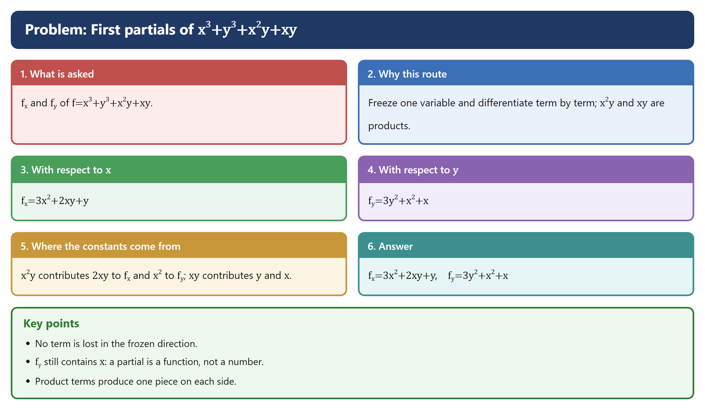

**What is asked**

$$f(x,y)=x^{3}+y^{3}+x^{2}y+xy$$

Find $f_x$ and $f_y$.

**Why this route**

When differentiating with respect to $x$, treat $y$ as constant. When differentiating with respect to $y$, treat $x$ as constant. Apply the power rule term by term.

**Step 1. Differentiate with respect to $x$**

$$f_x=\frac{\partial}{\partial x}\left(x^{3}+y^{3}+x^{2}y+xy\right)=3x^{2}+0+2xy+y$$

The term $y^{3}$ is constant. The derivative of $x^{2}y$ is $2xy$, and the derivative of $xy$ is $y$.

**Step 2. Differentiate with respect to $y$**

$$f_y=\frac{\partial}{\partial y}\left(x^{3}+y^{3}+x^{2}y+xy\right)=0+3y^{2}+x^{2}+x$$

The term $x^{3}$ is constant. The derivatives of $y^{3}$, $x^{2}y$ and $xy$ are $3y^{2}$, $x^{2}$ and $x$, respectively.

**Step 3. Combine the results and check each term**

$$f_x=3x^{2}+2xy+y,\qquad f_y=3y^{2}+x^{2}+x$$

Both partial derivatives are still functions of two variables. Once you have differentiated, let the variable you held fixed vary again.

**Where the constant comes from**

For $x^{3}$, the coefficient $3$ comes from the power rule $nx^{n-1}$. The same rule gives the $2$ in $2xy$, the derivative of $x^{2}y$ with respect to $x$. The derivative of $xy$ with respect to $x$ is $y$ because the power of $x$ is $1$.

**Sanity check**

Along the diagonal $y=x$, substitution gives $f(x,x)=x^{3}+x^{3}+x^{3}+x^{2}=3x^{3}+x^{2}$. Differentiating with respect to $x$ gives $9x^{2}+2x$. The chain rule gives the same result, $f_x(x,x)+f_y(x,x)=(3x^{2}+2x^{2}+x)+(3x^{2}+x^{2}+x)=9x^{2}+2x$.

**Answer**

$$f_x=3x^{2}+2xy+y,\qquad f_y=3y^{2}+x^{2}+x$$

**Common pitfall**

With respect to $x$, the derivative of $y^{3}$ is zero. The result $3y^{2}$ would come from differentiating with respect to $y$. A term that depends only on the fixed variable has derivative $0$.

---

### Example E3 - first partials with $x\sin y$ (p.97)

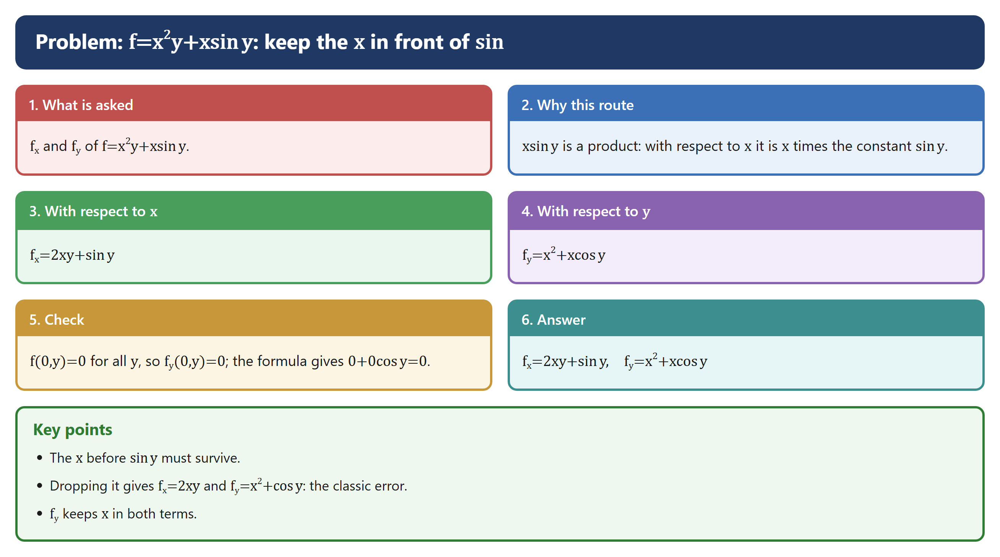

**What is asked**

$$f(x,y)=x^{2}y+x\sin y$$

Find $f_x$ and $f_y$.

**Why this route**

The term $x\sin y$ is a product. When differentiating with respect to $x$, the constant factor is $\sin y$. When differentiating with respect to $y$, it is $x$. Work through the two cases separately so you keep track of $x$.

**Step 1. Differentiate with respect to $x$**

$$f_x=\frac{\partial}{\partial x}\left(x^{2}y+x\sin y\right)=2xy+\sin y$$

The term $x^{2}y$ gives $2xy$. The term $x\sin y$ gives $\sin y$, since $\sin y$ is treated as constant.

**Step 2. Differentiate with respect to $y$**

$$f_y=\frac{\partial}{\partial y}\left(x^{2}y+x\sin y\right)=x^{2}+x\cos y$$

The term $x^{2}y$ gives $x^{2}$. The term $x\sin y$ gives $x\cos y$, with the factor $x$ still present.

**Step 3. Write out the full result**

$$f_x=2xy+\sin y,\qquad f_y=x^{2}+x\cos y$$

The derivative $f_y$ contains both $x^{2}$ and $x\cos y$. The factor $x$ remains.

**Where the constant comes from**

The trigonometric derivative is $\frac{\partial}{\partial y}\sin y=\cos y$. The constant factor $x$ then gives $x\cos y$. Writing only $\cos y$ would omit that factor.

**Sanity check**

The function satisfies $f(0,y)=0$ for all $y$, so $f_y(0,y)=0$. The formula agrees and gives $0^{2}+0\cos y=0$. Similarly, $f(x,0)=0$ implies $f_x(x,0)=0$, and the formula gives $0+\sin0=0$.

**Answer**

$$f_x=2xy+\sin y,\qquad f_y=x^{2}+x\cos y$$

**Common pitfall**

The handout uses $x\sin y$. Using $\sin y$ alone drops $x$ and gives $f_x=2xy$ and $f_y=x^{2}+\cos y$, which do not match the handout. The 11-12 notes label the $\sin y$ version as a supplementary variant.

---

### Example E4 - second and mixed partials of E2 (p.98-99)

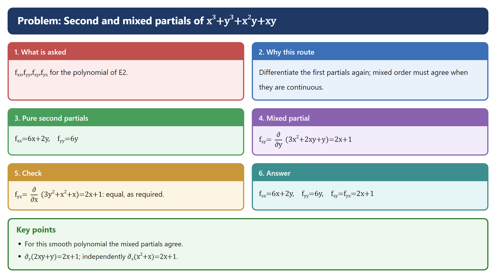

**What is asked**

For the function $f(x,y)=x^{3}+y^{3}+x^{2}y+xy$ from E2, find $f_{xx},f_{yy},f_{xy},f_{yx}$.

**Why this route**

All partial derivatives of a polynomial are continuous. Clairaut's theorem guarantees $f_{xy}=f_{yx}$, so use one order of mixed differentiation to check the other.

**Step 1. Differentiate $f_x$ from E2 again with respect to $x$**

$$f_{xx}=\frac{\partial}{\partial x}(3x^{2}+2xy+y)=6x+2y$$

The derivative of $3x^{2}$ is $6x$, and the derivative of $2xy$ is $2y$. The term $y$ is constant and has derivative $0$.

**Step 2. Differentiate $f_y$ again with respect to $y$**

$$f_{yy}=\frac{\partial}{\partial y}(3y^{2}+x^{2}+x)=6y$$

Only $3y^{2}$ contains $y$, and its derivative is $6y$. The term $x^{2}+x$ is constant with respect to $y$.

**Step 3. Find the mixed partials in both orders**

$$f_{xy}=\frac{\partial}{\partial y}(3x^{2}+2xy+y)=2x+1,\qquad f_{yx}=\frac{\partial}{\partial x}(3y^{2}+x^{2}+x)=2x+1$$

Both orders give the same result, as Clairaut's theorem predicts.

**Where the constant comes from**

Differentiating $2xy$ with respect to $y$ gives $2x$ because $2x$ is constant. This is the main term in $f_{xy}$. In the other order, differentiate the term $x^{2}$ in $f_y$ with respect to $x$ to get $2x$. Clairaut's theorem requires both orders to give the same $2x$. The $+1$ in the mixed partial comes from the final term $y$ in $f_x$. It came from differentiating the original term $xy$ with respect to $x$, and differentiating it with respect to $y$ gives $1$.

**Sanity check**

The expressions for $f_{xy}$ and $f_{yx}$ both equal $2x+1$ and are independent of $y$. Also, $f_{xx}$ contains $x,y$, while $f_{yy}$ contains only $y$. This agrees with the structure of the original terms $x^{3}$, $y^{3}$, $x^{2}y$ and $xy$.

**Answer**

$$f_{xx}=6x+2y,\qquad f_{yy}=6y,\qquad f_{xy}=f_{yx}=2x+1$$

**Common pitfall**

Continuity of the mixed partials is the condition used here to establish that $f_{xy}$ and $f_{yx}$ are equal. Check this condition before exchanging the order of differentiation.

---

### Example E5 - first and second partials of $e^{x^{2}y}$ (p.99)

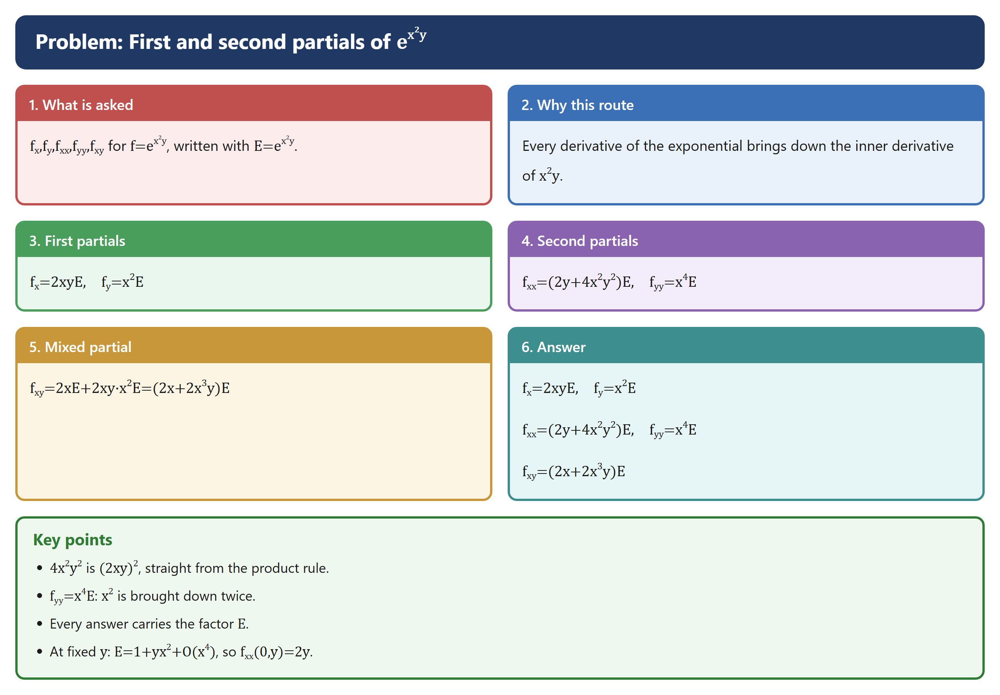

**What is asked**

$$f(x,y)=e^{x^{2}y}$$

Find $f_x,f_y,f_{xx},f_{yy},f_{xy}$.

**Why this route**

Use the chain rule to differentiate the exponential. Keep the exponential and multiply by the partial derivative of its exponent $x^{2}y$. Use the product rule for the second derivatives.

**Step 1. Find the first partial derivatives**

$$f_x=2xy\,e^{x^{2}y},\qquad f_y=x^{2}e^{x^{2}y}$$

The derivative of the exponent with respect to $x$ is $2xy$. With respect to $y$, it is $x^{2}$.

**Step 2. Find the pure second partial derivatives**

$$f_{xx}=\frac{\partial}{\partial x}\left(2xy\,e^{x^{2}y}\right)=(2y+4x^{2}y^{2})e^{x^{2}y},\qquad f_{yy}=\frac{\partial}{\partial y}\left(x^{2}e^{x^{2}y}\right)=x^{4}e^{x^{2}y}$$

For $f_{xx}$, use the product rule. The derivative of $2xy$ gives $2y$ times the exponential. Add $2xy$ times the exponential times the derivative of the exponent $2xy$ to get $4x^{2}y^{2}$. In $f_{yy}$, $x^{2}$ is constant, so the only extra factor is $x^{2}$.

**Step 3. Find the mixed partial derivatives**

$$f_{xy}=\frac{\partial}{\partial y}\left(2xy\,e^{x^{2}y}\right)=(2x+2x^{3}y)e^{x^{2}y}$$

Differentiating $2xy$ with respect to $y$ gives $2x$. Differentiating the exponential with respect to $y$ introduces a factor of $x^{2}$, so the second term is $2xy\cdot x^{2}=2x^{3}y$.

**Where the constant comes from**

In $f_{xx}$, the term $4x^{2}y^{2}$ comes from $(2xy)^{2}$. In $f_{xy}$, the term $2x^{3}y$ comes from $2xy\cdot x^{2}$. These coefficients follow directly from the product and chain rules.

**Sanity check**

Hold $y$ fixed and expand $e^{x^{2}y}$ about $x=0$ to get $e^{x^{2}y}=1+yx^{2}+O(x^{4})$. The linear coefficient is $0$ because there is no term linear in $x$. The quadratic coefficient is $y$, so $f_x(0,y)=0$ and $f_{xx}(0,y)=2y$. The formula $f_{xx}=(2y+4x^{2}y^{2})e^{x^{2}y}$ gives $2y$ at $x=0$, as expected. Along the line $x=0$, $f(0,y)=1$ is constant. This checks the partial derivatives with respect to $y$ ($f_y(0,y)=0$). The second derivative with respect to $x$ needs its own check. Constancy along this line does not make every derivative involving $x$ zero.

**Answer**

$$f_x=2xyE,\quad f_y=x^{2}E,\quad f_{xx}=(2y+4x^{2}y^{2})E,\quad f_{yy}=x^{4}E,\quad f_{xy}=(2x+2x^{3}y)E,\quad E=e^{x^{2}y}$$

**Common pitfall**

The result for $f_{yy}$ is $x^{4}E$. The result $x^{2}E$ would omit a factor. The first differentiation with respect to $y$ introduces $x^{2}$, and the second introduces another factor of $x^{2}$.

---

## 3. Small changes and the total differential (9.3, p.99-102)

Let $dx,dy$ denote small input increments, with $dx$ for the first input and $dy$ for the second. The **differential** of $z$ is the exact linear part

$$dz=\frac{\partial z}{\partial x}\,dx+\frac{\partial z}{\partial y}\,dy\qquad\text{(Eq. 9.5)},$$

which is valid when $z$ is differentiable at the point (a $C^{1}$ neighbourhood, i.e. continuous partials, is a sufficient condition). The **finite** change

$$\Delta z=z(x+dx,\,y+dy)-z(x,y)$$

is *not* equal to $dz$: it also carries second- and higher-order terms, so the honest statement is $\Delta z\approx dz$ with a remainder of order $(dx)^{2}+(dy)^{2}$. The lecture writes this first-order estimate as $\delta z$. Throughout this note $dz$ is the exact linear differential and $\Delta z$ (or $\delta z$) is the finite change, so $\approx$ is used only for the second.

**Three variables (Eq. 9.6, p.102).** For $z=z(x,y,t)$,

$$dz=\frac{\partial z}{\partial x}\,dx+\frac{\partial z}{\partial y}\,dy+\frac{\partial z}{\partial t}\,dt,\qquad \Delta z\approx dz,$$

In three variables there is one extra term. Each partial derivative holds the other two variables constant.

**Signed relative error.** Divide the differential by $z$. This requires $z\neq0$, so treat any case where it can vanish separately.

$$\frac{dz}{z}=\frac{x}{z}\frac{\partial z}{\partial x}\frac{dx}{x}+\frac{y}{z}\frac{\partial z}{\partial y}\frac{dy}{y},\qquad \frac{\Delta z}{z}\approx\frac{dz}{z}\quad(z\neq0).$$

For a product or quotient this collapses to a sum of the input relative errors with their exponents as weights. The lecture calls it "approximate": mark it as such, and when asked compare with the exact product.

**Absolute error bound.** If only the magnitudes are known, $|dx|\le\varepsilon_x$ and $|dy|\le\varepsilon_y$, then to first order

$$|dz|\le\left|\frac{\partial z}{\partial x}\right|\varepsilon_x+\left|\frac{\partial z}{\partial y}\right|\varepsilon_y.$$

This gives a first-order bound on $|dz|$. A strict bound on $|\Delta z|$ must also account for the remainder, which requires bounding the second derivatives over the neighbourhood. That step is outside the exam requirements.

### Example E6 - relative error of a disc's moment of inertia (p.100)

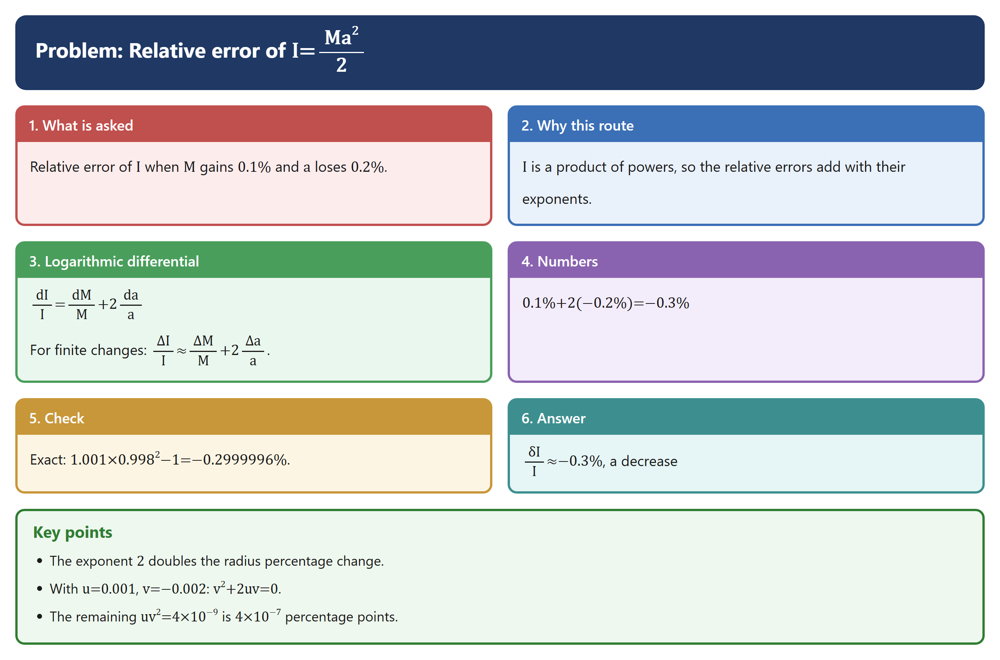

**What is asked**

$$I=\frac{1}{2}Ma^{2}$$

The measurement error in $M$ is $+0.1\%$, and the measurement error in $a$ is $-0.2\%$. Approximate the relative error in $I$ and compare it with the exact product.

**Why this route**

The quantity $I$ is the product of $M$ and $a$, with powers $1$ and $2$ respectively. To approximate the relative error, weight each input's relative error by its power and add the results.

**Step 1. Write the total differential**

$$dI=\frac{\partial I}{\partial M}\,dM+\frac{\partial I}{\partial a}\,da=\frac{1}{2}a^{2}\,dM+Ma\,da$$

This is the **exact linear differential** of $I$. For finite input increments, the actual change satisfies only $\Delta I\approx dI$. The partial derivatives are $\frac{\partial I}{\partial M}=\frac{1}{2}a^{2}$ and $\frac{\partial I}{\partial a}=Ma$.

**Step 2. Divide by $I$ to get the relative error**

$$\frac{\Delta I}{I}\approx\frac{dI}{I}=\frac{\Delta M}{M}+2\frac{\Delta a}{a}=0.1\%+2(-0.2\%)=-0.3\%$$

The exponent of $a$ is $2$, so its relative error has weight $2$.

**Step 3. Check against the exact product**

$$\frac{I_{\text{new}}}{I}=(1+0.001)(1-0.002)^{2}=1.001\times0.996004=0.997000004$$

The exact relative change is $-0.2999996\%$, which differs from the first-order estimate $-0.3\%$ by $4\times10^{-7}$ percentage points. Expand $(1+a)(1+b)^{2}-1$ to get $a+2b+b^{2}+2ab+ab^{2}$ and substitute $a=0.001$ and $b=-0.002$. The second-order terms $b^{2}+2ab=4\times10^{-6}-4\times10^{-6}=0$ cancel completely. The entire difference comes from the third-order term $ab^{2}=4\times10^{-9}$, equivalent to $4\times10^{-7}$ percentage points.

**Where the constant comes from**

The coefficient $2$ comes from the power of $a^{2}$. The power of $M$ is $1$, so its weight is $1$. There are no other constants to account for.

**Sanity check**

The quantity $M$ increases and $a$ decreases. Since $a$ carries the greater weight, the net effect should be negative, as $-0.3\%<0$ confirms. The exact value is slightly larger in value and smaller in magnitude than the first-order estimate. The third-order term $ab^{2}=4\times10^{-9}$ accounts for exactly $4\times10^{-7}$ percentage points.

**Answer**

$$\frac{\Delta I}{I}\approx-0.3\%,\qquad\text{exact }-0.2999996\%$$

**Common pitfall**

The weight of $a$ is easy to miswrite as $1$. The term $a$ is squared, so its weight is $2$. Keep the word "approximate" as well. The exact and approximate values first differ in the sixth decimal place.

---

### Example E7 - relative change of a pendulum period (p.101)

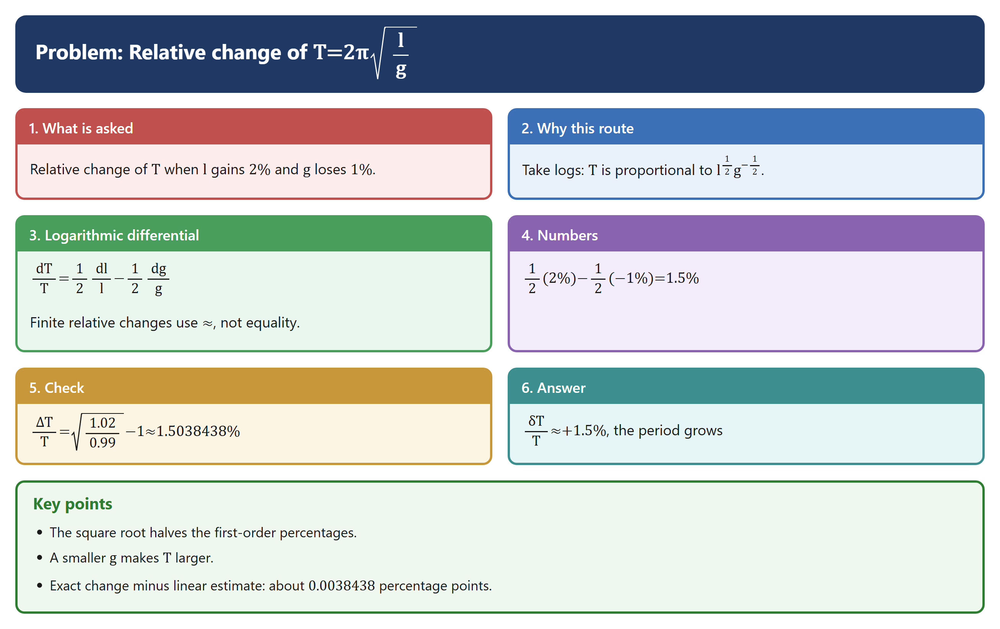

**What is asked**

$$T=2\pi\sqrt{\frac{l}{g}}$$

The quantity $l$ increases by $2\%$, and $g$ decreases by $1\%$. Approximate the relative change in $T$ and compare it with the exact value.

**Why this route**

The quantity $T$ is a constant times $l^{1/2}g^{-1/2}$. For the approximate relative error, multiply each input's relative error by its exponent and add the results.

**Step 1. Take logarithms or differentiate directly**

$$\ln T=\ln(2\pi)+\frac{1}{2}\ln l-\frac{1}{2}\ln g\quad\Rightarrow\quad\frac{dT}{T}=\frac{1}{2}\frac{dl}{l}-\frac{1}{2}\frac{dg}{g}$$

Logarithmic differentiation turns multiplication and division into addition and subtraction. The exponents become coefficients.

**Step 2. Substitute the percentages**

$$\frac{\Delta T}{T}\approx\frac{dT}{T}=\frac{1}{2}(2\%)-\frac{1}{2}(-1\%)=1\%+0.5\%=1.5\%$$

A decrease in $g$ of $1\%$ means $\delta g/g=-1\%$. The preceding minus sign makes its contribution $+0.5\%$.

**Step 3. Check against the exact product**

$$\frac{T_{\text{new}}}{T}=\sqrt{\frac{1.02}{0.99}}=\sqrt{1.030303\ldots}=1.015038438\ldots$$

The exact expression for the relative change has numerical value $\approx+1.5038438\%$. This evaluates $\sqrt{1.02/0.99}-1$, so the decimal is an approximation. It differs from the first-order estimate $1.5\%$ by $0.0038438$ percentage points.

**Where the constant comes from**

The coefficient $\frac{1}{2}$ comes from the square root. The quantity $g$ is in the denominator and has exponent $-\frac{1}{2}$, which contributes the minus sign.

**Sanity check**

An increase in $l$ lengthens the period. A decrease in $g$ also lengthens it. Both changes act in the same direction, so the result should be positive, as $+1.5\%>0$ confirms.

**Answer**

$$\frac{\Delta T}{T}\approx+1.5\%,\qquad\text{exact }\approx+1.5038438\%$$

**Common pitfall**

A decrease in $g$ of $1\%$ can be mistaken for $\delta g/g=+1\%$. Use $-1\%$ and apply the preceding minus sign to get the contribution $+0.5\%$. The wrong sign would give $0.5\%$.

---

### Example E8 - error in $z$ from $z^{2}=x^{2}+2y$ (p.102)

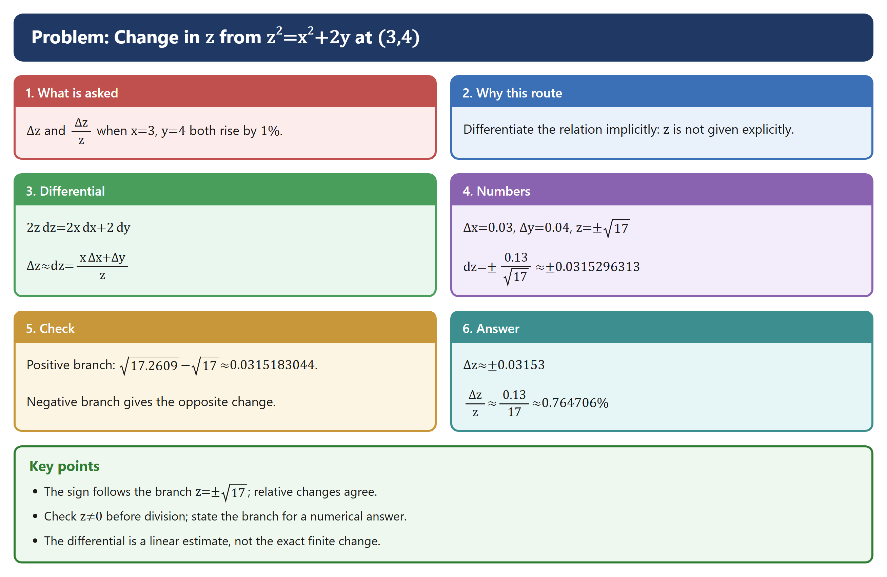

**What is asked**

$$z^{2}=x^{2}+2y,\qquad x=3,\ y=4$$

The measurement errors in $x$ and $y$ are both $+1\%$. Find the error in $z$.

**Why this route**

An implicit equation defines $z$. Take the total differential on both sides, then solve for $\delta z$. Treat both branches of $z$ separately.

**Step 1. Take the total differential on both sides**

$$2z\,dz=2x\,dx+2\,dy\quad\Rightarrow\quad dz=\frac{x\,dx+dy}{z},\qquad \Delta z\approx dz\quad(z\neq0)$$

When $x=3,y=4$, we have $z^{2}=9+8=17$, so $z=\pm\sqrt{17}$.

**Step 2. Substitute the values for the positive branch**

$$\Delta x=0.01\times3=0.03,\quad\Delta y=0.01\times4=0.04,\quad dz=\frac{3(0.03)+0.04}{\sqrt{17}}=\frac{0.13}{\sqrt{17}}\approx0.0315296313$$

This is a **first-order estimate**. For comparison, use the finite increments. When $x'=3.03$ and $y'=4.04$, we have $z'^{2}=17.2609$. This gives $\Delta z=\sqrt{17.2609}-\sqrt{17}\approx0.0315183044$, which differs from $0.0315296313$ by about $1.1\times10^{-5}$. The difference is small and nonzero.

The relative change is $\frac{\delta z}{z}=\frac{0.13}{17}\approx0.764706\%$.

**Step 3. Check the negative branch**

$$z=-\sqrt{17}\ \Rightarrow\ dz=\frac{0.13}{-\sqrt{17}}\approx-0.0315296313,\quad\frac{dz}{z}=\frac{-0.13/\sqrt{17}}{-\sqrt{17}}=\frac{0.13}{17}\approx0.764706\%$$

The absolute change reverses sign. The relative change stays the same.

**Where the constant comes from**

The numerator $0.13$ comes from $x\delta x+\delta y=3\times0.03+0.04$. The denominator $z=\sqrt{17}$ comes from the original equation. In the relative change, the denominator $17$ is $z^{2}$.

**Sanity check**

Both quantities $x,y$ increase, so $z^{2}=x^{2}+2y$ increases, and so does $|z|$. On the positive branch, $\delta z>0$. On the negative branch, $\delta z<0$, since a larger magnitude means a more negative value. Both signs agree with the direction of change.

**Answer**

$$\delta z\approx\pm0.03153,\qquad\frac{\delta z}{z}\approx0.764706\%\ \text{(both branches)}$$

**Common pitfall**

Include the negative branch so you get the sign reversal in the absolute change. Both branches have the same relative change and different absolute changes.

---

## 4. Total derivatives and the chain rule (9.4, p.103-106)

When the inputs themselves depend on another variable, the total derivative adds every path from the output to that variable. The lecture splits this into three cases.

**Case 1 / §9.4.1 (Eq. 9.8, p.103-104).** $x=x(t),\ y=y(t)$:

$$\frac{dz}{dt}=\frac{\partial z}{\partial x}\frac{dx}{dt}+\frac{\partial z}{\partial y}\frac{dy}{dt}.$$

**Case 2 / §9.4.2 (Eq. 9.10-9.11, p.104-105).** $y=y(x)$, so $z=z(x,y(x))$:

$$\frac{dz}{dx}=\frac{\partial z}{\partial x}+\frac{\partial z}{\partial y}\frac{dy}{dx}.$$

**Case 3 / §9.4.3 (Eq. 9.12, p.105-106, plus the unnumbered derivation that follows it).** $z(x,y)=C$ constant, so the total differential vanishes:

$$\frac{\partial z}{\partial x}+\frac{\partial z}{\partial y}\frac{dy}{dx}=0\quad\Rightarrow\quad\frac{dy}{dx}=-\frac{z_x}{z_y},\qquad z_y\neq0.$$

### Example E9 - chain rule with $x=t^{2},\ y=\sin t$ (p.104)

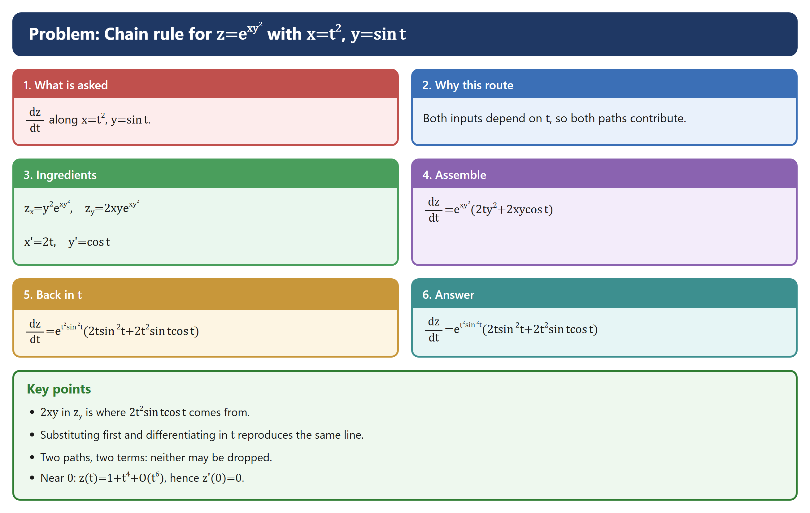

**What is asked**

$$z=e^{xy^{2}},\qquad x=t^{2},\ y=\sin t$$

Find $\frac{dz}{dt}$.

**Why this route**

Both $x,y$ are functions of $t$, so apply the chain rule from Case 1. To check the result independently, substitute first and then differentiate with respect to $t$.

**Step 1. Find the partial and ordinary derivatives**

$$\frac{\partial z}{\partial x}=y^{2}e^{xy^{2}},\quad\frac{\partial z}{\partial y}=2xy\,e^{xy^{2}},\quad\frac{dx}{dt}=2t,\quad\frac{dy}{dt}=\cos t$$

Each partial derivative of the exponential includes the derivative of its exponent as a factor.

**Step 2. Apply the chain rule**

$$\frac{dz}{dt}=y^{2}e^{xy^{2}}(2t)+2xy\,e^{xy^{2}}(\cos t)=e^{xy^{2}}\left(2ty^{2}+2xy\cos t\right)$$

The two terms come from the path through $x$ and the path through $y$, respectively.

**Step 3. Substitute $t$ and check the result**

$$\frac{dz}{dt}=e^{t^{2}\sin^{2}t}\left(2t\sin^{2}t+2t^{2}\sin t\cos t\right)$$

Substitute $z=e^{t^{2}\sin^{2}t}$ directly and differentiate with respect to $t$. The derivative of the exponent is $2t\sin^{2}t+t^{2}\cdot2\sin t\cos t$, which agrees with the formula above.

**Where the constant comes from**

The factor $2t$ comes from differentiating $x=t^{2}$, $\cos t$ comes from differentiating $y=\sin t$, and $2xy$ comes from $\frac{\partial}{\partial y}(xy^{2})=2xy$.

**Sanity check**

Substitute $x=t^{2}$ and $y=\sin t$, then expand to get $xy^{2}=t^{2}\sin^{2}t=t^{2}\left(t^{2}+O(t^{4})\right)=t^{4}+O(t^{6})$ and hence $z(t)=e^{t^{4}+O(t^{6})}=1+t^{4}+O(t^{6})$. Differentiating with respect to $t$ gives $z'(t)=4t^{3}+O(t^{5})$. At $t=0$, this is $0$, which agrees with the formula's $e^{0}(0+0)=0$. The single value $z(0)=1$ cannot establish that the function is constant nearby or has zero derivative there. To check the derivative, use the expansion or differentiate before substituting the point.

**Answer**

$$\frac{dz}{dt}=e^{t^{2}\sin^{2}t}\left(2t\sin^{2}t+2t^{2}\sin t\cos t\right)$$

**Common pitfall**

Omitting the path through $y$ leaves only the first term. Another mistake is to write $\frac{dy}{dt}$ as $-\cos t$. Add both terms and keep the signs from differentiating the original functions.

---

### Example E10 - total derivative with $y=\sin x$ (p.105)

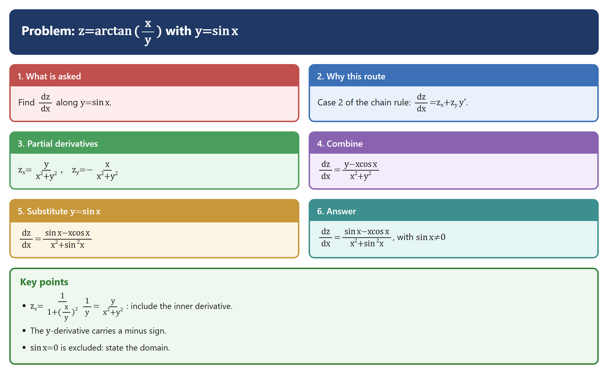

**What is asked**

$$z=\tan^{-1}\!\left(\frac{x}{y}\right),\qquad y=\sin x$$

Find $\frac{dz}{dx}$.

**Why this route**

Use Case 2 because $y$ depends on $x$. The chain rule makes the dependencies clearer. You can also substitute $z=\tan^{-1}(x/\sin x)$ before differentiating.

**Step 1. Find the partial derivatives**

$$\frac{\partial z}{\partial x}=\frac{1}{1+(x/y)^{2}}\cdot\frac{1}{y}=\frac{y}{x^{2}+y^{2}},\qquad\frac{\partial z}{\partial y}=\frac{1}{1+(x/y)^{2}}\cdot\left(-\frac{x}{y^{2}}\right)=-\frac{x}{x^{2}+y^{2}}$$

Use the inverse tangent derivative $\frac{d}{du}\tan^{-1}u=\frac{1}{1+u^{2}}$, then multiply by the derivative of its argument with respect to $x$ or $y$.

**Step 2. Apply the formula from Case 2**

$$\frac{dz}{dx}=\frac{y}{x^{2}+y^{2}}+\left(-\frac{x}{x^{2}+y^{2}}\right)\cos x=\frac{y-x\cos x}{x^{2}+y^{2}}$$

$\frac{dy}{dx}=\cos x$.

**Step 3. Substitute $y=\sin x$**

$$\frac{dz}{dx}=\frac{\sin x-x\cos x}{x^{2}+\sin^{2}x}$$

The domain requires $\sin x\neq0$ because the original expression $x/y$ is undefined at $y=0$.

**Where the constant comes from**

The numerator $\sin x-x\cos x$ comes from $y-x\cos x$. The denominator $x^{2}+\sin^{2}x$ comes from $x^{2}+y^{2}$. There are no extra coefficients.

**Sanity check**

At $x=\pi/2$, we have $y=1$ and $z=\tan^{-1}(\pi/2)$. The formula gives $\frac{1-(\pi/2)\cdot0}{(\pi/2)^{2}+1}=\frac{1}{\pi^{2}/4+1}>0$. As $x$ increases, $x/\sin x$ increases near $\pi/2$, so the inverse tangent also increases. The signs agree.

**Answer**

$$\frac{dz}{dx}=\frac{\sin x-x\cos x}{x^{2}+\sin^{2}x},\qquad\sin x\neq0$$

**Common pitfall**

The original expression is undefined at $\sin x=0$. Extending it to those points would require separate justification. Also check the minus sign in $\frac{\partial z}{\partial y}$.

---

### Example E11 - implicit differentiation from $z(x,y)=C$ (p.106)

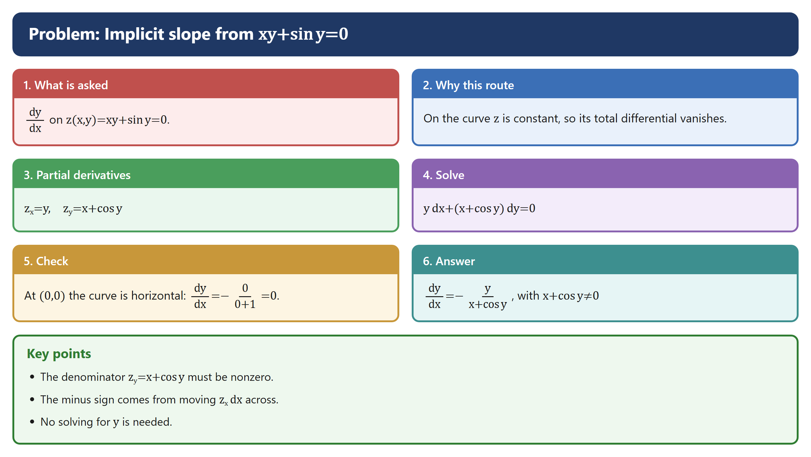

**What is asked**

$$z(x,y)=xy+\sin y=0$$

Find $\frac{dy}{dx}$.

**Why this route**

The expression $z$ is identically $0$, so its total differential is zero. Use Case 3 to solve for $\frac{dy}{dx}$.

**Step 1. Find the partial derivatives**

$$z_x=y,\qquad z_y=x+\cos y$$

The derivative of $xy$ with respect to $x$ is $y$, and with respect to $y$ it is $x$. The derivative of $\sin y$ with respect to $x$ is $0$, and with respect to $y$ it is $\cos y$.

**Step 2. Apply the formula from Case 3**

$$\frac{dy}{dx}=-\frac{z_x}{z_y}=-\frac{y}{x+\cos y}$$

The denominator must satisfy $x+\cos y\neq0$.

**Step 3. Check by implicit differentiation**

Treat $y$ as a function of $x$ and differentiate both sides of $xy+\sin y=0$ with respect to $x$.

$$\frac{d}{dx}\left(xy+\sin y\right)=y+x\frac{dy}{dx}+\cos y\,\frac{dy}{dx}=0.$$

This gives a linear equation in $\frac{dy}{dx}$. The first term $y$ comes from the product rule. Differentiating $x$ gives $1$, and $y$ stays as it is. The second term $x\frac{dy}{dx}$ comes from keeping $x$ and differentiating $y$. The third term $\cos y\frac{dy}{dx}$ comes from applying the chain rule to $\sin y$. Combine the two terms containing $\frac{dy}{dx}$ to get $(x+\cos y)\frac{dy}{dx}=-y$, then solve.

$$\frac{dy}{dx}=-\frac{y}{x+\cos y},$$

This agrees with Step 2.

**Where the constant comes from**

The minus sign comes from moving $z_x$ to the other side of the equation. The denominator $x+\cos y$ equals $z_y$.

**Sanity check**

Near the origin, when $x=0,y=0$, the equation holds and $\frac{dy}{dx}=-\frac{0}{0+1}=0$. This agrees with the curve being horizontal at the origin.

**Answer**

$$\frac{dy}{dx}=-\frac{y}{x+\cos y},\qquad x+\cos y\neq0$$

**Common pitfall**

The formula is undefined when the denominator is zero, so treat that case separately. Keep the minus sign.

---

## Formula card for 9.1-9.4

| Situation | Formula | Use or condition |
|---|---|---|
| Definition of a partial derivative | $f_x=\lim_{\delta x\to 0}\dfrac{f(x+\delta x,y)-f(x,y)}{\delta x}$ | Hold the other variable fixed (Eq. 9.1, p.96). |
| Higher order and mixed partials | $f_{xx}=(f_x)_x$, $f_{xy}=(f_x)_y$ | The mixed partials agree when they are continuous (Clairaut's theorem). |
| Total differential | $dz=z_x\,dx+z_y\,dy$ | Exact linear part (Eq. 9.5, p.99-100). |
| Finite change | $\Delta z\approx dz$ | First-order estimate at a point of differentiability, with a second-order remainder. |
| Three variables | $dz=z_x\,dx+z_y\,dy+z_t\,dt$ | Hold the other two variables fixed for each partial (Eq. 9.6, p.102). |
| Signed relative error | $\dfrac{\Delta z}{z}\approx\dfrac{x z_x}{z}\dfrac{\Delta x}{x}+\dfrac{y z_y}{z}\dfrac{\Delta y}{y}$ | Requires $z\neq0$. |
| Error bound | $\lvert dz\rvert\le\lvert z_x\rvert\varepsilon_x+\lvert z_y\rvert\varepsilon_y$ | When input bounds such as $\lvert dx\rvert\le\varepsilon_x$ are known, this is a first-order estimate. It does not give a strict bound. |
| 9.4.1 | $\dfrac{dz}{dt}=z_x\,x'(t)+z_y\,y'(t)$ | Both inputs vary with $t$ (Eq. 9.8, p.103-104). |
| 9.4.2 | $\dfrac{dz}{dx}=z_x+z_y\,y'(x)$ | One input depends on the other (Eq. 9.10-9.11, p.104-105). |
| 9.4.3 | $\dfrac{dy}{dx}=-\dfrac{z_x}{z_y}$ | On $z(x,y)=C$, requires $z_y\neq0$ (Eq. 9.12, p.105-106). |

## Quick check (answers below)

1. For $f=e^{x^{2}y}$, why does $f_{xx}(0,y)=2y$ hold in place of $0$?
2. Why does the existence of both partial derivatives fail to guarantee a tangent plane?
3. For $I=\tfrac12Ma^{2}$, the relative errors in $M$ and $a$ are $+0.1\%$ and $-0.2\%$, respectively. Why is the relative error in $I$ estimated as $-0.3\%$ instead of $-0.1\%$?
4. Given $z^{2}=x^{2}+2y$, $x=3,y=4$ and a change of $+1\%$ in each input, why does the absolute change in $z$ have two possible signs while the relative change has one?
5. For $z=\arctan(x/y)$ and $y=\sin x$, why does the expression for $dz/dx$ require $\sin x\neq0$?

**Answers**

1. Hold $y$ fixed and expand $e^{x^{2}y}=1+yx^{2}+O(x^{4})$. The quadratic coefficient is $y$, so the second derivative with respect to $x$ at $x=0$ is $2y$. Constancy along the line $x=0$ only shows that the partial derivatives with respect to $y$ are zero.
2. A tangent plane requires $f$ to be differentiable, meaning $\Delta f=f_x\Delta x+f_y\Delta y+o(\sqrt{\Delta x^{2}+\Delta y^{2}})$. Two partial derivatives give only the slopes in the coordinate directions. The condition $C^{1}$, which gives continuous partials, guarantees differentiability.
3. The exponent of $a$ is $2$, so the relative error has weight $2$, giving $0.1\%+2(-0.2\%)=-0.3\%$. A weight of $1$ would give the wrong result.
4. The two branches of $z=\pm\sqrt{17}$ are $dz=(x\,dx+dy)/z$. When $z$ changes sign, $dz$ does too. In $dz/z$, the numerator and denominator both change sign, so the relative change $0.13/17\approx0.764706\%$ is independent of the branch.
5. The term $x/y$ in the original expression requires $y=\sin x\neq0$. The derivative expression $\dfrac{\sin x-x\cos x}{x^{2}+\sin^{2}x}$ is undefined at $\sin x=0$. An extension to those points would need separate justification.

## Scope of this note

These notes cover sections **9.1-9.4** of the handout (printed pages 94-106, PDF pages 103-115). They cover functions of several variables and partial derivatives, higher order and mixed partials, small changes and the total differential, and total derivatives and the chain rule (9.4.1 $x(t),y(t)$, 9.4.2 $y(x)$, 9.4.3 $z(x,y)=C$). All examples E1-E11 come from the handout. Headings label material outside the handout as "supplementary".

These notes end before section 9.5. Later batches will add the remaining sections to this file.

**Self-check.** Run python _tools/check_math_style.py, python _tools/check_example_depth.py and python _tools/check_note_links.py in that order. Each should print RESULT PASS. The poster for each example is in figures/, with its filename listed in the coverage map. The scripts check format and structure. Use the independent check in the fifth part of each example above to verify the mathematics.
