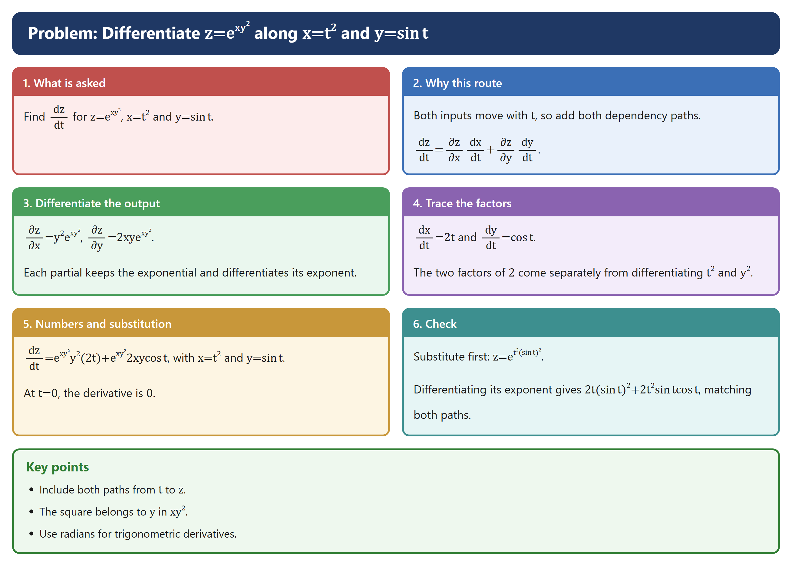
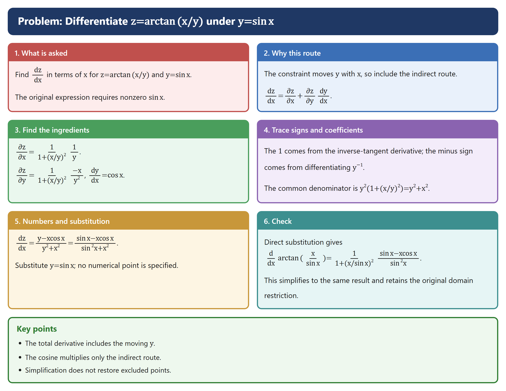
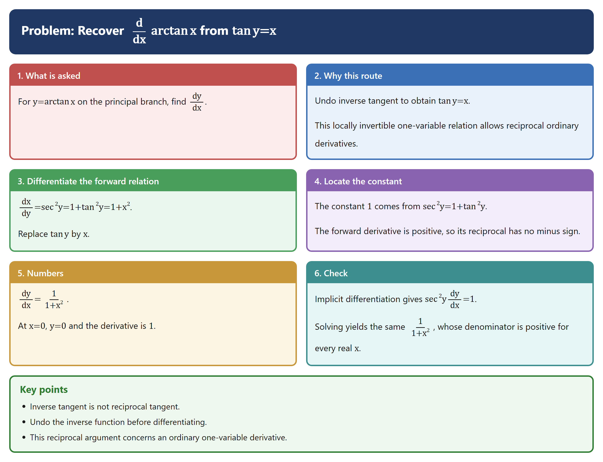
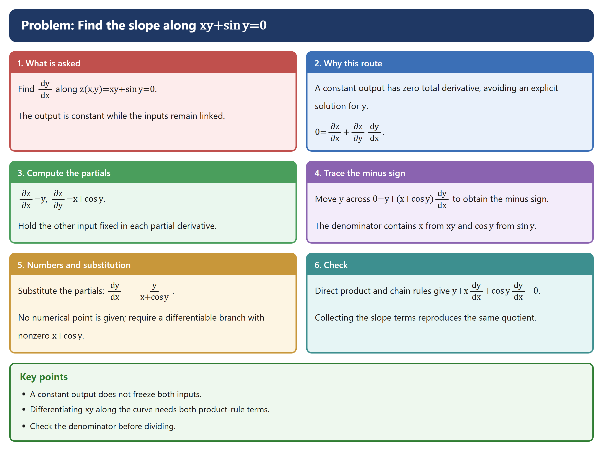
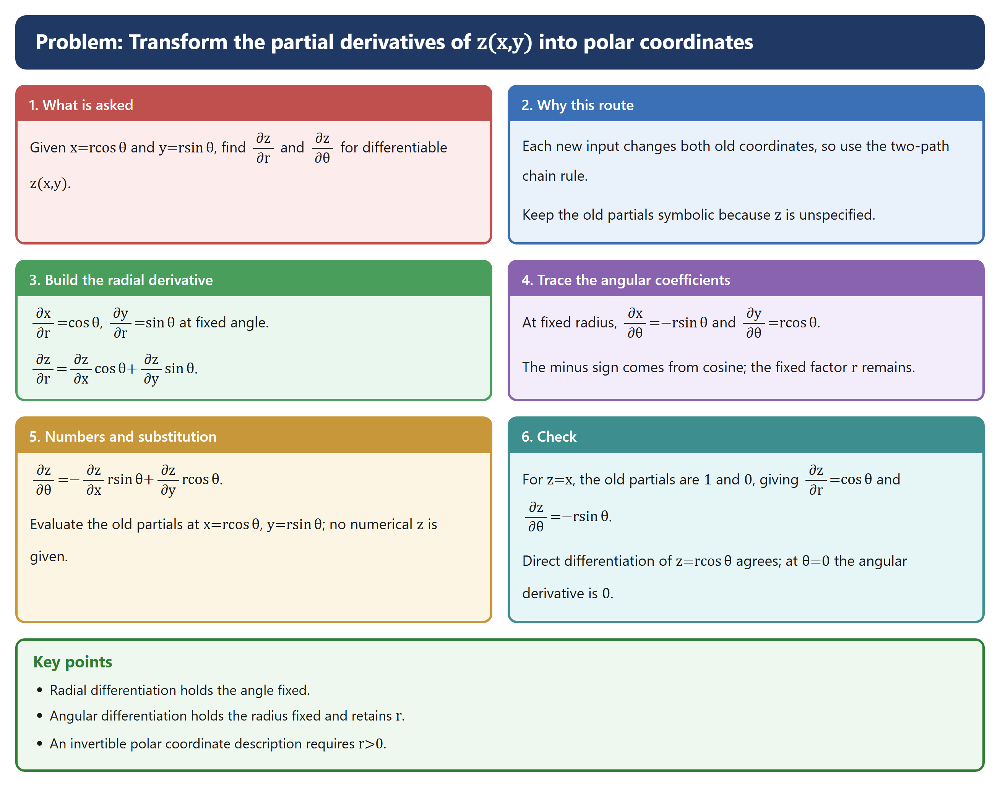
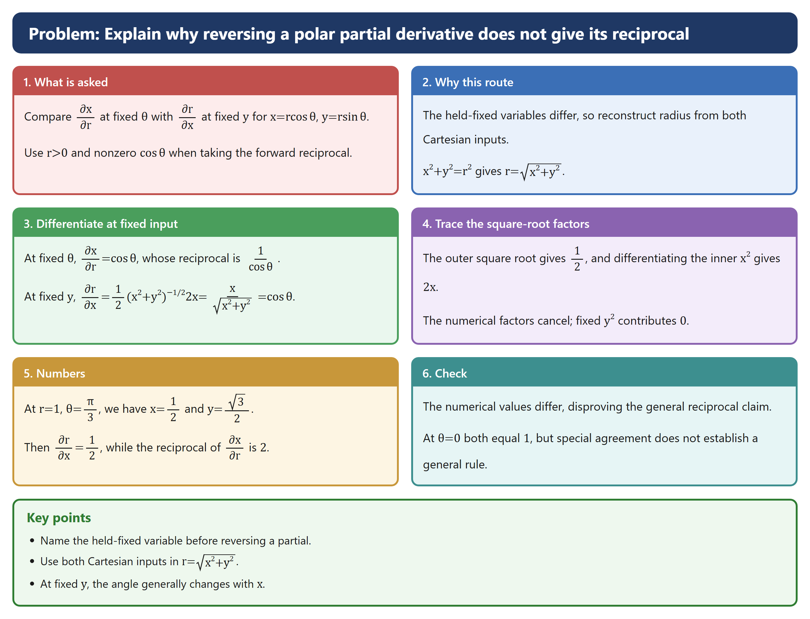
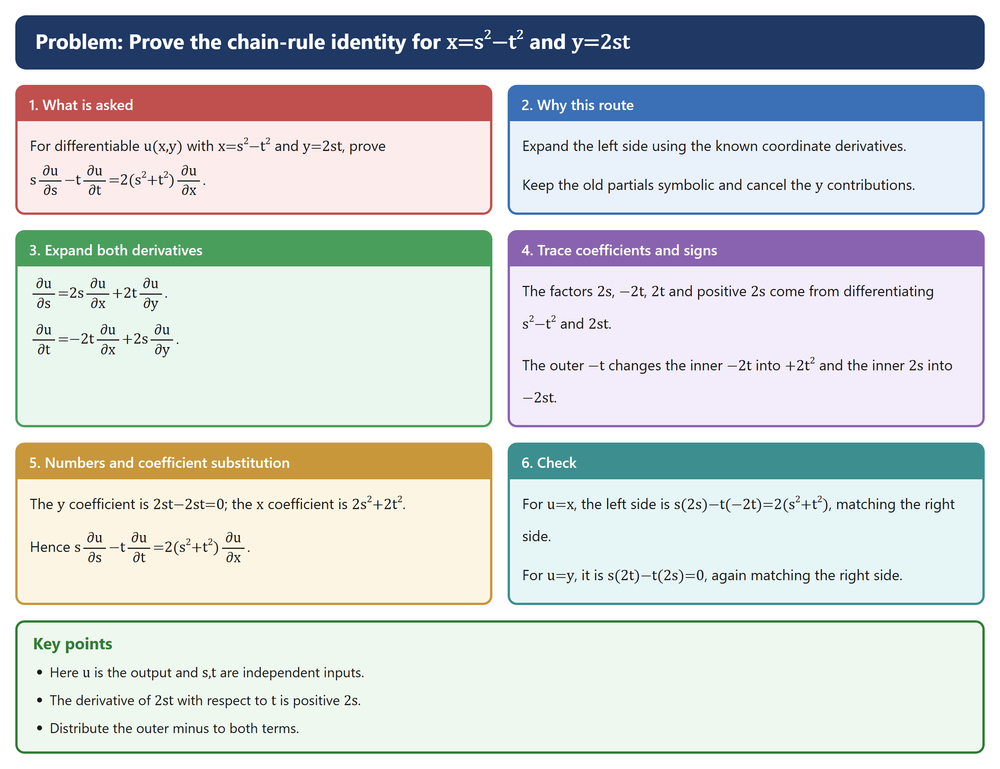
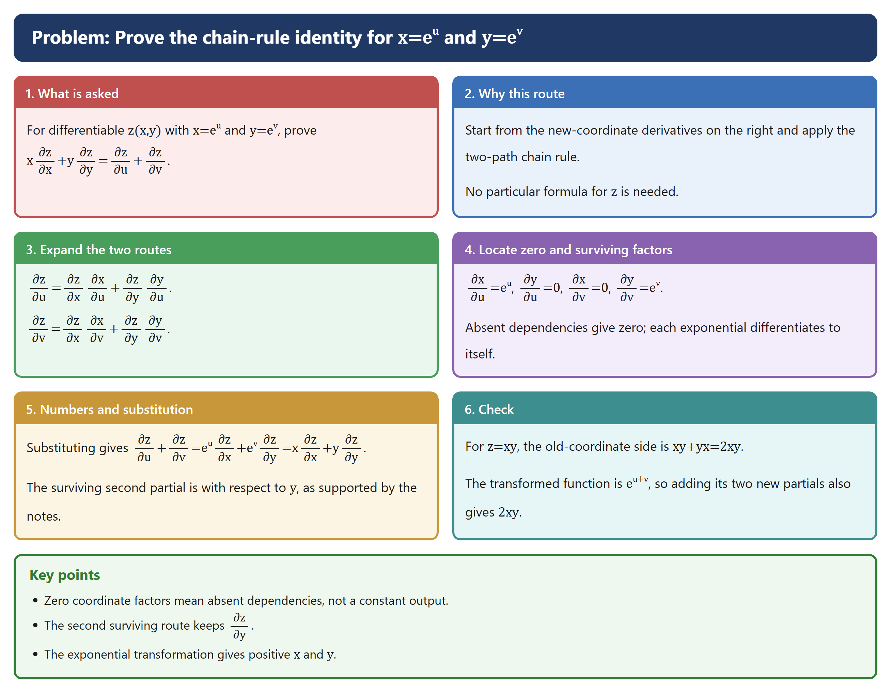

# Total Derivatives and Change of Variables

Course: MECH40008 Mathematics and Computing 1. Date: 17 November 2026. Recording title: ME MECH40008 - Mathematics and Computing 1 CAGB-02-200 2026-11-17. Handout: ME1 Mathematics Lecture Notes, Autumn Term, Prof Dan Balint, sections 9.4-9.5.

Duration: the Panopto session lasts 55:23, which is the time base used for every timestamp below. The screen-capture video itself runs slightly longer (about 59:57) and keeps recording after the lesson; its last page with any mathematics is the one at 52:50, written on the board as END LECTURE 19. The lecture speech is delivered between about 02:06 and 51:06.

Panopto recording: [Open the recording](https://imperial.cloud.panopto.eu/Panopto/Pages/Viewer.aspx?id=aaf91870-ada8-4949-8723-b4b4017b4787). The timestamps below follow the supplied transcript and frame list; small differences between them have not been silently corrected.

Sources: automatic English captions, all 33 supplied full-size frames in chronological order, and the handout text. Equations were transcribed from the frames; steps that are not fully visible in a frame were checked against the teacher's speech. The damaged handout extraction was used only for wording and section names. Editorial explanations, domain conditions, and independent checks are identified as additions; they are not quotations.

This lecture starts new material at Case 2 of section 9.4. Case 1 is a short review of the previous lecture. The notes retain that review because it explains the common starting point. The later "No Signal" frame and the two CIVE50010 Structural Mechanics 2 frames are excluded from the mathematics content.

## What this lecture is about

A quantity can change through more than one input. If you move along a prescribed path, both inputs may change together, so looking at only one partial derivative misses part of the change. The chain rule adds the contributions of all the paths through which the change reaches the output.

We first handle an explicit relation between two inputs, then a relation given by a constant-value equation. We then replace the old inputs by two new coordinates and learn why reversing the direction of a partial derivative usually does not mean taking its reciprocal.

## 1. Read the symbols and recover the common starting point (02:18-05:15; 05:21-06:26)

Write $z=z(x,y)$, read "z is a function of x and y". The letters $x$ and $y$ are inputs and $z$ is the output; they are variables unless a derivative tells us to hold one fixed. A **function** is a rule that assigns exactly one output to each allowed input. A **constraint** is an extra rule that limits which input pairs may occur.

The symbol $d$ is read "d" and belongs to an ordinary derivative such as $dy/dx$: the rate of change of $y$ as one independent variable $x$ changes. The symbol $\partial$ is read "partial"; $\partial z/\partial x$ means the rate of change of $z$ with respect to $x$, with $y$ held fixed. A **partial derivative** changes one input while holding the other independent input fixed. "Held fixed" describes this one calculation; it does not make that input a constant.

The handwritten symbol $\delta$, read "delta", denotes a small but finite change: $\delta x$, $\delta y$, and $\delta z$ are changes in the corresponding quantities. The sign $\approx$ means "approximately equal". The teacher's common starting point is the **total differential** idea: add the first-order contributions from the two input changes. For finite changes, the following is an approximation.

$$
\delta z \approx \frac{\partial z}{\partial x}\delta x+\frac{\partial z}{\partial y}\delta y
$$

Each product means "sensitivity times input change". Both partial derivatives are evaluated at the same starting input pair. For example, if only $x$ moves and $\delta y=0$, the second contribution vanishes. This is a minimal reading example of the displayed formula, not an extra exercise from the lecture.

Editorial condition: the underlying function must be differentiable at the point; merely having separate partial derivatives is not enough to justify every first-order approximation. A **limit** describes what a quantity approaches as an increment tends to zero. The symbol $\to$ means "tends to". Passing to the appropriate limit turns the change ratio into an exact derivative.

A **total derivative** is the rate of change after all specified dependencies are included. The **chain rule** computes a derivative through intermediate variables: multiply the rates along each dependency path, then add the paths. These lecture examples have no stated physical units; in an application, each term must have the units of the output divided by those of the final independent variable.

Principle recap: The same first-order change formula supports all three cases.

Pitfalls: Do not confuse $d$, $\partial$, and $\delta$, or replace a finite-change approximation by an exact equality.

Memory tip: First ask which inputs are allowed to move together.

## 2. Case 1 review: one parameter controls both inputs (02:49-05:15; 15:30-15:43)

Here $t$, read "t", is a **parameter**: a variable that specifies where we are along a path. It need not be time. We are given $x=x(t)$ and $y=y(t)$, so changing $t$ moves both inputs. In the $x$-$y$ plane, the pair traces a path; the total derivative measures how quickly the height $z$ of the surface changes along that specified motion.

$$
\frac{dz}{dt}=\frac{\partial z}{\partial x}\frac{dx}{dt}+\frac{\partial z}{\partial y}\frac{dy}{dt}
$$

The first term follows $t$ through $x$ to $z$; the second follows $t$ through $y$ to $z$. The partial derivatives describe the original two-input function and are then evaluated at $x(t),y(t)$. If only one intermediate input exists, the familiar one-variable rule is recovered.

$$
\frac{dz}{dt}=\frac{dz}{dx}\frac{dx}{dt}
$$

### Example 1. Revisit the previous lecture's exponential example (04:59-05:15; 15:30-15:43)

**What is asked**

The review frame gives $z=e^{xy^{2}}$, $x=t^{2}$, and $y=\sin t$. Find $dz/dt$. The number $e$ is the fixed base of the natural exponential function; $e$ raised to a quantity means the exponential of that quantity. The argument $xy^{2}$ means $x$ multiplied by the square of $y$. The function $\sin$ is read "sine". Angles in derivatives of trigonometric functions are in radians.

**Why this route**

There are two dependency paths from $t$ to $z$, so Case 1 applies. Direct substitution is also valid, but the term-by-term chain-rule method makes the two contributions visible. This is review material, not the starting point of today's new Case 2 work.

**Step 1**

$$
\frac{\partial z}{\partial x}=y^{2}e^{xy^{2}},\frac{\partial z}{\partial y}=2xye^{xy^{2}}
$$

This step obtains the two sensitivities of $z$. The exponential function is unchanged by differentiation; by the chain rule it is multiplied by the derivative of its exponent. Differentiating the exponent $xy^{2}$ with respect to $x$, holding $y$ fixed, gives $y^{2}$; differentiating it with respect to $y$, holding $x$ fixed, gives $2xy$.

**Step 2**

$$
\frac{dx}{dt}=2t,\frac{dy}{dt}=\cos t
$$

This step obtains the two input rates. The **power rule** moves a constant exponent to the front as a multiplier and reduces the exponent by one; it differentiates $t^{2}$ to $2t$. The derivative of sine is cosine, written $\cos$.

**Step 3**

$$
\frac{dz}{dt}=e^{xy^{2}}y^{2}(2t)+e^{xy^{2}}2xy\cos t
$$

This step combines the two paths. Here $x=t^{2}$ and $y=\sin t$ still apply; if a formula involving only $t$ is wanted, replace every $x$ and $y$ by those expressions. Keeping them here matches the visible review calculation.

**Where the constant comes from**

The factor $2$ in $2t$ comes from differentiating the square of $t$. The factor $2$ in $2xy$ comes separately from differentiating the square of $y$. They arise in different derivatives; neither is an extra factor inserted into the whole formula.

**Sanity check**

Editorial independent check: substitute first to obtain $z=e^{t^{2}(\sin t)^{2}}$. The **product rule** differentiates a product by differentiating each factor in turn and adding the two resulting products. Apply it to the exponent $t^{2}(\sin t)^{2}$, using the chain rule for $(\sin t)^{2}$; this gives $2t(\sin t)^{2}+2t^{2}\sin t\cos t$. Multiplying by the exponential matches Step 3 after substitution. At $t=0$ both routes give zero.

**Answer**

$$
\frac{dz}{dt}=e^{xy^{2}}y^{2}(2t)+e^{xy^{2}}2xy\cos t,x=t^{2},y=\sin t
$$

**Pitfalls**

Using only the $x$ path omits the entire second term. Reading the exponent as $x^{2}y$ changes the original problem. Memory tip: the square belongs to $y$, and both $x$ and $y$ move with $t$.

Principle recap: Multiply along each path from the parameter and add the paths.

Pitfalls: Do not hold $y$ fixed when calculating the total derivative along the given motion.

Memory tip: One parameter, two routes, one total rate.

## 3. Case 2: one input depends on the other (05:15-10:17; 11:27-15:54)

Now $y=y(x)$ is specified. Increasing $x$ affects $z$ directly through its first input and indirectly by moving $y$. A partial derivative fixes $y$; the required total derivative follows the specified curve where $y$ also moves. This is why these two derivatives answer different questions.

$$
\frac{dz}{dx}=\frac{\partial z}{\partial x}\frac{dx}{dx}+\frac{\partial z}{\partial y}\frac{dy}{dx}=\frac{\partial z}{\partial x}+\frac{\partial z}{\partial y}\frac{dy}{dx}
$$

The factor $dx/dx$ is $1$: a unit change in the input $x$ is a unit change in itself. To recover this rule from the small-change formula, use the approximation $\delta y\approx(dy/dx)\delta x$, divide by the nonzero increment $\delta x$, and then let that increment tend to zero. Do not substitute zero into a denominator before taking the limit.

### Example 2. Differentiate an inverse tangent under a sine constraint (08:45-10:17; 11:27-15:25)

**What is asked**

Given $z=\arctan(x/y)$ and $y=\sin x$, find $dz/dx$ as a function of $x$ only. The **inverse tangent** $\arctan$ returns the principal angle whose tangent equals its input. The handout's $\tan^{-1}$ means inverse tangent, not $1/\tan$. Editorial domain condition: $y$ cannot be zero, so the given composite expression requires $\sin x$ to be nonzero.

**Why this route**

The constraint has the exact form $y=y(x)$, so Case 2 separates the direct and indirect effects. Direct substitution also works, but then the derivative of $x/\sin x$ needs the quotient rule. The teacher later uses that second route as an independent check. The derivative of inverse tangent is derived in Example 3.

**Step 1**

$$
\frac{\partial z}{\partial x}=\frac{1}{1+(x/y)^{2}}\frac{1}{y},\frac{\partial z}{\partial y}=\frac{1}{1+(x/y)^{2}}\frac{-x}{y^{2}},\frac{dy}{dx}=\cos x
$$

This step obtains all three ingredients. For the first partial derivative, $y$ is fixed and the derivative of $x/y$ is $1/y$. For the second, $x$ is fixed and the derivative of $xy^{-1}$ is $-xy^{-2}$. Each is multiplied by the outer inverse-tangent derivative.

**Step 2**

$$
\frac{dz}{dx}=\frac{1}{y}\frac{1}{1+(x/y)^{2}}-\frac{x}{y^{2}}\frac{1}{1+(x/y)^{2}}\cos x
$$

This step inserts the ingredients into Case 2. The cosine belongs only to the route through $y$, because it is the derivative of $y(x)$.

**Step 3**

$$
\frac{dz}{dx}=\frac{y-x\cos x}{y^{2}+x^{2}}=\frac{\sin x-x\cos x}{\sin^{2}x+x^{2}}
$$

This step combines the fractions and removes $y$. The common denominator is $y^{2}(1+(x/y)^{2})=y^{2}+x^{2}$. The first numerator becomes $y$, while the second is $-x\cos x$. Finally replace $y$ by $\sin x$.

**Where the constant comes from**

The $1$ in $1+(x/y)^{2}$ comes from the derivative of inverse tangent. The minus sign comes from differentiating $y^{-1}$: its exponent $-1$ moves to the front and the exponent becomes $-2$. The cosine comes from differentiating $\sin x$, not from the inverse tangent itself.

**Sanity check**

$$
\frac{d}{dx}\arctan\left(\frac{x}{\sin x}\right)=\frac{1}{1+(x/\sin x)^{2}}\frac{\sin x-x\cos x}{\sin^{2}x}
$$

This is the teacher's direct-substitution check. The **quotient rule** differentiates a ratio by taking "denominator times derivative of numerator, minus numerator times derivative of denominator", divided by the denominator squared. Cancelling the sine-squared factor gives Step 3. Editorial point check: at $x=\frac{\pi}{2}$, where $\pi$ is the fixed circle constant "pi", the numerator is $1$ and both routes give $1/(1+\pi^{2}/4)$.

**Answer**

$$
\frac{dz}{dx}=\frac{\sin x-x\cos x}{\sin^{2}x+x^{2}}
$$

The answer applies wherever the original expression is defined, so $\sin x$ must be nonzero. Algebraic simplification does not automatically add excluded points back into the original function.

**Pitfalls**

Dropping the indirect term gives the incorrect result $y/(y^{2}+x^{2})$. Omitting the negative sign changes the numerator to $\sin x+x\cos x$. Memory tip: write the Case 2 rule before calculating its three ingredients.

Principle recap: The total derivative includes the direct effect of $x$ and its indirect effect through $y(x)$.

Pitfalls: A total derivative along a curve is not generally the partial derivative with $y$ fixed.

Memory tip: Direct contribution plus the contribution through $y$.

## 4. A short detour: recover the inverse-tangent derivative (10:17-11:27)

An inverse function reverses a one-input relation. If you forget the derivative of inverse tangent, apply tangent to undo the inverse function, then differentiate the ordinary relation. In the next example, $x$ and $y$ are local symbols for this short derivation; $y$ does not mean the earlier constraint $\sin x$.

### Example 3. Recover the derivative of inverse tangent (10:23-11:17)

**What is asked**

Let $y=\arctan x$. Find $dy/dx$. The function $\tan$ is tangent; $\sec$ is secant, meaning $1/\cos$ wherever cosine is nonzero. We use the principal branch of inverse tangent, where tangent is locally invertible.

**Why this route**

Taking tangent of both sides removes the inverse tangent. The teacher differentiates $x$ with respect to $y$ and then takes the reciprocal; direct implicit differentiation would also work. This reciprocal step concerns a locally invertible one-variable relation, not arbitrary partial derivatives.

**Step 1**

$$
\tan y=x
$$

This step recovers a relation involving the ordinary tangent function. The output $y$ is now the angle whose tangent is $x$.

**Step 2**

$$
\frac{dx}{dy}=\sec^{2}y=1+\tan^{2}y=1+x^{2}
$$

This step obtains the forward rate from angle $y$ to value $x$. The derivative of tangent is secant squared; the trigonometric identity changes it to $1+\tan^{2}y$, and Step 1 replaces tangent by $x$.

**Step 3**

$$
\frac{dy}{dx}=\frac{1}{1+x^{2}}
$$

This step takes the reciprocal of the ordinary one-variable derivative $dx/dy$. The denominator $1+x^{2}$ is positive for every real $x$, so the reciprocal is well defined.

**Where the constant comes from**

The constant $1$ is supplied by the identity $\sec^{2}y=1+\tan^{2}y$. It is not an integration constant. There is no minus sign because the derivative of $\tan y$ with respect to $y$ is $\sec^{2}y$, which is positive.

**Sanity check**

Editorial independent check using the teacher's alternative: differentiate $\tan y=x$ with respect to $x$ to get $\sec^{2}y(dy/dx)=1$. Solving gives the same result without first computing the inverse rate. At $x=0$, $y=0$ and the derivative is $1$.

**Answer**

$$
\frac{d}{dx}\arctan x=\frac{1}{1+x^{2}}
$$

**Pitfalls**

Do not interpret inverse tangent as the reciprocal of tangent, and do not carry this reciprocal-derivative argument into a two-variable partial derivative without checking what stays fixed. Memory tip: undo the inverse function before differentiating.

Principle recap: Recover the derivative from an ordinary relation whose derivative is known.

Pitfalls: The inverse-function notation and reciprocal notation mean different operations.

Memory tip: Tangent first, differentiation second.

## 5. Case 3: stay on a constant-value curve (16:03-24:14)

Now the constraint is $z(x,y)=C$, where $C$, read "C", is a constant. A **level curve** is a set of input pairs producing the same output. Moving along it may change $x$ and $y$, but not $z$. This implicitly relates the two inputs. **Implicit differentiation** differentiates that relation without first solving it explicitly for one input.

$$
0=\frac{\partial z}{\partial x}+\frac{\partial z}{\partial y}\frac{dy}{dx}
$$

Along a level curve the output does not change, so the small change of $z$ is zero: $\delta z=0$. Substituting into the total differential gives $0\approx\frac{\partial z}{\partial x}\delta x+\frac{\partial z}{\partial y}\delta y$. Dividing by the nonzero increment $\delta x$ and letting it tend to zero turns the approximation into the exact statement below. The zero is the derivative of the constant output, not a claim that both partial derivatives are zero. Rearranging gives the slope of the constrained curve. Editorial condition: these quotient formulas require a differentiable local branch and a nonzero denominator.

$$
\frac{dy}{dx}=-\frac{\partial z/\partial x}{\partial z/\partial y},\frac{dx}{dy}=-\frac{\partial z/\partial y}{\partial z/\partial x}
$$

The first quotient requires $\partial z/\partial y$ to be nonzero; the second requires $\partial z/\partial x$ to be nonzero. If both relevant ordinary derivatives exist and are nonzero on the same local branch, $dy/dx$ and $dx/dy$ are reciprocals of each other. If a denominator is zero, the formula cannot be applied, and it says nothing about whether a finite slope exists there.

Editorial clarification on rigour: a finite small-change expression still neglects a higher-order remainder. The exact zero-derivative equation above follows after taking the limit, or by using exact differentials. The derivation above starts from a finite-increment approximation, so reading that approximation as an exact equality would overstate its accuracy.

### Example 4. Differentiate a constant-value constraint (20:02-24:07)

**What is asked**

Given $z(x,y)=xy+\sin y=0$, find $dy/dx$ along the curve defined by this equation. The zero is the chosen constant value of $z$; it does not say that $x$ or $y$ must both be zero.

**Why this route**

The equation has the form $z(x,y)=C$, so the Case 3 quotient avoids solving explicitly for $y$. Direct implicit differentiation is also valid and will check the result. A bare partial derivative cannot give the curve's slope because it holds the other input fixed.

**Step 1**

$$
\frac{\partial z}{\partial x}=y,\frac{\partial z}{\partial y}=x+\cos y
$$

This step obtains the two partial derivatives. Holding $y$ fixed makes $xy$ differentiate to $y$ and $\sin y$ to zero. Holding $x$ fixed makes the two terms differentiate to $x$ and $\cos y$.

**Step 2**

$$
\frac{dy}{dx}=-\frac{y}{x+\cos y}
$$

This step inserts the partial derivatives into the Case 3 formula. The quotient is valid on a differentiable branch where $x+\cos y$ is nonzero.

**Where the constant comes from**

The minus sign comes from moving $\partial z/\partial x$ to the other side of the zero-derivative equation. The $x$ in the denominator comes from differentiating $xy$ with respect to $y$; the cosine comes from differentiating $\sin y$. The right-hand constant $0$ differentiates to $0$.

**Sanity check**

$$
y+x\frac{dy}{dx}+\cos y\frac{dy}{dx}=0
$$

This is the teacher's direct implicit-differentiation check. The **product rule** differentiates a product by differentiating the first factor and keeping the second, then keeping the first and differentiating the second. Thus $xy$ contributes $y+x(dy/dx)$, and the chain rule makes $\sin y$ contribute $\cos y(dy/dx)$. Collecting the two derivative terms recovers Step 2. Editorial point check: at $(x,y)=(0,0)$ the constraint holds and the formula gives slope zero, consistent with the solution branch $y=0$.

**Answer**

$$
\frac{dy}{dx}=-\frac{y}{x+\cos y}
$$

**Pitfalls**

Differentiating $xy$ as only $x(dy/dx)$ omits the $y$ term and may lead to the incorrect conclusion that the slope is always zero. Replacing $\cos y$ by $\cos x$ differentiates the wrong function. Memory tip: the constant fixes the output, while the inputs remain linked and may both move.

Principle recap: A constant output has zero total derivative along its level curve.

Pitfalls: Do not divide by a zero partial derivative or interpret zero total change as zero individual effects.

Memory tip: The two input effects balance each other.

## 6. Change of variables: two new independent inputs (24:50-27:41)

A **change of variables** describes the same output using a new set of inputs. Now $u$ and $v$, read "u" and "v", are new independent variables, with $x=x(u,v)$ and $y=y(u,v)$. In general, $x$ and $y$ both depend on $u$ and $v$ and are not constants. To find how $z$ changes with $u$, hold $v$ fixed; to find how it changes with $v$, hold $u$ fixed.

$$
\frac{\partial z}{\partial u}=\frac{\partial z}{\partial x}\frac{\partial x}{\partial u}+\frac{\partial z}{\partial y}\frac{\partial y}{\partial u}
$$

$$
\frac{\partial z}{\partial v}=\frac{\partial z}{\partial x}\frac{\partial x}{\partial v}+\frac{\partial z}{\partial y}\frac{\partial y}{\partial v}
$$

For the first formula, the coordinate derivatives with respect to $u$ hold $v$ fixed; for the second they hold $u$ fixed. The original partial $\partial z/\partial x$ still holds the original input $y$ fixed, while $\partial z/\partial y$ holds the original input $x$ fixed. These are different stages in the same calculation, so the held-fixed variable is not identical in every factor.

As a minimal special case, if $y$ contains only $v$ and has no $u$ dependence, then $\partial y/\partial u=0$ and the second route in the first formula disappears. This does not make the formula inapplicable; it makes it simpler. The last example of the lecture uses exactly this idea.

Principle recap: The extended chain rule includes one route through each old input.

Pitfalls: Do not replace both old partial derivatives by a single one just because the output is now described using new variables.

Memory tip: Choose the new input, freeze its partner, then follow every route.

## 7. Polar coordinates as a change of variables (27:47-31:23)

**Cartesian coordinates** give horizontal and vertical positions $x$ and $y$. **Polar coordinates** describe the same point using radius $r$, read "r", and angle $\theta$, read "theta". Radius is the distance from the origin, conventionally nonnegative; the angle is measured in radians. Changing the radius while holding the angle fixed moves the point along a ray; changing the angle while holding a positive radius fixed moves it around a circle.

### Example 5. Convert the derivative rules to polar coordinates (27:47-31:23)

**What is asked**

For any differentiable $z=z(x,y)$, use $x=r\cos\theta$ and $y=r\sin\theta$ to find $\partial z/\partial r$ and $\partial z/\partial\theta$. The function $z$ is deliberately unspecified: the requested answers are general rules containing its old partial derivatives.

**Why this route**

Both old coordinates depend on the two new coordinates, exactly as in section 6. We cannot calculate numerical values for the old partials without a particular $z$, but we can calculate all coordinate derivatives. Direct substitution becomes possible only after a particular $z$ is supplied.

**Step 1**

$$
\frac{\partial x}{\partial r}=\cos\theta,\frac{\partial y}{\partial r}=\sin\theta
$$

This step obtains the coordinate rates for radial motion. The angle is fixed, so cosine and sine are constants in this calculation, and the derivative of $r$ with respect to itself is $1$.

**Step 2**

$$
\frac{\partial z}{\partial r}=\frac{\partial z}{\partial x}\cos\theta+\frac{\partial z}{\partial y}\sin\theta
$$

This step adds the two coordinate contributions for radial motion. The old partials are evaluated at the point $x=r\cos\theta$, $y=r\sin\theta$.

**Step 3**

$$
\frac{\partial x}{\partial\theta}=-r\sin\theta,\frac{\partial y}{\partial\theta}=r\cos\theta
$$

This step obtains the coordinate rates for angular motion. Radius is fixed; differentiating cosine gives negative sine, and differentiating sine gives cosine.

**Step 4**

$$
\frac{\partial z}{\partial\theta}=-\frac{\partial z}{\partial x}r\sin\theta+\frac{\partial z}{\partial y}r\cos\theta
$$

This step adds the two contributions for angular motion. It is a change per radian, while the radial derivative is a change per unit of radius.

**Where the constant comes from**

The minus sign comes only from differentiating cosine. The factor $r$ remains because it is held fixed during angular differentiation. There is no factor $r$ in Step 1, because differentiating $r$ with respect to $r$ gives $1$.

**Sanity check**

Editorial independent check with the simplest test function, $z=x$: its old partials are $1$ and $0$. The two rules give $\partial z/\partial r=\cos\theta$ and $\partial z/\partial\theta=-r\sin\theta$. Directly differentiating $z=r\cos\theta$ gives the same pair. At angle zero, a small angular move has no first-order effect on the horizontal coordinate, consistent with the angular answer being zero.

**Answer**

$$
\frac{\partial z}{\partial r}=\frac{\partial z}{\partial x}\cos\theta+\frac{\partial z}{\partial y}\sin\theta
$$

$$
\frac{\partial z}{\partial\theta}=-\frac{\partial z}{\partial x}r\sin\theta+\frac{\partial z}{\partial y}r\cos\theta
$$

**Pitfalls**

Forgetting the factor $r$ makes the angular formula wrong. Holding $x$ fixed instead of $r$ while computing the angular coordinate derivatives changes the question. Editorial caveat: at $r=0$ the angle is not a unique coordinate, so statements needing an invertible polar coordinate system require $r>0$. Memory tip: radius means move out; angle means move around.

Principle recap: The coordinate transformation supplies the weights for the old partial derivatives.

Pitfalls: Always say whether radius or angle is fixed.

Memory tip: Outward uses cosine and sine; turning keeps the radius factor.

## 8. Why partial derivatives usually cannot be inverted one by one (31:37-37:45)

The **reciprocal rule** for ordinary inverse derivatives works when we reverse the same locally invertible one-variable relation and the derivative is nonzero. With coordinate changes, reversing one displayed partial derivative may also change which other variable is held fixed. That changes the motion being measured, so the ordinary reciprocal argument no longer applies.

$$
\frac{dr}{dx}=\left(\frac{dx}{dr}\right)^{-1}
$$

Here the superscript $-1$ means reciprocal of the entire derivative; it is not inverse-function notation. The displayed rule is the one-variable rule. The following example shows why the visually similar partial-derivative claim fails in general. "Fails in general" does not mean "unequal at every possible point".

### Example 6. Compare the two radial partial derivatives (32:58-37:03)

**What is asked**

For $x=r\cos\theta$ and $y=r\sin\theta$, compare $\partial x/\partial r$ at fixed $\theta$ with $\partial r/\partial x$ at fixed $y$. Use $r>0$ for the inverse radial derivative. To discuss the reciprocal of the first partial, also require $\cos\theta$ to be nonzero.

**Why this route**

The two partials belong to different independent input pairs: $(r,\theta)$ and $(x,y)$. We must express $r$ in terms of the complete old pair $x,y$ before differentiating at fixed $y$. Taking a reciprocal would skip that dependency check.

**Step 1**

$$
\frac{\partial x}{\partial r}=\cos\theta,\left(\frac{\partial x}{\partial r}\right)^{-1}=\frac{1}{\cos\theta}
$$

This step obtains the forward partial and its reciprocal, both starting from a derivative at fixed angle. It has not yet calculated the derivative at fixed $y$.

**Step 2**

$$
x^{2}+y^{2}=r^{2},r=\sqrt{x^{2}+y^{2}}
$$

This step expresses radius using both Cartesian inputs. Squaring and adding the coordinate formulas uses $\cos^{2}\theta+\sin^{2}\theta=1$. The nonnegative square root is selected because radius is nonnegative.

**Step 3**

$$
\frac{\partial r}{\partial x}=\frac{1}{2}(x^{2}+y^{2})^{-1/2}2x=\frac{x}{\sqrt{x^{2}+y^{2}}}=\cos\theta
$$

This step differentiates with $y$ fixed. Apply the power rule to the outer square root and the chain rule to its inside. Since $r>0$, the square root of $r^{2}$ is $r$; substituting $x=r\cos\theta$ leaves cosine.

**Where the constant comes from**

The factor $\frac{1}{2}$ comes from writing the square root as power $\frac{1}{2}$. The factor $2x$ comes from differentiating $x^{2}$; the derivative of the fixed $y^{2}$ is zero. The two numerical factors multiply to $1$, leaving $x$ in the numerator.

**Sanity check**

Editorial numerical check: take a point with $r=1$ and $\theta=\frac{\pi}{3}$, so $x=\frac{1}{2}$ and $y=\frac{\sqrt{3}}{2}$. Step 3 gives $\partial r/\partial x=\frac{1}{2}$, whereas the reciprocal in Step 1 is $2$. They differ. When the angle is zero, both happen to equal $1$; that special agreement does not establish a general rule.

**Answer**

$$
\frac{\partial r}{\partial x}=\cos\theta,\left(\frac{\partial x}{\partial r}\right)^{-1}=\frac{1}{\cos\theta}
$$

The first partial holds $y$ fixed; the partial inside the reciprocal holds $\theta$ fixed. Their values are generally different. A reciprocal statement with the same held-fixed variable is a different question and can hold when the corresponding one-variable relation is invertible.

**Pitfalls**

The algebraic identity $r=x/\cos\theta$ is valid where cosine is nonzero. The mistake is differentiating it at fixed $y$ while pretending $\theta$ is fixed: in that calculation $\theta$ depends on $x$ and $y$. This wrong assumption gives $1/\cos\theta$ instead of $\cos\theta$. Memory tip: before reversing a partial derivative, name the variable that stays fixed on each side.

Principle recap: Changing the held-fixed variable changes the question.

Pitfalls: The identity for radius is valid; ignoring the angle's dependency is the error.

Memory tip: A partial derivative needs its hidden fixed-variable instruction.

## 9. Proof strategy: start from the derivatives you can expand (38:42-44:50)

A proof may contain an unknown function. That does not stop us: leave its original partial derivatives symbolic and differentiate the coordinate transformation instead. The teacher's main advice is to inspect what is given and choose the side whose new-coordinate derivatives can be expanded. A **proof** shows why an identity holds for every allowed differentiable function, rather than checking only one numerical example.

### Example 7. Make the unwanted partial derivative cancel (38:57-44:24)

**What is asked**

Given $u=u(x,y)$, $x=s^{2}-t^{2}$, and $y=2st$, prove the identity below. Here $s$ and $t$, read "s" and "t", are independent variables. The letter $u$ is now the output function, unlike its role as a new input in section 6. The letter $t$ is a mathematical parameter and is not stated to be physical time.

$$
s\frac{\partial u}{\partial s}-t\frac{\partial u}{\partial t}=2(s^{2}+t^{2})\frac{\partial u}{\partial x}
$$

**Why this route**

Start from the left, because $\partial u/\partial s$ and $\partial u/\partial t$ can be expanded using the known transformation. The right-hand partial $\partial u/\partial x$ cannot be evaluated as a particular function because $u(x,y)$ is unspecified. We aim to keep it symbolic and cancel the $\partial u/\partial y$ terms.

**Step 1**

$$
\frac{\partial u}{\partial s}=\frac{\partial u}{\partial x}\frac{\partial x}{\partial s}+\frac{\partial u}{\partial y}\frac{\partial y}{\partial s}=2s\frac{\partial u}{\partial x}+2t\frac{\partial u}{\partial y}
$$

This step expands the derivative at fixed $t$. The coordinate derivatives are $2s$ and $2t$, because $t$ is constant in this step.

**Step 2**

$$
\frac{\partial u}{\partial t}=\frac{\partial u}{\partial x}\frac{\partial x}{\partial t}+\frac{\partial u}{\partial y}\frac{\partial y}{\partial t}=-2t\frac{\partial u}{\partial x}+2s\frac{\partial u}{\partial y}
$$

This step expands the derivative at fixed $s$. Differentiating $-t^{2}$ gives $-2t$ and differentiating $2st$ gives positive $2s$. The isolated negative wording in the 43:03 automatic-caption line is inconsistent with the preceding correct derivative and subsequent cancellation.

**Step 3**

$$
s\frac{\partial u}{\partial s}-t\frac{\partial u}{\partial t}=s\left(2s\frac{\partial u}{\partial x}+2t\frac{\partial u}{\partial y}\right)-t\left(-2t\frac{\partial u}{\partial x}+2s\frac{\partial u}{\partial y}\right)
$$

This step substitutes both expansions into exactly the requested left-hand side. Keep the second bracket intact: its entire contents are multiplied by $-t$.

**Step 4**

$$
s\frac{\partial u}{\partial s}-t\frac{\partial u}{\partial t}=2(s^{2}+t^{2})\frac{\partial u}{\partial x}
$$

This step cancels the two $\partial u/\partial y$ contributions, $2st$ and $-2st$, and combines the remaining coefficients $2s^{2}$ and $2t^{2}$. This reaches the requested right-hand side.

**Where the constant comes from**

Each $2$ comes from a square derivative or the given product $2st$. The plus sign in the final $t^{2}$ term comes from two negatives: the outer $-t$ multiplies the inner $-2t$. The $y$ contributions have equal size and opposite signs, which is why no $\partial u/\partial y$ remains.

**Sanity check**

Editorial independent check: choose $u=x$. Then $u=s^{2}-t^{2}$, and the left side is $s(2s)-t(-2t)=2(s^{2}+t^{2})$, matching the right side because $\partial u/\partial x=1$. Choosing $u=y$ instead gives $s(2t)-t(2s)=0$, matching the zero right side. These tests catch signs and cancellation errors; the general proof is Steps 1-4.

**Answer**

$$
s\frac{\partial u}{\partial s}-t\frac{\partial u}{\partial t}=2(s^{2}+t^{2})\frac{\partial u}{\partial x}
$$

**Pitfalls**

If the outer minus is not distributed to both terms, the unwanted $y$ contribution will not cancel. If $\partial y/\partial t$ is incorrectly made negative, a spurious $4st$ contribution survives. Memory tip: write both chain-rule expansions, substitute with brackets, then simplify.

Principle recap: Known coordinate formulas are enough to transform derivatives of an unspecified function.

Pitfalls: A successful test function is a check, not a proof for all functions.

Memory tip: Start where the known coordinate dependencies can be used.

## 10. Missing dependencies give zero coordinate derivatives (45:11-51:06)

A function may be described using two possible inputs while actually depending on only one. If $x=e^{u}$, changing $v$ at fixed $u$ does not change $x$. This makes $\partial x/\partial v$ zero, not undefined. The same idea applies to $y=e^{v}$ when differentiating with respect to $u$.

### Example 8. Prove the exponential-coordinate identity (45:26-50:55)

**What is asked**

The coordinates satisfy $x=e^{u}$ and $y=e^{v}$. For any differentiable $z=z(x,y)$, prove the identity below. In this example $u,v$ are again independent inputs and $z$ is the output. Editorial range condition: the exponential transformation gives positive $x$ and $y$.

$$
x\frac{\partial z}{\partial x}+y\frac{\partial z}{\partial y}=\frac{\partial z}{\partial u}+\frac{\partial z}{\partial v}
$$

**Why this route**

Start from the right-hand side this time. Its new-coordinate derivatives can be expanded using the known exponentials. Starting by trying to evaluate the original partials on the left would not help, because no particular formula for $z$ is given. The general two-route rule still applies even though two coordinate derivatives will be zero.

**Step 1**

$$
\frac{\partial x}{\partial u}=e^{u},\frac{\partial y}{\partial u}=0,\frac{\partial x}{\partial v}=0,\frac{\partial y}{\partial v}=e^{v}
$$

This step obtains the four coordinate derivatives. An exponential differentiates to itself; the two cross derivatives are zero because the differentiated variable is absent from that coordinate formula.

**Step 2**

$$
\frac{\partial z}{\partial u}=\frac{\partial z}{\partial x}\frac{\partial x}{\partial u}+\frac{\partial z}{\partial y}\frac{\partial y}{\partial u}=e^{u}\frac{\partial z}{\partial x}
$$

This step expands the $u$ derivative at fixed $v$. The route through $y$ vanishes because $\partial y/\partial u=0$, not because $\partial z/\partial y=0$ is assumed.

**Step 3**

$$
\frac{\partial z}{\partial v}=\frac{\partial z}{\partial x}\frac{\partial x}{\partial v}+\frac{\partial z}{\partial y}\frac{\partial y}{\partial v}=e^{v}\frac{\partial z}{\partial y}
$$

This step expands the $v$ derivative at fixed $u$. Now the route through $x$ vanishes. The surviving derivative is with respect to $y$.

**Step 4**

$$
\frac{\partial z}{\partial u}+\frac{\partial z}{\partial v}=e^{u}\frac{\partial z}{\partial x}+e^{v}\frac{\partial z}{\partial y}=x\frac{\partial z}{\partial x}+y\frac{\partial z}{\partial y}
$$

This step adds the results and replaces $e^{u}$ by $x$ and $e^{v}$ by $y$. The printed question and the teacher's 50:33 speech support the final derivative $\partial z/\partial y$. The final handwritten line appears to use $x$ there; that annotation conflict is recorded in Open items.

**Where the constant comes from**

The zero factors mean "no dependence on this input"; they do not require the whole output function to be constant. The coefficient of each surviving term is the corresponding exponential, which equals $x$ or $y$ by the given definitions. No extra coefficient is introduced.

**Sanity check**

Editorial independent check: take $z=xy$. The left side is $x y+y x=2xy$. After substitution, $z=e^{u+v}$; each of its two new partials equals $e^{u+v}$, so their sum is also $2xy$. This checks the two surviving routes, while Steps 1-4 prove the general identity.

**Answer**

$$
x\frac{\partial z}{\partial x}+y\frac{\partial z}{\partial y}=\frac{\partial z}{\partial u}+\frac{\partial z}{\partial v}
$$

**Pitfalls**

Omitting $\partial y/\partial u$ from the written general rule can hide the reasoning; write it and then set it to zero. Replacing the final $y$ derivative by an $x$ derivative gives the wrong term $y(\partial z/\partial x)$. Memory tip: no dependence means a zero coordinate factor, and the surviving route keeps its own old-variable derivative.

Principle recap: A simpler dependency pattern is a special case of the full chain rule.

Pitfalls: A zero coordinate factor does not imply a zero original partial derivative.

Memory tip: Write all routes first; delete only the routes whose factors are zero.

## Formula quick reference

Conditions are part of the formula. In each row, the partial derivatives of the original function are evaluated at the corresponding input point. This table repeats formulas already derived above; it adds no new identities.

| Situation | Rule | What stays fixed or is required |
|---|---|---|
| Small changes | $\delta z\approx(\partial z/\partial x)\delta x+(\partial z/\partial y)\delta y$ | First-order approximation for a differentiable function. |
| Case 1 | $\frac{dz}{dt}=\frac{\partial z}{\partial x}\frac{dx}{dt}+\frac{\partial z}{\partial y}\frac{dy}{dt}$ | Both inputs depend on the one parameter. |
| Case 2 | $\frac{dz}{dx}=\frac{\partial z}{\partial x}+\frac{\partial z}{\partial y}\frac{dy}{dx}$ | Follow the given relation $y=y(x)$. |
| Case 3 | $\frac{dy}{dx}=-\frac{\partial z/\partial x}{\partial z/\partial y}$ | Constant output; denominator nonzero; differentiable branch. |
| Change of variables: $u$ | $\frac{\partial z}{\partial u}=\frac{\partial z}{\partial x}\frac{\partial x}{\partial u}+\frac{\partial z}{\partial y}\frac{\partial y}{\partial u}$ | Hold $v$ fixed in the new-coordinate derivatives. |
| Change of variables: $v$ | $\frac{\partial z}{\partial v}=\frac{\partial z}{\partial x}\frac{\partial x}{\partial v}+\frac{\partial z}{\partial y}\frac{\partial y}{\partial v}$ | Hold $u$ fixed in the new-coordinate derivatives. |
| Polar radius | $\frac{\partial z}{\partial r}=\frac{\partial z}{\partial x}\cos\theta+\frac{\partial z}{\partial y}\sin\theta$ | Hold angle fixed. |
| Polar angle | $\frac{\partial z}{\partial\theta}=-r\sin\theta\frac{\partial z}{\partial x}+r\cos\theta\frac{\partial z}{\partial y}$ | Hold radius fixed. |
| Inverse tangent | $\frac{d}{dx}\arctan x=\frac{1}{1+x^{2}}$ | Ordinary real-variable derivative. |
| Inverse radius | $\frac{\partial r}{\partial x}=\frac{x}{\sqrt{x^{2}+y^{2}}}=\cos\theta$ | Hold $y$ fixed; $r>0$; generally not reciprocal of the fixed-angle forward partial. |

## Glossary and symbol guide

The following entries explain the vocabulary needed to read the calculations. A symbol's role is local to its own example: in particular, $u$ is the output in Example 7, but a new input in section 6 and in Example 8.

Partial derivative: vary one independent input and freeze the others.

Total derivative: the rate after all specified intermediate dependencies are included.

Total differential: the linear first-order contribution from all input changes.

Chain rule: multiply rates along one dependency route and add different routes.

Implicit differentiation: differentiate a relation without first isolating the dependent variable.

Level curve: input pairs producing one fixed output value.

Change of variables: express old coordinates using a new independent input pair.

Reciprocal: one divided by a nonzero quantity; matching held-fixed conditions matter for derivatives.

Product rule: differentiate each factor in turn and add the two products.

Quotient rule: denominator times numerator derivative minus numerator times denominator derivative, all over denominator squared.

$d$, "d": ordinary derivative notation. $\partial$, "partial": partial derivative notation. $\delta$, "delta": small finite increment.

$x,y,z$: original inputs and output in most examples. $t$: a parameter in Case 1. $u,v$: new inputs in the general transformation. $s,t$: independent inputs in Example 7; there $u$ is the output.

$C$, "C": a constant output value. $r$, "r": nonnegative radius. $\theta$, "theta": angle in radians. $e$, "e": the fixed natural exponential base. $\pi$, "pi": the fixed circle constant.

$\approx$, "approximately equal": an approximation. $\to$, "tends to": a limiting process. $\sqrt{x}$, "square root": the nonnegative root for nonnegative real input.

## Self-check questions with answers

These are editorial retrieval checks of the lecture material. They reuse the existing examples, so all formulas needed to answer them already appear above. Try to state the held-fixed variable before doing any algebra.

### 1. Choose the derivative

Question: for $z=\arctan(x/y)$ with $y=\sin x$, why is $\partial z/\partial x$ alone insufficient? Which rule supplies the missing effect?

Answer and reasoning: the partial derivative freezes $y$, but the prescribed constraint moves $y$ when $x$ changes. Case 2 adds $(\partial z/\partial y)(dy/dx)$ to the direct partial derivative. This is exactly the indirect route through $y$.

### 2. Recognise the constant-output condition

Question: for $xy+\sin y=0$, what are the two original partial derivatives, the curve's slope, and the condition needed for the quotient?

Answer and reasoning: the partials are $y$ and $x+\cos y$, because each calculation freezes the other input. Zero total derivative then gives $dy/dx=-y/(x+\cos y)$ on a differentiable local branch with nonzero $x+\cos y$. A zero output does not force either partial to be zero.

### 3. Diagnose the reciprocal mistake

Question: someone writes $\partial x/\partial r=\cos\theta$ and concludes that the partial derivative of $r$ with respect to $x$ at fixed $y$ is $1/\cos\theta$. What changed without being noticed?

Answer and reasoning: the first calculation holds $\theta$ fixed, while the requested inverse calculation holds $y$ fixed. Use $r=\sqrt{x^{2}+y^{2}}$ instead; for $r>0$ this gives $\partial r/\partial x=x/r=\cos\theta$. The two fixed-variable instructions describe different motions.

### 4. Choose the side of a proof

Question: why does the polynomial transformation proof start from $s(\partial u/\partial s)-t(\partial u/\partial t)$, while the exponential transformation proof starts from $\partial z/\partial u+\partial z/\partial v$?

Answer and reasoning: both starts use derivatives with respect to new inputs whose coordinate dependencies are known. Expand them by the chain rule while leaving the unspecified function's old partials symbolic. In the polynomial case the unwanted terms cancel; in the exponential case the missing coordinate dependencies give zero factors.

## Sources and timestamp register

Preparation for this note used locally saved automatic captions, a frame-timestamp and chapter list, and extracted handout text. Those were temporary working files and have since been removed, so they are not linked here.

Automatic chapter markers: 00:40 Total Derivative And Chain Rule Applications; 10:23 Differentiating Inverse Trigonometric Functions Implicitly; 14:43 Implicit Differentiation With Constrained Variables; 23:22 Chain Rule For Multivariable Functions; 31:30 Partial Derivatives Do Not Follow Reciprocal Rule; 40:01 Applying The Extended Chain Rule To Partial Derivatives. These are navigation markers, not exact conceptual boundaries: for example, the new Case 3 discussion starts at about 16:03 and the two-input transformation discussion at about 24:50.

All 33 supplied frames are listed below in chronological order. The mathematical transcription uses the original individual frames, not a thumbnail contact sheet. The time labels are those in the supplied plan.

03:10 - frame f_00020.jpg: Three cases and the section heading.

03:20 - frame f_00021.jpg: Small-change starting point and Case 1 dependency substitution.

03:40 - frame f_00023.jpg: Repeated view of the same Case 1 derivation.

05:00 - frame f_00031.jpg: Ordinary chain rule and the previous lecture's exponential example.

09:10 - frame f_00056.jpg: Case 2 total derivative and the constrained inverse-tangent question.

13:10 - frame f_00080.jpg: Inverse-tangent partials, result, and inverse-function sidebar.

15:20 - frame f_00093.jpg: Direct-substitution check and the Case 3 heading.

15:40 - frame f_00095.jpg: Return to the Case 1 review example.

19:50 - frame f_00120.jpg: Constant-output derivation, both slope directions, and the next question.

23:50 - frame f_00144.jpg: Implicit example solution and direct product-rule check.

24:30 - frame f_00148.jpg: Repeated implicit solution and transition to section 9.5.

24:40 - frame f_00149.jpg: Case 1 formula recalled before two new inputs are introduced.

25:20 - frame f_00153.jpg: Change of variables explained as an extension of Case 1.

27:10 - frame f_00164.jpg: New inputs and the fixed-$v$ derivative with respect to $u$.

27:40 - frame f_00167.jpg: Both extended chain-rule formulas.

28:00 - frame f_00169.jpg: General coordinate-change statement and the polar example opening.

28:10 - frame f_00170.jpg: Polar transformation and the requested two partial derivatives.

28:30 - frame f_00172.jpg: Radial chain-rule expansion.

28:50 - frame f_00174.jpg: Repeated radial expansion and coordinate-derivative setup.

32:30 - frame f_00196.jpg: Angular result and the ordinary reciprocal-derivative warning.

32:40 - frame f_00197.jpg: Warning that partial derivatives do not generally obey that reciprocal claim.

33:10 - frame f_00200.jpg: Forward radial partial and the squared-coordinate identity.

35:10 - frame f_00212.jpg: Inverse radial partial and the warning about mixed coordinates.

35:20 - frame f_00213.jpg: Repeated reciprocal warning and forward radial partial.

35:30 - frame f_00214.jpg: Return to the polar transformation and original question.

37:00 - frame f_00223.jpg: Inverse radial calculation and the angle's hidden $x$ dependence.

41:10 - frame f_00248.jpg: Polynomial transformation proof question and first chain-rule line.

45:10 - frame f_00272.jpg: Exponential transformation proof question.

49:10 - frame f_00296.jpg: Exponential transformation: first surviving derivative and zero cross factors.

52:50 - frame f_00318.jpg: Final exponential proof and handwritten end-of-lecture note. The screen capture continues after the lesson, so this page is the last one with mathematics.

55:30 - frame f_00334.jpg: No Signal; no mathematics transcribed.

59:40 - frame f_00359.jpg: CIVE50010 Structural Mechanics 2; a different course, excluded.

59:50 - frame f_00360.jpg: Repeated Structural Mechanics frame; excluded.

Teacher-speech anchors for continuations not fully shown in these selected frames: 29:20-30:49 gives the polar coordinate derivatives and both general formulas; 41:00-44:24 gives both polynomial chain-rule expansions and cancellation; 47:51-50:55 gives the exponential proof, zero coordinate factors, and the correct final $y$ derivative.

## Open items and notes

1. Screen-capture tail: the screen-capture video runs to about 59:57, longer than the 55:23 Panopto session, because recording continues after the class ends. The last page carrying mathematics is the one at 52:50, marked END LECTURE 19. Nothing in that tail is used as lecture content, so no mathematics is missing. This is a resolution of the earlier mismatch note, not an open question.

2. Capture metadata: the transcript file records the extraction time, not the lesson date. The recording title and the handwritten END LECTURE 19, 17/11/26 give 17 November 2026, and that is the date used throughout.

3. Final handwritten partial: in frame f_00318 at plan time 52:50, the last term appears to be written with $\partial x$. The printed question in f_00272, the preceding correct derivative, and the 50:33 speech all require $y$. The notes use that supported $y$ result. Recheck the original final-page stroke around the teacher's 49:53-50:55 explanation to decide whether this is a handwriting ambiguity or a board slip.

4. ASR sign conflict at 43:03: one line says "minus two s" for the second coordinate factor, while 42:50 states positive two $s$ and the 43:45-44:17 cancellation requires it. Differentiating the verified $y=2st$ also gives positive $2s$. The correct mathematics is established; replay 42:42-43:12 only if an exact spoken quotation is needed.

5. Capture-boundary note: the frames labelled 59:40 and 59:50 show Structural Mechanics 2, from the next recording, because the screen capture continued past the end of this lesson. Their presence may reflect over-capture or another time-base issue; the supplied materials do not decide which. They are recorded for provenance and excluded from the lesson.

6. Poster images are intentionally pending: the eight figures/ex_*.png references are the placeholders requested for later image generation. No poster files were generated. This is a planned asset gap, not an unresolved mathematical formula.

7. Review availability: the requested Claude Opus CLI worker was invoked for lesson synthesis and mathematics review, but returned a connection-refused error before producing content. No replacement model was used. This file has source-by-source editorial checks and programmatic checks, but the requested Opus review remains incomplete.
