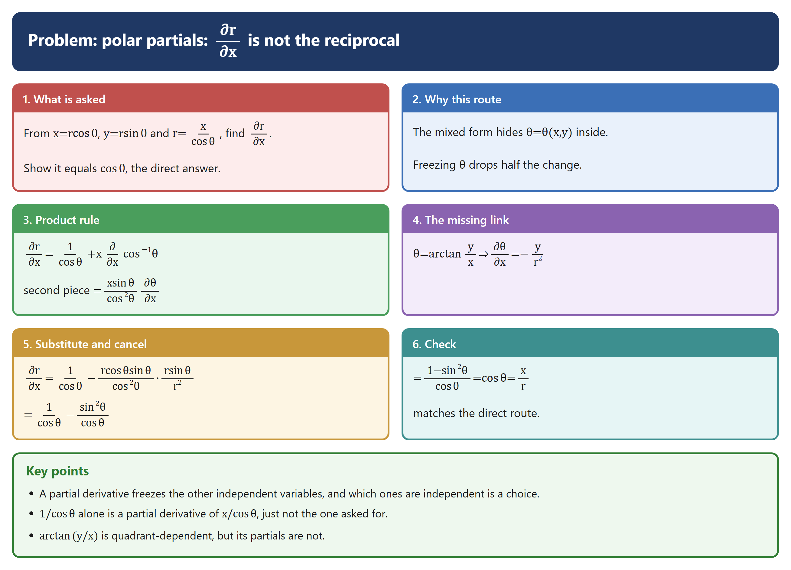
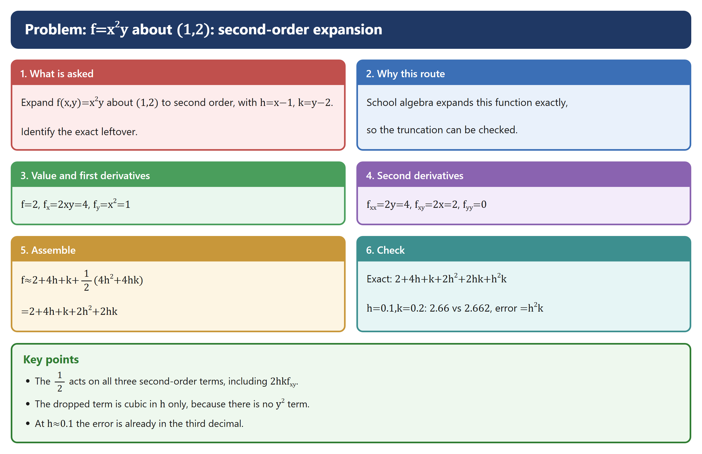
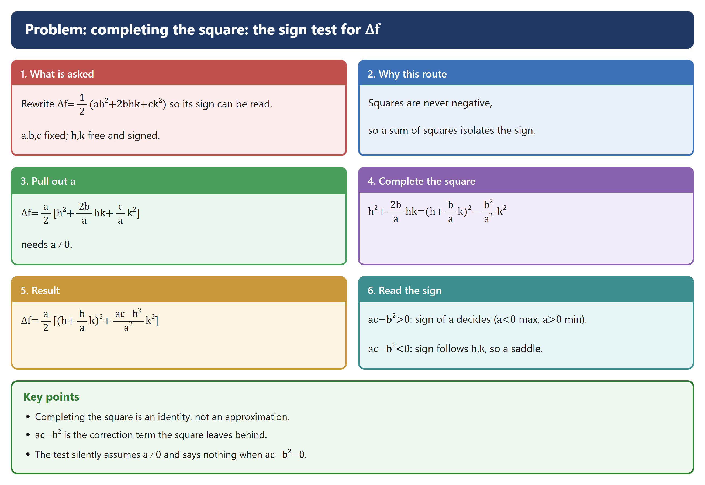
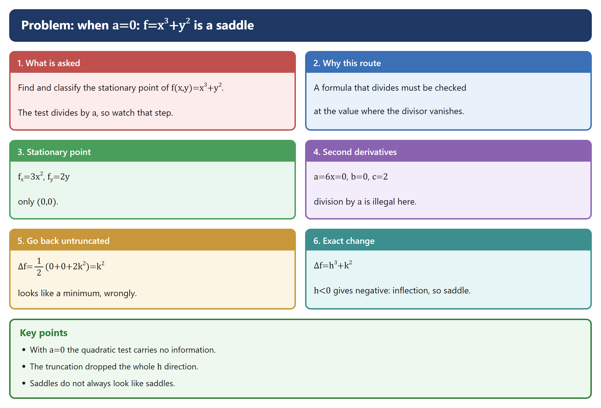
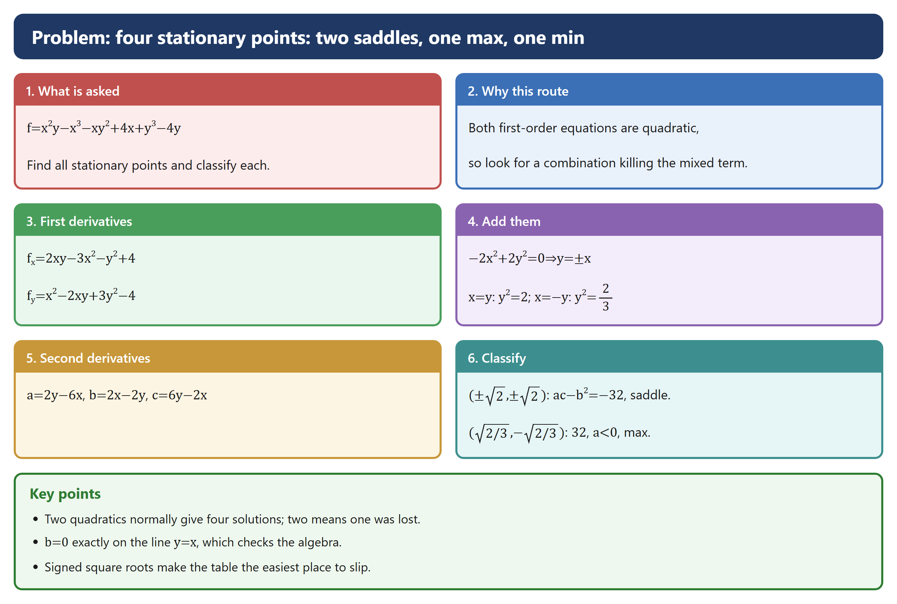

# Two-Variable Taylor Series and Stationary Points

Course: MECH40008 Mathematics and Computing 1. Date: 19 November 2026. Recording title: ME MECH40008 - Mathematics and Computing 1 CAGB-02-200 2026-11-19. Handout: ME1 Mathematics Lecture Notes, Autumn Term, Prof Dan Balint, end of §9.5 and §§9.6–9.7.

Duration: the Panopto session lasts 59:59, and every timestamp below uses that time base. The teaching runs from about 02:22 to 53:15. After 53:15 the recording continues but only room noise is captured, so nothing is lost by stopping there.

Panopto recording: [Open the recording](https://imperial.cloud.panopto.eu/Panopto/Pages/Viewer.aspx?id=b997ef68-2b83-46e6-aaf5-b4c200bdbef4).

Sources: the automatic English captions of this session, the lecture handout section numbers quoted by the teacher, and independent checks of every number below. The captions are machine-generated and occasionally garble the spoken formulas; where a formula matters, it has been rebuilt and then checked numerically, and every such reconstruction is labelled as one. Editorial explanations, domain conditions and independent checks are marked as additions; they are not quotations from the teacher.

Frames were also checked. The screen-capture stream was captured at 04:00, 06:50, 17:00, 19:40, 23:35, 24:00, 31:40 and 39:20 and read directly. That check confirmed the product-rule line and the quadrant note of Example 1, equation 9.22 with its mixed term, the statement that the first derivatives vanish at a stationary point (9.35), the completed-square form 9.38 with the criterion written as $(AC-B^{2})$, the special case $A=0$ with its handwritten caveat, and the classification table with its first three rows. The board uses capitals $A$, $B$, $C$ for the three second derivatives; the notes use lowercase $a$, $b$, $c$ for the same quantities, and the two are the same thing.

One caution on the time base: the 17 November note used a 55:23 session time base, because that session's player clock and its screen recording differed. This session's clock is the full 59:59, so do not compare timestamps across the two notes directly.

## What this lecture is about

Last time the class finished the chain rule for a quantity that depends on more than one input. This lecture closes the loop on one loose end from that discussion, then moves to the two-variable version of the Taylor series, and then uses that series to answer a new question: given a surface, where is it flat, and is a flat place a top, a bottom, or a saddle?

The payoff is a test you can apply mechanically. Find the places where both first partial derivatives vanish, then compute three second derivatives, then read off one combination of them. That combination decides everything, and this lecture derives why it works rather than just stating it.

## 1. Finish the previous lecture's question (02:22–08:30)

The lecture opens by returning to a question asked after the previous class. The teacher wrote a response into the notes rather than answering live, and he flags it as optional reading: he says you do not need to worry about it if you do not wish to.

The question is whether the two partial derivatives of a pair of variables are reciprocals of each other. Write one variable as a function of the other two, and the notation makes the two derivatives look like they should invert. They do not, in general.

The reason is hidden in what is being held fixed. When you differentiate with respect to $x$, the definition of a partial derivative says every other input is frozen. If the variable you are differentiating against appears both explicitly and inside another symbol that itself depends on it, freezing that other symbol is a choice you have to make consciously, not something the notation does for you.

To make this concrete, the teacher takes the polar-coordinate relations and deliberately writes $r$ in a mixed form, using $x$ and $\theta$ together rather than $x$ and $y$. That mixed form is the whole point: it puts the hidden dependence on show.

### Example 1. The same derivative by two routes (02:56–08:11)

**What is asked**

The polar relations are $x=r\cos\theta$ and $y=r\sin\theta$. Take the first one, $x=r\cos\theta$, divide through by $\cos\theta$, and you get the mixed form $r=x/\cos\theta$. Find $\partial r/\partial x$ from that mixed form, and show that the answer is the same as the one you get from the direct form $r=\sqrt{x^{2}+y^{2}}$. Here $\theta$ is not a constant: it is itself a function of $x$ and $y$, because $\tan\theta=y/x$.

**Why this route**

The direct route is shorter and is the one to use in an exam. The mixed route is taken here on purpose, because it is the only way to see the trap. In $r=x/\cos\theta$ the letter $x$ appears twice over: once as the explicit multiplier, and once inside $\theta$. A careless differentiation freezes $\theta$ and silently drops the second contribution, which is exactly the mistake the question was about.

**Step 1**

$$
\frac{\partial r}{\partial x}=\frac{\partial}{\partial x}\left(x\cos^{-1}\theta\right)=\frac{1}{\cos\theta}+x\cdot\frac{\partial}{\partial x}\left(\cos^{-1}\theta\right)
$$

This step splits the derivative into two pieces by the product rule. The first piece treats $x$ as the thing being differentiated and $\theta$ as frozen, giving $1/\cos\theta$. The second piece keeps $x$ as a constant multiplier and differentiates the $\cos^{-1}\theta$ factor, which is where the hidden $x$ dependence will enter.

**Step 2**

$$
\frac{\partial}{\partial x}\left(\cos^{-1}\theta\right)=-\cos^{-2}\theta\cdot\left(-\sin\theta\right)\cdot\frac{\partial\theta}{\partial x}=\frac{\sin\theta}{\cos^{2}\theta}\cdot\frac{\partial\theta}{\partial x}
$$

This step does the chain in three links: the power rule lowers $\cos^{-1}\theta$ to $-\cos^{-2}\theta$, the derivative of cosine with respect to its angle is minus sine, and the final link is $\partial\theta/\partial x$, the piece that records that $\theta$ moves when $x$ moves. Two minus signs cancel.

**Step 3**

$$
\theta=\arctan\frac{y}{x}\quad\Longrightarrow\quad\frac{\partial\theta}{\partial x}=\frac{1}{1+\left(y/x\right)^{2}}\cdot\left(-\frac{y}{x^{2}}\right)=-\frac{y}{x^{2}+y^{2}}=-\frac{y}{r^{2}}
$$

This step supplies the missing link. The derivative of arctangent is one over one plus the square of its argument; then the argument $y/x$ is differentiated with respect to $x$, holding $y$ fixed, which brings down $-y/x^{2}$. Multiplying top and bottom by $x^{2}$ turns the result into $-y/r^{2}$.

**Step 4**

$$
\frac{\partial r}{\partial x}=\frac{1}{\cos\theta}+\frac{x\sin\theta}{\cos^{2}\theta}\cdot\left(-\frac{y}{r^{2}}\right)=\frac{1}{\cos\theta}-\frac{r\cos\theta\,\sin\theta}{\cos^{2}\theta}\cdot\frac{r\sin\theta}{r^{2}}=\frac{1}{\cos\theta}-\frac{\sin^{2}\theta}{\cos\theta}
$$

This step substitutes $x=r\cos\theta$ and $y=r\sin\theta$ into the second term and cancels. The two $r$ factors in the numerator cancel the $r^{2}$ in the denominator, one $\cos\theta$ cancels against $\cos^{2}\theta$, and what is left is a single $\sin^{2}\theta/\cos\theta$.

**Where the constant comes from**

The two $r$ factors are not a coincidence: $x$ and $y$ each carry exactly one factor of $r$, so their product carries $r^{2}$, which is precisely what the denominator needs. The same is true of the cosines: $x$ carries one $\cos\theta$, so the denominator's $\cos^{2}\theta$ cancels one factor and leaves one behind. This exact matching is why the mixed route collapses to something simple instead of leaving a mess.

**Sanity check**

Use $1-\sin^{2}\theta=\cos^{2}\theta$ on the last line:

$$
\frac{1}{\cos\theta}-\frac{\sin^{2}\theta}{\cos\theta}=\frac{1-\sin^{2}\theta}{\cos\theta}=\frac{\cos^{2}\theta}{\cos\theta}=\cos\theta
$$

Now check against the direct route. From $r=\sqrt{x^{2}+y^{2}}$ the derivative is $x/r$, and $x/r=\cos\theta$. The two routes agree. A second, independent check: on the positive $x$ axis $\theta=0$, so $\cos\theta=1$, and indeed moving outwards along the $x$ axis changes $r$ exactly as fast as it changes $x$.

**Answer**

$$
\frac{\partial r}{\partial x}=\cos\theta=\frac{x}{r}
$$

**Trap**

The trap is to freeze $\theta$ and report only the first term $1/\cos\theta$. That answer is wrong, and it is wrong in a way that looks plausible, because $1/\cos\theta$ really is a partial derivative of the expression $x/\cos\theta$, just not the partial derivative with respect to $x$ holding $y$ fixed. The partial derivative symbol always means "hold the other independent variables fixed", and here the independent variables are $x$ and $y$, not $x$ and $\theta$. A second trap is the quadrant issue: $\theta=\arctan(y/x)$ is only literally correct in the first quadrant. That does not break this calculation, because the partial derivatives of $\theta$ are the same in every quadrant; the constant offset between the quadrant-correct formulas differentiates away.

The teacher also notes that the quadrant question is treated properly in Chapter 10, which is coming soon.

## 2. Taylor series for two variables (08:35–13:30)

The new section looks at first like a detour, and the teacher says so. It is not: it is the tool that makes everything after it work. The aim is to plot functions of two variables, to locate their flat places, and to draw their contour plots.

Recall the one-variable expansion. About a point $a$, with $h=x-a$ the distance you have moved:

$$
f(a+h)=f(a)+hf'(a)+\frac{1}{2}h^{2}f''(a)+\cdots
$$

The two-variable version keeps the same shape but every object doubles. There are now two distances, $h=x-a$ and $k=y-b$, and the second-order term is no longer a single square but a small quadratic form in $h$ and $k$:

$$
f(a+h,b+k)=f(a,b)+hf_{x}+kf_{y}+\frac{1}{2}\left(h^{2}f_{xx}+2hkf_{xy}+k^{2}f_{yy}\right)+\cdots
$$

All the derivatives on the right are evaluated at $(a,b)$. The first-order term has two contributions, one for each direction of travel. The second-order term has three: a pure $h$ piece, a pure $k$ piece, and a mixed piece that only exists because there are two directions to move in at once.

**A note that matters for the exam.** The handout prints the derivation of this expansion, and directly under it there is a footnote saying the derivation is not examined. The teacher draws a blue line around the whole derivation on the board and states it plainly: he will not ask anything about this derivation, in his words, on "this test or the exam". He says he would like to go through it because it is interesting, but he skips ahead so that the examined material gets the time, and if he runs out of time he will write his annotations into the PDF that goes onto Blackboard.

Only terms up to second order are needed for the rest of the lecture.

### Example 2. Expand to second order and check the leftover

This example is supplied by the note-taker to make the formula concrete; it was not worked in class. The timestamps in this section mark where the lecture presents the formula itself.

**What is asked**

Take $f(x,y)=x^{2}y$ and expand it about the point $(a,b)=(1,2)$, keeping terms up to second order. Then write the exact expansion and identify precisely what the truncation threw away. Here $h=x-1$ and $k=y-2$ are the distances from the expansion point.

**Why this route**

This function is chosen because it can be expanded exactly by school algebra. That makes the truncated Taylor series checkable rather than a formula to be trusted. The lecture's own justification for truncating is that everything afterwards happens very close to the expansion point, where the higher-order terms are negligible; this example lets you see that claim as an actual leftover term instead of an assertion.

**Step 1**

$$
f(1,2)=2,\qquad f_{x}=2xy\big|_{(1,2)}=4,\qquad f_{y}=x^{2}\big|_{(1,2)}=1
$$

This step collects the value and the two first derivatives at the expansion point. The value $2$ is $1^{2}\times2$. The $x$ derivative of $x^{2}y$ treats $y$ as a constant and brings the $2$ down, giving $2xy$, which is $4$ at the point. The $y$ derivative treats $x^{2}$ as a constant, giving $x^{2}$, which is $1$.

**Step 2**

$$
f_{xx}=2y\big|_{(1,2)}=4,\qquad f_{xy}=2x\big|_{(1,2)}=2,\qquad f_{yy}=0
$$

This step collects the three second derivatives. Differentiating $2xy$ with respect to $x$ again gives $2y$, which is $4$. Differentiating $2xy$ with respect to $y$ gives $2x$, which is $2$. Differentiating $x^{2}$ twice with respect to $y$ gives zero, because $x^{2}$ does not contain $y$ at all.

**Step 3**

$$
f(1+h,2+k)\approx2+4h+1k+\frac{1}{2}\left(4h^{2}+2\cdot2hk+0\right)=2+4h+k+2h^{2}+2hk
$$

This step assembles the expansion. The two first-order terms are $4h$ and $1k$. Inside the bracket, the mixed term is $2hk$ times the mixed derivative $2$, and the half in front of the bracket halves the resulting $4hk$ back to $2hk$.

**Step 4**

$$
f(1+h,2+k)=\left(1+h\right)^{2}\left(2+k\right)=2+4h+k+2h^{2}+2hk+h^{2}k
$$

This step expands the same thing exactly, with no approximation. Expanding $(1+h)^{2}=1+2h+h^{2}$ and then multiplying by $(2+k)$ reproduces every term of the truncated series, and produces exactly one extra term, $h^{2}k$.

**Where the constant comes from**

The coefficient $2$ on $h^{2}$ is half of the second derivative $4$; the $\frac{1}{2}$ in the Taylor formula and the $2$ that comes from squaring $(1+h)$ cancel to leave $2$. The coefficient $2$ on $hk$ is the mixed derivative $2$ multiplied by the $2$ in $2hk$ and then halved. The single leftover term $h^{2}k$ is cubic: one factor from the $h^{2}$ and one from the $k$. No other cubic term can appear, because $k^{2}$ would need a $y^{2}$ in the function and there is none.

**Sanity check**

Put $h=0.1$ and $k=0.2$. The exact value is $(1.1)^{2}(2.2)=1.21\times2.2=2.662$. The truncated series gives $2+0.4+0.2+2(0.01)+2(0.1)(0.2)=2.66$. The difference is $0.002$, and the predicted leftover $h^{2}k=0.01\times0.2=0.002$ matches it exactly. This is what "the higher-order terms are negligible near the point" means in practice: at a distance of about $0.1$, the error is already down in the third decimal place.

**Answer**

$$
f(1+h,2+k)=2+4h+k+2h^{2}+2hk+h^{2}k
$$

**Trap**

The common error is to drop the derivative from the mixed term, leaving $hk$ instead of $f_{xy}hk$. In this example $f_{xy}=2$ and the bracket supplies another $2$, so the $\frac{1}{2}$ in front exactly cancels one of them and the coefficient of $hk$ is $f_{xy}=2$. Both factors have to be used, and they do not cancel down to $1$, because the same $\frac{1}{2}$ also acts on the $h^{2}$ and $k^{2}$ terms. A second error is to place the $\frac{1}{2}$ only on the $h^{2}$ term; it multiplies all three second-order terms together. A third error is to assume the leftover is always $O(h^{3})$; it is cubic only along the direction that carries $h$, and if the mixed derivative happens to vanish you have to look at the other cubic term instead. A fourth error is to confuse which derivative owns the leftover cubic term: $h^{2}k$ comes from the third derivative $f_{xxy}=2$, not from the mixed second derivative $f_{xy}$, which is a different quantity even though both involve both letters.

## 3. Stationary points of a function of two variables (13:32–27:20)

A **stationary point** is a place where the function stops changing to first order. For one variable that meant a horizontal tangent line, which is the condition $df/dx=0$. For two variables the same idea is upgraded one dimension: instead of a horizontal tangent line, look for a horizontal tangent plane, which happens exactly where both first partial derivatives vanish.

$$
f_{x}(a,b)=0\qquad\text{and}\qquad f_{y}(a,b)=0
$$

The geometric reason is worth keeping, because it explains why two conditions are needed rather than one. Cut the surface with the plane $y=b$. The cut is a curve, and the slope of that curve is $f_{x}$. Cut it instead with $x=a$; that cut is another curve, and its slope is $f_{y}$. In the earlier derivation of partial derivatives these two slopes were called $\tan\alpha$ and $\tan\beta$. Setting both to zero says both angles are zero, and a plane whose slopes vanish in two independent directions is horizontal.

A **contour plot** is the other view of the same surface. Take a fixed height, slice the surface at that height, and draw the intersection on the flat $xy$ plane; repeat for several heights. An everyday example is an elevation map, where the curves join points of equal altitude. On a paraboloid the slices are circles, and the numbers written on them are the constant heights. Contour plots get their own treatment next lecture; here they are introduced only so the saddle point can be seen from above as well as in perspective.

Now the three kinds of flat place. At a **local maximum**, move away from the point in any direction and the function decreases. At a **local minimum**, move away in any direction and it increases. At a **saddle point**, it depends on the direction: one way it looks like a maximum, another way it looks like a minimum.

The teacher is careful about one asymmetry with the one-variable case, and it is worth writing down. For one variable, a point of inflection may or may not be stationary; you can have an inflection where the slope is not zero. For two variables, a saddle point is always stationary, by definition. That is why he calls the saddle point the catch-all: it is the name for every stationary point that is neither a maximum nor a minimum.

He also warns that saddle points do not always look like saddles. The picture on the handout does, but there are special cases that still count as saddle points and look different, for instance a point that behaves like a minimum in one direction and like an inflection point in the other. Example 5 below is exactly such a case.

## 4. Turning the Taylor series into a test (27:24–40:50)

This is the heart of the lecture. The Taylor series from Section 2 becomes useful here, because at a stationary point the linear term switches off. The first partial derivatives are zero by definition of a stationary point, so the $h f_{x}$ and $k f_{y}$ terms vanish, and what remains is a constant plus a quadratic.

The higher-order terms are dropped, and the justification is locality: everything that follows happens very close to the stationary point, so $h$ and $k$ are small, and cubic and quartic terms are negligible beside the constant and the quadratic. Note that $h$ and $k$ can each be positive or negative, since $x$ may be on either side of $a$.

Write $\Delta f$ for the change in the function as you move from $(a,b)$ to $(a+h,b+k)$, and abbreviate the three second derivatives by single letters. This is the teacher's notation, and it is worth adopting because it makes the algebra short:

$$
a=f_{xx}(a,b),\qquad b=f_{xy}(a,b),\qquad c=f_{yy}(a,b)
$$

With those letters, the truncated series becomes a compact statement:

$$
\Delta f=\frac{1}{2}\left(ah^{2}+2bhk+ck^{2}\right)
$$

Now the problem becomes readable. A maximum should have $\Delta f<0$ for every direction of departure; a minimum should have $\Delta f>0$ for every direction; a saddle should have $\Delta f$ changing sign with direction. So the whole question is: what is the sign of that bracket? The difficulty is that $a$, $b$, $c$, $h$ and $k$ can all carry signs, and only $h^{2}$ and $k^{2}$ are guaranteed positive. Reading the sign off directly is hopeless, which is why the next step is algebraic.

### Example 3. Completing the square to expose the sign (29:08–38:17)

**What is asked**

Starting from $\Delta f=\frac{1}{2}(ah^{2}+2bhk+ck^{2})$, rewrite it so that the sign can be read off, and state the resulting test. The quantities $a$, $b$, $c$ are fixed numbers determined by the function at the stationary point; $h$ and $k$ are free displacements that can each be positive or negative.

**Why this route**

Completing the square is chosen because it converts a sum of signed terms into a sum of squares plus one leftover. Squares are never negative, so once the expression is a sum of squares the only thing that can still flip the sign is an overall factor. Nothing else in elementary algebra gives that guarantee, and it is the same move that solves quadratics.

**Step 1**

$$
\Delta f=\frac{a}{2}\left[h^{2}+\frac{2b}{a}hk+\frac{c}{a}k^{2}\right]
$$

This step pulls $a$ out as an overall factor. Each of the three terms inside is divided by $a$, which is why the coefficients become $2b/a$ and $c/a$. Nothing has been assumed yet except that $a$ is not zero; that assumption is examined in Example 5.

**Step 2**

$$
h^{2}+\frac{2b}{a}hk=\left(h+\frac{b}{a}k\right)^{2}-\frac{b^{2}}{a^{2}}k^{2}
$$

This step completes the square on the first two terms. Expanding the square gives $h^{2}+2(b/a)hk+(b^{2}/a^{2})k^{2}$, so the extra $(b^{2}/a^{2})k^{2}$ that appeared has to be subtracted to keep the identity true. It is an identity, not an approximation.

**Step 3**

$$
\Delta f=\frac{a}{2}\left[\left(h+\frac{b}{a}k\right)^{2}+\left(\frac{c}{a}-\frac{b^{2}}{a^{2}}\right)k^{2}\right]=\frac{a}{2}\left[\left(h+\frac{b}{a}k\right)^{2}+\frac{ac-b^{2}}{a^{2}}k^{2}\right]
$$

This step substitutes the identity back and puts the last two coefficients over the common denominator $a^{2}$. The result is a square plus a squared $k$ with one combined coefficient. That combination $ac-b^{2}$ is the quantity the whole test is built on.

**Where the constant comes from**

The $ac$ in $ac-b^{2}$ comes from putting $c/a$ over the denominator $a^{2}$: multiply top and bottom by $a$ and you get $ac/a^{2}$. The $-b^{2}$ comes from the square that was completed in Step 2; completing a square always leaves behind a correction of exactly the square of the half-coefficient. The letter $b$ is the mixed derivative $f_{xy}$, so the correction is the mixed derivative squared, which is why the mixed term is the one that can destroy the test.

**Step 4**

$$
ac-b^{2}>0,\ a<0\Rightarrow\Delta f<0\ (\text{maximum});\qquad ac-b^{2}>0,\ a>0\Rightarrow\Delta f>0\ (\text{minimum})
$$

This step reads the sign off the bracketed form. When $ac-b^{2}>0$, both terms in the bracket are non-negative, so the bracket is non-negative and the sign of $\Delta f$ is the sign of the factor $a/2$ outside. Hence $a<0$ forces $\Delta f<0$ in every direction, and $a>0$ forces $\Delta f>0$ in every direction.

**Step 5**

$$
ac-b^{2}<0\Rightarrow\Delta f\ \text{changes sign with}\ h,k\ \Rightarrow\ \text{saddle point}
$$

This step handles the remaining case. When $ac-b^{2}<0$ the coefficient on $k^{2}$ inside the bracket is negative, while the completed square is still non-negative. Choosing $k$ large and $h=-bk/a$ makes the square vanish and leaves a negative result; choosing $k=0$ leaves a non-negative result. The sign therefore depends on the direction of departure, which is the definition of a saddle point.

**Sanity check**

Test the algebra on numbers. Take $a=2$, $b=1$, $c=3$, $h=1$, $k=1$. The original form gives $\frac{1}{2}(2+2+3)=3.5$. The completed form gives $\frac{2}{2}\left[(1+0.5)^{2}+\frac{6-1}{4}\right]=1\times(2.25+1.25)=3.5$. The two agree, so the rewriting is an identity. Note also that here $ac-b^{2}=6-1=5>0$ and $a=2>0$, so the test predicts a minimum, consistent with $\Delta f=3.5>0$.

**Step 6**

$$
a=0,\ b\neq0:\quad Q(h,k)=bhk+\frac{c}{2}k^{2}=k^{2}\left(b\frac{h}{k}+\frac{c}{2}\right)
$$

The handout itself flags this. Under Special case 1 it says that when $A=0$ the divided analysis is "strictly invalid", but adds in handwriting that such a point "would have been correctly identified by the usual $(AC-B^{2})<0$ test". That handwritten remark is exactly the distinction below.

This step checks that $a=0$ on its own does not break the test. Put $h=tk$ and factor out $k^{2}$; the bracket $bt+c/2$ is a straight line in $t$, so some $t$ makes it positive and some other $t$ makes it negative. Take either sign of $t$ and let $k$ tend to zero, and the displacement tends to the stationary point while $Q$ keeps a fixed sign. Both signs occur arbitrarily close to the point, so it is a saddle. Note that this also agrees with $ac-b^{2}=-b^{2}<0$ when $a=0$ and $b\neq0$.

**Answer**

$$
\Delta f=\frac{a}{2}\left[\left(h+\frac{b}{a}k\right)^{2}+\frac{ac-b^{2}}{a^{2}}k^{2}\right]
$$

with the test: $ac-b^{2}>0$ and $a<0$ gives a maximum; $ac-b^{2}>0$ and $a>0$ gives a minimum; $ac-b^{2}<0$ gives a saddle point.

**Trap**

The trap is to divide by $a$ without noticing that $a$ might be zero; the whole derivation silently assumes $a\neq0$, and Example 5 shows what happens when it fails. A second trap is to mix up the sign convention: the test uses $ac-b^{2}$, and the maximum case needs $a<0$, not $a>0$. A third is to forget that the test says nothing when $ac-b^{2}=0$; that case needs a more refined analysis, and the teacher states that it will not be met in this course.

### Example 5. When $a=0$ the test breaks

The lecture names this case and mentions the function $x^{3}+y^{2}$, but does not work it through; the teacher says he will put the example into the PDF instead. The arithmetic below is supplied by the note-taker.

**What is asked**

Take $f(x,y)=x^{3}+y^{2}$. Find its stationary point, then try to classify it. The point of the example is to see exactly where the division by $a$ fails and what has to be done instead.

**Why this route**

The teacher raises this case while still on the derivation, because a formula that silently divides by a quantity should be checked at the value where that quantity vanishes. The fallback is to return to the untruncated expression for $\Delta f$ and read the sign from there.

**Step 1**

$$
f_{x}=3x^{2},\qquad f_{y}=2y\qquad\Longrightarrow\qquad (0,0)\ \text{is the only stationary point}
$$

This step finds the stationary point. Setting $3x^{2}=0$ forces $x=0$, and setting $2y=0$ forces $y=0$. Both conditions must hold at the same place, so the origin is the only candidate.

**Step 2**

$$
a=f_{xx}=6x\big|_{(0,0)}=0,\qquad b=f_{xy}=0,\qquad c=f_{yy}=2
$$

This step evaluates the three second derivatives at the origin. The second derivative in $x$ is $6x$, which is zero at the origin; that is the failure. The mixed derivative is zero because $3x^{2}$ does not involve $y$ and $2y$ does not involve $x$. The second derivative in $y$ is $2$.

**Step 3**

$$
\Delta f=\frac{1}{2}\left(0\cdot h^{2}+2\cdot0\cdot hk+2k^{2}\right)=k^{2}
$$

This step goes back to the untruncated form before completing the square, because dividing by $a$ is no longer allowed. With $a=b=0$ and $c=2$, the quadratic part collapses to $k^{2}$, which is never negative. Taken at face value that would suggest a minimum.

**Step 4**

$$
\Delta f=f(h,k)-f(0,0)=h^{3}+k^{2}
$$

This step writes the exact change, not the truncation. The quadratic part has thrown away every $h$ term, because the coefficient of $h^{2}$ was zero. But the function still contains $x^{3}$, so the leading behaviour in the $h$ direction is cubic, and a cubic changes sign.

**Where the constant comes from**

The coefficient $6$ in $f_{xx}=6x$ is the second derivative of $x^{3}$: differentiating three times in total would give $6$, so twice gives $6x$. That $x$ is exactly what makes the coefficient vanish at the origin. The coefficient $2$ in $f_{yy}=2$ is the second derivative of $y^{2}$. The reason the cubic term survives while the quadratic does not is that there is no $h^{2}$ term at all, so nothing dominates the $h^{3}$.

**Sanity check**

Evaluate the exact change on both axes. Along $k=0$: $\Delta f=h^{3}$, which is negative for $h<0$ and positive for $h>0$, so moving in the $x$ direction the surface goes down on one side and up on the other; that is an inflection, not an extremum. Along $h=0$: $\Delta f=k^{2}\ge0$, which is a minimum. One direction behaves like a minimum and the other like an inflection, so the point is a saddle point. Concretely, $f(-0.1,0)=-0.001<0=f(0,0)$ while $f(0,0.1)=0.01>0$.

**Answer**

$$
(0,0)\ \text{is a stationary point and it is a saddle point}
$$

**Trap**

The trap is to trust the quadratic part here. In this example $a=0$ and $b=0$ at the same time, so $ac-b^{2}=0$ as well and the ordinary test really is silent. The quadratic part reads $k^{2}$, which is non-negative, and it is tempting to call the point a minimum; that conclusion is wrong, because the quadratic part discarded the entire $h$ direction. Do not generalise this to every case with $a=0$: if $a=0$ but $b\neq0$, then $ac-b^{2}=-b^{2}<0$ and the point is a saddle by the ordinary test, with no higher-order term needed. This is also the case the teacher had in mind when he said that saddle points do not always look like saddles.

## 5. Worked example: four stationary points (40:55–53:15)

The teacher works one example in class and says he will fill the remaining rows of the table afterwards, because the arithmetic becomes repetitive. The table below is complete, and every entry has been rechecked independently.

### Example 4. Find and classify every stationary point (40:55–53:15)

**What is asked**

Find the stationary points of

$$
f(x,y)=x^{2}y-x^{3}-xy^{2}+4x+y^{3}-4y
$$

and determine the nature of each one. The function is reconstructed from the partial derivatives read out in class (41:25–43:03), with the additive constant taken to be zero; the captions mangle the printed question, but the reconstructed function reproduces every derivative and every number quoted. This is the standard phrasing of the question, and it always means the same two jobs: solve the two first-order equations simultaneously, then classify each solution with the second-derivative test.

**Why this route**

The second-derivative test from Section 4 needs $a$, $b$, $c$ at each candidate point, so the candidates have to be found first. The two first-order equations here are both quadratic, so the system cannot be solved by simple substitution in one step; the trick is to look for a combination that cancels the mixed term.

**Step 1**

$$
f_{x}=2xy-3x^{2}-y^{2}+4,\qquad f_{y}=x^{2}-2xy+3y^{2}-4
$$

This step differentiates. In $f_{x}$, the term $x^{2}y$ gives $2xy$, the term $-x^{3}$ gives $-3x^{2}$, the term $-xy^{2}$ gives $-y^{2}$, the term $4x$ gives $4$, and the last two terms have no $x$ so they drop. In $f_{y}$, the term $x^{2}y$ gives $x^{2}$, the term $-xy^{2}$ gives $-2xy$, the term $y^{3}$ gives $3y^{2}$, the term $-4y$ gives $-4$, and the terms without $y$ drop.

**Step 2**

$$
f_{x}+f_{y}=\left(2xy-3x^{2}-y^{2}+4\right)+\left(x^{2}-2xy+3y^{2}-4\right)=-2x^{2}+2y^{2}=0\ \Longrightarrow\ y^{2}=x^{2}
$$

This step adds the two equations before setting them to zero. Addition is chosen because $2xy$ and $-2xy$ cancel, and the constants $+4$ and $-4$ cancel too; what survives is a difference of squares. The result says $y=x$ or $y=-x$, two straight lines through the origin, and every stationary point must lie on one of them.

**Step 3**

$$
x=y:\ -2y^{2}+4=0\ \Longrightarrow\ y=\pm\sqrt{2};\qquad x=-y:\ -6y^{2}+4=0\ \Longrightarrow\ y=\pm\sqrt{\frac{2}{3}}
$$

This step substitutes each line back into one of the original equations. Putting $x=y$ into $f_{x}$ gives $2y^{2}-3y^{2}-y^{2}+4=-2y^{2}+4$, which vanishes at $y=\pm\sqrt2$. Putting $x=-y$ gives $-2y^{2}-3y^{2}-y^{2}+4=-6y^{2}+4$, which vanishes at $y=\pm\sqrt{2/3}$. Each line therefore contributes two points.

**Step 4**

$$
f_{xx}=2y-6x,\qquad f_{xy}=2x-2y,\qquad f_{yy}=6y-2x
$$

This step prepares the test quantities. Differentiating $f_{x}$ again in $x$ gives $2y-6x$, and in $y$ gives $2x-2y$. Differentiating $f_{y}$ again in $y$ gives $6y-2x$. The mixed derivative can be obtained from either route; doing both gives the same answer, which is the statement that the order of partial differentiation does not matter.

**Step 5**

| point $(x,y)$ | $a$ | $b$ | $c$ | $ac-b^{2}$ | nature |
|---|---|---|---|---|---|
| $(\sqrt2,\sqrt2)$ | $-4\sqrt2$ | $0$ | $4\sqrt2$ | $-32$ | saddle |
| $(-\sqrt2,-\sqrt2)$ | $4\sqrt2$ | $0$ | $-4\sqrt2$ | $-32$ | saddle |
| $(\sqrt{2/3},-\sqrt{2/3})$ | $-8\sqrt{2/3}$ | $4\sqrt{2/3}$ | $-8\sqrt{2/3}$ | $32$ | maximum |
| $(-\sqrt{2/3},\sqrt{2/3})$ | $8\sqrt{2/3}$ | $-4\sqrt{2/3}$ | $8\sqrt{2/3}$ | $32$ | minimum |

This step tabulates every candidate. For $(\sqrt2,\sqrt2)$: $a=2\sqrt2-6\sqrt2=-4\sqrt2$, $b=0$, $c=6\sqrt2-2\sqrt2=4\sqrt2$, so $ac-b^{2}=-32<0$, a saddle. For $(\sqrt{2/3},-\sqrt{2/3})$: $a=2(-\sqrt{2/3})-6(\sqrt{2/3})=-8\sqrt{2/3}$, $b=2\sqrt{2/3}+2\sqrt{2/3}=4\sqrt{2/3}$, $c=6(-\sqrt{2/3})-2\sqrt{2/3}=-8\sqrt{2/3}$, so $ac-b^{2}=64(2/3)-16(2/3)=32>0$ and $a<0$, a maximum. The two remaining rows follow from the sign symmetry.

**Where the constant comes from**

Every $32$ in the last two rows is a consequence of $\sqrt2$ appearing exactly once in each factor. For the saddle rows, $a$ and $c$ have opposite signs and equal size, so $ac=-32$ and $b=0$ leaves $-32$. For the other two rows, $a$ and $c$ are equal and negative, so $ac=+64(2/3)$, and $b^{2}=16(2/3)$, and the difference is $48(2/3)=32$. The reason the difference is exactly a nice number is that $b$ is exactly half of $c$ in magnitude here, so $b^{2}$ is exactly a quarter of $ac$.

**Sanity check**

Two independent checks. First, substitute each point back into $f_{x}$ and $f_{y}$ and confirm both are zero; all four give a residual of zero to machine precision, which confirms the solutions were not mis-derived. Second, note that two of the four points have $b=0$ and the other two do not; the ones with $b=0$ sit on the line $y=x$ where $x=y$ makes $f_{xy}=2x-2y$ vanish, which is a good consistency check on the algebra of Step 4.

**Answer**

Two saddle points at $(\sqrt2,\sqrt2)$ and $(-\sqrt2,-\sqrt2)$; one maximum at $(\sqrt{2/3},-\sqrt{2/3})$; one minimum at $(-\sqrt{2/3},\sqrt{2/3})$.

**Trap**

The trap the teacher names himself is the simultaneous solution, not the classification: he calls finding the stationary points the trickiest part. Adding the two equations is the shortcut here, and it works only because the coefficients were arranged so that the mixed terms cancel; do not assume every problem is arranged that way. A second trap is arithmetic in the table: $a$, $b$, $c$ all involve signed square roots, and a single sign slip flips the verdict. A third is the count: two quadratics in two unknowns normally give up to four solutions, so getting only two is a signal that something was dropped.

## 6. Exam and handout notes

Three statements from this lecture are worth separating out, because they are about the course rather than about the mathematics.

First, the derivation of the two-variable Taylor series is explicitly not examined. The handout's footnote says so, the teacher draws a blue line around the derivation, and he says in words that he will not ask anything about it on the progress test or on the final exam. The footnote also says that studying it carefully helps with understanding the total derivative, which is why it is printed at all.

Second, equation 9.37 in the handout prints the half in an awkward place: it reads $\delta f=(2hkB+k^{2}C)\cdot\frac{1}{2}$, with the factor trailing at the end. The teacher annotates it by pulling the half to the front, so that it reads as a bracket multiplied by one half. The algebra is not wrong, only the layout; do not copy the printed layout into your own working.

Third, the case $ac-b^{2}=0$ needs a more refined test, and the teacher states plainly that it will not be met in this course. That is a scope statement, not a mathematical one.

The lecture closes by telling the class to practise the simultaneous solution on the problem sheet, and the teacher's last words are that he will see them tomorrow, on Friday.

## 7. Summary, traps and memory hooks

The lecture has one long argument and it is worth stating as a chain rather than as a list of facts. The chain is: a flat place means both first partials vanish; at such a place the Taylor series loses its linear term; the leftover quadratic can be completed into a square plus a correction; that square is never negative, so the sign is decided by the factor outside and by the correction; and those two quantities are $a$ and $ac-b^{2}$.

The summary in one table, with the notation $a=f_{xx}$, $b=f_{xy}$, $c=f_{yy}$:

| $ac-b^{2}$ | $a$ | verdict |
|---|---|---|
| positive | negative | maximum |
| positive | positive | minimum |
| negative | either | saddle |
| zero | any | no information from this test |
| negative | zero | saddle, since $ac-b^{2}=-b^{2}<0$ |

The rows that say "no information" are not footnotes; they are the ways the test can fail. Two separate things go wrong at $a=0$, and they must not be merged. If $a=0$ but $b\neq0$, then $ac-b^{2}=-b^{2}<0$, so the ordinary test still works and the point is a saddle; no higher-order term is needed, and the only thing that stops working is the division by $a$ inside the completed-square form. If $a=0$ and $b=0$, then $ac-b^{2}=0$ as well and the test is genuinely silent, because the quadratic part has lost every $h$ term; the bracket collapses to a single square, and the fallback is to inspect the cubic terms, as in Example 5. When $ac-b^{2}=0$ the correction term vanishes, the bracket collapses to a single square, and the sign can still depend on the neglected cubic terms.

**Traps to keep**

- Freezing the wrong variable. A partial derivative freezes the other independent variables, and which variables are independent is a choice about the problem, not a fact the notation supplies.
- Forgetting the factor $2$ on the mixed term of the Taylor series, or the $\frac{1}{2}$ on the whole quadratic block.
- Dividing by $a$ without checking $a\neq0$.
- Reading $ac-b^{2}$ with the wrong sign convention, or pairing it with the wrong condition on $a$.
- Believing that a saddle must look like a saddle.

**Memory hooks**

The test is the two-dimensional analogue of the second-derivative test for one variable. In one variable the single condition $f''>0$ means a minimum and $f''<0$ means a maximum; here $a$ plays the role of $f''$ and $ac-b^{2}>0$ is what makes $a$ trustworthy. Think of $ac-b^{2}$ as a quality check on $a$: if it is positive, the surface is genuinely curved the same way in both directions and $a$ alone decides; if it is negative, the surface bends one way along one line and the other way along another, and no single number can decide.

For the recipe, the order matters and it is always the same: solve $f_{x}=f_{y}=0$ first, compute the three second derivatives second, tabulate third. Doing the table before the candidates is the usual cause of a lost afternoon.
