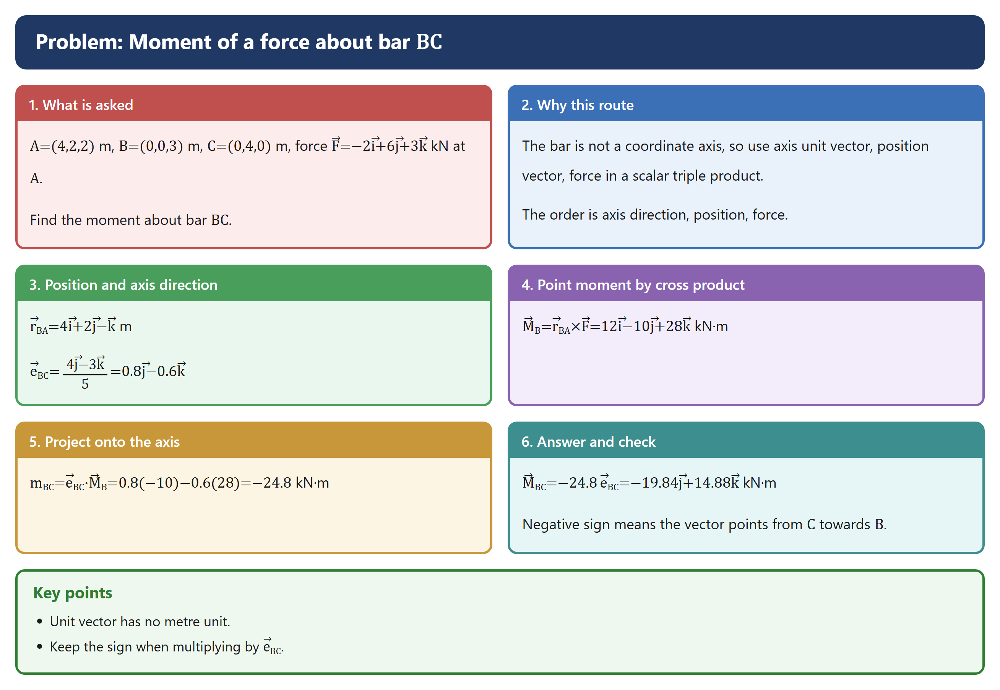
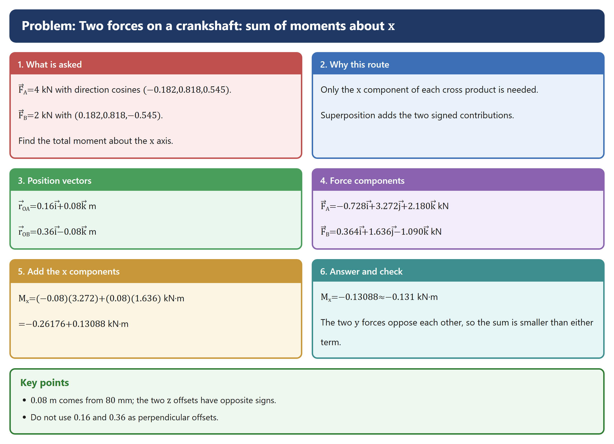
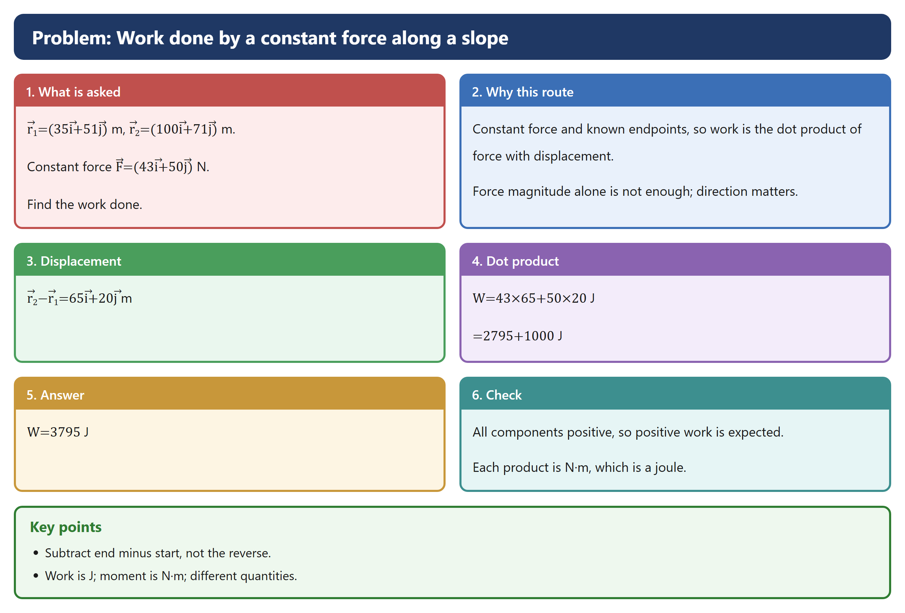
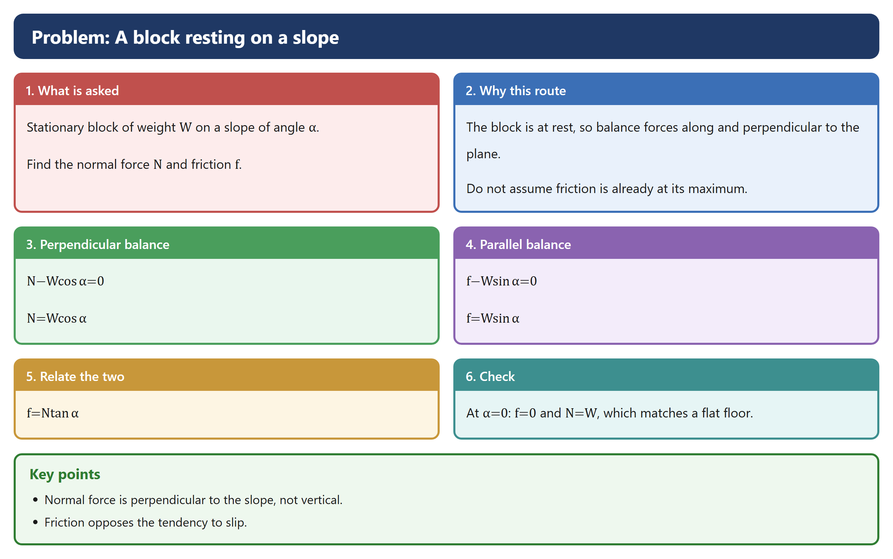
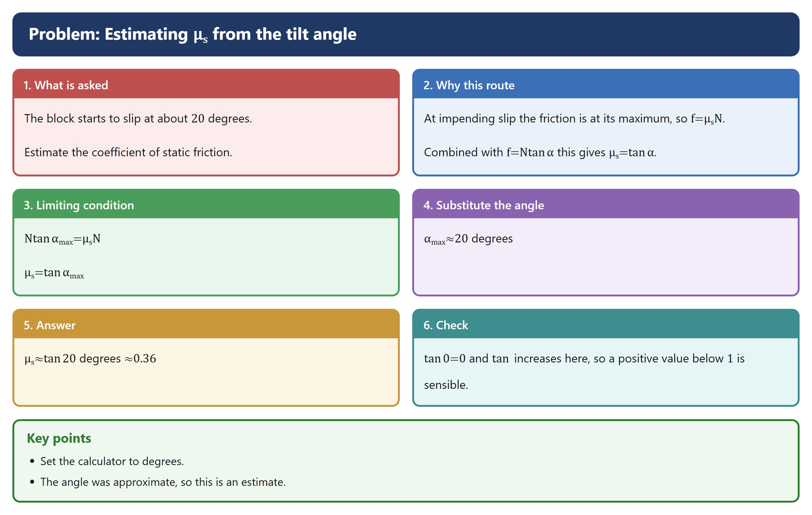

# MECH40009 Mechanics - Moments About an Axis

Course: MECH40009 Mechanics. Recording date: 2026-11-16. Recording title: ME MECH40009 - Mechanics CAGB-02-200 2026-11-16. Full recording duration: 60:00. This note covers 01:20-59:50. Sections 1-3 (01:20-29:30, handout §2.3-§2.4) cover moments about an axis with two worked examples; sections 4-7 cover work done by a force and friction.

Panopto: https://imperial.cloud.panopto.eu/Panopto/Pages/Viewer.aspx?id=4ebc6584-f263-48c6-a442-b4b40179f813. Sources: automatic English captions, the 24 full-size slide and handwriting screenshots listed in the frame plan, and the handout. The handout checks section numbers and English wording; formulas are checked against the screenshots, with the lecturer's words used to explain the sequence.

This lecture asks how strongly a force tends to turn an object about a chosen line, such as a shaft. We first find the turning effect about a point and then keep only the part along the line; two worked examples show how the signs and directions fit together.

## 1. Moment About an Arbitrary Axis (01:20-04:22)

Imagine a door that can turn only around its hinges. A force may produce a turning effect in three dimensions, but only the part aligned with the hinge axis tells us how strongly it tends to turn the door about that axis.

A **moment** measures the turning effect of a force about a specified point or axis. A **vector** has both magnitude and direction. Choose a point $P$ on the axis $L$; the position vector $\vec r$ goes from $P$ to a point on the force's line of action. The force is $\vec F$. The moment about $P$ is:

$$\vec M_P=\vec r\times\vec F$$

Read $\vec M_P$ as "moment about P"; its unit is newton metre, N·m. Read $\times$ as **cross product**: its order matters, and it gives a vector perpendicular to the plane of the two input vectors. $\vec r$ is measured in metres, m, and $\vec F$ in newtons, N. The moment direction follows the **right-hand rule**: curl the fingers from $\vec r$ towards $\vec F$; the thumb gives the moment direction.

The **unit vector** $\vec e$ points along the chosen positive direction of $L$ and has magnitude one, so it has no unit. The **dot product** selects the component of a vector along another direction. Write the signed axial component as $m_L$:

$$m_L=\vec e\cdot\vec M_P=\vec e\cdot\left(\vec r\times\vec F\right)$$

Here $m_L$ is in N·m. A positive value means the axial moment points along $\vec e$; a negative value means it points opposite to $\vec e$. If $\phi$, read "phi", is the angle between $\vec e$ and $\vec M_P$, then because $\vec e$ has length one, $m_L=|\vec M_P|\cos\phi$. The component is positive when $\phi<90$ degrees and negative when $\phi>90$ degrees.

The axial moment vector is the signed component multiplied by the chosen unit vector:

$$\vec M_L=\left(\vec e\cdot\vec M_P\right)\vec e=\left(\vec e\cdot\left(\vec r\times\vec F\right)\right)\vec e$$

Reversing the chosen $\vec e$ flips the sign of $m_L$, while a zero value stays zero. The lecturer notes this on the board. A negative $m_L$ then tells us that the physical moment points against that chosen direction; it does not mean there is no turning effect.

**Principle recap**

First find the moment about a point on the axis, then project it onto the axis. Any point on the same axis gives the same $m_L$: moving $P$ along the axis only adds a vector parallel to $\vec e$ to $\vec r$, and $\vec e\cdot(\vec e\times\vec F)=0$, so the result does not change.

**Pitfalls**

The slides sometimes put magnitude bars around a quantity that later becomes negative. A magnitude cannot be negative: here $m_L$ denotes the signed component, while its magnitude is $|m_L|$. Do not confuse the scalar component with the vector $\vec M_L$.

**Memory tip**

Think "point moment first, axis component second".

## 2. Example 1: Moment About Bar BC (04:22-13:01)

The bar fixes the axis of interest. The force acts at $A$, so we can take a position vector from an axis point to $A$, find the point moment and keep the part along the bar.

**What is asked**

This is Example 1 in these notes, and it appears as Example 3 on the lecturer's slide. The points are $A=(4,2,2)$ m, $B=(0,0,3)$ m and $C=(0,4,0)$ m. The force at $A$ is $-2\vec i+6\vec j+3\vec k$ kN. Find its moment about bar $BC$. Here $\vec i$, $\vec j$ and $\vec k$ are dimensionless unit vectors along the positive $x$, $y$ and $z$ directions; kN means kilonewton.

**Why this route**

We need rotation about a line, not the whole moment about a point. Choose $B$ on the line and choose the positive axis direction from $B$ to $C$; then project the moment about $B$ onto that direction. Point $C$ could also be used.

**Step 1**

$$\vec r_{BA}=4\vec i+2\vec j-\vec k\quad\text{m}$$

This gives the position vector from $B$ to the force application point $A$: subtract the coordinates of $B$ from those of $A$.

**Step 2**

$$\vec e_{BC}=\frac{4\vec j-3\vec k}{\sqrt{4^{2}+3^{2}}}=0.8\vec j-0.6\vec k$$

This gives the dimensionless unit vector from $B$ to $C$: divide the vector from $B$ to $C$ by its length.

**Step 3**

$$m_{BC}=\vec e_{BC}\cdot\left(\vec r_{BA}\times\vec F\right)=-24.8\quad\text{kN}\cdot\text{m}$$

This gives the signed moment component along the chosen $B$-to-$C$ direction. The lecturer evaluates the **scalar triple product** using a determinant: its three rows contain the components of $\vec e_{BC}$, $\vec r_{BA}$ and $\vec F$ in that order.

**Step 4**

$$\vec M_{BC}=-24.8\left(0.8\vec j-0.6\vec k\right)=-19.84\vec j+14.88\vec k\quad\text{kN}\cdot\text{m}$$

This gives the moment as a vector along the bar. The negative signed component means the vector points from $C$ towards $B$.

**Where the constant comes from**

The denominator is $5$ m because the axis vector has components $4$ m and $-3$ m. The negative sign in $-24.8$ comes from the projection, not from guessing the turning direction. Expanding the cross product gives $(12,-10,28)$ kN·m; dotting it with $(0,0.8,-0.6)$ gives $-8-16.8=-24.8$ kN·m.

**Sanity check**

The vector in Step 4 is a negative multiple of the unit vector from $B$ to $C$, so it points towards $B$, matching the lecturer's drawn arrow. Its unit is kN·m: metres from the position vector times kilonewtons from the force.

**Answer**

$$\vec M_{BC}=-19.84\vec j+14.88\vec k\quad\text{kN}\cdot\text{m}$$

The corresponding signed component is $-24.8$ kN·m along the selected $B$-to-$C$ direction. Viewed from $C$ towards $B$, the indicated rotation is clockwise.

**Pitfalls**

A unit vector has no metre unit, even though the handwriting writes "m" after the direction-vector calculation. Also keep the minus sign when multiplying by $\vec e_{BC}$; otherwise the vector points the wrong way.

**Principle recap**

The scalar triple product produces the signed axial component; multiplying by the axis unit vector turns that component into the axial moment vector.

**Pitfalls**

In the determinant for a scalar triple product, the first row contains the components of the axis unit vector, not the symbols $\vec i,\vec j,\vec k$ used in a vector cross-product determinant.

**Memory tip**

Read the order as "axis direction, position, force".

## 3. Example 2: Two Forces on a Crankshaft (13:01-29:30)

Two forces can each twist the same shaft. Find their contributions about the same axis and add those contributions, keeping their signs.

**What is asked**

The lecturer's Q4 gives two forces on a crankshaft. $\vec F_A$ has magnitude $4$ kN and direction cosines $(-0.182,0.818,0.545)$; $\vec F_B$ has magnitude $2$ kN and direction cosines $(0.182,0.818,-0.545)$. Find the sum of their moments about the $x$ axis.

**Why this route**

The **direction cosines** are the cosines of the angles a vector makes with the positive coordinate axes. They supply the components of a unit vector along the force, so multiplying them by the force magnitude gives the force vector. Since the requested axis is $x$, use $\vec i$ as its unit direction and add the two axial moment components.

**Step 1**

$$\vec r_{OA}=0.16\vec i+0.08\vec k\quad\text{m}$$

Take $O$ as the origin on the shaft axis. Reading the diagram, $A$ is $0.16$ m along the $x$ axis and $0.08$ m in the $z$ direction, so this step gives the position vector from $O$ to the point of application of $\vec F_A$.

**Step 2**

$$\vec r_{OB}=0.36\vec i-0.08\vec k\quad\text{m}$$

This gives the position vector from $O$ to the point of application of $\vec F_B$.

**Step 3**

$$\vec F_A=-0.728\vec i+3.272\vec j+2.180\vec k\quad\text{kN}$$

This gives the components of the first force by multiplying its direction cosines by $4$ kN.

**Step 4**

$$\vec F_B=0.364\vec i+1.636\vec j-1.09\vec k\quad\text{kN}$$

This gives the components of the second force by multiplying its direction cosines by $2$ kN.

**Step 5**

$$\vec M_x=\left(\vec i\cdot\left(\vec r_{OA}\times\vec F_A\right)\right)\vec i+\left(\vec i\cdot\left(\vec r_{OB}\times\vec F_B\right)\right)\vec i$$

This sets up the sum of the two moment vectors along the $x$ axis. Each dot product gives a signed scalar; each following $\vec i$ restores the axis direction.

**Step 6**

$$\vec M_x=\left(-0.08\times3.272+0.08\times1.636\right)\vec i\quad\text{kN}\cdot\text{m}$$

The $x$ component of $\vec r\times\vec F$ is $r_yF_z-r_zF_y$. The $r_y$ offset vanishes for both points ($r_y=0$), so each term reduces to $-r_zF_y$: that gives $-(0.08)(3.272)$ for $A$ and $-(-0.08)(1.636)$ for $B$.

**Where the constant comes from**

The $0.08$ m offsets come from $80$ mm on the diagram; the offsets have opposite $z$ signs. The $3.272$ and $1.636$ kN terms are $4\times0.818$ and $2\times0.818$. The first contribution is $-0.26176$ kN·m and the second is $+0.13088$ kN·m; together they give $-0.13088$ kN·m.

**Sanity check**

The two forces have the same positive $y$ direction but act at opposite $z$ offsets, so their contributions have opposite signs and partly cancel. The first contribution is twice as large as the second, so the sum is negative and has half the size of the first contribution.

**Answer**

$$\vec M_x\approx-0.131\vec i\quad\text{kN}\cdot\text{m}$$

The negative sign means the moment vector points opposite to the chosen positive $x$ direction.

**Pitfalls**

Do not use the shaft distances $0.16$ m and $0.36$ m as the perpendicular offsets for this particular $x$-component calculation. Do not drop the negative sign on the $z$ offset at $B$ or the final $\vec i$.

**Principle recap**

For several forces, calculate each force's moment about the same axis and add the signed contributions. For the $x$ axis, the lecturer also notes that taking only the $x$ component of each cross product reaches the same result.

**Pitfalls**

The automatic chapter label changes to "Work Done By Force Calculation" at 27:02, but the screenshots and captions through 29:30 still show this crankshaft calculation. The new topic is therefore not introduced in this part.

**Memory tip**

"One axis, two signed contributions": use the same positive axis direction for both forces before adding.

## 4. Work Done By Force Calculation (30:00-39:59)

At 30:00-31:10 the lecturer finishes the previous moment calculation: the moment about the $x$-axis is $-0.1309\vec i$ kN·m. The negative direction corresponds to clockwise rotation when viewed from positive $x$ towards the origin. From about 31:22 the lecture turns to work.

**Work done by a force** measures how much a force acts along a displacement. For a constant force and a finite displacement, use the **dot product**: it keeps the force component along the displacement and produces a scalar, a number with no direction.

$$W=\vec F\cdot\left(\vec r_2-\vec r_1\right)=Fd\cos\theta$$

Here $W$ is work, in joules, J; $\vec F$ is the force vector, in newtons, N; $\vec r_1$ and $\vec r_2$ are initial and final position vectors, in metres, m; $d$ is the magnitude of their difference, in m; and $\theta$ is the angle between force and displacement, measured in degrees or radians. One joule equals one newton metre (1 J = 1 N·m).

In the chair example, the lecturer pushes with a constant force of magnitude $P$, in N, at an angle $\theta$ above the horizontal, and the chair moves $2$ m horizontally. The horizontal component is $P\cos\theta$; the vertical component does no work because there is no vertical displacement, so $W=2P\cos\theta$ J.

For a small displacement, the slide writes the work as $\vec F\cdot d\vec r$. If the force varies along a longer path, the small contributions must be added along that path; the constant-force endpoint formula above should not be assumed without that condition.

### Example 3. Work along a slope

**What is asked**

A mass moves from $\vec r_1=(35\vec i+51\vec j)$ m to $\vec r_2=(100\vec i+71\vec j)$ m under a constant force $\vec F=(43\vec i+50\vec j)$ N. Find the work done by this force. The unit vectors $\vec i$ and $\vec j$ give the horizontal and vertical directions and have no units.

**Why this route**

The force is constant and both endpoint positions are known, so subtract the positions to get displacement, then take its dot product with the force. The magnitude of the force alone is not enough because direction matters.

**Step 1**

$$\vec r_2-\vec r_1=(100-35)\vec i+(71-51)\vec j=65\vec i+20\vec j\quad\mathrm{m}$$

This gives the displacement: $65$ m horizontally and $20$ m vertically.

**Step 2**

$$W=43\times65+50\times20=2795+1000=3795\quad\mathrm{J}$$

This gives the scalar work by multiplying matching components and adding them.

**Where the constant comes from**

The $65$ and $20$ come from endpoint subtraction; $43$ and $50$ are the given force components. The products are $2795$ J and $1000$ J respectively.

**Sanity check**

Both force components and both displacement components are positive, so positive work is expected. Each product has units N·m, which are equivalent to J.

**Answer**

$$W=3795\quad\mathrm{J}$$

**Pitfalls**

Do not subtract the endpoints in the opposite order: that reverses the displacement and incorrectly changes the sign of the answer. Do not cross-multiply horizontal and vertical components.

**Principle recap**

For constant force, work is the dot product of force and displacement, not force and final position.

**Pitfalls**

Do not confuse work, measured in J, with moment, measured in N·m: they have the same dimensional units but represent different physical quantities.

**Memory tip**

Take "end minus start", then multiply matching components.

## 5. Friction Forces And Static Equilibrium Analysis (40:00-46:29)

**Friction** acts along the contact surface and opposes relative slipping or the tendency to slip. A surface described as **smooth** in an ideal mechanics problem has zero friction; real dry surfaces are microscopically rough.

The slide illustrates **asperities**, tiny peaks that touch and deform under a load normal to the surface. For clean dry metal contacts, local junctions can form and resisting their shearing helps explain dry Coulomb friction. This is a model of the contact, not a claim that all materials behave identically.

**Static equilibrium** means the body remains at rest: the resultant force is zero and the resultant moment about any point is zero. In this slope problem only the force balance is used. A **free-body diagram** isolates the body and shows the forces acting on it, so that each force is counted once.

For the block on a slope, let $W$ now denote its weight, in N, not the work symbol used in section 4. Let $N$ be the normal force, perpendicular to the plane, and $f$ the static friction force, along the plane; both are in N. The slope angle is $\alpha$, read "alpha", measured in degrees or radians.

Choose positive $x$ uphill and positive $y$ away from the plane. The block tends to slip downhill, so friction acts uphill. Resolve its weight into $W\sin\alpha$ downhill and $W\cos\alpha$ into the plane. Force balance gives:

$$\sum F_x=f-W\sin\alpha=0,\qquad \sum F_y=N-W\cos\alpha=0$$

Here $\sum F_x$ and $\sum F_y$ are the sums of force components in the chosen directions, each in N. The printed slide gives the signs above; an automatic-caption sentence near 45:01 is inconsistent with them.

### Example 4. A stationary block on a slope

**What is asked**

For the pictured stationary block, express the normal force and friction in terms of its weight $W$ and slope angle $\alpha$.

**Why this route**

The block is at rest, so use force balance separately perpendicular and parallel to the plane. Do not start by assuming friction has reached its maximum.

**Step 1**

$$N-W\cos\alpha=0\to N=W\cos\alpha$$

This gives the normal force needed to balance the component pressing into the plane.

**Step 2**

$$f-W\sin\alpha=0\to f=W\sin\alpha$$

This gives the uphill static friction needed to balance the downhill component of weight.

**Step 3**

$$f=\frac{N}{\cos\alpha}\sin\alpha=N\tan\alpha$$

This relates the required friction to the normal force, provided $\cos\alpha$ is not zero.

**Where the constant comes from**

The sine and cosine factors come from resolving the same weight into directions parallel and perpendicular to the plane; their ratio gives $\tan\alpha$.

**Sanity check**

At $\alpha=0$, the plane is horizontal: $f=0$ and $N=W$, consistent with there being no downhill weight component.

**Answer**

$$N=W\cos\alpha,\qquad f=W\sin\alpha=N\tan\alpha$$

**Pitfalls**

The result assumes that static friction is sufficient to keep the block at rest. If the required $f$ exceeds its maximum, the assumed equilibrium cannot hold.

## 6. Coefficient Of Static Friction And Impending Slip (46:30-57:50)

As the slope becomes steeper, the stationary block needs more uphill friction. **Impending slip** is the instant at which sliding is just about to begin: static friction has reached its maximum available value.

The **coefficient of static friction** is written $\mu_s$, read "mu sub s". It is dimensionless and relates the maximum static friction $f_{max}$, in N, to the normal force $N$, in N:

$$f_{max}=\mu_sN,\qquad 0\le f\le\mu_sN$$

For this slope, at the limiting angle $\alpha_{max}$, the equilibrium result $f=N\tan\alpha$ becomes:

$$N\tan\alpha_{max}=\mu_sN\to\mu_s=\tan\alpha_{max}$$

Cancelling $N$ assumes a nonzero normal force. The equality $f=\mu_sN$ applies at impending slip; before that point, friction takes the value required by equilibrium, which can be smaller.

### Example 5. Estimating the coefficient from a tilt test

**What is asked**

The lecturer reports that the block begins to slip at approximately $20$ degrees. Estimate the coefficient of static friction for that pair of surfaces.

**Why this route**

At the onset of slipping, the required friction reaches its maximum, so the slope-test relation $\mu_s=\tan\alpha_{max}$ applies. The angle is approximate, so the result is an estimate.

**Step 1**

$$\alpha_{max}\approx20^{\circ}$$

This records the lecturer's approximate observed limiting angle.

**Step 2**

$$\mu_s=\tan\alpha_{max}\approx\tan20^{\circ}\approx0.36$$

This gives a dimensionless estimate of the coefficient.

**Where the constant comes from**

The value $20^{\circ}$ is the approximate demonstration reading, not a universal friction angle. The value $0.36$ is the tangent of that angle rounded to two decimal places.

**Sanity check**

The tangent of zero is zero, and the tangent increases over this range of angles; a positive coefficient below one is consistent with a modest positive slope.

**Answer**

$$\mu_s\approx0.36$$

**Pitfalls**

Set a calculator to degrees for the $20^{\circ}$ input. Do not treat the demonstration's approximate value as a property of every surface.

In the demonstration, changing the apparent contact face and using a heavier block of the same kind gave a similar limiting angle, while changing to a rubber surface gave a larger angle. These are observations under the demonstrated conditions; the ideal model treats the coefficient as depending on the contacting surface pair rather than the apparent area or weight alone.

The lecturer ends the mechanics explanation around 50:34. The 51:40 and 52:50 frames still show the limiting-friction slide; the 57:10 frame shows "No Signal", and the 57:50 frame shows a different slide. The transition itself is therefore an **open item** to be checked in the recording.

**Principle recap**

Static friction adjusts to the required equilibrium value up to its limit; the limiting slope gives $\mu_s=\tan\alpha_{max}$ for this particular setup.

**Pitfalls**

Do not use $f=\mu_sN$ for every stationary case, and do not use the limiting-angle result as a general equation for arbitrary forces or geometries.

**Memory tip**

"Equals" at the edge of slip; "less than or equal" while sticking.

## 7. Wrap-up (57:50-59:50)

The mechanics lecture has already ended in the available transcript. At 59:50 the picture instead displays a slide asking why viscous stress is related to the velocity gradient. It does not provide a mechanics-lecture derivation or a new formula in the specified frame.

**Principle recap**

The supported mechanics results in this segment are the work dot product, force balance on a slope, and the limiting static-friction condition.

**Pitfalls**

Do not treat the later viscous-stress slide as a continuation of the dry-friction derivation without checking the recording transition.

**Memory tip**

For the mechanics portion: displacement for work, force balance for rest, and the friction limit for impending slip.

## Open items

1. The chapter label switches to "Work Done By Force Calculation" at 27:02 while the board still shows the crankshaft calculation until 29:30; the work-done material belongs to the second part.

2. The handout text was extracted with spaces removed and with distorted symbols, so it is used only for section numbers and English terms; every formula here was read from the screenshots.

3. No unresolved formula conflict was found in this range; all numerical results above were recomputed from the printed coordinates and force components.
