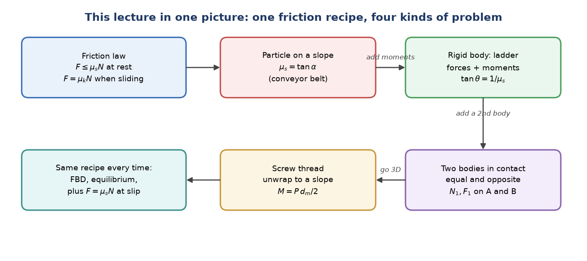
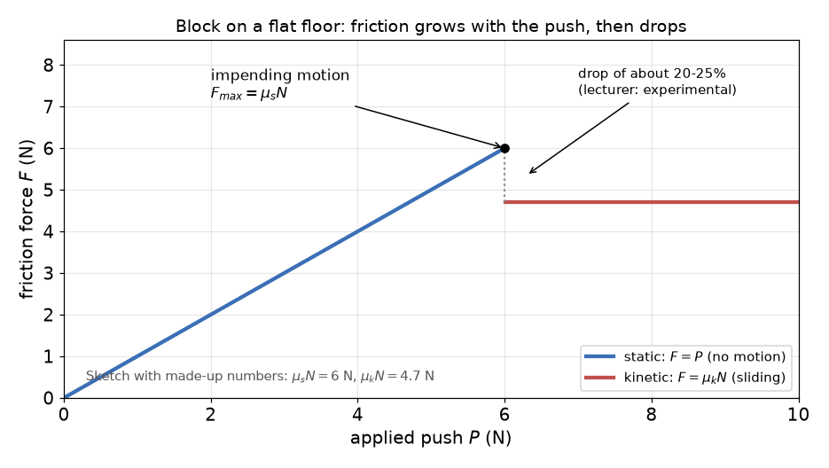
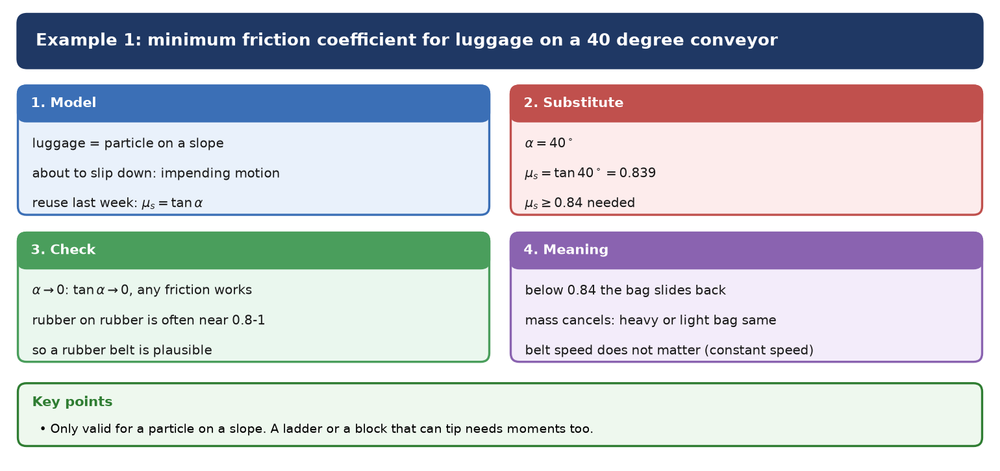
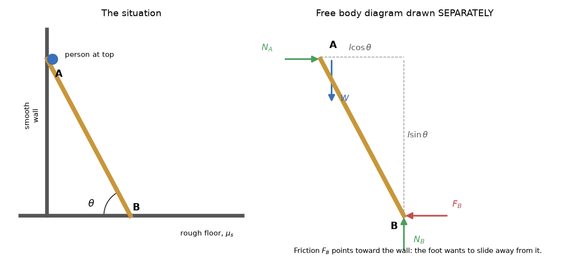
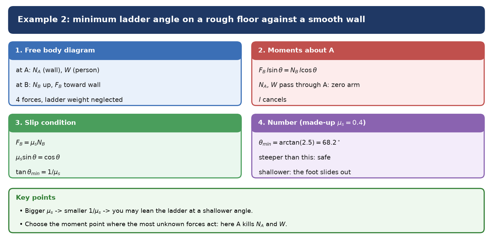
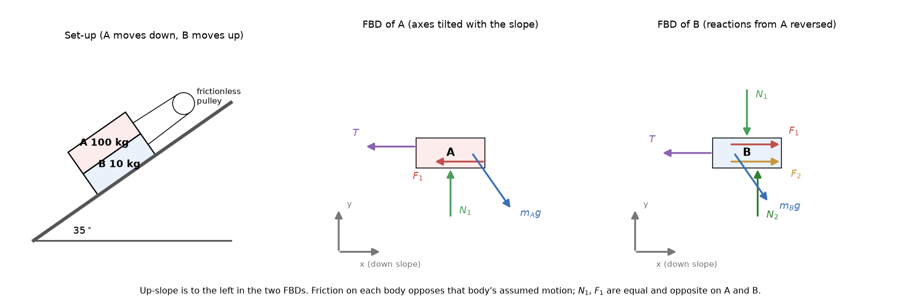
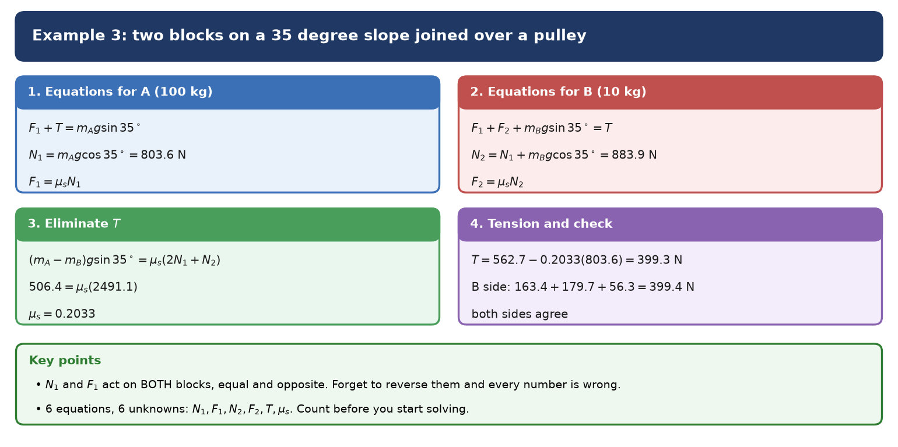
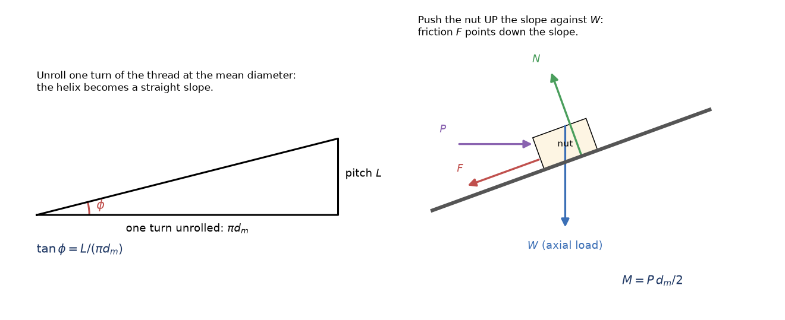
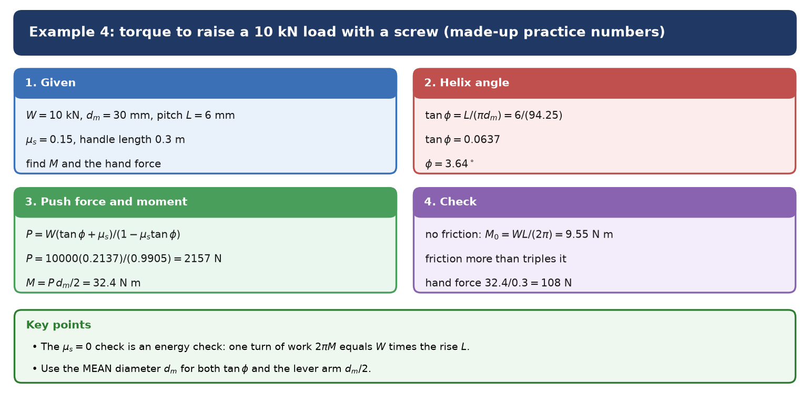

# MECH40009 Mechanics — Friction in Action: Conveyor, Ladder, Two Blocks and Screw Threads

This note covers the Imperial College London first-year lecture ME MECH40009 Mechanics 1 on 2026-11-23. The recording runs 59:59 and the teaching content runs from 01:02 to 55:32. It is written only from the automatic transcript, because the video and slides could not be downloaded. When the lecturer points at a figure, the figure is described in words from what she says, and the source is the transcript.

## What this lecture is about

Last week started the friction section of the statics notes. This week the lecturer finishes the basic friction law, then uses it on four kinds of problem: a particle on a slope, a ladder (a rigid body that can turn), two blocks pressed against each other, and the screw thread of a nut and bolt. The method never changes. Draw a free body diagram, write the equilibrium equations, and add one extra equation, $F=\mu_sN$, at the moment slipping is about to start.

Three words used all the time below. A **free body diagram** is a sketch of one object on its own, with every force on it drawn as an arrow and everything touching it removed. A **particle** is an object whose size does not matter, so only force balance is needed. A **rigid body** is an object that can also turn, so you need a moment balance as well.

Figure 1. The lecture as one chain. Each new problem adds one difficulty: moments for the ladder, a second body for the blocks, three dimensions for the screw. Drawn for this note from the transcript.

## 0. Chapter map

| Part | Time | Topic | Question it answers |
|---|---|---|---|
| 1 | 01:30–03:31 | Recap: dry friction and the tilt test | Why does friction have a maximum? |
| 2 | 03:31–07:30 | Static and kinetic friction on a flat floor | Which formula do I use before, at and after slipping? |
| 3 | 07:30–13:04 | Example: airport conveyor belt | How grippy must a 40 degree belt be? |
| 4 | 13:04–26:33 | Example: ladder against a smooth wall | How shallow can a ladder lean before it slides? |
| 5 | 26:33–38:30 | Example: two blocks over a pulley | How do I handle two bodies that touch? |
| 6 | 39:02–40:37 | Progress test notice | What is in the test? |
| 7 | 40:37–55:32 | Screw threads | What moment tightens a nut against a load? |

## 1. Recap: dry friction and the tilt test (01:30–03:31)

In plain words: friction is not a fixed force. It is exactly as big as it needs to be to stop sliding, up to a ceiling. Once the ceiling is reached, things start to slide.

The lecturer's model is **dry Coulomb friction**. Two dry surfaces touch only at tiny bumps. Where the bumps press together they weld into small junctions. To slide one surface over the other you must break these junctions, and that resistance is friction.

Last week's class demonstration put a block on a slope whose angle $\alpha$ could be raised. While the block stays put, the friction force equals the downhill part of the weight, $F=W\sin\alpha$, and it grows as $\alpha$ grows. At one particular angle the block starts to move. At that instant friction has reached its maximum, and only then may you write:

$$F=\mu_sN$$

Here $\mu_s$ is the **coefficient of static friction**, a number with no units, and $N$ is the **normal force**, the push of the surface straight out of itself, in newtons. Before that instant, $F=W\sin\alpha$ is the correct friction, not $\mu_sN$.

## 2. Static and kinetic friction on a flat floor (03:31–07:30)

Now put the block on a flat floor and push it sideways with a force $P$. Weight $W$ is balanced by $N$, and the push $P$ is balanced by friction $F$. Push harder and friction grows with you, one newton for one newton, so a graph of $F$ against $P$ is a line of slope 1. That line ends at the **impending motion** point, the last instant of balance, where $F=\mu_sN$.

Push past that point and the block slides. The friction then drops to a lower, roughly constant value set by the **coefficient of kinetic friction** $\mu_k$. Anyone who has shoved a heavy wardrobe knows this: the hardest moment is getting it started. Once the junctions are broken it takes less force to keep it moving. The lecturer said $\mu_k$ is typically about 20 to 25% less than $\mu_s$. The transcript writes this as "2,025%", an ASR error. At very high speeds other effects, such as aerodynamics, can lower friction further, but this course does not go there.

Figure 2. Friction against push, as the lecturer described it from her slide. The numbers are made up to show the shape only.

A student asked whether $\mu_s$ and $\mu_k$ are related by a formula. The lecturer said she knows of no model, only experimental data. So treat both as measured numbers.

| Item | Formula card: friction law |
|---|---|
| Formula | At rest: $F\leq\mu_sN$. Impending slip: $F=\mu_sN$. Sliding: $F=\mu_kN$ |
| Symbols | $F$ friction force (N); $N$ normal force (N); $\mu_s$, $\mu_k$ static and kinetic coefficients (no units) |
| Conditions | Dry surfaces. $\mu_sN$ only at the instant slipping starts; $\mu_kN$ only while sliding |
| Steps | Decide the state first (at rest, about to slip, or sliding), then choose the formula |
| Common error | Writing $F=\mu_sN$ for a body that is comfortably at rest. Then you have overstated friction |

The equilibrium equations still hold at the impending-motion instant, because that is the last moment of balance. They also hold for something sliding at constant velocity, since there is no acceleration. In that case pair them with $F=\mu_kN$.

### Example 1. Minimum friction for luggage on a conveyor

**What is asked**

An airport conveyor belt carries baggage up into an aircraft hold. The belt is inclined at 40 degrees. What is the minimum coefficient of static friction between the baggage and the belt so the bags do not slip back down?

$$\alpha=40^{\circ},\qquad \text{find } \mu_{s,min}$$

**Why this route**

A bag on a belt is the same picture as last week's block on a slope: a particle, so no moments are needed. "Minimum coefficient" means the bag is just about to slip, so impending motion applies. Last week's result was derived for exactly this case, so we reuse it instead of rewriting two equilibrium equations.

**Step 1: write the two equilibrium equations on the slope**

Perpendicular to the belt, the normal force balances the part of the weight pressing in. Along the belt, friction balances the part pulling down the slope.

$$N=W\cos\alpha,\qquad F=W\sin\alpha$$

**Step 2: impose the slip condition**

Replace $F$ by $\mu_sN$ and divide the second equation by the first. The weight $W$ cancels.

$$\mu_sW\cos\alpha=W\sin\alpha\quad\Rightarrow\quad\mu_s=\tan\alpha$$

**Step 3: put in the angle**

$$\mu_s=\tan40^{\circ}=0.839$$

**Where the constant comes from**

$\tan\alpha$ appears because it is the ratio of the downhill pull ($\sin\alpha$) to the press-in ($\cos\alpha$). Friction can supply at most $\mu_s$ times the press-in, so it must be at least that ratio. The lecturer rounded 0.839 to 0.84.

**Sanity check**

At $\alpha=0$ we get $\tan0=0$: a flat belt needs no friction at all, which is right. As $\alpha$ approaches 90 degrees, $\tan\alpha$ blows up: no friction can hold a bag on a vertical belt. The value 0.84 is typical of rubber, and the lecturer noted belts are made of rubbery material. That matches last week's demo, where the rubber-faced block needed a steeper angle to slide.

**Answer**

$$\mu_{s,min}=\tan40^{\circ}\approx0.84$$

**Trap**

The bag's mass does not appear, so a heavy suitcase and a light backpack need the same coefficient. Writing $\mu_s=\sin40^{\circ}=0.64$ is a common slip: it forgets that friction scales with $N=W\cos\alpha$, not with $W$.

The lecturer added that the Design and Manufacture lecturer will set a problem to select a motor and transmission for this conveyor. That links mechanics to design.

Technique: a particle on a slope at impending slip gives $\mu_s=\tan\alpha$ every time. Anything that can tip or turn needs moments too.

## 4. A ladder against a smooth wall (13:04–26:33)

In plain words: a ladder is a rigid body, not a particle. It can rotate, so you need a moment equation as well as force equations. The lecturer warned that $\mu_s=\tan\alpha$ is not a universal answer. It only works for a particle on a slope.

She also gave a progress-test rule. Draw the free body diagram as a separate sketch next to the question, never on top of the original picture. Leave out the wall, floor and ropes and draw only the forces they apply. Forces drawn on the original sketch score zero for the diagram, and diagrams usually carry quite a few marks.

Figure 3. The ladder and its free body diagram, rebuilt from the lecturer's spoken description: four forces, the wall reaction at the top, the person's weight at the top, and a normal force plus friction at the foot.

### Example 2. Minimum ladder angle

**What is asked**

A worker leans a ladder against a smooth wall (no friction at the wall) and wants to climb to the very top. The static coefficient of friction between the ladder foot and the floor is $\mu_s$. Neglect the ladder's weight. Find the minimum angle $\theta$ between the ladder and the floor before it slips.

$$\text{given } \mu_s,\ W \text{ at top A},\ \text{smooth wall at A},\ \text{rough floor at B}:\qquad\text{find }\theta_{min}$$

**Why this route**

There are four unknown forces but only one is wanted indirectly. Taking moments about A removes two forces at once: the wall reaction $N_A$ and the weight $W$ both act at A, so their moment arm is zero. What remains links only $F_B$ and $N_B$. The slip condition links those same two, so $N_B$ cancels and only $\theta$ is left.

**Step 1: take moments about A**

Let the ladder length be $l$. The foot B is $l\sin\theta$ below A and $l\cos\theta$ out from the wall. The horizontal force $F_B$ has arm $l\sin\theta$. The vertical force $N_B$ has arm $l\cos\theta$. Their turning effects must cancel.

$$F_B\,l\sin\theta=N_B\,l\cos\theta$$

**Step 2: substitute the slip condition**

At the minimum angle the foot is about to slide, so $F_B=\mu_sN_B$. The length $l$ cancels on both sides, and so does $N_B$.

$$\mu_sN_B\sin\theta=N_B\cos\theta\quad\Rightarrow\quad\mu_s=\frac{\cos\theta}{\sin\theta}=\cot\theta$$

**Step 3: solve for the angle**

The question gives $\mu_s$ and asks for $\theta$, so invert. Cotangent is one over tangent.

$$\tan\theta_{min}=\frac{1}{\mu_s}\quad\Rightarrow\quad\theta_{min}=\arctan\frac{1}{\mu_s}$$

**Step 4: try a number**

The lecture kept $\mu_s$ as a symbol. As an illustration with a made-up value $\mu_s=0.4$:

$$\theta_{min}=\arctan(2.5)=68.2^{\circ}$$

**Where the constant comes from**

The $\cot\theta$ comes from the two moment arms: $l\cos\theta$ for the floor's normal force and $l\sin\theta$ for friction. Friction has the arm that shrinks when the ladder lies flatter, so a flat ladder asks more of friction.

**Sanity check**

Force balance confirms the picture: horizontally $F_B=N_A$, vertically $N_B=W$. Trend: a smaller $\theta$ (flatter ladder) makes $\cot\theta$ bigger, so more friction is needed. Everyday experience agrees: a ladder leaned very flat slides out, so you stand it more upright. Limit: if $\mu_s\to0$ then $\theta_{min}\to90^{\circ}$, so on ice the ladder must be almost vertical.

**Answer**

$$\mu_s=\cot\theta_{min},\qquad\theta_{min}=\arctan\frac{1}{\mu_s}\qquad(68.2^{\circ}\text{ for }\mu_s=0.4)$$

**Trap**

In class the lecturer first wrote "$\mu_s$ equals theta" and "inverse cotangent", then corrected herself after a student asked. The correct relation is $\mu_s=\cot\theta$. A second trap is pointing $F_B$ away from the wall. The foot tends to slide away from the wall, so friction on it points toward the wall. A third trap is using $\mu_s=\tan\theta$ from the slope problem, which here gives the wrong angle, 21.8 degrees instead of 68.2.

Technique: take moments about the point where the most unknown forces meet.

## 5. Two blocks joined over a pulley (26:33–38:30)

In plain words: when two bodies touch, the push and the friction between them come in equal and opposite pairs. If you draw them on one body, you must draw them reversed on the other.

Figure 4. The set-up and the two separate free body diagrams, rebuilt from the lecturer's spoken description. The axes are tilted: $x$ along the slope (down-slope positive), $y$ perpendicular to it.

The lecturer explained two choices. First, you must draw A and B separately. Drawing the whole system as one body hides the A–B contact forces, so you cannot solve for them. You may draw "whole system plus one block", but not the whole system alone. Second, you must guess which way things move. Here A is heavier, so assume A slides down and B up. If a guess is wrong, you will get a negative coefficient or angle, and then you know to flip it without redoing everything.

### Example 3. Two blocks on a 35 degree slope

**What is asked**

Block A (100 kg) rests on block B (10 kg), which rests on a plane inclined at 35 degrees. A rope over a frictionless pulley joins them, so the tension is the same on both sides. The same static coefficient acts between A and B and between B and the plane, and both surfaces reach impending motion together. Find (a) the minimum $\mu_s$ to prevent slipping, (b) the rope tension $T$.

$$m_A=100\ \text{kg},\quad m_B=10\ \text{kg},\quad\alpha=35^{\circ},\quad g=9.81\ \text{m/s}^{2}:\qquad\text{find }\mu_s,\ T$$

**Why this route**

Each block is a particle, so it gives two force equations, four in total. The two slip equations make six. The unknowns are $N_1, F_1, N_2, F_2, T, \mu_s$, also six. Counting first tells you the problem is solvable. Then the clever move is to eliminate $T$ by adding the two along-slope equations, which avoids messy algebra.

**Step 1: write the equations for A**

A slides down, so friction $F_1$ from B on A points up the slope, and the rope also pulls A up the slope. Together they balance the down-slope weight component. Perpendicular to the slope, $N_1$ balances the press-in component.

$$F_1+T=m_Ag\sin35^{\circ}\quad(1),\qquad N_1=m_Ag\cos35^{\circ}=803.6\ \text{N}\quad(2)$$

**Step 2: write the equations for B**

B moves up. The rope pulls it up the slope. Three things pull it down the slope: friction $F_1$ from A (reversed from Step 1), friction $F_2$ from the plane, and B's own weight component. Perpendicular to the slope, the plane's push $N_2$ must hold both A's push $N_1$ and B's own press-in.

$$F_1+F_2+m_Bg\sin35^{\circ}=T\quad(3),\qquad N_2=N_1+m_Bg\cos35^{\circ}=883.9\ \text{N}\quad(4)$$

**Step 3: write the two slip conditions**

$$F_1=\mu_sN_1\quad(5),\qquad F_2=\mu_sN_2\quad(6)$$

**Step 4: eliminate T and solve for mu_s**

Substitute (3) into (1) to remove $T$. Then $F_1$ appears twice, once from each block, and the weight terms combine.

$$m_Ag\sin35^{\circ}-m_Bg\sin35^{\circ}=2F_1+F_2=\mu_s(2N_1+N_2)$$

$$\mu_s=\frac{(100-10)(9.81)(0.5736)}{2(803.6)+883.9}=\frac{506.4}{2491.1}=0.2033$$

**Step 5: back-substitute for T**

$$T=m_Ag\sin35^{\circ}-\mu_sN_1=562.7-0.2033\times803.6=399.3\ \text{N}$$

**Where the constant comes from**

The factor 2 in front of $N_1$ is the key. The A–B contact rubs both blocks, and both frictions $F_1$ resist the motion, one on each block. The difference $m_A-m_B=90$ kg is what drives the motion: the heavy block wants to go down and drag the light one up.

**Sanity check**

Check equation (3) independently: $F_1+F_2+m_Bg\sin35^{\circ}=163.4+179.7+56.3=399.4$ N, matching $T=399.3$ N up to rounding. Both answers match the values the lecturer gave in class: $\mu_s=0.2033$ and $T=399.3$ N. If the blocks had equal mass, the numerator would be zero, so no friction would be needed, which also makes sense.

**Answer**

$$\mu_s=0.2033,\qquad T=399.3\ \text{N}$$

**Trap**

Forgetting to reverse $N_1$ and $F_1$ on B. If you draw $F_1$ on B in the same direction as on A, the 2 in $2N_1$ becomes 0 and you get $\mu_s=506.4/883.9=0.573$, almost three times too big. The lecturer called this the key point of the problem.

Technique: count equations and unknowns before solving. If they match, start eliminating.

## 6. Progress test notice (39:02–40:37)

The Mechanics progress test covers everything up to the end of section 2, not the friction material now being taught. Tutorial sheets 0 to 3 are in scope and sheet 4 is not. The transcript is unclear on the exact sheet range. It is marked by hand, so results come back in January. It is set for 40 minutes but should take about 30, to give extra time to anyone who needs it. Last year's test, typically two questions, is on Canvas. This year the progress tests do not count towards the mark.

## 7. Screw threads (40:37–55:32)

In plain words: tightening a nut is the same as pushing a small block up a very gentle ramp that is wrapped around a cylinder. Unwrap the ramp and it becomes the slope problem you already know.

The set-up: a nut on a screw is tightened against an **axial load** $W$. You turn it with a spanner, and the question is what moment you must apply. The lecturer stressed that $W$ is not necessarily a weight. It is the resistance you feel as you squeeze parts together. When you clamp two plates with a bolt, the plates compress and push back. The screw can even be horizontal. The nut's own weight is tiny compared with $W$.

A screw thread is a line of constant slope wound around a cylinder, a **helix**. Three quantities describe it:

| Quantity | Symbol here | Meaning |
|---|---|---|
| Mean diameter | $d_m$ | Diameter half-way into the thread depth. The thread depth is small compared with it |
| Pitch | $L$ | Axial distance the nut rises in one full turn |
| Helix angle | $\phi$ | Slope angle of the thread, the same whichever way you look at the screw |

The transcript's symbol for pitch sounds like "T" or "tea". This note uses $L$ instead to avoid a clash with tension $T$. Check the symbol against the data and formula book.

Imagine a small speck sitting in the thread. Follow it once around the back and up to the front. It travels $\pi d_m$ around and rises $L$. Unroll that one turn into a flat triangle:

$$\tan\phi=\frac{L}{\pi d_m}$$

So only two of the three quantities are independent. Know any two and the third follows.

Figure 5. Turning a 3D thread into a 2D slope. The push $P$ acts horizontally at the mean radius $d_m/2$ from the screw axis. Drawn for this note from the transcript.

Now the nut is a block on a slope of angle $\phi$. The horizontal push $P$ (from your spanner) drives it up the slope against $W$. Because it moves up, friction $F$ points down the slope. Resolve horizontally ($x$) and vertically ($y$):

$$P-F\cos\phi-N\sin\phi=0$$

$$N\cos\phi-F\sin\phi-W=0$$

$$F=\mu_sN$$

Known: $W$, $\mu_s$, $\phi$. Unknown: $P$, $F$, $N$. Three equations, three unknowns. Put $F=\mu_sN$ into the vertical equation to get $N=W/(\cos\phi-\mu_s\sin\phi)$. Put that into the horizontal equation, then divide top and bottom by $\cos\phi$, which turns each sine over cosine into a tangent:

$$P=W\,\frac{\sin\phi+\mu_s\cos\phi}{\cos\phi-\mu_s\sin\phi}=W\,\frac{\tan\phi+\mu_s}{1-\mu_s\tan\phi}$$

Finally, the push $P$ acts at the mean radius, so the moment you must apply to the nut is:

$$M=P\,\frac{d_m}{2}$$

The lecturer said you do not need to memorise this. It is in the data and formula book and she will not ask you to derive it. Even so, it is only a 2D slope problem, so you should be able to derive it quickly.

A student asked why the arm is always the mean radius. The answer: the thread depth is small compared with $d_m$. So think of the nut as a circle of radius $d_m/2$ being turned by a force $P$ at its rim. The transcript writes this as "r m over two" at one point. The lecturer corrected herself on the board: the mean radius is $r_m=d_m/2$.

| Item | Formula card: moment to raise a load with a screw |
|---|---|
| Formula | $M=\dfrac{d_m}{2}\,W\,\dfrac{\tan\phi+\mu_s}{1-\mu_s\tan\phi}$, with $\tan\phi=L/(\pi d_m)$ |
| Symbols | $M$ moment (N m); $W$ axial load (N); $d_m$ mean diameter (m); $L$ pitch (m); $\phi$ helix angle; $\mu_s$ static coefficient |
| Conditions | Nut moving against the load (tightening or raising), at impending motion; thread depth small compared with $d_m$ |
| Steps | Find $\tan\phi$; find $P$; multiply by $d_m/2$; divide by the spanner length for the hand force |
| Common error | Using the outer diameter instead of $d_m$, or forgetting the $/2$ in the lever arm |

### Example 4. Torque to raise a load with a screw

**What is asked**

The lecturer derived the formula and left examples for next lecture, so this one uses made-up practice numbers. A screw lifts an axial load of 10 kN. The mean diameter is 30 mm, the pitch is 6 mm and $\mu_s=0.15$. Find the moment needed, and the hand force on a 0.3 m handle.

$$W=10\ \text{kN},\quad d_m=30\ \text{mm},\quad L=6\ \text{mm},\quad\mu_s=0.15,\quad\text{handle }0.3\ \text{m}:\qquad\text{find }M$$

**Why this route**

Raising the load means the nut moves against $W$, which is exactly the case the formula was derived for. Using the ready formula is faster than re-resolving forces. We also do a no-friction check, which an energy argument gives independently.

**Step 1: find the helix angle**

Work in millimetres for the ratio; the units cancel.

$$\tan\phi=\frac{L}{\pi d_m}=\frac{6}{\pi\times30}=0.0637,\qquad\phi=3.64^{\circ}$$

**Step 2: find the push P**

$$P=W\,\frac{\tan\phi+\mu_s}{1-\mu_s\tan\phi}=10000\times\frac{0.0637+0.15}{1-0.15\times0.0637}=10000\times\frac{0.2137}{0.9905}=2157\ \text{N}$$

**Step 3: find the moment and the hand force**

Now convert to metres. The lever arm is the mean radius, $0.030/2=0.015$ m.

$$M=P\,\frac{d_m}{2}=2157\times0.015=32.4\ \text{N m},\qquad F_{hand}=\frac{32.4}{0.3}=108\ \text{N}$$

**Where the constant comes from**

The $\pi$ comes from the circumference of one turn, $\pi d_m$. The $1/2$ in the lever arm turns diameter into radius. The friction coefficient 0.15 is more than twice $\tan\phi=0.064$, so most of the effort goes into fighting friction, not lifting.

**Sanity check**

Set $\mu_s=0$. Then $P=W\tan\phi$ and $M_0=W\tan\phi\,d_m/2=WL/(2\pi)=10000\times0.006/(2\pi)=9.55$ N m. The energy view gives the same: one turn does work $2\pi M_0$ and lifts $W$ by $L$, so $2\pi M_0=WL$. Friction raises the moment from 9.55 to 32.4 N m, about 3.4 times. A 108 N hand force, roughly an 11 kg pull, is reasonable for a person.

**Answer**

$$M\approx32.4\ \text{N m},\qquad F_{hand}\approx108\ \text{N}$$

**Trap**

Using $\tan\phi=L/d_m$ and forgetting $\pi$ gives $\tan\phi=0.2$ and $M=54.1$ N m, about 67% too big. Using the full diameter as the arm doubles the moment to 64.7 N m. Mixing mm and m in the last step gives a moment 1000 times too big.

Memory trick: unwrap the thread, push the block up, multiply by the mean radius.

A cross-check you can do yourself, not from the lecture: if you define a **friction angle** $\phi_s$ by $\tan\phi_s=\mu_s$, the push formula is the tangent addition formula, $P=W\tan(\phi+\phi_s)$. With $\phi=3.64^{\circ}$ and $\phi_s=8.53^{\circ}$, $\tan12.17^{\circ}=0.2157$, which gives the same 2157 N.

## Pitfalls and look-alikes

| Easily confused | The difference | Wrong result if mixed up |
|---|---|---|
| $F=W\sin\alpha$ vs $F=\mu_sN$ | The first is the friction needed at rest; the second is the ceiling, reached only at impending slip | Friction overstated for bodies at rest |
| $\mu_s$ vs $\mu_k$ | Static to start motion; kinetic to keep it going, about 20–25% lower | Starting force underestimated |
| Particle on slope vs ladder | Particle: forces only, $\mu_s=\tan\alpha$. Rigid body: add moments | Ladder angle 21.8 degrees instead of 68.2 degrees |
| $\mu_s=\tan\theta$ vs $\mu_s=\cot\theta$ | Slope problem vs ladder against smooth wall | Angles swapped about 45 degrees |
| Action–reaction between bodies | Same size, opposite direction on each body | $\mu_s=0.573$ instead of 0.2033 in Example 3 |
| Weight vs axial load in a screw | $W$ is any resisting axial force, not the nut's weight | You look for a mass that is not there |
| Mean diameter vs outer diameter | $\tan\phi$ and the lever arm both use $d_m$ | Moment wrong by tens of percent |

## Chapter summary and review sheet

| Problem type | Extra equation at slip | Key result |
|---|---|---|
| Particle on slope | $F=\mu_sN$ | $\mu_s=\tan\alpha$ |
| Ladder, smooth wall, rough floor | $F_B=\mu_sN_B$ plus moments about A | $\tan\theta_{min}=1/\mu_s$ |
| Two blocks in contact | $F_1=\mu_sN_1$, $F_2=\mu_sN_2$ | $\mu_s=(m_A-m_B)g\sin\alpha/(2N_1+N_2)$ for this set-up |
| Screw thread, raising load | $F=\mu_sN$ on the unrolled slope | $M=\tfrac{d_m}{2}W(\tan\phi+\mu_s)/(1-\mu_s\tan\phi)$ |

Short recipe: (1) decide the state (at rest, impending, sliding); (2) draw each body's free body diagram separately; (3) guess the direction of motion and point friction against it; (4) write force and, for rigid bodies, moment equations; (5) add $F=\mu_sN$ at each slipping surface; (6) count equations and unknowns, then solve; (7) a negative answer means your guess was backwards.

Memory trick: "Friction matches you until it maxes out; at the max, add $\mu N$."

## Sources and open items

Source: the automatic transcript of "ME MECH40009 Mechanics 1 (2026-11-23)", 59:59, from Panopto. The video returned HTTP 403, so no slide or board frame was seen. Every figure was redrawn for this note from the lecturer's spoken description with Matplotlib. Examples 1 and 3 use the lecture's own numbers and agree with the answers given in class. Examples 2 (numeric part) and 4 use made-up practice numbers, marked as such.

Chapter range Ch3: the lecturer said the progress test covers "everything up to the end of section two, not what we're doing now", and that last week started "a new section in your statics notes" on friction. So today's friction applications belong to section 3. The previous Mechanics note (2026-11-16) was named Ch2-3 for the same reason.

ASR doubts, each judged from context:

| Time | Transcript says | Judged as |
|---|---|---|
| 06:04 | "about 2,025% less than us" | About 20–25% less than $\mu_s$ |
| 08:34 | "f equals in USA" | $F=\mu_sN$ |
| 10:36, 12:00 | "ten alpha" | $\tan\alpha$ |
| 12:34 | "Alexis ... your lecturer for GMF" | The Design and Manufacture (DMF) lecturer; name spelling uncertain |
| 18:41 | "put the metre up" / "multimeter" | Probably Mentimeter, the class polling tool |
| 23:46–26:01 | "mu s is equal to theta", "inverse cotangent of theta" | Lecturer's slip, corrected in class: $\mu_s=\cot\theta$, $\theta=\arctan(1/\mu_s)$ |
| 39:36 | "sheets zero and three", "up to question three sheet" | Probably tutorial sheets 0–3 in scope, sheet 4 not; exact range uncertain |
| 40:03 | "Because it's 32" | Unclear; not used |
| 43:34, 46:32 | pitch called "tea" / "T" | Symbol uncertain; this note uses $L$ |
| 44:31–49:03 | helix angle "five", "high", "phi" | $\phi$ |
| 45:36, 52:36 | "r m over two", "REM" | Mean radius $r_m=d_m/2$, corrected on the board |
