# MECH40006 Materials 1 — Lecture 7: Bond Energy (wrap-up) and Crystal Structures

> Course: MECH40006 Materials 1, Imperial College London, first-year Mechanical Engineering (ME1).
> Lecture date: 2026-11-18. Recording title: ME MECH40006 - Materials 1 (2026-11-18).
> Covered time span: 01:09-53:10. After 53:10 the recording only contains after-class conversation, with no lecture content.
> Slides seen in the captured frames: slides 15, 14 and 20 of the bonding deck, then slides 2-8 and 10 of the crystal structure deck. No frames were captured after 40:00, so everything from 40:00 to 53:10 (stacking sequences, HCP, FCC) comes from the audio only.

## What this lecture is about

The lecture has two parts. First it finishes last week's topic: the force and energy between two isolated atoms, why the bond energy comes out negative, how the shape of the energy curve links to thermal expansion, and how to find the equilibrium spacing $r_0$ from a power-law model. Then it starts a new topic, crystal structure: how very many atoms arrange themselves in a solid. It defines crystal, lattice, unit cell, primitive cell and lattice point, introduces the hard sphere model of the atom, compares square and hexagonal packing in two dimensions, and builds the two close-packed three-dimensional structures, HCP and FCC, by stacking close-packed planes.

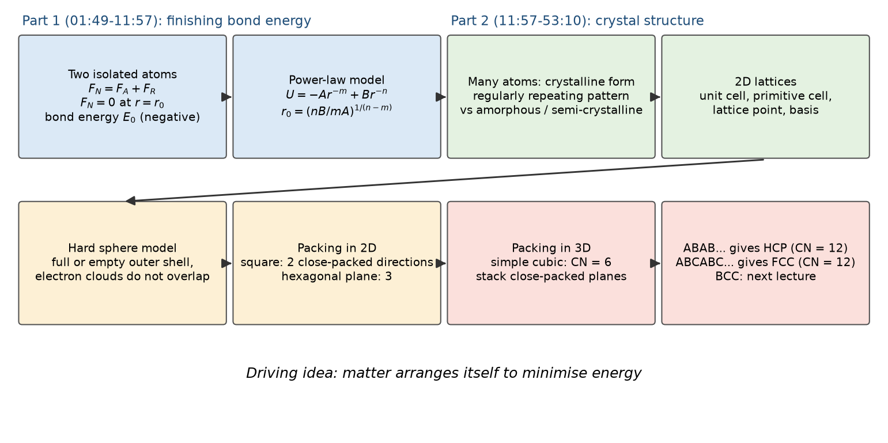
*Figure 0 — Overview of the lecture. Part 1 finishes bond energy; Part 2 builds crystal structures from 2D lattices up to HCP and FCC. Schematic drawn for this note.*

---

## 1. Recap: force versus interatomic separation (01:49-05:37)

The lecture opens by returning to last week's slide, partly to answer a tutorial question about the sign of the bond energy. The picture is two isolated atoms. They start infinitely far apart, so they do not interact at all and are "completely unaware of each other". They are then brought closer and closer, through the point where they stop attracting and start repelling each other.

Two forces act between the atoms. The **attractive force** $F_A$ is long range: it is still felt when the atoms are fairly far apart. The **repulsive force** $F_R$ is short range: it only switches on at small separation, but then becomes very large very quickly. The **net force** $F_N$ is what the atoms actually feel, and it is literally the sum of the two curves (slide 15):

$$F_N = F_A + F_R$$

Here $F$ is a force in newtons (N), and the horizontal axis is the **interatomic separation** $r$, the distance between the two atom centres, in metres (m). On the slide's force graph, attraction is plotted upwards (positive) and repulsion downwards (negative).

Where does the strong short-range repulsion come from? Think of the Bohr model: each atom is a nucleus of protons and neutrons with electron orbitals around it. When two atoms are pushed so close that their electron orbitals start to overlap, they very strongly resist. That resistance is the repulsive force. It "cuts in" only at small separation but becomes very negative very quickly.

The most important point on the net-force curve is where attraction exactly balances repulsion, so that there is no net force. The centre-to-centre spacing at that point is called the **equilibrium spacing** $r_0$. The slide gives $r_0 \approx 0.3$ nm for many atoms.

$$F_N = 0 \quad \text{at} \quad r = r_0$$

So in a solid we expect neighbouring atoms to sit $r_0$ apart. To pull them further apart we must do work against the net attraction; if the material stays elastic, they want to go back. Conversely, if we push them closer together, they push back. Either way, the atoms "want to be at $r_0$".

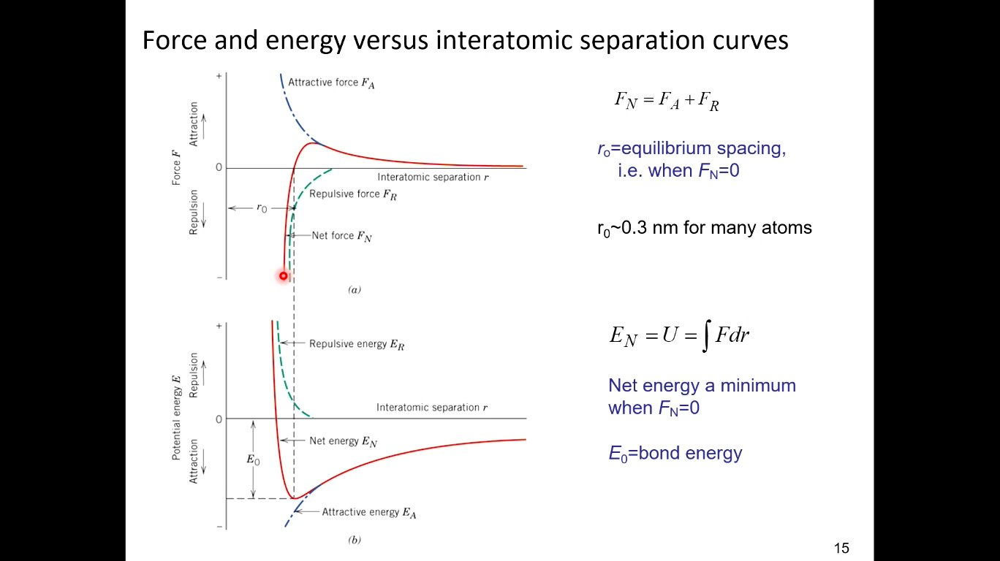
*Figure 1 — Slide 15, "Force and energy versus interatomic separation curves" (frame t0240, 04:00). Top: attractive, repulsive and net force, with $r_0$ where $F_N = 0$. Bottom: the matching energy curves, with the bond energy $E_0$ at the minimum.*

Summary: the net force is attraction plus repulsion, and it is zero at $r_0$. Pitfall: $r_0$ is where the force is zero, not where the energy is zero. Memory tip: long-range pull plus short-range push gives a resting distance.

---

## 2. Bond energy and why it is negative (05:37-07:13)

Force and energy are linked. The slide writes the net potential energy $E_N$, also called $U$, as the integral of the force over separation. $E_N$ is an energy in joules (J). The slide also notes that the net energy is a minimum exactly where $F_N = 0$, that is at $r = r_0$.

$$E_N = U = \int F \, dr$$

The **bond energy** $E_0$ is the energy needed to take two atoms sitting at their equilibrium position and separate them until they no longer interact at all. We describe that as separating them "to infinity". On the energy curve it is the depth of the well, measured from the zero line down to the minimum. In the audio this quantity is heard as "the z0 position" at 05:47; the slide labels it $E_0$.

Where we put zero energy is a free choice. One could argue for putting zero at the bottom of the well, because then the bond energy would be positive. The convention, however, is that energy is zero at infinite separation, where the curve drifts towards zero for large $r$. With that convention the minimum lies below zero, so the bond energy works out negative. The lecturer warns that Question 1 on Tutorial Sheet 5 will give a negative energy, and that this is simply a consequence of where zero has been defined.

Summary: zero energy is at infinite separation by convention, so the bond energy $E_0$ is negative. Pitfall: a negative bond energy is not an arithmetic mistake. Keep the slide's convention $F = dU/dr$, under which attraction is positive (plotted upwards on slide 15). Memory tip: a bound pair sits in a hole below "free" (zero).

---

## 3. Asymmetry of the energy curve and thermal expansion (07:19-08:53)

The bond energy curve is not symmetric about the line $r = r_0$. It is much steeper on the left, at small separation, than on the right. Different atomic bonds give different shapes: some have deep, narrow troughs and some have shallower, wider troughs.

As a material is heated up from absolute zero, the atoms gain energy, which we picture as moving up the curve. At each energy level they vibrate between a smallest and a largest interatomic spacing. Because the curve is asymmetric, the mean position of the vibrating atoms moves to the right as the temperature rises. The more asymmetric the curve, the more the mean position shifts, and so the more the material expands. This is what sets the **coefficient of thermal expansion**, the measure of how much a material expands when heated.

A bond with a deep, narrow well therefore has a relatively small coefficient of thermal expansion, while a shallow, wide well gives a larger one. In the audio at 08:35 the lecturer says "a deep, shallow well", which contradicts itself; the earlier sentence at 07:48 contrasts "deep narrow troughs" with "more shallow, wider troughs", so the intended pair is deep and narrow versus shallow and wide.

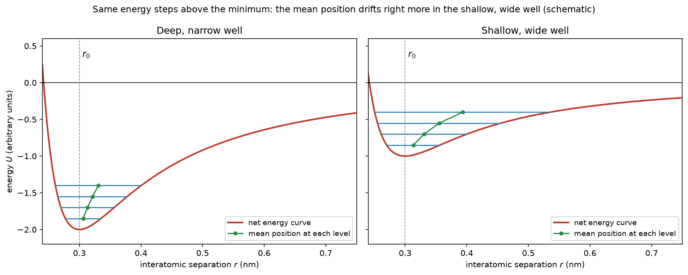
*Figure 2 — Schematic of the idea at 07:19-08:53. Blue lines are vibration ranges at equal energy steps above the minimum; green dots are their mean positions. Curves use the slide-14 power-law shape with the covalent exponents $m = 2$, $n = 9$ and $r_0 = 0.3$ nm; the energy scale is arbitrary. Drawn for this note, not a lecture slide.*

Summary: an asymmetric well makes the mean spacing grow with temperature. Pitfall: thermal expansion comes from the asymmetry, not just from "vibrating more". Memory tip: deep and narrow means stiff and little expansion; shallow and wide means more expansion.

---

## 4. The power-law model and the equilibrium spacing (08:53-11:57)

A common way to describe the bond energy is a **power-law model**: one power of $r$ for the attractive part and one for the repulsive part (slide 14; the audio at 09:00 sounds like "a bomb potential", but the slide says power-law model). Here $U$ is the net energy in J, $r$ is the separation in m, and $A$, $B$, $m$, $n$ are four constants whose values depend on the system, i.e. on the bond type.

$$U = -A r^{-m} + B r^{-n}$$

The first term, $-A r^{-m}$, is the attractive part and is negative. The second term, $+B r^{-n}$, is the repulsive part and is positive. Because of the relationship between energy and force, differentiating the energy gives the force (slide 14):

$$F = \frac{dU}{dr} = \frac{mA}{r^{m+1}} - \frac{nB}{r^{n+1}}$$

Slide 14 lists typical exponents: ionic bonds $m = 1$; covalent bonds $m = 2$ and $n = 9$; metallic bonds $m = 1$ to $4$. In answer to a student question (11:37), the lecturer explains that the values of $A$, $B$, $m$ and $n$ are given for a particular bond type, such as an ionic or a covalent bond.

For an ionic bond, where the attraction is the coulombic force between charges, slide 14 gives the constant $A$ as shown below. Here $\varepsilon_0$ is the permittivity of a vacuum, with units $\text{C}^{2}\,\text{N}^{-1}\,\text{m}^{-2}$ or $\text{F}\,\text{m}^{-1}$ (F is the farad). $Z_1$ and $Z_2$ are the valences of the two ion types, and $q$ is the electronic charge, $1.602 \times 10^{-19}$ C. This illustration was on screen at 09:00-10:00 but was not talked through in the audio.

$$A = \frac{1}{4\pi\varepsilon_0}\left(Z_1 q\right)\left(Z_2 q\right)$$

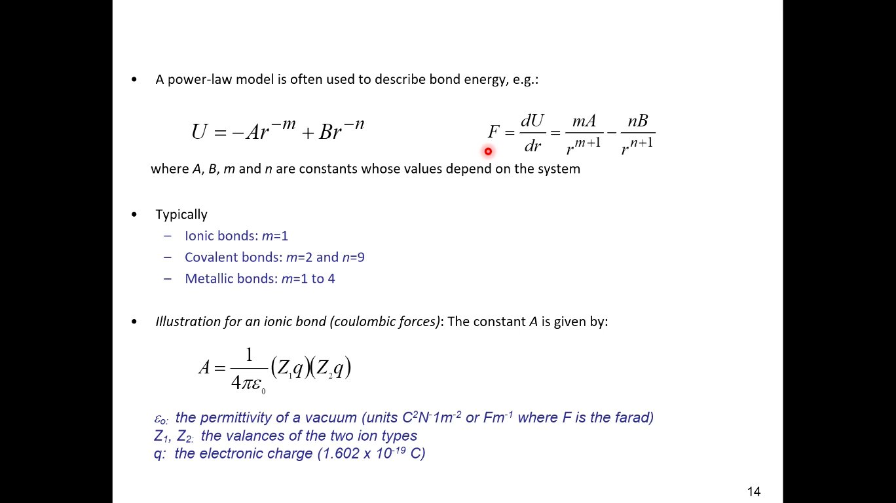
*Figure 3 — Slide 14, the power-law model, its force, the typical exponents and the ionic illustration for $A$ (frame t0600, 10:00).*

The lecturer then ends the bonding part on the worked example from slide 20: differentiate the energy to get the force, set the force to zero at equilibrium, so the $A$ term equals the $B$ term, and solve for $r$, which is $r_0$. For many typical crystalline solids $r_0$ is of the order of $10^{-9}$ m, around $0.3$ nm (the audio at 10:53 says "metres times ten to the nine"; the slide reads $0.3 \times 10^{-9}$ m). Question 1 on Tutorial Sheet 5 uses this result and then asks for the bond energy, which comes out negative.

#### Example 1 — Equilibrium spacing from the power-law model

**What is asked.** Assuming the power-law model, derive an expression for the equilibrium atomic spacing $r_0$ in terms of the constants $A$, $B$, $m$ and $n$ (slide 20).

**Why this route.** $r_0$ is defined as the spacing where the net force is zero. We have the energy $U(r)$, and the force is its derivative, so we differentiate, set the result to zero and solve for $r$.

**Step 1 — Differentiate the energy to get the force.** Differentiate each term with the power rule: the derivative of $-A r^{-m}$ is $+mA r^{-m-1}$, and the derivative of $+B r^{-n}$ is $-nB r^{-n-1}$. This yields the force as a function of $r$.

$$F = \frac{dU}{dr} = \frac{mA}{r^{m+1}} - \frac{nB}{r^{n+1}}$$

**Step 2 — Set the force to zero at $r = r_0$.** At equilibrium the net force on the atoms is zero, so the attractive term must equal the repulsive term. This yields one equation with one unknown, $r_0$.

$$\frac{mA}{r_0^{m+1}} = \frac{nB}{r_0^{n+1}}$$

**Step 3 — Collect the powers of $r_0$.** Multiply both sides by $r_0^{n+1}$ and divide by $mA$. The power of $r_0$ becomes $(n+1) - (m+1) = n - m$. This yields $r_0$ raised to a single power.

$$r_0^{\,n-m} = \frac{nB}{mA}$$

**Step 4 — Take the $(n-m)$-th root.** Raise both sides to the power $1/(n-m)$. This yields the slide's result.

**Where each constant comes from.** $A$, $B$, $m$, $n$ are the four power-law constants of slide 14; their values are given for each bond type (e.g. covalent $m = 2$, $n = 9$). For an ionic bond $A$ comes from the coulombic formula with $\varepsilon_0$, $Z_1$, $Z_2$ and $q = 1.602 \times 10^{-19}$ C. No other constant enters the derivation.

**Sanity check.** Units: $U$ is in J, so $A$ has units $\text{J}\,\text{m}^{m}$ and $B$ has units $\text{J}\,\text{m}^{n}$. Then $nB/(mA)$ has units $\text{m}^{n-m}$, and its $1/(n-m)$ power is in metres, as a length should be. For the ionic case, $A = (Z_1 q)(Z_2 q)/(4\pi\varepsilon_0)$ has units $\text{C}^{2}/(\text{C}^{2}\,\text{N}^{-1}\,\text{m}^{-2}) = \text{N}\,\text{m}^{2} = \text{J}\,\text{m}$, which matches $m = 1$. Substituting $r_0^{\,n-m} = nB/(mA)$ back into Step 2 makes both sides equal. These checks are worked here; they are not on the slide.

**Answer.**

$$r_0 = \left(\frac{nB}{mA}\right)^{1/(n-m)}$$

**Common pitfall.** Sign slips when differentiating negative powers: $-A r^{-m}$ differentiates to $+mA r^{-m-1}$, not $-mA r^{-m-1}$. A second slip is to write the exponent as $n - m$ instead of $1/(n-m)$, or to subtract the powers the wrong way round and get $1/(m-n)$ with $mA/(nB)$ inside, which is the same number written differently but easy to garble.

**Figure.**

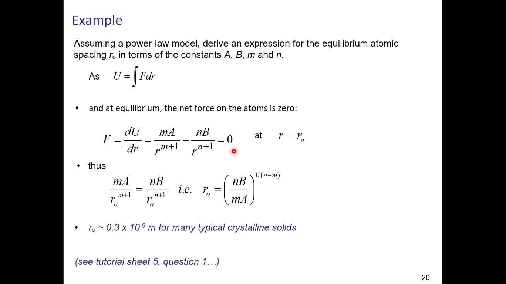
*Figure 4 — Slide 20, the worked example: $U = \int F\,dr$, $F = dU/dr = 0$ at $r = r_0$, hence $r_0 = (nB/mA)^{1/(n-m)}$; $r_0 \approx 0.3 \times 10^{-9}$ m for many typical crystalline solids (frame t0660, 11:00).*

#### Example 2 — The bond energy from the power-law model, and why it is negative

**What is asked.** Once $r_0$ is known, the lecturer says Question 1 of Tutorial Sheet 5 asks for the bond energy, and that it comes out negative. Show where the bond energy comes from in the power-law model and why its sign is negative.

**Why this route.** The bond energy is the value of the energy curve at its minimum, measured from the zero line. So we first check where zero is, then evaluate $U$ at $r_0$, then use the equilibrium condition from Example 1 to see the sign.

**Step 1 — Locate zero energy.** Both terms of the power-law energy shrink to zero as $r$ grows, because $m$ and $n$ are positive. This yields the convention used in the course: energy is zero at infinite separation.

$$\lim_{r \to \infty}\left(-A r^{-m} + B r^{-n}\right) = 0$$

**Step 2 — Evaluate the energy at the minimum.** The net energy is a minimum where $F_N = 0$, that is at $r_0$. Substituting $r_0$ into $U$ yields the bond energy, which is what Tutorial Sheet 5, Question 1 asks you to compute once $r_0$ is known.

$$E_0 = U(r_0) = -A r_0^{-m} + B r_0^{-n}$$

**Step 3 — Use the equilibrium condition to see the sign.** Multiplying the Step 2 equation of Example 1 by $r_0$ gives $mA r_0^{-m} = nB r_0^{-n}$, so the repulsive term equals $\frac{m}{n}$ times the size of the attractive term. Substituting this yields a form whose sign is easy to read. This rearrangement is worked here as a check; it is not on a slide.

$$E_0 = -A r_0^{-m}\left(1 - \frac{m}{n}\right)$$

**Where each constant comes from.** $A$, $B$, $m$, $n$ are again the slide-14 constants for the bond type, and $r_0$ is the result of Example 1. $A$ is positive because $-A r^{-m}$ is the attractive, negative part of the energy. The typical covalent values $m = 2$ and $n = 9$ from slide 14 have $n > m$.

**Sanity check.** With $A > 0$, $r_0 > 0$ and $n > m$, the bracket $1 - m/n$ lies between 0 and 1, so $E_0$ is negative, as the lecturer said. For the covalent values the bracket is $1 - 2/9 = 7/9$, so the repulsive term cancels only $2/9$ of the attraction at $r_0$. Physically, a bound pair must sit lower than the separated pair, which has zero energy.

**Answer.**

$$E_0 = U(r_0) < 0 \quad \text{(with } U \to 0 \text{ as } r \to \infty \text{)}$$

**Common pitfall.** Do not "fix" the negative sign by dropping it: with zero at infinity, a negative bond energy is correct. Also do not confuse the two conditions: $F = 0$ locates $r_0$, while $U(r_0)$ gives $E_0$.

**Figure.**

*Figure 5 — Same slide as Figure 1 (frame t0240): in the lower graph the net energy $E_N$ tends to zero at large $r$ and reaches its minimum at $r_0$; the depth of that minimum is the bond energy $E_0$.*

Summary: the power law gives $r_0$ from $F = 0$ and $E_0$ from $U(r_0)$. Pitfall: mixing up which condition gives which quantity. Memory tip: force zero, then energy value.

---

## 5. From two atoms to crystal structure (11:57-15:08)

Everything so far concerns two isolated atoms. It takes us one step further, but it does not yet explain why materials behave the way they do. For that we must look at a larger scale and ask how atoms behave in large numbers: how they arrange themselves in a solid. The equilibrium spacing tells us how far apart neighbours sit, but not what structure they take up. That question is **crystal structure**.

The learning outcomes (slide 2) are: recognise that crystalline forms occur frequently in the physical world and explain why; define crystal, lattice, primitive cell, unit cell, close-packed direction and close-packed plane; use the hard sphere model to describe how atoms pack to form the HCP, FCC and BCC structures, with example metals for each; and calculate the atomic packing factor of HCP, FCC and BCC and the density of a crystalline material from its unit cell. These lead to Tutorial Sheet 6. In this recording the lecture reached HCP and FCC; BCC is announced for next week, and packing factor and density were not covered.

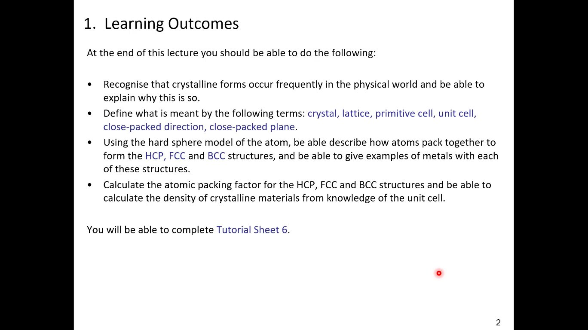
*Figure 6 — Slide 2, learning outcomes for the crystal structure lectures (frame t0840, 14:00).*

Why does it matter? Slide 3 gives three reasons. First, not all mechanical properties can be explained by interatomic forces; the way atoms arrange themselves partly determines how many atoms exist per unit volume. Second, and more importantly, the arrangement of atoms controls the strength and ductility of the material. Third, by understanding this we can learn to control these properties. The lecturer stresses that new vocabulary is coming, and that the link to mechanical properties is next week's topic; this week is about what the arrangements are and how to recognise and define them.

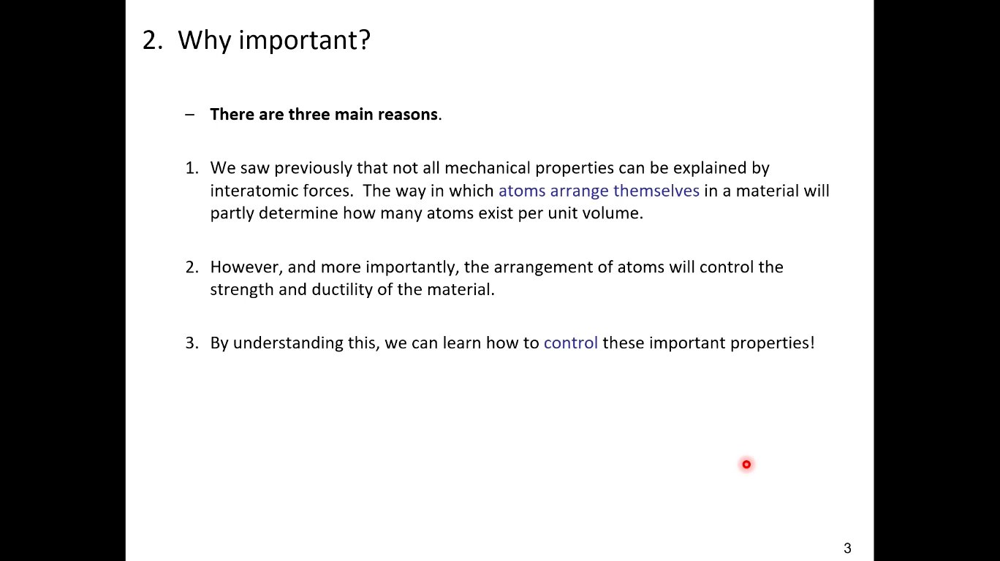
*Figure 7 — Slide 3, "Why important?": three reasons (frame t0900, 15:00).*

Summary: two-atom physics gives spacing and bond energy; crystal structure gives the arrangement, which controls properties. Pitfall: assuming $r_0$ alone fixes the structure. Memory tip: distance from bonding, pattern from crystal structure.

---

## 6. Crystalline form, lattice and amorphous materials (15:08-19:51)

As a general driving force, matter arranges itself to minimise energy (slide 4). So the arrangement of atoms is not random; it is driven by physical laws. That is useful: it means we can recognise and understand the arrangement, and it only changes if we go out of our way to change it. Materials do the same thing under the same conditions, time after time, which makes them reliable, predictable and dependable.

**Crystalline form** refers to this arrangement when it is a regularly repeating pattern rather than random. A **crystal** is "a homogeneous solid made up of atoms/molecules arranged in a regularly repeating pattern". Crystals are a solid-state phenomenon: when something crystallises it forms a solid. The lecturer mentions the liquid crystal display as a partial exception: there a liquid, when an electric charge is applied, can orientate itself but not change position, so it takes up some form of ordering; the lecturer calls this "a little bit of a fudge".

The term **lattice** describes the pattern, i.e. the shape. Each lattice will get a name, so that naming a lattice tells you immediately what shape is meant. The lattice formed depends on the nature of the interatomic or intermolecular bonding and on the relative sizes of the atoms or ions involved.

Do materials always form crystalline structures? No. Some materials have no structural order; these are **amorphous** materials, for example some polymers and glasses. Some materials are partly crystalline and partly amorphous; these are called **semi-crystalline**, as in semi-crystalline polymers.

If energy drives materials towards regular patterns, why are some amorphous? The lecturer's analogy: a ball released at the top of a hill rolls down to minimise its potential energy, but it may run into a tree and get wedged halfway down. Local forces stop the energy minimisation. Materials likewise "want" to crystallise, but their structure may make them tangled, twisted and wedged in a non-crystalline arrangement. They did not set out to be amorphous; they cannot minimise their energy because of their structure.

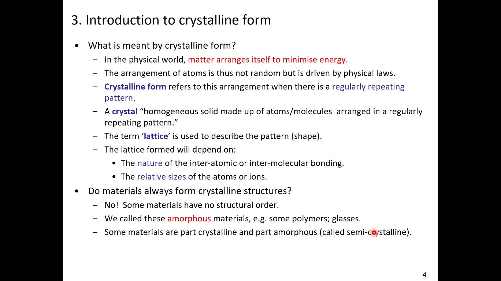
*Figure 8 — Slide 4, "Introduction to crystalline form": energy minimisation, crystal, lattice, and amorphous or semi-crystalline materials (frame t0960, 16:00).*

Summary: energy minimisation gives regular, repeating, predictable arrangements; when the structure gets stuck, the result is amorphous. Pitfall: thinking amorphous materials do not "want" to crystallise. Memory tip: the ball stuck on the tree.

---

## 7. Lattices in two dimensions: unit cell, primitive cell, lattice point (19:58-23:52)

The lecture starts in two dimensions, on a surface, and extends to three dimensions later. In 2D, several shapes can completely cover an area with no unfilled spaces: squares, rectangles, triangles and hexagons (slide 5). Circles cannot.

Take the hexagon. Any bigger area can be divided into hexagons, so the hexagon can be treated as an area building block. For a hexagonal lattice, the hexagon is a **unit cell**: one of the repeat building blocks of the structure. But the hexagon could be split into six triangles, and the triangles could also be the building block. The triangle, one sixth of the hexagon, is then the **primitive cell**, the smallest building block. The six triangles make up the unit cell, which shows the shape of the structure.

What does the shape represent in a material? The corners give the relative positions of atoms, ions or molecules, and the lines represent the bonding between them. Each such position is a **lattice point**; we might expect to find atoms at the lattice points. A non-primitive cell, the "unit cell", can be the hexagon, multiples of it, or other combinations. What matters is that the cell faithfully represents the whole; the choice is often one of convenience, to make later calculations easy.

Moving to three dimensions, it has been found that there are 14 volume shapes that can completely fill a volume with no empty space. We do not need to know them all; only a very small number are used in this course.

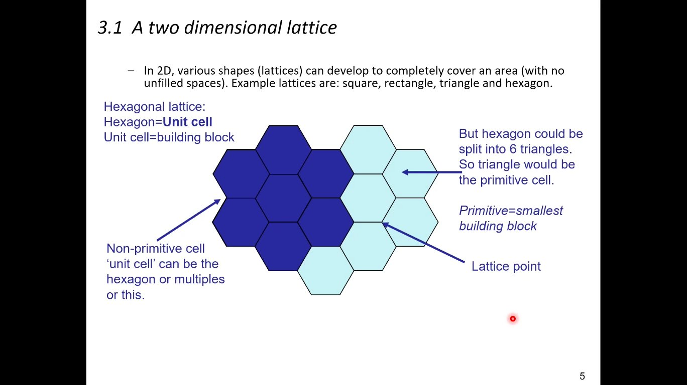
*Figure 9 — Slide 5, "A two dimensional lattice": hexagon as unit cell, triangle as primitive cell (smallest building block), a lattice point, and a non-primitive cell made of several hexagons (frame t1380, 23:00).*

Summary: unit cell = convenient repeat block; primitive cell = smallest repeat block; lattice point = where the atoms sit. Pitfall: thinking there is only one correct cell; several choices are valid if they rebuild the whole. Memory tip: one hexagon equals six triangles.

---

## 8. What sits at the lattice points: the basis (23:52-26:39)

Atoms or groups of atoms occupy the lattice points; whatever sits there is called the **basis** (slide 6). The slide lists five cases. Single atoms, all the same: carbon in diamond, where every lattice point is a carbon atom, as in the diamond structure of the previous lecture. Single atoms, not all the same: covalently bonded silicon carbide, SiC. Ions, all the same: pure metals; recall that a metal atom becomes a positive ion when it loses its outermost electrons to the electron cloud. Ions, not all the same: the slide gives metallic alloys; the lecturer also points to the magnesium oxide picture, an ionic ceramic in which electrons transfer from magnesium to oxygen, so dissimilar ions form a crystalline solid. Molecules: some crystalline polymers, though many polymers are amorphous.

The slide also shows a schematic of a semi-crystalline polymer such as polyethylene, which has long carbon-carbon chains with hydrogen side groups. These chains can be very long, with very large molecular weights, and can fold back and forth. In the diagram the black squares are carbon atoms and the lines between them are covalent bonds. Where the chains have folded back neatly during production, the region is highly ordered: a crystalline region. Where that order breaks down, the region is amorphous. So the polymer is partly crystalline and partly amorphous.

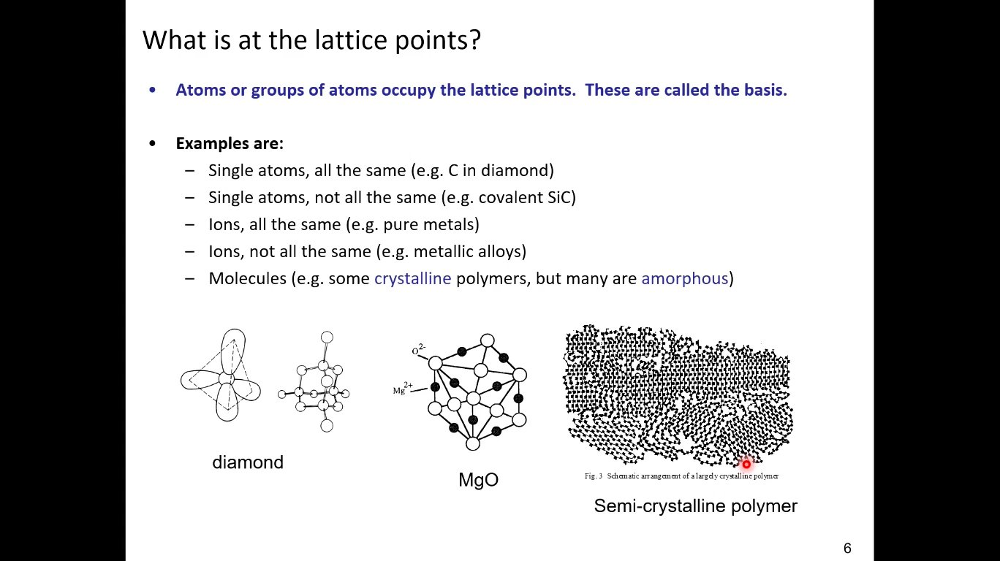
*Figure 10 — Slide 6, "What is at the lattice points?": the basis, with diamond, MgO and a semi-crystalline polymer as examples (frame t1440, 24:00).*

Summary: the lattice is the pattern; the basis is what sits on each point of it. Pitfall: the audio repeatedly says "irons" at 24:36-24:48; it means ions. Memory tip: lattice is the shelf, basis is what you put on it.

---

## 9. The hard sphere model of the atom (26:47-28:53)

To describe crystal structures we need a simple way to represent atoms. The course uses the **hard sphere model**: each atom, or ion, is treated as a hard sphere. Slide 7 lists the assumptions that make this acceptable.

First, the outer electron shell is either full or empty. This is achieved by losing electrons, for a metal (they go to the sea of electrons), or by gaining electrons, for a non-metal. Second, the remaining electrons in the inner orbitals are distributed in a rotationally symmetric way about the nucleus. Third, the electron clouds do not overlap significantly; this is a good assumption because otherwise the very large repulsive forces of Section 1 would arise, so the atoms will not penetrate each other. Fourth, therefore, the ions can be represented as hard spheres; for metals, whose outer-shell electrons have been lost, this applies directly.

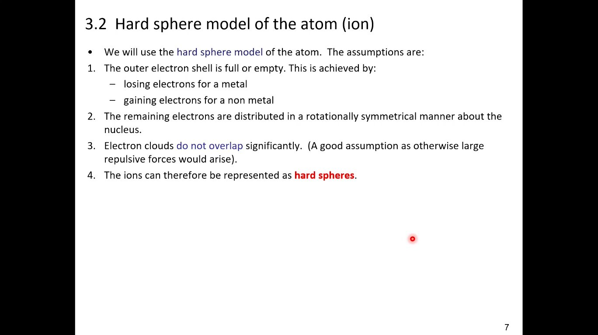
*Figure 11 — Slide 7, "Hard sphere model of the atom (ion)": the four assumptions (frame t1680, 28:00).*

Summary: full or empty outer shell, symmetric inner electrons, no overlap, therefore hard spheres. Pitfall: the model is justified by the strong short-range repulsion, not by atoms literally being solid balls. Memory tip: snooker balls that cannot be squashed.

---

## 10. Packing of spheres in two dimensions (28:59-35:51)

Consider a 3 by 3 array of hard spheres, nine atoms in total (slide 8). Each sphere has a diameter $d$, its ionic diameter, which is twice its atomic radius $R$. In this arrangement neighbouring spheres touch, so the separation between adjacent centres, $r_0$, equals $d$. That is not always the case, as later structures show. Coordinate axes are added: $x$ and $y$ in the page and $z$ out of the page.

$$d = 2R, \qquad r_0 = d \quad \text{(square arrangement)}$$

This is the **square lattice**; in three dimensions it becomes a cubic lattice, because the distances between the points form a square. Notice the empty space between the spheres; it will turn out to be important. The square arrangement is a good starting point, but it is not a common lattice in materials (though it does occur), and it is not efficient: there is comparatively a lot of empty space. "If we were trying to pack atoms for a rainy day, we wouldn't pack them this way."

A **close-packed direction** is a straight line drawn on the arrangement that never passes through empty space: it stays inside the touching atoms. The slide adds that close-packed directions must be unique, meaning a direction cannot be parallel to one already counted. In the square lattice the $x$ axis and the $y$ axis are close-packed directions; any other line, such as a diagonal, crosses empty space. So the square lattice has only two close-packed directions.

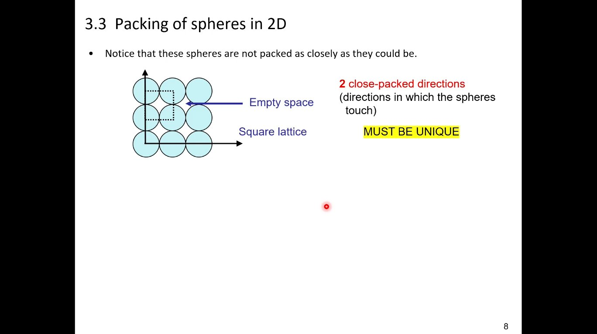
*Figure 12 — Slide 8, square lattice: empty space between the spheres and 2 close-packed directions, which must be unique (frame t1920, 32:00).*

Anyone who has set up the balls for snooker or pool knows a closer arrangement. Put the triangle down, toss the balls in and shake: they settle into a **hexagonal lattice** arrangement, because they want to. This arrangement on a plane is a **close-packed plane** (the slide spells it "closed-packed plane"). It is optimally packed: for a given area, no other arrangement of hard spheres packs them more densely. In it we can draw three unique, non-parallel straight lines that stay inside the atoms, so it has three close-packed directions, one more than the square arrangement.

#### Example 3 — Counting close-packed directions in the square and hexagonal arrangements

**What is asked.** How many close-packed directions does the square arrangement have, how many does the hexagonal close-packed plane have, and what is the difference?

**Why this route.** A close-packed direction is a line through touching spheres, and parallel lines count only once. So we count, for one atom, how many neighbours it touches in the plane, then pair up opposite neighbours, because each straight line through the atom passes through two opposite neighbours.

**Step 1 — Square arrangement.** In the square layer, each atom touches two neighbours along $x$ and two along $y$, which is four in the plane (the lecturer's count at 38:26). Opposite neighbours share one line, so the number of unique lines is four divided by two. This yields 2, matching the slide.

$$N_{\text{square}} = \frac{4}{2} = 2$$

**Step 2 — Hexagonal close-packed plane.** In the close-packed plane, an atom at the centre of a hexagon touches six atoms around it (the lecturer's description at 46:34). Again opposite neighbours share one line. This yields 3 unique, non-parallel directions.

$$N_{\text{hex}} = \frac{6}{2} = 3$$

**Step 3 — Compare.** Subtracting yields the difference the lecturer points out at 35:17.

**Where each constant comes from.** The 4 in-plane neighbours of the square layer and the 6 of the hexagonal layer are touching-neighbour counts stated in the lecture (38:26 and 46:34). The divisor 2 comes from the uniqueness rule on slide 8: the two halves of one straight line are not separate directions. The "divide by two" pairing is this note's way of organising the count; the lecture simply draws the lines.

**Sanity check.** Draw it: in the square array, the diagonal from one sphere to the next crosses a gap, so diagonals do not count and 2 is right. In the hexagonal array, lines at 0°, 60° and 120° each run through touching spheres, and a fourth line would be parallel to one of them. The hexagonal plane is the denser packing, so it is reasonable that it has more close-packed directions.

**Answer.**

$$N_{\text{square}} = 2, \qquad N_{\text{hex}} = 3, \qquad N_{\text{hex}} - N_{\text{square}} = 1$$

**Common pitfall.** Counting each half-line separately (getting 4 and 6), or counting a diagonal of the square array, which crosses empty space. Also, "unique" means non-parallel: two parallel rows of atoms are the same direction.

**Figure.**

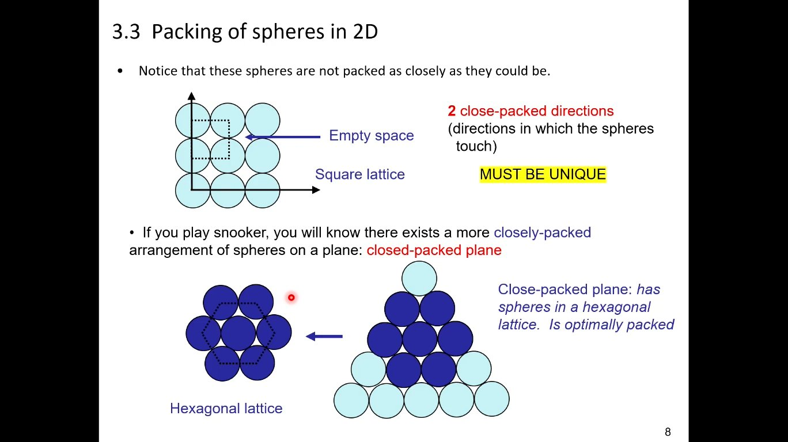
*Figure 13 — Slide 8, complete: the square lattice with 2 close-packed directions, and the snooker-triangle close-packed plane, which has spheres in a hexagonal lattice and is optimally packed (frame t2100, 35:00).*

Summary: square lattice, 2 close-packed directions and wasted space; hexagonal close-packed plane, 3 directions and the densest 2D packing. Pitfall: "close-packed plane" is a property of the hexagonal arrangement only. Memory tip: the snooker triangle packs itself.

---

## 11. Simple cubic: the first three-dimensional structure (35:51-38:56)

No frame was captured for this part of the lecture (the captured slide numbers jump from 8 to 10), so this section follows the audio only.

Going back to the square arrangement and adding layers above and below, we could draw a plan view, a front view and a side view, as in an engineering drawing, and ask what the representative building block is. The answer is a cube: the simplest primitive cell for this **simple cubic** arrangement. With an infinite number of these cubes we could recreate a solid whose atoms take up this lattice.

The cube has one atom or ion at each corner, eight in all. All its sides are the same length, called the **lattice parameter** $a$. Each atom has six **nearest neighbours**, that is, it touches six other atoms. This count is also called the **coordination number**: the number of atoms that an atom touches in its lattice. Simple cubic is not a common lattice, but some elements adopt it; polonium is one (the audio calls it a "square lattice configuration").

#### Example 4 — Coordination number of the simple cubic lattice

**What is asked.** In the simple cubic lattice, how many atoms are at the corners of the cell, what is the coordination number, and how is the lattice parameter $a$ related to the sphere size?

**Why this route.** The coordination number counts touching neighbours. In a cubic arrangement the touching neighbours lie along the three axes, so we count along $x$, $y$ and $z$ separately and add.

**Step 1 — Count the corner atoms.** A cube has eight corners, and the cell has one atom at each; the lecturer counts them "1, 2, 3, 4, 5, 6, 7, 8" at 37:20. This yields the corner count.

$$N_{\text{corner}} = 8$$

**Step 2 — Count touching neighbours along each axis.** Pick one atom. It touches one neighbour on each side along $x$, one on each side along $y$, and one above and one below along $z$ (38:26-38:34). This yields the coordination number.

$$\text{CN}_{\text{SC}} = 2 + 2 + 2 = 6$$

**Step 3 — Relate $a$ to the sphere size.** The touching neighbours lie along the cube edges, so the edge length equals the centre-to-centre spacing of touching spheres. Section 10 gave $r_0 = d = 2R$ for the square arrangement, which yields the relation below. This step combines two statements from the lecture; the lecture did not write it as a formula.

$$a = r_0 = d = 2R$$

**Where each constant comes from.** The 8 is the number of corners of a cube. Each 2 in the sum is "one neighbour on each side" along an axis, and there are 3 axes because the structure is three-dimensional. The factor 2 in $d = 2R$ is the diameter-radius relation stated at 29:24.

**Sanity check.** In the square layer alone, each atom touches 4 (Example 3); adding one layer above and one below adds exactly one atom each, directly over and under, giving $4 + 2 = 6$. Consistent. Six is well below the twelve of the close-packed structures (Example 5), as expected for an arrangement with a lot of empty space.

**Answer.**

$$N_{\text{corner}} = 8, \qquad \text{CN}_{\text{SC}} = 6, \qquad a = 2R$$

**Common pitfall.** Counting the diagonal atoms of the cube as neighbours: they do not touch the chosen atom. Also, the 8 corner atoms are not 8 whole atoms belonging to one cell, since each corner is shared with neighbouring cells; counting atoms per cell is not covered in this lecture.

**Figure.**

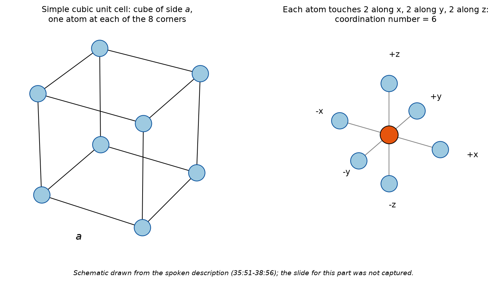
*Figure 14 — Schematic of the simple cubic cell (cube of side $a$, 8 corner atoms) and of one atom with its 6 nearest neighbours along $\pm x$, $\pm y$, $\pm z$. Drawn for this note from the audio, because the slide was not captured.*

Summary: simple cubic has a cube cell of side $a$, one atom per corner, and coordination number 6; polonium is an example. Pitfall: confusing "nearest neighbour" with "any atom in the cell". Memory tip: six faces of a die, six neighbours.

---

## 12. Stacking close-packed planes: ABCABC and ABAB (38:56-45:18)

Now we return to the hexagonal close-packed plane and build three-dimensional structures by laying one close-packed plane on the table, putting another on top, then another, and so on (slide 10). The first layer is plane A. Each sphere of plane A leaves hollows between it and its neighbours. Placing one sphere of the next plane in a hollow fixes where all the others in that plane go; next to it, a hollow cannot be used, because the neighbouring sphere's centre is already there. That layer is plane B.

For plane C, look for the hollows in plane B where an atom can sit; placing one atom again fixes the rest of the plane. In the first sequence the lecturer builds, the C atoms sit in a third set of positions, and the next plane after C sits directly above plane A. This is the **stacking sequence** ABCABC. This structure takes up the least volume for a given number of atoms, so it is a **close-packed structure**: it is made of close-packed planes, each optimised, and stacked in an optimal three-dimensional way.

There was a second option. Planes A and B are the same, but when placing the third plane there is a choice of two positions. Shifting one atom to the other position resets the whole third plane, and it then sits directly above plane A. The structure then repeats as A, B, A, B: a different sequence of close-packed planes, and a different structure. (The audio at 43:21 says the structure "repeats itself every third layer"; the sequence it then names is A B A B, in which the third plane is back over A.)

Which option a material takes, if it forms a hexagonal close-packed lattice, is governed by things like atomic size and atomic bonding, because the material minimises its energy according to its own specific requirements. The lecturer compares it to choosing a degree or a career: a big decision, because it dominates the mechanical properties. ABCABC follows one path and ABAB another; those consequences are next week's topic. The good news is that a given material always makes the same choice under the same conditions, unless we change something.

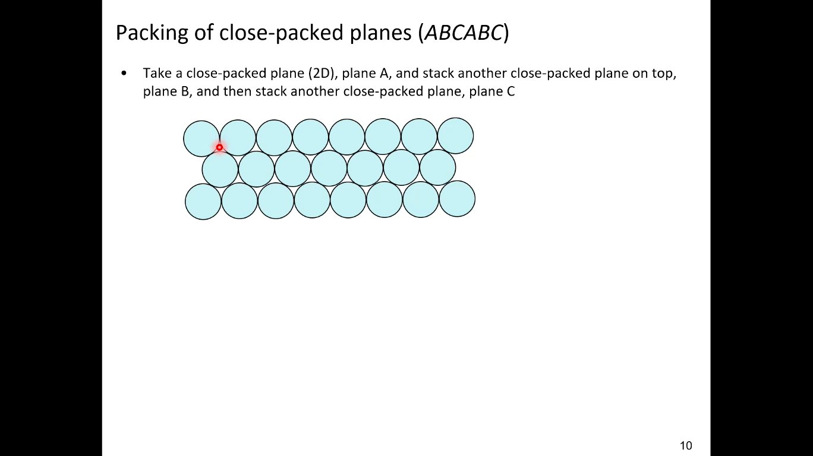
*Figure 15 — Slide 10, "Packing of close-packed planes (ABCABC)", at the moment it was captured: a close-packed plane, plane A, with the instruction to stack plane B and then plane C on top (frame t2400, 40:00). The later build-up of this slide was not captured.*

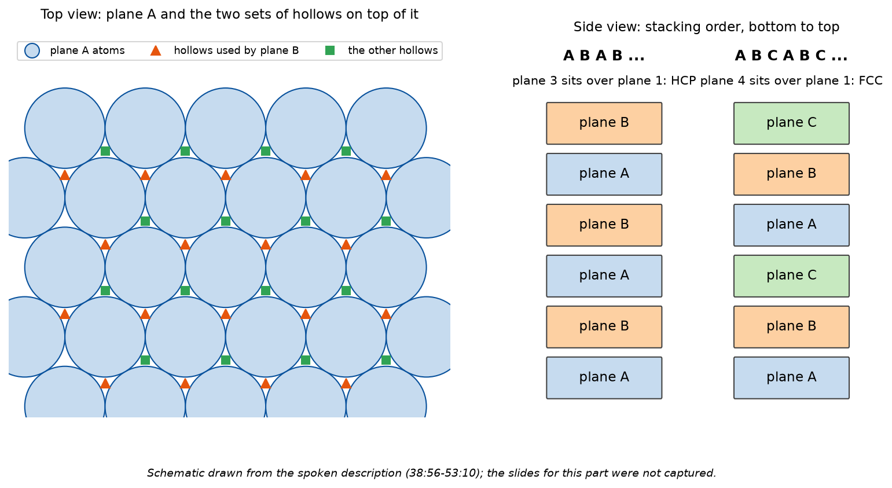
*Figure 16 — Schematic of the stacking idea. Left: top view of plane A with the two sets of hollows; plane B uses one set. Right: the two sequences, ABAB (plane 3 over plane 1, giving HCP) and ABCABC (plane 4 over plane 1, giving FCC). Drawn for this note from the audio.*

Summary: stacking close-packed planes gives two close-packed structures; the only choice is where the third plane goes. Pitfall: thinking ABAB or ABCABC is random for a given material; it is fixed by size and bonding. Memory tip: third plane back on A gives ABAB; third plane in a new place gives ABC.

---

## 13. Hexagonal close-packed (HCP) (45:18-50:02)

No frame was captured for this part; this section follows the audio only.

The ABAB arrangement gives the **hexagonal close-packed** or HCP lattice, sometimes called close-packed hexagonal (CPH), with the letters swapped; it is the same lattice. It is formed of close-packed planes repeating on an ABAB stacking sequence, so it is a close-packed structure with the optimum number of atoms per unit volume.

Each atom in HCP has a coordination number of 12: six in its own plane, three in the plane above and three in the plane below (worked out in Example 5). Metals with this lattice include beryllium, magnesium, titanium and zirconium; it is quite a common arrangement.

The HCP unit cell has metallic ions at its points, with lines representing the metallic bonds between them. As described in the audio, there are six atoms plus one in the middle on the top face, three in intermediate positions, and another six at the bottom (the audio does not repeat "plus one" for the bottom face, and the slide was not captured). This drawing is a **reduced-sphere model** (heard as "reduced sphere level" at 48:22): instead of full spheres, it marks only the positions of the atom centres, which is an easier way to see their relative positions. We know the atoms touch, so neighbouring spheres meet halfway between centres.

The HCP cell is described by two lattice parameters: $a$, the side of the hexagon, and $c$, the height of the unit cell (the audio at 48:51 says "a ... multiplied by c", most likely meaning the two dimensions $a$ by $c$). The unit cell can be split into three primitive cells by cutting it twice and removing a section with the atoms in the middle. Each primitive cell then has four atoms on the top, four on the bottom, and one middle-layer atom (heard as "bilayer atoms", most likely "B-layer atoms"). Three primitive cells together rebuild the unit cell, so either cell can be used as long as we are consistent about what is in it and how big it is.

#### Example 5 — Coordination number of a close-packed structure

**What is asked.** Show that each atom in the HCP structure has coordination number 12, and say what the coordination number is for FCC.

**Why this route.** The structure is built plane by plane, so count touching neighbours plane by plane: in the atom's own plane, in the plane above, and in the plane below.

**Step 1 — Neighbours in the same plane.** An atom at the centre of a hexagon in a close-packed plane touches the six atoms around it (46:34). This yields 6.

$$N_{\text{same plane}} = 6$$

**Step 2 — Neighbours in the plane above.** Around the atom there are hollows between its six neighbours. The next plane can put an atom in one hollow but must skip the next, then put one, then skip one (46:49-46:57). So only every other hollow is filled. This yields 3.

$$N_{\text{above}} = 3$$

**Step 3 — Neighbours in the plane below.** By the same argument, the atom touches three atoms in the plane below (46:57). This yields 3.

$$N_{\text{below}} = 3$$

**Step 4 — Add them up.** The total is the coordination number. For FCC, the lecturer notes at 52:03-52:11 that the arrangement is generated in exactly the same way, from close-packed planes, so the count is the same.

**Where each constant comes from.** The 6 is the six touching neighbours in a close-packed plane. Each 3 comes from the "skip every other hollow" rule: an atom of the next plane cannot sit next to a hollow that is already used, because the centre of the neighbouring sphere is in the way (the same reason as at 40:15). Only the plane directly above and directly below touch the atom; planes further away are too far.

**Sanity check.** 12 is twice the simple cubic value of 6 (Example 4), which fits the claim that close-packed structures pack the most atoms into a given volume. The total is the same for HCP and FCC because both are made only of close-packed planes; the two differ only in where the third plane sits, which changes which atoms touch from below, not how many.

**Answer.**

$$\text{CN}_{\text{HCP}} = \text{CN}_{\text{FCC}} = 6 + 3 + 3 = 12$$

**Common pitfall.** Counting all six hollows above the atom, which gives $6 + 6 + 6 = 18$; only every other hollow can be filled. Another slip is counting only the six in-plane neighbours and forgetting the planes above and below.

**Figure.**

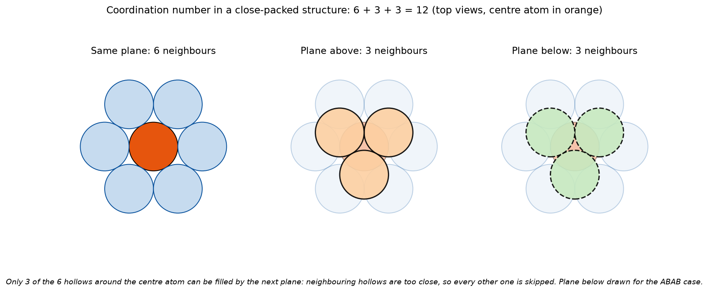
*Figure 17 — Schematic top views of a close-packed structure: 6 neighbours in the same plane, 3 in the plane above, 3 in the plane below (drawn for the ABAB case). Drawn for this note from the audio at 46:25-47:11.*

Summary: HCP is ABAB stacking of close-packed planes, coordination number 12, lattice parameters $a$ and $c$; examples Be, Mg, Ti, Zr. Pitfall: the HCP unit cell (hexagonal prism) is not the primitive cell; three primitive cells make one unit cell. Memory tip: 6 around, 3 on top, 3 underneath.

---

## 14. Face-centred cubic (FCC) (50:05-53:10)

No frame was captured for this part; this section follows the audio only.

The ABCABC arrangement is a little harder to see, because the usual way of drawing its unit cell does not line up with the way the planes are stacked. The A-layer, B-layer and C-layer atoms can be taken in the order A, B, C or the other way round. Looked at from the right direction, the layers line up and the arrangement fits easily into a cell. The resulting unit cell is the **face-centred cubic** or FCC cell.

It is called face-centred cubic because in the centre of every face of the cell there is an atom, which the cell boundary cuts in half, so each face has half an atom sitting in it. In the reduced-sphere model it looks somewhat like the simple cubic cell, being cubic again: four atoms at the top corners, four at the bottom corners, and an atom at the centre of each face.

Because FCC is generated in exactly the same way as HCP, from close-packed planes, each atom again has coordination number 12, and there are three close-packed directions in each close-packed plane. Metals with this structure include aluminium, lead and, importantly, iron in a higher-temperature range. Steel will typically take up the configuration of iron, and the crystal structures of iron at different temperatures will be revisited when the course studies steel.

The lecture stops here: the two close-packed arrangements, hexagonal close-packed and face-centred cubic, are done (heard as "face executed" at 53:02). The third structure, BCC, is left for next week.

Summary: FCC is ABCABC stacking, a cubic cell with atoms at the 8 corners and the 6 face centres, coordination number 12; examples Al, Pb and high-temperature Fe. Pitfall: the close-packed planes of FCC are not the cube faces; the drawn cell is tilted relative to the stacking. Memory tip: FCC = corners plus face centres, from ABC.

---

## Audio and slide caveats

These are the places where the audio was unclear or disagreed with a slide, and how this note handled them. Where the slide was visible, the slide was followed.

- 05:47 "the z0 position": the slide labels the bond energy $E_0$. 08:35 "a deep, shallow well": read as deep and narrow, from 07:48. 09:00 "a bomb potential": the slide says power-law model. 10:53 "metres times ten to the nine": the slide gives $0.3 \times 10^{-9}$ m.
- 24:36-24:48 "irons": ions. Slide 6 gives "metallic alloys" as the example of ions that are not all the same, while the lecturer points to MgO at that moment; both are recorded above.
- 35:51-38:56: no frame captured; the simple cubic content is from audio only. 40:00-53:10: no frames captured; stacking, HCP and FCC are from audio only, so the unit-cell drawings for HCP and FCC could not be checked.
- 43:21 "repeats itself every third layer": the named sequence is ABAB, read as the third plane returning above A. 47:57 the bottom-face count of the HCP cell is said as "another six"; 48:51 "a ... multiplied by c" read as the two parameters $a$ and $c$; 49:19 "bilayer atoms" read as B-layer atoms; 53:02 "face executed" is face-centred cubic.
- No handwritten board work was visible in the captured frames; the lecturer used only a laser pointer on the slides.

---

## Key formula sheet

| Formula | Meaning and units | When it applies |
| --- | --- | --- |
| $F_N = F_A + F_R$ | Net force is attraction plus repulsion; forces in N, attraction positive | Two isolated atoms at separation $r$ |
| $F_N = 0$ at $r = r_0$ | Defines the equilibrium spacing $r_0$, in m; about 0.3 nm for many atoms | Equilibrium, no net force |
| $E_N = U = \int F \, dr$ | Net potential energy in J; a minimum where $F_N = 0$ | Slide 15 convention, zero energy at infinite separation |
| $U = -A r^{-m} + B r^{-n}$ | Power-law bond energy; $A$, $B$, $m$, $n$ set by the bond type | Ionic $m = 1$; covalent $m = 2$, $n = 9$; metallic $m = 1$ to $4$ |
| $F = \frac{dU}{dr} = \frac{mA}{r^{m+1}} - \frac{nB}{r^{n+1}}$ | Force from the power-law energy, in N | Same power-law model |
| $A = \frac{1}{4\pi\varepsilon_0}\left(Z_1 q\right)\left(Z_2 q\right)$ | Attractive constant for an ionic bond; $q = 1.602 \times 10^{-19}$ C | Ionic (coulombic) bond, $m = 1$ |
| $r_0 = \left(\frac{nB}{mA}\right)^{1/(n-m)}$ | Equilibrium spacing from the power law, in m | Power-law model, $F = 0$ |
| $E_0 = U(r_0) < 0$ | Bond energy, in J; negative by convention | Zero energy at infinite separation |
| $d = 2R$, $r_0 = d$ | Sphere diameter from radius; touching spheres sit one diameter apart | Hard sphere model, square arrangement |
| $\text{CN}_{\text{SC}} = 6$ | Coordination number of simple cubic | Simple cubic, e.g. polonium |
| $\text{CN}_{\text{HCP}} = \text{CN}_{\text{FCC}} = 6 + 3 + 3 = 12$ | Coordination number of the close-packed structures | HCP (ABAB) and FCC (ABCABC) |

---

## Self-check questions

**Q1.** Why does the bond energy come out negative when you solve Tutorial Sheet 5, Question 1?

*Answer:* By convention the energy is zero at infinite separation. The bound pair at $r_0$ sits at the bottom of a well below that zero, so $E_0 = U(r_0)$ is negative. It is a convention, not a mistake.

**Q2.** Using the covalent exponents $m = 2$ and $n = 9$, write $r_0$ in terms of $A$ and $B$.

*Answer:* Substituting into $r_0 = (nB/mA)^{1/(n-m)}$ gives $r_0 = \left(\frac{9B}{2A}\right)^{1/7}$.

**Q3.** Which has the larger coefficient of thermal expansion: a bond with a deep, narrow energy well or one with a shallow, wide well? Why?

*Answer:* The shallow, wide well. As temperature rises the atoms move up the asymmetric curve, and the mean of their vibration shifts further to the right in a shallow, wide well, so the material expands more.

**Q4.** For a 2D hexagonal lattice, what is the unit cell and what is the primitive cell?

*Answer:* The hexagon is the unit cell (the repeat building block); one of the six triangles it splits into is the primitive cell (the smallest building block).

**Q5.** List the four assumptions of the hard sphere model.

*Answer:* The outer electron shell is full or empty; the remaining electrons are rotationally symmetric about the nucleus; electron clouds do not overlap significantly; therefore the ions can be represented as hard spheres.

**Q6.** Why are some materials amorphous, if energy drives them towards crystalline order?

*Answer:* Their structure gets them tangled, twisted and wedged in a non-crystalline arrangement before they can reach the minimum-energy one, like a ball stuck on a tree halfway down a hill.

**Q7.** Which stacking sequence gives HCP and which gives FCC? Give two example metals for each.

*Answer:* ABAB gives HCP (e.g. magnesium, titanium; also beryllium, zirconium). ABCABC gives FCC (e.g. aluminium, lead; also iron at higher temperature).

**Q8.** What are the coordination numbers of simple cubic, HCP and FCC?

*Answer:* Simple cubic 6 ($2 + 2 + 2$); HCP and FCC both 12 ($6 + 3 + 3$).

---

## Glossary

| Term | Meaning |
| --- | --- |
| interatomic separation $r$ | Distance between two atom centres, in m |
| attractive / repulsive force | Long-range pull and short-range push between atoms |
| net force $F_N$ | Sum of attractive and repulsive forces |
| equilibrium spacing $r_0$ | Separation where the net force is zero |
| bond energy $E_0$ | Energy to separate two atoms from $r_0$ to infinity; negative by convention |
| power-law model | $U = -A r^{-m} + B r^{-n}$ description of bond energy |
| coefficient of thermal expansion | How much a material expands when heated |
| crystal structure | How atoms arrange themselves in a solid |
| crystalline form | Arrangement as a regularly repeating pattern |
| crystal | Homogeneous solid of atoms or molecules in a regularly repeating pattern |
| lattice | The pattern (shape) of the arrangement |
| amorphous | No structural order, e.g. glasses, some polymers |
| semi-crystalline | Partly crystalline, partly amorphous |
| unit cell | Repeat building block that shows the shape of the structure |
| primitive cell | Smallest building block |
| lattice point | Position of an atom, ion or molecule in the lattice |
| basis | Atom or group of atoms occupying each lattice point |
| hard sphere model | Treat each atom or ion as an incompressible sphere |
| close-packed direction | Unique straight line through touching spheres, no empty space |
| close-packed plane | Optimally packed plane of spheres in a hexagonal lattice |
| square / hexagonal lattice | 2D arrangements with 2 and 3 close-packed directions |
| simple cubic | Cube cell with one atom per corner, CN 6 |
| lattice parameter | Edge length of the cell ($a$; also $c$ for HCP) |
| nearest neighbour | An atom that touches the chosen atom |
| coordination number | Number of atoms an atom touches in its lattice |
| stacking sequence | Order of close-packed planes, ABAB or ABCABC |
| close-packed structure | Least volume for a given number of atoms |
| hexagonal close-packed (HCP) | ABAB stacking; CN 12; e.g. Be, Mg, Ti, Zr |
| face-centred cubic (FCC) | ABCABC stacking; atoms at corners and face centres; CN 12; e.g. Al, Pb, high-temperature Fe |
| reduced-sphere model | Cell drawing that marks only atom centres |

---

Sources: recording "ME MECH40006 - Materials 1 (2026-11-18)", lecture of 2026-11-18, auto-generated captions 01:09-59:46 (lecture content 01:09-53:10); slide frames t0060-t2400 (34 frames; none after 40:00), of which t0240, t0600, t0660, t0840, t0900, t0960, t1380, t1440, t1680, t1920, t2100 and t2400 are reproduced as figures. Figures 0, 2, 14, 16 and 17 are schematics drawn for this note.
