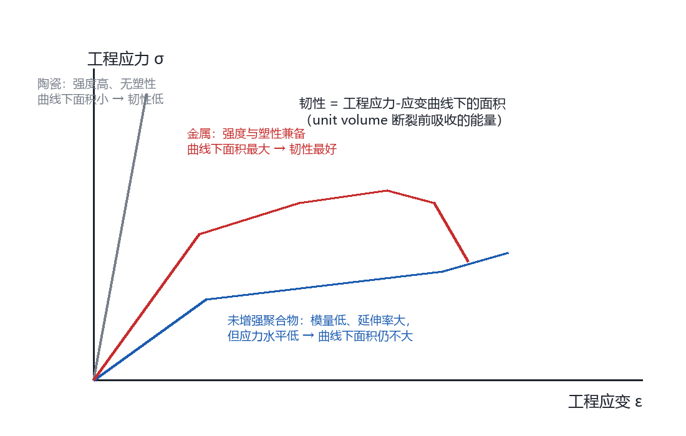
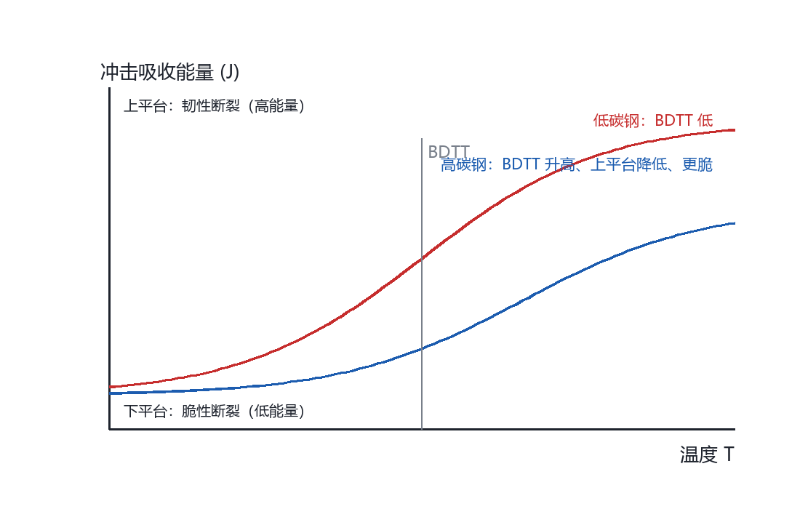
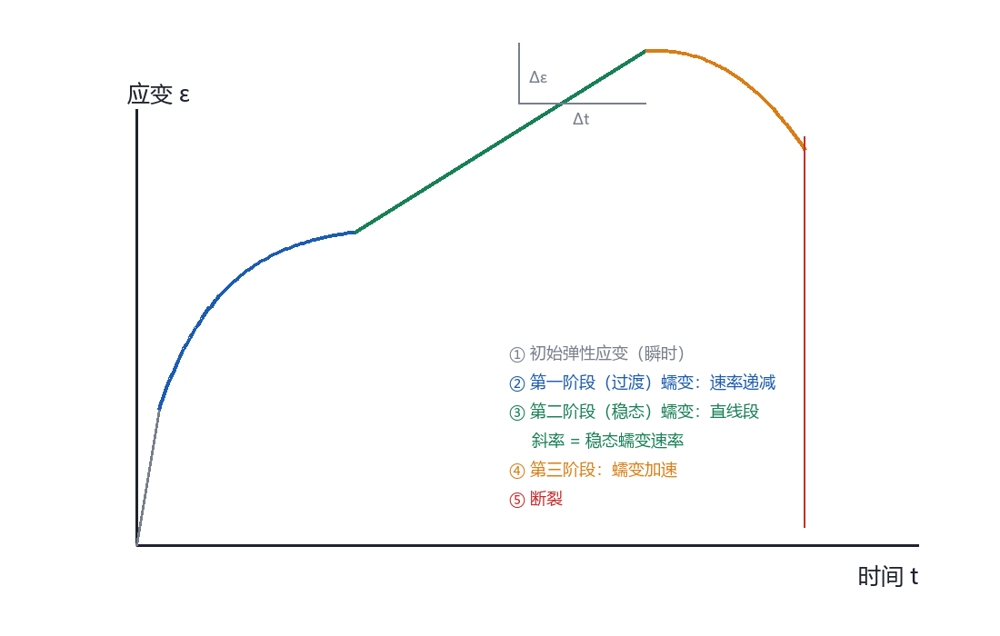
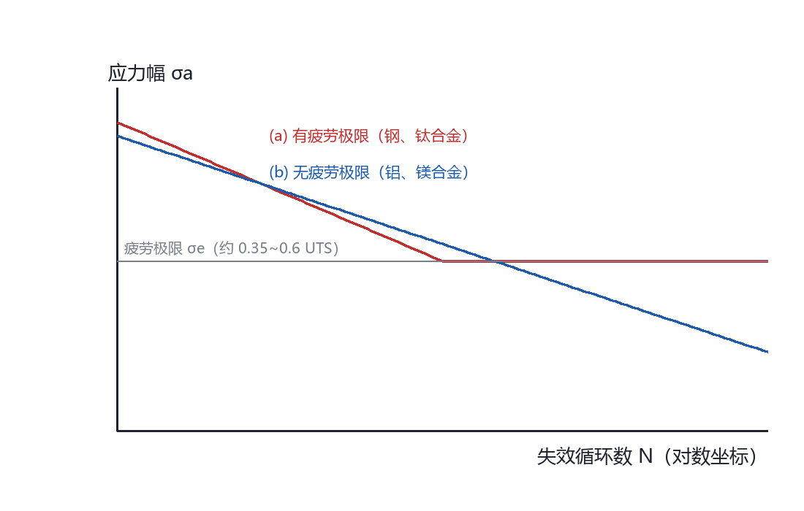

# MECH40006 Materials 1 — Lectures 4 and 5: Study Notes

**Lecture 4 — Toughness and Creep Resistance | Lecture 5 — Fatigue Resistance**

> **Source**: *MECH40006: MATERIALS 1 — COURSE NOTES: PART I* (2026-27) 
> Lecture 4: pp. 25–31 | Lecture 5: pp. 32–39 
> **Reading**: Callister, *Materials Science and Engineering: An Introduction* — Ch. 8 §8.1–8.4, §8.6, §8.12–8.13 (L4); §8.7–8.11 (L5)

---

## Contents

1. [Lecture 4 — Toughness and Creep Resistance](#lecture-4)
2. [Lecture 5 — Fatigue Resistance](#lecture-5)
3. [Formula Sheet](#formula-sheet)
4. [Self-test](#self-test)
5. [Page Map](#page-map)

---

# Lecture 4 — Toughness and Creep Resistance

## 4.0 Learning outcomes

By the end of this lecture you should be able to:

1. State clearly what **toughness** is, name **two** measures of it, and explain why it differs from strength.
2. Identify the features of a stress–strain curve that relate to toughness.
3. Describe a **Charpy** impact test and interpret the results.
4. Recognise the toughness range across the four classes of engineering material.
5. Define **creep** and recognise when it matters.
6. Describe a creep strain–time plot and identify its regions.
7. Apply the generalised creep law under **constant temperature** and **constant stress**, and calculate the constants.

---

## 4.1 Why it matters

Many engineering failures occur **suddenly, without warning and without prior plastic deformation** — this is due to a lack of toughness.

Toughness is the property that characterises the resistance to **brittle fracture** (sudden cracking under load).

**Case studies**

- An oil tanker split into two in New York harbour.
- Failures of the Liberty ships in the 1940s led to a much better understanding of toughness, and to tougher materials.
- Modern examples: low-temperature pipes, welded structures, ship plate.

> **Key idea**: toughness is not how strong a material is, but how much energy it absorbs before fracture.

---

## 4.2 Definition and measures

### Definition

**Toughness is the measure of the energy required to fracture a material.** It corresponds to the **area under the stress–strain curve**:

$$
U \;=\; \int_{0}^{\varepsilon_{f}} \sigma \, \mathrm{d}\varepsilon
$$

It is **not** fixed by any single quantity — not Young's modulus, not strength, not ductility — but is the combined result of strength and plasticity.

  

<em>Figure 1 — Stress–strain curves and toughness (area under the curve) for three classes of material</em>

| Class | Strength | Plasticity | Area under curve | Toughness |
|---|---|---|---|---|
| Ceramics | Very high | Almost none | Small | **Low** |
| Unreinforced polymers | Low | Large | Moderate to small | **Low** |
| Metals | Medium to high | Good | Largest | **High** |

> **Memory hook**: look at the **area**, not the **height**.

### Two measures (frequently examined)

| Measure | Unit | Meaning | Features |
|---|---|---|---|
| Fracture energy absorbed | J | energy needed to break the whole specimen | depends on specimen size, **not a material constant** |
| Critical energy release rate $G_C$ | J/m² | energy needed per **unit area** of new fracture surface | **independent of size**, more fundamental |
| Critical stress intensity factor $K_C$ | MPa·m$^{1/2}$ | strength of the stress field at a crack tip | fracture mechanics, covered in ME2 |

$G_C$ is a more accurate measure of toughness than the total energy in joules because it is **independent of specimen size**; $K_C$ is the fracture-mechanics measure, met again in ME2.

---

## 4.3 Fracture: two steps and surfaces

For fracture to occur, a crack must first **initiate**, then **grow** until the remaining section can no longer carry the load.

The sequence is: crack **initiation** → crack **growth** → the remaining section is too small → instant fracture.

Cracks often initiate at **stress concentrations**: weld lines, voids and defects, changes in cross-section, sharp corners, keyways, threads, scratches, corrosion pits.

| Mode | Energy absorbed | Fracture surface |
|---|---|---|
| Ductile | High | **Cup-and-cone**, with necking |
| Brittle | Low | **Flat**, almost no plastic deformation |

A change in temperature can cause a transition from one mode to the other, switching the same material from ductile to brittle fracture (see the Charpy section in 4.4).

---

## 4.4 The Charpy impact test

### Procedure

A bar of **10 × 10 × 60 mm** with a **V-notch** is supported near its ends and hit by a **pendulum** to cause fracture. The **potential energy lost by the pendulum** is measured. The notch creates a stress concentration that promotes brittle fracture; the bar is simply supported at both ends and broken by a single blow.

$$
E = m g \left(h_{1} - h_{2}\right)
$$

Tests are repeated at different temperatures and absorbed energy is plotted against temperature.

### Reading the results

  

<em>Figure 2 — Impact energy versus temperature, and the brittle–ductile transition temperature BDTT</em>

- **Lower shelf**: low temperature, low energy → **brittle fracture**;
- **Upper shelf**: high temperature, high energy → **ductile fracture**;
- the midpoint of the transition region is the **BDTT (brittle–ductile transition temperature)**;
- **the lower the BDTT and the higher the upper shelf, the tougher the material**, and the better it suits low-temperature and impact service.

### Three conclusions

1. Charpy only **ranks** materials by BDTT and absorbed energy; it does **not** give a material property or a material constant.
2. In steel, BDTT and impact energy depend strongly on **carbon content**: higher %C → higher BDTT and lower upper shelf → more brittle.
3. For low-temperature or impact-loaded service, specify a sufficiently low BDTT and verify by Charpy acceptance tests.

---

## 4.5 Creep: definition and criteria

**Creep is an increase of strain with time at a constant stress.** It is a particular problem in polymers at room temperature and in metals at elevated temperature: polymers creep noticeably at room temperature, while metals need a high temperature before creep is visible.

| Case | Relation | Comment |
|---|---|---|
| Low temperature | $\varepsilon = f(\sigma)$ | independent of time |
| High temperature | $\varepsilon = f(\sigma, t, T)$ | time-dependent strain appears |

The ratio of operating temperature to melting temperature, $T/T_M$ (both in kelvin), determines the sensitivity to creep. This is the homologous temperature criterion:

| Material | Condition for significant creep |
|---|---|
| Polymers | room temperature and above |
| Metals | $T > (0.3\text{--}0.4)\,T_M$ |
| Ceramics | $T > (0.4\text{--}0.5)\,T_M$ |

> **Example**: copper has $T_M \approx 1358$ K, so $T > 0.4 \times 1358 \approx 543$ K (about 270 °C) is where creep must be considered — creep matters above about 270 °C.

**Typical failures**: tungsten lamp filaments, high-pressure turbine blades, high-temperature steam pipes and high-pressure oil pipes.

---

## 4.6 The creep curve

  

<em>Figure 3 — A typical creep curve at constant stress</em>

| # | Region | Feature | Engineering significance |
|---|---|---|---|
| 1 | Initial elastic strain | instantaneous, independent of time | set by stiffness |
| 2 | Primary creep | rate **decreasing** | work hardening dominates |
| 3 | Secondary creep | **straight line**, constant rate | **$\dot{\varepsilon}_{ss}$ is the key design parameter** |
| 4 | Tertiary creep | rate rises steeply (necking, voids) | close to failure |
| 5 | Fracture / rupture | failure | corresponds to the rupture lifetime $t_r$ |

The **steady-state creep rate** $\dot{\varepsilon}_{ss}$ — the slope of the straight section, $\Delta\varepsilon/\Delta t$ — is the most important design parameter for long-life applications (e.g. nuclear plant). For short creep life (e.g. turbine blades) the **rupture lifetime** $t_r$ may dominate instead.

---

## 4.7 The generalised creep law

$$
\dot{\varepsilon}_{ss} \;=\; A \exp\!\left(-\frac{Q}{RT}\right) \sigma^{n}
\qquad (4.5)
$$

| Symbol | Meaning |
|---|---|
| $\dot{\varepsilon}_{ss}$ | steady-state creep rate, unit s$^{-1}$ |
| $A$ | material constant (microstructure, grain size, etc.) |
| $Q$ | creep activation energy, unit J/mol |
| $R$ | universal gas constant, $R = 8.31$ J mol$^{-1}$ K$^{-1}$ |
| $T$ | absolute temperature, unit K |
| $n$ | creep (stress) exponent, usually 3–8 for metals |

The temperature dependence is an **Arrhenius rate law** because creep is controlled by **atomic diffusion**; the stress dependence is a **power law**.

---

## 4.8 Isolating the variables

### Constant temperature

$$
\dot{\varepsilon}_{ss} = B \sigma^{n}
\qquad\Longrightarrow\qquad
\log \dot{\varepsilon}_{ss} = \log B + n \log \sigma
\qquad (4.6)
$$

- plot **$\log\dot{\varepsilon}_{ss}$ against $\log\sigma$**; the **slope is $n$**;
- the middle section is a straight line (power-law creep, $n \approx 3\text{--}8$);
- the **low-stress tail with a slope of $\approx 1$** means the creep mechanism has changed (diffusion creep) and the power law no longer applies.

### Constant stress

$$
\dot{\varepsilon}_{ss} = C \exp\!\left(-\frac{Q}{RT}\right)
\qquad\Longrightarrow\qquad
\ln \dot{\varepsilon}_{ss} = \ln C - \frac{Q}{RT}
\qquad (4.7)
$$

- plot **$\ln\dot{\varepsilon}_{ss}$ against $1/T$**; the **slope is $-Q/R$**;
- hence **$Q = -R \times$ slope**.

---

## 4.9 Worked examples

### Example 1: find n (constant temperature)

| $\sigma$ / MPa | 100 | 200 |
|---|---|---|
| $\dot{\varepsilon}_{ss}$ / s$^{-1}$ | $1.0\times10^{-8}$ | $8.0\times10^{-7}$ |

$$
n = \frac{\ln\left(8.0\times10^{-7}\right)-\ln\left(1.0\times10^{-8}\right)}{\ln 200-\ln 100}
  = \frac{\ln 80}{\ln 2}
  \approx \frac{4.382}{0.693}
  \approx 6.3
$$

**Conclusion:** $n \approx 6.3$, inside the typical range 3–8 for power-law creep in metals.

### Example 2: find Q (constant stress)

At $T_1 = 800$ K, $\dot{\varepsilon}_1 = 2.0\times10^{-9}$ s$^{-1}$; at $T_2 = 850$ K, $\dot{\varepsilon}_2 = 1.2\times10^{-8}$ s$^{-1}$.

$$
\ln\frac{\dot{\varepsilon}_{2}}{\dot{\varepsilon}_{1}}
= -\frac{Q}{R}\left(\frac{1}{T_2}-\frac{1}{T_1}\right)
$$

$$
\ln 6 = \frac{Q}{8.31}\left(7.353\times10^{-5}\right)
\;\Longrightarrow\;
Q \approx \frac{1.7918 \times 8.31}{7.353\times10^{-5}}
\approx 2.0\times10^{5}\ \text{J/mol}
$$

**Conclusion:** $Q \approx 200$ kJ/mol, consistent with the activation energy for atomic diffusion in metals.

### Example 3: the ratio method (fastest in an exam)

$$
\frac{\dot{\varepsilon}}{\dot{\varepsilon}_{0}}
= \left(\frac{\sigma}{\sigma_{0}}\right)^{n}
\exp\!\left[-\frac{Q}{R}\left(\frac{1}{T}-\frac{1}{T_0}\right)\right]
$$

There is no need to find $A$: take the ratio against a known operating point and avoid compounding intermediate rounding errors.

---

## 4.10 Pitfalls

1. **Toughness is not strength**: ceramics are strong but have very low toughness; toughness is the area under the curve.
2. **Charpy gives no material constant**; it only ranks materials and supplies a BDTT.
3. **Total energy (J) is not $G_C$ (J/m²)**: the latter is independent of size.
4. In a creep curve the **straight section is steady-state creep**; its slope is $\dot{\varepsilon}_{ss}$.
5. **Constant temperature means log–log to find $n$; constant stress means ln against $1/T$ to find $Q$**. Do not mix the two plots.
6. Temperatures must be in **K**, and the sign of the $1/T$ term is what makes the slope $-Q/R$.
7. A low-stress slope of $\approx 1$ is a **change of mechanism**, not power-law creep.

---

# Lecture 5 — Fatigue Resistance

## 5.0 Learning outcomes

By the end of this lecture you should be able to:

1. Demonstrate awareness of the dangers of fatigue failure.
2. Describe fatigue loading with examples.
3. Explain how fatigue cracks initiate and grow.
4. Define stress range, mean stress, stress amplitude and stress ratio.
5. Describe a fatigue test and analyse **S–N** data.
6. Explain **fatigue limit, fatigue strength and fatigue life**.
7. Describe the factors that affect fatigue life.

---

## 5.1 Why it matters

**Most engineering failures result from fatigue loading.** Fatigue failures often occur catastrophically, with no obvious warning, whenever **dynamic fluctuating loads** are present.

**Case studies**

| Case | Description |
|---|---|
| De Havilland Comet (1952) | the airliner broke up in flight; cracks started at stress concentrations at rivet holes and window corners |
| Aloha Airlines B737 (1988) | large sections of fuselage skin tore away |
| Hatfield derailment (2000) | a gauge-corner crack led to a broken rail, then derailment and casualties; more than **300 critical cracks** were found in rails from the same batch |
| Wind turbine components | cyclic-load fatigue of blades, main shafts and bolts |

**Other components at risk**: crankshafts, railway axles, machine components and even the **bell** of Big Ben.

---

## 5.2 Fatigue loading and parameters

**Fatigue is the fracture of a material after the repeated application of a stress. The stress is smaller than that needed to cause fracture in a single application, often very much smaller.**

Common load spectra: fully reversed, asymmetric tension–compression, and random loading.

### Four definitions

$$
\begin{aligned}
\sigma_r &= \Delta\sigma = \sigma_{\max} - \sigma_{\min} &&(5.1)\\[2pt]
\sigma_a &= \frac{\sigma_{\max}-\sigma_{\min}}{2} = \frac{\sigma_r}{2} &&(5.2)\\[2pt]
\sigma_m &= \frac{\sigma_{\max}+\sigma_{\min}}{2} &&(5.3)\\[2pt]
R &= \frac{\sigma_{\min}}{\sigma_{\max}} &&(5.4)
\end{aligned}
$$

Equivalence relations:

$$
\sigma_{\max} = \sigma_m + \sigma_a, \qquad \sigma_{\min} = \sigma_m - \sigma_a
$$

### Example

$\sigma_{\max} = +120$ MPa, $\sigma_{\min} = -40$ MPa:

$$
\sigma_r = 160\ \text{MPa},\quad
\sigma_a = 80\ \text{MPa},\quad
\sigma_m = 40\ \text{MPa},\quad
R = -0.33
$$

This is a **tension–compression cycle** ($R<0$).

**Special cases**

- fully reversed: $\sigma_m = 0$, $R = -1$;
- pulsating (zero-to-tension): $\sigma_{\min} = 0$, $R = 0$;
- the closer $R$ is to 1, the larger the mean stress and the more dangerous the fatigue.

---

## 5.3 Crack initiation and growth

There are **three distinct steps**: (i) **initiation** of a small crack, (ii) **propagation** — the crack grows a very small amount each cycle, (iii) **fast brittle fracture** once the remaining section can no longer carry the load.

Cracks almost always initiate **on the surface** at **stress concentrations** — the local stress is elevated relative to the remote stress. Sources: manufacturing defects (voids, weld defects), geometric features (section changes, sharp corners, keyways, threads), and surface damage (scratches, indentation, corrosion).

A **circular hole** in a plate gives a local stress about **3 times** the remote stress, i.e. **stress concentration factor $K_t \approx 3$**.

### Markings on the fracture surface

| Marking | Scale | Meaning |
|---|---|---|
| **Beachmarks** | macroscopic, visible to the eye | traces left when the load **interrupted** (e.g. regular shutdowns) |
| **Striations** | microscopic, need SEM | growth trace of **each cycle** (or each group of cycles) |

There may be several thousand striations in every beachmark ridge. The light "thumbnail" region is the **stable propagation** zone; the darker region covering most of the surface is the **final fast fracture** zone. The centre of the markings also works back to the **crack origin**.

---

## 5.4 Testing and the S–N diagram

### Test procedure

A sinusoidal stress is applied (simplest case: fully reversed, $\sigma_m=0$) and the number of cycles to failure $N$ is recorded. Data scatter significantly, so many repeat specimens are tested at each condition; the first batch is usually at $\sigma_a \approx (2/3)\,\text{UTS}$. Loading is typically **5–10 Hz** — higher frequencies shorten the test but may **heat the specimen**, invalidating results.

### S–N diagram

  

<em>Figure 4 — S–N curves with and without a fatigue limit</em>

Results $(\sigma_a, N)$ are plotted on a **$\sigma_a$–$\log N$** diagram. Points **below** the curve represent **survival**; points **above** represent **failure**.

### Three terms

| Term | Definition | Materials it applies to |
|---|---|---|
| **Fatigue limit** $\sigma_e$ | below this stress amplitude the material **never fails** (any $N$) | steels, titanium alloys |
| **Fatigue strength** | the $\sigma_a$ at a **specified life** (e.g. $10^7$ cycles) | non-ferrous alloys such as Al and Mg |
| **Fatigue life** | the number of cycles $N$ at a **specified stress** | general use |

Many steels show a fatigue limit of **35%–60% of UTS**. Most non-ferrous alloys (Al, Mg) show **no fatigue limit** and fail even at very low $\sigma_a$, so fatigue strength or life at a specified $N$ is used instead.

---

## 5.5 Safety factors

The working point is $(S_3, N_3)$; the S–N curve gives the failure points $(S_3, N_4)$ and $(S_4, N_3)$.

$$
X_s = \frac{S_4}{S_3}\quad(5.5),
\qquad\qquad
X_N = \frac{N_4}{N_3}\quad(5.6)
$$

$X_s$ is typically **1.5–3.0**; $X_N$ is typically **5–20**. Life factors must be larger because of experimental scatter, the flattening of the S–N curve at high $N$ (a small stress error changes life by orders of magnitude), and the consequences of failure.

### Example

A steel gives $\sigma_a = 300$ MPa at $N = 10^6$ and $\sigma_a = 250$ MPa at $N = 10^7$. Service requires $\sigma_a = 200$ MPa and $N_3 = 10^6$.

- the slope is about $-50$ MPa/decade, and 200 MPa is one decade below 250 MPa → $N_4 \approx 10^8$;
- $X_s = S_4/S_3 = 300/200 = 1.5$;
- $X_N = N_4/N_3 = 10^8/10^6 = 100$.

**Comment:** $X_N = 100$ is far above the typical value, which means a very large life margin — and it is also a reminder that **extrapolation** is unreliable, so state the assumption in an exam answer.

---

## 5.6 Factors affecting fatigue

| Factor | Effect |
|---|---|
| Mean stress | tensile mean stress (larger $R$) **lowers** life; compressive mean stress helps |
| Surface | scratches, machining marks and corrosion pits are harmful; shot peening, surface hardening and carburising help |
| Stress concentration | sharp corners, keyways, holes, threads and section changes → blend smoothly and increase fillet radii |
| Design | avoid weld defects and control assembly stress |
| Environment | corrosion, temperature and hydrogen embrittlement accelerate fatigue (corrosion fatigue) |

---

## 5.7 Pitfalls

1. **A fatigue limit belongs only to some materials** (steels, titanium); aluminium alloys must be described by the fatigue strength at $10^7$ cycles.
2. **Beachmarks (macroscopic) are not striations (microscopic)**; one beachmark can contain thousands of striations.
3. The stress concentration factor of a circular hole is $K_t \approx 3$ — a commonly examined number.
4. **$X_N \gg X_s$** because the S–N curve flattens at high $N$ and the data scatter.
5. The 5–10 Hz frequency is chosen to **avoid heating the specimen**.
6. Fatigue cracks **start at the surface**, so surface quality has a very large effect on life.

---

# Formula Sheet

| Topic | Formula |
|---|---|
| Toughness | $U=\int_0^{\varepsilon_f}\sigma\,\mathrm{d}\varepsilon$ (J or J/m², $G_C$) |
| Charpy | $E = mg(h_1-h_2)$ |
| Creep criterion | metals $T>0.3\text{--}0.4\,T_M$; ceramics $T>0.4\text{--}0.5\,T_M$; polymers at room temperature |
| Steady-state creep rate | $\dot{\varepsilon}_{ss}=\Delta\varepsilon/\Delta t$ (slope of the straight line) |
| Generalised creep law | $\dot{\varepsilon}_{ss}=A\exp(-Q/RT)\sigma^{n}$ |
| Constant temperature | $\dot{\varepsilon}_{ss}=B\sigma^{n}$; $\log$–$\log$ slope $=n$ |
| Constant stress | $\dot{\varepsilon}_{ss}=C\exp(-Q/RT)$; $\ln\dot{\varepsilon}_{ss}$–$1/T$ slope $=-Q/R$ |
| Fatigue parameters | $\sigma_r=\sigma_{\max}-\sigma_{\min}$; $\sigma_a=\sigma_r/2$; $\sigma_m=(\sigma_{\max}+\sigma_{\min})/2$; $R=\sigma_{\min}/\sigma_{\max}$ |
| Safety factors | $X_s=S_4/S_3$; $X_N=N_4/N_3$ |

---

# Self-test

### Questions

1. Distinguish toughness, strength and ductility in one sentence.
2. Why is the total fracture energy (J) not an ideal material property? What is the better indicator?
3. Sketch the Charpy energy–temperature curve, mark the upper and lower shelves and the BDTT, and explain the effect of carbon content.
4. A metal has $T_M = 1500$ K and serves at 500 °C. Does creep need to be considered?
5. What are the five regions of a creep curve? Which parameter matters most in design?
6. Constant temperature: $\sigma_1 = 50$ MPa → $\dot{\varepsilon}=2\times10^{-9}$, $\sigma_2 = 150$ MPa → $\dot{\varepsilon}=5.4\times10^{-8}$. Find $n$.
7. Constant stress: $T$ rises from 700 K to 750 K and $\dot{\varepsilon}$ rises from $1\times10^{-9}$ to $6\times10^{-9}$. Find $Q$ ($R = 8.31$).
8. Given $\sigma_{\max}=200$ MPa and $\sigma_{\min}=50$ MPa, find $\sigma_r,\sigma_a,\sigma_m,R$ and identify the cycle type.
9. What are the three stages of fatigue? How do you tell the stable propagation zone from the final fracture zone on a fracture surface?
10. A steel has UTS = 800 MPa. What is the approximate range of its fatigue limit? Why do aluminium alloys have no fatigue limit?
11. State the definitions of $X_s$ and $X_N$, and explain why $X_N$ is usually larger.

### Answers

1. Strength is the stress level that resists plastic deformation or fracture; ductility is the plastic strain available before fracture; toughness is the **energy** absorbed before fracture (the area under the curve).
2. Total energy changes with specimen size, so it is not a material constant; **$G_C$ (J/m²)** is independent of size and therefore more fundamental.
3. Lower shelf at low temperature (brittle, low energy) → transition region → upper shelf at high temperature (ductile, high energy); the midpoint of the transition is the BDTT. **Raising the carbon content raises the BDTT and lowers the upper shelf.**
4. $T = 773$ K, $0.4T_M = 600$ K, $T > 0.4T_M$ → **creep must be considered**.
5. (1) initial elastic strain, (2) primary creep (decelerating), (3) secondary creep (straight line, slope $\dot{\varepsilon}_{ss}$), (4) tertiary creep, (5) fracture. The most important is $\dot{\varepsilon}_{ss}$ (for short-life components, $t_r$).
6. $n = \ln(27)/\ln 3 = 3$.
7. $Q = \ln 6 \cdot 8.31 / (1/700-1/750) \approx 1.56\times10^{5}$ J/mol $\approx 156$ kJ/mol.
8. $\sigma_r=150$, $\sigma_a=75$, $\sigma_m=125$ MPa, $R=0.25$ → **tension–tension (pulsating) cycle** with a fairly large mean stress.
9. Initiation (at a surface stress concentration) → stable propagation → fast fracture; the propagation zone is bright and finely marked, the final zone is rough and covers a large area.
10. $\sigma_e \approx 0.35\text{--}0.6 \times 800 = 280\text{--}480$ MPa; aluminium and magnesium alloys have no horizontal section, so they still fail at low stress amplitude.
11. $X_s=S_4/S_3$ and $X_N=N_4/N_3$; the S–N curve flattens at high $N$ and the data scatter, so the life factor is taken as 5–20 while the stress factor is 1.5–3.

---

# Page Map

| Content | Page |
|---|---|
| L4 learning outcomes, why it matters | 25 |
| Toughness definition, $G_C$, $K_C$, fracture surface appearance | 26 |
| Charpy test and BDTT, effect of carbon content | 27 |
| Creep definition, temperature criterion | 28–29 |
| Five regions of the creep curve | 29 |
| Creep law, log–log and ln–$1/T$ plotting | 30–31 |
| L5 learning outcomes, case studies | 32–33 |
| Fatigue load types and the four parameters | 34–35 |
| Crack initiation and growth, $K_t\approx3$, fracture surface markings | 35–36 |
| Fatigue testing, S–N diagram, fatigue limit | 36–37 |
| Fatigue strength and life, safety factors | 37–38 |
| Factors affecting fatigue, further reading | 39 |
