# MECH40006 Materials 1 — Lecture 6: Atomic Bonding

**Lecture 6 — Bonding (parts 1–4 are for independent study)**

> **Source**: *MECH40006: MATERIALS 1 — COURSE NOTES: PART I* (2026-27)
> **Pages**: pp. **43–51** (Lecture 6; the next lecture, Lecture 7 Crystal Structure, starts on p.52)
> **Tutorial**: Tutorial Sheet 5
> **Reading**: Callister, *Materials Science and Engineering* — Ch. 2 (Atomic Structure and Interatomic Bonding)
> **Style**: English throughout; terms are set in bold at first use; every section closes with a short key-points summary.

---

## Contents

1. [Learning outcomes](#outcomes)
2. [Why it matters](#why)
3. [Basic concepts: the atom and the periodic table](#basics)
4. [Bond classification: primary and secondary bonds](#classes)
5. [Ionic bonding](#ionic)
6. [Covalent bonding](#covalent)
7. [Metallic bonding](#metallic)
8. [van der Waals bonding](#vdw)
9. [Hydrogen bonding](#hydrogen)
10. [Bonds in engineering materials](#materials)
11. [Forces and bond energy](#forces)
12. [Bond energy vs melting point](#energy)
13. [Properties from bonding](#props)
14. [Worked example](#example)
15. [Pitfalls](#pitfalls)
16. [Formula sheet](#formulas)
17. [Self-test](#selftest)
18. [Glossary](#glossary)
19. [Page map](#pagemap)
20. [Plain-text formulas](#plain)

---

## 1. Learning outcomes

At the end of this lecture you should be able to:

1. **Describe a simplified model of the atom** — the Bohr model: a nucleus with electrons in shells.
2. **Define atomic number, atomic mass unit, Avogadro's number, mole and isotope.**
3. **Interpret the periodic table** — use the outer electrons to decide whether an element is a metal, a non-metal or a metalloid.
4. **Describe and give examples of ionic, covalent, metallic, van der Waals and hydrogen bonds.**
5. **Explain the form of the force and energy versus interatomic separation graphs** — equilibrium spacing, bond energy and slope.
6. **Demonstrate awareness of which properties can be explained by bonding and which cannot** — Young's modulus and thermal expansion can be explained; strength and the modulus of polymers cannot.

**Key points:** The aim of this lecture is not to memorise five bond names. It is to reason **from whether the outer electrons are empty, to the bond type, and then from bond strength and directionality to material properties**. Exams often ask: why are ceramics hard and brittle, why do metals deform, why are polymers soft? The answers are all here.

---

## 2. Why it matters

The type of bonding between atoms of an element depends on their positions in the **periodic table**, that is, on their **electronegativity**.

**Ionic, covalent and metallic bonds are strong primary bonds**; **van der Waals and hydrogen bonds are weaker secondary bonds**.

Forces between atoms and the associated **bond energy** can explain some important mechanical and physical properties — for example **Young's modulus** and **thermal expansion**. The same argument explains why stronger bonds give harder materials and higher melting points.

**Key points:** Remember the causal chain in one line: **outer electrons → bond type → bond energy and directionality → macroscopic properties**. This chain is the main thread running from Lecture 6 to Lecture 8 (crystal structure, defects, deformation).

---

## 3. Basic concepts: the atom and the periodic table

### 3.1 Polarity, mole and Avogadro's number

A **proton** carries a positive charge, an **electron** an equal but opposite negative charge, and a **neutron** no charge. An atom is therefore **charge neutral** overall.

**Avogadro's number** $N_A = 6.02\times10^{23}$ is the number of protons and neutrons needed to give a mass of 1 g: $6.02\times10^{23}\times1.66\times10^{-24}\,\mathrm{g}=1\,\mathrm{g}$ — in other words, how many protons or neutrons it takes to make up one gram of mass.

A **mole** is the amount of substance containing $6.02\times10^{23}$ atoms or molecules.

### 3.2 Simplified model of the atom

The **Bohr model** describes the atom as a **nucleus** with **electrons orbiting in shells**. Quantum mechanics says electrons can only occupy certain **energy levels**; each shell has an energy level that binds its electrons to the nucleus. **Full shells containing 2, 8 or 18 electrons are stable.**

The behaviour of an atom depends strongly on whether its **outer two shells** are full — this decides whether it wants to lose electrons, gain electrons or share electrons.

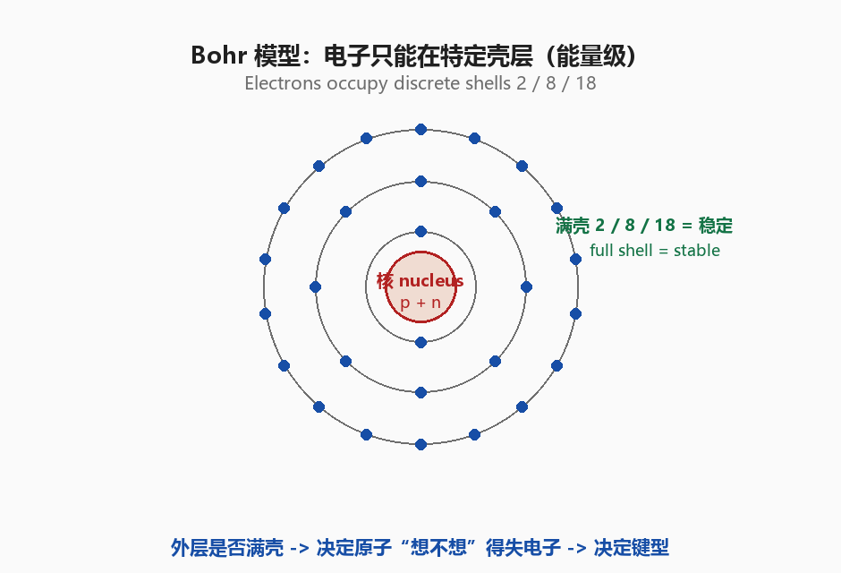

*Figure 1 — Bohr model: electrons can only occupy discrete shells; a full shell is the most stable.*

### 3.3 Mass and charge

The nucleus contains almost all the mass. Each proton and neutron has a mass of about $1.66\times10^{-24}\,\mathrm{g}$ — this is the **atomic mass unit**. An electron mass is $0.911\times10^{-27}\,\mathrm{g}$, negligible. Charges: electron $-1.6\times10^{-19}\,\mathrm{C}$, proton $+1.6\times10^{-19}\,\mathrm{C}$.

### 3.4 Element classification

The number of protons is the **atomic number**. For carbon we write $^{12.01}_{6}\mathrm{C}$: **6** is the atomic number, **12.01** is the **atomic weight**. The **atomic mass** counts protons plus neutrons; the **atomic weight** is the **weighted average over naturally occurring isotopes**.

Metals have outer shells that are nearly **empty** (1, 2 or 3 electrons); non-metals have outer shells nearly **full** (lacking 1, 2 or 3 electrons); **metalloids** sit in between.

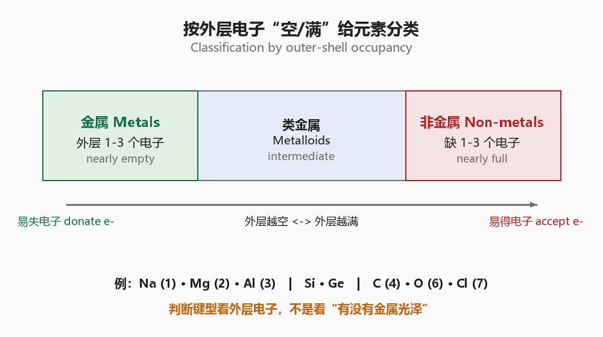

*Figure 2 — The emptier the outer shell, the more metallic the element; the fuller it is, the more non-metallic.*

**Key points:** This section is the toolkit: **the atomic number counts protons, the atomic weight averages the isotopes, and chemical behaviour follows the outermost electrons**. Remember the full-shell numbers 2, 8 and 18, and that metals are "empty" while non-metals are "full".

---

## 4. Bond classification: primary and secondary bonds

Bonding depends strongly on the electrons in the **outer two shells** and whether they are full.

**Strong primary bonds**: outer-shell electrons are **transferred or shared**.

- **Ionic bonding** → **transfer** of electrons
- **Covalent bonding** → **sharing** of electrons
- **Metallic bonding** → **pooling** of electrons (forming an electron sea)

All three **primary bonds** involve a redistribution of the outer electrons: ionic bonds transfer them, covalent bonds share them, metallic bonds pool them.

**Weaker secondary bonds** come from more subtle attractions between positive and negative charges, with **no transfer or sharing**:

- **van der Waals**
- **Hydrogen bonds**

**Secondary bonds** involve no transfer or sharing of electrons, only electrostatic attraction between positive and negative charges; they are an order of magnitude weaker.

**Directionality**: a bond is **directional** if there is a **preferred orientation** between the atoms that maximises bond strength. If bond strength is equal in all directions, the bond is **non-directional**. This single point decides whether a material is brittle or can deform.

Usually **more than one** type of bond is present in a material.

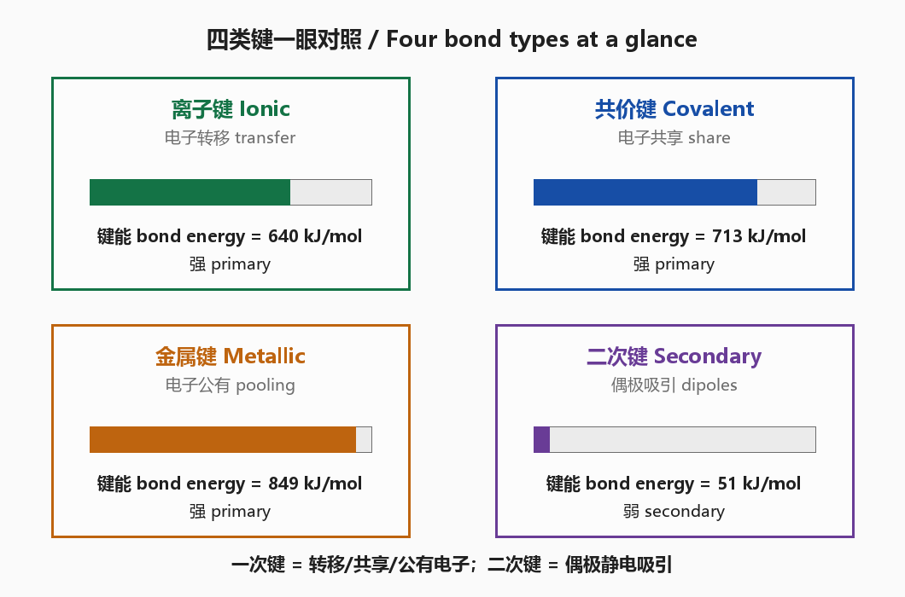

*Figure 3 — Primary versus secondary bonds: the bond energies differ by more than an order of magnitude.*

**Key points:** Memory hook: **transfer, share, pool are primary bonds; dipole attraction is a secondary bond**. On directionality: ionic and metallic bonds are **non-directional**, covalent bonds are **directional**, and secondary bonds are weak and non-directional. Directionality leads to plasticity: non-directional bonds (metals) deform easily, directional bonds (ceramics) break as soon as they deform.

---

## 5. Ionic bonding

Ionic bonding occurs between **dissimilar atoms**, e.g. Na and Cl, by **electron transfer**. The resulting compound NaCl contains **Na⁺ and Cl⁻ ions**; one electron moves from Na to Cl.

To separate the ions we must supply energy (e.g. heat) to **return the electron**. How much energy is needed governs the **melting point**. The more electrons transferred, the more energy needed: **MgO melts higher than NaCl** because two electrons (not one) must be returned — 2800 °C against 801 °C.

Ionic bonds are **non-directional** — there is no preferred orientation that maximises bond strength. Ionic crystals are therefore hard and high-melting, but they crack easily along cleavage planes under load, i.e. they are **brittle**.

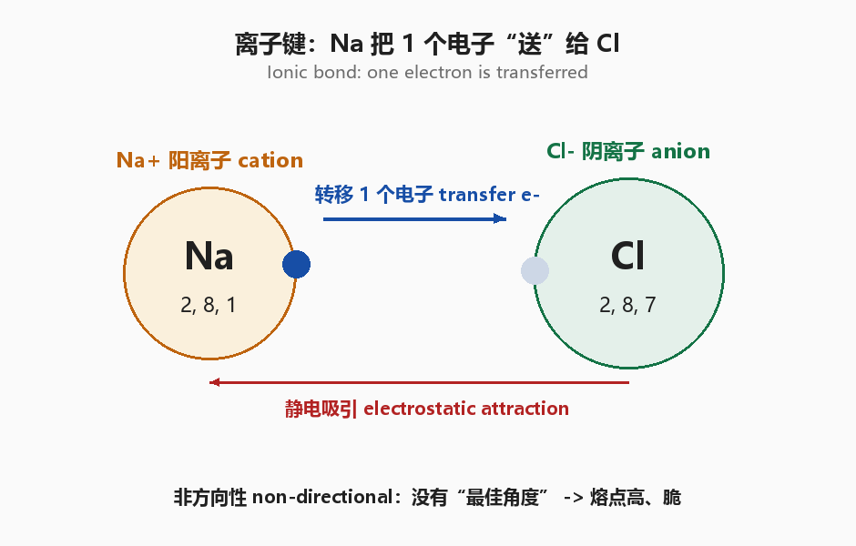

*Figure 4 — Na loses one electron and becomes Na⁺, Cl gains one and becomes Cl⁻; the ions are held together by electrostatic attraction.*

**Key points:** Three keywords for ionic bonding: **transfer, non-directional, melting point rising with the number of charges**. Exams often ask why MgO melts higher than NaCl — because **two** electrons must be returned instead of one.

---

## 6. Covalent bonding

Covalent bonding may occur between **identical or similar atoms**. When an element has about **4 electrons** in its outer shell, transferring them all would cost too much energy; instead the electrons are **shared**.

Carbon has configuration (2, 4). In **diamond**, the four bonds form a regular **tetrahedron** with a bond angle of **109.5°**.

Covalent bonds are **directional**: they take up specific orientations, which determines the characteristic **molecular shape** and the structure of the crystal.

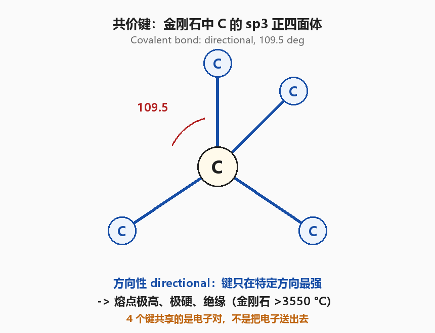

*Figure 5 — Four C–C covalent bonds form a tetrahedron; strong directionality gives extreme hardness, a very high melting point and electrical insulation.*

**Key points:** Three keywords for covalent bonding: **sharing, directionality, large bond energy**. Directionality brings hardness, brittleness and a high melting point; and because the electrons are locked into the bonds, the material **does not conduct** (unless it is a semiconductor such as Si).

---

## 7. Metallic bonding

Metals with 1, 2 or 3 outer electrons **donate** them into a **sea or cloud of electrons** surrounding the remaining ions. These electrons belong to no particular atom; the attraction between the **ion cores** and the **electron sea** is the metallic bond.

Because the electrons are free to move, metals:

- **conduct heat and electricity** easily;
- form a wide range of **mixtures/alloys**;
- **pack closely**, giving generally **higher densities** than ionic or covalent solids;
- are **non-directional**, so they can be **shaped easily at nearly constant volume** (ductile).

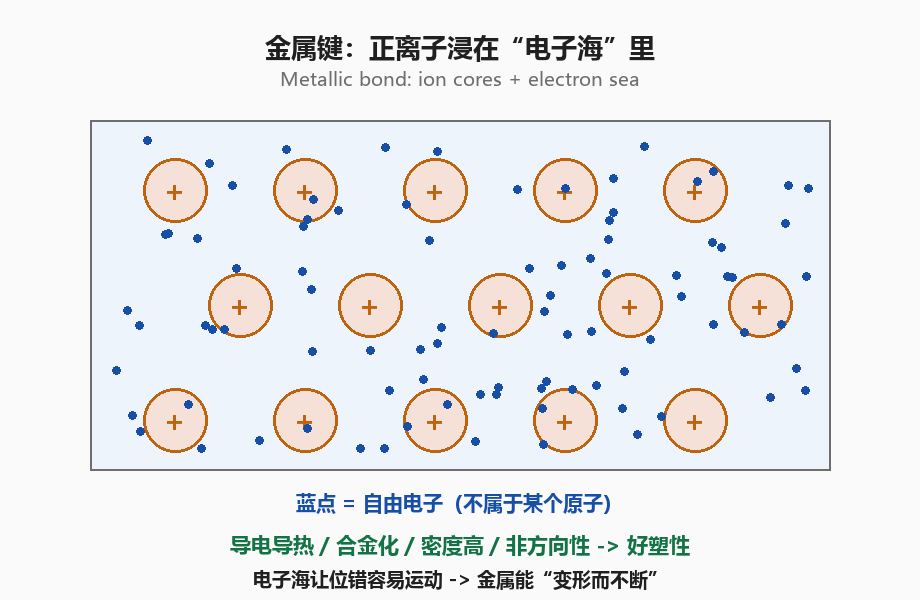

*Figure 6 — The electron sea lets dislocations move easily, which is why metals deform instead of breaking.*

**Key points:** Three keywords for metallic bonding: **electron sea, non-directional, conductive**. Non-directionality is the root of metallic plasticity: one layer of atoms can slide past another and the bonds simply re-form. Compare a covalent crystal, where a directional bond that is pulled apart stays broken.

---

## 8. van der Waals bonding

Atoms contain positive protons and negative electrons. If at any instant the charge distribution becomes **asymmetric**, a net charge separation exists — this is a **dipole**. Dipoles can be **temporary** or **permanent**.

Once a dipole forms in one atom, it can **induce a dipole** in a neighbour: a net positive charge repels positive charge and attracts electrons, flipping the neighbour's charge distribution. The resulting attraction between two dipoles is the **van der Waals force**.

Bond energies are very small — e.g. **Ar: 7.7 kJ/mol, Cl₂: 31 kJ/mol** — so such solids melt at very low temperatures (**Ar −189 °C**) and are volatile.

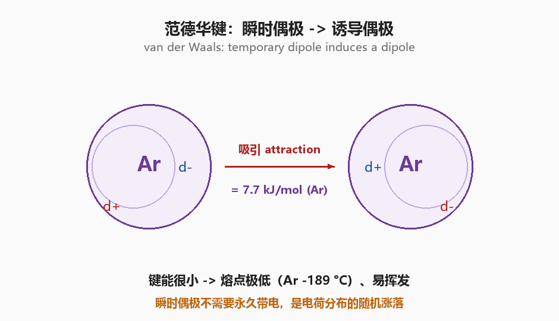

*Figure 7 — van der Waals bonding needs no permanent charge; attraction comes from fluctuations in the charge distribution.*

**Key points:** Three keywords for van der Waals bonding: **dipole, induced, weak**. It explains why inert gases can be liquefied and why polymers are soft. **Do not mistake "weak" for "irrelevant"**: many secondary bonds together still hold a polymer up.

---

## 9. Hydrogen bonding

The hydrogen bond is a **specific type of van der Waals bond** between **hydrogen** atoms and **more electronegative** atoms (O, N, F).

The hydrogen nucleus is the smallest, so it is certain to retain **less than its "fair share" of electrons**; molecules containing H therefore become **polar** and attract each other. This gives **permanent dipoles** with **greater bond energy** than temporary-dipole bonds.

Water is the classic example: **H₂O has a bond energy of 51 kJ/mol** and boils at **100 °C**, far above what its small molecular mass would suggest.

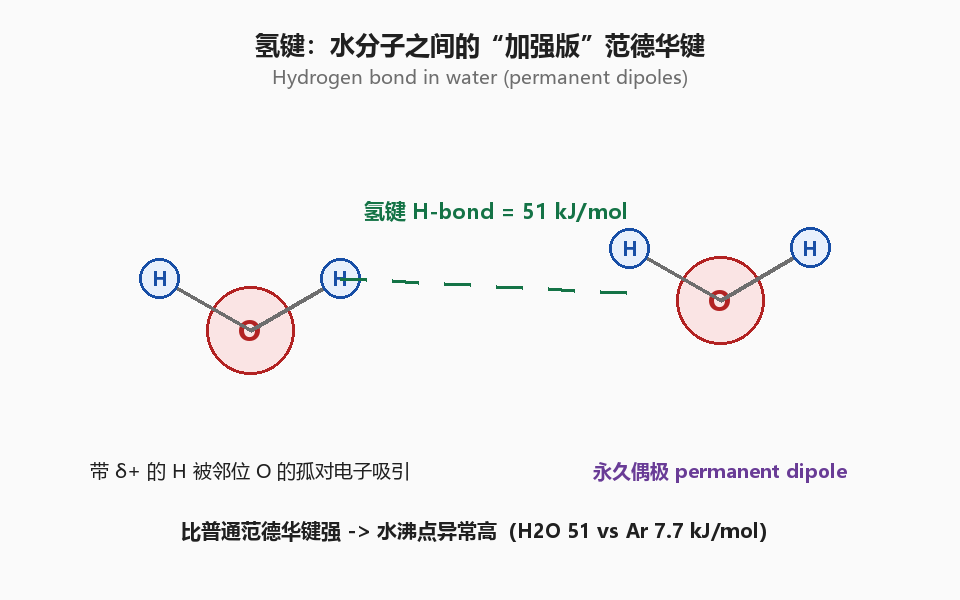

*Figure 8 — The δ+ on H is attracted by the lone pair of a neighbouring O, forming a hydrogen bond.*

**Key points:** A hydrogen bond is a **van der Waals bond built on a permanent dipole**, with strength between that of a primary bond and that of an ordinary van der Waals bond. It explains the unusually high boiling point of water, why ice is less dense than water, and the high strength of polymers such as nylon and cellulose.

---

## 10. Bonds in engineering materials

All the descriptions above are **simplifications** of reality; some bonds are **combinations** of the individual types. The main classes of engineering materials (and semiconductors) sit on a **tetrahedron of bond types**.

Roughly:

- **Ceramics** — ionic and/or covalent (MgO ionic; SiC covalent);
- **Metals** — metallic;
- **Polymers** — covalent backbone plus weak secondary bonds between chains;
- **Semiconductors** — covalent (Si, Ge), with some ionic character.

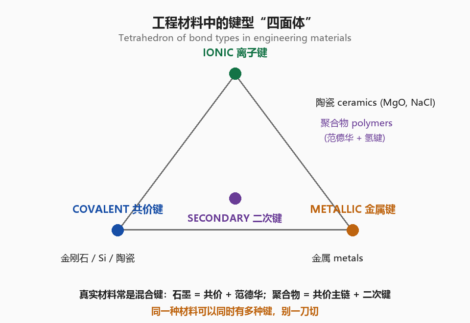

*Figure 9 — Materials can sit inside the tetrahedron or on its edges: real materials usually mix bond types.*

**Key points:** Remember the phrase **mixed bonding**: graphite is covalent within a layer and van der Waals between layers, which is why it works as a lubricant; a polymer is covalent along the backbone and secondary-bonded between chains, which is why it softens on heating. If an exam asks why graphite is soft and diamond hard, the answer is the bond type and the way the bonds are arranged.

---

## 11. Forces between atoms and bond energy

### 11.1 Net force

Consider two atoms brought from far apart to close proximity; model the bond as a **spring**. The net force is the sum of **attractive** $F_A$ and **repulsive** $F_R$ forces:

$$
F = F_A + F_R \qquad (6.1)
$$

The repulsive force has a **very short range** and only acts when **electron clouds overlap**. Atoms settle at the **equilibrium spacing $r_0$** where the net force is **zero**.

### 11.2 Potential energy and the power law

The potential energy in the bond is

$$
U = \int F\,\mathrm{d}r \qquad (6.2)
$$

and it is a **minimum at the equilibrium spacing** — consistent with physical systems minimising their energy.

A **power law** is often used:

$$
U = -A r^{-m} + B r^{-n} \qquad (6.3)
$$

where $A$, $B$, $m$, $n$ are constants for the system. Differentiating:

$$
F=\frac{\mathrm{d}U}{\mathrm{d}r}=\frac{mA}{r^{m+1}}-\frac{nB}{r^{n+1}} \qquad (6.4)
$$

**Note that the course notes use $F=\mathrm{d}U/\mathrm{d}r$**, so a negative slope of $U$ corresponds to a positive force — do not flip the sign.

Typical values: **ionic $m=1$; covalent $m=2$, $n=9$; metallic $m=1$ to 4.**

Setting $F=0$ in (6.4) gives the equilibrium spacing $r_0$; substituting back gives the **bond energy $E_0=|U_{\min}|$**.

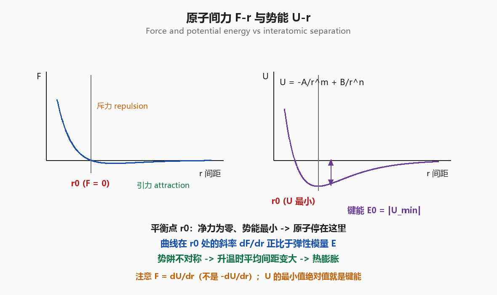

*Figure 10 — At $r_0$ the net force is zero and the potential energy is minimum; the slope of the curve and the depth of the well give the elastic modulus and the bond energy respectively.*

**Key points:** Three results to memorise: (i) at $r_0$, $F=0$ and $U$ is minimum; (ii) **bond energy is the depth of the potential well** ($|U_{\min}|$); (iii) the well is **asymmetric**, so on heating the average spacing grows, which is **thermal expansion**. The routine for finding $r_0$: set $\mathrm{d}U/\mathrm{d}r=0$ and solve for $r$.

---

## 12. Bond energy vs melting point

Stronger bonds need more energy to break, so they show higher melting temperatures. The table below is from p.50 of the course notes.

| Bond type | Substance | Bond energy (kJ/mol) | Melting temp (°C) |
|---|---|---|---|
| **Ionic** | NaCl | 640 | 801 |
| | MgO | 1000 | 2800 |
| **Covalent** | Si | 450 | 1410 |
| | C (diamond) | 713 | >3550 |
| **Metallic** | Hg | 68 | −39 |
| | Al | 324 | 660 |
| | W | 849 | 3410 |
| **van der Waals** | Ar | 7.7 | −189 |
| | Cl₂ | 31 | −101 |
| **Hydrogen** | H₂O | 51 | 0 |

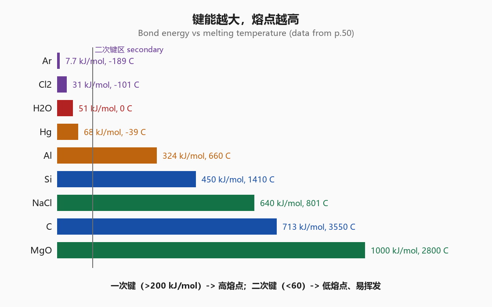

*Figure 11 — The same trend throughout: substances held by secondary bonds (below 60 kJ/mol) melt very low, those held by primary bonds (above 200) melt high.*

**Key points:** This table is the direct evidence for "bond strength → melting point". **You must be able to explain the exceptions**: Hg is a metal but melts very low (bond energy only 68) because its 6s electrons are paired and few electrons take part in the metallic bond; W has a bond energy of 849 and melts at 3410 °C, which is why it is used for lamp filaments.

---

## 13. Properties from bonding

### 13.1 Young's modulus

Recall from Lecture 2 that **Young's modulus $E$** is the slope of the elastic part of the stress–strain curve. At the start of a tensile test, atoms sit at $r_0$; as load is applied they move to $r$. The **initial slope** of the force–separation data near $r_0$ is proportional to $E$.

Quantitatively:

$$
E=\frac{\delta\sigma}{\delta\varepsilon}
=\frac{1}{r_0}\left(\frac{\mathrm{d}^2U}{\mathrm{d}r^2}\right)_{r_0}
=\frac{2q^2}{\pi\varepsilon_0 r_0^{4}} \qquad (6.5)
$$

This is the statement that **the macroscopic modulus comes from the curvature of the atomic-scale potential well**. So the stronger the bond and the smaller $r_0$, the larger $E$ (diamond and ceramics have high moduli).

For many **metals**, $E$ can be predicted quite accurately from interatomic force data. However, the analysis **does not work for polymers**, because the origin of their $E$ is different (chain uncoiling, not bond stretching). The modulus of a polymer comes mainly from stretching and uncoiling its molecular chains.

### 13.2 Why UTS cannot be predicted

One might imagine that **ultimate tensile strength (UTS)** could be predicted from the **maximum** of the force–separation curve. But that gives UTS in the range **$E/10$ to $E/15$** — far too high: steel typically shows **UTS $\approx E/100$** and many metals **$E/1000$**.

The reason is that real strength is controlled by **defects and slip**, not by pulling all bonds apart at once. This is the subject of the next lectures.

Properties that **can** be explained by bonding: **melting point, stiffness, thermal expansion, electrical/thermal conductivity, density trend, brittleness vs ductility**.

Properties that **cannot** (or not well): **yield strength, UTS, fatigue life, fracture toughness** — these need defect and microstructure arguments.

**Key points:** A frequent exam true/false item: "a large bond energy implies high strength" — **wrong**. Bond energy only decides properties of the modulus and melting-point kind, i.e. small-deformation and thermal behaviour; strength is also controlled by defects. This is the most valuable sentence in the section.

---

## 14. Worked example

**Question**

The potential energy between two ions is modelled as

$$
U(r)=-\frac{A}{r^{m}}+\frac{B}{r^{n}},\qquad A=1.0\times10^{-28}\ \mathrm{J\,m},\quad B=1.0\times10^{-105}\ \mathrm{J\,m^{9}},\quad m=1,\ n=9
$$

(a) Find the equilibrium spacing $r_0$.
(b) Find the bond energy $E_0$ in kJ/mol.
(c) Estimate Young's modulus from $E=\frac{1}{r_0}\left(\frac{\mathrm{d}^2U}{\mathrm{d}r^2}\right)_{r_0}$.

**Solution**

**(a)** Differentiate first:

$$
\frac{\mathrm{d}U}{\mathrm{d}r}=\frac{mA}{r^{m+1}}-\frac{nB}{r^{n+1}}=\frac{A}{r^{2}}-\frac{9B}{r^{10}}
$$

Set it to zero:

$$
\frac{A}{r_0^{2}}=\frac{9B}{r_0^{10}}\;\Rightarrow\; r_0^{8}=\frac{9B}{A}
=\frac{9\times1.0\times10^{-105}}{1.0\times10^{-28}}=9.0\times10^{-77}
$$

$$
r_0=\left(9.0\times10^{-77}\right)^{1/8}=3.1\times10^{-10}\ \mathrm{m}=0.31\ \mathrm{nm}
$$

**(b)** Substitute back into the potential energy (note $B=Ar_0^{8}/9$):

$$
E_0=\left|U(r_0)\right|=\frac{8}{9}\cdot\frac{A}{r_0}
=\frac{8}{9}\times\frac{1.0\times10^{-28}}{3.1\times10^{-10}}
=2.87\times10^{-19}\ \mathrm{J}
$$

Per mole: $E_0=2.87\times10^{-19}\times6.02\times10^{23}=1.73\times10^{5}\ \mathrm{J/mol}\approx\mathbf{173\ kJ/mol}$.

**(c)** Second derivative:

$$
\frac{\mathrm{d}^2U}{\mathrm{d}r^2}=\frac{2A}{r^{3}}-\frac{90B}{r^{11}}
\;\xrightarrow{r=r_0}\;\frac{2A}{r_0^{3}}-\frac{10A}{r_0^{3}}=\frac{8A}{r_0^{3}}
$$

$$
E=\frac{1}{r_0}\cdot\frac{8A}{r_0^{3}}=\frac{8A}{r_0^{4}}
=\frac{8\times1.0\times10^{-28}}{(3.1\times10^{-10})^{4}}
\approx8.7\times10^{10}\ \mathrm{Pa}\approx\mathbf{87\ GPa}
$$

**Check:** 173 kJ/mol and 87 GPa are of the same order as common ionic crystals (NaCl: 640 kJ/mol, E ≈ 40 GPa), so the results are reasonable; they are lower than NaCl because the parameters here are chosen for teaching.

**Key points:** This kind of problem has three steps: **differentiate, set the derivative to zero and solve for $r_0$, then substitute back to get the energy or take the second derivative to get the modulus**. Write the unit chain out in full: $A$ has units $\mathrm{J\,m}$ and $B$ has units $\mathrm{J\,m^{9}}$, and only then does $E$ come out in Pa.

---

## 15. Pitfalls

1. **Sign**: the course notes define $F=\mathrm{d}U/\mathrm{d}r$ (not $-\mathrm{d}U/\mathrm{d}r$); work with the notes' sign convention, do not import another textbook's.
2. **Bond energy is the depth of the well**: $E_0=|U_{\min}|$, not the value of $U$ at some arbitrary $r$.
3. **At $r_0$, $F=0$ but $U$ is minimum** — not $U=0$.
4. **Directionality is not strength**: ionic bonds are very strong but non-directional; covalent bonds are directional. Directionality decides brittle versus ductile; bond energy decides melting point and modulus.
5. **A hydrogen bond is not a primary (chemical) bond**: it is a special secondary bond with a bond energy of about 51 kJ/mol.
6. **The metallic "electron sea" is more than a free-electron gas**: it explains four observations at once — conduction, alloying, high density and good plasticity.
7. **Do not read "large bond energy" as "high strength"**: strength is controlled by defects, see 13.2.
8. **The bond-stretching model for $E$ does not apply to polymers**: their modulus comes from chain conformation.

**Key points:** The marks are most often lost on item 7 (confusing modulus with strength) and item 1 (the sign relation between $F$ and $U$). In an answer, write the formula first, then substitute numbers, and carry the units.

---

## 16. Formula sheet

| Topic | Formula | Note |
|---|---|---|
| Net force | $F=F_A+F_R$ | (6.1) |
| Potential energy | $U=\int F\,\mathrm{d}r$ | (6.2) |
| Power-law $U$ | $U=-Ar^{-m}+Br^{-n}$ | (6.3) |
| Force | $F=\dfrac{\mathrm{d}U}{\mathrm{d}r}=\dfrac{mA}{r^{m+1}}-\dfrac{nB}{r^{n+1}}$ | (6.4) |
| Equilibrium | $\left.\dfrac{\mathrm{d}U}{\mathrm{d}r}\right|_{r_0}=0$ | solve for $r_0$ |
| Bond energy | $E_0=|U_{\min}|$ | depth of the well |
| Young's modulus | $E=\dfrac{1}{r_0}\left(\dfrac{\mathrm{d}^2U}{\mathrm{d}r^2}\right)_{r_0}=\dfrac{2q^2}{\pi\varepsilon_0 r_0^{4}}$ | (6.5) |
| Values of $m,n$ | ionic $m=1$; covalent $m=2,n=9$; metallic $m=1\sim4$ | p.49 |
| Avogadro | $N_A=6.02\times10^{23}\ \mathrm{mol^{-1}}$ | |
| Atomic mass unit | $1.66\times10^{-24}\ \mathrm{g}$ | |

**Key points:** The two most frequently examined entries are (6.4) and (6.5): the first gives $r_0$ and the bond energy, the second links a macroscopic modulus to the microscopic potential well.

---

## 17. Self-test

### Questions

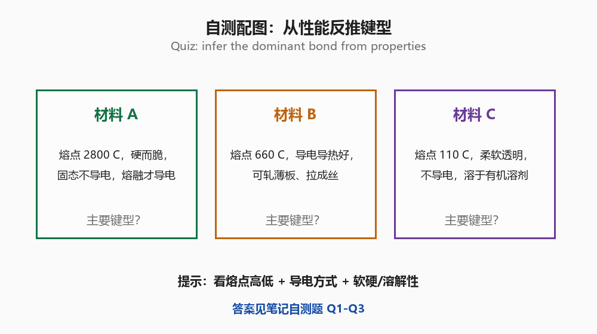

*Figure 12 — What is the dominant bond type in materials A, B and C?*

**Q1.** Material A melts at 2800 °C, is hard and brittle, and does not conduct as a solid but does conduct when molten; material B melts at 660 °C, conducts heat and electricity well and can be rolled into sheet; material C melts at 110 °C, is soft and transparent, does not conduct and dissolves in organic solvents. Identify the dominant bond type for each.

**Q2.** Why are ionic bonds non-directional while covalent bonds are directional? Give one mechanical consequence of each.

**Q3.** Why does MgO melt at a higher temperature than NaCl? Use the electron-transfer argument.

**Q4.** Sketch (or describe) the force–separation curve and mark $r_0$, the repulsive region and the attractive region.

**Q5.** Explain why the potential energy is a minimum at $r_0$ and why this implies thermal expansion.

**Q6.** A bond has $U=-A/r^{2}+B/r^{9}$ with $A=8.5\times10^{-39}\ \mathrm{J\,m^{2}}$, $B=2.4\times10^{-107}\ \mathrm{J\,m^{9}}$. Find $r_0$.

**Q7.** Using Q6, find the bond energy in kJ/mol.

**Q8.** Why can Young's modulus of metals be predicted from interatomic data, but not that of polymers?

**Q9.** Why is the UTS predicted from the maximum of the $F$–$r$ curve (≈ $E/10$–$E/15$) much higher than the measured value ($E/100$–$E/1000$)?

**Q10.** Rank the following by melting point and justify: Ar, NaCl, W, H₂O, diamond.

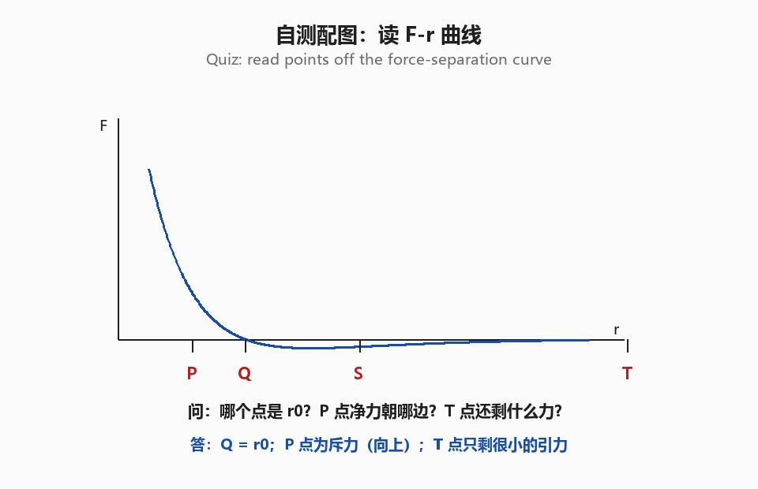

*Figure 13 — Points P, Q, S and T: which one is $r_0$? Which way does the net force point at P?*

### Answers

**A1.** A = **ionic** (high melting point, hard and brittle, conducts when molten); B = **metallic** (conducts heat and electricity, ductile); C = **secondary/van der Waals** (low melting point, soft, insulating, soluble in organic solvents — a typical polymer).

**A2.** Ionic bonds rely on **electrostatic attraction**, which is the same in every direction, so they are **non-directional**: the crystal is hard but **brittle** and cracks along cleavage planes. Covalent bonds rely on **shared electron pairs**, which are strong only where the orbitals overlap in a specific direction, so they are **directional**: the material is very hard, high-melting and **insulating**, but the bond fails once it is pulled apart.

**A3.** Melting means **giving the electrons back to the metal**. NaCl only needs **one** electron returned, MgO needs **two**, so roughly twice the energy is needed — hence MgO melts at 2800 °C against 801 °C for NaCl.

**A4.** For $r<r_0$, $F>0$ (**repulsion**, rising steeply); at $r=r_0$, $F=0$; for $r>r_0$, $F<0$ (**attraction**, decaying slowly to zero). $r_0$ is where the curve crosses the horizontal axis.

**A5.** $U=\int F\,\mathrm{d}r$; for $r<r_0$, $F>0$ makes $U$ rise as $r$ increases, and for $r>r_0$, $F<0$ makes $U$ rise again, so $U$ is minimum at $r_0$. The well is **asymmetric**: as temperature rises and the vibration amplitude grows, the **average spacing increases**, which is thermal expansion.

**A6.** $\mathrm{d}U/\mathrm{d}r=2A/r^{3}-9B/r^{10}=0\Rightarrow r_0^{7}=9B/(2A)=9\times2.4\times10^{-107}/(2\times8.5\times10^{-39})=1.27\times10^{-68}$.
$r_0=(1.27\times10^{-68})^{1/7}=2.0\times10^{-10}\ \mathrm{m}=0.20\ \mathrm{nm}$.

**A7.** $U(r_0)=-A/r_0^{2}+B/r_0^{9}$; using $B=2A r_0^{7}/9$ this simplifies to $U(r_0)=-\dfrac{7A}{9r_0^{2}}$.
$=-7\times8.5\times10^{-39}/(9\times(2.0\times10^{-10})^{2})\approx-1.65\times10^{-19}\ \mathrm{J}$, and multiplying by $N_A$ gives **≈100 kJ/mol**.

**A8.** The $E$ of a metal comes from **stretching the interatomic bonds** (the curvature of the well), so it can be predicted from $F$–$r$ data; the $E$ of a polymer comes from **uncoiling and rearranging molecular chains**, not from bond stretching, so the model does not apply.

**A9.** The theoretical value assumes **all bonds are pulled apart at the same time**; in a real material **dislocation slip** happens first, and a very small stress is enough to let local bonds slip and re-form, so the measured strength is one to two orders of magnitude lower.

**A10.** From highest to lowest melting point: **diamond (>3550 °C, covalent, 713 kJ/mol) > W (3410 °C, metallic, 849) > NaCl (801 °C, ionic, 640) > H₂O (0 °C, hydrogen bonding, 51) > Ar (−189 °C, van der Waals, 7.7)**. The reason: the larger the bond energy, the harder the bonds are to break and the higher the melting point; diamond's bond energy is slightly below tungsten's, but its three-dimensional covalent network makes melting extremely difficult.

**Key points:** The point of the self-test is to **link bond type, bond energy and property**. Q6 and Q7 train the calculation; Q8 and Q9 train awareness of the model's limits, which is where essay questions are most likely.

---

## 18. Glossary

| Term | One-line explanation |
|---|---|
| atomic bonding | the way atoms join together to form a solid |
| primary bond | ionic, covalent or metallic bond; strong |
| secondary bond | van der Waals or hydrogen bond; weak |
| electronegativity | the ability of an atom to pull electrons towards itself |
| ionic bond | electron transfer; non-directional |
| covalent bond | electron sharing; directional |
| metallic bond | electron sea; non-directional |
| van der Waals bond | dipole attraction; the weakest |
| hydrogen bond | strong dipole attraction between H and O/N/F |
| dipole | centres of positive and negative charge that do not coincide |
| equilibrium spacing $r_0$ | the interatomic spacing at which the net force is zero |
| bond energy $E_0$ | depth of the potential well; the energy needed to break the bond |
| potential energy $U$ | the energy of the interaction between atoms |
| Young's modulus $E$ | slope of the elastic region; measures bond stiffness |
| UTS | ultimate tensile strength; the highest point of the stress–strain curve |
| thermal expansion | the increase in average spacing caused by the asymmetric potential well |

---

## 19. Page map

| Content | Page |
|---|---|
| Learning outcomes, why it matters | 43 |
| Charge, Avogadro, Bohr model, mass and charge, element classification | 44–45 |
| Bond overview, definition of directionality | 45 |
| Ionic bonding (NaCl, MgO) | 46 |
| Covalent bonding (diamond tetrahedron) | 46 |
| Metallic bonding (electron sea) | 47 |
| van der Waals bonding (Ar dipole) | 47 |
| Hydrogen bonding (water), bond tetrahedron of engineering materials | 48 |
| Forces and bond energy, power law, values of $m$/$n$ | 49 |
| F–r and U–r graphs, bond energy and melting point table | 50 |
| Young's modulus and UTS prediction, polymer exception | 51 |

---

## 20. Plain-text formulas

If a previewer does not render LaTeX, use this version:

- Net force: F = F_A + F_R
- Potential energy: U = integral of F dr
- Power-law U: U = -A*r^(-m) + B*r^(-n)
- Force: F = dU/dr = m*A/r^(m+1) - n*B/r^(n+1)
- Equilibrium: dU/dr = 0 at r = r0
- Bond energy: E0 = |U_min|
- Young's modulus: E = (1/r0) * (d2U/dr2) at r0 = 2*q^2 / (pi * eps0 * r0^4)
- Typical m: ionic m=1; covalent m=2, n=9; metallic m=1..4
- Avogadro: NA = 6.02e23 /mol; amu = 1.66e-24 g

---

*These notes are based on MECH40006 Lecture 6 (pp.43–51), with 13 figures, for revision and Tutorial Sheet 5.*
